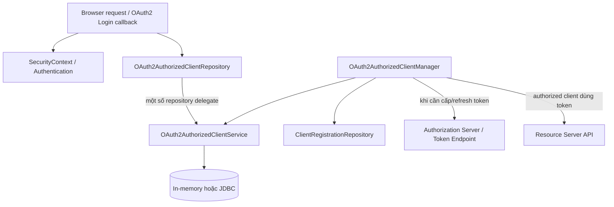
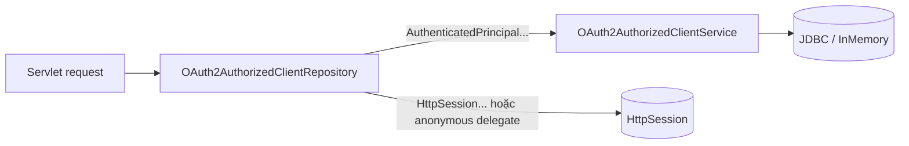

# 14.2. OAuth2AuthorizedClientService trong ứng dụng Servlet

> **Module:** Spring Security OAuth 2.0 OIDC Client  
> **Chương:** 14. Authorized Client  
> **Phạm vi:** Spring Boot/Spring Security OAuth 2.0 Client trên **Servlet stack** (Spring MVC), tập trung vào `OAuth2AuthorizedClientService`, cách lưu/truy xuất authorized client, liên hệ với HTTP request và các tác vụ không có request.

Khi ứng dụng Spring Security đăng nhập người dùng qua OAuth 2.0/OIDC hoặc được cấp quyền gọi một API, kết quả không chỉ có `Authentication` biểu diễn người dùng. Ứng dụng còn có thể sở hữu một **authorized client**: cấu hình Client registration gắn với access token và, khi được cấp, refresh token. Những dữ liệu này cần có nơi lưu và truy xuất cho các lần gọi API tiếp theo.

`OAuth2AuthorizedClientService` là abstraction của Spring Security phục vụ việc **lưu, đọc và xóa `OAuth2AuthorizedClient` theo registration ID và principal**. Trong ứng dụng Servlet, nó thường được phối hợp với `OAuth2AuthorizedClientRepository` để xử lý ngữ cảnh HTTP, hoặc với `AuthorizedClientServiceOAuth2AuthorizedClientManager` khi ứng dụng cần làm việc ngoài một request web, như job định kỳ.

Điểm dễ nhầm là tên gọi:

- `OAuth2AuthorizedClientService` **không** phải service gọi API bất kỳ thay người dùng.
- Nó **không** xác minh ID token hoặc tạo phiên đăng nhập.
- Nó **không** phải Token Endpoint của Authorization Server.
- Nó **không** tự chọn grant, xin token mới hoặc refresh token chỉ vì bạn gọi `loadAuthorizedClient(...)`.

Bài học trình bày hợp đồng API, cách chọn in-memory hay JDBC, cách kết nối với cấu hình Servlet và những giới hạn bảo mật cần nhớ.

## 1. Mục tiêu học tập

Sau bài này, bạn có thể:

1. Giải thích `OAuth2AuthorizedClient` chứa những gì và vì sao phải lưu.
2. Phân biệt `OAuth2AuthorizedClientService`, `OAuth2AuthorizedClientRepository`, `ClientRegistrationRepository` và `OAuth2AuthorizedClientManager`.
3. Dùng đúng ba thao tác `loadAuthorizedClient(...)`, `saveAuthorizedClient(...)` và `removeAuthorizedClient(...)`.
4. Hiểu khóa tra cứu **(registration ID, principal name)** và các nguy cơ khi dùng sai danh tính.
5. Cấu hình `InMemoryOAuth2AuthorizedClientService` cho lab/ứng dụng đơn giản.
6. Cấu hình `JdbcOAuth2AuthorizedClientService` và bảng lưu authorized client cho ứng dụng nhiều instance hoặc cần lưu bền vững.
7. Biết khi nào `AuthenticatedPrincipalOAuth2AuthorizedClientRepository` chuyển thao tác Servlet sang service và khi nào có thể dùng session repository.
8. Sử dụng `AuthorizedClientServiceOAuth2AuthorizedClientManager` trong tác vụ không có `HttpServletRequest` với grant `client_credentials`.
9. Xử lý token hết hạn, refresh, logout và thu hồi token mà không nhầm trách nhiệm giữa các lớp.
10. Tránh làm lộ access token/refresh token qua log, response HTTP hoặc database thiếu bảo vệ.

## 2. Authorized client là gì?

Trong Spring Security, một `OAuth2AuthorizedClient` biểu diễn **Client registration đã được ủy quyền trong một ngữ cảnh principal**, cùng những token mà Client nhận được từ Authorization Server.

Một authorized client có các thông tin quan trọng:

| Trường/Method | Diễn giải |
|---|---|
| `getClientRegistration()` | `ClientRegistration`: client ID, scopes cấu hình, grant type, provider endpoints... |
| `getPrincipalName()` | Tên principal mà authorized client này được lưu cho |
| `getAccessToken()` | Access token, loại token, scopes được cấp, thời điểm phát hành/hết hạn |
| `getRefreshToken()` | Refresh token nếu Authorization Server phát hành; có thể `null` |

Ví dụ ở mức ý tưởng:

```text
OAuth2AuthorizedClient
├── clientRegistration
│   ├── registrationId = "calendar"
│   ├── clientId = "web-calendar-client"
│   └── provider details = ...
├── principalName = "user-734"
├── accessToken = <sensitive bearer token>
│   ├── scopes = ["calendar.read"]
│   ├── issuedAt = ...
│   └── expiresAt = ...
└── refreshToken = <sensitive token, nếu có>
```

**Access token và refresh token là credentials nhạy cảm.** Các giá trị `tokenValue` không được trả về trình duyệt tùy tiện, ghi log, đưa vào ảnh chụp hoặc lưu trong mã nguồn.

### 2.1. Authorization không đồng nghĩa với login

Có hai luồng liên quan:

- **OAuth2/OIDC Login:** người dùng đăng nhập vào web app; Spring Security có `OAuth2AuthenticationToken` trong `SecurityContext` và có thể lưu authorized client từ lần đăng nhập.
- **OAuth2 Client để gọi API:** ứng dụng dùng `OAuth2AuthorizedClientManager` hoặc cơ chế tương đương để lấy/đổi/refresh access token cho một Client registration khi cần.

Một ứng dụng có thể đăng nhập bằng `corporate-login` nhưng gọi lịch bằng Client registration `calendar-api`. Hai `OAuth2AuthorizedClient` này không bắt buộc là một. Vì vậy, service cần **registration ID chính xác**, không chỉ tên người dùng.

## 3. Vị trí của OAuth2AuthorizedClientService trong kiến trúc

Sơ đồ tổng quan trên Servlet stack:



Sơ đồ thể hiện **các vai trò** chứ không khẳng định mọi repository hoặc manager luôn gọi service. Ví dụ một `HttpSessionOAuth2AuthorizedClientRepository` có thể lưu token theo HTTP session mà không sử dụng `OAuth2AuthorizedClientService`; ngược lại, `AuthenticatedPrincipalOAuth2AuthorizedClientRepository` có thể dùng service để lưu authorized clients của principal đã xác thực.

### 3.1. Bốn abstraction quan trọng

| Abstraction | Nhiệm vụ chính | Khóa/đầu vào | Phụ thuộc HTTP request? |
|---|---|---|---|
| `ClientRegistrationRepository` | Đọc cấu hình Client registration | `registrationId` | Không |
| `OAuth2AuthorizedClientService` | Lưu, đọc, xóa authorized client | `registrationId` + `principalName` hoặc `Authentication` | Không |
| `OAuth2AuthorizedClientRepository` | Lưu, đọc, xóa authorized client trong ngữ cảnh web Servlet | `registrationId` + `Authentication` + `HttpServletRequest`, đôi khi response | **Có** |
| `OAuth2AuthorizedClientManager` | Tổ chức quá trình authorize/reauthorize, xin hoặc refresh token theo grant được cấu hình | `OAuth2AuthorizeRequest` | Tùy implementation |

Có thể hình dung:

- **Repository cấu hình** biết Client nào tồn tại.
- **Service lưu trữ** biết token nào đang được lưu cho principal/registration.
- **Repository Servlet** biết request, response và cách liên kết token với HTTP/user context.
- **Manager** biết khi nào cần authorizing/re-authorizing Client, nhờ các provider và storage thích hợp.

Đừng dùng `OAuth2AuthorizedClientService` như một cơ chế tự động kiểm tra quyền API. Token được lưu có thể đã hết hạn hoặc không đủ scope/audience.

## 4. Hợp đồng API của OAuth2AuthorizedClientService

Trong Spring Security, interface nằm trong package:

```java
org.springframework.security.oauth2.client.OAuth2AuthorizedClientService
```

Các method chính có thể mô tả như sau:

```java
public interface OAuth2AuthorizedClientService {

    <T extends OAuth2AuthorizedClient> T loadAuthorizedClient(
        String clientRegistrationId,
        String principalName
    );

    void saveAuthorizedClient(
        OAuth2AuthorizedClient authorizedClient,
        Authentication principal
    );

    void removeAuthorizedClient(
        String clientRegistrationId,
        String principalName
    );
}
```

Đây là cách trình bày interface để học; dùng API thực của dependency hiện hành khi viết code dự án.

### 4.1. loadAuthorizedClient

```java
OAuth2AuthorizedClient authorizedClient =
    authorizedClientService.loadAuthorizedClient(
        "calendar-api",
        authentication.getName()
    );
```

Tác dụng: lấy một authorized client đã lưu dưới cặp khóa **`("calendar-api", principalName)`**.

Kết quả có thể là `null`, ví dụ:

- Người dùng chưa từng authorize registration đó.
- Token đã bị xóa khi logout hoặc theo lifecycle.
- Ứng dụng chuyển storage từ session sang database và dữ liệu cũ không có.
- Registration/principal name đã thay đổi.
- Ứng dụng đọc một instance khác trong khi storage chỉ ở memory.

**Quan trọng:** gọi `loadAuthorizedClient` đơn thuần **không phải** là bước refresh token hoặc chắc chắn có token mới. Nếu cần quản lý token theo grant và expiry, dùng authorized client manager.

### 4.2. saveAuthorizedClient

```java
authorizedClientService.saveAuthorizedClient(
    authorizedClient,
    authentication
);
```

Tác dụng: lưu hoặc cập nhật authorized client gắn với principal thích hợp. Đối tượng `OAuth2AuthorizedClient` phải đến từ **luồng ủy quyền đáng tin cậy** hoặc test fixture, không từ token value được client HTTP gửi tùy ý.

Trong nhiều luồng chuẩn, framework/manager có success handler xử lý việc save. Bạn thường **không phải tự gọi** method này sau mỗi request.

### 4.3. removeAuthorizedClient

```java
authorizedClientService.removeAuthorizedClient(
    "calendar-api",
    authentication.getName()
);
```

Tác dụng: xóa bản ghi authorized client của cặp khóa đó trong storage.

Xóa local record **không đồng nghĩa** với:

- Thu hồi access token tại Authorization Server.
- Thu hồi refresh token ở server.
- Đăng xuất phiên SSO ở OpenID Provider.
- Xóa `SecurityContext` hoặc invalidating web session.
- Xóa authorized client của các registration khác.

Muốn logout/revocation thực sự, cần thiết kế các bước phù hợp với OP, ứng dụng và chính sách lưu trữ.

## 5. Khóa định danh: registration ID và principal name

Service thường được tra cứu theo cặp:

```text
(clientRegistrationId, principalName)
```

Ví dụ:

| Client registration ID | Principal name | Authorized client |
|---|---|---|
| `corporate-login` | `user-734` | Token từ lần login corporate |
| `calendar-api` | `user-734` | Token để truy cập lịch của user-734 |
| `calendar-api` | `user-962` | Token truy cập lịch của user-962 |
| `reporting-job` | `reporting-worker` | Token của tác vụ nền dùng client_credentials |

Cùng principal có thể có **nhiều** authorized clients theo registrations; cùng registration có thể phục vụ **nhiều principals**.

### 5.1. registration ID khác client ID và provider ID

Ví dụ cấu hình:

```yaml
spring:
  security:
    oauth2:
      client:
        registration:
          calendar-api:
            provider: company-op
            client-id: app-calendar-client
            client-secret: ${CALENDAR_CLIENT_SECRET}
            authorization-grant-type: authorization_code
            scope: [openid, calendar.read]
        provider:
          company-op:
            issuer-uri: https://login.example.test/realms/company
```

Ba chuỗi khác vai trò:

- `calendar-api`: **registration ID**; dùng trong `loadAuthorizedClient("calendar-api", ...)`.
- `company-op`: **provider ID**; chỉ đến bộ cấu hình provider.
- `app-calendar-client`: **client ID** đăng ký với OP; không phải khóa tra cứu service.

Nếu gọi nhầm:

```java
authorizedClientService.loadAuthorizedClient(
    "app-calendar-client", // sai nếu không có registration ID này
    authentication.getName()
);
```

thì thông thường không tìm được authorized client mong muốn.

### 5.2. principalName không phải tham số tùy ý lấy từ browser

Khi lưu token của người dùng hiện tại, dùng danh tính từ `Authentication` đã được Spring Security xác lập và hiểu quy tắc mapping của ứng dụng:

```java
String principalName = authentication.getName();
```

**Không làm:**

```java
// Ví dụ phản diện: người gọi tự chọn user khác để đọc token.
String principalName = request.getParameter("username");

OAuth2AuthorizedClient client =
    authorizedClientService.loadAuthorizedClient(
        "calendar-api",
        principalName
    );
```

Nếu endpoint cho phép bất kỳ user chọn `principalName`, nó có thể đọc nhầm hoặc làm lộ token người khác. Service là **storage abstraction**, không phải lớp tự thực hiện authorization cho người đang yêu cầu đọc bản ghi.

### 5.3. Lưu ý về tên principal bền vững

`Authentication.getName()` có thể được xác định bởi `OAuth2UserService`/`OidcUserService`; nó không nhất thiết là email. Nếu muốn dùng storage dài hạn theo người dùng:

- Dùng khóa ổn định cho danh tính đã được xác thực.
- Với OIDC, cân nhắc identity mapping dựa trên **(issuer, subject)** và quy tắc nội bộ được kiểm soát.
- Tránh dùng email chưa xác minh hoặc giá trị dễ đổi làm định danh token storage.
- Trong ứng dụng multi-tenant, cần tránh va chạm principal names giữa các tenant; cặp registration ID + principal name chỉ an toàn khi **namespace của hai giá trị đủ rõ**.
- Khi đổi principal naming strategy, xác định chính sách migration hoặc invalidation cho bản ghi cũ.

Một ví dụ: hai issuers khác nhau cùng có `sub="42"`. Nếu cả hai được đổ về chung registration hoặc storage key không có tenant namespace, có thể sinh nhầm bản ghi. Thiết kế registration/identity mapping phải bảo toàn ranh giới tin cậy.

## 6. Triển khai InMemoryOAuth2AuthorizedClientService

Spring Security có implementation:

```java
org.springframework.security.oauth2.client.InMemoryOAuth2AuthorizedClientService
```

Đây là storage trong bộ nhớ tiến trình. Nó thích hợp cho:

- Lab hoặc học tập.
- Môi trường phát triển.
- Ứng dụng nhỏ một instance khi chấp nhận mất authorized client sau restart.
- Unit/integration test cần setup đơn giản.

### 6.1. Khai báo bean tường minh

```java
package example.security;

import org.springframework.context.annotation.Bean;
import org.springframework.context.annotation.Configuration;
import org.springframework.security.oauth2.client.InMemoryOAuth2AuthorizedClientService;
import org.springframework.security.oauth2.client.OAuth2AuthorizedClientService;
import org.springframework.security.oauth2.client.registration.ClientRegistrationRepository;

@Configuration
class AuthorizedClientStorageConfig {

    @Bean
    OAuth2AuthorizedClientService authorizedClientService(
            ClientRegistrationRepository clientRegistrations) {

        return new InMemoryOAuth2AuthorizedClientService(
            clientRegistrations
        );
    }
}
```

Trong cấu hình Spring Boot OAuth2 Client thông thường, framework có thể tự cung cấp service mặc định nếu điều kiện auto-configuration thỏa. Khai báo bean tường minh có ích khi bạn muốn thể hiện rõ lựa chọn storage, nhưng hãy kiểm tra các beans hiện hành để tránh xung đột hoặc tạo service mà luồng web **không thực sự sử dụng**.

### 6.2. Những giới hạn quan trọng

| Hạn chế | Hệ quả |
|---|---|
| Lưu trong RAM của một JVM | Restart có thể làm mất authorized clients |
| Nhiều instances không chia sẻ chung memory | Một instance không đọc được token đã lưu ở instance khác |
| Không có giải pháp backup/persistence | Không phù hợp khi cần quản lý token bền vững |
| Có thể tích lũy records nếu không cleanup | Cần policy lifecycle/giải phóng dữ liệu |
| Chưa bảo đảm token luôn hợp lệ | Access token có thể hết hạn giữa các request |
| Memory có thể chứa secret/token | Không dump heap hoặc log nhạy cảm tùy tiện |

Nếu triển khai load balancing giữa nhiều pods, session stickiness không tự biến `InMemoryOAuth2AuthorizedClientService` thành distributed storage. Cần xem xét service chung hoặc thiết kế session/repository cụ thể cho ứng dụng.

## 7. Triển khai JdbcOAuth2AuthorizedClientService

Đối với ứng dụng yêu cầu storage bền vững và nhiều instances, Spring Security cung cấp:

```java
org.springframework.security.oauth2.client.JdbcOAuth2AuthorizedClientService
```

Implementation này dùng JDBC để lưu authorized client trong cơ sở dữ liệu quan hệ.

### 7.1. Phụ thuộc cơ bản

Với Maven và Spring Boot 3.x:

```xml
<dependencies>
    <dependency>
        <groupId>org.springframework.boot</groupId>
        <artifactId>spring-boot-starter-oauth2-client</artifactId>
    </dependency>
    <dependency>
        <groupId>org.springframework.boot</groupId>
        <artifactId>spring-boot-starter-security</artifactId>
    </dependency>
    <dependency>
        <groupId>org.springframework.boot</groupId>
        <artifactId>spring-boot-starter-web</artifactId>
    </dependency>
    <dependency>
        <groupId>org.springframework.boot</groupId>
        <artifactId>spring-boot-starter-jdbc</artifactId>
    </dependency>
    <!-- Thêm JDBC driver của database đang sử dụng. -->
</dependencies>
```

Ví dụ sử dụng PostgreSQL hoặc một RDBMS khác, thêm driver và cấu hình DataSource tương ứng. Không để credentials kết nối database trong source code.

### 7.2. Bean JDBC service

```java
package example.security;

import org.springframework.context.annotation.Bean;
import org.springframework.context.annotation.Configuration;
import org.springframework.jdbc.core.JdbcOperations;
import org.springframework.security.oauth2.client.JdbcOAuth2AuthorizedClientService;
import org.springframework.security.oauth2.client.OAuth2AuthorizedClientService;
import org.springframework.security.oauth2.client.registration.ClientRegistrationRepository;

@Configuration
class JdbcAuthorizedClientConfiguration {

    @Bean
    OAuth2AuthorizedClientService authorizedClientService(
            JdbcOperations jdbcOperations,
            ClientRegistrationRepository clientRegistrations) {

        return new JdbcOAuth2AuthorizedClientService(
            jdbcOperations,
            clientRegistrations
        );
    }
}
```

Đây là **lựa chọn thay cho** `InMemoryOAuth2AuthorizedClientService` ở mục trước. Không đồng thời khai báo hai beans cùng vai trò rồi mong Spring tự biết storage nào dùng. Nếu muốn nhiều stores có chủ đích, cần `@Qualifier` và wiring repository/manager rõ ràng.

### 7.3. Schema database

`JdbcOAuth2AuthorizedClientService` cần bảng/schema phù hợp implementation và phiên bản Spring Security. Các bản phân phối có script schema tham khảo, thường nằm tại:

```text
classpath:org/springframework/security/oauth2/client/oauth2-client-schema.sql
```

Trong một môi trường lab với database có thể khởi tạo schema tự động, có thể cấu hình Spring SQL initialization tham chiếu script này khi phù hợp:

```yaml
spring:
  sql:
    init:
      mode: always
      schema-locations:
        - classpath:org/springframework/security/oauth2/client/oauth2-client-schema.sql
```

**Cẩn trọng:** đây là minh họa cho môi trường thử nghiệm; không bật tạo bảng tự động lặp lại trên production. Trong dự án thật, dùng Flyway/Liquibase hoặc hệ quản trị migration, kiểm tra DDL đúng với database và version. Một số script mẫu cần chỉnh kiểu dữ liệu/khóa index theo nền tảng RDBMS.

Về khái niệm, bảng `oauth2_authorized_client` chứa:

- `client_registration_id`;
- `principal_name`;
- loại access token, giá trị token và thời gian phát hành/hết hạn;
- scopes được cấp;
- refresh token và thời gian phát hành nếu có;
- metadata quản trị liên quan.

Khóa chính logic thường gắn với **(client_registration_id, principal_name)**.

### 7.4. Những điều JDBC service không tự xử lý

Có JDBC không có nghĩa:

- Token tự động được mã hóa ở cấp ứng dụng.
- Access token/refresh token tự động bị thu hồi tại OP khi xóa bản ghi.
- Mỗi lần `loadAuthorizedClient` là một lần refresh.
- Có cơ chế locking/distributed refresh phù hợp cho nhiều instances.
- Web session hoặc Spring SecurityContext được lưu vào database.
- Tất cả users đang đăng nhập sẽ được chia sẻ session giữa pods.
- Database backup mặc nhiên an toàn để chứa bearer token.

Bạn phải thiết kế **encryption at rest**, phân quyền database, audit, rotation, migration và lifecycle phù hợp nếu dùng JDBC ở production.

## 8. Repository Servlet và Service khác nhau ở đâu?

Trong Servlet stack, `OAuth2AuthorizedClientRepository` thường xuất hiện tại các điểm cần `HttpServletRequest`/`HttpServletResponse`. Interface repository có các phương thức tương ứng:

```java
OAuth2AuthorizedClient loadAuthorizedClient(
    String clientRegistrationId,
    Authentication principal,
    HttpServletRequest request
);

void saveAuthorizedClient(
    OAuth2AuthorizedClient authorizedClient,
    Authentication principal,
    HttpServletRequest request,
    HttpServletResponse response
);

void removeAuthorizedClient(
    String clientRegistrationId,
    Authentication principal,
    HttpServletRequest request,
    HttpServletResponse response
);
```

Khác biệt lớn với service:

- Repository có thể quyết định lưu theo HTTP session.
- Repository có thể phân biệt anonymous và authenticated principal.
- Repository được các thành phần Servlet HTTP và một số authorized client managers sử dụng.
- Service không nhận request/response, thích hợp làm storage ngoài web request.

### 8.1. Hai implementation repository phổ biến

**`HttpSessionOAuth2AuthorizedClientRepository`**

Lưu authorized clients gắn với HTTP session. Nếu người dùng mất phiên, authorized clients trong session có thể không còn được truy cập. Nó không mặc nhiên sử dụng service JDBC/InMemory do bạn khai báo.

**`AuthenticatedPrincipalOAuth2AuthorizedClientRepository`**

Dùng `OAuth2AuthorizedClientService` cho principals đã xác thực; đối với anonymous principal, có thể ủy quyền lưu cho một repository khác, mặc định thường là session-based repository.

Ví dụ tường minh:

```java
import org.springframework.context.annotation.Bean;
import org.springframework.context.annotation.Configuration;
import org.springframework.security.oauth2.client.OAuth2AuthorizedClientService;
import org.springframework.security.oauth2.client.web.AuthenticatedPrincipalOAuth2AuthorizedClientRepository;
import org.springframework.security.oauth2.client.web.OAuth2AuthorizedClientRepository;

@Configuration
class AuthorizedClientRepositoryConfig {

    @Bean
    OAuth2AuthorizedClientRepository authorizedClientRepository(
            OAuth2AuthorizedClientService service) {

        return new AuthenticatedPrincipalOAuth2AuthorizedClientRepository(
            service
        );
    }
}
```

Khi dùng service JDBC ở nhiều instances, điều quan trọng là **đường đi thực tế của OAuth2 Login/Manager có dùng repository dựa vào service đó hay không**. Chỉ định nghĩa một JDBC bean mà để một custom HTTP session repository hoạt động riêng thì token vẫn có thể chỉ nằm trong session.

### 8.2. Cách mô hình hóa hai storage



Cần xem cấu hình bean của ứng dụng thay vì suy ra mặc định duy nhất cho mọi phiên bản Spring Boot/Spring Security. Với production, hãy ghi rõ lựa chọn storage trong kiến trúc và kiểm tra cơ chế lưu token cuối cùng trước khi vận hành nhiều instances.

## 9. Liên hệ với oauth2Login() và oauth2Client()

Trong Spring Security Servlet, hai cấu hình HTTP Security có nhiệm vụ liên quan nhưng khác nhau:

- `oauth2Login()`: đăng nhập người dùng qua OAuth 2.0/OIDC; sau login có Authentication và có thể lưu authorized client.
- `oauth2Client()`: hỗ trợ cơ chế OAuth2 Client để truy cập tài nguyên được bảo vệ theo client authorization, kể cả trong ứng dụng không dùng OAuth2 Login làm cách đăng nhập chính.

Ví dụ web application:

```java
package example.security;

import org.springframework.context.annotation.Bean;
import org.springframework.context.annotation.Configuration;
import org.springframework.security.config.Customizer;
import org.springframework.security.config.annotation.web.builders.HttpSecurity;
import org.springframework.security.web.SecurityFilterChain;

@Configuration
class WebSecurityConfiguration {

    @Bean
    SecurityFilterChain webSecurityChain(HttpSecurity http)
            throws Exception {

        return http
            .authorizeHttpRequests(auth -> auth
                .requestMatchers("/", "/error").permitAll()
                .anyRequest().authenticated()
            )
            .oauth2Login(Customizer.withDefaults())
            .oauth2Client(Customizer.withDefaults())
            .build();
    }
}
```

Trong ứng dụng chỉ cần OAuth2 Login có thể không cần cấu hình cả hai theo kiểu minh họa; chúng có mục đích khác nhau. Nếu tự cung cấp repository/service hoặc manager, bạn cần đảm bảo **cấu hình nào dùng repository/service nào** theo DSL và dependency injection thực tế.

### 9.1. Sau đăng nhập, service có bản ghi không?

Không nên khẳng định mặc định tuyệt đối cho mọi ứng dụng.

- Nếu OAuth2 Login flow đã lưu vào `AuthenticatedPrincipalOAuth2AuthorizedClientRepository` dùng service, có thể tra bản ghi từ service.
- Nếu cấu hình chọn `HttpSessionOAuth2AuthorizedClientRepository`, authorized client có thể chỉ ở HTTP session.
- Nếu có repository/manager tự định nghĩa, hành vi phụ thuộc implementation đó.
- Nếu custom success/failure handler hoặc policy lưu/xóa khác, vòng đời cũng khác.

Muốn biết chắc: đọc cấu hình bean/repository/manager của ứng dụng. Đừng coi `loadAuthorizedClient(...) == null` luôn có nghĩa user chưa từng login.

## 10. Đọc authorized client trong service của ứng dụng

Một service có thể nhận `Authentication` đã xác thực từ caller, lấy principal name và tra authorized client:

```java
package example.service;

import java.util.Optional;

import org.springframework.security.core.Authentication;
import org.springframework.security.oauth2.client.OAuth2AuthorizedClient;
import org.springframework.security.oauth2.client.OAuth2AuthorizedClientService;
import org.springframework.stereotype.Service;

@Service
public class AuthorizedClientLookup {

    private final OAuth2AuthorizedClientService authorizedClientService;

    public AuthorizedClientLookup(
            OAuth2AuthorizedClientService authorizedClientService) {
        this.authorizedClientService = authorizedClientService;
    }

    public Optional<OAuth2AuthorizedClient> find(
            String registrationId,
            Authentication authentication) {

        if (authentication == null || registrationId == null) {
            return Optional.empty();
        }

        OAuth2AuthorizedClient client =
            authorizedClientService.loadAuthorizedClient(
                registrationId,
                authentication.getName()
            );

        return Optional.ofNullable(client);
    }
}
```

Phương thức trên minh họa thao tác **đọc storage**, không tự xin token. Authentication phải đến từ context đã được bảo vệ; đừng tạo giả một Authentication với username do người gọi cung cấp để đọc token của user khác.

### 10.1. Dùng trong controller an toàn

Ví dụ trả trạng thái có hay không có authorized client, **không trả token**:

```java
import java.util.Map;

import org.springframework.security.core.Authentication;
import org.springframework.web.bind.annotation.GetMapping;
import org.springframework.web.bind.annotation.RestController;

@RestController
class AuthorizationStatusController {

    private final AuthorizedClientLookup lookup;

    AuthorizationStatusController(AuthorizedClientLookup lookup) {
        this.lookup = lookup;
    }

    @GetMapping("/api/connections/calendar")
    Map<String, Object> calendarStatus(Authentication authentication) {
        boolean connected = lookup.find(
            "calendar-api",
            authentication
        ).isPresent();

        return Map.of(
            "registrationId", "calendar-api",
            "stored", connected
        );
    }
}
```

Yêu cầu HTTP tới endpoint này phải chịu các access rules phù hợp; ví dụ chỉ gọi ở phiên người dùng đã được xác thực. Trường `stored=true` chỉ có nghĩa service đang lưu bản ghi; nó **không bảo đảm token còn hợp lệ hoặc user còn quyền API**.

### 10.2. Không trả OAuth2AuthorizedClient trực tiếp

Tránh:

```java
// Không an toàn: có nguy cơ serialize access/refresh token ra browser.
@GetMapping("/api/debug/authorized-client")
OAuth2AuthorizedClient debug(...) {
    return authorizedClientService.loadAuthorizedClient(...);
}
```

Nếu cần trạng thái kết nối, trả DTO chỉ gồm các trường tối thiểu như registration ID, trạng thái kết nối, thời điểm hết hạn đã đánh giá phù hợp. Đừng cho frontend tùy ý chọn `principalName` để đọc bản ghi service.

## 11. Xóa authorized client đúng mục đích

Giả sử người dùng muốn ngắt kết nối ứng dụng với Calendar. Bạn có thể xóa bản ghi service:

```java
public void disconnectCalendar(Authentication authentication) {
    authorizedClientService.removeAuthorizedClient(
        "calendar-api",
        authentication.getName()
    );
}
```

Tuy nhiên, thao tác này chỉ xóa **local storage**. Nếu muốn thật sự ngừng khả năng dùng token ở phía AS/Resource Server, cần xem OP có **token revocation endpoint** hoặc API thu hồi ủy quyền phù hợp và thiết kế trình tự:

1. Xác minh user được phép ngắt kết nối của chính họ.
2. Xác định đúng registration/principal và authorized client.
3. Nếu chính sách yêu cầu, gửi revocation request tới OP bằng phương thức và thông tin xác thực phù hợp, không log token.
4. Xóa local authorized client sau khi xử lý theo chính sách lỗi/retry.
5. Xử lý race với tác vụ đang dùng token.
6. Cập nhật trạng thái kết nối trong dữ liệu ứng dụng.

**Không tự động coi `removeAuthorizedClient` là global logout hoặc end-user logout ở OP.**

### 11.1. Xóa service và xóa repository có thể khác nhau

Nếu authorized client đang được lưu trong HTTP session repository, gọi `OAuth2AuthorizedClientService.removeAuthorizedClient(...)` có thể **không xóa dữ liệu trong session**. Ngược lại, nếu repository đã delegate về service, thao tác đó có thể xóa đúng nơi.

Vì vậy, khi endpoint web cần xóa bản ghi của user hiện tại, ưu tiên xóa qua **repository/manager gắn với đúng HTTP request và storage** đang dùng. Nếu các job/clients ngoài request dùng service, hãy xác định chính sách xóa ở service riêng.

## 12. OAuth2AuthorizedClientManager: tại sao cần thêm một lớp?

`OAuth2AuthorizedClientService` chỉ có load/save/remove. Nó không quyết định:

- Có nên gọi Token Endpoint ngay hay không.
- Có grant nào phù hợp cho Client registration.
- Khi nào refresh token nên được dùng.
- Nếu token expired thì làm gì.
- Phải gửi client authentication theo cơ chế nào.
- Có nên xóa authorized client khi lần reauthorization thất bại.

Những quyết định đó thuộc **OAuth2AuthorizedClientManager** và các `OAuth2AuthorizedClientProvider` được cấu hình.

### 12.1. Manager cho Servlet request

Một lựa chọn phổ biến khi code chạy trong `HttpServletRequest` là `DefaultOAuth2AuthorizedClientManager`. Nó làm việc với:

- `ClientRegistrationRepository`.
- `OAuth2AuthorizedClientRepository`.
- `OAuth2AuthorizedClientProvider` được cấu hình.

Do repository nhận request/response và principal, manager này phù hợp với ứng dụng Servlet có ngữ cảnh HTTP.

### 12.2. Manager cho công việc ngoài Servlet request

`AuthorizedClientServiceOAuth2AuthorizedClientManager` dùng trực tiếp:

- `ClientRegistrationRepository`.
- `OAuth2AuthorizedClientService`.
- `OAuth2AuthorizedClientProvider`.

Nó dành cho các trường hợp **không có HttpServletRequest**, ví dụ:

- `@Scheduled` job.
- Queue consumer.
- Batch process.
- Service-to-service call bằng `client_credentials`.
- Thành phần nền được kích hoạt độc lập với request của browser.

Đây là khác biệt quan trọng trong phạm vi bài học: **service có thể được sử dụng ngoài Servlet request**, dù chính ứng dụng là ứng dụng Servlet.

## 13. Ví dụ hoàn chỉnh: background job dùng client_credentials

Giả sử ứng dụng cần gọi API báo cáo mỗi đêm, không có người dùng tương tác. AS đăng ký một confidential Client với grant `client_credentials`.

### 13.1. Cấu hình registration

```yaml
spring:
  security:
    oauth2:
      client:
        registration:
          reporting-service:
            provider: internal-as
            client-id: reporting-worker
            client-secret: ${REPORTING_CLIENT_SECRET}
            client-authentication-method: client_secret_basic
            authorization-grant-type: client_credentials
            scope:
              - reports.read

        provider:
          internal-as:
            token-uri: https://auth.example.test/oauth2/token
```

Ví dụ này là OAuth2 Client để gọi API; không cần scope `openid` nếu không thực hiện OIDC user login. Tên `reporting-service` là registration ID nội bộ; `reporting-worker` là Client ID ở Authorization Server.

### 13.2. Tạo service-based manager

```java
package example.security;

import org.springframework.context.annotation.Bean;
import org.springframework.context.annotation.Configuration;
import org.springframework.security.oauth2.client.AuthorizedClientServiceOAuth2AuthorizedClientManager;
import org.springframework.security.oauth2.client.OAuth2AuthorizedClientManager;
import org.springframework.security.oauth2.client.OAuth2AuthorizedClientProvider;
import org.springframework.security.oauth2.client.OAuth2AuthorizedClientProviderBuilder;
import org.springframework.security.oauth2.client.OAuth2AuthorizedClientService;
import org.springframework.security.oauth2.client.registration.ClientRegistrationRepository;

@Configuration
class BackgroundOAuth2ClientConfiguration {

    @Bean
    OAuth2AuthorizedClientManager backgroundAuthorizedClientManager(
            ClientRegistrationRepository registrations,
            OAuth2AuthorizedClientService authorizedClientService) {

        OAuth2AuthorizedClientProvider provider =
            OAuth2AuthorizedClientProviderBuilder.builder()
                .clientCredentials()
                .build();

        AuthorizedClientServiceOAuth2AuthorizedClientManager manager =
            new AuthorizedClientServiceOAuth2AuthorizedClientManager(
                registrations,
                authorizedClientService
            );

        manager.setAuthorizedClientProvider(provider);
        return manager;
    }
}
```

Ở đây provider `clientCredentials()` được cấu hình tường minh. Manager có thể dùng service để **tái sử dụng authorized client đã lưu khi phù hợp** và xin access token mới theo grant được phép khi cần.

### 13.3. Gọi manager từ một service

```java
package example.service;

import org.springframework.security.oauth2.client.OAuth2AuthorizeRequest;
import org.springframework.security.oauth2.client.OAuth2AuthorizedClient;
import org.springframework.security.oauth2.client.OAuth2AuthorizedClientManager;
import org.springframework.stereotype.Service;

@Service
public class ReportingAccessTokenService {

    private final OAuth2AuthorizedClientManager authorizedClientManager;

    public ReportingAccessTokenService(
            OAuth2AuthorizedClientManager authorizedClientManager) {
        this.authorizedClientManager = authorizedClientManager;
    }

    public OAuth2AuthorizedClient authorizeReportingJob() {
        OAuth2AuthorizeRequest request =
            OAuth2AuthorizeRequest
                .withClientRegistrationId("reporting-service")
                .principal("reporting-scheduler")
                .build();

        OAuth2AuthorizedClient authorizedClient =
            authorizedClientManager.authorize(request);

        if (authorizedClient == null) {
            throw new IllegalStateException(
                "Cannot authorize reporting-service"
            );
        }

        return authorizedClient;
    }
}
```

**Vì sao principal là `"reporting-scheduler"`?** Với `client_credentials`, không có end-user đăng nhập. Manager vẫn cần một principal identifier làm **khóa lưu** authorized client. Đây là tên logic do ứng dụng chọn, không phải người dùng thật và không phải role hoặc Client secret.

**Lưu ý khi ứng dụng có nhiều `OAuth2AuthorizedClientManager`:** code phía trên chỉ tiêm kiểu interface. Nếu đã có manager Servlet khác, phải dùng `@Qualifier` hoặc tên bean/tổ chức dependency rõ ràng để Spring chọn đúng service-based manager. Ví dụ dùng một bean trong ứng dụng lab là trường hợp đơn giản.

### 13.4. Dùng token để gọi API

Trong ứng dụng thật, nên cấu hình HTTP client tích hợp OAuth2 Client để nó sử dụng manager phù hợp, thay vì tự truyền `tokenValue` qua nhiều tầng.

Ở mức khái niệm:

```java
OAuth2AuthorizedClient client =
    reportingAccessTokenService.authorizeReportingJob();

String accessToken = client.getAccessToken().getTokenValue();

// Chỉ truyền token qua HTTPS đến đúng Resource Server,
// thường do OAuth2-aware HTTP client xử lý.
```

**Không** trả `accessToken` về trình duyệt hay ghi log. Resource Server vẫn phải xác minh token, audience, scopes và authorization; thành công khi lấy token không có nghĩa API sẽ cho phép mọi thao tác.

### 13.5. Việc lưu token diễn ra ở đâu?

Với `AuthorizedClientServiceOAuth2AuthorizedClientManager`, cơ chế mặc định dùng success handler lưu authorized client đã được cấp qua `OAuth2AuthorizedClientService`. Khi reauthorization thất bại, manager có failure handler cho một số lỗi OAuth phù hợp; hành vi xóa hay giữ record cần kiểm tra theo phiên bản/cấu hình.

Do đó, code ứng dụng thường **không cần gọi `saveAuthorizedClient` ngay sau mỗi `authorize(...)`** nếu manager đã chịu trách nhiệm.

## 14. Refresh token: có hay không và do ai xử lý?

Authorized client có thể có refresh token, nhưng không phải grant nào cũng cấp.

| Grant/case | Có refresh token không? | Ghi chú |
|---|---|---|
| Authorization Code với user | Có thể | Tùy AS, scopes, consent, policy; không mặc định luôn có |
| Client Credentials | Thông thường không | Khi hết hạn, manager thường thực hiện client_credentials grant mới |
| OIDC Login | Có thể | `openid` không tự bảo đảm refresh token |
| Public client | Có thể theo chính sách AS | Cần cơ chế chống refresh token replay phù hợp |
| Authorized client chỉ lưu access token | Không | Service vẫn lưu/đọc được |

Nếu một Client dùng refresh token và ứng dụng muốn tự động refresh, manager cần provider hỗ trợ:

```java
OAuth2AuthorizedClientProvider provider =
    OAuth2AuthorizedClientProviderBuilder.builder()
        .refreshToken()
        .build();
```

Hoặc kết hợp với grant khác theo nhu cầu:

```java
OAuth2AuthorizedClientProvider provider =
    OAuth2AuthorizedClientProviderBuilder.builder()
        .clientCredentials()
        .refreshToken()
        .build();
```

**Không hiểu nhầm:** thêm `refreshToken()` trong manager **không khiến AS tự cấp refresh token**. Nó chỉ cho phép manager dùng refresh token khi đã có và khi điều kiện refresh phù hợp.

### 14.1. load không đồng nghĩa refresh

Nếu bạn làm:

```java
OAuth2AuthorizedClient client =
    authorizedClientService.loadAuthorizedClient(
        "calendar-api",
        authentication.getName()
    );
```

thì có thể nhận token đã hết hạn. Dữ liệu được load từ storage không tự thay đổi.

Nếu cần token có thể sử dụng, ưu tiên manager:

```java
OAuth2AuthorizedClient client = manager.authorize(
    OAuth2AuthorizeRequest
        .withClientRegistrationId("calendar-api")
        .principal(authentication)
        .build()
);
```

Manager chỉ hoạt động theo **grant provider** đã được cấu hình; nếu authorization hoặc refresh không thể thực hiện trong ngữ cảnh hiện tại, cần xử lý kết quả `null`/exception theo API tương ứng. Với Authorization Code cần tương tác người dùng, một background job không thể tự thay browser login flow.

### 14.2. Expiry và clock skew

Token expiry có thể phụ thuộc đồng hồ giữa Client/AS, timeout mạng và thời gian thực hiện request. Authorized client manager thường cân nhắc `expiresAt` và độ lệch thời gian phù hợp để không dùng token sát hạn.

Nếu tự kiểm tra `getAccessToken().getExpiresAt()`, cần cẩn trọng với `null` trong một số trường hợp, clock skew và tình huống token bị thu hồi trước hạn. Dựa trên expiry metadata đơn thuần không đảm bảo token luôn được API chấp nhận.

## 15. Xử lý token bị từ chối tại Resource Server

Một access token còn hạn theo storage vẫn có thể bị Resource Server từ chối do:

- Token bị thu hồi tại AS.
- Audience không đúng API.
- Scope không đủ.
- Tài khoản hoặc consent thay đổi.
- Resource Server/AS policy thay đổi.
- Access token format hoặc validation khác với kỳ vọng.

`OAuth2AuthorizedClientService` **không nhận response 401/403 từ API** và không tự biết token đã bị từ chối.

Cần phân biệt:

| API response | Nguyên nhân điển hình | Xử lý |
|---|---|---|
| 401 Unauthorized | Token thiếu, hỏng, hết hạn hoặc không được chấp nhận | Xác định loại token/grant, cân nhắc refresh/reauthorize đúng cách |
| 403 Forbidden | Identity/token hợp lệ nhưng không đủ quyền | Kiểm tra scopes/roles/policy, không retry vô hạn |
| Lỗi Token Endpoint `invalid_grant` | Refresh token/code không còn hợp lệ | Xử lý authorization failure; có thể xóa authorized client bị lỗi |
| Lỗi Token Endpoint `invalid_client` | Client authentication sai | Sửa Client registration/credential, không tùy tiện chuyển sang `none` |

Không thiết kế interceptor “gặp 401/403 thì xóa token rồi xin token mới vô hạn”. Việc retry cần hạn chế, phân loại lỗi và gắn với chính sách ủy quyền phù hợp.

## 16. So sánh cách dùng service trong web request và background job

| Yếu tố | Trong Servlet request | Ngoài Servlet request |
|---|---|---|
| Ngữ cảnh | Browser/session/Authentication/HttpServletRequest | Job, queue consumer, scheduler |
| Storage abstraction phổ biến | `OAuth2AuthorizedClientRepository` | `OAuth2AuthorizedClientService` |
| Manager phổ biến | `DefaultOAuth2AuthorizedClientManager` | `AuthorizedClientServiceOAuth2AuthorizedClientManager` |
| Principal | Người dùng hiện tại | Principal logic ổn định cho system job hoặc identity được truyền rõ |
| Grant thích hợp | Authorization Code, refresh token và các grant được cấu hình | `client_credentials`, refresh token khi có đủ ngữ cảnh |
| Có browser redirect không? | Có thể | Không, trừ khi luồng được thiết kế riêng |
| Rủi ro chính | Session/CSRF, token leakage giữa users | Shared principal, concurrency, token storage và lifecycle |
| Hợp đồng truy xuất | Registration ID + Authentication + request | Registration ID + principal name |

Có thể dùng chung **một service JDBC** làm storage nền cho nhiều manager nếu các thành phần được thiết kế rõ. Nhưng không nên dùng chung một principal giả cho mọi tenant hoặc mọi user khi scopes/tokens khác nhau; khóa lưu phải phản ánh đúng ranh giới sử dụng.

## 17. Bảo mật token trong OAuth2AuthorizedClientService

Vì service có thể giữ **bearer credentials**, bảo mật của storage quan trọng không kém việc bảo vệ HTTP session.

### 17.1. Bảo vệ dữ liệu tại nơi lưu

- Dùng database credentials có quyền tối thiểu.
- Bật TLS giữa app và database khi triển khai qua mạng.
- Mã hóa volume/storage; đánh giá mã hóa giá trị token ở cấp ứng dụng khi mô hình đe dọa cần.
- Hạn chế backup chứa token; áp chính sách retention và truy cập backup.
- Không cấp quyền SELECT toàn bảng cho user hoặc dịch vụ không liên quan.
- Quản lý secrets và encryption keys qua secret manager/KMS theo chính sách.
- Xây lifecycle cleanup cho bản ghi không còn hợp lệ hoặc không còn được sử dụng.

**Không dựa vào việc access token “chỉ là chuỗi” để cho rằng dữ liệu không nhạy cảm.** Với bearer token, bất kỳ ai giữ token hợp lệ có thể thử sử dụng nó tại Resource Server tương ứng.

### 17.2. Phân quyền khi đọc token

Service interface nhận `principalName` do caller truyền vào; bản thân interface không kiểm tra quyền nghiệp vụ của HTTP user hiện tại. Do đó:

- Không cung cấp endpoint cho phép query arbitrary principal names.
- Dùng Authentication đã được Spring Security xác minh.
- Khi service chạy background có quyền rộng, hạn chế đường gọi và kiểm tra tenant/access policy ở tầng nghiệp vụ.
- Với multi-tenant, thiết kế khóa và phân vùng dữ liệu để tránh đọc xuyên tenant.
- Nếu audit, chỉ ghi registration ID, principal internal identifier đã được phê duyệt và kết quả thao tác; không ghi token values.

### 17.3. Logout và revocation

Khi người dùng logout khỏi web app:

- Phiên web có thể bị hủy theo cấu hình.
- Authorized clients lưu trong HTTP session có thể mất theo session.
- Authorized clients lưu qua JDBC service **có thể còn tồn tại** sau khi logout nếu không có policy xóa.
- Xóa record local không bảo đảm remote token revoked.
- End-session OIDC tại OP là vấn đề khác với xóa authorized client.

Chính sách tốt cần nói rõ: logout có xóa stored authorized clients không, khi nào revoke token tại OP, khi nào người dùng được kết nối lại, và có cần quản lý authorization liên tục cho những tích hợp API độc lập với login session hay không.

## 18. Vận hành nhiều instances và đồng thời

Một lợi ích của JDBC service là nhiều instances có thể nhìn thấy cùng storage. Tuy nhiên, điều này đưa đến câu hỏi **concurrency**.

### 18.1. Hai workers cùng thấy token sắp hết hạn

Tình huống:

1. Pod A và pod B load cùng authorized client.
2. Cả hai thấy token cần refresh.
3. Hai refresh requests cùng dùng một refresh token.
4. AS dùng refresh token rotation; token cũ có thể bị vô hiệu hóa sau lần đầu.
5. Một request thất bại `invalid_grant` và có thể làm bản ghi bị xóa hoặc ghi đè không mong muốn.

Không phải cứ dùng `JdbcOAuth2AuthorizedClientService` là đã có distributed lock hoặc atomic refresh protocol. Nếu hệ thống có concurrency cao, cần:

- Thiết kế token ownership/khóa theo principal-registration.
- Cân nhắc serialized refresh hoặc distributed coordination phù hợp.
- Xem xét phiên bản và behavior của manager/failure handler.
- Tránh retry không kiểm soát khi refresh token đã được rotate.
- Xử lý transaction/optimistic locking nếu tùy biến storage.

### 18.2. Bản ghi cũ khi client registration thay đổi

Authorized client được lưu theo registration ID và principal name. Nếu deployment đổi:

```text
registrationId: calendar-api -> calendar-v2
```

bản ghi cũ có thể không còn được truy xuất qua ID mới. Nếu đổi Client ID, scopes hoặc provider issuer nhưng giữ cùng registration ID, authorized client cũ cũng có thể **không còn phù hợp** với Client registration mới.

Vì vậy, khi thay OAuth2 Client configuration quan trọng, cần quyết định invalidate, migrate hoặc reauthorize stored clients. Không giữ token chỉ vì row trong database vẫn tồn tại.

### 18.3. Đồng bộ thời gian và token expiry

Nhiều instances cần đồng hồ tương đối đồng bộ. Token `issuedAt`/`expiresAt` là thời điểm; clock skew quá lớn có thể làm service/manager đánh giá sai thời hạn, khiến request thất bại hoặc refresh quá nhiều lần.

## 19. Thực hành A — InMemory service trong ứng dụng MVC

**Mục tiêu:** hiểu thao tác lưu/truy xuất authorized client khi browser đăng nhập OAuth2/OIDC.

**Chuẩn bị:** một OP test hỗ trợ OIDC Authorization Code, Client registration `corporate`, một ứng dụng Spring Boot MVC có `oauth2Login()` và bean in-memory service. Bảo đảm repository dùng service cho authenticated principals hoặc cấu hình đúng cơ chế lưu đã chọn.

**Các bước:**

1. Đăng ký callback `http://localhost:8080/login/oauth2/code/corporate` ở OP.
2. Khởi động ứng dụng với registration và service đã cấu hình.
3. Truy cập `/oauth2/authorization/corporate` và hoàn tất login.
4. Lấy `Authentication.getName()` của người dùng đã xác thực.
5. Dùng `authorizedClientService.loadAuthorizedClient("corporate", authentication.getName())`.
6. Chỉ hiển thị `registrationId` và trạng thái có/không có record; không hiển thị token.
7. Khởi động lại ứng dụng và quan sát khác biệt khi storage chỉ trong memory.
8. Nếu `load` trả null dù login thành công, kiểm tra web repository hiện tại có dùng service hay chỉ lưu trong HTTP session.

**Kết quả cần hiểu:** service có thể lưu authorized clients trong RAM và dùng cặp registration-principal; nó không tự biến storage thành bền vững hoặc đảm bảo luồng login đã wiring vào service.

## 20. Thực hành B — JDBC storage và restart

**Mục tiêu:** hiểu tính bền vững của `JdbcOAuth2AuthorizedClientService`.

**Chuẩn bị:** database local dành cho lab, datasource, schema tương ứng phiên bản Spring Security, bean JDBC service và repository/manager sử dụng service đó.

**Các bước:**

1. Tạo bảng theo script schema/migration phù hợp.
2. Cấu hình JDBC service thay thế in-memory service.
3. Hoàn tất OAuth2/OIDC Login với tài khoản thử nghiệm.
4. Tra authorized client bằng registration ID và principal name.
5. Dừng ứng dụng rồi khởi động lại.
6. Kiểm tra record authorized client còn tồn tại trong database.
7. Phân biệt **record còn tồn tại** với **session web còn đăng nhập**; session có thể đã mất hoặc đã hết hạn.
8. Xóa authorized client local và xác nhận storage không còn bản ghi cho khóa đó.

**Kết quả cần hiểu:** JDBC giúp lưu bền vững token metadata nhưng không thay vai trò của HTTP session, SecurityContext hoặc remote token revocation.

**Lưu ý bảo mật:** dùng test credentials, test tokens và database dành riêng cho lab; không sao chép token value vào báo cáo.

## 21. Thực hành C — Scheduled job với client_credentials

**Mục tiêu:** làm việc với OAuth2 Client mà không có browser hoặc `HttpServletRequest`.

**Chuẩn bị:** AS test hỗ trợ `client_credentials`, Client đăng ký confidential, scope `reports.read`, token endpoint và resource API test.

**Các bước:**

1. Cấu hình registration `reporting-service` như mục 13.
2. Tạo `AuthorizedClientServiceOAuth2AuthorizedClientManager` với provider `clientCredentials()`.
3. Gọi `authorize(...)` từ service với principal logic `reporting-scheduler`.
4. Lần đầu kiểm tra manager nhận token từ AS và service có thể lưu authorized client.
5. Gọi lại trong lúc token còn hạn; quan sát manager có thể tái sử dụng dữ liệu thích hợp.
6. Thử khi token đã hết hạn trong lab; quan sát grant `client_credentials` mới khi cần.
7. Dùng token gọi đúng Resource Server và scope.
8. Không ghi access token ra log hoặc trả cho frontend.

**Kết quả mong đợi:** service lưu/đọc token cho principal logic, manager chịu trách nhiệm authorization theo grant và HTTP client sử dụng token khi gọi API.

### 21.1. Tại sao không dùng username của người dùng thật?

Với `client_credentials`, Client hành động với danh tính của ứng dụng/service, không có sự kiện đăng nhập người dùng cuối. Dùng tên `reporting-scheduler` làm **storage key ổn định**, không suy ra thông tin user hoặc role từ chuỗi đó. Nếu có nhiều tenants hoặc workloads khác quyền, nên phân biệt key hoặc registration theo chính sách.

## 22. Thực hành D — Refresh token và lỗi invalid_grant

**Mục tiêu:** phân biệt record storage với vòng đời token.

**Chuẩn bị:** Authorization Code Client trong lab được AS cấp refresh token; manager có provider `refreshToken()` và service/repository được cấu hình rõ ràng.

**Các bước:**

1. Hoàn tất ủy quyền và lưu authorized client.
2. Đọc `expiresAt` của access token **chỉ để chẩn đoán**, không log tokenValue.
3. Tạo điều kiện refresh trong lab, chẳng hạn token sắp hết hạn.
4. Gọi manager thay vì chỉ `loadAuthorizedClient`.
5. Quan sát reauthorization thành công và sự cập nhật authorized client.
6. Trong môi trường test, mô phỏng refresh token bị thu hồi để tạo `invalid_grant`.
7. Quan sát manager/failure handler và trạng thái record theo cấu hình.
8. Xử lý lại authorization mới nếu cần, không retry refresh token cũ vô hạn.

**Kết quả mong đợi:** service không tự refresh; manager/provider xử lý grant và lifecycle, có thể save/remove theo success/failure handler thích hợp.

## 23. Thực hành E — Ngắt kết nối và logout

**Mục tiêu:** phân biệt local token storage với phiên web và remote revocation.

**Các bước:**

1. Đăng nhập vào web app bằng `corporate`.
2. Authorize thêm registration `calendar-api` và xác nhận authorized client được lưu trong storage tương ứng.
3. Gọi chức năng “Disconnect Calendar” để xóa authorized client theo chính sách.
4. Xác nhận lần gọi API sau đó phải reauthorize hoặc bị từ chối, tùy luồng.
5. Logout khỏi ứng dụng.
6. Kiểm tra session web, service JDBC và OP session theo các cơ chế riêng.
7. Nếu OP hỗ trợ revocation, thử luồng thu hồi trên test tenant và so sánh với việc chỉ xóa local record.

**Kết quả mong đợi:** ba khái niệm khác nhau — xóa local authorized client, logout khỏi web session và kết thúc/thu hồi tại OP — cần được thiết kế riêng.

## 24. Bảng chẩn đoán lỗi thường gặp

| Hiện tượng | Nguyên nhân có thể | Hướng kiểm tra |
|---|---|---|
| `loadAuthorizedClient` trả `null` sau login | Web repository không dùng service | Kiểm tra `OAuth2AuthorizedClientRepository` và wiring service |
| Token mất sau restart | Dùng `InMemoryOAuth2AuthorizedClientService` | Chuyển JDBC hoặc storage bền vững nếu kiến trúc yêu cầu |
| Pod B không thấy token của Pod A | Mỗi pod có storage memory riêng | Dùng shared storage hoặc cơ chế repository phù hợp |
| Token lưu dưới sai user | Principal name lấy từ đầu vào không tin cậy hoặc mapping đổi | Dùng Authentication đã xác thực, chuẩn hóa identity namespace |
| Dùng client ID để load nhưng không thấy | Nhầm client ID với registration ID | Dùng `ClientRegistration.getRegistrationId()` |
| `saveAuthorizedClient` không chạy | Authorization thành công nhưng manager/repository dùng success handler khác | Kiểm tra handler và storage được gắn |
| `load` trả token hết hạn | Service không refresh | Dùng authorized client manager có provider phù hợp |
| Job không có HttpServletRequest | Dùng Servlet manager ngoài request | Dùng `AuthorizedClientServiceOAuth2AuthorizedClientManager` |
| Manager không xin token cho client_credentials | Chưa có provider `clientCredentials()` hoặc registration không đúng grant | Kiểm tra provider builder, AS và ClientRegistration |
| `invalid_client` từ Token Endpoint | Client auth credentials/method không khớp AS | Kiểm tra secret, grant, client authentication method |
| `invalid_grant` khi refresh | Refresh token cũ/thu hồi/rotation conflict | Xử lý theo failure policy, cân nhắc concurrency |
| Logout nhưng token còn ở DB | JDBC service không phụ thuộc session | Thiết kế chính sách xóa/revocation riêng |
| Xóa local nhưng token vẫn dùng được ngoài hệ thống | Chưa revoke token ở AS | Dùng revocation protocol/API khi OP hỗ trợ và policy yêu cầu |
| Trả AuthorizedClient ra JSON | Lộ access/refresh token | Dùng DTO trạng thái tối thiểu, không serialize credentials |
| Storage JDBC lỗi thiếu bảng | Chưa tạo schema hoặc schema lệch version | Kiểm tra migration và script của Spring Security |
| Multi-tenant bị dùng nhầm token | Key namespace/registration-principal không đủ phân biệt | Đặt key và policy phân vùng tenant rõ ràng |

## 25. Những hiểu lầm cần tránh

| Hiểu lầm | Cách hiểu đúng |
|---|---|
| “OAuth2AuthorizedClientService là nơi Spring Security lưu user login session.” | Nó lưu authorized client và tokens; session/SecurityContext có cơ chế khác. |
| “Có authorized client nghĩa đang đăng nhập.” | Authorized client có thể vẫn tồn tại sau logout, đặc biệt với JDBC. |
| “loadAuthorizedClient luôn trả token hợp lệ.” | Nó chỉ đọc dữ liệu đang lưu; cần manager và Resource Server kiểm tra token theo mục đích. |
| “Service và repository Servlet là một.” | Repository có HTTP request/response; service không. |
| “Chỉ thêm JDBC service bean là tất cả token login được lưu JDBC.” | Phải bảo đảm đường đi repository/manager thực sự dùng service. |
| “Bản ghi được xóa nghĩa remote token bị revoke.” | Xóa local storage không phải token revocation. |
| “Principal name có thể lấy từ query username.” | Không được dùng dữ liệu người gọi tùy ý để đọc authorized client của user khác. |
| “client_id là khóa tra service.” | Khóa tra dùng registration ID nội bộ và principal name. |
| “Service tự biết scope mới và tự cấp quyền.” | Scope được cấp theo AS/manager; service chỉ lưu authorized client. |
| “Client Credentials luôn có refresh token.” | Thông thường nhận access token và xin lại bằng client_credentials khi cần. |
| “JDBC tự xử lý concurrency refresh token.” | Persistence không tự giải quyết locking/race khi rotation. |
| “Background job dùng DefaultOAuth2AuthorizedClientManager giống web request.” | Service-based manager phù hợp hơn khi không có Servlet request. |
| “Access token lấy được là đủ để truy cập mọi API.” | Cần audience/scopes/authorization đúng tại Resource Server. |

## 26. Câu hỏi tự kiểm tra

**Câu 1.** `OAuth2AuthorizedClientService` có bao nhiêu thao tác chính và chúng là gì?

*Gợi ý:* load, save, remove.

**Câu 2.** Vì sao gọi `loadAuthorizedClient("calendar-api", userName)` có thể trả token đã hết hạn?

*Gợi ý:* storage không tự thực hiện OAuth2 token lifecycle.

**Câu 3.** Khi nào nên dùng `JdbcOAuth2AuthorizedClientService` thay vì `InMemoryOAuth2AuthorizedClientService`?

*Gợi ý:* cần persistence/shared storage giữa các instances, đồng thời đánh giá bảo mật.

**Câu 4.** `OAuth2AuthorizedClientRepository` khác service như thế nào trong Servlet?

*Gợi ý:* repository nhận HTTP request/response và có thể lưu theo session.

**Câu 5.** Vì sao một job `@Scheduled` có thể dùng `AuthorizedClientServiceOAuth2AuthorizedClientManager`?

*Gợi ý:* không có request web nhưng vẫn cần Client registration, service và grant providers.

**Câu 6.** Với `client_credentials`, `principal("reporting-scheduler")` có nghĩa người dùng “reporting-scheduler” đã đăng nhập không?

*Gợi ý:* không; đây là tên logic làm khóa storage.

**Câu 7.** Nếu logout web nhưng JDBC vẫn còn authorized client, có phải framework bị lỗi không?

*Gợi ý:* chưa chắc; storage và session có lifecycle riêng, cần policy rõ ràng.

**Câu 8.** Xóa authorized client bằng `removeAuthorizedClient(...)` có thu hồi refresh token tại OP không?

*Gợi ý:* không mặc định; cần token revocation/authorization revocation theo khả năng OP.

**Câu 9.** Tại sao không nên tạo endpoint nhận `username` rồi gọi `loadAuthorizedClient` để trả token?

*Gợi ý:* người gọi có thể giả tên principal, dẫn tới đọc token trái phép.

**Câu 10.** Với hai workers cùng refresh token có rotation, chỉ dùng database chung đã đủ tránh xung đột chưa?

*Gợi ý:* chưa; cần chiến lược concurrency/serialization thích hợp.

## 27. Hướng thiết kế thực tế

Khi triển khai OAuth2/OIDC Client trong một sản phẩm Spring MVC, có thể áp dụng nguyên tắc phân lớp:

```text
web/
  SecurityFilterChain + OAuth2 Login
  OAuth2AuthorizedClientRepository
               |
               v
client/
  OAuth2AuthorizedClientManager
  ClientRegistrationRepository
               |
               v
storage/
  OAuth2AuthorizedClientService
  ├── InMemory (lab)
  └── JDBC (production nếu đáp ứng yêu cầu)
               |
               v
token lifecycle + API call
  grant provider / refresh / scopes / retry policy
```

Chọn storage theo nhu cầu, **không** dựa vào việc ứng dụng có dùng Servlet hay không:

- Nếu dữ liệu chỉ cần sống trong HTTP session, repository session có thể là thiết kế phù hợp.
- Nếu token gắn với principal cần sống qua restart hoặc được nhiều app instances truy cập, cân nhắc service JDBC hoặc một storage tương đương được bảo vệ.
- Nếu job chạy ngoài request, service-based authorized client manager cung cấp đường đi rõ ràng.
- Nếu vừa có login web vừa có API client khác, tách chính sách lưu và sử dụng token để không nhầm login registration với API registration.
- Khi dữ liệu token có thể tồn tại lâu, phải có chính sách quản lý quyền truy cập database, xoá, thu hồi, backup và incident response.

### 27.1. Không thay thế authorization bằng token storage

Dù người dùng có bản ghi `OAuth2AuthorizedClient` cho registration `calendar-api`, ứng dụng vẫn phải:

1. Xác thực người gọi hiện tại.
2. Kiểm tra họ được phép thực hiện thao tác tương ứng.
3. Truy xuất authorized client đúng principal/registration.
4. Quản lý token validity và scope/audience theo API.
5. Bảo vệ kết quả API và dữ liệu nhạy cảm được trả về.

Một token trong database không tự chứng minh người dùng đang được cấp quyền thực hiện bất kỳ hành động nghiệp vụ nào.

## 28. Tài liệu tham khảo

- [Spring Security Reference — OAuth 2.0 Client](https://docs.spring.io/spring-security/reference/servlet/oauth2/client/index.html): các abstraction ClientRegistration, authorized client, repository và manager.
- [Spring Security Reference — Core OAuth2 Client Classes](https://docs.spring.io/spring-security/reference/servlet/oauth2/client/core.html): `OAuth2AuthorizedClient`, `OAuth2AuthorizedClientService` và repository.
- [Spring Security Reference — Authorized Clients](https://docs.spring.io/spring-security/reference/servlet/oauth2/client/authorized-clients.html): cấu hình và dùng authorized clients, token management trên Servlet.
- [Spring Security API — OAuth2AuthorizedClientService](https://docs.spring.io/spring-security/reference/api/java/org/springframework/security/oauth2/client/OAuth2AuthorizedClientService.html): load, save, remove contract.
- [Spring Security API — InMemoryOAuth2AuthorizedClientService](https://docs.spring.io/spring-security/reference/api/java/org/springframework/security/oauth2/client/InMemoryOAuth2AuthorizedClientService.html): implementation lưu trong memory.
- [Spring Security API — JdbcOAuth2AuthorizedClientService](https://docs.spring.io/spring-security/reference/api/java/org/springframework/security/oauth2/client/JdbcOAuth2AuthorizedClientService.html): implementation dựa trên JDBC.
- [Spring Security API — AuthenticatedPrincipalOAuth2AuthorizedClientRepository](https://docs.spring.io/spring-security/reference/api/java/org/springframework/security/oauth2/client/web/AuthenticatedPrincipalOAuth2AuthorizedClientRepository.html): repository dùng service cho authenticated principals.
- [Spring Security API — AuthorizedClientServiceOAuth2AuthorizedClientManager](https://docs.spring.io/spring-security/reference/api/java/org/springframework/security/oauth2/client/AuthorizedClientServiceOAuth2AuthorizedClientManager.html): manager dùng ngoài Servlet request.
- [Spring Security API — OAuth2AuthorizedClient](https://docs.spring.io/spring-security/reference/api/java/org/springframework/security/oauth2/client/OAuth2AuthorizedClient.html): object lưu ClientRegistration và token.
- [RFC 6749 — OAuth 2.0 Authorization Framework](https://www.rfc-editor.org/rfc/rfc6749): grants, access/refresh token và vai trò Client/AS.
- [RFC 7009 — OAuth 2.0 Token Revocation](https://www.rfc-editor.org/rfc/rfc7009): thu hồi token tại Authorization Server.
- [RFC 9700 — OAuth 2.0 Security Best Current Practice](https://www.rfc-editor.org/rfc/rfc9700): quản lý token, refresh token rotation và biện pháp bảo vệ hiện đại.

**Ghi nhớ:** `OAuth2AuthorizedClientService` là **storage abstraction** để lưu, đọc và xóa `OAuth2AuthorizedClient` theo **registration ID + principal**. Trong Servlet application, cần biết `OAuth2AuthorizedClientRepository` nào đang được sử dụng; khi chạy ngoài HTTP request, có thể dùng `AuthorizedClientServiceOAuth2AuthorizedClientManager` để quản lý token theo grant. In-memory hay JDBC chỉ quyết định **nơi lưu**, không thay thế authorization, token refresh, session, remote revocation hay bảo vệ credentials.
