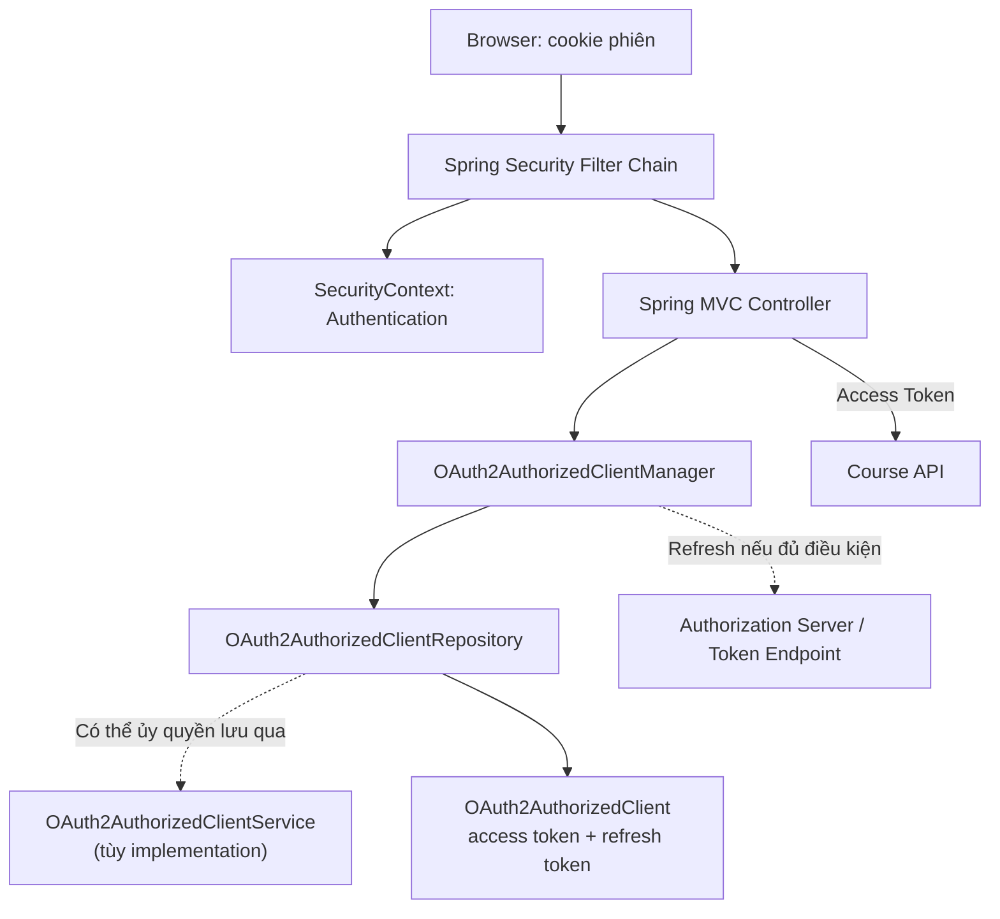
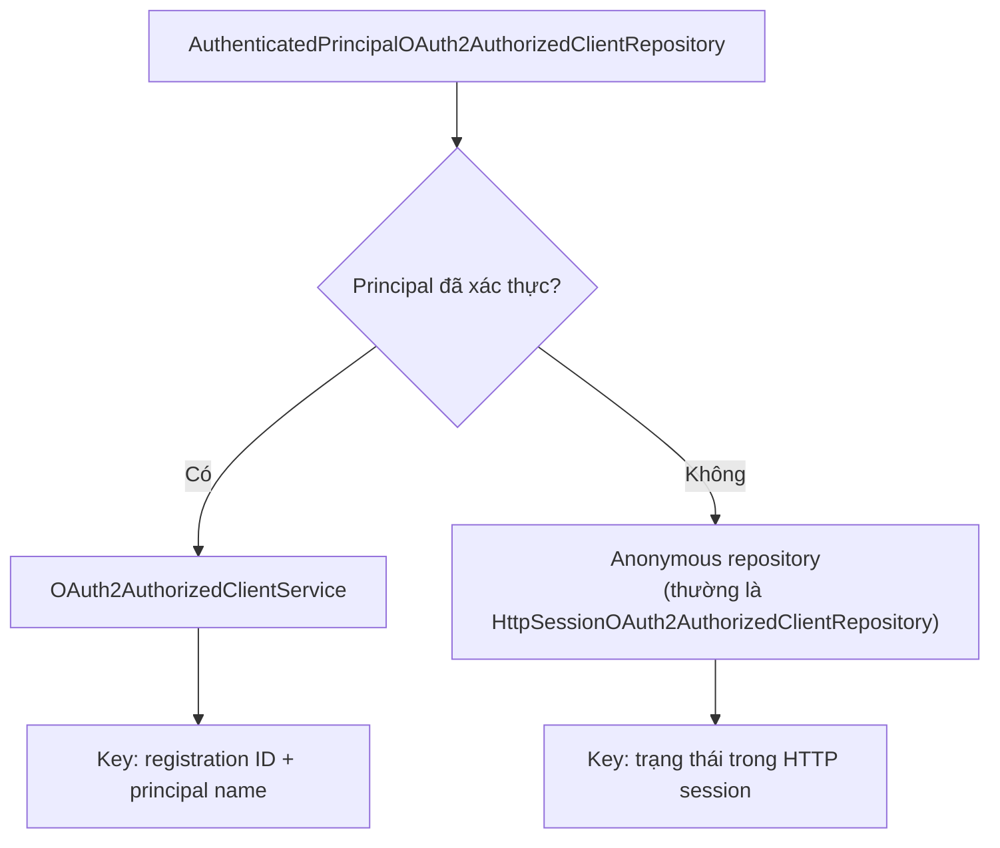
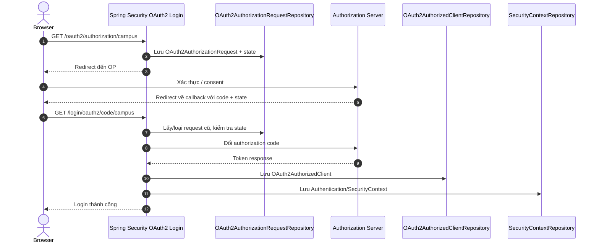

# 14.3. OAuth2AuthorizedClientRepository và ngữ cảnh HTTP request

## Mục tiêu bài học

Sau bài học, bạn có thể:

- Giải thích vai trò của **`OAuth2AuthorizedClientRepository`** trong ứng dụng **Spring Security OAuth2/OIDC Client sử dụng Servlet**.
- Phân biệt `ClientRegistration`, `OAuth2AuthorizedClient`, `OAuth2AuthorizedClientRepository`, `OAuth2AuthorizedClientService` và `OAuth2AuthorizationRequestRepository`.
- Nắm ba thao tác `loadAuthorizedClient`, `saveAuthorizedClient`, `removeAuthorizedClient` cùng các tham số `Authentication`, `HttpServletRequest` và `HttpServletResponse`.
- Hiểu vì sao việc lưu trạng thái OAuth2 authorized client có thể phụ thuộc **HTTP session** hoặc **principal đã xác thực**, và các giới hạn của những lựa chọn đó.
- Dùng repository hoặc `@RegisteredOAuth2AuthorizedClient` khi cần lấy access token để backend gọi API, đồng thời để `OAuth2AuthorizedClientManager` tham gia cấp lại token khi thích hợp.
- Cấu hình Spring Security Servlet cho OAuth2 Login, hiểu việc kết nối repository với manager, và lựa chọn cách lưu phù hợp khi triển khai nhiều instance.
- Tránh rò rỉ token, lẫn dữ liệu người dùng, mất trạng thái khi logout hoặc refresh token, và nhầm lẫn giữa request context với background job.

## 1. Bối cảnh: sau khi OIDC login thành công, token nằm ở đâu?

Giả sử **Learning Portal** là một Spring Boot web application. Người dùng đăng nhập qua **Campus Identity** (OpenID Provider) bằng OpenID Connect Authorization Code Flow. Sau callback, Spring Security đã kiểm tra ID Token và tạo phiên đăng nhập.

Learning Portal tiếp tục cần gọi **Course API** thay mặt người dùng:

```http
GET /api/me/courses HTTP/1.1
Host: courses.example.org
Authorization: Bearer <access-token>
```

Client phải lấy đúng access token cho **người dùng hiện tại** và **client registration đã được ủy quyền**. Nếu token gần hết hạn, ứng dụng có thể cần refresh qua Token Endpoint.

Trong Spring Security, một thành phần đảm nhiệm việc **lưu và tải trạng thái đã được ủy quyền trong ngữ cảnh request Servlet** là:

```java
OAuth2AuthorizedClientRepository
```

Repository không phải cơ chế đăng nhập độc lập và không phát hành token. Nó giúp trả lời:

> “Trong request HTTP này, ứng với registration `campus` và principal hiện tại, ứng dụng đang có `OAuth2AuthorizedClient` nào để sử dụng hoặc cập nhật?”

Một `OAuth2AuthorizedClient` chứa ClientRegistration, principal name, access token và refresh token (nếu được cấp). Repository cung cấp cơ chế lấy/lưu/xóa đối tượng đó.

### 1.1. Phân biệt thông tin đăng ký, đăng nhập và ủy quyền

| Đối tượng | Mục đích | Ví dụ trong Learning Portal |
| --- | --- | --- |
| `ClientRegistration` | Cấu hình ứng dụng tại Authorization Server | Client ID, issuer, Token Endpoint, scopes, `registrationId=campus` |
| `Authentication` | Danh tính và authorities đã xác thực cho request | OIDC principal của sinh viên A |
| `OAuth2AuthorizedClient` | Trạng thái OAuth2 client đã được ủy quyền cho một principal | Registration `campus`, sinh viên A, access token A, refresh token A |
| `OAuth2AuthorizedClientRepository` | Lưu/tải/xóa authorized client, **có HTTP request/response context** | Lấy token A cho request của sinh viên A |
| `OAuth2AuthorizedClientService` | Lưu/tải/xóa authorized client theo ID registration và principal name, **không cần HttpServletRequest** | Lấy token từ một service store |
| `OAuth2AuthorizedClientManager` | Điều phối authorization/re-authorization, có thể dùng refresh token | Trả authorized client còn dùng được hoặc làm mới khi cần |

**Không nên đặt access token trong một biến singleton hoặc lưu token vừa nhận của người dùng A để sử dụng cho mọi request.** Mỗi người dùng/grant có trạng thái và quyền riêng.

### 1.2. Sơ đồ tổng thể



Mô hình trên mô tả những thành phần có thể phối hợp trong một ứng dụng, không bắt buộc mọi repository đều sử dụng `OAuth2AuthorizedClientService`. Với `HttpSessionOAuth2AuthorizedClientRepository`, trạng thái authorized client được quản lý qua HTTP session thay vì một service store riêng.

## 2. `OAuth2AuthorizedClient` chứa những gì?

Một đối tượng `OAuth2AuthorizedClient` đại diện cho **client registration đã được ủy quyền cho một principal cụ thể**.

Các API thường dùng:

```java
OAuth2AuthorizedClient authorizedClient = ...;

String registrationId =
    authorizedClient.getClientRegistration().getRegistrationId();

String principalName = authorizedClient.getPrincipalName();

OAuth2AccessToken accessToken =
    authorizedClient.getAccessToken();

OAuth2RefreshToken refreshToken =
    authorizedClient.getRefreshToken();
```

Trong đó:

- `getClientRegistration()` trả cấu hình client đã được dùng.
- `getPrincipalName()` cho biết tên principal liên quan đến authorized client.
- `getAccessToken()` trả access token để client dùng cho Resource Server thích hợp.
- `getRefreshToken()` có thể trả `null`; provider không bắt buộc cấp refresh token trong mọi grant/registration.

Một biểu diễn khái niệm:

```text
OAuth2AuthorizedClient
  |
  +-- ClientRegistration: "campus"
  |     +-- clientId = "learning-portal-web"
  |     +-- grantType = authorization_code
  |
  +-- principalName = "student-9b71"
  |
  +-- accessToken
  |     +-- tokenValue = [SENSITIVE]
  |     +-- issuedAt
  |     +-- expiresAt
  |
  +-- refreshToken (optional)
        +-- tokenValue = [VERY SENSITIVE]
```

**Token value là credential nhạy cảm.** Không serialize nguyên `OAuth2AuthorizedClient` ra browser, không log `getTokenValue()` và không đưa refresh token vào request tới Course API.

### 2.1. Một người dùng có thể có nhiều authorized client

Giả sử Portal hỗ trợ hai registration:

```text
campus
partner
```

Cùng một người dùng có thể đã cho phép client `campus` gọi một API, đồng thời ủy quyền cho `partner` một API khác. Khi đó:

```text
Principal A + registration "campus"  -> authorized client A/campus
Principal A + registration "partner" -> authorized client A/partner
Principal B + registration "campus"  -> authorized client B/campus
```

Các đối tượng này không được thay thế hoặc chia sẻ tùy ý. `registrationId` cần được xem như **khóa chọn cấu hình OAuth Client**, không phải cách suy ra quyền của người dùng.

## 3. Giao diện `OAuth2AuthorizedClientRepository`

Trong Spring Security Servlet:

```java
import org.springframework.security.oauth2.client.web
    .OAuth2AuthorizedClientRepository;
```

Giao diện có ba thao tác cốt lõi (trình bày theo chữ ký điển hình):

```java
public interface OAuth2AuthorizedClientRepository {

    <T extends OAuth2AuthorizedClient> T loadAuthorizedClient(
        String clientRegistrationId,
        Authentication principal,
        HttpServletRequest request
    );

    void saveAuthorizedClient(
        OAuth2AuthorizedClient authorizedClient,
        Authentication principal,
        HttpServletRequest request,
        HttpServletResponse response
    );

    void removeAuthorizedClient(
        String clientRegistrationId,
        Authentication principal,
        HttpServletRequest request,
        HttpServletResponse response
    );
}
```

Các kiểu request/response thuộc **Servlet API** tương ứng phiên bản Spring đang dùng. Trong Spring Security hiện đại với Spring Framework 6+, import là `jakarta.servlet.http.*`; dự án sử dụng các dòng cũ có thể dùng namespace `javax.servlet.*`.

### 3.1. Ý nghĩa từng tham số

| Tham số | Dùng để làm gì? |
| --- | --- |
| `clientRegistrationId` | Chọn authorized client ứng với một registration, ví dụ `campus` |
| `Authentication principal` | Cung cấp danh tính xác thực hoặc trạng thái anonymous để repository áp dụng chính sách lưu/tải |
| `HttpServletRequest request` | Cung cấp ngữ cảnh Servlet: session, request attributes hoặc metadata do implementation cần |
| `HttpServletResponse response` | Cho phép implementation cập nhật trạng thái HTTP/session/cookie khi lưu hoặc xóa |
| `OAuth2AuthorizedClient authorizedClient` | Đối tượng cần lưu, bao gồm token hiện hành và optional refresh token |

**Điểm đặc trưng của repository này chính là HTTP request/response context.** Không được thiết kế để mọi lời gọi đều chạy được trong một worker không có Servlet request.

### 3.2. `loadAuthorizedClient`: tải đúng trạng thái

Ví dụ:

```java
OAuth2AuthorizedClient current =
    authorizedClientRepository.loadAuthorizedClient(
        "campus",
        authentication,
        request
    );
```

Nếu không có authorized client đã lưu cho ngữ cảnh đó, kết quả có thể là `null`. Đừng suy diễn `null` nghĩa người dùng chưa đăng nhập: một `Authentication` đã hợp lệ vẫn có thể chưa hề ủy quyền cho registration `campus`, hoặc trạng thái OAuth đã bị xóa/hết khả dụng.

### 3.3. `saveAuthorizedClient`: lưu token và phiên bản mới

Sau một lần authorization hoặc refresh thành công, client có thể cần lưu `OAuth2AuthorizedClient` mới, đặc biệt khi token endpoint trả access token mới và **refresh token mới do rotation**:

```java
authorizedClientRepository.saveAuthorizedClient(
    updatedAuthorizedClient,
    authentication,
    request,
    response
);
```

Ứng dụng cần tránh ghi đè thông tin token mới bằng trạng thái cũ trong những request đồng thời. Repository là giao diện lưu trữ; nó **không mặc nhiên cung cấp khóa phân tán** hay giải quyết mọi race condition giữa các instance.

### 3.4. `removeAuthorizedClient`: xóa trạng thái đã được ủy quyền

Ví dụ:

```java
authorizedClientRepository.removeAuthorizedClient(
    "campus",
    authentication,
    request,
    response
);
```

Đây là thao tác **xóa bản ghi local** của authorized client. Nó **không tự đồng nghĩa** Authorization Server đã thu hồi refresh token hoặc access token.

Nếu yêu cầu sản phẩm là hủy quyền phía provider, cần xem Authorization Server có hỗ trợ token revocation, OIDC logout hay cơ chế quản lý grant thích hợp.

## 4. Vì sao repository cần `HttpServletRequest` và `HttpServletResponse`?

Ở ứng dụng Servlet, trạng thái request có thể gắn với:

- **HTTP session** mà browser giữ qua session cookie.
- **SecurityContext/Authentication** của người dùng đã đăng nhập.
- **Client registration** đang được sử dụng.
- **Cơ chế lưu riêng** của ứng dụng (database, cache hoặc service).
- **Response** để cập nhật session/cookie khi implementation cần.

Ví dụ hai browser cùng đăng nhập hai tài khoản:

```text
Browser A
  Cookie: JSESSIONID=AAA
  Principal: sinh viên A

Browser B
  Cookie: JSESSIONID=BBB
  Principal: sinh viên B
```

Khi controller A tải authorized client, repository dùng principal và/hoặc session tương ứng để tìm trạng thái A. Việc truyền request là một cách để implementation truy cập đúng session của request hiện tại.

**Không được lấy `JSESSIONID` làm access token.** Cookie session chỉ hỗ trợ browser duy trì phiên ứng dụng. Access token được lưu/đọc theo repository, không nhất thiết xuất hiện trong cookie.

### 4.1. `Authentication` và HTTP session không phải cùng một thứ

Một `Authentication` biểu diễn **danh tính hiện tại**; `HttpSession` là cơ chế **lưu trạng thái phiên HTTP**.

Chúng có thể đi cùng nhau nhưng không đồng nhất:

| Tình huống | `Authentication` | HTTP session |
| --- | --- | --- |
| OIDC Login web thông dụng | Principal OIDC đã xác thực | Thường có session |
| Người dùng anonymous | Có thể là anonymous authentication hoặc không có authentication phù hợp | Có thể có hoặc chưa có session |
| Bearer JWT Resource Server stateless | Authentication cho mỗi request Bearer | Thường không cần session |
| Background job | Có thể dùng service principal theo thiết kế | Không có request/session Servlet |
| Người dùng logout | Authentication local bị kết thúc | Session có thể bị invalidate |

Việc repository có thể lưu theo session **không có nghĩa mọi ứng dụng đều chọn cách đó**.

### 4.2. `HttpServletResponse` được truyền ngay cả khi implementation không cần

`saveAuthorizedClient(...)` và `removeAuthorizedClient(...)` có tham số response vì giao diện hỗ trợ nhiều implementation khác nhau trong ngữ cảnh Servlet. Một implementation lưu hoàn toàn trong service có thể không cần ghi cookie hoặc header. Không nên suy ra mọi lần save đều tạo cookie mới.

## 5. Hai hướng triển khai quan trọng

Spring Security cung cấp những implementation repository hữu ích cho Servlet web application.

### 5.1. `HttpSessionOAuth2AuthorizedClientRepository`

Implementation:

```java
HttpSessionOAuth2AuthorizedClientRepository
```

lưu các authorized client trong **HTTP session**. Nó phù hợp khi trạng thái OAuth chỉ cần gắn với phiên browser và ứng dụng chấp nhận các đặc tính lưu trữ/session tương ứng.

Ví dụ khai báo bean (chỉ chọn cách này khi đúng chủ đích kiến trúc):

```java
@Bean
OAuth2AuthorizedClientRepository authorizedClientRepository() {
    return new HttpSessionOAuth2AuthorizedClientRepository();
}
```

Đặc điểm:

- Phụ thuộc vào session của browser/request.
- Khi session bị xóa hoặc hết hạn, các authorized client chỉ lưu trong session đó cũng không còn được tải từ session cũ.
- Trong deployment nhiều node, cần hiểu cơ chế session replication/cluster hoặc sticky session.
- Không phải lựa chọn cho job nền không có HTTP request.
- Có thể đơn giản cho một ứng dụng Servlet stateful, nhưng phải đánh giá việc lưu refresh token trong session store.

### 5.2. `AuthenticatedPrincipalOAuth2AuthorizedClientRepository`

Implementation:

```java
AuthenticatedPrincipalOAuth2AuthorizedClientRepository
```

lựa chọn nơi lưu theo **trạng thái Authentication**. Với principal được xác thực, nó ủy quyền việc lưu/tải/xóa cho một `OAuth2AuthorizedClientService`. Khi principal chưa được xác thực, implementation có thể dùng một repository fallback, mặc định thường là repository dựa trên HTTP session.

Sơ đồ:



Ví dụ cấu hình tường minh:

```java
@Configuration
class AuthorizedClientRepositoryConfig {

    @Bean
    OAuth2AuthorizedClientRepository authorizedClientRepository(
            OAuth2AuthorizedClientService authorizedClientService) {

        return new AuthenticatedPrincipalOAuth2AuthorizedClientRepository(
            authorizedClientService
        );
    }
}
```

Trong ứng dụng Spring Boot có cấu hình OAuth2 Client phù hợp, framework có thể tự tạo các bean mặc định; **không bắt buộc** tự khai báo repository khi cách mặc định đáp ứng nhu cầu. Code trên chỉ minh họa cách lựa chọn implementation rõ ràng.

Cũng có thể thay repository fallback dành cho anonymous principal nếu sản phẩm có yêu cầu riêng, nhưng cần hiểu vòng đời authorization và session trước khi làm vậy.

### 5.3. `OAuth2AuthorizedClientService` đi kèm là gì?

`OAuth2AuthorizedClientService` thao tác theo `clientRegistrationId` và `principalName`, không nhận `HttpServletRequest`/`HttpServletResponse`:

```java
OAuth2AuthorizedClient client =
    authorizedClientService.loadAuthorizedClient(
        "campus",
        principalName
    );
```

Các implementation thường gặp:

| Service | Đặc điểm sử dụng |
| --- | --- |
| `InMemoryOAuth2AuthorizedClientService` | Lưu trong bộ nhớ của tiến trình; hữu ích cho demo, kiểm thử hoặc ứng dụng đơn giản |
| `JdbcOAuth2AuthorizedClientService` | Lưu qua JDBC; phù hợp hơn khi cần trạng thái tồn tại ngoài bộ nhớ một JVM |
| Service tùy biến | Dùng kho khác hoặc quy tắc tenant/persistence riêng, với trách nhiệm bảo mật token và consistency |

**In-memory không phải distributed store.** Khi chạy nhiều instance, restart hoặc chuyển request sang node khác, bạn không thể giả định bản ghi token ở JVM A có sẵn trong JVM B.

### 5.4. So sánh repository và service

| Khía cạnh | `OAuth2AuthorizedClientRepository` | `OAuth2AuthorizedClientService` |
| --- | --- | --- |
| Ngữ cảnh thiết kế | Servlet HTTP request/response | Không gắn trực tiếp với Servlet request |
| Tham số tìm kiếm | Registration ID, `Authentication`, request | Registration ID và principal name |
| Hỗ trợ lưu | `saveAuthorizedClient(..., request, response)` | `saveAuthorizedClient(..., principal)` |
| Có thể gắn session | Có, tùy implementation | Không tự nhận session từ API |
| Dùng ngoài request HTTP | Không phải lựa chọn trực tiếp | Có thể phù hợp khi biết đúng principal và lưu trữ |
| Tự refresh token? | Không | Không |
| Kết hợp với | `DefaultOAuth2AuthorizedClientManager` | `AuthorizedClientServiceOAuth2AuthorizedClientManager` hoặc repository delegate |

Nếu cần làm mới token, phải có thêm manager/provider tương ứng. Không nên gọi service/repository như thể thao tác `load` tự tạo token mới.

## 6. Phân biệt với `OAuth2AuthorizationRequestRepository`

Hai interface dễ bị nhầm vì cùng chữ “repository” và cùng có thể dùng HTTP session:

```text
OAuth2AuthorizationRequestRepository
OAuth2AuthorizedClientRepository
```

Nhưng chức năng và thời điểm hoàn toàn khác.

| Thành phần | Lưu dữ liệu gì? | Thời điểm |
| --- | --- | --- |
| `OAuth2AuthorizationRequestRepository` | **Authorization request** đã khởi tạo: `state`, redirect URI, PKCE liên quan, dữ liệu cần ghép callback | Trước và trong lúc browser chuyển sang Authorization Server |
| `OAuth2AuthorizedClientRepository` | **Authorized client** sau khi có access token/refresh token | Sau khi token exchange/authorization thành công và trong các lần sử dụng tiếp |
| `SecurityContextRepository` | **Authentication/SecurityContext** đã xác thực | Trong hoặc sau xử lý login, các request về sau |

Luồng:



Hai lần lưu thường có trách nhiệm khác nhau:

- Trước callback, client cần biết request nào đã được khởi tạo để kiểm tra `state`.
- Sau callback, client cần giữ trạng thái ủy quyền để gọi API tiếp theo.

Không thay `OAuth2AuthorizationRequestRepository` bằng `OAuth2AuthorizedClientRepository` khi muốn giải quyết lỗi `state` trong OAuth login.

## 7. Spring Security lưu Authorized Client sau khi đăng nhập

Với `oauth2Login()` trong một ứng dụng Servlet, quá trình thường gồm:

1. `OAuth2AuthorizationRequestRedirectFilter` khởi tạo authorization request và redirect browser.
2. Callback được `OAuth2LoginAuthenticationFilter` xử lý.
3. Spring đổi authorization code thành token.
4. Nếu dùng OIDC, Spring xác minh ID Token và xây OIDC principal.
5. Một `OAuth2AuthorizedClient` được tạo và lưu thông qua cơ chế authorized client của OAuth2 Login.
6. `Authentication`/`SecurityContext` được lưu theo cấu hình, giúp request sau truy cập lại danh tính người dùng.

Ví dụ cấu hình:

```yaml
spring:
  security:
    oauth2:
      client:
        registration:
          campus:
            provider: campus
            client-id: ${CAMPUS_CLIENT_ID}
            client-secret: ${CAMPUS_CLIENT_SECRET}
            client-authentication-method: client_secret_basic
            authorization-grant-type: authorization_code
            redirect-uri: "{baseUrl}/login/oauth2/code/{registrationId}"
            scope:
              - openid
              - profile
              - courses.read

        provider:
          campus:
            issuer-uri: https://login.example.org/realms/campus
```

SecurityFilterChain:

```java
@Configuration
class WebSecurityConfig {

    @Bean
    SecurityFilterChain webSecurity(HttpSecurity http) throws Exception {
        http
            .authorizeHttpRequests(auth -> auth
                .requestMatchers("/", "/error", "/assets/**").permitAll()
                .anyRequest().authenticated()
            )
            .oauth2Login(Customizer.withDefaults())
            .oauth2Client(Customizer.withDefaults());

        return http.build();
    }
}
```

Đây là ví dụ backend confidential client. Các endpoint/domain là minh họa; ứng dụng thật phải đăng ký OAuth Client/redirect URI ở OP và quản lý secret an toàn. Tùy phiên bản/cấu hình, một số bean OAuth2 Client và behavior đã được Boot thiết lập tự động.

### 7.1. Vì sao không có authorized client dù người dùng đã đăng nhập?

Một người dùng **được xác thực** chưa chắc có trạng thái ủy quyền cho **mọi client registration**. Các tình huống:

- Người dùng login qua `campus`, nhưng code muốn tải registration `partner`.
- Kho lưu token đã bị xóa, hết session hoặc ứng dụng đã restart.
- UserInfo/login chính của ứng dụng sử dụng principal khác khóa lưu token.
- Repository trong một service/manager được cấu hình khác repository của OAuth2 Login.
- Token của registration đã bị từ chối, removed hoặc chưa được cấp.
- Ứng dụng chỉ triển khai `oauth2ResourceServer()` mà không có OAuth2 Client flow tương ứng.

Cần tách **login authentication** với **OAuth2 authorization**. Đừng dùng một `OAuth2AuthorizedClient` bất kỳ rồi cho rằng nó thuộc principal hiện tại.

## 8. Đọc Authorized Client trực tiếp từ repository trong controller

Một Spring MVC controller có thể nhận `Authentication` cùng `HttpServletRequest`, sau đó gọi repository:

```java
@RestController
class AuthorizedClientStatusController {

    private final OAuth2AuthorizedClientRepository authorizedClients;

    AuthorizedClientStatusController(
            OAuth2AuthorizedClientRepository authorizedClients) {
        this.authorizedClients = authorizedClients;
    }

    @GetMapping("/internal/oauth2/client-status")
    Map<String, Object> status(
            Authentication authentication,
            HttpServletRequest request) {

        OAuth2AuthorizedClient client =
            authorizedClients.loadAuthorizedClient(
                "campus",
                authentication,
                request
            );

        if (client == null) {
            return Map.of(
                "registrationId", "campus",
                "authorized", false
            );
        }

        Map<String, Object> response = new LinkedHashMap<>();
        response.put("registrationId",
            client.getClientRegistration().getRegistrationId());
        response.put("authorized", true);
        response.put("hasRefreshToken",
            client.getRefreshToken() != null);

        if (client.getAccessToken().getExpiresAt() != null) {
            response.put("accessTokenExpiresAt",
                client.getAccessToken().getExpiresAt().toString());
        }

        return response;
    }
}
```

Endpoint này **chỉ để minh họa**, nên bảo vệ bằng quyền quản trị/debug hoặc không triển khai ở production. Ngay cả metadata như thời hạn/token status cũng cần được kiểm soát theo threat model.

Điểm quan trọng:

- Repository tra cứu từ `authentication` và `request` hiện tại.
- Không có authorized client thì xử lý rõ ràng.
- Không trả `client.getAccessToken().getTokenValue()` hoặc refresh token ra JSON.
- `loadAuthorizedClient` **chỉ tải**, không tự refresh một access token đã hết hạn.

### 8.1. Không nên chỉ dùng `authentication.getName()` tự dựng key

Một repository có thể dựa trên session, một repository khác dựa trên service được khóa theo principal name. Việc tự xây thuật toán tìm token bằng `getName()` mà bỏ qua repository abstraction có thể dẫn đến khác biệt hành vi, nhất là khi ứng dụng có custom principal hoặc nhiều provider.

Hãy dùng API repository/manager theo cấu hình đã thống nhất, và ràng buộc rõ tenant/identity để tránh trùng principal names.

### 8.2. Không log tokens để debug

Có thể ghi:

```text
registrationId=campus
authorized=true
hasRefreshToken=true
accessTokenExpiresAt=<timestamp>
```

Nhưng không ghi:

```text
accessToken=<bearer-token-value>
refreshToken=<refresh-token-value>
clientSecret=<secret>
```

Token có thể cấp quyền trực tiếp hoặc quyền xin token mới. Việc log token vào tracing/crash report dễ mở rộng bề mặt lộ credential.

## 9. Cách dùng `@RegisteredOAuth2AuthorizedClient` trong request Servlet

Trong nhiều controller, ứng dụng không cần gọi `loadAuthorizedClient` thủ công. Spring Security hỗ trợ:

```java
@RegisteredOAuth2AuthorizedClient("campus")
```

để resolve authorized client phù hợp trong ngữ cảnh web request. Cơ chế resolve có thể phối hợp `OAuth2AuthorizedClientManager`, nên **có khả năng authorize/re-authorize** theo cấu hình chứ không chỉ là tra cứu thuần túy.

Ví dụ:

```java
@RestController
class CourseController {

    private final RestClient restClient;

    CourseController(RestClient.Builder builder) {
        this.restClient = builder.build();
    }

    @GetMapping("/api/my-courses")
    String myCourses(
            @RegisteredOAuth2AuthorizedClient("campus")
            OAuth2AuthorizedClient authorizedClient) {

        String accessToken =
            authorizedClient.getAccessToken().getTokenValue();

        return restClient.get()
            .uri("https://courses.example.org/api/me/courses")
            .headers(h -> h.setBearerAuth(accessToken))
            .retrieve()
            .body(String.class);
    }
}
```

Đây là mã minh họa; ứng dụng thực cần xử lý exception, timeout, DTO và ràng buộc đúng audience/scope của token. Không trả access token cho browser. Nếu authorized client không thể được resolve/authorize, luồng lỗi phải được xử lý rõ ràng theo kiến trúc đăng nhập của ứng dụng.

### 9.1. Khác nhau giữa repository và annotation

| Cách dùng | Tác dụng điển hình | Điều cần chú ý |
| --- | --- | --- |
| `repository.loadAuthorizedClient(...)` | Tải trạng thái đã lưu | Không tự xin token mới |
| `@RegisteredOAuth2AuthorizedClient(...)` | Resolve authorized client cho controller | Tùy cấu hình có thể đi qua manager và refresh |
| `authorizedClientManager.authorize(...)` | Yêu cầu authorize/re-authorize | Có thể dùng provider/grant và lưu cập nhật |
| `OAuth2AuthorizedClientService.loadAuthorizedClient(...)` | Tải theo registration ID và principal name | Không có request context, không tự refresh |

Nếu cần đảm bảo token còn dùng được trước khi gọi API, nên ưu tiên **manager hoặc tích hợp HTTP client** có hỗ trợ token management, thay vì tự lấy một object từ repository rồi dùng token cũ mãi.

## 10. `DefaultOAuth2AuthorizedClientManager` và HTTP request

Đây là manager thường dùng cho **Servlet application trong ngữ cảnh request**.

```java
@Configuration
class AuthorizedClientManagerConfig {

    @Bean
    OAuth2AuthorizedClientManager authorizedClientManager(
            ClientRegistrationRepository registrations,
            OAuth2AuthorizedClientRepository repository) {

        OAuth2AuthorizedClientProvider provider =
            OAuth2AuthorizedClientProviderBuilder.builder()
                .authorizationCode()
                .refreshToken()
                .build();

        DefaultOAuth2AuthorizedClientManager manager =
            new DefaultOAuth2AuthorizedClientManager(
                registrations,
                repository
            );

        manager.setAuthorizedClientProvider(provider);
        return manager;
    }
}
```

Luồng sử dụng về mặt ý tưởng:

```text
Controller/HTTP Client
  -> AuthorizedClientManager.authorize(...)
     -> tải OAuth2AuthorizedClient qua repository
     -> access token còn hạn: dùng lại
     -> token cần làm mới + có refresh token: gọi Token Endpoint nếu provider cho phép
     -> cập nhật trạng thái token và lưu qua repository
```

**Manager không phải timer nền** tự làm mới mọi token khi không có request. Thông thường nó xét trạng thái khi ứng dụng gọi `authorize(...)` trong ngữ cảnh phù hợp.

### 10.1. Vì sao manager cần repository?

Manager phải biết authorized client hiện có của principal nào, và nơi lưu phiên bản mới sau khi refresh. Repository cung cấp thao tác tương ứng trong Servlet request.

Một caller có thể tạo yêu cầu authorize:

```java
OAuth2AuthorizeRequest request =
    OAuth2AuthorizeRequest
        .withClientRegistrationId("campus")
        .principal(authentication)
        .build();

OAuth2AuthorizedClient authorizedClient =
    authorizedClientManager.authorize(request);
```

Đoạn này giả định chạy trong **Servlet request context** mà manager có thể truy cập. Khi sử dụng ngoài controller hoặc ngữ cảnh khác, cần truyền request/response attributes phù hợp API phiên bản đang dùng hoặc chọn manager dành cho service/background.

Nếu manager không thể xác định HTTP request context cần thiết, không nên cố truyền một request giả chỉ để sử dụng manager Servlet trong scheduled job.

### 10.2. Cấu hình success/failure handler

`DefaultOAuth2AuthorizedClientManager` hỗ trợ handler khi authorization thành công hoặc thất bại.

Tùy cấu hình, cơ chế mặc định có thể lưu authorized client mới qua repository và xóa trạng thái không hợp lệ với các lỗi OAuth thích hợp (ví dụ `invalid_grant` theo handler được cấu hình).

Điều này giải thích vì sao sau refresh thất bại, authorized client có thể không còn trong repository. Tuy nhiên, không nên mặc định **mọi** lỗi HTTP 5xx hay timeout đều phải xóa grant: cần phân loại lỗi có thể phục hồi với lỗi token/grant không còn hợp lệ.

### 10.3. Một request có thể thay đổi token store

Khi refresh-token rotation được bật:

```text
Trước request:
  Access Token AT1
  Refresh Token RT1

Khi authorize():
  Client gửi RT1 đến Token Endpoint
  OP trả AT2 + RT2

Sau request:
  Repository cần lưu AT2 + RT2
```

Nếu một thread/instance khác vẫn lưu RT1 và ghi đè dữ liệu mới, client có thể mất grant hoặc bị provider phát hiện reuse. Việc đồng bộ update trong hệ thống nhiều request không tự được giải quyết chỉ bằng việc dùng interface repository.

## 11. Background jobs: khi không có HTTP request

Một scheduled task có thể cần access token để gọi API, nhưng nó không có `HttpServletRequest` và session browser.

Ví dụ:

```text
@Scheduled job
    -> không có DispatcherServlet request
    -> không có browser cookie
    -> không có principal session tự nhiên
```

Trong trường hợp đó, Spring Security có manager dựa trên service:

```java
AuthorizedClientServiceOAuth2AuthorizedClientManager
```

Ví dụ cho một workload dùng Client Credentials:

```java
@Bean
OAuth2AuthorizedClientManager backgroundManager(
        ClientRegistrationRepository registrations,
        OAuth2AuthorizedClientService authorizedClients) {

    OAuth2AuthorizedClientProvider provider =
        OAuth2AuthorizedClientProviderBuilder.builder()
            .clientCredentials()
            .build();

    AuthorizedClientServiceOAuth2AuthorizedClientManager manager =
        new AuthorizedClientServiceOAuth2AuthorizedClientManager(
            registrations, authorizedClients
        );

    manager.setAuthorizedClientProvider(provider);
    return manager;
}
```

Caller:

```java
OAuth2AuthorizeRequest authorizeRequest =
    OAuth2AuthorizeRequest
        .withClientRegistrationId("course-sync")
        .principal("scheduled-course-sync")
        .build();

OAuth2AuthorizedClient client =
    backgroundManager.authorize(authorizeRequest);
```

Đây là ví dụ machine-to-machine với `client_credentials`; nó không đăng nhập một người dùng. Phải cấu hình registration, grant và Token Endpoint đúng chính sách provider.

Nếu background job thực sự cần chạy thay mặt một người dùng theo grant đã được ủy quyền trước đó, phải chọn đúng principal, service store và chính sách thời hạn/refresh; không dùng `SecurityContext` của user bất kỳ hoặc tự giả mạo browser session.

### 11.1. Bảng chọn manager theo môi trường

| Môi trường | Thành phần thường phù hợp | Nguồn trạng thái |
| --- | --- | --- |
| Servlet controller với OIDC Login và session | `DefaultOAuth2AuthorizedClientManager` | `OAuth2AuthorizedClientRepository` |
| Outbound API call trong HTTP request | Repository/manager hoặc tích hợp HTTP client | Có request principal và authorized client |
| Worker/scheduled job không có Servlet request | `AuthorizedClientServiceOAuth2AuthorizedClientManager` | `OAuth2AuthorizedClientService` |
| Resource Server chỉ xác minh Bearer token | Thường không cần authorized client repository | Token trong inbound request |
| Application dùng reactive WebFlux | Repository/manager **reactive** tương ứng | `ServerOAuth2AuthorizedClientRepository`, không phải Servlet repository |

**Không dùng các interface Servlet trong WebFlux chỉ vì chúng có tên gần giống.** Reactive stack có API khác và mô hình request riêng.

## 12. Session-based repository và service-based repository trong sản xuất

### 12.1. Chọn theo thời gian sống của authorized client

Một số ứng dụng chỉ cần token khi người dùng còn session browser. Khi logout hoặc session hết hạn, token local có thể được xóa theo session.

Ứng dụng khác muốn duy trì grant sau khi session HTTP kết thúc để xử lý nghiệp vụ sau này, khi provider cho phép và người dùng đã đồng ý. Khi đó, authorized client có thể cần một **persistent service store** với chính sách bảo mật và thu hồi thích hợp.

| Tiêu chí | Lưu trong HTTP session | Lưu qua authorized client service |
| --- | --- | --- |
| Vòng đời | Thường bám session | Theo khóa principal/registration và chính sách lưu |
| Tồn tại sau browser session | Thường không, nếu chỉ lưu session | Có thể, tùy service và cleanup |
| Chia sẻ qua nhiều node | Cần session clustering/distributed session | Cần persistent/shared service store |
| Phù hợp background processing | Không trực tiếp | Có thể phù hợp hơn |
| Bảo vệ refresh token | Bảo vệ session store và cookie/session ID | Bảo vệ database/secret store, quyền truy cập, mã hóa |
| Logout | Invalidate session có thể dọn local state | Có thể cần chủ động remove/revoke từ service |
| Truy vết phân tách principal | Theo session của request | Theo principal name và registration ID |

Không có lựa chọn mặc định nào phù hợp mọi hệ thống. Hãy thiết kế theo thời gian sống token, số instance, UX, consent, yêu cầu bảo mật và nhu cầu gọi API sau khi browser đóng.

### 12.2. Khi triển khai nhiều instance

Giả sử Learning Portal có hai node:

```text
Browser -> Load Balancer
         |-- Node A
         |-- Node B
```

Nếu authorized client chỉ lưu trong bộ nhớ của Node A, request tiếp theo đến Node B có thể không tìm thấy token.

Có những phương án:

- Dùng shared session nếu chọn session-backed repository.
- Dùng JDBC/shared authorized client service nếu chọn persistence theo principal.
- Thiết kế đồng bộ refresh token khi nhiều request cùng đọc một grant.
- Đảm bảo các instance sử dụng cùng khóa định danh principal/tenant.
- Định nghĩa rõ thời hạn retention và cleanup khi grant hết hiệu lực.

**Sticky session chỉ là một lựa chọn vận hành**, không thay thế kế hoạch recovery khi node bị restart hoặc request chuyển node.

### 12.3. Khóa lưu trữ và multi-tenant

Nếu service store dùng khóa logic:

```text
(registrationId, principalName)
```

thì principal name phải được quản lý để không lẫn người dùng giữa các issuer/tenant. Ví dụ hai OP khác nhau đều có `sub="123"`; nếu mã ứng dụng tự tạo `principalName="123"` và đồng thời dùng chung registration ID trong một kho tùy biến, dữ liệu có thể va chạm.

Nên thiết kế định danh thống nhất theo issuer và subject của OIDC, kèm tenant và registration cần thiết, hoặc áp dụng quy tắc khóa rõ ràng của repository custom. Không dựa riêng vào email có thể thay đổi để xác định người dùng.

## 13. Logout và thu hồi quyền

Có ba thao tác khác nhau:

1. **Logout khỏi ứng dụng:** kết thúc `Authentication`/local session.
2. **Remove authorized client:** xóa trạng thái token lưu trong repository/service của client.
3. **Token revocation hoặc OP logout:** yêu cầu Authorization Server thu hồi token/grant hoặc kết thúc phiên SSO theo giao thức provider hỗ trợ.

Ba thao tác này **không tự đồng nhất**.

### 13.1. Với repository theo session

Khi session bị invalidate, các authorized client chỉ nằm trong session sẽ không còn truy xuất được từ session đó. Tuy nhiên, Authorization Server có thể vẫn chấp nhận refresh token nếu token chưa bị thu hồi.

### 13.2. Với service theo principal

Nếu authorized client được lưu trong JDBC hoặc kho khác, việc logout khỏi browser có thể **không tự xóa bản ghi token**. Cần định nghĩa:

- Khi logout có cần remove authorized client khỏi service không?
- Khi người dùng rút consent có cần gọi revocation endpoint không?
- Có cần giữ grant để thực hiện tác vụ offline đã được cho phép không?
- Ai có quyền xem/xóa authorized client của một principal?
- Chính sách retention và xóa token nhạy cảm trong database là gì?

Một controller chỉ gọi `removeAuthorizedClient(...)` không đảm bảo OP đã thu hồi token. Việc revoke phải thực hiện ở endpoint và phương thức nhà cung cấp hỗ trợ.

### 13.3. Không dùng GET để thực hiện hành động xóa nhạy cảm

Ví dụ xóa authorized client nên là thao tác có kiểm soát (POST/DELETE tùy thiết kế), có authentication, authorization và CSRF protection phù hợp nếu dùng cookie session.

Không tạo URL GET công khai kiểu:

```text
GET /oauth/remove-all-tokens
```

rồi cho phép bất kỳ trang bên ngoài kích hoạt xóa token của người dùng chỉ bằng một link.

## 14. Bảo mật token store và HTTP context

Những yêu cầu quan trọng:

| Nguy cơ | Biện pháp |
| --- | --- |
| Access/refresh token bị lộ trong log hoặc HTTP response | Không log raw token, không serialize nguyên `OAuth2AuthorizedClient` |
| Browser JavaScript đọc refresh token | Ưu tiên giữ token tại backend/BFF và chỉ dùng cookie session khi kiến trúc cho phép |
| Kẻ tấn công chiếm session cookie | HTTPS, `Secure`, `HttpOnly`, `SameSite` thích hợp, bảo vệ session và CSRF |
| Token của người A được dùng cho request B | Kiểm tra principal/session/registration binding, không dùng biến global |
| Token store bị đọc bởi dịch vụ không được phép | Giới hạn database credentials, quyền đọc, mã hóa ở trạng thái nghỉ khi cần |
| Refresh-token rotation bị race | Đồng bộ cập nhật theo grant, versioning/compare-and-swap |
| Token tồn tại sau logout ngoài ý muốn | Chính sách remove, revocation và retention rõ ràng |
| Authorization thất bại nhưng app vẫn dùng token cũ | Xử lý lỗi `invalid_grant`/expired token, không retry mù |
| Multi-tenant principal names va chạm | Khóa định danh có issuer/tenant và registration phù hợp |

### 14.1. Session cookie không phải là kho lưu token trong browser

Trong server-side OIDC Login, browser thường chỉ mang cookie session. Token có thể được lưu tại server trong HTTP session hoặc service.

Điều đó giúp giảm mức độ token xuất hiện trong JavaScript, nhưng cookie session vẫn rất nhạy cảm: ai chiếm được session có thể thực hiện request trong quyền của người dùng. Vì thế token store an toàn không thay thế CSRF/session protection.

### 14.2. Không tạo repository toàn cục dùng chung một token

Ví dụ sai về kiến trúc:

```java
@Component
class UnsafeTokenCache {
    private OAuth2AuthorizedClient lastAuthorizedClient;
}
```

Nếu controller lưu authorized client của người A vào field này, request của người B có thể nhận token sai. Một `OAuth2AuthorizedClientRepository` phù hợp phân tách theo principal/session để tránh kiểu lẫn trạng thái đó.

### 14.3. Khi cache hoặc mã hóa token

Cache nên có khóa và thời hạn phù hợp, không cache theo mỗi `registrationId` khi token là user delegated. Lưu trữ lâu dài nên xem xét mã hóa token ở trạng thái nghỉ, khóa mã hóa được quản lý riêng, quyền truy cập tối thiểu, rotation và deletion.

Không cache access token dài hơn thời hạn nó có hiệu lực chỉ để tránh gọi Token Endpoint. Nếu refresh token bị provider thu hồi, repository cũng cần xử lý bản ghi không dùng được.

## 15. Xử lý lỗi khi tải hoặc refresh Authorized Client

### 15.1. `loadAuthorizedClient(...)` trả `null`

Các khả năng:

- Chưa có lần authorization phù hợp.
- Registration ID sai.
- Authentication/principal đang khác lúc lưu.
- HTTP session đã hết hạn.
- Service store chưa có bản ghi hoặc instance khác không dùng chung kho.
- Authorized client đã bị remove sau lỗi grant hoặc logout.

Ứng dụng có thể cần khởi tạo authorization flow tương tác nếu người dùng chưa cấp quyền. Không nên tạo access token giả hoặc dùng token từ một principal khác.

### 15.2. Access token đã hết hạn

Repository **vẫn có thể trả đối tượng chứa access token hết hạn**. Nó lưu trạng thái, không tự đảm bảo mọi token được tải còn hiệu lực.

Khi đó:

```text
repository.loadAuthorizedClient(...)
   -> có object
   -> access token có thể đã hết hạn
```

Manager/provider như `refreshToken()` mới xem xét việc cấp access token mới theo điều kiện thực tế. Nếu không có refresh token hoặc grant không còn hợp lệ, ứng dụng cần giải quyết re-authorization.

### 15.3. Provider từ chối refresh bằng `invalid_grant`

Một refresh token có thể hết hạn, bị thu hồi hoặc bị phát hiện reuse. Cần dừng dùng token không còn hợp lệ và xử lý xóa/tái ủy quyền theo chính sách. Không retry mãi cùng refresh token cũ.

### 15.4. Lỗi mạng hoặc Token Endpoint tạm thời không sẵn sàng

Không phải mọi lỗi đều nghĩa grant đã bị thu hồi. Với timeout/5xx có thể áp dụng retry có giới hạn và backoff theo chính sách, đồng thời chú ý tình huống token endpoint đã xử lý refresh và xoay token trước khi client nhận timeout. Retry cùng refresh token cũ có thể gây reuse detection.

## 16. Bài tập thực hành

### Bài tập 1 — Repository dùng request context như thế nào?

Cho controller:

```java
@GetMapping("/oauth-status")
String oauthStatus(
        Authentication auth,
        HttpServletRequest request) {

    OAuth2AuthorizedClient client =
        repository.loadAuthorizedClient(
            "campus",
            auth,
            request
        );

    return client == null ? "not-authorized" : "authorized";
}
```

**Câu hỏi:** Vì sao không chỉ truyền `"campus"`?

**Đáp án:** vì trạng thái token có thể khác giữa principal và session. Repository cần thêm `Authentication` và `HttpServletRequest` để tìm đúng authorized client theo implementation.

### Bài tập 2 — Phân biệt hai repository

Một developer dùng `HttpSessionOAuth2AuthorizationRequestRepository` để tìm access token sau login.

**Câu hỏi:** Sai ở đâu?

**Đáp án:** repository đó dùng cho **authorization request đang chờ callback**, không phải authorized client đã nhận token. Dùng `OAuth2AuthorizedClientRepository` hoặc service/manager tương ứng.

### Bài tập 3 — Lưu theo session hay service?

Portal chỉ cần token trong khi browser còn phiên; khi logout, token local không nên còn dùng. Một ứng dụng khác cần worker chạy theo lịch sau khi người dùng rời trang, và được phép thực hiện offline access.

**Đáp án gợi ý:** với Portal session-bound, cân nhắc session repository; với worker offline, cân nhắc persistent `OAuth2AuthorizedClientService` và manager dành cho non-HTTP context, kèm consent/expiry/revocation policies rõ ràng.

### Bài tập 4 — Kết quả `load` không có nghĩa token hợp lệ

Repository trả authorized client có:

```text
accessToken.expiresAt = 09:00
currentTime           = 09:10
refreshToken          = RT1
```

**Câu hỏi:** Có thể gọi API ngay bằng access token cũ không?

**Đáp án:** không nên. Repository chỉ trả state. Dùng manager/provider phù hợp để refresh khi được phép rồi lấy access token mới; nếu thất bại, xử lý re-authorization.

### Bài tập 5 — Kiểm tra behavior sau logout

Ứng dụng dùng `AuthenticatedPrincipalOAuth2AuthorizedClientRepository` và `JdbcOAuth2AuthorizedClientService`. Người dùng logout, HTTP session bị invalidate nhưng record token vẫn tồn tại trong database.

**Câu hỏi:** Đây có phải lỗi framework chắc chắn không?

**Đáp án:** không nhất thiết. Authorized client store theo service có vòng đời độc lập với HTTP session. Ứng dụng phải định nghĩa rõ logout có xóa/revoke token lưu ở service không.

### Bài tập 6 — Hai request refresh đồng thời

A và B đều đọc RT1. A nhận RT2; B vẫn gửi RT1.

**Câu hỏi:** Repository có tự giải quyết race này chỉ vì có method `saveAuthorizedClient` không?

**Đáp án:** không. Cần thiết kế concurrency control cho một grant, ví dụ single-flight lock và optimistic versioning trong shared store, tránh mất token mới hoặc bị phát hiện replay.

## 17. Câu hỏi tự kiểm tra

**1. `OAuth2AuthorizedClientRepository` khác `ClientRegistrationRepository` ở đâu?**

> Registration repository giữ **cấu hình client**; authorized client repository giữ **trạng thái client đã được ủy quyền cùng token** của principal trong ngữ cảnh Servlet.

**2. Vì sao method `loadAuthorizedClient` nhận cả `Authentication` và `HttpServletRequest`?**

> Vì implementation có thể phân tách token theo principal, session hoặc cách lưu gắn với request; chỉ registration ID không đủ xác định token đúng.

**3. `HttpSessionOAuth2AuthorizedClientRepository` lưu dữ liệu ở đâu?**

> Trong HTTP session; vòng đời dữ liệu gắn với session và cách hệ thống triển khai session store.

**4. `AuthenticatedPrincipalOAuth2AuthorizedClientRepository` xử lý principal đã xác thực như thế nào?**

> Thường delegate cho `OAuth2AuthorizedClientService` để tải/lưu theo registration ID và principal name; anonymous principal có thể dùng repository fallback theo session.

**5. `OAuth2AuthorizedClientService` khác repository Servlet như thế nào?**

> Service không nhận `HttpServletRequest`/`HttpServletResponse`, nên phù hợp hơn cho lưu/truy xuất theo principal ngoài ngữ cảnh request khi được cấu hình đúng.

**6. Chỉ gọi `loadAuthorizedClient(...)` có tự refresh access token hết hạn không?**

> Không. Dùng `OAuth2AuthorizedClientManager` với provider phù hợp nếu muốn authorize/re-authorize và lưu token cập nhật.

**7. Xóa authorized client có đồng nghĩa đã revoke token tại Authorization Server không?**

> Không. Xóa local state khác với token revocation hoặc OIDC provider logout.

**8. Có nên trả `OAuth2AuthorizedClient` nguyên object cho frontend không?**

> Không. Nó chứa credential nhạy cảm; API chỉ nên trả metadata tối thiểu và không tiết lộ token.

**9. Scheduled task không có Servlet request nên dùng manager nào?**

> Thường dùng `AuthorizedClientServiceOAuth2AuthorizedClientManager` và một authorized-client service, với principal/grant chính xác cho workload đó.

**10. Nếu cùng lúc có nhiều browser và user, cách nào tránh dùng nhầm token?**

> Cần repository/store được phân tách đúng theo registration, authenticated principal/session và tenant; không lưu token trong singleton hay cache chỉ theo một registration ID.

---

## Ghi nhớ

Trong **Spring Security OAuth2/OIDC Client sử dụng Servlet**, **`OAuth2AuthorizedClientRepository`** lưu, tải và xóa **`OAuth2AuthorizedClient`** bằng cách kết hợp `ClientRegistration` với **`Authentication` và HTTP request/response context**. Tùy implementation, dữ liệu có thể được lưu trong **HTTP session** hoặc qua **`OAuth2AuthorizedClientService`** cho principal đã xác thực. Repository khác `OAuth2AuthorizationRequestRepository` (giữ authorization request trước callback) và khác `OAuth2AuthorizedClientManager` (điều phối authorization/refresh). Khi xây hệ thống thật, hãy giữ token ở backend, phân tách principal/tenant rõ ràng, bảo vệ session và kho lưu, xử lý refresh đồng thời, logout/revocation và sử dụng manager phù hợp nếu phải gọi API ngoài ngữ cảnh HTTP request.
