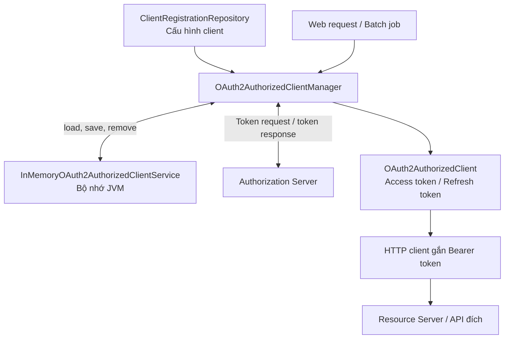
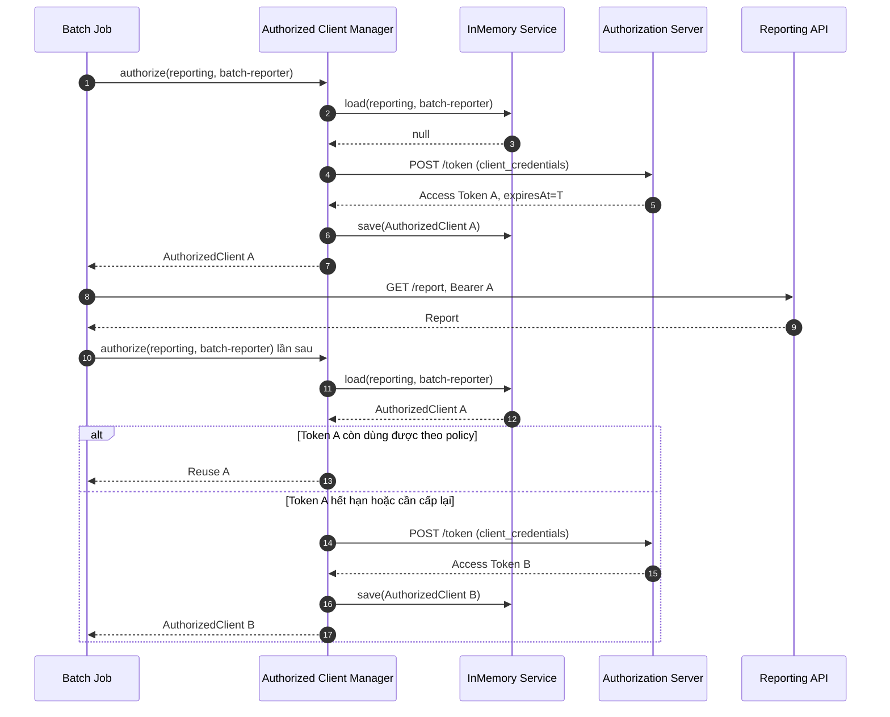

# 14.4. InMemoryOAuth2AuthorizedClientService và vòng đời dữ liệu

## 1. Vì sao cần lưu OAuth2AuthorizedClient?

Trong **Spring Security OAuth 2.0/OIDC Client**, ứng dụng có thể được Authorization Server cấp access token để gọi API được bảo vệ. Sau khi có token, ứng dụng thường gọi API nhiều lần; nếu lần nào cũng xin token mới, hệ thống sẽ tăng độ trễ, tải cho Token Endpoint và có thể gặp giới hạn tần suất. Ngược lại, nếu chỉ giữ token trong biến tạm của controller, việc quản lý token theo từng người dùng hoặc từng client registration sẽ khó nhất quán.

Spring Security biểu diễn kết quả cấp quyền bằng **`OAuth2AuthorizedClient`**. Đối tượng này gắn:

- `ClientRegistration`: cấu hình OAuth2 client, gồm client ID, grant type, scopes, provider và các endpoint.
- `principalName`: định danh chủ thể mà token đã cấp gắn với, có thể là tên principal của người dùng hoặc tên ổn định của tác vụ service-to-service.
- `OAuth2AccessToken`: access token cùng thời điểm phát hành/hết hạn và các scope được thể hiện ở token object.
- `OAuth2RefreshToken`: có thể có, tùy grant và chính sách Authorization Server.

`InMemoryOAuth2AuthorizedClientService` là một triển khai của `OAuth2AuthorizedClientService` **lưu các authorized client đã có token trong bộ nhớ JVM**. Nó hữu ích khi không cần lưu qua restart hoặc chia sẻ giữa nhiều instance. Đây là *kho token phía OAuth2 Client*, không phải Authorization Server, không phải nơi lưu authorization request có `state`/PKCE trước callback, cũng không phải Resource Server xác minh access token gửi vào API.

**Điểm phân biệt quan trọng:** service này có nhiệm vụ **load, save và remove**. Việc **xin token mới, làm mới token và quyết định token hiện tại có cần cấp lại** thuộc các thành phần như `OAuth2AuthorizedClientManager` và `OAuth2AuthorizedClientProvider`.

### 1.1. Vị trí trong kiến trúc



Một ứng dụng có thể chỉ cần OAuth2 Client để chạy job bằng `client_credentials`, hoặc kết hợp OAuth2 Login để đăng nhập người dùng rồi gọi API bằng token được cấp thay mặt người dùng.

## 2. Đừng nhầm những kho dữ liệu khác nhau

| Kiểu/thành phần | Lưu những gì? | Khi nào dùng? |
| --- | --- | --- |
| `ClientRegistration` | Client ID, secret/cách xác thực, grant, scopes, endpoints | Cấu hình cách xin token |
| `ClientRegistrationRepository` | Các client registrations theo `registrationId` | Trước và trong quá trình authorize |
| `OAuth2AuthorizationRequest` | Authorization URL, `state`, PKCE, metadata riêng một lần authorize | Trước authorization-code callback |
| `AuthorizationRequestRepository` | Authorization request đang chờ callback | Liên kết redirect với callback |
| `OAuth2AuthorizedClient` | Registration + principal name + access/refresh token | Sau khi token được cấp |
| `OAuth2AuthorizedClientService` | API lưu/tải/xóa authorized client | Vòng đời token phía client |
| `InMemoryOAuth2AuthorizedClientService` | Authorized clients trong JVM | Lựa chọn storage cụ thể |
| `OAuth2AuthorizedClientRepository` | API lưu/tải authorized client trong bối cảnh Servlet request | Trong HTTP request web |
| `OAuth2AuthorizedClientManager` | Điều phối cấp/cấp lại quyền, dùng provider và storage | Khi ứng dụng cần token |
| `SecurityContext` | `Authentication` của người dùng | Bảo vệ request của ứng dụng |

Ví dụ: một người dùng đăng nhập thành công bằng OpenID Connect, nên ứng dụng có `OidcUser` trong `Authentication`. Điều đó **không có nghĩa** `OidcUser` là authorized client, hoặc ID Token từ `OidcUser` là access token để gọi REST API. Để gọi API, ứng dụng cần **access token từ authorized client phù hợp**.

## 3. API của OAuth2AuthorizedClientService

Interface nằm ở package:

```java
org.springframework.security.oauth2.client.OAuth2AuthorizedClientService
```

Các method chính, rút gọn JavaDoc:

```java
public interface OAuth2AuthorizedClientService {

    <T extends OAuth2AuthorizedClient> T loadAuthorizedClient(
        String clientRegistrationId,
        String principalName);

    void saveAuthorizedClient(
        OAuth2AuthorizedClient authorizedClient,
        Authentication principal);

    void removeAuthorizedClient(
        String clientRegistrationId,
        String principalName);
}
```

### 3.1. loadAuthorizedClient

Thao tác này tra cứu theo **cặp khóa** `(clientRegistrationId, principalName)`:

```java
OAuth2AuthorizedClient client =
    authorizedClientService.loadAuthorizedClient(
        "reporting", "batch-reporter");

if (client == null) {
    // Chưa có authorized client dưới khóa này.
}
```

- `clientRegistrationId` là khóa cấu hình trong Spring Security, chẳng hạn `reporting`.
- `principalName` là tên chủ thể được dùng lúc authorized client được lưu.
- Khi không có dữ liệu tương ứng, interface Servlet thường trả `null`.

**Phương thức `load` không gọi Token Endpoint để xin token mới** và không kiểm tra access token còn sử dụng được. Nó chỉ lấy dữ liệu đã lưu.

### 3.2. saveAuthorizedClient

`saveAuthorizedClient(authorizedClient, principal)` lưu authorized client gắn với tên principal của `Authentication`. Bản lưu trước dưới cùng khóa có thể được thay bằng bản mới:

```text
save(
    registrationId = "reporting",
    principalName  = "batch-reporter",
    accessToken    = A
)

Map[("reporting", "batch-reporter")] = OAuth2AuthorizedClient(A)
```

Nếu token được cấp mới, manager có thể gọi `save` để thay bản ghi. Tuy nhiên, bản lưu thành công **không chứng minh** token có audience/scope phù hợp với API đích. Và việc dùng sai `Authentication.getName()` lúc lưu có thể khiến lần tra cứu kế tiếp không thấy entry.

### 3.3. removeAuthorizedClient

`removeAuthorizedClient(registrationId, principalName)` xóa bản sao được lưu phía client:

```java
authorizedClientService.removeAuthorizedClient(
    "reporting", "batch-reporter");
```

**Xóa khỏi RAM khác với thu hồi token ở Authorization Server.** Token vẫn có thể được Resource Server chấp nhận đến khi hết hạn hoặc bị revoke thông qua cơ chế/chính sách provider hỗ trợ (ví dụ Token Revocation Endpoint theo RFC 7009).

### 3.4. Những khả năng interface không cam kết

`OAuth2AuthorizedClientService` không cung cấp một contract chung cho việc duyệt toàn bộ tokens, xóa tất cả tokens của một user, tự cleanup theo TTL, tự đồng bộ đa instance hoặc tự tạo audit trail. Nếu hệ thống cần các hành vi đó, phải thiết kế storage và chính sách vòng đời thích hợp.

## 4. Lưu trữ trong RAM: nhanh nhưng có giới hạn

Lớp triển khai:

```java
org.springframework.security.oauth2.client.InMemoryOAuth2AuthorizedClientService
```

Có thể hình dung:

```text
JVM process A
└── InMemoryOAuth2AuthorizedClientService
    ├── (corporate, user-101) -> Authorized Client A
    ├── (corporate, user-202) -> Authorized Client B
    ├── (crm, user-101)       -> Authorized Client C
    └── (reporting, batch)    -> Authorized Client D

JVM process B
└── InMemoryOAuth2AuthorizedClientService
    └── Map riêng, không tự đồng bộ với process A
```

Triển khai lưu theo khóa tổ hợp, thường liên quan `OAuth2AuthorizedClientId`, để phân biệt client registration và principal. Điều này cho phép cùng một provider có nhiều người dùng với token khác nhau và cùng một người dùng có nhiều authorized clients.

| Đặc tính | Hệ quả |
| --- | --- |
| Trong heap JVM | Truy xuất nhanh, không cần database |
| Theo từng process | Pod A không tự chia sẻ với pod B |
| Không bền vững | Restart hoặc thay pod mất các entry cũ |
| Concurrent map trong process | Không tự bảo đảm atomic refresh giữa các request/nodes |
| Token có `expiresAt` | Không tự đồng nghĩa entry được xóa khỏi map ở thời điểm đó |
| Có thể giữ refresh token | Cần bảo vệ heap dump, debugger, logs và quyền truy cập process |
| Không có audit bền vững | Không phù hợp nếu nghiệp vụ cần lịch sử lưu token |
| Số entry tăng theo keys | Cần chú ý retention khi có nhiều principal lâu không quay lại |

Việc map an toàn khi nhiều thread cùng truy cập **không tương đương** một hệ thống token refresh có đồng bộ phân tán. Hai tác vụ vẫn có thể cùng thấy access token hết hạn và đồng thời xin token mới, nhất là với refresh token rotation.

## 5. Cấu hình Spring Boot Servlet

### 5.1. Dependency

Ví dụ Gradle:

```gradle
dependencies {
    implementation 'org.springframework.boot:spring-boot-starter-web'
    implementation 'org.springframework.boot:spring-boot-starter-security'
    implementation 'org.springframework.boot:spring-boot-starter-oauth2-client'
}
```

### 5.2. Khai báo service tường minh

```java
@Configuration
class AuthorizedClientStorageConfiguration {

    @Bean
    OAuth2AuthorizedClientService authorizedClientService(
            ClientRegistrationRepository clientRegistrations) {

        return new InMemoryOAuth2AuthorizedClientService(
            clientRegistrations);
    }
}
```

`ClientRegistrationRepository` ở đây cung cấp cấu hình các OAuth2 client đã đăng ký. `InMemoryOAuth2AuthorizedClientService` giữ các token đã được cấp cho những client đó.

Spring Boot/Spring Security có thể tự tạo những bean mặc định dựa trên auto-configuration và những bean đã có. Khi tự khai báo một service, cần biết **authorized-client repository/manager nào đang thực sự sử dụng bean đó**. Không nên giả định mọi luồng OAuth2 sẽ lưu vào service vừa khai báo nếu ứng dụng đã cấu hình repository khác.

Các ví dụ Java trong bài lược bỏ một số `import` thông dụng của Spring Security và Spring Framework.

### 5.3. Registration dành cho client_credentials

```yaml
spring:
  security:
    oauth2:
      client:
        registration:
          reporting:
            provider: company-auth
            client-id: ${REPORTING_CLIENT_ID}
            client-secret: ${REPORTING_CLIENT_SECRET}
            authorization-grant-type: client_credentials
            scope:
              - report.read
        provider:
          company-auth:
            token-uri: https://auth.example.com/oauth2/token
```

`reporting` là `registrationId` nội bộ của Spring. Client ID/secret là thông tin do Authorization Server cấp, phải được quản lý bằng biến môi trường hoặc secret manager thay vì commit vào repository.

`client_credentials` là quyền của **service**, không tạo đăng nhập người dùng và không cần browser authorization callback.

## 6. Vòng đời một authorized client trong batch job

Giả sử một job dùng `client_credentials` gọi Reporting API mỗi 15 phút.



Service thực hiện thao tác lưu và đọc. **Manager/provider** đánh giá token có thể tái sử dụng, cần cấp mới hay có grant thích hợp để làm mới hay không.

Trong `client_credentials`, Authorization Server thông thường không cấp refresh token; client có thể dùng chính client credentials để xin access token mới. Với Authorization Code/OIDC login, provider có thể cấp refresh token, nên vòng đời khác.

### 6.1. Tạo manager phù hợp background job

```java
@Configuration
class ReportingAuthorizedClientConfiguration {

    @Bean
    OAuth2AuthorizedClientManager authorizedClientManager(
            ClientRegistrationRepository registrations,
            OAuth2AuthorizedClientService authorizedClients) {

        OAuth2AuthorizedClientProvider provider =
            OAuth2AuthorizedClientProviderBuilder.builder()
                .clientCredentials()
                .build();

        var manager =
            new AuthorizedClientServiceOAuth2AuthorizedClientManager(
                registrations, authorizedClients);

        manager.setAuthorizedClientProvider(provider);
        return manager;
    }
}
```

`AuthorizedClientServiceOAuth2AuthorizedClientManager` phù hợp khi không có `HttpServletRequest`, chẳng hạn scheduler hoặc background worker. Ở đây chỉ cấu hình `clientCredentials()` vì job không cần tương tác đăng nhập.

### 6.2. Sử dụng authorized client để gọi API

```java
@Service
class ReportingGateway {

    private final OAuth2AuthorizedClientManager manager;
    private final RestClient reportingApi;

    ReportingGateway(
            OAuth2AuthorizedClientManager manager,
            RestClient.Builder restClientBuilder) {

        this.manager = manager;
        this.reportingApi = restClientBuilder
            .baseUrl("https://reporting-api.example.com")
            .build();
    }

    String dailySummary() {
        OAuth2AuthorizeRequest request =
            OAuth2AuthorizeRequest.withClientRegistrationId("reporting")
                .principal("batch-reporter")
                .build();

        OAuth2AuthorizedClient client = manager.authorize(request);

        if (client == null) {
            throw new IllegalStateException(
                "Reporting client could not be authorized");
        }

        return reportingApi.get()
            .uri("/api/reports/daily")
            .headers(headers -> headers.setBearerAuth(
                client.getAccessToken().getTokenValue()))
            .retrieve()
            .body(String.class);
    }
}
```

Ví dụ dùng `RestClient` của Spring Framework 6.1+. Ở ứng dụng thực tế có thể cấu hình tích hợp OAuth2 cho `RestClient` hoặc `WebClient` để tự gắn access token, nhưng luôn phải bảo đảm **đúng registration được dùng với đúng API**.

`principal("batch-reporter")` là tên dùng để lưu authorized client của job. Nó không chứng minh một người dùng tên `batch-reporter` đã đăng nhập.

## 7. Load và authorize khác nhau

```java
// Chỉ lấy dữ liệu đã lưu:
OAuth2AuthorizedClient stored =
    authorizedClientService.loadAuthorizedClient(
        "reporting", "batch-reporter");

// Có thể reuse hoặc xin token mới theo provider/grant đã cấu hình:
OAuth2AuthorizedClient current =
    authorizedClientManager.authorize(
        OAuth2AuthorizeRequest
            .withClientRegistrationId("reporting")
            .principal("batch-reporter")
            .build());
```

| Hành vi | `loadAuthorizedClient` | `authorizedClientManager.authorize` |
| --- | --- | --- |
| Tìm entry theo registration/principal | Có | Thường có |
| Xin token mới khi thiếu | Không | Có thể, nếu grant phù hợp |
| Làm mới/cấp lại token hết hạn | Không | Có thể theo provider đã cấu hình |
| Ghi token mới về service | Không | Có thể thông qua success handler |
| Bắt buộc liên hệ IdP mỗi lần | Không | Không; có thể reuse |
| Chắc chắn API đích chấp nhận token | Không | Không; Resource Server còn kiểm tra |
| Có thể không tìm/không cấp được | Có | Có |

Một token đã lưu chưa chắc còn hạn, và một token còn hạn chưa chắc không bị revoke hoặc có quyền truy cập API. Vì vậy business code nên dùng **manager hoặc HTTP client integration** thay vì gọi `load` rồi gửi token thô không kiểm soát vòng đời.

### 7.1. ExpiresAt khác TTL của entry

Giả sử:

```text
10:00  Lưu token A với expiresAt=10:30.
10:15  Manager có thể reuse A.
10:31  Chưa có lời gọi mới. Entry A vẫn có thể nằm trong map.
11:00  Manager chạy, thấy token hết hạn, xin token B.
11:01  Save B thay A.
```

`OAuth2AccessToken.getExpiresAt()` là metadata cho việc sử dụng token, **không mặc nhiên là lệnh xóa entry khỏi RAM**. Nếu cần dọn expired entries để giảm footprint, ứng dụng cần retention/cleanup policy hoặc storage có expiration tương ứng.

Một số provider/manager coi token cần cấp lại **trước** thời điểm hết hạn bằng một khoảng dự phòng (clock skew). Đừng mặc định một token chỉ còn vài giây vẫn chắc chắn đủ thời gian để gọi API thành công.

### 7.2. Refresh token rotation và concurrency

Trong Authorization Code/OIDC Login, provider có thể cấp refresh token. Khi bật **refresh token rotation**, một lần refresh có thể trả refresh token mới R2 và vô hiệu R1. Nếu hai request cùng đọc authorized client cũ và đồng thời dùng R1:

```text
Request A: refresh với R1 -> thành công, nhận access A2 + refresh R2
Request B: refresh với R1 -> có thể bị invalid_grant
```

Một map thread-safe không tự bảo đảm chỉ có một refresh operation hoặc update mới nhất được ghi đúng trên toàn cluster. Nếu đây là yêu cầu quan trọng, phải thiết kế coordination/transaction phù hợp và kiểm tra chính sách provider.

## 8. Với OAuth2 Login, token thuộc về người dùng nào?

Trong web app dùng `oauth2Login()`:

1. Browser tới Authorization Endpoint của OIDC Provider.
2. Provider redirect browser về callback kèm authorization code.
3. Backend đổi code lấy token và xác minh ID Token theo OIDC.
4. Spring Security tạo `Authentication`/principal của người dùng.
5. Authorized client có thể được lưu để backend dùng access token gọi API thay người dùng.

Ví dụ một web app:

```yaml
spring:
  security:
    oauth2:
      client:
        registration:
          corporate:
            provider: staff-oidc
            client-id: ${CORPORATE_CLIENT_ID}
            client-secret: ${CORPORATE_CLIENT_SECRET}
            authorization-grant-type: authorization_code
            redirect-uri: "{baseUrl}/login/oauth2/code/{registrationId}"
            scope: openid, profile, email, report.read
        provider:
          staff-oidc:
            issuer-uri: https://idp.example.com/realms/staff
```

```java
@Configuration
class LoginSecurityConfig {

    @Bean
    SecurityFilterChain webSecurity(HttpSecurity http) throws Exception {
        http
            .authorizeHttpRequests(auth -> auth
                .requestMatchers("/", "/assets/**").permitAll()
                .anyRequest().authenticated())
            .oauth2Login(Customizer.withDefaults())
            .oauth2Client(Customizer.withDefaults());

        return http.build();
    }
}
```

`oauth2Login()` phục vụ đăng nhập, còn `oauth2Client()` hỗ trợ các chức năng OAuth2 Client liên quan. Browser thường tiếp tục dùng **session cookie** để truy cập web app, trong khi backend dùng **access token** để gọi API. Hai credential có nhiệm vụ và vòng đời khác nhau.

### 8.1. Hai user cùng một registration vẫn có token riêng

```text
(corporate, sub-101) -> OAuth2AuthorizedClient của user A
(corporate, sub-202) -> OAuth2AuthorizedClient của user B
(reporting, batch)   -> OAuth2AuthorizedClient của service job
```

Cặp `(registrationId, principalName)` là chìa khóa. `principalName` thường lấy từ `Authentication.getName()` trong luồng user, nhưng tên này phụ thuộc cấu hình principal. Nếu đổi từ `sub` sang email sau deploy, những entry trước đó có thể không còn được tìm thấy.

**Không dùng email làm khóa nhận dạng ổn định theo thói quen** nếu ứng dụng có OIDC; định danh issuer + subject đáng tin thường phù hợp hơn để liên kết tài khoản nội bộ. Với multi-tenant, cần bảo đảm registration và principal naming không gây va chạm giữa các nguồn danh tính.

### 8.2. Thử đọc trạng thái mà không làm lộ token

Ví dụ endpoint nội bộ chỉ cho người có quyền thích hợp:

```java
@RestController
class AuthorizedClientStatusController {

    private final OAuth2AuthorizedClientService clients;

    AuthorizedClientStatusController(
            OAuth2AuthorizedClientService clients) {
        this.clients = clients;
    }

    @GetMapping("/internal/oauth2/status")
    Map<String, Object> status(
            OAuth2AuthenticationToken authentication) {

        String registrationId =
            authentication.getAuthorizedClientRegistrationId();

        OAuth2AuthorizedClient client = clients.loadAuthorizedClient(
            registrationId, authentication.getName());

        if (client == null) {
            return Map.of("storedInThisService", false);
        }

        OAuth2AccessToken token = client.getAccessToken();

        return Map.of(
            "storedInThisService", true,
            "registrationId", registrationId,
            "expiresAt", token.getExpiresAt().toString()
        );
    }
}
```

Ví dụ chỉ trả metadata, **không trả token value, refresh token hoặc client secret**. Cần bảo vệ `/internal/**` bằng authorization policy phù hợp. Nếu authorized client đang được lưu qua repository khác, `null` từ service này không chứng minh ứng dụng chưa có token ở nơi khác.

## 9. OAuth2AuthorizedClientService khác OAuth2AuthorizedClientRepository

Trong ngăn xếp Servlet:

- **`OAuth2AuthorizedClientService`** có API độc lập với `HttpServletRequest`/`HttpServletResponse`; lưu/tải/xóa theo registration/principal. Phù hợp cho tác vụ nền.
- **`OAuth2AuthorizedClientRepository`** phục vụ các hoạt động trong HTTP request, có thể dựa vào `Authentication`, request, response và sử dụng service ở tầng dưới.
- **`AuthorizationRequestRepository`** là một thành phần **khác**, lưu authorization request chứa `state`/PKCE trước khi callback hoàn tất. Nó không lưu access token đã được cấp để gọi API.

Trong cấu hình Servlet phổ biến, `AuthenticatedPrincipalOAuth2AuthorizedClientRepository` sử dụng `OAuth2AuthorizedClientService` cho principal đã xác thực và có thể dùng HTTP session repository khi chưa xác thực. Vì vậy phải xác định **repository/manager đang được wiring** trước khi kết luận service in-memory chứa mọi authorized client của web app.

| Ngữ cảnh | Manager phù hợp thường gặp |
| --- | --- |
| Servlet request có browser/user | `DefaultOAuth2AuthorizedClientManager` với `OAuth2AuthorizedClientRepository` |
| Batch/scheduler ngoài Servlet request | `AuthorizedClientServiceOAuth2AuthorizedClientManager` với `OAuth2AuthorizedClientService` |
| WebFlux request | `DefaultReactiveOAuth2AuthorizedClientManager` |
| WebFlux background task | `AuthorizedClientServiceReactiveOAuth2AuthorizedClientManager` |

Nếu dùng manager dành cho HTTP request trong một scheduled job không có request context, ứng dụng có thể lỗi hoặc không có ngữ cảnh cần thiết.

## 10. Logout không tự đồng nghĩa xóa và revoke token

Các vòng đời khác nhau:

| Sự kiện | Hệ quả |
| --- | --- |
| Browser logout khỏi web app | SecurityContext/session có thể bị xóa |
| `removeAuthorizedClient` | Local authorized-client entry bị xóa |
| Token Revocation Endpoint | Authorization Server nhận yêu cầu thu hồi token nếu hỗ trợ |
| OIDC RP-Initiated Logout | Provider xử lý phiên SSO; không mặc nhiên thu hồi mọi access token |
| JVM restart | In-memory entries biến mất |
| Access token hết hạn | Entry có thể vẫn ở RAM cho tới khi thay/xóa |

Vì vậy **không giả định web logout tự xóa mọi entry trong `InMemoryOAuth2AuthorizedClientService`**, và cũng không khẳng định local removal đã làm token vô hiệu phía IdP.

Ví dụ một logout handler chỉ dọn authorized client cho registration `corporate`:

```java
@Bean
LogoutHandler authorizedClientCleanup(
        OAuth2AuthorizedClientService service) {

    return (request, response, authentication) -> {
        if (authentication != null) {
            service.removeAuthorizedClient(
                "corporate", authentication.getName());
        }
    };
}
```

Có thể gắn vào Servlet logout DSL:

```java
http.logout(logout -> logout
    .addLogoutHandler(authorizedClientCleanup));
```

Đây là ví dụ **local cleanup cho một registration**, không phải giải pháp revoke token hoặc clear all cho mọi user/tenant. Nếu ứng dụng có nhiều registrations, phải xác định những entry nào cần được xóa; interface service không cung cấp một method tổng quát để liệt kê tất cả.

## 11. Khi nào nên dùng in-memory?

**Phù hợp** khi ứng dụng chạy một instance, số principal nhỏ, token có thể xin lại sau restart, không cần chia sẻ giữa pod và không có yêu cầu lưu trữ bền vững. Các tình huống dễ gặp là demo, local development, test hoặc batch service `client_credentials`.

**Cân nhắc storage khác** khi ứng dụng có nhiều instance, refresh token cần tồn tại qua rolling deployment, yêu cầu TTL/cleanup, audit, thu hồi token theo user/tenant, chia sẻ dữ liệu hoặc kiểm soát refresh token rotation có tính nhất quán cao.

Không có nghĩa in-memory luôn không an toàn. Mức độ phù hợp phụ thuộc grant type, topology, số user và hậu quả khi token bị mất hoặc lưu quá lâu.

### 11.1. JDBC và storage chia sẻ

Spring Security có implementation `JdbcOAuth2AuthorizedClientService` cho một số kiến trúc Servlet:

```java
@Bean
OAuth2AuthorizedClientService jdbcAuthorizedClients(
        JdbcOperations jdbc,
        ClientRegistrationRepository registrations) {

    return new JdbcOAuth2AuthorizedClientService(jdbc, registrations);
}
```

Ví dụ chỉ cho thấy **cách tạo bean**. Cần tạo đúng schema SQL, datasource, migration, transaction và cơ chế bảo vệ secrets theo tài liệu của phiên bản Spring Security.

Khi dùng JDBC/Redis hoặc custom storage:

1. Giữ khóa `(registrationId, principalName)` nhất quán, có chính sách tenant/issuer rõ ràng.
2. Bảo vệ access token và refresh token bằng access control, TLS, mã hóa lưu trữ khi cần.
3. Giữ đúng giá trị token, scopes, issuedAt/expiresAt, refresh token khi serialize và đọc lại.
4. Đảm bảo concurrency/transaction không ghi đè refresh token mới bằng dữ liệu cũ.
5. Định nghĩa TTL/cleanup, phân biệt access-token expiry với retention của authorized client.
6. Xử lý storage outage, không bỏ qua token validation hoặc dùng nhầm token khi storage lỗi.
7. Quy định session/logout/revocation phù hợp và có kế hoạch migration khi đổi principal naming.

Shared Spring Session **không đồng nghĩa** shared authorized-client service nếu wiring vẫn dùng in-memory service mỗi pod.

## 12. WebFlux dùng implementation reactive khác

Class đang học là API Servlet/non-reactive:

```java
OAuth2AuthorizedClientService
InMemoryOAuth2AuthorizedClientService
AuthorizedClientServiceOAuth2AuthorizedClientManager
ClientRegistrationRepository
```

Trong WebFlux tương ứng có:

```java
ReactiveOAuth2AuthorizedClientService
InMemoryReactiveOAuth2AuthorizedClientService
AuthorizedClientServiceReactiveOAuth2AuthorizedClientManager
ReactiveClientRegistrationRepository
```

Ví dụ WebFlux:

```java
@Configuration
class ReactiveStorageConfiguration {

    @Bean
    ReactiveOAuth2AuthorizedClientService reactiveAuthorizedClients(
            ReactiveClientRegistrationRepository registrations) {

        return new InMemoryReactiveOAuth2AuthorizedClientService(
            registrations);
    }
}
```

Khi dùng `ReactiveOAuth2AuthorizedClientManager`, kết quả authorize là `Mono<OAuth2AuthorizedClient>`:

```java
Mono<OAuth2AuthorizedClient> authorized =
    reactiveAuthorizedClientManager.authorize(authorizeRequest);
```

Trong đoạn trên, `authorizeRequest` đã được tạo bằng `OAuth2AuthorizeRequest`. Tiếp tục xử lý bằng `flatMap` và `WebClient`, tránh `.block()` trên event loop. Reactive in-memory service **vẫn là bộ nhớ của một process**, không tự giải quyết chia sẻ nhiều instance hoặc refresh concurrency.

## 13. Xử lý lỗi theo đúng tầng

| Triệu chứng | Nguyên nhân có thể | Hướng xử lý |
| --- | --- | --- |
| `loadAuthorizedClient` trả `null` | Chưa lưu, sai registration/principal, hoặc restart | Kiểm tra khóa và wiring service/repository |
| Token có trong store nhưng API trả `401` | Hết hạn, revoked, sai audience, token không gửi đi | Kiểm tra manager, expiry và Resource Server |
| API trả `403` | Thiếu scope/authority/permission | Kiểm tra grant scopes và policy API |
| `invalid_client` tại Token Endpoint | Sai secret/client authentication method | Kiểm tra ClientRegistration và IdP |
| `invalid_grant` khi refresh | Refresh token hết hạn, revoked, hoặc rotation race | Kiểm tra refresh flow/concurrency |
| Sau restart phải xin token mới | Storage in-memory biến mất | Chấp nhận đặc tính hoặc dùng persistent store |
| Một số pod có token, một số pod không | Map lưu riêng từng JVM | Shared store hoặc thiết kế token riêng từng pod |
| Logout nhưng token còn trong service | Chưa cleanup hoặc repository khác giữ token | Kiểm tra wiring/logout policy |
| Heap tăng dài hạn | Nhiều authorized clients không được dọn | Retention, quota, cleanup |
| Token cũ không tìm được sau đổi username field | Principal name trong khóa đã thay đổi | Chọn định danh ổn định và migration |
| Hai request cùng refresh token | Race condition/rotation policy | Coordination, atomic update, provider behavior |
| Job không reuse token | Principal name thay đổi mỗi lần hoặc dùng manager khác | Dùng khóa ổn định và đúng service |
| WebFlux không inject được service | Dùng interface Servlet thay vì reactive | Chọn stack/API phù hợp |

**Không chữa tất cả lỗi API bằng cách xóa token.** Nếu `403` do thiếu quyền, xin lại token với cùng scope thường không giải quyết được. Nếu `401` do sai audience, cần sửa client/API configuration. Nếu lỗi network, retry/backoff phải theo quy tắc HTTP và hệ thống, không được hiểu đơn giản là token expiry.

## 14. Bảo mật token trong RAM và logs

Access token và refresh token đều là credential. Đặc biệt access token dạng bearer có thể được sử dụng bởi bên nắm giữ nếu Resource Server chưa có ràng buộc bổ sung.

- Không log raw access token, refresh token, client secret hoặc các header `Authorization`.
- Không trả toàn bộ `OAuth2AuthorizedClient` từ endpoint chẩn đoán.
- Bảo vệ heap dump, debugger, process permissions và diagnostic endpoints.
- Không truyền refresh token tới frontend nếu backend quản lý nó.
- Gửi access token chỉ tới Resource Server đúng audience/scopes.
- Không dùng ID Token OIDC thay access token để gọi API.
- Với nhiều tenant, giới hạn quyền truy cập authorized client theo registration/principal phù hợp.
- Khi chuyển sang JDBC/Redis, dùng mã hóa lưu trữ, TLS, quyền tối thiểu và chính sách retention nếu cần.
- Không giữ token mãi chỉ để tăng cache hit; dọn dữ liệu theo chính sách.
- Nếu cần audit, log metadata phù hợp (registration ID, thời gian/token status) thay vì giá trị token.

Mã hóa token ngay trong RAM có thể có ích trong một số thiết kế, nhưng ứng dụng vẫn phải giải mã để dùng. Bảo vệ process, secrets và quyền truy cập hệ điều hành vẫn là nền tảng.

## 15. Tình huống thực hành

### Tình huống A — Batch job một instance

Job gọi Reports API mỗi 15 phút bằng `client_credentials`; token có hạn một giờ, mất token sau restart là chấp nhận được.

**Hướng triển khai:** dùng `InMemoryOAuth2AuthorizedClientService` và `AuthorizedClientServiceOAuth2AuthorizedClientManager`. Manager có thể reuse token và xin token mới khi cần; theo dõi rate limit của IdP.

### Tình huống B — Mười pod chạy cùng batch job

Mỗi pod khởi tạo service in-memory riêng, nên sau deployment cả mười pod có thể đồng thời xin token mới.

**Phân tích:** hành vi này đúng với storage per-process. Nếu IdP giới hạn tần suất hoặc token refresh cần phối hợp, cân nhắc shared storage/coordination, hoặc chiến lược client credentials riêng cho mỗi pod.

### Tình huống C — User logout nhưng token còn trong RAM

Ứng dụng hủy `JSESSIONID`, tuy nhiên service vẫn lưu `(corporate, sub-101)`.

**Phân tích:** logout session và xóa authorized client là hai việc riêng. Nếu policy yêu cầu, thêm cleanup handler phù hợp và cân nhắc token revocation.

### Tình huống D — Token đã hết hạn vẫn tải được

Developer dùng `loadAuthorizedClient`, lấy token value và gửi thẳng tới API.

**Phân tích:** service chỉ đọc entry, không tự làm mới token. Dùng manager/HTTP client integration thay vì tự xử lý từ record cũ.

### Tình huống E — Đổi tên principal từ `sub` sang email

Entry cũ lưu dưới `(corporate, sub-101)`, nhưng code mới tra `(corporate, user@example.com)`.

**Phân tích:** cặp khóa đã đổi. Cần có chiến lược principal naming ổn định/migration; tránh dùng email làm định danh bất biến theo thói quen.

### Tình huống F — Refresh token rotation và hai request đồng thời

Hai request dùng refresh token R1, provider cấp R2 cho request đầu rồi từ chối request thứ hai.

**Phân tích:** cần quản lý concurrency, đảm bảo lưu bản mới nhất và không retry vô hạn với R1. Thread-safe map không giải quyết trọn vẹn refresh concurrency.

### Tình huống G — Portal nhiều pod cần giữ refresh token qua rollout

Người dùng không muốn phải cấp lại consent sau mỗi deployment.

**Hướng triển khai:** cân nhắc `JdbcOAuth2AuthorizedClientService` hoặc shared store đáng tin, kiểm tra authorized-client repository thực sự sử dụng nó, và thiết kế encryption, cleanup, transaction, token rotation.

## 16. Câu hỏi ôn tập

**1. InMemoryOAuth2AuthorizedClientService giữ những gì?**  
`OAuth2AuthorizedClient` gồm client registration, principal name, access token và refresh token khi được cấp, trong bộ nhớ JVM.

**2. Authorized client được tra theo khóa nào?**  
Theo cặp `(clientRegistrationId, principalName)`.

**3. `loadAuthorizedClient` có tự gọi Token Endpoint nếu token hết hạn không?**  
Không. Nó chỉ đọc dữ liệu đã lưu; manager/provider mới điều phối việc cấp lại.

**4. Token hết hạn có tự biến mất khỏi map không?**  
Không có cam kết như vậy. Access token expiry và retention/TTL của entry là hai khái niệm khác nhau.

**5. Vì sao token mất sau restart?**  
Vì in-memory store tồn tại trong heap của process đã dừng.

**6. Cùng một service bean có được chia sẻ tự động giữa nhiều pod không?**  
Không. Mỗi JVM có RAM riêng.

**7. `removeAuthorizedClient` có thu hồi token ở IdP không?**  
Không. Nó xóa local record, còn revocation là cơ chế riêng.

**8. Vì sao background `client_credentials` job nên dùng AuthorizedClientServiceOAuth2AuthorizedClientManager?**  
Vì manager này phù hợp với ngữ cảnh không có Servlet request và làm việc với `OAuth2AuthorizedClientService`.

**9. OAuth2AuthorizedClientService và AuthorizationRequestRepository khác nhau thế nào?**  
Service giữ token **đã cấp**, còn authorization-request repository giữ request **đang chờ callback** với state/PKCE.

**10. WebFlux dùng lớp tương ứng nào?**  
`InMemoryReactiveOAuth2AuthorizedClientService` và API reactive liên quan.

**11. Logout có luôn xóa tất cả authorized clients không?**  
Không; phụ thuộc logout handler, wiring repository/service và token policy.

**12. API trả `403` dù token còn hạn thì nên làm gì?**  
Kiểm tra scope, roles/quyền và Resource Server policy; không mặc định xin lại token sẽ giải quyết.

**13. Lúc nào nên dùng persistent/shared storage?**  
Khi cần token qua restart, chia sẻ đa instance, cleanup/audit, thu hồi theo user/tenant, hoặc coordination cho refresh token rotation.

**14. Vì sao phải bảo vệ heap dump?**  
Vì in-memory service có thể giữ access/refresh token là credential có giá trị sử dụng.

## 17. Tài liệu tham khảo chính thức

- [Spring Security — OAuth 2.0 Client (Servlet)](https://docs.spring.io/spring-security/reference/servlet/oauth2/client/index.html)
- [Spring Security — Authorized Clients](https://docs.spring.io/spring-security/reference/servlet/oauth2/client/authorized-clients.html)
- [Spring Security API — OAuth2AuthorizedClientService](https://docs.spring.io/spring-security/site/docs/current/api/org/springframework/security/oauth2/client/OAuth2AuthorizedClientService.html)
- [Spring Security API — InMemoryOAuth2AuthorizedClientService](https://docs.spring.io/spring-security/site/docs/current/api/org/springframework/security/oauth2/client/InMemoryOAuth2AuthorizedClientService.html)
- [Spring Security API — OAuth2AuthorizedClient](https://docs.spring.io/spring-security/site/docs/current/api/org/springframework/security/oauth2/client/OAuth2AuthorizedClient.html)
- [Spring Security API — AuthorizedClientServiceOAuth2AuthorizedClientManager](https://docs.spring.io/spring-security/site/docs/current/api/org/springframework/security/oauth2/client/AuthorizedClientServiceOAuth2AuthorizedClientManager.html)
- [Spring Security API — JdbcOAuth2AuthorizedClientService](https://docs.spring.io/spring-security/site/docs/current/api/org/springframework/security/oauth2/client/JdbcOAuth2AuthorizedClientService.html)
- [Spring Security — Reactive OAuth 2.0 Client](https://docs.spring.io/spring-security/reference/reactive/oauth2/client/index.html)
- [RFC 6749 — OAuth 2.0 Authorization Framework](https://www.rfc-editor.org/rfc/rfc6749)
- [RFC 7009 — OAuth 2.0 Token Revocation](https://www.rfc-editor.org/rfc/rfc7009)

**Ghi nhớ:** `InMemoryOAuth2AuthorizedClientService` lưu **authorized clients theo cặp registration/principal trong một JVM**. Nó chỉ đảm nhiệm load/save/remove; việc xin và cấp lại token thuộc manager/provider. Token hết hạn không đồng nghĩa entry tự biến mất, logout local không mặc nhiên revoke token, và nhiều pods không chia sẻ được RAM. Dùng in-memory khi chấp nhận những đặc tính đó; nếu cần tính bền vững, cleanup hoặc phối hợp refresh, hãy thiết kế storage/chính sách phù hợp.
