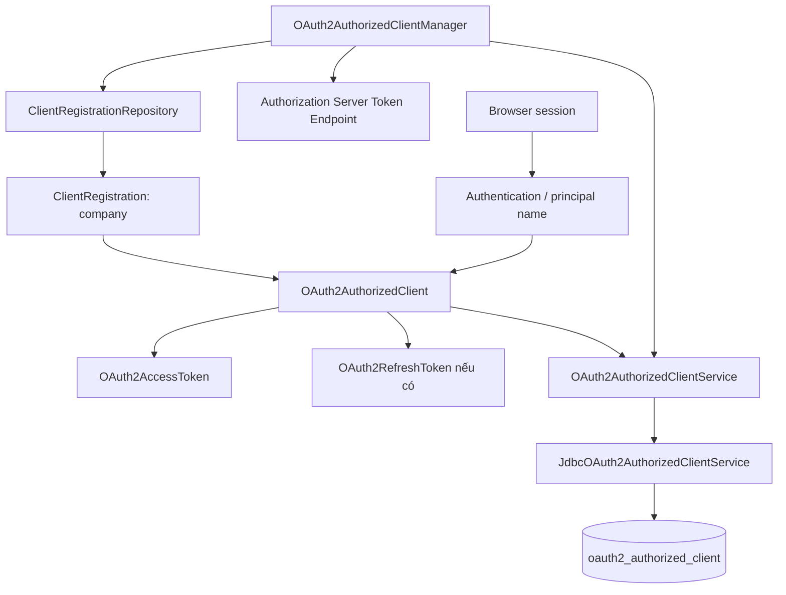
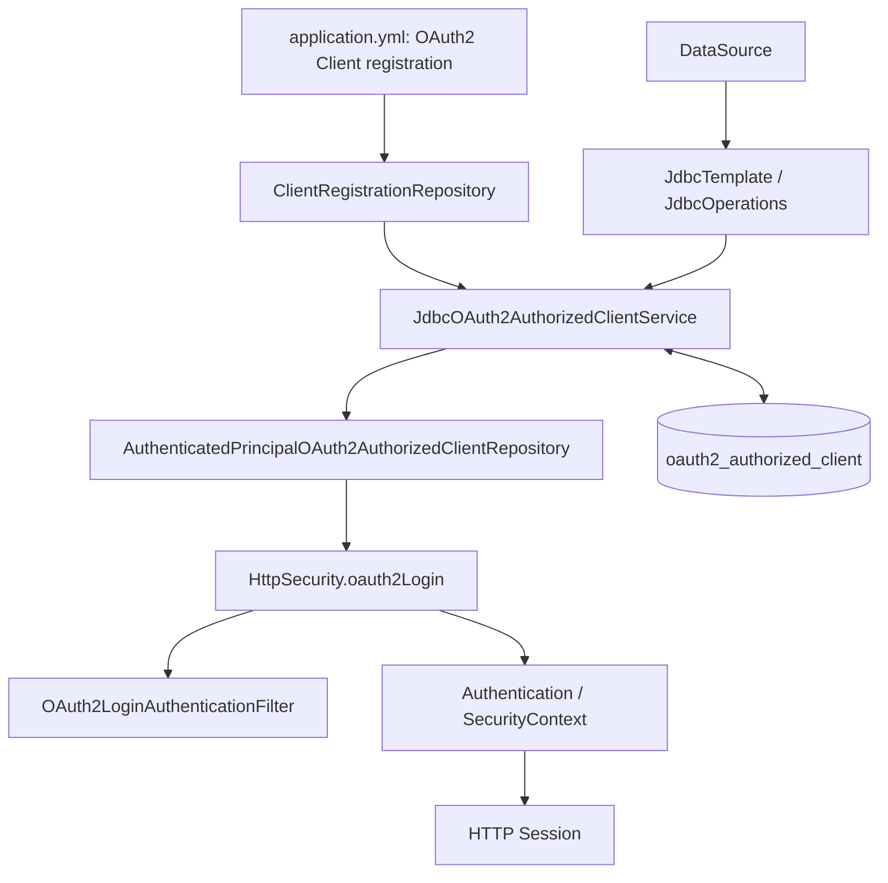
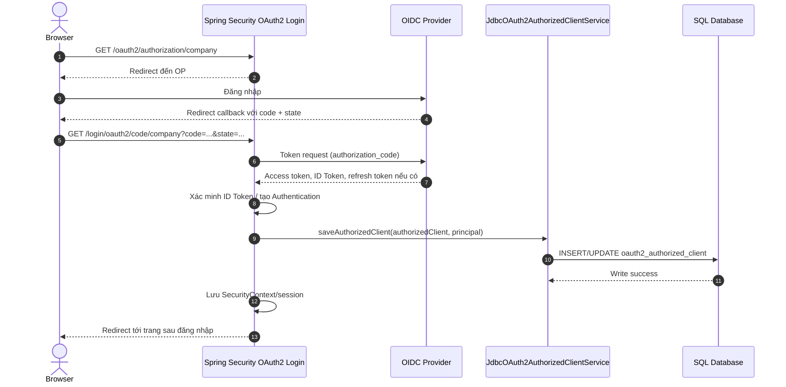
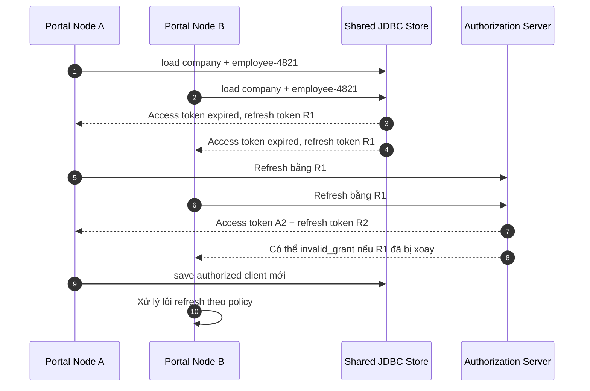

# 14.5. JdbcOAuth2AuthorizedClientService và các yêu cầu lưu trữ

## 1. Bài toán: Access Token và Refresh Token cần tồn tại ở đâu?

Trong một ứng dụng **Spring Security OAuth 2.0 / OIDC Client**, sau khi người dùng đăng nhập bằng Authorization Code Flow, Spring Security có thể nhận được:

- **Access token** dùng để gọi API/Resource Server theo quyền đã được cấp.
- **Refresh token**, nếu Authorization Server cấp và chính sách cho phép.
- **ID Token** dành cho ứng dụng OIDC Client xác thực danh tính người dùng.

Ứng dụng có thể cần sử dụng access token ở những request tiếp theo, hoặc làm mới token khi nó hết hạn. Nếu chỉ lưu trạng thái authorized client trong bộ nhớ của một tiến trình, ứng dụng sẽ gặp các vấn đề vận hành khi **restart, triển khai nhiều instance hoặc cần một kho token dùng chung**.

Ví dụ **Employee Portal** có ba instance:

```text
Browser
   |
   v
Load Balancer
   |
   +---- Portal instance A
   |
   +---- Portal instance B
   |
   +---- Portal instance C
             |
             v
       Shared Database
```

Khi người dùng đăng nhập tại instance A rồi request gọi API đi qua instance B, ứng dụng cần thiết kế cách truy xuất trạng thái authorized client theo cùng danh tính/ngữ cảnh. Một lựa chọn dành cho **Spring Security Servlet** là **`JdbcOAuth2AuthorizedClientService`**, lưu và đọc dữ liệu `OAuth2AuthorizedClient` từ cơ sở dữ liệu quan hệ qua JDBC.

Bài học này tập trung vào:

1. Contract `OAuth2AuthorizedClientService` và ý nghĩa của `JdbcOAuth2AuthorizedClientService`.
2. Những trường nào được lưu, khóa định danh và quan hệ với `ClientRegistration`, `Authentication`, session.
3. Cấu trúc bảng `oauth2_authorized_client`, migration và tính tương thích SQL dialect.
4. Ví dụ cấu hình Spring Boot 3.x / Spring Security 6.x với `JdbcTemplate`.
5. Cách sử dụng trong OAuth2 Login, OAuth2 Client và service-to-service Client Credentials.
6. Bảo mật access/refresh token ở database, backup, khóa mã hóa, quyền đọc và vòng đời token.
7. Xử lý restart, multi-node, refresh race, token rotation, cleanup, sự cố database và quan sát hệ thống.

> **Nguyên tắc:** `JdbcOAuth2AuthorizedClientService` là **dịch vụ lưu trạng thái OAuth2 client đã được cấp token**. Nó **không phải** bảng người dùng, kho cấu hình ClientRegistration, nơi lưu toàn bộ HTTP session hay thành phần tự động xác minh access token cho API.

## 2. Phân biệt ClientRegistration, Authorized Client và Authentication

### 2.1. Các đối tượng có tên gần giống nhau

| Thành phần | Đối tượng lưu gì? | Nơi tồn tại thường gặp |
| --- | --- | --- |
| **`ClientRegistration`** | `registrationId`, `clientId`, secret, authorization grant, scopes, issuer, token endpoint | Configuration / `ClientRegistrationRepository` |
| **`OAuth2AuthorizedClient`** | Registration được cấp quyền, principal name, **access token** và có thể **refresh token** | `OAuth2AuthorizedClientService` hoặc `OAuth2AuthorizedClientRepository` |
| **`OAuth2User` / `OidcUser`** | Thông tin principal sau OAuth2/OIDC login | `Authentication`, security context |
| **`Authentication`** | Principal, authorities, trạng thái authenticated | `SecurityContext` |
| **`HttpSession`** | Trạng thái phiên web, security context và dữ liệu ứng dụng tùy cấu hình | Servlet session store / Spring Session |
| **`OAuth2AuthorizationRequest`** | Request tạm chứa state, redirect, PKCE/nonce cho lần login đang diễn ra | `AuthorizationRequestRepository`, thường là session |
| **`OAuth2AccessTokenResponse`** | Phản hồi token vừa nhận từ Token Endpoint | Trong pipeline token exchange |

Giữa các thành phần có quan hệ, nhưng không thay thế lẫn nhau:

- **`ClientRegistrationRepository`** giúp Spring biết **client nào**, token endpoint nào, client ID/secret nào đã được đăng ký tại provider.
- **`OAuth2AuthorizedClientService`** giúp ứng dụng biết một **client registration đã nhận token nào cho principal tương ứng**.
- **`SecurityContext` / session** giúp browser tiếp tục được nhận diện là người dùng đã authenticated.
- **Resource Server** của API chịu trách nhiệm xác minh access token đến từ client, không dựa vào dữ liệu trong JDBC authorized client service của website.

### 2.2. Sơ đồ quan hệ



Lưu ý: OAuth2AuthorizedClient giữ tham chiếu tới `ClientRegistration` khi đang ở trong Java, nhưng **không cần sao chép toàn bộ client secret/issuer/configuration vào mỗi row token**. Khi load từ JDBC, service cần `ClientRegistrationRepository` để tái tạo object với registration hợp lệ.

## 3. `OAuth2AuthorizedClientService` là contract gì?

Trong Servlet stack, `OAuth2AuthorizedClientService` cung cấp các thao tác cốt lõi:

```java
public interface OAuth2AuthorizedClientService {

    <T extends OAuth2AuthorizedClient> T loadAuthorizedClient(
            String clientRegistrationId,
            String principalName);

    void saveAuthorizedClient(
            OAuth2AuthorizedClient authorizedClient,
            Authentication principal);

    void removeAuthorizedClient(
            String clientRegistrationId,
            String principalName);
}
```

Đoạn trên biểu diễn contract cơ bản để giải thích bài học; interface thực tế được cung cấp trong package `org.springframework.security.oauth2.client`.

### 3.1. Đọc, ghi, xóa diễn ra như thế nào?

- **`loadAuthorizedClient(registrationId, principalName)`**: lấy token đã lưu cho một cặp client registration và principal; thông thường trả `null` nếu không có bản ghi.
- **`saveAuthorizedClient(authorizedClient, principal)`**: lưu hoặc cập nhật authorized client tương ứng với authentication principal.
- **`removeAuthorizedClient(registrationId, principalName)`**: xóa dữ liệu authorized client tương ứng.

`JdbcOAuth2AuthorizedClientService` là implementation **đồng bộ qua JDBC** của contract này. Nó sử dụng `JdbcOperations` và `ClientRegistrationRepository`.

### 3.2. Tại sao khóa lưu trữ cần cả registration ID và principal name?

Một người dùng có thể đăng nhập bằng nhiều nhà cung cấp hoặc cùng một người dùng được cấp quyền cho nhiều API registration:

```text
(clientRegistrationId, principalName)
-------------------------------------
(company, employee-4821)
(reports-api, employee-4821)
(partner, employee-4821)
```

Nếu chỉ dùng `principalName`, token của các provider có thể ghi đè nhau. Nếu chỉ dùng `clientRegistrationId`, các người dùng khác nhau có thể chia sẻ token không đúng phạm vi.

Vì vậy, bảng JDBC tiêu chuẩn sử dụng **khóa chính ghép `(client_registration_id, principal_name)`**.

Cần hiểu hai trường:

- **`clientRegistrationId`**: định danh cục bộ như `company`, `reports-api`.
- **`principalName`**: tên được lấy từ `Authentication` khi lưu. Trong OIDC, tên này thường liên quan đến subject/user identifier theo cấu hình principal; với service-to-service có thể là một định danh kỹ thuật ổn định.

**Không mặc định `principalName` là email**, cũng không mặc định nó luôn là `sub` trong mọi cấu hình. Giá trị thực phụ thuộc principal name và cách ánh xạ claim của ứng dụng.

### 3.3. Jdbc implementation khác InMemory implementation

| Tiêu chí | `InMemoryOAuth2AuthorizedClientService` | `JdbcOAuth2AuthorizedClientService` |
| --- | --- | --- |
| Nơi lưu | Bộ nhớ tiến trình JVM | Database qua JDBC |
| Có mất dữ liệu khi restart? | Có, nếu không có nguồn lưu riêng | Không nếu dữ liệu DB còn và schema tương thích |
| Chia sẻ giữa nhiều instance | Không tự động | Có thể dùng database chung |
| Yêu cầu migration/schema | Không | Có |
| Cần bảo vệ token khỏi người có quyền truy cập DB | Không áp dụng cho DB; vẫn phải bảo vệ memory/log | **Có, đặc biệt refresh token** |
| Phụ thuộc database availability | Không | Có |
| Tự xử lý concurrent refresh giữa các node | Không được bảo đảm | **Không có distributed lock mặc định chỉ nhờ JDBC** |
| Thích hợp cho | Demo, development, service nhỏ ít yêu cầu persistence | Ứng dụng cần token persistence có kiểm soát |

**JDBC không tự biến authorized client thành phiên đăng nhập dùng chung.** Nó chỉ giải quyết phần token storage; session và `SecurityContext` là các thành phần riêng.

## 4. Mô hình lưu trữ và bảng `oauth2_authorized_client`

### 4.1. Các cột thường có trong schema Spring Security

Schema JDBC tiêu chuẩn thường gồm các cột sau:

| Cột | Kiểu ý nghĩa | Bắt buộc? | Nội dung |
| --- | --- | --- | --- |
| `client_registration_id` | String | Có | Registration ID cục bộ |
| `principal_name` | String | Có | Principal name trong `Authentication` |
| `access_token_type` | String | Có | Loại access token, thường `Bearer` |
| `access_token_value` | Binary/BLOB | Có | **Giá trị access token nhạy cảm** |
| `access_token_issued_at` | Timestamp | Có | Thời điểm access token được cấp |
| `access_token_expires_at` | Timestamp | Có | Thời điểm access token hết hạn |
| `access_token_scopes` | String có định dạng do mapper quản lý | Có thể null | Danh sách scopes |
| `refresh_token_value` | Binary/BLOB | Có thể null | **Refresh token nhạy cảm**, nếu có |
| `refresh_token_issued_at` | Timestamp | Có thể null | Thời điểm refresh token được cấp |
| `created_at` | Timestamp | Có | Thời điểm row được tạo, nếu schema sử dụng |
| **Primary key** | Ghép hai trường | Có | `client_registration_id` + `principal_name` |

**Access token và refresh token là bí mật.** Đừng coi các cột trên như metadata có thể cho mọi người dùng database hoặc công cụ BI truy vấn.

### 4.2. Ví dụ DDL minh họa cho database hỗ trợ `BLOB`

```sql
CREATE TABLE oauth2_authorized_client (
    client_registration_id VARCHAR(100) NOT NULL,
    principal_name VARCHAR(200) NOT NULL,
    access_token_type VARCHAR(100) NOT NULL,
    access_token_value BLOB NOT NULL,
    access_token_issued_at TIMESTAMP NOT NULL,
    access_token_expires_at TIMESTAMP NOT NULL,
    access_token_scopes VARCHAR(1000) DEFAULT NULL,
    refresh_token_value BLOB DEFAULT NULL,
    refresh_token_issued_at TIMESTAMP DEFAULT NULL,
    created_at TIMESTAMP DEFAULT CURRENT_TIMESTAMP NOT NULL,
    PRIMARY KEY (client_registration_id, principal_name)
);
```

Đây là **mẫu cấu trúc để hiểu**. Trong dự án thật, ưu tiên sử dụng **schema JDBC chính thức đi kèm đúng phiên bản Spring Security** và chuyển đổi theo **SQL dialect/driver** của database đang triển khai. Không copy DDL `BLOB` này nguyên xi sang mọi RDBMS mà không kiểm tra tương thích.

Ví dụ:

- H2/MySQL/MariaDB có cú pháp và đặc tính binary khác nhau.
- PostgreSQL thường dùng `BYTEA` thay cho `BLOB` thông dụng; mapping giữa JDBC `Types.BLOB`, byte arrays, `BYTEA` và driver cần được xác nhận. Việc chỉ đổi tên cột từ `BLOB` thành `BYTEA` không bảo đảm default mapper luôn hoạt động như mong muốn.
- Oracle, SQL Server và các database khác có kiểu binary, timestamp và giới hạn kích thước riêng.

**Schema phải phù hợp với các SQL query và row/parameter mapper mà `JdbcOAuth2AuthorizedClientService` sử dụng.** Nếu đổi tên bảng/cột hoặc đổi cách lưu binary, cần thiết kế extension chính thức/tùy biến mapper theo API tương ứng, không giả định JDBC service tự tìm schema khác.

### 4.3. Tại sao dùng `BLOB`/binary cho token?

Access token có thể là:

- JWT text có dấu `.` và các đoạn Base64URL.
- Opaque token, không có cấu trúc công khai.
- Một chuỗi dài có ký tự khác nhau theo provider.

Refresh token cũng có thể có định dạng opaque hoặc chuỗi dài. **Không giả định token luôn là JWT** hoặc luôn ngắn hơn giới hạn `VARCHAR(255)`.

Schema dùng binary để lưu nguyên giá trị token theo mapping của Spring Security. Khi mã hóa ở mức ứng dụng, cần chú ý kích thước ciphertext có thể lớn hơn plaintext. Các giới hạn lưu trữ cần được tính theo loại token thực và giải pháp bảo mật.

### 4.4. Không sửa tùy ý chiều dài khóa hoặc scopes

Ví dụ:

- `registrationId` dài hơn kích thước cột `client_registration_id` có thể khiến save lỗi.
- Principal name dài hơn `VARCHAR(200)` có thể gặp truncate hoặc SQL exception.
- Scope list rất dài có thể vượt `VARCHAR(1000)`.
- Một access token/JWT lớn có thể vượt kích thước binary tối đa của database hoặc driver.

Hãy quyết định độ dài cột theo **schema chính thức, constraints và nhu cầu thực tế**, đồng thời bảo đảm mapper/driver xử lý đúng. Không âm thầm truncate principal name, scope hoặc token, vì chúng ảnh hưởng khóa tra cứu và tính toàn vẹn dữ liệu.

## 5. Thiết lập project Spring Boot để dùng JDBC persistence

Bài sử dụng **Spring Boot 3.x, Spring Security 6.x, Java 17+ và Servlet/MVC**. Các endpoint/credentials chỉ là ví dụ; không phải môi trường OP thật.

### 5.1. Maven dependencies

```xml
<dependencies>
    <dependency>
        <groupId>org.springframework.boot</groupId>
        <artifactId>spring-boot-starter-web</artifactId>
    </dependency>
    <dependency>
        <groupId>org.springframework.boot</groupId>
        <artifactId>spring-boot-starter-security</artifactId>
    </dependency>
    <dependency>
        <groupId>org.springframework.boot</groupId>
        <artifactId>spring-boot-starter-oauth2-client</artifactId>
    </dependency>

    <!-- JDBC / DataSource / JdbcTemplate -->
    <dependency>
        <groupId>org.springframework.boot</groupId>
        <artifactId>spring-boot-starter-jdbc</artifactId>
    </dependency>

    <!-- Database minh họa để học ở local -->
    <dependency>
        <groupId>com.h2database</groupId>
        <artifactId>h2</artifactId>
        <scope>runtime</scope>
    </dependency>
</dependencies>
```

Production có thể thay H2 bằng PostgreSQL/MySQL/Oracle/SQL Server phù hợp. Schema cần migration theo database đó.

Nếu dùng Gradle Kotlin DSL:

```kotlin
dependencies {
    implementation("org.springframework.boot:spring-boot-starter-web")
    implementation("org.springframework.boot:spring-boot-starter-security")
    implementation("org.springframework.boot:spring-boot-starter-oauth2-client")
    implementation("org.springframework.boot:spring-boot-starter-jdbc")
    runtimeOnly("com.h2database:h2")
}
```

### 5.2. Cấu hình DataSource cho local

```yaml
spring:
  datasource:
    url: jdbc:h2:file:./data/authorized-clients
    driver-class-name: org.h2.Driver
    username: sa
    password: ""

  security:
    oauth2:
      client:
        registration:
          company:
            provider: company-idp
            client-id: ${OIDC_CLIENT_ID}
            client-secret: ${OIDC_CLIENT_SECRET}
            authorization-grant-type: authorization_code
            client-authentication-method: client_secret_basic
            redirect-uri: "{baseUrl}/login/oauth2/code/{registrationId}"
            scope:
              - openid
              - profile
              - email
        provider:
          company-idp:
            issuer-uri: https://id.example.com/realms/company

server:
  port: 8080
```

`jdbc:h2:file:./data/authorized-clients` dùng database H2 dạng file để minh họa dữ liệu tồn tại qua restart của **một** tiến trình local, khác với `jdbc:h2:mem:...` bị mất khi process kết thúc.

**Đây không phải cấu hình production.** Không dùng tài khoản `sa` không mật khẩu hoặc file DB trong thư mục ứng dụng cho hệ thống thực, không chia sẻ một file H2 cho nhiều node theo cách không được database hỗ trợ. Production cần database server được quản trị, tài khoản ứng dụng giới hạn quyền và secret manager.

### 5.3. Khởi tạo schema bằng migration

Ưu tiên dùng **Flyway** hoặc **Liquibase** và đặt migration trong hệ thống version control với DDL phù hợp dialect; ở local có thể thử schema chuẩn của Spring Security.

Ví dụ một migration đơn giản cho H2:

```sql
-- V1__create_oauth2_authorized_client.sql
CREATE TABLE oauth2_authorized_client (
    client_registration_id VARCHAR(100) NOT NULL,
    principal_name VARCHAR(200) NOT NULL,
    access_token_type VARCHAR(100) NOT NULL,
    access_token_value BLOB NOT NULL,
    access_token_issued_at TIMESTAMP NOT NULL,
    access_token_expires_at TIMESTAMP NOT NULL,
    access_token_scopes VARCHAR(1000),
    refresh_token_value BLOB,
    refresh_token_issued_at TIMESTAMP,
    created_at TIMESTAMP DEFAULT CURRENT_TIMESTAMP NOT NULL,
    PRIMARY KEY (client_registration_id, principal_name)
);
```

Nếu dùng migration tool, thêm dependency tương ứng, cấu hình migration runner và đảm bảo nó chạy **trước khi code cần đọc/ghi token**. Nếu dùng Spring Boot `schema.sql` trong demo, phải quyết định thời điểm khởi tạo schema và tránh xung đột với Flyway/Liquibase. **Không dùng đồng thời nhiều cơ chế tạo bảng cho cùng schema một cách vô thức.**

Không viết startup code `DROP TABLE oauth2_authorized_client` để “reset token” trong môi trường vận hành. Xóa bảng có thể khiến mọi authorized client mất refresh token và buộc người dùng/worker xin quyền lại.

### 5.4. Registration configuration và dữ liệu token có vòng đời khác nhau

- Client ID, secret, issuer, endpoints: được quản lý bằng config/secret store, có thể cần restart/refresh khi thay đổi.
- Access token, refresh token, issued/expires timestamps: thay đổi theo từng lần authorization/refresh và được lưu bằng JDBC service.

Nếu **đổi registration ID** từ `company` thành `company-oidc`, những row cũ vẫn chứa `client_registration_id=company`. Mã mới tra cứu `company-oidc` sẽ không tìm thấy chúng. Đây là thay đổi ảnh hưởng khóa lưu trữ, cần kế hoạch migration hoặc yêu cầu người dùng đăng nhập lại theo chính sách.

## 6. Tạo `JdbcOAuth2AuthorizedClientService` bean bằng Java

### 6.1. Wiring tối thiểu

```java
package com.example.portal.security;

import org.springframework.context.annotation.Bean;
import org.springframework.context.annotation.Configuration;
import org.springframework.jdbc.core.JdbcOperations;
import org.springframework.security.oauth2.client.OAuth2AuthorizedClientService;
import org.springframework.security.oauth2.client.jdbc.JdbcOAuth2AuthorizedClientService;
import org.springframework.security.oauth2.client.registration.ClientRegistrationRepository;

@Configuration
public class AuthorizedClientPersistenceConfig {

    @Bean
    OAuth2AuthorizedClientService authorizedClientService(
            JdbcOperations jdbcOperations,
            ClientRegistrationRepository clientRegistrationRepository) {

        return new JdbcOAuth2AuthorizedClientService(
                jdbcOperations,
                clientRegistrationRepository);
    }
}
```

Giải thích constructor:

- **`JdbcOperations`**: abstraction JDBC dùng để thực thi SQL và chuyển đổi kết quả, thường được Spring Boot cung cấp thông qua `JdbcTemplate` khi có DataSource phù hợp.
- **`ClientRegistrationRepository`**: repository cấu hình OAuth/OIDC client. Khi đọc dữ liệu token từ DB, JDBC service cần tra cứu registration để xây dựng `OAuth2AuthorizedClient`.
- **`JdbcOAuth2AuthorizedClientService`**: implementation lưu/đọc/xóa dữ liệu authorized client qua JDBC.

Đối tượng service này **không tự tạo bảng**. Bảng phải đã tồn tại và tương thích trước khi có thao tác save/load.

### 6.2. Kết nối service với HTTP request repository

Trong ứng dụng Servlet, Spring Security có abstraction **`OAuth2AuthorizedClientRepository`** dùng ở ngữ cảnh HTTP request/response. Có thể dùng **`AuthenticatedPrincipalOAuth2AuthorizedClientRepository`** để kết nối authorized client service cho principal đã authenticated:

```java
package com.example.portal.security;

import org.springframework.context.annotation.Bean;
import org.springframework.context.annotation.Configuration;
import org.springframework.security.oauth2.client.OAuth2AuthorizedClientService;
import org.springframework.security.oauth2.client.web.AuthenticatedPrincipalOAuth2AuthorizedClientRepository;
import org.springframework.security.oauth2.client.web.OAuth2AuthorizedClientRepository;

@Configuration
public class AuthorizedClientHttpRepositoryConfig {

    @Bean
    OAuth2AuthorizedClientRepository authorizedClientRepository(
            OAuth2AuthorizedClientService authorizedClientService) {

        return new AuthenticatedPrincipalOAuth2AuthorizedClientRepository(
                authorizedClientService);
    }
}
```

Đây là cầu nối quan trọng:

- `OAuth2AuthorizedClientService` là API lưu trữ không gắn trực tiếp với HTTP request.
- `OAuth2AuthorizedClientRepository` biết ngữ cảnh **`HttpServletRequest` / `HttpServletResponse` / `Authentication`**.
- `AuthenticatedPrincipalOAuth2AuthorizedClientRepository` sử dụng service để lưu authorized client cho principal đã authenticated và có cơ chế riêng cho trường hợp anonymous theo cấu hình.

**Không giả định mọi authorized client trong mọi tình huống đều ghi xuống JDBC**. Ví dụ anonymous authorization flow có thể dùng HTTP session repository thay thế. Với đăng nhập OIDC thành công và principal đã authenticated, cấu hình repository cần đảm bảo dùng JDBC service như dự kiến.

### 6.3. Cấu hình `SecurityFilterChain`

```java
package com.example.portal.security;

import org.springframework.context.annotation.Bean;
import org.springframework.context.annotation.Configuration;
import org.springframework.security.config.annotation.web.builders.HttpSecurity;
import org.springframework.security.oauth2.client.web.OAuth2AuthorizedClientRepository;
import org.springframework.security.web.SecurityFilterChain;

@Configuration
public class WebSecurityConfig {

    @Bean
    SecurityFilterChain securityFilterChain(
            HttpSecurity http,
            OAuth2AuthorizedClientRepository authorizedClientRepository)
            throws Exception {

        http.authorizeHttpRequests(authorize -> authorize
                .requestMatchers("/", "/css/**", "/error").permitAll()
                .anyRequest().authenticated()
            )
            .oauth2Login(oauth2 -> oauth2
                .authorizedClientRepository(authorizedClientRepository)
            );

        return http.build();
    }
}
```

Đây là một cấu hình **đầy đủ theo mục đích bài**, khi bean repository đã được tạo ở mục 6.2. Nếu ứng dụng đồng thời dùng `oauth2Client` để tự khởi tạo/cấp quyền gọi API, hãy cấu hình authorized client repository/manager nhất quán với flow đó. Không tự khai báo một chain khác cùng matcher mặc định nếu không có yêu cầu dùng nhiều filter chain.

Khi chỉ dùng cấu hình Boot mặc định, Spring có thể cung cấp service/repository phù hợp theo điều kiện auto-configuration. Trong bài này ta tạo bean tường minh để thể hiện chính xác **JDBC service được đưa vào OAuth2 Login như thế nào**.

### 6.4. Java wiring end-to-end



Lưu ý về sự tách biệt:

- JDBC service lưu token, **không lưu toàn bộ `Authentication`**.
- Session dùng để duy trì đăng nhập web, **không tự động được chia sẻ giữa các node chỉ vì token chung DB**.
- Database token là dữ liệu rất nhạy cảm, cần mô hình vận hành/bảo mật riêng.

## 7. Thử các thao tác load, save và remove qua service

Để hiểu contract, có thể hình dung ứng dụng đã có một `OAuth2AuthorizedClient` hợp lệ từ một lần token exchange và một principal tương ứng. Những ví dụ dưới đây **không tạo access token giả để dùng ở production**.

### 7.1. Lưu authorized client

```java
// Pseudocode Java nằm trong service đã có authorizedClient và authentication:
authorizedClientService.saveAuthorizedClient(
        authorizedClient,
        authentication);
```

Khi save thành công, JDBC service tạo hoặc cập nhật bản ghi cho cặp:

```text
client_registration_id = authorizedClient.getClientRegistration()
                                         .getRegistrationId()
principal_name          = authentication.getName()
```

Các token và timestamps được lấy từ `OAuth2AuthorizedClient`. Không dùng username do browser truyền vào như một authority để gắn token cho người dùng khác.

### 7.2. Đọc authorized client

```java
OAuth2AuthorizedClient authorizedClient =
        authorizedClientService.loadAuthorizedClient(
                "company",
                authentication.getName());

if (authorizedClient != null) {
    Instant expiresAt =
            authorizedClient.getAccessToken().getExpiresAt();

    // Dùng metadata này để quyết định flow cấp quyền / log an toàn.
}
```

Các import tương ứng gồm `OAuth2AuthorizedClient` và `java.time.Instant`. Đây là đoạn minh họa trong phương thức đã inject `authorizedClientService` và có `Authentication`.

**Không phải có row trong database là access token còn dùng được.** Cần kiểm tra thời hạn, refresh token và chính sách của Authorized Client Manager, đồng thời hiểu token có thể bị thu hồi trước `expires_at`.

### 7.3. Xóa authorized client

```java
authorizedClientService.removeAuthorizedClient(
        "company",
        authentication.getName());
```

Việc này **xóa bản ghi token tại client**, nhưng **không tự thu hồi token ở Authorization Server**, không xóa session đăng nhập và không bảo đảm chấm dứt phiên SSO tại OP. Nếu sản phẩm yêu cầu revoke token hoặc OP logout, cần sử dụng giao thức/endpoint riêng được provider hỗ trợ.

### 7.4. Không cần gọi các phương thức này thủ công sau mọi login

Trong một ứng dụng sử dụng `oauth2Login`, filter và authorized client repository có thể **tự lưu authorized client khi authentication thành công**. Code nghiệp vụ thường nên dùng `OAuth2AuthorizedClientManager` hoặc các integration phù hợp để lấy token, thay vì ghi đè DB bằng một bản copy token tự tạo.

Các phương thức load/save/remove hữu ích để hiểu contract, xây integration và triển khai những operation chủ động như thu hồi local authorized client khi user ngắt kết nối API.

## 8. Lưu trữ JDBC trong OAuth2 Login và khi gọi API

### 8.1. Luồng OIDC login



Một số chi tiết thứ tự lưu authorized client, tạo Authentication và success handling có thể khác theo implementation/phiên bản. Điều quan trọng ở đây là **kho JDBC phục vụ lưu token đã cấp**, còn **SecurityContext/session** có vòng đời riêng.

### 8.2. Lần sau gọi API cần token

Giả sử Portal gọi một API được bảo vệ:

```text
GET /reports (Browser → Employee Portal)
    |
    v
Spring phục hồi Authentication từ session
    |
    v
Authorized Client Manager xác định registration "company"
    |
    v
JDBC loadAuthorizedClient("company", principalName)
    |
    +-- Có access token còn phù hợp → dùng để gọi API
    |
    +-- Token hết hạn/cần làm mới
          |
          +-- Có refresh token + provider hỗ trợ → refresh tại Token Endpoint
          |
          +-- Thành công → cập nhật JDBC authorized client
          |
          +-- Không thể refresh → yêu cầu ủy quyền/đăng nhập lại theo policy
```

**`JdbcOAuth2AuthorizedClientService` không tự gọi Token Endpoint khi bạn chỉ gọi `loadAuthorizedClient`.** Việc quyết định cần refresh và sử dụng grant nào thuộc các thành phần `OAuth2AuthorizedClientManager`/provider.

### 8.3. Dữ liệu của người dùng và service account khác nhau

Một ứng dụng có thể lưu:

```text
(company, employee-4821)
(company, employee-9274)
(reports-api, reports-batch)
```

Hai row đầu gắn với principal của người dùng. Row thứ ba có thể thuộc một **client_credentials service account**, với principal kỹ thuật được ứng dụng đặt có chủ đích.

Đối với machine-to-machine, đừng dùng principal name ngẫu nhiên cho mỗi lần chạy vì nó sẽ tạo nhiều row không cần thiết. Cũng đừng dùng chung một principal name giữa các tenant/khối nghiệp vụ **nếu chính sách phân tách token yêu cầu cách ly**. Cặp `registrationId` và `principalName` là ranh giới khóa dữ liệu, không phải cơ chế phân quyền đa tenant hoàn chỉnh.

## 9. Sử dụng JDBC service với `OAuth2AuthorizedClientManager`

Trong code nghiệp vụ, thay vì đọc token từ database rồi tự quyết định mọi chi tiết, nên dùng **`OAuth2AuthorizedClientManager`** phù hợp. Manager phối hợp registration, provider, token storage và các grant được hỗ trợ.

### 9.1. `DefaultOAuth2AuthorizedClientManager` cho Servlet request

Đối với flow gắn với người dùng/Servlet request, có thể cấu hình manager với `OAuth2AuthorizedClientRepository`:

```java
package com.example.portal.security;

import org.springframework.context.annotation.Bean;
import org.springframework.context.annotation.Configuration;
import org.springframework.security.oauth2.client.DefaultOAuth2AuthorizedClientManager;
import org.springframework.security.oauth2.client.OAuth2AuthorizedClientManager;
import org.springframework.security.oauth2.client.OAuth2AuthorizedClientProvider;
import org.springframework.security.oauth2.client.OAuth2AuthorizedClientProviderBuilder;
import org.springframework.security.oauth2.client.registration.ClientRegistrationRepository;
import org.springframework.security.oauth2.client.web.OAuth2AuthorizedClientRepository;

@Configuration
public class ServletAuthorizedClientManagerConfig {

    @Bean
    OAuth2AuthorizedClientManager authorizedClientManager(
            ClientRegistrationRepository registrations,
            OAuth2AuthorizedClientRepository repository) {

        OAuth2AuthorizedClientProvider provider =
                OAuth2AuthorizedClientProviderBuilder.builder()
                    .authorizationCode()
                    .refreshToken()
                    .build();

        var manager = new DefaultOAuth2AuthorizedClientManager(
                registrations, repository);
        manager.setAuthorizedClientProvider(provider);

        return manager;
    }
}
```

Ở đây:

- `authorizationCode()` hỗ trợ luồng ủy quyền người dùng có callback.
- `refreshToken()` hỗ trợ refresh khi authorized client có refresh token và chính sách cho phép.
- `DefaultOAuth2AuthorizedClientManager` sử dụng `OAuth2AuthorizedClientRepository` trong ngữ cảnh HTTP request.
- Repository phía dưới kết nối `JdbcOAuth2AuthorizedClientService` như mục 6.2 cho trường hợp phù hợp.

Tùy chương trình thực tế, có thể cần thêm provider/grant khác, lưu failure, success hoặc cung cấp OAuth2AuthorizedClientContextAttributesMapper. Đừng xem đoạn bean này là một cơ chế auto-refresh token bất kể client/HTTP context nào.

### 9.2. Service-tier manager cho Client Credentials và background jobs

Một scheduled job không có browser session hoặc `HttpServletRequest`. Với trường hợp **client_credentials**, nên sử dụng **`AuthorizedClientServiceOAuth2AuthorizedClientManager`**, vì nó dựa trực tiếp trên `OAuth2AuthorizedClientService` thay cho repository gắn với Servlet.

```java
package com.example.portal.security;

import org.springframework.context.annotation.Bean;
import org.springframework.context.annotation.Configuration;
import org.springframework.security.oauth2.client.AuthorizedClientServiceOAuth2AuthorizedClientManager;
import org.springframework.security.oauth2.client.OAuth2AuthorizedClientManager;
import org.springframework.security.oauth2.client.OAuth2AuthorizedClientProvider;
import org.springframework.security.oauth2.client.OAuth2AuthorizedClientProviderBuilder;
import org.springframework.security.oauth2.client.OAuth2AuthorizedClientService;
import org.springframework.security.oauth2.client.registration.ClientRegistrationRepository;

@Configuration
public class BackgroundTokenManagerConfig {

    @Bean("serviceTierAuthorizedClientManager")
    OAuth2AuthorizedClientManager serviceTierAuthorizedClientManager(
            ClientRegistrationRepository registrations,
            OAuth2AuthorizedClientService authorizedClientService) {

        OAuth2AuthorizedClientProvider provider =
                OAuth2AuthorizedClientProviderBuilder.builder()
                    .clientCredentials()
                    .build();

        var manager = new AuthorizedClientServiceOAuth2AuthorizedClientManager(
                registrations,
                authorizedClientService);
        manager.setAuthorizedClientProvider(provider);

        return manager;
    }
}
```

Khi manager có `clientCredentials()`, nó có thể xin access token theo danh tính của ứng dụng, không cần callback người dùng.

Một service minh họa cách yêu cầu authorized client:

```java
package com.example.portal.reports;

import org.springframework.beans.factory.annotation.Qualifier;
import org.springframework.security.oauth2.client.OAuth2AuthorizeRequest;
import org.springframework.security.oauth2.client.OAuth2AuthorizedClient;
import org.springframework.security.oauth2.client.OAuth2AuthorizedClientManager;
import org.springframework.stereotype.Service;

@Service
public class ReportsTokenService {

    private final OAuth2AuthorizedClientManager manager;

    public ReportsTokenService(
            @Qualifier("serviceTierAuthorizedClientManager")
            OAuth2AuthorizedClientManager manager) {
        this.manager = manager;
    }

    public OAuth2AuthorizedClient getAuthorizedClient() {
        OAuth2AuthorizeRequest request = OAuth2AuthorizeRequest
                .withClientRegistrationId("reports-api")
                .principal("reports-batch")
                .build();

        OAuth2AuthorizedClient authorized = manager.authorize(request);

        if (authorized == null) {
            throw new IllegalStateException(
                    "Không cấp được OAuth2 authorized client");
        }

        return authorized;
    }
}
```

Code giả định rằng `reports-api` là một `ClientRegistration` có grant `client_credentials`, client ID/secret và token URI hợp lệ. Giá trị `reports-batch` là **principal kỹ thuật ổn định** do ứng dụng chọn để định danh token trong store. Trong môi trường nhiều tenant, cần có nguyên tắc định danh phù hợp với ranh giới token của từng tenant.

**Không ghi access token ra log** khi gọi `getAuthorizedClient()`. Khi gọi API thực, truyền nó bằng cơ chế Bearer token của HTTP client và bảo vệ destination URL để không rò token sang host không tin cậy.

### 9.3. Hai kiểu manager không hoán đổi tùy tiện

| Manager | Ngữ cảnh | Nguồn persistence thông dụng |
| --- | --- | --- |
| `DefaultOAuth2AuthorizedClientManager` | Có Servlet HTTP request/response | `OAuth2AuthorizedClientRepository` |
| `AuthorizedClientServiceOAuth2AuthorizedClientManager` | Service tier/background, không phụ thuộc HTTP request | `OAuth2AuthorizedClientService` |
| `JdbcOAuth2AuthorizedClientService` | JDBC persistence cho authorized client | Bảng `oauth2_authorized_client` |

`JdbcOAuth2AuthorizedClientService` dùng được làm thành phần persistence phía dưới, nhưng nó **không giải quyết lựa chọn manager/provider hay đăng nhập OIDC**. Việc tạo manager phải khớp cách ứng dụng lấy token.

## 10. Yêu cầu bảo mật khi lưu access token và refresh token

Đây là phần quan trọng nhất khi chuyển từ in-memory sang JDBC.

### 10.1. Token là credential có giá trị sử dụng

Một access token hợp lệ có thể được dùng để gọi API mà không cần người dùng nhập mật khẩu lại. Refresh token còn nhạy cảm hơn vì có thể giúp lấy access token mới trong thời gian dài theo chính sách của Authorization Server.

Vì vậy, các cột:

```text
access_token_value
refresh_token_value
```

phải được bảo vệ như **secret**. Đừng xem chúng là dữ liệu hồ sơ hoặc log nghiệp vụ thông thường.

**`JdbcOAuth2AuthorizedClientService` không được mặc định hiểu là có mã hóa token ở mức ứng dụng.** Việc nó lưu token qua binary/BLOB không có nghĩa token đã được mã hóa an toàn khỏi người đọc database.

### 10.2. Các lớp bảo vệ cần kết hợp

| Lớp | Biện pháp | Mục tiêu |
| --- | --- | --- |
| **Network** | TLS giữa application và database, private network, firewall | Chặn nghe lén và truy cập ngoài dự kiến |
| **Database access** | Dedicated DB account, least privilege, phân quyền schema/table | Giảm phạm vi người có thể đọc token |
| **Storage** | Disk/volume/database encryption at rest | Bảo vệ thiết bị và snapshot bị lấy trái phép |
| **Application-level encryption** (khi yêu cầu) | Mã hóa token trước khi ghi DB bằng AEAD/envelope encryption | Giảm rủi ro người đọc bảng token có thể sử dụng credential trực tiếp |
| **Key management** | KMS/HSM/secret manager, rotation, phân tách quyền | Bảo vệ và quản trị khóa giải mã |
| **Logging** | Masking SQL parameters, HTTP headers, token payload | Chặn lộ token trong log/tracing |
| **Backup** | Backup encryption, retention, quyền restore, xóa theo policy | Tránh token bị lộ qua bản sao lưu |
| **Operations** | Alerting, audit access, kiểm soát export/BI/admin | Phát hiện và giới hạn việc truy xuất bất thường |
| **Lifecycle** | Revoke, delete, TTL/retention, xử lý refresh token rotation | Không giữ credential không còn cần thiết |

**Encryption at rest của ổ đĩa không bảo vệ hoàn toàn trước người dùng database có quyền SELECT bảng**, vì database có thể giải mã khi phục vụ query. Với dữ liệu token nhạy cảm, một số môi trường cần **mã hóa ở tầng ứng dụng** và phân tách quyền sử dụng khóa khỏi quyền đọc DB.

### 10.3. Mã hóa ở tầng ứng dụng cần thiết kế như một phần của mapper

Nếu chính sách yêu cầu encrypt token trước khi ghi:

1. Chọn thuật toán **authenticated encryption** phù hợp, chẳng hạn AES-GCM, dùng nonce/IV đúng quy tắc.
2. Dùng KMS/secret manager quản lý master key hoặc envelope key, không để khóa trong source code hay cùng cột DB.
3. Mã hóa **giá trị token** trước khi JDBC parameter mapper ghi.
4. Giải mã trong row mapper sau khi đọc, trước khi tạo `OAuth2AccessToken` / `OAuth2RefreshToken`.
5. Lưu metadata cần thiết để xác định version/key ID/nonce theo định dạng an toàn.
6. Thiết kế rotation và read-old/write-new, tránh làm tất cả row không thể giải mã khi đổi khóa.
7. Bảo đảm ciphertext/token binary đủ kích thước cột và không bị truncate.
8. Kiểm soát lỗi giải mã: **không trả plaintext rỗng/giá trị token giả**, cũng không tự chấp nhận token không còn toàn vẹn.

`JdbcOAuth2AuthorizedClientService` có các điểm mở rộng ánh xạ row/parameters theo phiên bản thư viện. Khi tùy biến, phải bảo đảm schema, insert/update và đọc dữ liệu đồng bộ. Một lỗi thiết kế dễ mắc là **mã hóa khi save nhưng quên giải mã ở load**, hoặc tạo format mới mà không có kế hoạch đọc dữ liệu cũ.

Không nên tự phát minh thuật toán mã hóa, tự dùng ECB hoặc IV cố định. Với dự án có yêu cầu bảo mật cao, nên có đánh giá chuyên sâu trước khi đưa token persistence vào production.

### 10.4. Vì sao không hash token rồi lưu?

Mật khẩu người dùng được lưu bằng hàm băm một chiều vì ứng dụng chỉ cần **kiểm tra khớp mật khẩu**, không cần lấy lại plaintext password.

Ngược lại, OAuth2 Client thường cần **đọc lại access token nguyên vẹn** để gửi tới API, và **đọc refresh token nguyên vẹn** để gọi Token Endpoint. Nếu chỉ lưu hash một chiều, ứng dụng sẽ không thể thực hiện những thao tác đó.

Do đó:

- Dùng **mã hóa có khả năng giải mã được quản lý chặt** nếu cần bảo vệ token ở mức ứng dụng.
- Không dùng password hash để thay thế cơ chế bảo vệ giá trị token cần được truy xuất lại.
- Hạn chế thời gian lưu và quyền sử dụng token thay vì coi mã hóa là giải pháp duy nhất.

### 10.5. Xử lý dữ liệu định danh

`principal_name` có thể chứa subject, username hoặc giá trị định danh người dùng. Nó không phải token nhưng vẫn có thể là **dữ liệu cá nhân/định danh nội bộ**.

Cần có chính sách:

- Phân quyền người có thể truy vấn thông tin định danh.
- Giữ `principalName` ổn định và không dùng email tùy tiện nếu email thay đổi.
- Xóa dữ liệu khi người dùng ngắt kết nối hoặc khi kết thúc vòng đời tài khoản theo quy định.
- Không export đồng thời `principal_name` và token plaintext cho BI/analytics.
- Nếu multi-tenant, bảo đảm namespace định danh và quyền đọc dữ liệu giữa tenant.

## 11. Quản lý vòng đời token và cleanup dữ liệu

### 11.1. Thời điểm access token hết hạn

Bảng chứa `access_token_expires_at`, giúp đọc được thời hạn dự kiến của access token. Nhưng:

- `expires_at` không phản ánh chắc chắn việc token bị OP thu hồi trước thời hạn.
- Lệch clock giữa application, database và Authorization Server có thể làm token bị coi là sớm/muộn.
- Manager thường cần **clock skew** để tránh gửi token quá sát lúc hết hạn.
- Sau khi access token hết hạn, refresh token **có thể vẫn còn giá trị** và cần được giữ lại để làm mới access token.

Vì vậy, **không xóa mọi row ngay khi `access_token_expires_at < NOW()`**. Hành động đó có thể phá hỏng khả năng refresh và buộc người dùng đăng nhập lại.

### 11.2. Tại sao không có `refresh_token_expires_at` trong schema tiêu chuẩn?

Schema lưu token có thể chứa `refresh_token_issued_at` và giá trị refresh token nhưng **không nhất thiết có thời điểm hết hạn refresh token**. Nhiều OP quản lý refresh token theo rotation, idle timeout, absolute lifetime hoặc revoke policy mà client không nhận một `exp` chuẩn hóa cho refresh token.

Do đó, một cleanup job **không thể chỉ nhìn access token expiry để kết luận refresh token chắc chắn vô dụng**.

Cần xây retention policy dựa trên:

- Trạng thái user/account và việc ngắt kết nối provider.
- Chính sách refresh token của OP và các signal/revoke nếu có.
- Thời gian kể từ khi row được tạo/sử dụng theo cơ chế metadata được hỗ trợ.
- Yêu cầu tuân thủ về retention dữ liệu/backup.
- Việc app còn cần thực hiện API call thay mặt user không.

### 11.3. Ví dụ truy vấn dữ liệu tổng hợp không phơi token

Để biết số authorized client theo registration:

```sql
SELECT client_registration_id, COUNT(*) AS authorized_client_count
FROM oauth2_authorized_client
GROUP BY client_registration_id
ORDER BY client_registration_id;
```

Để biết số row có refresh token (không đọc giá trị):

```sql
SELECT client_registration_id,
       COUNT(*) AS total_clients,
       SUM(CASE WHEN refresh_token_value IS NULL THEN 0 ELSE 1 END)
           AS with_refresh_token
FROM oauth2_authorized_client
GROUP BY client_registration_id;
```

Các truy vấn này chỉ dành cho người vận hành được phân quyền. Không đưa `principal_name`/token plaintext lên dashboard công khai. Database dialect có thể có cách tối ưu khác nhưng ý tưởng là **thống kê metadata**, không xuất credential.

### 11.4. Ví dụ cleanup khi không có refresh token

Một chính sách có thể dọn row **đã quá hạn đủ lâu và không có refresh token**:

```sql
-- Ví dụ minh họa; :cutoff được bind qua prepared statement.
DELETE FROM oauth2_authorized_client
WHERE access_token_expires_at < :cutoff
  AND refresh_token_value IS NULL;
```

Với các row có refresh token, cần quy tắc riêng thay vì cùng xóa theo access token expiry.

**`:cutoff` không phải cú pháp parameter được mọi SQL client hỗ trợ trực tiếp**. Đó là ký hiệu đặt tên thường dùng trong `NamedParameterJdbcTemplate`. Với JDBC prepared statement thông thường, dùng placeholder `?`.

Trước khi chạy cleanup thật, cần thiết kế batching, retention, audit, bảo đảm không xung đột đáng kể với refresh đang diễn ra và quan sát số row bị xóa. Đây là ví dụ chính sách, **không phải lệnh cần chạy mặc định** cho mọi project.

### 11.5. Logout và ngắt kết nối tài khoản

Đăng xuất browser khỏi Employee Portal và xóa authorized client là hai quyết định khác nhau:

- **Logout local:** xóa Authentication/session của website.
- **Remove authorized client:** xóa token mà ứng dụng đã lưu cho registration/principal.
- **Revoke token:** gửi yêu cầu tới Authorization Server nếu provider hỗ trợ token revocation.
- **OP logout:** yêu cầu kết thúc phiên SSO ở nhà cung cấp, nếu có chức năng tương ứng.

Có sản phẩm muốn token tiếp tục tồn tại để đồng bộ dữ liệu sau logout; có sản phẩm muốn xóa/revoke ngay vì yêu cầu quyền riêng tư. Vì vậy cần **chính sách sản phẩm và an ninh rõ ràng**, không tự coi logout đồng nghĩa token đã bị revoke.

Ví dụ minh họa tùy chọn **xóa local authorized client khi logout**:

```java
import org.springframework.security.oauth2.client.OAuth2AuthorizedClientService;
import org.springframework.security.oauth2.client.authentication.OAuth2AuthenticationToken;
import org.springframework.security.web.authentication.logout.LogoutHandler;

LogoutHandler removeLocalTokenOnLogout(
        OAuth2AuthorizedClientService service) {

    return (request, response, authentication) -> {
        if (authentication instanceof OAuth2AuthenticationToken oauth) {
            service.removeAuthorizedClient(
                    oauth.getAuthorizedClientRegistrationId(),
                    oauth.getName());
        }
    };
}
```

Đoạn trên chỉ là **ví dụ method tạo LogoutHandler** trong class đã có import và service phù hợp. Khi gắn vào `http.logout(...)`, cần xác định chính sách logout thực sự và xử lý lỗi database đúng yêu cầu. Việc xóa local row **không tự revoke token ở OP** và có thể ảnh hưởng khả năng gọi API sau logout.

## 12. Tính nhất quán khi refresh token trên nhiều node

### 12.1. Race condition thường gặp

Giả sử access token của `(company, employee-4821)` hết hạn. Hai request đến hai instance khác nhau gần cùng thời điểm.



Tùy provider, việc sử dụng lại refresh token đã rotation có thể dẫn tới lỗi `invalid_grant`, thu hồi cả token family hoặc cảnh báo reuse. **Shared JDBC storage không tự đảm bảo refresh chỉ diễn ra một lần giữa các instance**.

### 12.2. Yêu cầu quản lý concurrency

Một số chiến lược cần đánh giá:

- **Per-key lock**: khóa theo `(registrationId, principalName)`, dùng cơ chế distributed lock/DB lock phù hợp.
- **Double-check sau khi có lock**: đọc lại row sau khi lấy lock; có thể node khác đã refresh thành công.
- **Optimistic concurrency**: dùng version/update điều kiện để không ghi đè dữ liệu mới bằng token cũ; thường cần thiết kế schema/mapper tùy biến.
- **Đồng bộ authorized client manager**: ưu tiên một luồng cấp lại token cho cùng principal/registration.
- **Giới hạn retry**: không retry refresh token đã rotation như một request idempotent.
- **Cấu hình timeout/lock expiry**: tránh node giữ lock mãi khi bị chết.
- **Quan sát số refresh thất bại** theo registration và loại lỗi, không log raw refresh token.

`JdbcOAuth2AuthorizedClientService` là giải pháp persistence, **không phải hệ thống distributed refresh coordination hoàn chỉnh**. Nếu khối lượng request cao hoặc OP bật refresh-token reuse detection nghiêm ngặt, cần xem xét concurrency ngay từ thiết kế.

### 12.3. Race condition khi insert/update

Hai luồng có thể cùng không tìm thấy row, rồi cùng cố tạo row cho cặp khóa giống nhau. Database primary key sẽ ngăn bản ghi trùng, nhưng một luồng có thể gặp lỗi unique constraint hoặc transaction rollback.

Không coi việc có primary key là đủ để tất cả thao tác lưu song song luôn thành công. Cần dùng chính sách upsert/retry/idempotency và transaction phù hợp nếu workload có nhiều lần cấp token cùng principal đồng thời.

### 12.4. Transaction của database không bao trùm Authorization Server

Một thao tác refresh có thể là:

```text
(1) HTTP POST tới OP
(2) OP cấp token mới, có thể rotate refresh token
(3) App ghi token mới xuống JDBC database
```

**(1)–(3) không thuộc một transaction ACID phân tán tự động.**

Nếu OP đã rotate refresh token nhưng DB save thất bại, hệ thống có thể còn giữ refresh token cũ không dùng được. Cần có chiến lược phát hiện, thông báo, yêu cầu cấp lại quyền và xử lý recover; không thể chỉ rollback database rồi kỳ vọng OP cũng rollback token rotation.

## 13. Khi database không sẵn sàng thì chuyện gì xảy ra?

JDBC service phụ thuộc vào database. Khi mất kết nối hoặc schema lỗi, các thao tác đọc/ghi có thể phát sinh `DataAccessException` hoặc exception từ driver.

Các tình huống:

| Lỗi database | Tác động tới Authorized Client |
| --- | --- |
| Không kết nối được DB | Không load/save/remove authorized client từ JDBC |
| Connection pool cạn | Login/call API bị chậm hoặc timeout ở tầng persistence |
| Thiếu bảng `oauth2_authorized_client` | SQL lỗi khi truy cập |
| Sai tên cột/kiểu BLOB | Row/parameter mapping lỗi |
| Unique constraint conflict | Một lần save có thể thất bại |
| DB read-only | Có thể load nhưng không save token refresh |
| DB replication lag | Instance có thể đọc bản token cũ |
| Database restore từ backup cũ | Có thể khôi phục refresh token đã rotation/revoked |
| Mất khóa giải mã dữ liệu token | Không thể đọc token đã mã hóa ở application layer |

### 13.1. Có nên fallback sang InMemory khi JDBC lỗi?

Không nên tự động làm như vậy một cách không kiểm soát. Fallback từ JDBC sang memory có thể tạo:

- Token state khác nhau giữa các instance.
- Refresh token mới chỉ nằm trên một node.
- Hành vi không nhất quán khi instance restart.
- Khó thu hồi hoặc cập nhật authorized client sau đó.
- Mất khả năng đáp ứng policy token retention/audit.
- Nguy cơ ngầm cho phép cấp quyền mà bộ phận vận hành không thể theo dõi.

Nếu sản phẩm cần degraded mode, phải thiết kế rõ **rủi ro, giới hạn quyền, thời hạn và cách đồng bộ lại token**. Với nghiệp vụ cần token persistence an toàn, lựa chọn thích hợp có thể là **fail closed** và thông báo dịch vụ đăng nhập/liên kết API tạm không khả dụng.

### 13.2. Phân loại lỗi phù hợp

Cần phân biệt:

- **OIDC authentication failure**: ID Token không hợp lệ, state sai, OP từ chối user.
- **Token Endpoint failure**: `invalid_client`, `invalid_grant`, timeout OP.
- **JDBC persistence failure**: không lưu/đọc authorized client do DB.
- **API authorization failure**: access token không đủ audience/scope/quyền.
- **Session failure**: browser mất SecurityContext/cookie, dù token row còn ở DB.

Không sửa lỗi JDBC bằng cách tắt `state`/`nonce` validation hoặc tắt CSRF. Những cơ chế này không liên quan đến khả năng DB lưu token và việc bỏ chúng tạo lỗ hổng mới.

## 14. Database schema migration và thay đổi phiên bản

### 14.1. Dùng migration có kiểm soát

Một hệ thống chạy lâu dài cần quản lý cấu trúc bảng bằng migration có version:

```text
V1__create_oauth2_authorized_client.sql
V2__adjust_token_binary_storage.sql
V3__add_operational_indexes.sql
...
```

Các tên trên chỉ là ví dụ tổ chức migration. Khi nâng Spring Security, cần đối chiếu **SQL schema và mapper contract của phiên bản mới**. Không tự giả định schema đã tồn tại từ Spring Security 5.x sẽ luôn tương thích nguyên vẹn với mọi bản 6.x/7.x.

Đặc biệt cần kiểm tra:

- Tên bảng/cột và khóa chính.
- Kiểu binary của access/refresh token.
- Độ dài principal, registration ID và scopes.
- Timestamp precision/zone.
- Hành vi insert/update/save và mapper.
- Các extension mã hóa token, key version, thuật toán.
- Khả năng rolling upgrade với hai phiên bản application cùng ghi/đọc.

### 14.2. Thay đổi principal naming strategy

Nếu trước đây key là email và sau đó chuyển sang `sub`, mọi row cũ có `principal_name=email` sẽ không còn được tìm thấy bằng `principal_name=sub`.

Giải pháp có thể là:

- Migration có kiểm soát khi biết mapping email → subject đáng tin cậy.
- Yêu cầu người dùng reauthorize/đăng nhập lại, xóa dữ liệu cũ theo retention.
- Giữ principal naming strategy ổn định trong suốt vòng đời dữ liệu nếu khả thi.

Không chuyển mọi email thành subject bằng phép đoán tên, vì có thể cấp token của user này cho user khác.

### 14.3. Thay đổi registration ID/issuer

Dữ liệu JDBC chỉ ghi `client_registration_id`, không tự xác định lại issuer lịch sử. Nếu configuration mới tái sử dụng cùng ID `company` nhưng trỏ sang issuer/tenant khác, row token cũ có thể bị load cùng một registration ID mới.

Đó là rủi ro vận hành và bảo mật. Khi đổi issuer, client ID, tenant hoặc ý nghĩa của một registration:

1. Quyết định có cần **đổi registration ID** để cô lập token cũ không.
2. Xác định row cũ cần được revoke, delete hay giữ tạm thời.
3. Đảm bảo token cũ không được dùng để gọi API/OP mới.
4. Kiểm tra ảnh hưởng tới refresh token, principal name và các grant.
5. Có kế hoạch rolling deployment và thông báo user nếu cần reauthorization.

## 15. Performance và capacity của token persistence

### 15.1. Mô hình tải

Mỗi lần gọi API thông qua authorized client manager có thể cần:

- Tra cứu token theo registration/principal.
- Kiểm tra expiration và refresh nếu cần.
- Lưu token mới khi được cấp/refresh.
- Trong một số flow, xóa token không hợp lệ.

Tải database tăng theo **số request ứng dụng cần authorized client**, không chỉ số người dùng đăng nhập. Một application có 10.000 user nhưng mỗi request gọi nhiều API có thể tạo áp lực đọc rất lớn nếu không có caching/manager strategy phù hợp.

### 15.2. Khóa chính và chỉ mục

Primary key `(client_registration_id, principal_name)` thường phục vụ truy vấn chính `loadAuthorizedClient`. Các truy vấn dọn dữ liệu và thống kê có thể cần index riêng theo `access_token_expires_at` hoặc `created_at` khi volume lớn.

Không thêm index lên giá trị token plaintext; thường không có use case tìm token bằng nội dung, và index đó có thể tăng rủi ro/chi phí. Index nên gắn với truy vấn metadata thực tế.

### 15.3. Pool và timeout

- Kết nối JDBC nên dùng pool được quản trị (ví dụ HikariCP trong cấu hình Boot thông dụng).
- Đặt giới hạn pool, connection timeout, query timeout khi cần, theo capacity.
- Quan sát p95/p99 thời gian `load/save/remove`.
- Xử lý database errors theo policy, không retry vô hạn trong callback login.
- Tránh logging SQL bind parameter chứa access/refresh token.

### 15.4. Cache token: lợi ích và rủi ro

Cache tại ứng dụng có thể giảm truy vấn JDBC nhưng tạo vấn đề:

- Token đã bị revoke hoặc refresh ở node khác nhưng cache vẫn giữ bản cũ.
- Refresh token rotation làm cache lỗi thời.
- TTL cache phải phù hợp access token expiry, refresh policy và quyền user.
- Dữ liệu token trong cache cũng là credential nhạy cảm, cần bảo vệ như database.
- Khi nhiều node dùng cache riêng, cần invalidation/coherence hoặc quy tắc nhất quán.

Vì vậy, cache không chỉ là tăng tốc query. Nó cần một thiết kế về **token consistency và security**.

## 16. Quan sát hệ thống mà không phơi lộ token

### 16.1. Những metric hữu ích

| Metric minh họa | Mục tiêu |
| --- | --- |
| `oauth2.authorized_client.load.count` | Số lần load authorized client |
| `oauth2.authorized_client.load.duration` | Latency truy vấn token |
| `oauth2.authorized_client.save.count` | Số lần save/cập nhật token |
| `oauth2.authorized_client.save.failures` | Lỗi ghi JDBC |
| `oauth2.authorized_client.remove.count` | Số lần xóa |
| `oauth2.refresh.success` / `failure` | Tỷ lệ refresh token thành công/thất bại |
| `oauth2.refresh.invalid_grant` | Dấu hiệu refresh token hết hạn/rotation/reuse |
| `db.connection.pool.wait` | Thời gian chờ connection |
| `oauth2.authorized_client.rows` | Quy mô bảng theo registration |
| `oauth2.authorized_client.cleanup.deleted` | Số row được xóa theo retention |

Đây là **tên metric gợi ý**, không phải khẳng định Spring Security tự sinh sẵn. Có thể tạo instrumentation bằng Micrometer/OpenTelemetry hoặc giải pháp vận hành đang sử dụng.

### 16.2. Log nào tương đối an toàn?

```text
INFO authorized_client.saved
     registration_id=company
     result=success
     latency_ms=24

WARN authorized_client.refresh_failed
     registration_id=reports-api
     oauth_error=invalid_grant

ERROR authorized_client.jdbc_error
      operation=save
      sql_state_class=23
      registration_id=company
```

Không log:

- `access_token_value` hoặc `refresh_token_value`.
- Raw SQL parameter list từ prepared statement.
- Header `Authorization: Bearer ...` / `Authorization: Basic ...`.
- Client secret, ID Token, authorization code, PKCE verifier.
- Toàn bộ `OAuth2AuthorizedClient.toString()` nếu có khả năng chứa thông tin nhạy cảm.
- Principal name/subject từng user trong metric label có cardinality cao và vấn đề riêng tư.

Khi cần truy tìm một sự kiện, sử dụng correlation ID có kiểm soát và audit access đúng chính sách. Nếu truy vấn DB bằng công cụ admin, tránh chụp màn hình hiển thị cột token.

## 17. Sự khác biệt giữa JDBC authorized client và session store

Một câu hỏi thường gặp: “Lưu token vào JDBC rồi thì nhiều node có cần lưu session chung không?”

**Có thể vẫn cần**, tùy mô hình ứng dụng.

| Trạng thái | Kho lưu ví dụ | Lý do |
| --- | --- | --- |
| **Authorized client access/refresh token** | `JdbcOAuth2AuthorizedClientService` | Gọi API hoặc refresh token sau login |
| **Authentication / SecurityContext** | HTTP session, Spring Session, hoặc cơ chế xác thực khác | Browser được nhận diện ở request tiếp theo |
| **Authorization request/state/nonce/PKCE** | `AuthorizationRequestRepository`, thường HTTP session | Xử lý callback đúng lần login ban đầu |
| **ClientRegistration** | YAML/Java/configuration, repository trong Spring | Xác định issuer, client ID, endpoint |
| **Business user profile** | Database nghiệp vụ | Tên hiển thị, cài đặt, quyền nội bộ theo policy |

Giả sử browser đăng nhập tại node A, token đã được save vào JDBC chung, nhưng node B không thể khôi phục `SecurityContext` vì session không chung. User vẫn có thể bị coi là anonymous, dù bảng JDBC có row token. Đây không phải bug trong `JdbcOAuth2AuthorizedClientService`.

Giải pháp có thể là:

- Session affinity theo load balancer nếu kiến trúc và HA yêu cầu cho phép.
- Spring Session với Redis/JDBC hoặc store chung phù hợp.
- Kiến trúc không dùng server-side session với chiến lược xác thực khác, nếu sản phẩm thiết kế như vậy.

**Không lấy authorized client row làm bằng chứng duy nhất để tạo Authentication**. Việc biết rằng `(company, employee-4821)` có access token trong DB không chứng minh request HTTP hiện tại đến từ employee-4821.

## 18. Các lỗi và cách xử lý thường gặp

| Triệu chứng | Nguyên nhân có thể | Hướng xử lý |
| --- | --- | --- |
| `Table "OAUTH2_AUTHORIZED_CLIENT" not found` | Chưa chạy schema migration hoặc sai schema/database | Xác nhận migration, DataSource và DB schema |
| SQL lỗi khi save token | Cột sai tên/kiểu, BLOB mapping không tương thích | So sánh schema với Spring version, driver/dialect |
| PostgreSQL báo lỗi kiểu dữ liệu binary | `BYTEA` và JDBC BLOB mapping chưa thống nhất | Đánh giá driver, row/parameter mapper, dialect |
| Duplicate key / primary key violation | Hai luồng cùng insert cặp registration/principal | Thiết kế upsert/concurrency/transaction phù hợp |
| `loadAuthorizedClient` trả `null` | Sai registration ID hoặc principal name, row bị xóa/chưa lưu | Kiểm tra cặp khóa từ SecurityContext và service |
| Token không còn sau restart | Vẫn dùng InMemory service, DB H2 memory hoặc sai datasource | Kiểm tra bean, database URL và schema |
| Token có trong DB nhưng user vẫn phải login lại | HTTP session/authentication không tồn tại | Kiểm tra session store/SecurityContext, không nhầm token với login |
| Access token hết hạn mà không refresh | Manager chưa hỗ trợ refresh, không có refresh token hoặc token bị revoke | Kiểm tra authorized client provider và OP policy |
| Refresh trả `invalid_grant` | Refresh token hết hạn/rotation/reuse, nhiều node race | Phân tích refresh concurrency và provider |
| Token mới ghi DB nhưng node khác dùng token cũ | Cache hoặc đọc replica chậm, race | Kiểm soát cache/invalidation, consistency |
| DB bị read-only | Save/update token mới thất bại | Kiểm tra user DB permission và trạng thái cluster |
| Principal name dài hơn cột | Cắt chuỗi hoặc insert lỗi | Thay schema/strategy an toàn, không truncate im lặng |
| Scope list quá dài | Vượt giới hạn cột scopes | Đánh giá limits/migration/mapper |
| Token không giải mã được sau key rotation | Không giữ khả năng đọc key version cũ | Kế hoạch envelope encryption rotation |
| Logout xong token còn row | Chưa có policy remove/revoke | Phân biệt local logout và token lifecycle |
| DB backup restore khiến refresh thất bại | Token đã được OP rotation/revoked sau thời điểm backup | Reauthorization hoặc recovery policy |
| Multi-node login chập chờn | JDBC shared nhưng session/cookie không shared | Spring Session hoặc session affinity |
| 401 từ Resource Server | Access token sai audience/issuer/hết hạn | Kiểm tra API token contract, không chỉ DB row |
| 403 từ Resource Server | Token hợp lệ nhưng scope/quyền thiếu | Kiểm tra authorization của API |

### Đường truy tìm nhanh

```text
Cần sử dụng access token cho registration + principal
        |
        v
AuthorizedClientManager / Repository
        |
        v
JdbcOAuth2AuthorizedClientService.loadAuthorizedClient()
        |
        +-- SQL error? → schema / DB availability / mapper / permission
        |
        +-- Không có row? → principal name / registration ID / chưa save
        |
        v
Có authorized client
        |
        +-- Token còn phù hợp? → gọi Resource Server
        |
        +-- Token hết hạn? → refresh theo manager/provider
                                   |
                                   +-- Refresh lỗi? → OP / race / secret / grant
                                   |
                                   +-- Refresh được? → JDBC save/update
                                                           |
                                                           +-- DB lỗi? → recover/reauthorize policy
        |
        v
API nhận access token
        |
        +-- 401/403? → audience / scopes / Resource Server authorization
```

## 19. Tình huống thực hành để hiểu persistence

Những tình huống dưới đây là **kịch bản học tập và hành vi dự kiến**, không phải kết quả đã chạy với database hay OP thật.

### 19.1. Case A — Lưu rồi đọc lại authorized client

Giả sử user đã OIDC login thành công theo registration `company`:

1. Spring tạo `OAuth2AuthorizedClient` từ token response.
2. Authorized client repository chuyển thao tác lưu xuống JDBC service cho principal đã authenticated.
3. Database có một row `(company, employee-4821)`.
4. Lần sau manager load cùng khóa để lấy access token.
5. Access token chưa hết hạn và còn hợp lệ → dùng cho API phù hợp.

Điều cần hiểu: **bản ghi chỉ có ý nghĩa khi gắn đúng registration và principal đã được xác thực**.

### 19.2. Case B — Application restart

Giả sử database H2 file local còn dữ liệu và ứng dụng sử dụng lại cùng DataSource:

1. Spring Boot restart.
2. Các bean registration và JDBC service được tạo lại.
3. Bảng `oauth2_authorized_client` vẫn còn.
4. Client có thể load authorized client bằng cùng registration/principal.
5. Browser session có thể đã mất và vẫn cần đăng nhập lại; token persistence **không đồng nghĩa session persistence**.

### 19.3. Case C — Refresh token rotation trong cluster

Hai node cùng thấy access token hết hạn. Node A refresh thành công và nhận R2; node B sử dụng R1 có thể bị OP từ chối. Đó là vấn đề **điều phối refresh**, không phải lỗi schema. Cần giữ token state nhất quán và tránh replay refresh token đã rotation.

### 19.4. Case D — DB có token nhưng registry đổi client ID

Nếu `company` trong config trỏ sang client ID mới, token cũ có thể không còn đúng audience/client. Row vẫn nằm ở database nhưng không thể giả định vẫn hợp lệ. Cần chính sách migration/revoke/reauthorize tương ứng.

### 19.5. Case E — Logout và thu hồi

User logout local. Nếu sản phẩm chỉ xóa session, row token có thể tồn tại. Nếu sản phẩm muốn disconnect OAuth client, cần xóa local row và thực hiện revocation với OP nếu được hỗ trợ/được yêu cầu. Sự khác nhau nằm ở **chính sách token lifecycle**.

### 19.6. Case F — Database unavailable sau token refresh

Authorization Server đã cấp R2 nhưng `saveAuthorizedClient` thất bại vì database down. Ứng dụng có thể mất khả năng dùng R2 ở request sau và row cũ R1 không còn hợp lệ. Đây là một failure mode giữa **side effect ở provider** và **side effect trong SQL**, cần runbook phục hồi.

## 20. Các câu hỏi thường gặp

**1. `JdbcOAuth2AuthorizedClientService` có phải nơi lưu ID Token không?**

Mục tiêu của nó là lưu `OAuth2AuthorizedClient`, chủ yếu gồm access token và refresh token cùng registration/principal. ID Token của OIDC principal thuộc quá trình xác thực và `Authentication`; không nên mặc định bảng JDBC authorized client là kho ID Token.

**2. Có phải thêm dependency JDBC là Spring tự lưu authorized client xuống database?**

Không chắc. Cần có DataSource, schema phù hợp và bean `JdbcOAuth2AuthorizedClientService`/repository được Spring Security sử dụng. Nếu để InMemory service hoạt động, token vẫn có thể nằm trong memory.

**3. Khi nào cần Jdbc thay InMemory?**

Khi ứng dụng cần persistent token state qua restart, dùng nhiều instance hoặc có yêu cầu quản lý vòng đời/access token ở database. Đổi lại phải xử lý bảo mật token, migration, concurrency, database availability và backup.

**4. Database lưu token rồi có cần Spring Session nữa không?**

Có thể có, nếu web app Servlet cần chia sẻ `SecurityContext`/session qua nhiều node. JDBC authorized client service chỉ lưu token, không tự chia sẻ HTTP session.

**5. Có nên lưu token trong database dưới dạng JWT plaintext không?**

Không nên để token nhạy cảm có thể đọc rộng rãi. Cần bảo vệ access/refresh token bằng least privilege, TLS, at-rest encryption và cân nhắc application-level encryption theo mô hình đe dọa. Binary/BLOB **không đồng nghĩa mã hóa**.

**6. Tại sao khóa lưu là `registrationId + principalName`?**

Vì cùng một principal có thể được cấp token ở nhiều client registration, và mỗi registration có nhiều principal khác nhau. Khóa ghép ngăn các cặp đó ghi đè nhau.

**7. Access token hết hạn rồi có nên xóa row ngay?**

Không mặc định. Row có thể còn refresh token hợp lệ để xin token mới. Cleanup phải dựa vào token lifecycle và retention policy, không chỉ access token expiry.

**8. `JdbcOAuth2AuthorizedClientService` có tự refresh token không?**

Không. Nó thực hiện load/save/remove. `OAuth2AuthorizedClientManager` và authorized client provider mới điều phối refresh/token acquisition.

**9. Có thể dùng JDBC service cho Client Credentials không?**

Có, thông qua `AuthorizedClientServiceOAuth2AuthorizedClientManager` và `client_credentials` provider, dùng một principal kỹ thuật ổn định. Không cần HTTP session hoặc authorization callback cho flow máy đến máy.

**10. JDBC có đảm bảo chỉ một node được refresh token tại một thời điểm không?**

Không tự động. Cần thiết kế đồng bộ theo khóa, locking, optimistic concurrency hoặc cơ chế tương đương khi có nguy cơ concurrent refresh.

**11. Remove authorized client có revoke token tại Authorization Server không?**

Không tự động. Xóa row là thao tác local. Nếu cần revoke từ OP, dùng cơ chế hỗ trợ tương ứng, và hiểu rằng logout SSO cũng là quy trình khác.

**12. Có nên tắt logging SQL để tránh rò token?**

Cần cấu hình logging theo chính sách và **không bật chế độ ghi SQL bind parameters/token values** vào log. Vẫn có thể giữ log metadata, số lần load/save, latency và SQL error type đã được che thông tin.

**13. Dùng PostgreSQL với `BYTEA` có được không?**

Có thể triển khai persistence trên PostgreSQL nhưng phải đảm bảo **schema, JDBC driver, BLOB/binary mapping và SQL của service** khớp nhau. Không coi câu lệnh DDL `BLOB` minh họa cho H2 là DDL chạy nguyên xi trên PostgreSQL.

**14. Đổi principal name từ email sang subject có ảnh hưởng không?**

Có. `principal_name` là một phần khóa chính. Đổi chiến lược sẽ khiến row cũ không còn được tìm thấy nếu không migration, và việc ánh xạ thiếu tin cậy có thể gây nhầm token giữa user.

**15. Có cần lưu token của mọi user mãi mãi không?**

Không. Cần retention, cleanup, revoke và xóa theo chính sách quyền truy cập, vòng đời tài khoản, quy định dữ liệu và cách OP quản lý refresh token.

## 21. Tổng kết

**`JdbcOAuth2AuthorizedClientService`** là implementation JDBC của **`OAuth2AuthorizedClientService`** dành cho ứng dụng **Spring Security Servlet**, giúp lưu và lấy `OAuth2AuthorizedClient` theo cặp **`(clientRegistrationId, principalName)`**.

Những điểm cốt lõi:

1. **Đúng loại dữ liệu:** service lưu authorized client và access/refresh token, không thay thế `ClientRegistrationRepository`, `SecurityContext` hay HTTP session.
2. **Đúng schema:** chuẩn bị bảng `oauth2_authorized_client` phù hợp phiên bản Spring Security và SQL dialect; quản lý bằng migration có kiểm soát.
3. **Đúng wiring:** tạo bean `JdbcOAuth2AuthorizedClientService(JdbcOperations, ClientRegistrationRepository)`, rồi tích hợp với `OAuth2AuthorizedClientRepository` và manager theo ngữ cảnh Servlet/service tier.
4. **Đúng bảo mật:** bảo vệ token bằng least privilege, TLS, mã hóa thích hợp, secret/key management, backup policy và logging không lộ credentials.
5. **Đúng vòng đời:** hiểu token expiry, refresh, revoke, logout, retention và xóa dữ liệu; không dọn mọi row ngay khi access token hết hạn.
6. **Đúng tính nhất quán:** database chung không tự xử lý race khi refresh token rotation, không đảm bảo session chung và không tạo transaction ACID với Token Endpoint.
7. **Đúng vận hành:** theo dõi SQL errors, latency, pool, concurrency, schema changes và recovery khi dữ liệu token bị cũ hoặc không thể giải mã.

Khi đáp ứng các yêu cầu này, JDBC persistence giúp OAuth2 Client hoạt động ổn định hơn trong môi trường triển khai nhiều instance và qua restart, nhưng cần được xem như **hệ thống quản lý credential nhạy cảm**, không đơn thuần là thêm một bảng lưu chuỗi token vào database.

### Tài liệu tham khảo

- [Spring Security — OAuth2 Client Core Interfaces and Classes (Servlet)](https://docs.spring.io/spring-security/reference/servlet/oauth2/client/core.html)
- [Spring Security — OAuth2 Client, Authorized Clients (Servlet)](https://docs.spring.io/spring-security/reference/servlet/oauth2/client/authorized-clients.html)
- [Spring Security — OAuth2 Client Authorization Grants (Servlet)](https://docs.spring.io/spring-security/reference/servlet/oauth2/client/authorization-grants.html)
- [Spring Security API — JdbcOAuth2AuthorizedClientService](https://docs.spring.io/spring-security/reference/api/java/org/springframework/security/oauth2/client/jdbc/JdbcOAuth2AuthorizedClientService.html)
- [Spring Security — JDBC Schema for OAuth2 Authorized Client](https://docs.spring.io/spring-security/reference/servlet/appendix/database-schema.html)
- [OAuth 2.0 Authorization Framework — RFC 6749](https://www.rfc-editor.org/rfc/rfc6749)
- [OAuth 2.0 Token Revocation — RFC 7009](https://www.rfc-editor.org/rfc/rfc7009)
- [OAuth 2.0 Security Best Current Practice — RFC 9700](https://www.rfc-editor.org/rfc/rfc9700)
