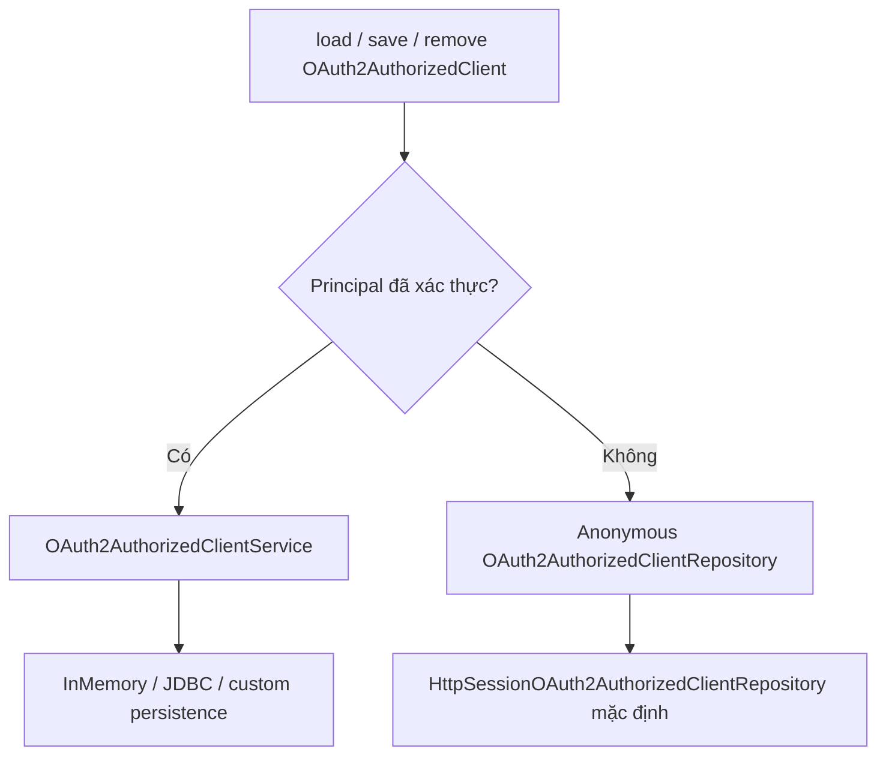

# 14.7. AuthenticatedPrincipalOAuth2AuthorizedClientRepository và chọn nơi lưu

## 1. Vì sao OAuth2 Authorized Client cần một nơi lưu?

Trong **Spring Security OAuth 2.0/OIDC Client**, sau khi ứng dụng hoàn tất Authorization Code Grant, nó nhận **access token** và có thể nhận **refresh token**. Spring Security cần biết các token này thuộc về **OAuth2 client registration nào** và được cấp trong ngữ cảnh **principal nào**, để những lần gọi API sau không phải bắt người dùng đăng nhập lại mỗi lần.

Ví dụ cổng nội bộ sử dụng một OIDC Provider để đăng nhập và một API quản lý hồ sơ:

```text
Người dùng Alice
    |
    +-- Đăng nhập bằng registrationId = "corporate"
    |
    +-- Token Endpoint cấp access token và có thể refresh token
    |
    +-- Spring Security tạo OAuth2AuthorizedClient
    |      clientRegistration = "corporate"
    |      principalName      = "alice-uid"
    |      accessToken        = ...
    |      refreshToken       = ... (nếu có)
    |
    +-- Ứng dụng cần lưu / truy xuất Authorized Client
    |
    +-- Những request tiếp theo có thể dùng token hợp lệ gọi API
```

Chỗ lưu không phải chỉ là một chi tiết kỹ thuật. Nó quyết định:

- Token còn tồn tại khi **HTTP request kết thúc** hay không.
- Token có còn sau khi **session hết hạn** hoặc **ứng dụng restart** hay không.
- Nhiều instance của ứng dụng có cùng nhìn thấy token không.
- Token gắn đúng **người dùng**, **client registration**, **tenant** và **ngữ cảnh xác thực** hay không.
- Token bí mật được bảo vệ, hết hạn, refresh, thu hồi và xóa như thế nào.
- Hệ thống sẽ hành xử ra sao khi người dùng còn **anonymous** hoặc khi chạy tác vụ nền không có HTTP request.

Lớp **`AuthenticatedPrincipalOAuth2AuthorizedClientRepository`** là một thành phần quan trọng để giải quyết câu hỏi **nên lưu authorized client ở đâu khi đã biết principal là ai**.

Điểm cần nhớ ngay:

> `AuthenticatedPrincipalOAuth2AuthorizedClientRepository` là một **repository phân luồng lưu trữ**: với principal đã được xác thực, nó dùng `OAuth2AuthorizedClientService`; với principal chưa được xác thực/anonymous, mặc định nó chuyển cho `HttpSessionOAuth2AuthorizedClientRepository`.

Chính **service hoặc repository được ủy quyền** mới nắm cơ chế lưu token cụ thể. Bản thân `AuthenticatedPrincipalOAuth2AuthorizedClientRepository` không phải database và không tự mã hóa token.

### Mục tiêu bài học

Sau bài này, bạn có thể:

1. Phân biệt `ClientRegistration`, `OAuth2AuthorizedClient`, `OAuth2AuthorizedClientRepository` và `OAuth2AuthorizedClientService`.
2. Hiểu cách `AuthenticatedPrincipalOAuth2AuthorizedClientRepository` chọn nhánh authenticated hoặc anonymous.
3. Biết khi nào nên dùng `InMemoryOAuth2AuthorizedClientService`, `JdbcOAuth2AuthorizedClientService` hoặc `HttpSessionOAuth2AuthorizedClientRepository`.
4. Cấu hình repository trong một ứng dụng **Spring Security Servlet/MVC**.
5. Biết vai trò của `DefaultOAuth2AuthorizedClientManager` trong truy xuất, lưu và làm mới token.
6. Tránh nhầm lẫn giữa nơi lưu **authorization request**, **security context**, **client registration** và **authorized client**.
7. Thiết kế cách lưu token phù hợp với ứng dụng đơn instance, nhiều instance, multi-tenant và background jobs.
8. Nhận diện những rủi ro bảo mật, xóa token và lỗi thường gặp khi lựa chọn sai nơi lưu.

## 2. Bốn đối tượng dễ bị nhầm lẫn

Trước khi chọn repository, cần phân biệt đúng những gì đang được lưu.

### 2.1. ClientRegistration: cấu hình OAuth2 Client

Một `ClientRegistration` mô tả **ứng dụng client đã được đăng ký như thế nào**:

```text
registrationId      = corporate
clientId            = portal-web
authorizationUri    = https://id.example.com/authorize
tokenUri            = https://id.example.com/token
redirectUri         = {baseUrl}/login/oauth2/code/{registrationId}
scopes              = openid profile api.read
```

Nó là metadata cấu hình, thường nằm trong `ClientRegistrationRepository`, không phải dữ liệu token của một người dùng.

### 2.2. OAuth2AuthorizedClient: authorization đã được cấp

Một `OAuth2AuthorizedClient` mang thông tin:

```java
org.springframework.security.oauth2.client.OAuth2AuthorizedClient
```

Có thể hiểu:

```text
OAuth2AuthorizedClient
    ├─ ClientRegistration
    ├─ principalName
    ├─ OAuth2AccessToken
    └─ OAuth2RefreshToken (tùy provider)
```

Ví dụ:

```java
OAuth2AuthorizedClient client = ...;

String registrationId =
    client.getClientRegistration().getRegistrationId();

String principalName = client.getPrincipalName();
OAuth2AccessToken accessToken = client.getAccessToken();
OAuth2RefreshToken refreshToken = client.getRefreshToken();
```

Các phương thức trên giúp ứng dụng làm việc với authorized client nhưng **không có nghĩa được in access token/refresh token ra log**. `getRefreshToken()` có thể trả `null` nếu AS không cấp refresh token.

### 2.3. OAuth2AuthorizedClientService: lưu token theo registration và principal

Interface:

```java
org.springframework.security.oauth2.client.OAuth2AuthorizedClientService
```

Cung cấp các thao tác chính:

```java
<T extends OAuth2AuthorizedClient> T loadAuthorizedClient(
    String clientRegistrationId,
    String principalName
);

void saveAuthorizedClient(
    OAuth2AuthorizedClient authorizedClient,
    Authentication principal
);

void removeAuthorizedClient(
    String clientRegistrationId,
    String principalName
);
```

Service dùng **`clientRegistrationId` + `principalName`** để tra authorized client, không bắt buộc phải có `HttpServletRequest` và `HttpServletResponse`.

Điều đó phù hợp với các triển khai dựa trên bộ nhớ hoặc database, và cả những luồng cần truy xuất authorized client bên ngoài request web.

### 2.4. OAuth2AuthorizedClientRepository: tích hợp ngữ cảnh HTTP Servlet

Interface:

```java
org.springframework.security.oauth2.client.web.OAuth2AuthorizedClientRepository
```

Contract khái niệm:

```java
<T extends OAuth2AuthorizedClient> T loadAuthorizedClient(
    String clientRegistrationId,
    Authentication principal,
    HttpServletRequest request
);

void saveAuthorizedClient(
    OAuth2AuthorizedClient authorizedClient,
    Authentication principal,
    HttpServletRequest request,
    HttpServletResponse response
);

void removeAuthorizedClient(
    String clientRegistrationId,
    Authentication principal,
    HttpServletRequest request,
    HttpServletResponse response
);
```

Khác với service, repository này nhận cả **`Authentication`** và **HTTP servlet request/response**. Vì vậy implementation có thể chọn session, xử lý ngữ cảnh anonymous hoặc ủy quyền sang một store khác dựa trên principal.

### 2.5. Bảng tóm tắt

| Thành phần | Chứa gì? | Dùng khóa gì? | Cần HTTP request? |
|---|---|---|---|
| `ClientRegistrationRepository` | Metadata client/provider | `registrationId` | Không |
| `OAuth2AuthorizedClient` | Registration + access token + refresh token + principal name | Là một value object | Không |
| `OAuth2AuthorizedClientService` | Các authorized clients đã được cấp | `clientRegistrationId` + `principalName` | Không |
| `OAuth2AuthorizedClientRepository` | Truy cập nơi lưu authorized client theo ngữ cảnh web | `registrationId`, `Authentication`, request | Có trong contract Servlet |
| `AuthorizationRequestRepository` | Authorization request đang chờ callback, bao gồm `state`/PKCE correlation | Dữ liệu yêu cầu ủy quyền và session/request | Có |
| `SecurityContextRepository` | Authentication hiện tại của phiên | Security context/session | Có thể |

Không dùng `ClientRegistrationRepository` để lưu access token. Không dùng `AuthorizationRequestRepository` như kho refresh token lâu dài.

## 3. AuthenticatedPrincipalOAuth2AuthorizedClientRepository là gì?

Lớp nằm ở package:

```java
org.springframework.security.oauth2.client.web.AuthenticatedPrincipalOAuth2AuthorizedClientRepository
```

Nó triển khai:

```java
OAuth2AuthorizedClientRepository
```

Và có constructor nhận:

```java
AuthenticatedPrincipalOAuth2AuthorizedClientRepository(
    OAuth2AuthorizedClientService authorizedClientService
)
```

Ý tưởng thiết kế: các authorized clients gắn với **principal đã xác thực** có thể được lưu bằng `OAuth2AuthorizedClientService` — nơi có khả năng lưu theo principal — còn các request **anonymous** được lưu qua một repository khác gắn với HTTP request/session.

### 3.1. Sơ đồ phân nhánh



Bảng hành vi:

| Tình huống | Thành phần được sử dụng | Hệ quả |
|---|---|---|
| Người dùng Alice đã đăng nhập | `OAuth2AuthorizedClientService` | Có thể lưu theo `registrationId` + principal name. |
| Người dùng Bob đã đăng nhập | `OAuth2AuthorizedClientService` | Có entry riêng theo tên Bob. |
| Request anonymous / unauthenticated | `anonymousAuthorizedClientRepository` | Mặc định lưu trong HTTP session. |
| Ứng dụng thay anonymous repository | Repository do bạn cấu hình | Hành vi phụ thuộc implementation được thay vào. |
| Bạn thay `OAuth2AuthorizedClientService` từ InMemory sang JDBC | Vẫn là nhánh authenticated | Token của người dùng đã xác thực có thể được lưu bền vững trong database. |

Như vậy, lớp này **không tự lưu token vào hai nơi cố định**. Nó lựa chọn **delegate**; nơi lưu thực sự phụ thuộc vào delegate mà ứng dụng đã cung cấp.

### 3.2. Vì sao không chỉ dùng principal.isAuthenticated()?

Trong Spring Security, một `AnonymousAuthenticationToken` có thể trả `isAuthenticated() == true` vì đối tượng đã được tạo hợp lệ trong security pipeline, nhưng điều đó **không có nghĩa người dùng đã đăng nhập**.

Vì vậy, implementation cần phân biệt anonymous authentication với một người dùng thực sự đã xác thực bằng cơ chế nhận diện phù hợp như `AuthenticationTrustResolver`, thay vì đơn giản dựa trên một boolean mà ứng dụng tự kiểm tra.

Điểm này quan trọng khi custom service, viết test hoặc tự xây repository. Không nên làm như sau rồi coi kết quả là bằng chứng login:

```java
// Không phải phép kiểm tra đầy đủ cho mọi loại Authentication.
if (authentication != null && authentication.isAuthenticated()) {
    // Có thể vẫn đang là anonymous authentication.
}
```

Hãy dùng cơ chế phân biệt anonymous/remember-me/fully-authenticated phù hợp với chính sách nghiệp vụ hoặc để Spring Security quản lý điều kiện của repository mặc định.

### 3.3. Cả ba thao tác đều đi qua cùng logic

`AuthenticatedPrincipalOAuth2AuthorizedClientRepository` không chỉ định tuyến việc **save**. Nó cũng định tuyến:

- `loadAuthorizedClient(...)`: đọc từ nơi lưu tương ứng.
- `saveAuthorizedClient(...)`: ghi vào nơi lưu tương ứng.
- `removeAuthorizedClient(...)`: xóa tại nơi lưu tương ứng.

Vì vậy, **một thay đổi trong trạng thái authentication** có thể khiến cùng `registrationId` được tra ở hai nơi khác nhau.

Ví dụ:

```text
Khi anonymous:
    load("partner") --> HttpSession repository

Sau khi xác thực thành Alice:
    load("partner") --> OAuth2AuthorizedClientService
```

Một authorized client trước đó lưu ở session anonymous **không được mặc định tự chuyển** sang service của Alice chỉ vì principal chuyển sang authenticated. Tùy flow, framework có thể tạo và lưu một authorized client sau login; nếu bạn có luồng tùy biến chuyển authorization từ anonymous sang authenticated, phải thiết kế việc chuyển dữ liệu một cách rõ ràng và an toàn.

## 4. Triển khai mặc định: authenticated qua service, anonymous qua session

Constructor phổ biến:

```java
OAuth2AuthorizedClientRepository repository =
    new AuthenticatedPrincipalOAuth2AuthorizedClientRepository(
        authorizedClientService
    );
```

Trong cấu hình mặc định của lớp:

- `authorizedClientService` được dùng khi principal đã xác thực.
- `HttpSessionOAuth2AuthorizedClientRepository` thường là delegate cho principal anonymous.

Bạn có thể đổi repository dùng cho anonymous bằng:

```java
repository.setAnonymousAuthorizedClientRepository(
    anotherRepository
);
```

### 4.1. Vì sao anonymous phù hợp với session?

Khi chưa xác thực, ứng dụng không có một principal ID ổn định đáng tin để làm khóa lưu authorization dài hạn. HTTP session giúp gắn authorized client với **một lượt tương tác web cụ thể** mà không chia sẻ nó với các anonymous sessions khác.

Ví dụ hai trình duyệt chưa đăng nhập:

```text
Anonymous session S1:
    registrationId = demo
    authorized client = A1

Anonymous session S2:
    registrationId = demo
    authorized client = A2
```

Nếu chỉ dùng một khóa toàn cục `"anonymousUser"` trong database, token của các anonymous users có thể bị **ghi đè hoặc lộ chéo**. Repository dựa trên session tránh việc mọi request anonymous bị dồn vào cùng một principal name.

### 4.2. Session không phải kho lưu token vĩnh viễn

`HttpSessionOAuth2AuthorizedClientRepository` gắn authorized client với HTTP session. Tùy cách cấu hình session:

- Session hết hạn có thể làm mất authorized client.
- Restart ứng dụng có thể làm mất session local.
- Nhiều instance không dùng shared session store có thể không tìm thấy dữ liệu khi request sang node khác.
- Session serialization/cookie policy/TTL ảnh hưởng đến độ bền.
- Token có thể làm tăng khối lượng dữ liệu session.

Nếu dùng **Spring Session** với Redis hoặc JDBC, nhiều instance có thể chia sẻ HTTP sessions; tuy vậy **độ bền và bảo mật của token trong session** vẫn phải được đánh giá, không tự coi Redis session tương đương token vault dài hạn.

### 4.3. Authenticated cũng chưa chắc đã bền vững

Trong nhánh authenticated, repository chuyển tới `OAuth2AuthorizedClientService`. Nếu service là `InMemoryOAuth2AuthorizedClientService`, token vẫn nằm trong **RAM của một instance**, không tự được lưu bền vững. Muốn lưu bền, cần thay implementation của **service**, chẳng hạn JDBC hoặc custom persistence có bảo vệ secret.

Đây là câu trả lời quan trọng cho cụm “chọn nơi lưu”: **đổi implementation của delegate**, không chỉ khởi tạo thêm một `AuthenticatedPrincipalOAuth2AuthorizedClientRepository`.

## 5. InMemoryOAuth2AuthorizedClientService

Class:

```java
org.springframework.security.oauth2.client.InMemoryOAuth2AuthorizedClientService
```

Một ví dụ tạo service và repository:

```java
import org.springframework.context.annotation.Bean;
import org.springframework.context.annotation.Configuration;

import org.springframework.security.oauth2.client.OAuth2AuthorizedClientService;
import org.springframework.security.oauth2.client.InMemoryOAuth2AuthorizedClientService;
import org.springframework.security.oauth2.client.registration.ClientRegistrationRepository;
import org.springframework.security.oauth2.client.web.AuthenticatedPrincipalOAuth2AuthorizedClientRepository;
import org.springframework.security.oauth2.client.web.OAuth2AuthorizedClientRepository;

@Configuration
public class InMemoryAuthorizedClientConfig {

    @Bean
    OAuth2AuthorizedClientService authorizedClientService(
            ClientRegistrationRepository registrations) {

        return new InMemoryOAuth2AuthorizedClientService(registrations);
    }

    @Bean
    OAuth2AuthorizedClientRepository authorizedClientRepository(
            OAuth2AuthorizedClientService service) {

        return new AuthenticatedPrincipalOAuth2AuthorizedClientRepository(
            service
        );
    }
}
```

Điểm cần hiểu:

1. `ClientRegistrationRepository` cung cấp metadata khi service cần dựng hoặc tra authorized client.
2. `InMemoryOAuth2AuthorizedClientService` là store cho **authenticated** principals trong ví dụ.
3. `AuthenticatedPrincipalOAuth2AuthorizedClientRepository` chọn service hoặc anonymous repository theo Authentication.
4. Anonymous mặc định vẫn dùng session.

### 5.1. Khi nào InMemory phù hợp?

- Học tập và chạy thử local.
- Một instance với yêu cầu đơn giản, chấp nhận token mất khi restart.
- Token có vòng đời ngắn và không cần chia sẻ giữa nodes.
- Môi trường kiểm thử cần cấu hình dễ dựng.

### 5.2. Hạn chế khi lên production

- Không tự chia sẻ dữ liệu giữa nhiều pods/instances.
- Token mất nếu process restart.
- RAM tăng theo số authorized clients.
- Khó điều phối refresh token rotation khi nhiều nodes độc lập.
- Không phù hợp nếu nghiệp vụ yêu cầu duy trì liên kết tài khoản qua nhiều đợt deploy.

**InMemory không phải nghĩa token không nhạy cảm.** Token vẫn ở bộ nhớ và phải được bảo vệ trong diagnostic heap dumps, logs, monitoring và quyền truy cập process.

## 6. JDBC OAuth2AuthorizedClientService

Spring Security cung cấp:

```java
org.springframework.security.oauth2.client.JdbcOAuth2AuthorizedClientService
```

Nó sử dụng JDBC để lưu authorized clients trong database. Constructor phổ biến nhận:

```java
JdbcOAuth2AuthorizedClientService(
    JdbcOperations jdbcOperations,
    ClientRegistrationRepository clientRegistrationRepository
)
```

Ví dụ wiring trong Spring Boot Servlet:

```java
import org.springframework.context.annotation.Bean;
import org.springframework.context.annotation.Configuration;
import org.springframework.jdbc.core.JdbcOperations;
import org.springframework.security.oauth2.client.JdbcOAuth2AuthorizedClientService;
import org.springframework.security.oauth2.client.OAuth2AuthorizedClientService;
import org.springframework.security.oauth2.client.registration.ClientRegistrationRepository;

@Configuration
public class JdbcAuthorizedClientConfig {

    @Bean
    OAuth2AuthorizedClientService authorizedClientService(
            JdbcOperations jdbc,
            ClientRegistrationRepository registrations) {

        return new JdbcOAuth2AuthorizedClientService(jdbc, registrations);
    }
}
```

Lưu ý: ví dụ này **thay thế service InMemory ở mục trước**. Không đặt cả hai method cùng tên/kiểu trong một ứng dụng nếu không có cơ chế lựa chọn rõ ràng.

Nếu application vẫn dùng `AuthenticatedPrincipalOAuth2AuthorizedClientRepository`, nhánh authenticated sẽ gọi service JDBC này. Anonymous vẫn chuyển tới session trừ khi bạn thay anonymous repository.

### 6.1. JDBC schema và khóa lưu

Spring Security có schema SQL tham khảo cho `JdbcOAuth2AuthorizedClientService`; cấu trúc thường có bảng như:

```text
oauth2_authorized_client
  client_registration_id
  principal_name
  access_token_type
  access_token_value
  access_token_issued_at
  access_token_expires_at
  access_token_scopes
  refresh_token_value
  refresh_token_issued_at
  created_at
```

Khóa định danh thông thường là cặp:

```text
(client_registration_id, principal_name)
```

Không tự dựng bảng tùy ý rồi mong `JdbcOAuth2AuthorizedClientService` dùng được. Phải sử dụng schema/SQL đúng với **phiên bản Spring Security** hoặc cấu hình custom mappers/SQL theo API mà phiên bản cung cấp.

### 6.2. Khi nào chọn JDBC?

- Muốn authorized clients còn sau restart/deploy.
- Có nhiều instance cùng truy xuất token của một principal.
- Cần quản trị thời gian lưu, xóa, audit và backup trong hệ thống cơ sở dữ liệu.
- Cần phối hợp token retention với lifecycle của account linking.

Nhưng JDBC **không tự biến refresh token thành an toàn**. Cần xét encryption at rest, hạn chế quyền đọc dữ liệu, TLS tới database, secret key management và audit.

### 6.3. Database phải xử lý dữ liệu token như credential

Access token và nhất là refresh token có thể cấp quyền truy cập tài nguyên của người dùng. Các yêu cầu nên được cân nhắc:

- Mã hóa dữ liệu ở tầng lưu trữ và, nếu yêu cầu, ở mức ứng dụng/cột.
- Giới hạn service account database chỉ được đọc/ghi dữ liệu cần thiết.
- Không log raw SQL parameters chứa token.
- Bảo vệ backups, replicas, exports và thao tác hỗ trợ kỹ thuật.
- Thiết kế chính sách TTL/cleanup cho entries đã hết hạn hoặc tài khoản bị xóa.
- Quản lý khóa mã hóa độc lập với database khi hệ thống yêu cầu.
- Có chính sách xóa token khi người dùng ngắt liên kết tài khoản.

## 7. HttpSessionOAuth2AuthorizedClientRepository

Implementation:

```java
org.springframework.security.oauth2.client.web.HttpSessionOAuth2AuthorizedClientRepository
```

Nó lưu authorized client trong **HTTP session**.

Ví dụ thay anonymous delegate:

```java
import org.springframework.context.annotation.Bean;
import org.springframework.context.annotation.Configuration;

import org.springframework.security.oauth2.client.OAuth2AuthorizedClientService;
import org.springframework.security.oauth2.client.web.AuthenticatedPrincipalOAuth2AuthorizedClientRepository;
import org.springframework.security.oauth2.client.web.HttpSessionOAuth2AuthorizedClientRepository;
import org.springframework.security.oauth2.client.web.OAuth2AuthorizedClientRepository;

@Configuration
public class HybridAuthorizedClientConfig {

    @Bean
    OAuth2AuthorizedClientRepository authorizedClientRepository(
            OAuth2AuthorizedClientService service) {

        AuthenticatedPrincipalOAuth2AuthorizedClientRepository repository =
            new AuthenticatedPrincipalOAuth2AuthorizedClientRepository(
                service
            );

        repository.setAnonymousAuthorizedClientRepository(
            new HttpSessionOAuth2AuthorizedClientRepository()
        );

        return repository;
    }
}
```

Ví dụ gọi setter trên cho thấy điểm mở rộng, nhưng trong cấu hình thông thường **delegate anonymous mặc định đã là HTTP session**, nên không cần đặt lại khi không có nhu cầu.

### 7.1. Nếu muốn lưu mọi authorized client vào session?

Có thể chủ động đưa một `HttpSessionOAuth2AuthorizedClientRepository` làm repository cho toàn bộ Servlet flow:

```java
@Bean
OAuth2AuthorizedClientRepository authorizedClientRepository() {
    return new HttpSessionOAuth2AuthorizedClientRepository();
}
```

Trong mô hình đó, **cả authenticated và anonymous** đều dùng session theo implementation đã chọn, không còn phân luồng qua `AuthenticatedPrincipalOAuth2AuthorizedClientRepository`.

Tuy nhiên, đây là lựa chọn kiến trúc:

- Token gắn mạnh với phiên hiện tại.
- Session hết hạn làm mất khả năng truy xuất authorized client.
- Nếu dùng session phân tán, serialized token data có thể được ghi ra Redis/JDBC session store.
- Sau logout, cần hiểu lifecycle của HTTP session và liệu token có bị thu hồi tại AS hay chỉ bị mất khỏi ứng dụng.
- Không phù hợp cho service-to-service background process không có HTTP session.

## 8. So sánh nơi lưu: InMemory, JDBC, Session và custom store

| Tiêu chí | InMemoryAuthorizedClientService | JdbcAuthorizedClientService | HttpSessionAuthorizedClientRepository | Custom store |
|---|---|---|---|---|
| Lưu theo user principal | Có | Có | Theo session | Tùy thiết kế |
| Sống qua restart | Không | Có nếu DB bền | Tùy session backend | Tùy storage |
| Chia sẻ giữa nhiều instances | Không mặc định | Có | Nếu shared session store | Tùy implementation |
| Có HTTP session | Không bắt buộc | Không bắt buộc | **Cần** | Tùy design |
| Phù hợp background jobs | Có giới hạn do InMemory | Có thể, với manager đúng | Không phù hợp | Có thể |
| Chi phí vận hành | Thấp | DB và schema | Session infrastructure | Tùy storage |
| Cần mã hóa/kiểm soát token | Có | **Có** | **Có** | **Có** |
| Dễ thử nghiệm local | Rất tốt | Cần DB | Tốt với web | Tùy |
| Quản lý refresh token rotation trên nhiều nodes | Không tự có | Cần concurrency policy | Cần session concurrency policy | Cần thiết kế |

Không có lựa chọn tốt nhất cho mọi hệ thống. Một portal chỉ cần token trong phiên có thể dùng session. Một ứng dụng có tài khoản liên kết và tác vụ nền cần truy cập API sau login thường cần persistent service.

### 8.1. Chọn theo yêu cầu, không theo tên lớp

Tự hỏi:

1. **Token còn cần sau khi người dùng đóng trình duyệt không?**
2. **Tác vụ nền có cần token khi không có HTTP request không?**
3. **Ứng dụng chạy bao nhiêu instance?**
4. **Có refresh token và refresh-token rotation không?**
5. **Principal name có ổn định không?**
6. **Có nhiều OAuth2 registrations, issuer, tenant không?**
7. **Logout/disconnect có phải xóa token không?**
8. **Có yêu cầu audit, encryption, data retention và backup không?**
9. **Có cần rollback/deploy mà không khiến mọi kết nối mất token không?**
10. **Chi phí vận hành database/session store có được chấp nhận không?**

Đáp án cho những câu này quan trọng hơn việc chọn class có tên “repository” hay “service”.

## 9. Cấu hình Spring Security OAuth2 Login sử dụng repository

Trong ứng dụng Servlet, có thể gắn repository trực tiếp vào `HttpSecurity`:

```java
import org.springframework.context.annotation.Bean;
import org.springframework.context.annotation.Configuration;
import org.springframework.security.config.annotation.web.builders.HttpSecurity;
import org.springframework.security.oauth2.client.web.OAuth2AuthorizedClientRepository;
import org.springframework.security.web.SecurityFilterChain;

@Configuration
public class OAuth2SecurityConfiguration {

    @Bean
    SecurityFilterChain securityFilterChain(
            HttpSecurity http,
            OAuth2AuthorizedClientRepository repository)
            throws Exception {

        http
            .authorizeHttpRequests(authorize -> authorize
                .requestMatchers("/", "/public/**").permitAll()
                .anyRequest().authenticated()
            )
            .oauth2Login(login -> login
                .authorizedClientRepository(repository)
            )
            .oauth2Client(client -> client
                .authorizedClientRepository(repository)
            );

        return http.build();
    }
}
```

Hai điểm cấu hình liên quan nhưng không đồng nhất:

- `oauth2Login()` thực hiện đăng nhập người dùng thông qua OAuth2/OIDC.
- `oauth2Client()` cung cấp cấu hình hỗ trợ OAuth2 Client khi ứng dụng cần authorized clients để gọi APIs.

Nếu dự án không cần gọi API ngoài, có thể chỉ cần `oauth2Login()` tùy kiến trúc. Nếu cần sử dụng token cho API, phải xem cơ chế authorized client manager, repository và token refresh.

### 9.1. Khi nào không cần bean custom?

Spring Boot/Spring Security có thể cung cấp các bean và default repositories/services khi dependencies và auto-configuration phù hợp. Nếu mặc định đáp ứng nhu cầu, không bắt buộc phải tạo một `AuthenticatedPrincipalOAuth2AuthorizedClientRepository` thủ công.

Khi tạo bean riêng, ứng dụng có thể thay default mà Boot thường cung cấp. Vì thế hãy **chọn một nguồn cấu hình rõ ràng**: nếu thay service sang JDBC, đảm bảo repository/manager thực sự dùng đúng service đó.

Không giả định rằng **khai báo một bean mới luôn được framework chọn** nếu bạn đồng thời có nhiều bean cùng type, nhiều SecurityFilterChains hoặc custom authorized client managers. Những thành phần chủ động xây riêng có thể vẫn đang dùng store cũ.

## 10. Dùng OAuth2AuthorizedClient trong controller Servlet

Spring MVC có annotation:

```java
org.springframework.security.oauth2.client.annotation.RegisteredOAuth2AuthorizedClient
```

Một controller minh họa:

```java
import java.util.Map;

import org.springframework.security.oauth2.client.OAuth2AuthorizedClient;
import org.springframework.security.oauth2.client.annotation.RegisteredOAuth2AuthorizedClient;
import org.springframework.web.bind.annotation.GetMapping;
import org.springframework.web.bind.annotation.RestController;

@RestController
public class ConnectionController {

    @GetMapping("/connection")
    Map<String, String> connection(
            @RegisteredOAuth2AuthorizedClient("corporate")
            OAuth2AuthorizedClient client) {

        if (client == null) {
            return Map.of("status", "not-authorized");
        }

        return Map.of(
            "status", "authorized",
            "registrationId",
            client.getClientRegistration().getRegistrationId()
        );
    }
}
```

Endpoint chỉ tiết lộ trạng thái và registration ID, không trả access token. Trong ứng dụng thật, cần kiểm soát authorization truy cập endpoint và cách xử lý trạng thái chưa cấp quyền (ví dụ khởi tạo authorization flow phù hợp hoặc trả lỗi chuẩn).

`@RegisteredOAuth2AuthorizedClient` được giải quyết bằng infrastructure của Spring Security OAuth2 Client và authorized client manager/repository phù hợp. Không phải annotation tự biết đi đọc database nào nếu ứng dụng chưa cấu hình store đúng.

### 10.1. Đừng gửi authorized client nguyên bản ra API

Không nên:

```java
// Không nên làm trong API công khai.
@GetMapping("/debug")
OAuth2AuthorizedClient debug(
        @RegisteredOAuth2AuthorizedClient("corporate")
        OAuth2AuthorizedClient client) {
    return client;
}
```

Một `OAuth2AuthorizedClient` chứa access token và có thể có refresh token. Serialize nó thành JSON hoặc đưa vào log là nguy cơ lộ credentials.

## 11. DefaultOAuth2AuthorizedClientManager và vai trò của repository

Trong ứng dụng Servlet, `DefaultOAuth2AuthorizedClientManager` quản lý việc authorize/re-authorize OAuth2 client theo các provider và dữ liệu đã được lưu.

Class:

```java
org.springframework.security.oauth2.client.web.DefaultOAuth2AuthorizedClientManager
```

Constructor:

```java
DefaultOAuth2AuthorizedClientManager(
    ClientRegistrationRepository clientRegistrationRepository,
    OAuth2AuthorizedClientRepository authorizedClientRepository
)
```

Một cấu hình mẫu:

```java
import org.springframework.context.annotation.Bean;
import org.springframework.context.annotation.Configuration;

import org.springframework.security.oauth2.client.OAuth2AuthorizedClientManager;
import org.springframework.security.oauth2.client.OAuth2AuthorizedClientProvider;
import org.springframework.security.oauth2.client.OAuth2AuthorizedClientProviderBuilder;
import org.springframework.security.oauth2.client.registration.ClientRegistrationRepository;
import org.springframework.security.oauth2.client.web.DefaultOAuth2AuthorizedClientManager;
import org.springframework.security.oauth2.client.web.OAuth2AuthorizedClientRepository;

@Configuration
public class AuthorizedClientManagerConfig {

    @Bean
    OAuth2AuthorizedClientManager authorizedClientManager(
            ClientRegistrationRepository registrations,
            OAuth2AuthorizedClientRepository repository) {

        DefaultOAuth2AuthorizedClientManager manager =
            new DefaultOAuth2AuthorizedClientManager(
                registrations, repository
            );

        OAuth2AuthorizedClientProvider provider =
            OAuth2AuthorizedClientProviderBuilder.builder()
                .authorizationCode()
                .refreshToken()
                .build();

        manager.setAuthorizedClientProvider(provider);

        return manager;
    }
}
```

Ý nghĩa:

- Manager tra registration và authorized client hiện tại.
- Provider có thể cấp quyền hoặc làm mới access token nếu grant/refresh token cho phép.
- Manager sử dụng success/failure handlers để lưu/xóa authorized client theo cơ chế được cấu hình.
- Repository là ranh giới lưu trữ của manager trong **Servlet request context**.

Cấu hình trên chỉ minh họa một tập provider gồm authorization code và refresh token. Một ứng dụng có thể cần `clientCredentials()` hoặc provider khác theo đúng grant đã đăng ký. Đừng thêm mọi provider vô điều kiện cho một client không được AS cấp phép.

### 11.1. Khi nào cần chú ý HTTP request/response?

`DefaultOAuth2AuthorizedClientManager` được thiết kế để làm việc trong ngữ cảnh **Servlet `HttpServletRequest`**. Repository có thể phụ thuộc vào HTTP session, response hoặc authentication của web request.

Trong một scheduled job không có HTTP request, đừng cố giả lập session của một người dùng để manager hoạt động. Spring Security có **manager khác** dành cho môi trường ngoài Servlet request.

## 12. Background jobs và service-to-service: chọn AuthorizedClientServiceOAuth2AuthorizedClientManager

Một batch job, scheduler hoặc service gọi API từ worker thread thường không có `HttpServletRequest`/`HttpServletResponse`.

Lúc đó, dùng:

```java
org.springframework.security.oauth2.client.AuthorizedClientServiceOAuth2AuthorizedClientManager
```

Constructor:

```java
AuthorizedClientServiceOAuth2AuthorizedClientManager(
    ClientRegistrationRepository clientRegistrationRepository,
    OAuth2AuthorizedClientService authorizedClientService
)
```

Ví dụ bean dành cho `client_credentials`:

```java
import org.springframework.context.annotation.Bean;
import org.springframework.context.annotation.Configuration;
import org.springframework.security.oauth2.client.AuthorizedClientServiceOAuth2AuthorizedClientManager;
import org.springframework.security.oauth2.client.OAuth2AuthorizedClientManager;
import org.springframework.security.oauth2.client.OAuth2AuthorizedClientProviderBuilder;
import org.springframework.security.oauth2.client.OAuth2AuthorizedClientService;
import org.springframework.security.oauth2.client.registration.ClientRegistrationRepository;

@Configuration
public class BackgroundTokenManagerConfig {

    @Bean("backgroundAuthorizedClientManager")
    OAuth2AuthorizedClientManager backgroundAuthorizedClientManager(
            ClientRegistrationRepository registrations,
            OAuth2AuthorizedClientService service) {

        AuthorizedClientServiceOAuth2AuthorizedClientManager manager =
            new AuthorizedClientServiceOAuth2AuthorizedClientManager(
                registrations, service
            );

        manager.setAuthorizedClientProvider(
            OAuth2AuthorizedClientProviderBuilder.builder()
                .clientCredentials()
                .build()
        );

        return manager;
    }
}
```

Đây là phương án **thay thế/bổ sung có chủ đích** cho manager dùng Servlet; nếu cùng ứng dụng có cả hai beans kiểu `OAuth2AuthorizedClientManager`, phải dùng tên/qualifier khi injection.

Khi sử dụng manager ngoài HTTP:

- Chọn một `principalName` có ý nghĩa ổn định để làm khóa authorized client của service, ví dụ một service identity.
- Không dùng chung principal name giữa các workload không được phép chia sẻ token.
- Không tự giả định `client_credentials` tạo ra principal người dùng.
- Cân nhắc cách refresh hoặc re-authorize phù hợp với grant; nhiều client credentials tokens không có refresh token.
- Đảm bảo store có thể truy cập trên node thực hiện background job.

### 12.1. Background job dùng token của người dùng là trường hợp khác

Nếu scheduler thực sự cần gọi API **thay mặt người dùng Alice**, hệ thống cần authorization đã được cấp cho Alice, chính sách lưu refresh token phù hợp và điều kiện cho phép offline access.

Không dùng một `client_credentials` token của service rồi giả định nó mang quyền của Alice. Ngược lại, không lấy token của Alice dùng cho Bob chỉ vì cả hai cùng đăng nhập qua registration `corporate`.

## 13. Principal name là chìa khóa rất quan trọng

Một authorized client service thường tra dữ liệu bằng:

```text
(client_registration_id, principal_name)
```

Ví dụ:

| registrationId | principalName | Ý nghĩa |
|---|---|---|
| `corporate` | `alice-uid` | Token cho Alice qua Corporate IdP |
| `corporate` | `bob-uid` | Token cho Bob qua Corporate IdP |
| `partner` | `alice-uid` | Token của Alice qua một provider khác |
| `batch-api` | `inventory-worker` | Token của một service identity |

### 13.1. Principal name phải ổn định

Nếu `Authentication.getName()` dựa trên email của người dùng, và email thay đổi sau khi login, service có thể không tìm được authorized client theo tên mới.

Với OIDC, định danh external user nên dựa trên **issuer + subject (`iss`, `sub`)** hoặc local stable account ID có mapping được quản trị. Không dùng email, display name hay nickname chưa được xác minh làm khóa duy nhất.

### 13.2. Tránh đụng tên giữa các tenants

Giả sử hai tenants đều có user tên `admin` và cùng sử dụng `registrationId = enterprise`. Nếu service chỉ nhận cặp `(registrationId, principalName)`, hai người có thể đụng khóa.

Một thiết kế multi-tenant cần ràng buộc namespace:

```text
tenantA + enterprise + user-001
tenantB + enterprise + user-001
```

Có thể dùng registration IDs tách theo tenant, principal names đã namespace hóa hoặc custom store có khóa tenant, tùy mô hình đáng tin cậy. Quan trọng nhất là **không cho hai chủ thể khác quyền cùng tra vào một authorized client**.

### 13.3. Principal đổi trạng thái trong luồng đăng nhập

`AuthenticatedPrincipalOAuth2AuthorizedClientRepository` có thể đọc session khi anonymous rồi chuyển sang service sau khi xác thực. Điều này có nghĩa:

```text
Anonymous request:
  lookup -> session

Authenticated request:
  lookup -> OAuth2AuthorizedClientService
```

Nếu luồng tùy chỉnh tạo authorized client khi anonymous rồi muốn dùng tiếp sau authentication, cần quyết định rõ cách liên kết dữ liệu với principal mới. Không tự sao chép tất cả token anonymous của session thành token của bất kỳ user nào đăng nhập sau đó.

## 14. Token refresh và vấn đề đồng thời

Một access token có thời hạn; nếu có refresh token, manager có thể gọi AS xin access token mới. Nơi lưu authorized client phải hỗ trợ cập nhật kết quả refresh.

Ví dụ:

```text
Alice + corporate -> access_token_A, refresh_token_R1

Token gần hết hạn:
    Manager refresh -> access_token_B, refresh_token_R2 (nếu rotation)

Store phải ghi lại authorized client mới:
    Alice + corporate -> access_token_B, refresh_token_R2
```

### 14.1. Refresh token rotation trong nhiều instances

Giả sử Alice gửi hai HTTP requests đồng thời:

```text
Node 1 đọc R1
Node 2 đọc R1

Node 1 refresh bằng R1 thành công -> R2
Node 2 refresh bằng R1 -> invalid_grant / reuse detection
```

Đây là một vấn đề concurrency thực tế, nhất là khi AS sử dụng **refresh token rotation**.

Chọn JDBC/custom persistence giúp các nodes nhìn thấy dữ liệu chung, nhưng **không tự giải quyết hoàn toàn race condition**. Tùy hệ thống, có thể cần:

- Per-principal/registration locking.
- Compare-and-set hoặc optimistic concurrency control.
- Quy tắc chỉ một refresh in-flight cho một authorized client.
- Re-read dữ liệu mới sau khi một node đã refresh thành công.
- Không retry refresh token cũ vô hạn khi AS có reuse detection.

Không giả định mỗi lần refresh chỉ đổi access token mà refresh token giữ nguyên.

### 14.2. Xóa authorized client khi refresh thất bại

`OAuth2AuthorizedClientManager` và success/failure handlers có thể lưu authorized client sau authorization thành công hoặc xóa khi gặp những lỗi nhất định. Nếu thay handler mặc định, phải hiểu tác động lên stored refresh tokens và trạng thái người dùng.

Không xóa mọi token khi chỉ có lỗi mạng tạm thời, nhưng cũng không giữ nguyên token đã bị AS thu hồi rồi cố sử dụng mãi. Phân biệt lỗi transport với OAuth2 protocol errors như `invalid_grant`.

## 15. Logout, disconnect và vòng đời token

Một điều dễ nhầm:

> Người dùng logout khỏi ứng dụng không đồng nghĩa Authorization Server đã revoke access token/refresh token.

Có nhiều hành động khác nhau:

| Hành động | Ý nghĩa |
|---|---|
| Xóa session ứng dụng | Người dùng không còn đăng nhập ở web app đó. |
| Xóa SecurityContext | Không còn Authentication cho request/session tương ứng. |
| Xóa `OAuth2AuthorizedClient` | Ứng dụng không còn bản token trong store mà repository/service quản lý. |
| Revoke access/refresh token tại AS | Provider được yêu cầu vô hiệu hóa token theo chính sách/hỗ trợ. |
| OIDC RP-Initiated Logout | Kết thúc hoặc thay đổi SSO session ở OpenID Provider khi được hỗ trợ. |

Chúng không tự động tương đương.

### 15.1. Với store theo session

Khi HTTP session invalidated, authorized clients chỉ lưu trong session thường không còn được truy xuất trong session đó. Tuy nhiên token ở AS có thể vẫn còn hiệu lực cho đến expiry hoặc revocation.

### 15.2. Với store JDBC theo authenticated principal

Logout web không nhất thiết xóa database row chứa authorized client. Nếu sản phẩm có yêu cầu “đăng xuất là ngắt liên kết provider”, cần thực hiện thao tác xóa và, nếu thích hợp, revoke token ở AS.

Ví dụ xóa authorized client bằng service:

```java
authorizedClientService.removeAuthorizedClient(
    "corporate",
    principalName
);
```

Với repository trong HTTP request, có thể dùng:

```java
authorizedClientRepository.removeAuthorizedClient(
    "corporate",
    authentication,
    request,
    response
);
```

Dùng đúng contract theo ngữ cảnh và bảo đảm người gọi chỉ được xóa token của principal hợp lệ. Không nhận `principalName` tùy ý từ query parameter rồi xóa token của người khác.

### 15.3. Chính sách lưu giữ

Tùy store, cần quy định:

- Token hết hạn nhưng refresh token còn hợp lệ thì giữ bao lâu.
- User ngắt liên kết tài khoản thì xóa toàn bộ token nào.
- User bị xóa, bị vô hiệu hóa hoặc chuyển tenant thì xử lý ra sao.
- Bản sao token trong backup/log/snapshot được bảo vệ và giữ bao lâu.
- Cơ chế cleanup định kỳ không xóa nhầm token đang được refresh.

## 16. Security checklist dành cho token storage

### 16.1. Access token và refresh token là secrets

Không:

- Log `authorizedClient.getAccessToken().getTokenValue()`.
- Serialize nguyên `OAuth2AuthorizedClient` ra HTTP response.
- Đưa refresh token vào cookie trình duyệt mà không có thiết kế bảo vệ nghiêm ngặt.
- Lưu token plaintext trong logs, trace span, analytics event.
- Gửi token đến API/host không thuộc nguồn tài nguyên được phép.
- Dùng chung token giữa các users/tenants khác nhau.

### 16.2. Nếu lưu trong database

Cân nhắc:

1. TLS cho kết nối tới database.
2. Encryption at rest và bảo vệ backup.
3. Nếu threat model yêu cầu, mã hóa giá trị token ở application layer hoặc column encryption.
4. Hạn chế database roles chỉ đọc/ghi phần cần thiết.
5. Không log raw token parameters của SQL.
6. Quản lý encryption keys độc lập với dữ liệu khi cần.
7. Kiểm soát các thao tác truy xuất theo user/tenant.
8. Token cleanup và audit hợp lệ theo chính sách dữ liệu.

`JdbcOAuth2AuthorizedClientService` cung cấp persistence cơ bản; **không nên suy ra nó tự thực hiện toàn bộ các yêu cầu bảo mật lưu trữ của tổ chức**.

### 16.3. Nếu lưu trong HttpSession

Cần bảo vệ session:

- Session ID khó đoán và cookie an toàn (`HttpOnly`, `Secure`, chính sách `SameSite` phù hợp).
- Bảo vệ session fixation, logout, CSRF và các đường callback.
- Dùng HTTPS, thiết lập session timeout.
- Nếu shared session store, bảo vệ Redis/JDBC bằng auth/TLS/network policy.
- Không đưa nội dung session chứa token về frontend.
- Không giả định token tự bị revoke khi session bị xóa.

### 16.4. Nếu lưu InMemory

Bảo vệ process memory, heap dumps, debugger access và log; xem xét restart/deploy làm mất token. InMemory phù hợp cho một số use cases nhưng không tự an toàn hơn database trong mọi threat model.

## 17. Anonymous và authenticated: các tình huống cần phân biệt

### Tình huống A: Người dùng đã đăng nhập và muốn gọi API

Alice có authenticated principal ổn định. Repository gọi `OAuth2AuthorizedClientService` theo `registrationId` + principal name. Nếu service JDBC, token của Alice có thể được truy xuất lại từ DB.

### Tình huống B: Người dùng chưa login nhưng authorization diễn ra theo một flow riêng

Repository anonymous mặc định dùng session, gắn token với request/session hiện tại; không lưu tất cả token vào một khóa chung `anonymousUser`.

### Tình huống C: Anonymous session đã có token, sau đó Alice đăng nhập

Sau login, `AuthenticatedPrincipalOAuth2AuthorizedClientRepository` chọn nhánh service thay vì session. Token từng lưu khi anonymous không tự động xuất hiện trong service theo tên Alice. Cần thiết kế flow migration có kiểm soát nếu sản phẩm thực sự yêu cầu.

### Tình huống D: Session của Alice hết hạn

Nếu authorized client chỉ ở session, có thể mất dữ liệu. Nếu authorized client lưu ở JDBC service, token có thể vẫn còn, nhưng việc dùng nó phải qua policy xác thực và authorization của ứng dụng — **không cho một request anonymous lấy token Alice chỉ vì DB còn dữ liệu**.

### Tình huống E: Ứng dụng chạy ba pods và dùng InMemory

Alice đăng nhập trên pod 1, token nằm trong bộ nhớ pod 1. Request sau vào pod 2 có thể không tìm thấy token. Đây là vấn đề lưu trữ/distribution, không nhất thiết là lỗi AS.

### Tình huống F: Refresh token rotation gặp race

Hai nodes cùng refresh bằng refresh token cũ. Một request thành công, request khác trả `invalid_grant`. Shared DB chưa đủ: cần concurrency control theo principal/registration.

## 18. Những lỗi thường gặp

| Triệu chứng | Nguyên nhân khả dĩ | Cách xử lý |
|---|---|---|
| Đăng nhập thành công, request kế tiếp không thấy authorized client | Session mất, principal name thay đổi, repo/service không khớp | Xem routing authenticated/anonymous và nơi lưu thực tế |
| Token mất sau restart | Service InMemory hoặc local session | Chọn persistence phù hợp |
| Token mất khi request sang node khác | Không có shared store/session | Dùng JDBC/custom service hoặc shared session |
| Anonymous requests dùng chung token | Custom store khóa tất cả bằng `anonymousUser` | Tách theo session, không chia sẻ token |
| Principal `isAuthenticated()` true nhưng vẫn là anonymous | Nhầm ý nghĩa boolean của AnonymousAuthenticationToken | Dùng trust resolver/cơ chế Spring Security |
| Đã tạo Jdbc service nhưng vẫn thấy token trong RAM | Repository/manager đang tham chiếu service cũ | Kiểm tra wiring của bean và SecurityFilterChain |
| Refresh token thất bại ngẫu nhiên nhiều pods | Race và token rotation | Thêm concurrency policy |
| Token không còn sau logout | Session bị invalidate, store theo session | Xác định đúng yêu cầu lifecycle |
| Token vẫn còn trong DB sau logout | Logout không tự xóa authorized client | Cấu hình disconnect/remove/revoke policy |
| Token của tenant A truy xuất cho tenant B | Khóa principal/registration không đủ namespace | Thiết kế khóa tenant và authz rõ ràng |
| Authorization code callback `state` sai | Mất AuthorizationRequestRepository/session | Không nhầm với AuthorizedClientRepository |
| ID Token xác minh lỗi | Issuer/JWKS/audience/nonce | Không sửa token storage như thể đây là lỗi repository |
| API trả `401` dù authorized client tồn tại | Token hết hạn/audience/scope sai | Kiểm tra token lifecycle và API policy |
| Worker không có HTTP request nhưng dùng DefaultOAuth2AuthorizedClientManager | Sai loại manager cho background context | Dùng AuthorizedClientServiceOAuth2AuthorizedClientManager |

### 18.1. Phân biệt AuthorizationRequestRepository với AuthorizedClientRepository

Đây là sự nhầm lẫn dễ xảy ra nhất trong Authorization Code Flow:

```text
Trước callback:
    AuthorizationRequestRepository
      -> state
      -> PKCE verifier
      -> authorization request metadata

Sau khi token exchange thành công:
    OAuth2AuthorizedClientRepository / Service
      -> ClientRegistration
      -> principalName
      -> accessToken
      -> refreshToken (nếu có)
```

Một lỗi `authorization_request_not_found` hoặc `invalid_state` thường liên quan session/callback correlation, **không được sửa bằng cách chuyển `OAuth2AuthorizedClientService` sang JDBC**.

### 18.2. Phân biệt có token với token còn sử dụng được

`loadAuthorizedClient()` tìm thấy một object không tự đảm bảo:

- Access token còn hạn.
- Token chưa bị AS revoke.
- Scope/audience phù hợp API định gọi.
- Principal hiện tại còn được phép dùng token.
- Refresh token còn hợp lệ.

OAuth2 Authorized Client Manager và ứng dụng phải xử lý lifecycle theo grant, provider và policy riêng.

## 19. Đề xuất lựa chọn theo kiến trúc ứng dụng

### 19.1. Ứng dụng đơn instance cho học tập

Chọn:

```text
AuthenticatedPrincipalOAuth2AuthorizedClientRepository
    ├─ Authenticated -> InMemoryOAuth2AuthorizedClientService
    └─ Anonymous     -> HttpSessionOAuth2AuthorizedClientRepository
```

Ưu điểm: ít thiết lập, dễ học. Giới hạn: token mất khi restart và không chia sẻ giữa instances.

### 19.2. Portal web, token chỉ cần trong phiên

Có thể cân nhắc `HttpSessionOAuth2AuthorizedClientRepository` cho toàn bộ flow, nếu token không cần tồn tại sau session và kiến trúc session được bảo vệ phù hợp.

Nếu ứng dụng đa instance, phải sử dụng session store chia sẻ hoặc chiến lược routing đáng tin cậy. Không xem sticky sessions là phương án persistence bền vững dài hạn.

### 19.3. Ứng dụng cần duy trì liên kết tài khoản lâu dài

Chọn:

```text
AuthenticatedPrincipalOAuth2AuthorizedClientRepository
    ├─ Authenticated -> JdbcOAuth2AuthorizedClientService
    └─ Anonymous     -> HttpSessionOAuth2AuthorizedClientRepository
```

Phù hợp khi cần token sau restart, chia sẻ giữa nodes hoặc thực hiện đồng bộ theo user. Thiết kế thêm mã hóa, xóa token, principal namespace và refresh rotation concurrency.

### 19.4. Hệ thống service-to-service

Không nhất thiết cần Servlet repository. Nếu chạy nền với `client_credentials`, chọn:

```text
AuthorizedClientServiceOAuth2AuthorizedClientManager
    |
    +-- ClientRegistrationRepository
    +-- OAuth2AuthorizedClientService
```

Service có thể là InMemory hoặc persistence phù hợp với yêu cầu caching và vận hành. Token đại diện cho client/service, không phải một user đăng nhập bằng browser.

### 19.5. Multi-tenant enterprise

Cần cân nhắc:

- Registration tách theo tenant hay dùng repository động.
- Issuer và subject đáng tin cậy cho identity.
- Namespace của principal name.
- Khả năng cô lập token giữa tenants.
- Storage encryption/key rotation.
- Race refresh token trên nhiều nodes.
- Tenant offboarding có xóa token/credentials đúng phạm vi không.

Có thể cần custom `OAuth2AuthorizedClientService`/repository, nhưng không nên tự viết chỉ để thay InMemory bằng JDBC khi Spring Security đã có implementation sẵn.

## 20. Một ví dụ kiến trúc Servlet hoàn chỉnh

Giả sử portal dùng `registrationId = corporate` và muốn lưu authorized clients của người dùng trong JDBC, nhưng giữ default session cho anonymous.

### 20.1. Cấu hình OAuth2 Client registration

```yaml
spring:
  security:
    oauth2:
      client:
        registration:
          corporate:
            provider: company-oidc
            client-id: ${OIDC_CLIENT_ID}
            client-secret: ${OIDC_CLIENT_SECRET}
            authorization-grant-type: authorization_code
            client-authentication-method: client_secret_basic
            redirect-uri: "{baseUrl}/login/oauth2/code/{registrationId}"
            scope:
              - openid
              - profile
              - api.read
        provider:
          company-oidc:
            issuer-uri: https://id.example.com
```

### 20.2. DataSource và schema JDBC

Ứng dụng cần datasource và `JdbcOperations` hợp lệ, cùng **schema authorized client** đúng phiên bản Spring Security. Cần apply schema qua migration được quản trị (Flyway/Liquibase hoặc cơ chế tương đương), không để ứng dụng tùy ý drop/create bảng trong production.

Ví dụ cấu trúc triển khai:

```text
Spring Boot DataSource
    |
    v
JdbcTemplate (JdbcOperations)
    |
    v
JdbcOAuth2AuthorizedClientService
    |
    v
AuthenticatedPrincipalOAuth2AuthorizedClientRepository
    |
    v
Spring Security OAuth2 Login / Client
```

### 20.3. Bean service + repository

```java
import org.springframework.context.annotation.Bean;
import org.springframework.context.annotation.Configuration;
import org.springframework.jdbc.core.JdbcOperations;
import org.springframework.security.oauth2.client.JdbcOAuth2AuthorizedClientService;
import org.springframework.security.oauth2.client.OAuth2AuthorizedClientService;
import org.springframework.security.oauth2.client.registration.ClientRegistrationRepository;
import org.springframework.security.oauth2.client.web.AuthenticatedPrincipalOAuth2AuthorizedClientRepository;
import org.springframework.security.oauth2.client.web.OAuth2AuthorizedClientRepository;

@Configuration
public class AuthorizedClientStorageConfig {

    @Bean
    OAuth2AuthorizedClientService authorizedClientService(
            JdbcOperations jdbc,
            ClientRegistrationRepository registrations) {

        return new JdbcOAuth2AuthorizedClientService(jdbc, registrations);
    }

    @Bean
    OAuth2AuthorizedClientRepository authorizedClientRepository(
            OAuth2AuthorizedClientService service) {

        return new AuthenticatedPrincipalOAuth2AuthorizedClientRepository(
            service
        );
    }
}
```

Khi đăng nhập bằng OIDC, Spring Security vẫn xác minh ID Token và tạo `Authentication`; repository chọn JDBC service cho principal đã xác thực. Authorized client được lưu theo registration/principal để dùng khi truy cập API sau đó.

### 20.4. SecurityFilterChain

```java
import org.springframework.context.annotation.Bean;
import org.springframework.context.annotation.Configuration;
import org.springframework.security.config.annotation.web.builders.HttpSecurity;
import org.springframework.security.oauth2.client.web.OAuth2AuthorizedClientRepository;
import org.springframework.security.web.SecurityFilterChain;

@Configuration
public class SecurityConfig {

    @Bean
    SecurityFilterChain securityFilterChain(
            HttpSecurity http,
            OAuth2AuthorizedClientRepository authorizedClients)
            throws Exception {

        http
            .authorizeHttpRequests(authorize -> authorize
                .requestMatchers("/", "/public/**").permitAll()
                .anyRequest().authenticated()
            )
            .oauth2Login(login -> login
                .authorizedClientRepository(authorizedClients)
            )
            .oauth2Client(client -> client
                .authorizedClientRepository(authorizedClients)
            );

        return http.build();
    }
}
```

Đây là ví dụ cho Servlet. Không dùng `ReactiveOAuth2AuthorizedClientService` hoặc reactive repositories trong cùng cấu hình mà không chuyển sang WebFlux stack.

### 20.5. Hành vi kỳ vọng

```text
Login thành công:
    principal = alice-uid
    registration = corporate

    authorizedClientRepository.saveAuthorizedClient(...)
       |
       +-- principal authenticated?
              |
              +-- yes -> JdbcOAuth2AuthorizedClientService.save(...)

Request tiếp theo:
    authorizedClientRepository.loadAuthorizedClient(
        "corporate", aliceAuthentication, request
    )
       |
       +-- JDBC lookup by ("corporate", "alice-uid")

Anonymous request:
    authorizedClientRepository.loadAuthorizedClient(
        "corporate", anonymousAuthentication, request
    )
       |
       +-- HttpSessionOAuth2AuthorizedClientRepository
```

Ứng dụng không được cho anonymous caller tùy ý lấy token theo `alice-uid` chỉ vì biết tên này. Identity/authentication phải được xác minh trước, và business authorization vẫn phải kiểm tra quyền truy cập.

## 21. Câu hỏi thường gặp

### 21.1. AuthenticatedPrincipalOAuth2AuthorizedClientRepository có tự lưu vào database không?

Không. Nó ủy quyền sang `OAuth2AuthorizedClientService`. Chỉ khi service là JDBC/custom persistent store, nhánh authenticated mới có persistence tương ứng.

### 21.2. Vì sao anonymous mặc định dùng HttpSession?

Vì trước khi xác thực không có một principal name ổn định đáng tin để lưu theo user. Session giúp cô lập authorized client theo phiên, tránh dùng chung token với mọi `anonymousUser`.

### 21.3. Khi đã login, token còn nằm trong session không?

Tùy repository thực sự được cấu hình. Với `AuthenticatedPrincipalOAuth2AuthorizedClientRepository` mặc định, authenticated branch dùng service. Nếu application thay toàn bộ repository bằng `HttpSessionOAuth2AuthorizedClientRepository`, token lưu theo session theo implementation đó.

### 21.4. Logout có tự xóa token JDBC không?

Không nên giả định. Logout, xóa stored authorized client và token revocation ở provider là các hành động khác nhau. Phải triển khai lifecycle theo yêu cầu sản phẩm.

### 21.5. Có thể dùng email làm principalName không?

Chỉ khi hiểu và chấp nhận mọi rủi ro thay đổi/trùng lặp/verified status. Thường nên dùng stable local ID hoặc OIDC `(iss, sub)` mapping đáng tin.

### 21.6. Có thể dùng AuthenticatedPrincipal repository trong scheduled job không?

Nó dành cho contract Servlet request. Với công việc chạy ngoài HTTP request, dùng `AuthorizedClientServiceOAuth2AuthorizedClientManager` và service thích hợp.

### 21.7. Nếu token đã lưu trong database, có chắc API call thành công không?

Không. Token có thể hết hạn, sai scope/audience, bị revoke hoặc không còn quyền. Storage và authorization của API là hai vấn đề khác nhau.

### 21.8. Nếu Redis chứa HTTP session, có thể dùng như token store lâu dài không?

Có thể dùng shared sessions cho một số kiến trúc nhưng cần xét TTL, serialization, security và khả năng mất dữ liệu. Việc session lưu token không tự tương đương với thiết kế persistent OAuth2AuthorizedClientService.

## 22. Bài tập tư duy

**Câu 1.** Alice và Bob đều dùng `registrationId = corporate`. Vì sao authorized clients của họ không nên được lưu dưới một khóa `corporate` duy nhất?

**Trả lời:** Vì mỗi token gắn với principal cụ thể. Phải phân biệt ít nhất registration và principal, tránh lộ token chéo người dùng.

**Câu 2.** Với principal anonymous, `AuthenticatedPrincipalOAuth2AuthorizedClientRepository` mặc định gọi gì?

**Trả lời:** Anonymous authorized client repository, thường là `HttpSessionOAuth2AuthorizedClientRepository`.

**Câu 3.** Với principal đã xác thực, lớp đó gọi gì?

**Trả lời:** `OAuth2AuthorizedClientService` được truyền vào constructor.

**Câu 4.** Vì sao dùng InMemory service có thể lỗi khi deploy nhiều pods?

**Trả lời:** Mỗi pod có bộ nhớ riêng; authorized clients lưu trên một pod không tự có trên pod khác.

**Câu 5.** JDBC service có tự mã hóa mọi token ở application layer không?

**Trả lời:** Không nên giả định. Phải đánh giá và triển khai các biện pháp bảo mật lưu trữ theo threat model.

**Câu 6.** Nếu đổi session lưu authorization request sang JDBC authorized client service, có sửa được lỗi `invalid_state` không?

**Trả lời:** Không chắc và thường không. `invalid_state` liên quan authorization request/callback correlation, không phải kho token sau exchange.

**Câu 7.** Tác vụ nền gọi API bằng client credentials cần manager nào?

**Trả lời:** `AuthorizedClientServiceOAuth2AuthorizedClientManager` phù hợp vì không phụ thuộc Servlet HTTP request.

**Câu 8.** Nếu refresh token rotation chạy trên hai nodes, shared DB đã đủ tránh race chưa?

**Trả lời:** Chưa. Cần chính sách concurrency cho việc refresh/cập nhật authorized client.

**Câu 9.** Khi user logout khỏi web app, token đã bị revoke ở IdP chưa?

**Trả lời:** Không mặc nhiên. Local logout, xóa store và revocation là các hành động khác nhau.

**Câu 10.** Cơ chế lưu token nên thay ở lớp nào?

**Trả lời:** Thường thay `OAuth2AuthorizedClientService` trong nhánh authenticated hoặc thay repository/anonymous delegate theo kiến trúc; không sửa `ClientRegistrationRepository` vốn chỉ chứa metadata.

## 23. Ghi nhớ trọng tâm

| Thuật ngữ | Ý nghĩa cần nhớ |
|---|---|
| `OAuth2AuthorizedClient` | Registration + principal name + access token + refresh token tùy có. |
| `OAuth2AuthorizedClientService` | Lưu/tra token theo registration ID và principal name, không cần HTTP request. |
| `OAuth2AuthorizedClientRepository` | Contract truy xuất token theo ngữ cảnh Servlet web request. |
| `AuthenticatedPrincipalOAuth2AuthorizedClientRepository` | **Router:** authenticated -> service; anonymous -> anonymous repository. |
| `InMemoryOAuth2AuthorizedClientService` | Store RAM, dễ học, mất khi restart, không tự chia sẻ đa node. |
| `JdbcOAuth2AuthorizedClientService` | Store database, cần schema và chính sách bảo mật token. |
| `HttpSessionOAuth2AuthorizedClientRepository` | Store theo HTTP session; mặc định cho anonymous branch. |
| `DefaultOAuth2AuthorizedClientManager` | Manager dùng repository trong ngữ cảnh Servlet web request. |
| `AuthorizedClientServiceOAuth2AuthorizedClientManager` | Manager dùng service trong tác vụ ngoài Servlet request. |
| `ClientRegistrationRepository` | Chỉ lưu cấu hình client/provider, không giữ token người dùng. |
| `AuthorizationRequestRepository` | Giữ state/PKCE correlation trước callback, khác authorized client. |
| `principalName` | Khóa cần ổn định, đúng namespace người dùng/tenant. |
| Refresh token rotation | Cần kiểm soát concurrent refresh, không chỉ shared persistence. |
| Logout/disconnect | Phân biệt local session, xóa stored token và revoke token ở AS. |

**Kết luận:** `AuthenticatedPrincipalOAuth2AuthorizedClientRepository` không phải một kho lưu trữ độc lập mà là lớp **quyết định delegate theo trạng thái xác thực của principal**. Với người dùng đã đăng nhập, nó dùng `OAuth2AuthorizedClientService`; với anonymous, mặc định dùng `HttpSessionOAuth2AuthorizedClientRepository`. Muốn chọn **nơi lưu** token, hãy bắt đầu từ nhu cầu phiên, restart, multi-instance, background jobs và bảo mật, sau đó chọn `InMemoryOAuth2AuthorizedClientService`, `JdbcOAuth2AuthorizedClientService`, session repository hoặc custom store tương ứng. Dù sử dụng lựa chọn nào, phải giữ token gắn với đúng principal/registration và thiết kế vòng đời refresh, logout, xóa dữ liệu một cách an toàn.

## Tài liệu tham khảo chính thức

- [Spring Security — OAuth 2.0 Client (Servlet)](https://docs.spring.io/spring-security/reference/servlet/oauth2/client/index.html): overview về authorized clients, repository và managers.
- [Spring Security — OAuth2AuthorizedClientRepository API](https://docs.spring.io/spring-security/reference/api/java/org/springframework/security/oauth2/client/web/OAuth2AuthorizedClientRepository.html): contract load/save/remove trong Servlet.
- [Spring Security — AuthenticatedPrincipalOAuth2AuthorizedClientRepository API](https://docs.spring.io/spring-security/reference/api/java/org/springframework/security/oauth2/client/web/AuthenticatedPrincipalOAuth2AuthorizedClientRepository.html): delegation theo authenticated principal và anonymous repository.
- [Spring Security — OAuth2AuthorizedClientService API](https://docs.spring.io/spring-security/reference/api/java/org/springframework/security/oauth2/client/OAuth2AuthorizedClientService.html): service contract cho storage.
- [Spring Security — JdbcOAuth2AuthorizedClientService API](https://docs.spring.io/spring-security/reference/api/java/org/springframework/security/oauth2/client/JdbcOAuth2AuthorizedClientService.html): triển khai lưu authorized clients bằng JDBC.
- [Spring Security — OAuth2AuthorizedClientManager API](https://docs.spring.io/spring-security/reference/api/java/org/springframework/security/oauth2/client/OAuth2AuthorizedClientManager.html): hợp đồng quản lý authorization và token lifecycle.
