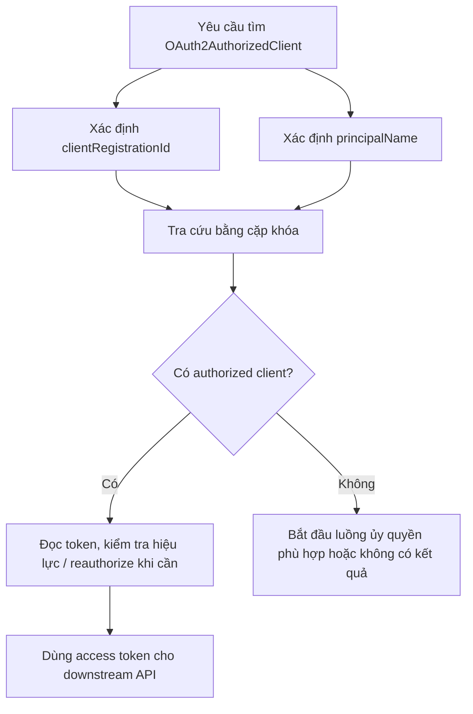
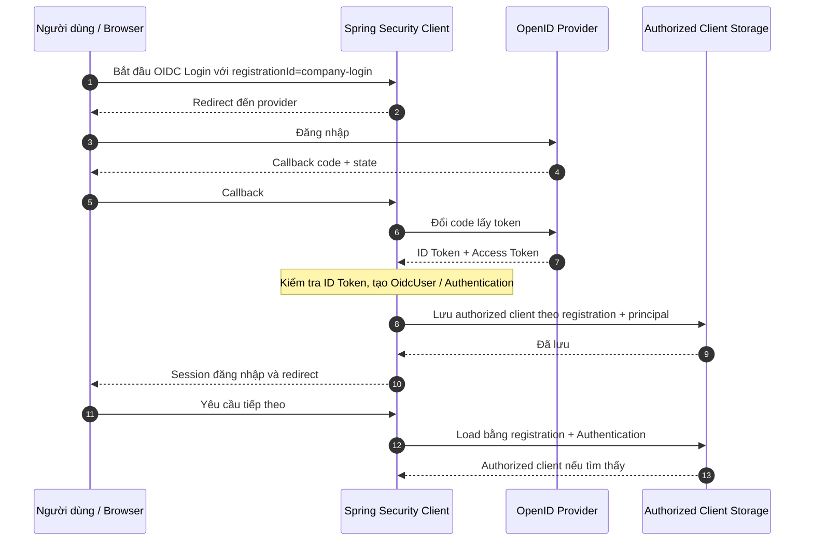
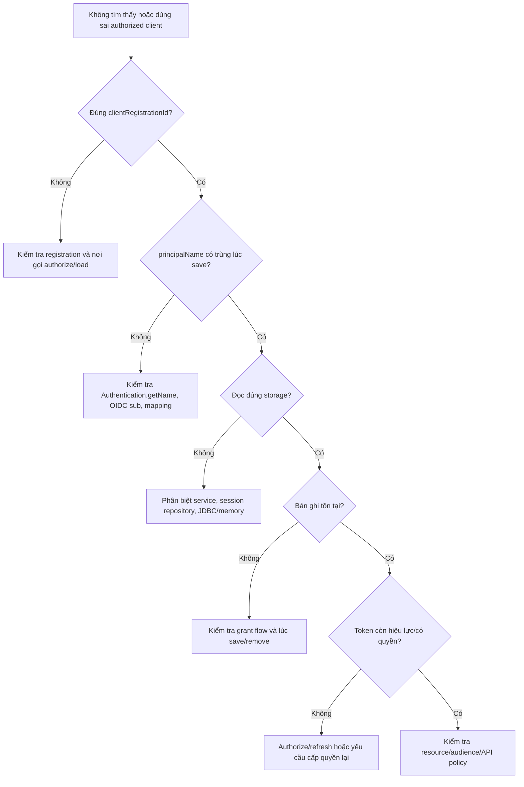

# 14.8. Khóa tra cứu theo registration ID và principal name

Trong **Spring Security OAuth 2.0 / OpenID Connect (OIDC) Client**, sau khi một ứng dụng nhận được access token từ Authorization Server, framework cần biết **token đó thuộc client nào và gắn với chủ thể nào** để có thể tìm lại, sử dụng, làm mới hoặc xóa nó về sau. Đây là mục đích của cặp khóa:

```text
(clientRegistrationId, principalName)
```

Ví dụ, một cổng quản trị có hai client registration `company-login` và `reports-api`. Người dùng Alice đăng nhập rồi ứng dụng được cấp token để gọi API. Nếu chỉ lưu token theo tên người dùng `alice`, ứng dụng có thể lấy nhầm token của client khác; nếu chỉ lưu theo `registrationId`, người dùng Alice và Bob có thể dùng nhầm token của nhau. **Kết hợp hai chiều thông tin** giúp phân biệt các authorized client mà Spring Security cần quản lý.

Bài này trình bày cách khóa tra cứu được dùng trong `OAuth2AuthorizedClientService`, vai trò của `OAuth2AuthorizedClientRepository` ở Servlet và cách chọn principal name ổn định khi đăng nhập OIDC, dùng nhiều provider, chạy background job hoặc triển khai nhiều instance. Trọng tâm là hiểu đúng **danh tính dùng làm khóa** thay vì nhầm nó với `client-id`, `sub`, `registrationId`, session ID hoặc scope.

## 1. Authorized Client là đối tượng gì?

`OAuth2AuthorizedClient` đại diện cho một client registration **đã được Authorization Server cấp quyền**. Nó giữ những thông tin quan trọng:

- `ClientRegistration`: đăng ký OAuth2 client, chứa `registrationId`, `clientId`, grant type, thông tin provider.
- `principalName`: tên chủ thể mà authorized client được gắn vào trong ngữ cảnh của ứng dụng.
- `accessToken`: access token hiện có, scope và thời điểm hết hạn.
- `refreshToken`: refresh token nếu provider cấp và ứng dụng được phép lưu.

Mô hình khái niệm:

```text
OAuth2AuthorizedClient
  |
  +-- clientRegistration
  |     +-- registrationId = "reports-api"
  |     +-- clientId       = "portal-reports-client"
  |     +-- provider       = "company-idp"
  |
  +-- principalName = "employee-42"
  |
  +-- accessToken
  |     +-- scopes
  |     +-- issuedAt, expiresAt
  |     +-- tokenValue (BÍ MẬT)
  |
  +-- refreshToken (nếu có, BÍ MẬT)
```

**Lưu ý:** `OAuth2AuthorizedClient` không phải `Authentication` hoặc `OidcUser`. `Authentication` mô tả chủ thể hiện được xác thực trong `SecurityContext`; `OAuth2AuthorizedClient` mô tả **ủy quyền của một OAuth2 client** và token có thể sử dụng để gọi downstream API.

### 1.1. Phân biệt những chuỗi rất dễ nhầm

| Giá trị | Ví dụ | Ý nghĩa |
|---|---|---|
| `registrationId` | `company-login` | Khóa nội bộ ứng dụng để chọn `ClientRegistration`. |
| `clientId` | `portal-web-prod` | Định danh client do Authorization Server cấp. |
| `providerId` | `company` | Khóa cấu hình provider trong Spring Boot, không phải khóa tra cứu authorized client. |
| `principalName` | `employee-42` | Tên chủ thể mà Spring lưu authorized client. |
| OIDC `sub` | `employee-42` | Định danh subject do **một issuer** cấp trong ID Token. |
| OIDC `iss` | `https://idp.example.org/realms/company` | Issuer xác nhận subject đó. |
| Session ID | Một cookie/session định danh phiên | Trạng thái browser và session, không phải khóa chuẩn của `OAuth2AuthorizedClientService`. |
| Scope | `reports.read` | Quyền OAuth2 được yêu cầu/cấp, không phải một thành phần của khóa tra cứu mặc định. |

Trong trường hợp đơn giản, `principalName` có thể trùng với OIDC `sub`. Nhưng không được mặc định rằng hai giá trị luôn giống nhau: tên của `Authentication` có thể được cấu hình khác, chẳng hạn theo một user-name attribute hoặc cơ chế liên kết user nội bộ.

## 2. Vì sao cần khóa kép?

Xét một ứng dụng có hai client registration và hai người dùng:

| `registrationId` | `principalName` | Authorized client/token tương ứng |
|---|---|---|
| `company-login` | `alice` | Token phát hành cho Alice trong flow đăng nhập. |
| `reports-api` | `alice` | Token của Alice dùng với Reports API theo registration này. |
| `company-login` | `bob` | Token phát hành cho Bob trong flow đăng nhập. |
| `reports-api` | `bob` | Token của Bob dùng với Reports API. |

Hai bản ghi có thể giống principal nhưng khác registration, hoặc giống registration nhưng khác principal. Cặp (`registrationId`, `principalName`) phân biệt cả hai trường hợp.



**Không nên** thiết kế kho lưu trữ chỉ có một token cho mỗi `registrationId` nếu ứng dụng sử dụng token đại diện cho nhiều người dùng. Điều đó có thể khiến user A dùng nhầm token của user B — một lỗi bảo mật nghiêm trọng.

Ngược lại, với `client_credentials`, token thường đại diện cho **chính client/service**, không phải người dùng cuối. Ở tình huống đó vẫn có `principalName` làm khóa kỹ thuật, nhưng ý nghĩa của nó là một chủ thể logic do ứng dụng chỉ định, không nhất thiết là OIDC subject.

## 3. OAuth2AuthorizedClientService: API thể hiện rõ hai khóa

`OAuth2AuthorizedClientService` là abstraction để **lưu, tìm và xóa** authorized client. Các phương thức quan trọng ở phía Servlet:

```java
<T extends OAuth2AuthorizedClient> T loadAuthorizedClient(
        String clientRegistrationId,
        String principalName);

void saveAuthorizedClient(
        OAuth2AuthorizedClient authorizedClient,
        Authentication principal);

void removeAuthorizedClient(
        String clientRegistrationId,
        String principalName);
```

Đoạn trên rút gọn chữ ký từ API để làm nổi bật tham số. Cần lưu ý sự khác biệt:

- **`loadAuthorizedClient`** nhận trực tiếp `clientRegistrationId` và `principalName`.
- **`removeAuthorizedClient`** cũng nhận đúng cặp này.
- **`saveAuthorizedClient`** nhận một `OAuth2AuthorizedClient` và một `Authentication`. Registration ID đến từ authorized client; tên principal dùng để lưu phải nhất quán với `Authentication` được cung cấp.

Một bản ghi trong repository có thể được biểu diễn khái niệm:

```text
key:
    (client_registration_id = "company-login",
     principal_name = "employee-42")

value:
    access_token, access_token_type, token_scopes,
    access_token_issued_at, access_token_expires_at,
    refresh_token (nếu có), ...
```

`InMemoryOAuth2AuthorizedClientService` là cách lưu trong bộ nhớ tiến trình; `JdbcOAuth2AuthorizedClientService` là một triển khai có persistence bằng JDBC. Các phiên bản và cấu hình Spring có thể cho phép triển khai khác; cách bảo quản/đồng bộ dữ liệu phụ thuộc service mà ứng dụng thực sự sử dụng.

### 3.1. Ví dụ đọc authorized client của người dùng hiện tại

Trong một controller Servlet, có thể lấy tên principal từ `Authentication` do Spring Security cung cấp:

```java
import org.springframework.security.core.Authentication;
import org.springframework.security.oauth2.client.OAuth2AuthorizedClient;
import org.springframework.security.oauth2.client.OAuth2AuthorizedClientService;
import org.springframework.web.bind.annotation.GetMapping;
import org.springframework.web.bind.annotation.RestController;

@RestController
class ClientStatusController {

    private final OAuth2AuthorizedClientService authorizedClientService;

    ClientStatusController(OAuth2AuthorizedClientService service) {
        this.authorizedClientService = service;
    }

    @GetMapping("/internal/client-status")
    ClientStatus status(Authentication authentication) {
        String registrationId = "company-login";
        String principalName = authentication.getName();

        OAuth2AuthorizedClient client =
                authorizedClientService.loadAuthorizedClient(
                        registrationId, principalName);

        return new ClientStatus(
                registrationId,
                client != null,
                client != null ? client.getAccessToken().getExpiresAt() : null);
    }

    record ClientStatus(
            String registrationId,
            boolean authorized,
            java.time.Instant expiresAt) {}
}
```

Đây là ví dụ dành cho môi trường kiểm thử hoặc endpoint nội bộ được bảo vệ. **Không trả token value, refresh token, secret hoặc toàn bộ client object về browser**. `loadAuthorizedClient(...)` chỉ đọc bản ghi theo khóa, không bảo đảm access token hiện có chưa hết hạn; logic dùng token phải xét thời hạn và cơ chế tái ủy quyền phù hợp.

Một lưu ý quan trọng: trong ứng dụng có repository lưu authorized client **theo session** thay vì theo service, đọc trực tiếp `OAuth2AuthorizedClientService` có thể không tìm thấy token dù đăng nhập đã thành công. Cần biết thành phần nào đang lưu bản ghi trước khi chọn API đọc.

### 3.2. Ví dụ xóa một authorized client theo khóa

```java
String registrationId = "company-login";
String principalName = authentication.getName();

authorizedClientService.removeAuthorizedClient(
        registrationId, principalName);
```

Lệnh này xóa authorized client khỏi **service lưu trữ được gọi**. Nó **không tự động thu hồi token tại Authorization Server**, không xóa session web và không đăng xuất người dùng tại OpenID Provider.

Nếu ứng dụng cần logout, revocation, session invalidation hoặc ngắt quyền truy cập downstream, phải thiết kế từng bước tương ứng. Một token đã phát hành có thể tiếp tục hợp lệ tới lúc hết hạn hoặc bị provider thu hồi theo cơ chế hỗ trợ.

## 4. OAuth2AuthorizedClientRepository: khóa tra cứu trong ngữ cảnh HTTP

Trong Servlet, `OAuth2AuthorizedClientRepository` lưu và đọc authorized client theo **HTTP request, principal và registration**. API có dạng:

```java
<T extends OAuth2AuthorizedClient> T loadAuthorizedClient(
        String clientRegistrationId,
        Authentication principal,
        HttpServletRequest request);

void saveAuthorizedClient(
        OAuth2AuthorizedClient authorizedClient,
        Authentication principal,
        HttpServletRequest request,
        HttpServletResponse response);

void removeAuthorizedClient(
        String clientRegistrationId,
        Authentication principal,
        HttpServletRequest request,
        HttpServletResponse response);
```

Điểm khác với `OAuth2AuthorizedClientService`:

| Đặc điểm | `OAuth2AuthorizedClientService` | `OAuth2AuthorizedClientRepository` |
|---|---|---|
| Phạm vi | Service lưu trữ authorized client độc lập với Servlet request | Lưu trữ/tra cứu trong ngữ cảnh Servlet request/response |
| Đầu vào tra cứu | `registrationId` + **`principalName`** (String) | `registrationId` + **`Authentication`** + `HttpServletRequest` |
| Có thể dùng ngoài web request | Có | Phải có hoặc mô phỏng ngữ cảnh HTTP tương ứng |
| Triển khai tiêu biểu | `InMemoryOAuth2AuthorizedClientService`, `JdbcOAuth2AuthorizedClientService` | `HttpSessionOAuth2AuthorizedClientRepository`, `AuthenticatedPrincipalOAuth2AuthorizedClientRepository` |
| Nơi thường dùng | Service-tier client management, persistence theo chủ thể | OAuth2 Login/authorization trong Servlet web flow |

`AuthenticatedPrincipalOAuth2AuthorizedClientRepository` có thể ủy quyền việc lưu theo authenticated principal cho một `OAuth2AuthorizedClientService`, trong khi dùng `HttpSessionOAuth2AuthorizedClientRepository` cho trường hợp anonymous tùy cấu hình. Đây là lý do nhiều ứng dụng thấy hiệu ứng khóa cặp `registrationId` + `principalName` ngay cả khi code gọi repository thay vì service.

**Không phải mọi repository đều lưu bằng cùng một chiến lược.** Khi dùng `HttpSessionOAuth2AuthorizedClientRepository`, dữ liệu được gắn với session HTTP; chuyện lookup theo principal string trong database không diễn ra giống với `JdbcOAuth2AuthorizedClientService`. Cần hiểu **repository cụ thể** đang dùng.

### 4.1. Ví dụ tra cứu từ HTTP request

```java
import jakarta.servlet.http.HttpServletRequest;
import org.springframework.security.core.Authentication;
import org.springframework.security.oauth2.client.OAuth2AuthorizedClient;
import org.springframework.security.oauth2.client.web.OAuth2AuthorizedClientRepository;

OAuth2AuthorizedClient client =
        authorizedClientRepository.loadAuthorizedClient(
                "company-login",
                authentication,
                httpServletRequest);
```

Đoạn này minh họa lời gọi khi các đối tượng đã có trong ngữ cảnh Servlet. Với repository dựa trên session, kết quả còn phụ thuộc session trong `httpServletRequest`; với repository dựa trên service, tên principal và nơi lưu service trở nên quan trọng.

### 4.2. Phân biệt Authorization Request Repository

Ba khái niệm dễ bị nhầm:

| Thành phần | Lưu gì? | Dùng ở thời điểm nào? |
|---|---|---|
| `OAuth2AuthorizationRequestRepository<OAuth2AuthorizationRequest>` | Authorization Request gốc (bao gồm `state` và dữ liệu PKCE/OIDC cần cho callback) | **Trước và trong callback** của Authorization Code Flow |
| `OAuth2AuthorizedClientRepository` | Authorized client và token trong HTTP request/session context | **Sau khi được cấp quyền**, cho các lần truy cập của web client |
| `OAuth2AuthorizedClientService` | Authorized client trong service storage theo registration/principal | Sau khi được cấp quyền, gồm các ngữ cảnh không có Servlet request |

Mặc định Servlet OAuth2 Login thường dùng `HttpSessionOAuth2AuthorizationRequestRepository` cho **authorization request**. Đây không phải `HttpSessionOAuth2AuthorizedClientRepository` và càng không phải JDBC authorized client table. Mất `state` trong callback và không tìm được access token sau login là hai loại lỗi khác nhau.

## 5. Principal name đến từ đâu?

Thông thường `Authentication.getName()` là tên được Spring Security công bố cho principal hiện tại. Trong một ứng dụng OIDC Login, tên này thường lấy từ `OidcUser.getName()`, mặc định có thể là `sub` của ID Token; nhưng nó có thể thay đổi khi ứng dụng dùng cấu hình tên principal khác.

```java
String principalName = authentication.getName();
Object principal = authentication.getPrincipal();

if (principal instanceof OidcUser oidcUser) {
    String subject = oidcUser.getIdToken().getSubject();
    String issuer = oidcUser.getIdToken().getIssuer().toString();

    // authentication.getName() có thể trùng subject,
    // nhưng không nên mặc định luôn đúng trong mọi cấu hình.
}
```

Các giá trị có thể được chọn làm principal name:

- **OIDC `sub`**: thường ổn định trong miền issuer và phù hợp với OIDC Login đơn provider.
- **Một user-name attribute**: ví dụ `preferred_username` hoặc trường provider tự định nghĩa; thuận tiện hiển thị nhưng có thể thay đổi.
- **Local user ID**: được ánh xạ từ external identity; cần một chiến lược tạo `Authentication`/principal nhất quán.
- **Service principal logic**: ví dụ `report-sync-job`, dùng trong `client_credentials` khi không có người dùng browser.

### 5.1. Vì sao chọn principal name ổn định là quan trọng?

Giả sử lần đăng nhập đầu:

```text
registrationId = company-login
principalName  = alice
```

Ứng dụng lưu authorized client dưới khóa `(company-login, alice)`. Sau đó provider đổi `preferred_username` thành `alice.nguyen` và ứng dụng đã cấu hình `Authentication.getName()` dựa trên thuộc tính này.

Lần tra cứu tiếp theo dùng:

```text
(company-login, alice.nguyen)
```

Kho lưu trữ không tìm được bản ghi cũ **dù token có thể vẫn còn trong storage**. Hệ quả là user bị yêu cầu ủy quyền lại, token cũ trở thành dữ liệu mồ côi, hoặc ứng dụng phải làm thủ tục migration/cleanup.

Vì thế, tránh dùng các thuộc tính có thể đổi như email, tên hiển thị hoặc username làm khóa lưu token nếu không có quy tắc chuyển đổi và migration rõ ràng.

### 5.2. OIDC subject cần gắn với issuer

`sub` của OIDC chỉ được đảm bảo trong ngữ cảnh issuer. Hai issuer có thể đều phát:

```text
iss = https://idp.example.org/realms/staff
sub = 00042

iss = https://idp.partner.example.org/realms/partners
sub = 00042
```

Hai subject có cùng chuỗi `00042` không mặc nhiên thuộc cùng người. Cặp (`iss`, `sub`) là định danh bên ngoài an toàn hơn cho quy trình liên kết tài khoản nội bộ.

Nếu mỗi issuer luôn dùng **một registration ID khác nhau**, cặp khóa authorized client `(registrationId, principalName)` có thể phân biệt hai trường hợp. Nhưng nếu ứng dụng áp một registration logic lên nhiều issuer/tenant hoặc tự hợp nhất đăng nhập, chỉ dựa vào `sub` làm principal name có thể gây **va chạm khóa và rò rỉ token**.

Một thiết kế tốt là có mô hình `external_identity(issuer, subject) -> local_user_id`, rồi quyết định principal name cho storage theo một quy tắc nhất quán, được xác thực và tránh xung đột.

### 5.3. Cẩn thận khi thay đổi name attribute

Trong OAuth2/OIDC Login, ứng dụng có thể thay đổi attribute được dùng làm principal name bằng cấu hình hoặc custom principal. Ví dụ tên hiển thị đọc từ `preferred_username` có vẻ tiện, nhưng giá trị đó có thể thay đổi hoặc không duy nhất.

Trước khi đổi chiến lược đặt tên ở hệ thống đang chạy:

1. Xác định authorized clients hiện đang được lưu theo tên nào.
2. Đánh giá có thể lưu token cũ dưới khóa mới hay cần đăng nhập/ủy quyền lại.
3. Bảo đảm không có hai người dùng khác nhau cùng principal name trong cùng registration.
4. Kiểm soát token cũ trong repository/service và quy trình xóa/thu hồi.
5. Cập nhật đồng bộ nơi gọi `load`, `save`, `remove` và authorized client manager.

Không tự sửa `Authentication.getName()` bằng cách nối dữ liệu người dùng không đáng tin chỉ để token “dễ tìm”. Nó là một khóa có ý nghĩa bảo mật.

## 6. JDBC: cặp khóa trở thành khóa bản ghi như thế nào?

Khi sử dụng `JdbcOAuth2AuthorizedClientService`, lưu trữ thường nằm trong bảng `oauth2_authorized_client`. Trong schema mẫu Spring Security, các cột khóa có dạng:

```sql
CREATE TABLE oauth2_authorized_client (
    client_registration_id varchar(100) NOT NULL,
    principal_name varchar(200) NOT NULL,
    access_token_type varchar(100) NOT NULL,
    access_token_value blob NOT NULL,
    access_token_issued_at timestamp NOT NULL,
    access_token_expires_at timestamp NOT NULL,
    access_token_scopes varchar(1000) DEFAULT NULL,
    refresh_token_value blob DEFAULT NULL,
    refresh_token_issued_at timestamp DEFAULT NULL,
    created_at timestamp DEFAULT CURRENT_TIMESTAMP NOT NULL,
    PRIMARY KEY (client_registration_id, principal_name)
);
```

Đây là **schema mô phỏng để minh họa khóa**; tên kiểu dữ liệu, độ dài, cột và câu lệnh DDL thực tế phải lấy từ phiên bản Spring Security và database đang dùng. Không chạy nguyên ví dụ này trên production mà chưa đối chiếu schema chính thức và migration hiện tại.

Mô hình composite key:

```text
PRIMARY KEY (client_registration_id, principal_name)
                       |
             mỗi registration + principal
             tương ứng tối đa một bản ghi
```

Điều quan trọng là cách áp dụng tính duy nhất: cùng một user có nhiều registration thì nhiều dòng; một registration có nhiều principal thì nhiều dòng.

### 6.1. Ảnh hưởng của key design tới bảo mật

Nếu app vô tình dùng cùng `principalName` cho mọi người, ví dụ `"default-user"`, các token có thể **ghi đè** nhau khi dùng cùng registration, tạo nguy cơ user này dùng token của user khác.

Nếu app dùng email làm principal name và email được chuyển nhượng cho người khác, bản ghi token cũ dưới cùng email có thể bị lấy lại nhầm khi user mới đăng nhập bằng cùng tên. Việc chọn khóa cần dựa trên danh tính đã xác thực, ổn định và duy nhất trong miền của registration.

Storage chứa access token và refresh token là **dữ liệu nhạy cảm**. Cần kiểm soát quyền truy cập database, mã hóa theo chính sách, giới hạn backup/log, bảo vệ các tài khoản dịch vụ và lập kế hoạch xóa dữ liệu không còn cần thiết. Composite key hỗ trợ truy vấn đúng bản ghi, nhưng tự nó không bảo vệ nội dung token khi database bị lộ.

### 6.2. InMemory và JDBC khác nhau về vòng đời

| Tiêu chí | `InMemoryOAuth2AuthorizedClientService` | `JdbcOAuth2AuthorizedClientService` |
|---|---|---|
| Nơi lưu | Bộ nhớ trong một process | Database được cấu hình |
| Sau khi restart | Thường mất dữ liệu | Có thể còn dữ liệu nếu database giữ lại |
| Multi-instance | Mỗi instance có kho riêng nếu không đồng bộ | Các instance có thể chia sẻ dữ liệu |
| Truy vấn bằng cặp khóa | Có | Có |
| Quản trị token/backup | Trong memory, phụ thuộc process | Cần chính sách DB, backup, mã hóa, phân quyền |
| Cần cân nhắc concurrency | Có, trong phạm vi process | Có, đặc biệt khi refresh/update đồng thời qua nhiều instance |

Một kho JDBC chia sẻ không tự giải quyết mọi vấn đề đa instance. Các request đồng thời có thể cùng nhận thấy token đã hết hạn và cùng chạy refresh; cần xét chiến lược retry, optimistic locking/serialization hoặc xử lý failure đúng với provider khi hệ thống có tải lớn.

## 7. Dùng AuthorizedClientManager để tra cứu và tự ủy quyền

Đọc trực tiếp `OAuth2AuthorizedClientService` hữu ích khi cần truy vấn một bản ghi, nhưng luồng ứng dụng thực tế thường cần **lấy hoặc làm mới token**. `OAuth2AuthorizedClientManager` cung cấp API authorize và phối hợp với `OAuth2AuthorizedClientProvider` để xử lý các grant được cấu hình.

Với service-tier hoặc background job không có `HttpServletRequest`, lựa chọn phù hợp thường là `AuthorizedClientServiceOAuth2AuthorizedClientManager`.

### 7.1. Ví dụ client credentials cho background job

`application.yml`:

```yaml
spring:
  security:
    oauth2:
      client:
        registration:
          inventory-service:
            provider: company
            client-id: "${INVENTORY_CLIENT_ID}"
            client-secret: "${INVENTORY_CLIENT_SECRET}"
            client-authentication-method: client_secret_basic
            authorization-grant-type: client_credentials
            scope:
              - inventory.read
        provider:
          company:
            token-uri: "https://idp.example.org/realms/company/protocol/openid-connect/token"
```

Bean authorized client manager:

```java
import org.springframework.context.annotation.Bean;
import org.springframework.context.annotation.Configuration;
import org.springframework.security.oauth2.client.AuthorizedClientServiceOAuth2AuthorizedClientManager;
import org.springframework.security.oauth2.client.OAuth2AuthorizedClientManager;
import org.springframework.security.oauth2.client.OAuth2AuthorizedClientProvider;
import org.springframework.security.oauth2.client.OAuth2AuthorizedClientProviderBuilder;
import org.springframework.security.oauth2.client.OAuth2AuthorizedClientService;
import org.springframework.security.oauth2.client.registration.ClientRegistrationRepository;

@Configuration
class BackgroundOAuth2Config {

    @Bean
    OAuth2AuthorizedClientManager backgroundAuthorizedClientManager(
            ClientRegistrationRepository registrations,
            OAuth2AuthorizedClientService authorizedClientService) {

        OAuth2AuthorizedClientProvider provider =
                OAuth2AuthorizedClientProviderBuilder.builder()
                        .clientCredentials()
                        .build();

        var manager = new AuthorizedClientServiceOAuth2AuthorizedClientManager(
                registrations, authorizedClientService);

        manager.setAuthorizedClientProvider(provider);
        return manager;
    }
}
```

Ở background job:

```java
import org.springframework.security.oauth2.client.OAuth2AuthorizeRequest;
import org.springframework.security.oauth2.client.OAuth2AuthorizedClient;
import org.springframework.security.oauth2.client.OAuth2AuthorizedClientManager;

OAuth2AuthorizeRequest request = OAuth2AuthorizeRequest
        .withClientRegistrationId("inventory-service")
        .principal("service:inventory-import")
        .build();

OAuth2AuthorizedClient authorized = manager.authorize(request);
if (authorized == null) {
    throw new IllegalStateException(
            "No authorized client for inventory-service");
}

// Chỉ truyền access token tới API được phép; không log tokenValue.
String tokenValue = authorized.getAccessToken().getTokenValue();
```

`manager` là instance `OAuth2AuthorizedClientManager` được inject; ví dụ thể hiện cách gọi tại lớp job/service. Token value cần được sử dụng trong HTTP client có kiểm soát để gọi đúng Resource Server; không trả về browser hoặc ghi log.

Tại đây khóa logic là:

```text
registrationId = "inventory-service"
principalName  = "service:inventory-import"
```

Không có OIDC subject của người dùng cuối vì `client_credentials` không đại diện một user đang login. `principal("service:inventory-import")` chỉ là tên chủ thể logic để manager và service có thể tìm lại bản ghi giữa các lần chạy.

### 7.2. Vì sao tên principal của job phải nhất quán?

Nếu lần chạy thứ nhất dùng `"service:inventory-import"` nhưng lần chạy thứ hai dùng `"job-2026-11-16-001"`, service sẽ tra cứu **hai khóa khác nhau**. Điều đó dễ tạo nhiều bản ghi/token cho cùng một client, thay vì tái sử dụng authorized client phù hợp.

Nên chọn tên ổn định, có ngữ nghĩa rõ ràng và được định nghĩa ở một nơi. Tránh đưa timestamp, request ID hoặc UUID ngẫu nhiên vào principal name nếu không có yêu cầu cố ý tách token.

Tuy nhiên, **không được dùng chung service principal giữa hai ngữ cảnh có yêu cầu cách ly khác nhau** chỉ để giảm số lần gọi token endpoint. Nếu token khác quyền, môi trường, tenant hoặc chủ sở hữu, các ngữ cảnh đó phải được phân vùng hợp lý theo registration và principal, đồng thời theo policy của hệ thống.

### 7.3. Phân biệt manager web và service manager

| Manager | Ngữ cảnh phù hợp | Nguồn lưu thường dùng |
|---|---|---|
| `DefaultOAuth2AuthorizedClientManager` | Servlet web request có `HttpServletRequest` và `HttpServletResponse` | `OAuth2AuthorizedClientRepository` |
| `AuthorizedClientServiceOAuth2AuthorizedClientManager` | Service/background job không phụ thuộc Servlet request | `OAuth2AuthorizedClientService` |

Không đổi sang service manager ngoài web rồi mong token lưu trong HTTP session tự xuất hiện trong service storage. Nếu hai thành phần dùng repository/service khác nhau, chúng có thể không thấy cùng authorized client dù cung cấp `registrationId` và principal name trùng nhau.

Đối với authorization-code flow, manager có thể cần chuyển hướng người dùng qua browser để được cấp grant ban đầu; một background job không có browser không thể tự tạo một user authorization code chỉ bằng cách gọi `authorize(...)`. Chọn grant type tương ứng với mô hình ứng dụng.

## 8. OIDC Login: principal name và authorized client

Trong luồng OIDC Servlet:



Trong ví dụ một provider, default principal name có thể lấy từ OIDC `sub`; nhưng ứng dụng vẫn phải dùng **giá trị thực tế mà security context/authorized client storage sử dụng**, thay vì tự suy luận từ email hoặc claim bất kỳ.

### 8.1. Lấy authorized client qua argument resolver

Trong controller Servlet, Spring Security hỗ trợ `@RegisteredOAuth2AuthorizedClient`:

```java
import org.springframework.security.oauth2.client.OAuth2AuthorizedClient;
import org.springframework.security.oauth2.client.annotation.RegisteredOAuth2AuthorizedClient;
import org.springframework.web.bind.annotation.GetMapping;
import org.springframework.web.bind.annotation.RestController;

@RestController
class ReportsController {

    @GetMapping("/reports/client-info")
    String clientInfo(
            @RegisteredOAuth2AuthorizedClient("reports-api")
            OAuth2AuthorizedClient client) {

        return "registration="
                + client.getClientRegistration().getRegistrationId();
    }
}
```

Đây là ví dụ yêu cầu authorized client cho `reports-api` trong ngữ cảnh request hiện tại; registration này phải thực sự được cấu hình và người dùng phải trải qua ủy quyền cần thiết. Annotation kết hợp cơ chế authorized client resolution/authorization của Spring; hành vi khi chưa có client còn phụ thuộc grant type và cấu hình.

Không nên giả định rằng việc user đã đăng nhập bằng `company-login` sẽ khiến registration `reports-api` mặc nhiên có token. Hai registration là hai giá trị khóa khác nhau.

### 8.2. Khi thay đổi tên principal sau đăng nhập

Một ứng dụng có thể dùng `OidcUserService` tùy chỉnh hoặc `GrantedAuthoritiesMapper`. Việc ánh xạ authorities không nhất thiết thay đổi `Authentication.getName()`; còn thay đổi name attribute của `OidcUser` hoặc đổi principal type có thể khiến khóa tra cứu thay đổi.

Nếu một service lưu token theo principal `employee-42` nhưng controller tra cứu bằng `alice@example.org`, lookup sẽ không tìm thấy bản ghi. Hãy thống nhất chiến lược principal ở **cả nơi lưu và nơi sử dụng token**, không chữa bằng cách tìm token bất kỳ theo client ID rồi gắn cho request hiện tại.

## 9. Khi một người dùng có nhiều provider hoặc nhiều tenant

Một ứng dụng có thể hỗ trợ:

```text
/oauth2/authorization/corporate
/oauth2/authorization/partner
```

Hai registration thường gắn với hai issuer khác nhau. Bảng:

| registrationId | principalName | Identity nguồn | Authorized client |
|---|---|---|---|
| `corporate` | `user-42` | `(issuer=corporate, sub=user-42)` | Token corporate |
| `partner` | `user-42` | `(issuer=partner, sub=user-42)` | Token partner |

Cặp khóa có registration khác nhau nên phân biệt được hai authorized client. Tuy nhiên, ở hệ thống cần **liên kết một local user tới nhiều external identities**, không nên dùng mỗi `principalName` để kết luận hai dòng thuộc cùng một người. Phải có cơ chế mapping identity nội bộ rõ ràng.

### 9.1. Khi cần đưa tenant vào mô hình khóa

Nếu nhiều tenant cùng sử dụng một registration logic với cùng principal string, có nguy cơ cặp khóa không đủ để phân biệt các miền ủy quyền. Cần thiết kế cách phân vùng:

- Registration ID riêng cho tenant/provider khi policy yêu cầu.
- Principal name được xây dựng từ một ID nội bộ **đã xác thực và duy nhất** trong miền lưu trữ.
- Kho lưu trữ tách theo tenant với isolation thích hợp khi kiến trúc hỗ trợ.
- Thêm một tầng identity mapping từ (`issuer`, `subject`) tới local user và tenant.

Không lấy `tenantId` từ query parameter do browser tự gửi rồi nối thẳng vào principal name để quyết định token được truy xuất. Tenant và danh tính phải được xác nhận bởi chính sách server.

### 9.2. Chuẩn hóa và mã hóa principal name

Nếu ứng dụng muốn ghép issuer và subject thành một chuỗi, hãy dùng phép biểu diễn **không nhập nhằng**, ví dụ một mã identity nội bộ ổn định. Phép nối ngây thơ:

```java
// Dễ gây nhập nhằng nếu không quy ước escaping/encoding:
String principalName = issuer + ":" + subject;
```

có thể gặp khó khăn nếu các thành phần chứa ký tự phân cách hoặc bị thay đổi định dạng. Một giải pháp thường dễ quản lý hơn là lưu (`issuer`, `subject`) trong bảng external identity và dùng **local user ID bất biến** làm khóa ứng dụng, nếu kiến trúc security context cho phép. Không thay đổi khóa principal của hệ thống đang chạy mà không có kế hoạch migration.

## 10. Những lỗi khi tra cứu authorized client

| Triệu chứng | Nguyên nhân có thể | Cách chẩn đoán |
|---|---|---|
| `loadAuthorizedClient(...)` trả `null` | Sai `registrationId`, sai `principalName`, token chưa từng được lưu, hoặc storage khác | So sánh khóa lúc save/load, loại repository/service và grant flow. |
| Vừa login xong nhưng service không tìm thấy token | Authorized client được lưu trong HTTP session repository, không phải service đó | Kiểm tra `OAuth2AuthorizedClientRepository` và implementation thực tế. |
| User đổi tên/email rồi không lấy được token cũ | Principal name dùng attribute có thể thay đổi | Chọn tên ổn định, lập kế hoạch migration/reauthorization. |
| Hai user dùng nhầm token | Principal name bị dùng chung hoặc lookup không ràng buộc user thực tế | Xem lại key strategy, issuer/tenant isolation và quyền truy cập storage. |
| Background job liên tục lấy token mới | Mỗi lần tạo principal mới, hoặc client/service storage không giữ giữa các lần chạy | Dùng principal logic ổn định và persistence phù hợp. |
| Restart làm mất authorized client | Lưu bằng InMemory service | Dùng persistence nếu cần giữ token sau restart; bảo vệ refresh token. |
| Multi-instance không tìm được token | Instance dùng kho memory/session khác nhau | Dùng storage/session chung hoặc mô hình nhất quán theo kiến trúc. |
| Access token hết hạn dù load thành công | `load` chỉ tìm bản ghi, không tự bảo đảm token còn hiệu lực | Dùng authorized client manager để reauthorize/refresh theo cấu hình. |
| Xóa client rồi token vẫn gọi API được | `removeAuthorizedClient` chỉ xóa local storage | Dùng revocation/provider logout nếu được hỗ trợ và đáp ứng yêu cầu. |
| Một client có nhiều token cho cùng user | Có nhiều registration ID hoặc principal name không nhất quán | Kiểm tra danh sách registration và cách ánh xạ identity. |
| Token dùng trong API trả 401/403 | Sai audience/scope, token bị thu hồi, nhầm registration hoặc user | Kiểm tra API contract và token được chọn, không chỉ khóa lưu trữ. |
| Logout rồi vẫn có refresh token trong database | Logout session chưa tích hợp cleanup/revocation đúng storage | Thiết kế chính sách logout, xóa authorized client và thu hồi token tương ứng. |

### 10.1. Quy trình debug theo thứ tự



Chẩn đoán nên bắt đầu bằng **tên registration, loại storage và chiến lược đặt principal**, không bằng việc dump access token. Khi debug production, chỉ log mã định danh kỹ thuật đã được cho phép, transaction/correlation ID và trạng thái có/không có bản ghi; không log token hoặc dữ liệu nhạy cảm.

## 11. Lưu ý về security khi thiết kế khóa

### 11.1. Cặp khóa không phải cơ chế authorization duy nhất

Vì đã biết (`registrationId`, `principalName`), một service không nên mặc nhiên trả token cho bất kỳ caller nào cung cấp hai chuỗi đó. Ứng dụng cần ràng buộc request với **Authentication đã được xác thực**, quyền gọi API và logic sở hữu authorized client.

Đặc biệt, không xây endpoint như:

```java
// KHÔNG AN TOÀN: cho browser tùy ý chọn principalName để lấy token.
@GetMapping("/tokens")
String token(@RequestParam String registrationId,
             @RequestParam String principalName) {
    OAuth2AuthorizedClient client =
            service.loadAuthorizedClient(registrationId, principalName);
    return client.getAccessToken().getTokenValue();
}
```

Ví dụ này vừa cho phép truy cập token người khác nếu không có authorization, vừa làm lộ access token. **Không sử dụng mô hình như vậy trong ứng dụng thật.** Backend nên lấy principal từ security context/nguồn service đã được xác thực và giữ token ở server.

### 11.2. Nguyên tắc bảo quản token

- Chỉ cấp quyền đọc/ghi kho token cho thành phần cần thiết; tách quyền quản trị database.
- Không để client secret, access token, refresh token hoặc Authorization header vào log/response.
- Cân nhắc mã hóa token ở trạng thái lưu trữ, backup và quy trình rotate khóa.
- Áp dụng chính sách xóa authorized client không còn cần thiết và revoke token khi provider hỗ trợ.
- Với hệ thống đa tenant, đảm bảo tenant isolation xuyên suốt registration, principal và storage.
- Không dùng tên hiển thị, email hoặc tham số từ frontend làm principal key nếu không được chuẩn hóa và xác minh.
- Đối với token có scope/audience nhạy cảm, không chia sẻ authorized client giữa các job hoặc user chỉ vì có cùng registration ID.

### 11.3. Khi nào nên lưu token theo session?

Một ứng dụng web nhỏ có thể dùng session repository để giữ authorized client cùng vòng đời phiên; phù hợp nếu session được quản lý chặt chẽ. Tuy nhiên, khi ứng dụng cần background job, multi-instance, reauthorization giữa request hoặc persistence sau restart, cần xem xét service storage và manager thích hợp.

Không chọn JDBC chỉ vì “muốn token sống mãi”: refresh token có thời hạn và chính sách thu hồi riêng, trong khi việc giữ token quá lâu tăng nguy cơ lộ credential. Thiết kế retention theo nhu cầu nghiệp vụ và chính sách của provider.

## 12. Reactive WebFlux: cùng ý tưởng khóa, khác API

Trong Spring WebFlux, `ReactiveOAuth2AuthorizedClientService` và `ServerOAuth2AuthorizedClientRepository` phục vụ các mục đích tương tự nhưng sử dụng Reactor.

| Servlet | Reactive |
|---|---|
| `OAuth2AuthorizedClientService` | `ReactiveOAuth2AuthorizedClientService` |
| `OAuth2AuthorizedClientRepository` | `ServerOAuth2AuthorizedClientRepository` |
| `OAuth2AuthorizedClientManager` | `ReactiveOAuth2AuthorizedClientManager` |
| `AuthorizedClientServiceOAuth2AuthorizedClientManager` | `AuthorizedClientServiceReactiveOAuth2AuthorizedClientManager` |
| `HttpServletRequest` | `ServerWebExchange` |

Service Reactive có thể có API tương tự:

```java
Mono<OAuth2AuthorizedClient> clientMono =
        reactiveAuthorizedClientService.loadAuthorizedClient(
                "company-login", principalName);
```

Repository Reactive sử dụng `Authentication` và `ServerWebExchange` theo ngữ cảnh server reactive. Khi không tìm thấy client, kết quả có thể là `Mono.empty()` thay vì `null` như API đồng bộ.

Không gọi `block()` trên event loop WebFlux để dùng Servlet service; việc đó có thể làm chậm hoặc gây nghẽn ứng dụng. Chọn manager, repository và client HTTP phù hợp với reactive stack.

Về mặt ý nghĩa, **registration ID và principal name vẫn là hai chiều phân biệt authorized client**. Những vấn đề về ổn định principal, định danh đa issuer, quyền riêng tư và tenant isolation cũng tồn tại trên WebFlux.

## 13. Tình huống tổng hợp: BFF, hai người dùng và một background worker

Giả sử hệ thống có:

- `company-login`: đăng nhập OIDC cho nhân viên qua browser.
- `reports-api`: authorization code client dùng token của nhân viên để gọi Reports API.
- `inventory-service`: client credentials dành cho background worker.

Các authorized client được lưu:

```text
("company-login",    "employee-42")         -> login tokens
("reports-api",      "employee-42")         -> delegated reports token
("company-login",    "employee-99")         -> login tokens
("reports-api",      "employee-99")         -> delegated reports token
("inventory-service","service:inventory")   -> service access token
```

Trong tình huống này:

1. Nhân viên 42 không được nhận token của nhân viên 99: cùng registration nhưng principal khác.
2. Cùng nhân viên 42, token `company-login` không được coi là token `reports-api`: registration khác.
3. Background worker không có `OidcUser`; nó dùng `principalName` logic ổn định để tìm lại token `client_credentials`.
4. Khi nhân viên đổi email, authorized client không nên bị mất do key thay đổi nếu hệ thống dùng subject hoặc local user ID ổn định.
5. Nếu ứng dụng mở thêm tenant, phải bảo đảm các cặp key không va chạm giữa tenant và không cho user/worker lấy token ngoài miền sở hữu.
6. Token đã load vẫn phải được kiểm tra thời hạn và quyền: nhận đúng bản ghi không đồng nghĩa access token được API chấp nhận.

### 13.1. Checklist khi thiết kế hệ thống

Trước khi phát triển một kho authorized client, nhóm kỹ thuật nên thống nhất:

1. Registration ID được quản lý và đặt tên thế nào giữa các môi trường, provider và tenant?
2. Principal name lấy từ `Authentication.getName()`, OIDC `sub`, local user ID hay service principal?
3. Có chiến lược tránh trùng và xử lý thay đổi tên principal không?
4. Authorized client được lưu ở session, memory, JDBC hay kho tùy chỉnh?
5. Có cần chia sẻ giữa các instance hoặc dùng ngoài HTTP request không?
6. Service/manager nào thực hiện việc lấy lại token và refresh?
7. Khi logout, thu hồi quyền hoặc đổi client secret, ai chịu trách nhiệm cleanup và revocation?
8. Quyền truy cập storage được kiểm soát ra sao và token được bảo vệ thế nào?

## 14. Câu hỏi ôn tập

1. Vì sao chỉ dùng `registrationId` hoặc chỉ dùng `principalName` làm khóa authorized client đều có thể gây lỗi?
2. `clientId` có phải một thành phần của cặp khóa tra cứu `OAuth2AuthorizedClientService` không? Vì sao?
3. `loadAuthorizedClient` và `removeAuthorizedClient` nhận tham số gì? `saveAuthorizedClient` dùng `Authentication` vào mục đích nào?
4. Vì sao `OAuth2AuthorizedClientRepository` có thêm `HttpServletRequest` mà `OAuth2AuthorizedClientService` thì không?
5. `HttpSessionOAuth2AuthorizationRequestRepository` khác `HttpSessionOAuth2AuthorizedClientRepository` ở thời điểm và loại dữ liệu lưu như thế nào?
6. Khi `OidcUser.getName()` chuyển từ `sub` sang email, điều gì có thể xảy ra với các authorized client đã lưu?
7. Vì sao trong ứng dụng nhiều issuer phải phân biệt `(iss, sub)` thay vì chỉ dựa vào `sub`?
8. Tại sao background job dùng `client_credentials` vẫn phải chỉ định `principalName` dù không có user cuối?
9. Dùng `removeAuthorizedClient` có thu hồi access token ở Authorization Server và tự logout browser không?
10. Vì sao một authorized client có trong JDBC vẫn có thể không sử dụng được để gọi Reports API?

## Tài liệu tham khảo

- [Spring Security Reference — OAuth2 Client (Servlet)](https://docs.spring.io/spring-security/reference/servlet/oauth2/client/index.html)
- [Spring Security Reference — OAuth2 Client Core Model (Servlet)](https://docs.spring.io/spring-security/reference/servlet/oauth2/client/core.html)
- [Spring Security Reference — OAuth2 Client (Reactive)](https://docs.spring.io/spring-security/reference/reactive/oauth2/client/index.html)
- [Spring Security API — OAuth2AuthorizedClient](https://docs.spring.io/spring-security/reference/api/java/org/springframework/security/oauth2/client/OAuth2AuthorizedClient.html)
- [Spring Security API — OAuth2AuthorizedClientService](https://docs.spring.io/spring-security/reference/api/java/org/springframework/security/oauth2/client/OAuth2AuthorizedClientService.html)
- [Spring Security API — OAuth2AuthorizedClientRepository](https://docs.spring.io/spring-security/reference/api/java/org/springframework/security/oauth2/client/web/OAuth2AuthorizedClientRepository.html)
- [Spring Security API — AuthorizedClientServiceOAuth2AuthorizedClientManager](https://docs.spring.io/spring-security/reference/api/java/org/springframework/security/oauth2/client/AuthorizedClientServiceOAuth2AuthorizedClientManager.html)
- [Spring Security API — JdbcOAuth2AuthorizedClientService](https://docs.spring.io/spring-security/reference/api/java/org/springframework/security/oauth2/client/JdbcOAuth2AuthorizedClientService.html)
- [Spring Security API — ReactiveOAuth2AuthorizedClientService](https://docs.spring.io/spring-security/reference/api/java/org/springframework/security/oauth2/client/ReactiveOAuth2AuthorizedClientService.html)
- [OpenID Connect Core 1.0 — ID Token subject identifier](https://openid.net/specs/openid-connect-core-1_0.html#IDToken)
