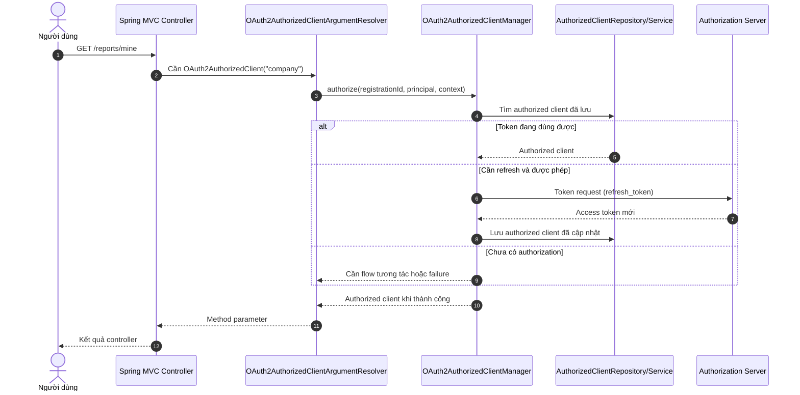

# 14.10. @RegisteredOAuth2AuthorizedClient trong controller Servlet

Khi một ứng dụng Spring MVC cho người dùng đăng nhập bằng OAuth 2.0 hoặc OpenID Connect (OIDC), sau khi đăng nhập thành công, ứng dụng thường cần gọi một API thay mặt người dùng. Ví dụ, người dùng đăng nhập qua SSO, rồi mở trang `/dashboard`; backend phải gọi API hồ sơ hoặc API nghiệp vụ bằng **access token đã được cấp cho đúng client registration và người dùng hiện tại**.

Trong Spring Security OAuth 2.0 Client trên **Servlet stack**, annotation **`@RegisteredOAuth2AuthorizedClient`** giúp controller nhận một **`OAuth2AuthorizedClient`** ngay tại tham số phương thức thay vì tự đọc session hoặc truy vấn kho token bằng tay.

Ví dụ ngắn nhất:

```java
@GetMapping("/account")
String account(
        @RegisteredOAuth2AuthorizedClient("company")
        OAuth2AuthorizedClient authorizedClient) {

    String registrationId =
        authorizedClient.getClientRegistration().getRegistrationId();

    // Access token nằm trong authorizedClient.getAccessToken().
    // Chỉ sử dụng token để gọi API có quyền tương ứng.
    return "account";
}
```

Bài học giải thích annotation hoạt động thế nào trong Spring MVC, cách phân biệt **ClientRegistration**, **OAuth2AuthorizedClient**, **principal** và **token**, cách kết hợp với `oauth2Login()`/`oauth2Client()`, ví dụ gọi API, các tình huống thiếu authorization hoặc token hết hạn và những rủi ro bảo mật.

> Phạm vi: ứng dụng **Spring Boot 3.x / Spring Security 6.x, Servlet (Spring MVC)**. Các class và cơ chế có thể được tinh chỉnh giữa các phiên bản; khi dùng một phiên bản cụ thể, cần đối chiếu API đi kèm. Các host `example.test` chỉ là ví dụ.

## 1. Authorized Client là gì?

Trong OAuth 2.0, **ClientRegistration** mô tả ứng dụng đã đăng ký với Authorization Server. Nó bao gồm client ID, client authentication method, grant type, redirect URI, scopes và thông tin provider.

Sau khi một client đã được cấp token thành công, Spring Security biểu diễn kết quả bằng **`OAuth2AuthorizedClient`**.

Một authorized client gắn kết ba phần:

```text
ClientRegistration
    +
Principal name (ngữ cảnh được cấp quyền)
    +
Access token, và có thể Refresh token
    =
OAuth2AuthorizedClient
```

Những method thường gặp:

| API | Giá trị nhận được | Ý nghĩa |
| --- | --- | --- |
| `getClientRegistration()` | `ClientRegistration` | Client và provider nào đã được sử dụng |
| `getPrincipalName()` | `String` | Tên principal mà authorized client được gắn vào |
| `getAccessToken()` | `OAuth2AccessToken` | Token dùng để truy cập Resource Server |
| `getRefreshToken()` | `OAuth2RefreshToken` hoặc `null` | Token có thể dùng khi được cấp để lấy access token mới |

Trong `OAuth2AccessToken`, bạn có thể lấy:

```java
OAuth2AccessToken accessToken = authorizedClient.getAccessToken();

String tokenValue = accessToken.getTokenValue();
Set<String> scopes = accessToken.getScopes();
Instant issuedAt = accessToken.getIssuedAt();
Instant expiresAt = accessToken.getExpiresAt();
```

**`tokenValue` là bí mật bearer credential.** Không in vào log, HTML, JSON API trả về trình duyệt, metric hay exception. Sự tồn tại của `OAuth2AuthorizedClient` trong backend không có nghĩa frontend phải được nhận token.

### 1.1. Phân biệt bốn đối tượng quan trọng

| Đối tượng | Câu hỏi nó trả lời | Ví dụ |
| --- | --- | --- |
| **`ClientRegistration`** | Ứng dụng này được đăng ký với OP/AS thế nào? | `registrationId="company"` |
| **`OAuth2AuthorizedClient`** | Registration này đã nhận token nào trong ngữ cảnh principal nào? | `company + alice + access token` |
| **`Authentication`** | Request hiện tại đã xác thực người dùng/subject nào? | `OAuth2AuthenticationToken` |
| **`OidcUser`** | OIDC đã xác thực danh tính và trả các claim nào? | `sub`, `iss`, `email` |

**`OidcUser` không phải `OAuth2AuthorizedClient`.** Một đối tượng đại diện principal đã đăng nhập; đối tượng còn lại giữ token gắn với client registration. Vì vậy, nếu muốn gọi API bằng access token, annotation chuyên biệt cho authorized client phù hợp hơn việc tìm token trong `OidcUser`.

## 2. @RegisteredOAuth2AuthorizedClient làm gì?

Annotation nằm trong package:

```java
import org.springframework.security.oauth2.client.annotation.RegisteredOAuth2AuthorizedClient;
```

Và thường gắn vào tham số `OAuth2AuthorizedClient` của một phương thức MVC handler:

```java
@GetMapping("/dashboard")
ResponseEntity<?> dashboard(
    @RegisteredOAuth2AuthorizedClient("company")
    OAuth2AuthorizedClient client) {
    // ...
}
```

Khi Spring MVC chuẩn bị gọi handler, **argument resolver** do Spring Security cung cấp sẽ tìm hoặc thực hiện quy trình authorize cho authorized client tương ứng với `registrationId` và principal hiện tại, theo cấu hình hỗ trợ của ứng dụng.

Điểm quan trọng:

- Annotation **không chứa access token**. Chuỗi `company` là **registration ID**, không phải giá trị bearer token.
- Spring MVC **không tự cấp token bằng reflection**; nó ủy quyền cho hạ tầng OAuth2 Client của Spring Security.
- Authorized client được truy xuất hoặc tạo thông qua cơ chế manager/repository/service thích hợp và grant type mà client được phép sử dụng.
- Nếu cần tương tác người dùng để xin quyền, framework có thể khởi động luồng authorization hoặc không thể hoàn tất request controller hiện tại.
- Resolver không phải phương thức giải mã ID Token hay kiểm tra vai trò nghiệp vụ; chúng thuộc các phần khác của Spring Security.

### 2.1. Sơ đồ MVC argument resolution

```mermaid
flowchart TD
    A["Browser GET /dashboard"] --> B["Servlet filter chain"]
    B --> C["SecurityContext / Authentication"]
    C --> D["DispatcherServlet chọn MVC handler"]
    D --> E["Method parameter:<br/>@RegisteredOAuth2AuthorizedClient(\"company\")"]
    E --> F["OAuth2AuthorizedClientArgumentResolver"]
    F --> G["OAuth2AuthorizedClientManager / client storage"]
    G --> H{"Authorized client hợp lệ?"}
    H -->|Có| I["Trả OAuth2AuthorizedClient cho controller"]
    H -->|Cần authorize/refresh| J["AuthorizedClientProvider và OAuth2 flow"]
    J --> K{"Có thể hoàn tất?"}
    K -->|Có| I
    K -->|Không| L["Redirect/exception hoặc authorization failure"]
    I --> M["Controller gọi đúng Resource Server"]
```

Sơ đồ mô tả trách nhiệm logic. Chi tiết cụ thể khi manager cần authorize lại phụ thuộc grant type, trạng thái user, authorization request repository, filter chain và phiên bản Spring Security. Không nên mặc định mọi lỗi đều khiến handler nhận được `null` hoặc mọi lần gọi controller luôn tạo HTTP redirect.

## 3. Vì sao annotation hữu ích hơn tự đọc token từ session?

Không dùng annotation, controller có thể cố:

1. Lấy username trong SecurityContext.
2. Tìm `clientRegistrationId` theo chuỗi tự tạo.
3. Đọc HTTP session.
4. Truy vấn một kho token riêng.
5. Tự xử lý token hết hạn và refresh token.

Cách đó dễ sai vì một người dùng có thể có nhiều OAuth2 client registration, token cần gắn với đúng principal, và vòng đời refresh phụ thuộc policy của Authorization Server.

Với annotation, controller chỉ khai báo **dependency**:

```java
@RegisteredOAuth2AuthorizedClient("company")
OAuth2AuthorizedClient authorizedClient
```

Framework chịu trách nhiệm phần quản lý authorized client theo cấu hình; controller tập trung vào nghiệp vụ dùng token.

**Tuy nhiên:** controller vẫn phải kiểm tra quyền của chính ứng dụng, chọn **đúng downstream API** và xử lý lỗi từ API đó. Không có annotation nào biến mọi bearer token thành quyền truy cập không giới hạn.

## 4. Cấu hình Spring Boot OAuth2/OIDC Client

### 4.1. Dependency

Với Maven:

```xml
<dependencies>
    <dependency>
        <groupId>org.springframework.boot</groupId>
        <artifactId>spring-boot-starter-web</artifactId>
    </dependency>
    <dependency>
        <groupId>org.springframework.boot</groupId>
        <artifactId>spring-boot-starter-security</artifactId>
    </dependency>
    <dependency>
        <groupId>org.springframework.boot</groupId>
        <artifactId>spring-boot-starter-oauth2-client</artifactId>
    </dependency>
</dependencies>
```

`spring-boot-starter-web` tạo ứng dụng Servlet MVC; `spring-boot-starter-oauth2-client` cung cấp cấu hình client, OAuth2 Login và hạ tầng authorized client.

### 4.2. Client registration trong application.yml

```yaml
spring:
  security:
    oauth2:
      client:
        registration:
          company:
            provider: company
            client-id: ${OIDC_CLIENT_ID}
            client-secret: ${OIDC_CLIENT_SECRET}
            authorization-grant-type: authorization_code
            redirect-uri: "{baseUrl}/login/oauth2/code/{registrationId}"
            scope:
              - openid
              - profile
              - email
              - profile.read

        provider:
          company:
            issuer-uri: https://id.example.test/realms/company
```

Cấu hình này minh họa registration `company` với Authorization Code Flow + OIDC. Giả định OP hỗ trợ các scope đã liệt kê; `profile.read` là tên scope API minh họa, không phải scope OIDC mặc định.

Những giá trị liên hệ với annotation:

```text
registration:
  company:             <-- @RegisteredOAuth2AuthorizedClient("company")
    client-id: ...      <-- ID thật được OP cấp, có thể khác "company"
    ...
```

Nếu cấu hình key `company-oidc` thì annotation phải dùng `"company-oidc"`, không phải tên hiển thị `Company SSO` hoặc giá trị `client-id`.

### 4.3. SecurityFilterChain cho Servlet login

```java
import org.springframework.context.annotation.Bean;
import org.springframework.context.annotation.Configuration;
import org.springframework.security.config.Customizer;
import org.springframework.security.config.annotation.web.builders.HttpSecurity;
import org.springframework.security.web.SecurityFilterChain;

@Configuration
class SecurityConfig {

    @Bean
    SecurityFilterChain securityFilterChain(HttpSecurity http) throws Exception {
        return http
            .authorizeHttpRequests(auth -> auth
                .requestMatchers("/", "/error", "/public/**").permitAll()
                .anyRequest().authenticated())
            .oauth2Login(Customizer.withDefaults())
            .oauth2Client(Customizer.withDefaults())
            .build();
    }
}
```

- **`oauth2Login()`** khởi động/hoàn tất login qua OAuth2 hoặc OIDC và tạo Authentication cho browser session.
- **`oauth2Client()`** bật các cơ chế hỗ trợ authorization cho OAuth2 Client trong filter chain theo cấu hình.
- **`anyRequest().authenticated()`** bảo vệ các endpoint controller để chỉ user đã xác thực gọi được.

Tùy phiên bản và cấu hình Boot, các thành phần OAuth2 Client có thể được cài đặt tự động khi bật `oauth2Login()`; việc khai báo cả hai trong ví dụ nhằm làm rõ ứng dụng vừa đăng nhập người dùng vừa dùng authorized client để gọi API.

**Không cần tự viết controller callback** `/login/oauth2/code/company`. Trong cấu hình mặc định, filter của Spring Security xử lý authorization response.

### 4.4. Khởi động login

Người dùng truy cập:

```text
/oauth2/authorization/company
```

OP xác thực và đưa browser về callback mặc định:

```text
/login/oauth2/code/company?code=...&state=...
```

Sau khi đổi code lấy token và xác thực OIDC thành công, Spring Security tạo Authentication và lưu authorized client qua cơ chế repository/service thích hợp. Khi người dùng vào controller có annotation, resolver có thể tra lại authorized client này.

## 5. Ví dụ controller truy cập authorized client

### 5.1. Chỉ đọc metadata an toàn

Một endpoint minh họa:

```java
import java.time.Instant;
import java.util.Map;

import org.springframework.security.oauth2.client.OAuth2AuthorizedClient;
import org.springframework.security.oauth2.client.annotation.RegisteredOAuth2AuthorizedClient;
import org.springframework.web.bind.annotation.GetMapping;
import org.springframework.web.bind.annotation.RestController;

@RestController
class AuthorizedClientInfoController {

    @GetMapping("/client/status")
    Map<String, Object> status(
            @RegisteredOAuth2AuthorizedClient("company")
            OAuth2AuthorizedClient authorizedClient) {

        String registrationId =
            authorizedClient.getClientRegistration().getRegistrationId();

        Instant expiresAt =
            authorizedClient.getAccessToken().getExpiresAt();

        return Map.of(
            "registrationId", registrationId,
            "accessTokenPresent", true,
            "expiresAt", expiresAt == null ? "unknown" : expiresAt.toString()
        );
    }
}
```

**Không trả về `authorizedClient` trực tiếp dưới dạng JSON.** Đối tượng này chứa access token và có thể chứa refresh token. Chỉ chọn dữ liệu metadata cần thiết và đã được phép công khai. Endpoint chẩn đoán như trên nên bảo vệ theo chính sách, không mặc nhiên mở public.

`expiresAt` giúp quan sát token có thời hạn bao lâu, nhưng **không phải cơ chế refresh token**. Controller nên để hạ tầng authorized client manager thực hiện refresh theo cấu hình, không tự tạo vòng refresh bằng cách gọi token endpoint trong MVC handler.

### 5.2. Đọc principal đồng thời

Bạn có thể nhận cả `OidcUser` và `OAuth2AuthorizedClient`:

```java
import java.util.Map;

import org.springframework.security.core.annotation.AuthenticationPrincipal;
import org.springframework.security.oauth2.client.OAuth2AuthorizedClient;
import org.springframework.security.oauth2.client.annotation.RegisteredOAuth2AuthorizedClient;
import org.springframework.security.oauth2.core.oidc.user.OidcUser;
import org.springframework.web.bind.annotation.GetMapping;
import org.springframework.web.bind.annotation.RestController;

@RestController
class AccountController {

    @GetMapping("/account/me")
    Map<String, Object> me(
            @AuthenticationPrincipal OidcUser principal,
            @RegisteredOAuth2AuthorizedClient("company")
            OAuth2AuthorizedClient client) {

        return Map.of(
            "subject", principal.getSubject(),
            "registrationId",
                client.getClientRegistration().getRegistrationId(),
            "authorizedClientPrincipal", client.getPrincipalName()
        );
    }
}
```

Trong ví dụ kỹ thuật, trả `subject` giúp thấy mối quan hệ. Trong production, việc công khai định danh người dùng và principal name phải tuân thủ chính sách riêng tư/API; không cần trả dữ liệu đó nếu frontend không sử dụng.

Lưu ý `OidcUser.getSubject()` là claim OIDC trong không gian issuer, còn `OAuth2AuthorizedClient.getPrincipalName()` là tên principal mà authorized client được gắn. **Không được mặc định hai chuỗi luôn giống nhau**: principal name có thể được cấu hình theo cách khác. Sự liên kết authorized client với Authentication hiện tại được hạ tầng Spring Security quản lý.

## 6. Ví dụ đầy đủ: controller gọi Resource Server bằng access token

Một luồng thường gặp là ứng dụng web đăng nhập qua OP và dùng token để gọi API hồ sơ:

```text
Browser --> Spring MVC /reports
              |
              | @RegisteredOAuth2AuthorizedClient("company")
              v
        OAuth2AuthorizedClient
              |
              | Bearer access token
              v
        Resource Server /api/reports
              |
              v
           Response
```

### 6.1. Service gọi API

Tách HTTP client khỏi MVC controller để dễ bảo trì:

```java
import org.springframework.http.HttpHeaders;
import org.springframework.stereotype.Service;
import org.springframework.web.client.RestClient;

@Service
class ReportApiClient {

    private final RestClient restClient;

    ReportApiClient(RestClient.Builder builder) {
        this.restClient = builder
            .baseUrl("https://api.example.test")
            .build();
    }

    String loadMyReports(String accessToken) {
        return restClient.get()
            .uri("/v1/reports/mine")
            .headers(headers -> headers.setBearerAuth(accessToken))
            .retrieve()
            .body(String.class);
    }
}
```

Ở đây, `https://api.example.test` là Resource Server đã được ứng dụng cấu hình tin cậy. **Không xây destination URL từ dữ liệu người dùng tùy ý**, rồi gắn access token lên URL đó. Bearer token phải được gửi tới đúng API/audience được cấp quyền.

### 6.2. Controller nhận authorized client

```java
import org.springframework.http.MediaType;
import org.springframework.http.ResponseEntity;
import org.springframework.security.oauth2.client.OAuth2AuthorizedClient;
import org.springframework.security.oauth2.client.annotation.RegisteredOAuth2AuthorizedClient;
import org.springframework.web.bind.annotation.GetMapping;
import org.springframework.web.bind.annotation.RestController;

@RestController
class ReportController {

    private final ReportApiClient reportApiClient;

    ReportController(ReportApiClient reportApiClient) {
        this.reportApiClient = reportApiClient;
    }

    @GetMapping(value = "/reports/mine",
                produces = MediaType.APPLICATION_JSON_VALUE)
    ResponseEntity<String> reports(
            @RegisteredOAuth2AuthorizedClient("company")
            OAuth2AuthorizedClient authorizedClient) {

        String token = authorizedClient.getAccessToken().getTokenValue();

        String json = reportApiClient.loadMyReports(token);

        return ResponseEntity.ok()
            .contentType(MediaType.APPLICATION_JSON)
            .body(json);
    }
}
```

Controller lấy token **chỉ để gửi đến đúng downstream API**; response trả về là dữ liệu API đã được kiểm soát, không phải bản thân token. Trong hệ thống thật, bạn nên dùng DTO đã định nghĩa thay vì chuyển nguyên JSON string nếu cần kiểm soát schema, lọc dữ liệu và authorization.

**Điểm cần phân biệt:** `@RegisteredOAuth2AuthorizedClient` giúp lấy token; việc API có chấp nhận token hay không vẫn phụ thuộc Resource Server: issuer, audience, scope, token expiry, consent và chính sách phân quyền.

### 6.3. Vì sao không trả access token để JavaScript tự gọi API?

Ví dụ nguy hiểm:

```java
// Không dùng trong ứng dụng thật: trả bearer token ra browser.
@GetMapping("/token")
String token(
    @RegisteredOAuth2AuthorizedClient("company")
    OAuth2AuthorizedClient client) {

    return client.getAccessToken().getTokenValue();
}
```

Nếu frontend không cần token, việc trả token làm tăng bề mặt rủi ro: XSS, extension trình duyệt, browser storage, công cụ ghi log hoặc copy/paste nhầm. Với web backend, thường nên giữ token ở server và để backend gọi API thay mặt user.

Trong trường hợp kiến trúc yêu cầu một browser-based client trực tiếp gọi API, cần thiết kế OAuth2 public-client flow và token storage riêng; không xem endpoint “xuất token từ session” là giải pháp mặc định.

## 7. registrationId của annotation được xác định thế nào?

Cách an toàn, rõ ràng nhất:

```java
@RegisteredOAuth2AuthorizedClient("company")
OAuth2AuthorizedClient companyClient
```

Giá trị `"company"` tương ứng chính xác với key:

```yaml
spring:
  security:
    oauth2:
      client:
        registration:
          company:
            # ...
```

**Nó không phải client ID từ OP**. Ví dụ:

```yaml
registration:
  company:
    client-id: production-portal-oauth-client-8732
```

annotation vẫn phải dùng `"company"`.

### 7.1. Có thể bỏ registrationId không?

Spring Security hỗ trợ dùng annotation mà không chỉ rõ registration ID trong một số trường hợp, chẳng hạn:

```java
@GetMapping("/default-client")
String load(
        @RegisteredOAuth2AuthorizedClient
        OAuth2AuthorizedClient authorizedClient) {
    return authorizedClient.getClientRegistration().getRegistrationId();
}
```

Khi request hiện tại được xác thực qua OAuth2 Login, framework có thể suy ra registration từ **`OAuth2AuthenticationToken`** của user hiện tại. Tuy nhiên, điều này **không thích hợp để giả định trong mọi tình huống**:

- User có thể được xác thực bằng form login, HTTP Basic hoặc cơ chế khác, không có OAuth2 registration gắn với Authentication.
- Ứng dụng có thể hỗ trợ nhiều registrations, trong khi API đang cần token từ một registration cụ thể.
- Một người dùng đăng nhập qua OP A nhưng đã cấp quyền cho API của OP B; “registration đăng nhập” và “registration gọi API” không nhất thiết giống nhau.

Vì vậy, khi controller cần gọi **API của một provider xác định**, nên chỉ rõ `clientRegistrationId` bằng annotation để tránh lựa chọn mơ hồ.

### 7.2. Hai registration không có nghĩa hai token thay thế được nhau

Giả sử:

```yaml
registration:
  company-login:
    # OIDC login
  calendar-api:
    # OAuth2 client được dùng để gọi lịch
```

Người dùng đăng nhập qua `company-login` chưa chắc đã ủy quyền `calendar-api`. Nếu controller gọi:

```java
@RegisteredOAuth2AuthorizedClient("calendar-api")
OAuth2AuthorizedClient calendarClient
```

Spring Security cần tìm/authorize client `calendar-api` tương ứng. Nếu chưa được cấp quyền, có thể cần một Authorization Code Flow khác hoặc trả failure tùy ứng dụng. Không nên đưa access token của `company-login` đến calendar API chỉ vì cả hai thuộc cùng một người dùng.

## 8. Argument resolver, authorized client manager và repository

Hạ tầng chung liên quan đến annotation gồm những abstraction sau:

| Thành phần | Vai trò |
| --- | --- |
| **`OAuth2AuthorizedClientArgumentResolver`** | Giải quyết tham số annotated trong Spring MVC controller |
| **`OAuth2AuthorizedClientManager`** | Điều phối tìm/cấp/refresh authorized client theo `registrationId` và principal |
| **`OAuth2AuthorizedClientProvider`** | Hỗ trợ các grant phù hợp như authorization code, refresh token, client credentials |
| **`OAuth2AuthorizedClientRepository`** | Lưu/tải authorized client theo HTTP request, response và principal trong ứng dụng Servlet |
| **`OAuth2AuthorizedClientService`** | Lưu/tải authorized client theo registration ID và principal name, thường dùng phía service |
| **`ClientRegistrationRepository`** | Nguồn ClientRegistration đã cấu hình |

Luồng giải quyết tham số có thể hình dung:



Sơ đồ này là **mô hình trách nhiệm**, không phải cam kết rằng mọi implementation của argument resolver sẽ luôn gọi token endpoint hoặc phản hồi giống nhau. Người dùng có thể bị đưa sang trang login/authorization trước khi handler thực sự chạy.

### 8.1. Tại sao cần principalName?

Một `OAuth2AuthorizedClient` không chỉ được khóa theo registration. Ví dụ:

```text
(company, alice) -> access token của Alice
(company, bob)   -> access token của Bob
```

Nếu controller tự lấy token từ một biến static như `latestAccessToken`, user B có thể vô tình dùng token của user A. Spring Security gắn authorized client vào principal và ngữ cảnh request để tránh kiểu trộn lẫn đó.

### 8.2. Dữ liệu lưu trong session hay database?

Điều này phụ thuộc repository/service đã cấu hình. Ứng dụng Servlet cơ bản có thể dùng repository gắn với HTTP session; ứng dụng production có thể dùng cơ chế persistence phù hợp hơn.

- **Session-based:** dữ liệu gắn với phiên browser; cần quản lý cookie, session expiry và nhiều instance.
- **Persistent service:** token có thể được lưu theo registration/principal; cần encryption at rest, quyền truy cập, retention và thu hồi.
- **Distributed session:** nhiều instance cùng truy cập session; cần bảo vệ dữ liệu serialized và tránh session fixation/theft.

Không nên mặc định rằng annotation tự tạo một bảng database lưu token hoặc tự mã hóa token ở mọi cách triển khai.

## 9. Vòng đời access token và refresh token

Access token có thời gian hiệu lực. Nếu controller được gọi khi token gần hoặc đã hết hạn, câu hỏi quan trọng là **authorized client manager được cấu hình với provider nào**.

Ví dụ vòng đời:

```text
T0: Authorization Code Flow thành công
    -> access token #1, có thể có refresh token

T1: Controller dùng @RegisteredOAuth2AuthorizedClient
    -> token #1 còn hiệu lực -> gọi API

T2: Token #1 gần/hết hạn
    -> manager/provider có thể refresh với refresh token

T3: Authorization Server cấp token #2
    -> authorized client mới được lưu

T4: Controller gọi API với token #2
```

**Không bảo đảm mọi lần gọi annotation đều refresh token**:

- Authorization Server có thể **không cấp refresh token**.
- Client registration hoặc authorized client provider không hỗ trợ refresh cho trường hợp đó.
- Refresh token có thể bị thu hồi, hết hạn hoặc thay đổi theo token rotation.
- Manager có thể coi access token còn hợp lệ theo clock skew đã cấu hình.
- Một authorized client cũ hoặc token bị revoke cũng có thể bị downstream API từ chối trước khi phía client biết.

### 9.1. Cấu hình manager cho Servlet

Khi cần kiểm soát các grant và refresh, một cấu hình tham khảo:

```java
import org.springframework.context.annotation.Bean;
import org.springframework.context.annotation.Configuration;
import org.springframework.security.oauth2.client.OAuth2AuthorizedClientManager;
import org.springframework.security.oauth2.client.OAuth2AuthorizedClientProvider;
import org.springframework.security.oauth2.client.OAuth2AuthorizedClientProviderBuilder;
import org.springframework.security.oauth2.client.registration.ClientRegistrationRepository;
import org.springframework.security.oauth2.client.web.DefaultOAuth2AuthorizedClientManager;
import org.springframework.security.oauth2.client.web.OAuth2AuthorizedClientRepository;

@Configuration
class AuthorizedClientManagerConfig {

    @Bean
    OAuth2AuthorizedClientManager authorizedClientManager(
            ClientRegistrationRepository registrations,
            OAuth2AuthorizedClientRepository authorizedClients) {

        OAuth2AuthorizedClientProvider provider =
            OAuth2AuthorizedClientProviderBuilder.builder()
                .authorizationCode()
                .refreshToken()
                .clientCredentials()
                .build();

        DefaultOAuth2AuthorizedClientManager manager =
            new DefaultOAuth2AuthorizedClientManager(
                registrations, authorizedClients);

        manager.setAuthorizedClientProvider(provider);

        return manager;
    }
}
```

Ví dụ trên có ý nghĩa **mô tả các capability** có thể hỗ trợ trong hạ tầng Servlet: Authorization Code, Refresh Token và Client Credentials. Không phải mọi registration đều dùng mọi grant. `registration.authorization-grant-type` và quyền tại Authorization Server quyết định flow hợp lệ.

Một số cơ chế Spring Boot/Spring Security cấu hình sẵn manager cho trường hợp thông thường. Chỉ khai báo custom manager khi có nhu cầu cụ thể về grant, failure/success handler, authorized client storage hoặc clock skew.

### 9.2. Annotation không nên thay thế logic gọi API khi lỗi

Nếu API trả 401 do access token bị revoke, controller/service cần xử lý lỗi rõ ràng. Không cố gửi lại token cũ vô hạn, không log token và không tự chuyển 401 từ API thành “người dùng đã sai mật khẩu”.

Tùy kiến trúc, có thể cần cơ chế loại bỏ authorized client hỏng, authorize lại hoặc yêu cầu người dùng cấp quyền lại. Việc retry nên có giới hạn và bảo đảm không lặp lại một lệnh ghi không idempotent.

## 10. Phân biệt OAuth2 Login và OAuth2 Client

Hai chức năng thường kết hợp nhưng không đồng nhất:

### 10.1. oauth2Login(): xác thực người dùng

`oauth2Login()` đưa browser qua Authorization Server/OP, xử lý callback và tạo Authentication, thường là `OAuth2AuthenticationToken`. Với `openid` scope, principal có thể là `OidcUser`.

Câu hỏi của login: **“Người dùng hiện tại là ai?”**

### 10.2. oauth2Client(): cấp quyền để gọi API

`oauth2Client()` liên quan đến việc dùng một client registration để được cấp token, quản lý authorized client và xử lý authorization khi cần.

Câu hỏi của OAuth2 Client: **“Ứng dụng có token hợp lệ nào để gọi API này trong ngữ cảnh được phép?”**

Một app có thể:

- Dùng `oauth2Login()` để đăng nhập qua `company-login`.
- Dùng một `ClientRegistration` riêng `calendar-api` để xin quyền đọc lịch người dùng.
- Dùng `@RegisteredOAuth2AuthorizedClient("calendar-api")` trong controller sau khi client đã được authorize theo flow phù hợp.

**Không phải mọi OAuth2 login đều tự động cấp mọi scope/API của tất cả registration trong ứng dụng.**

## 11. Client Credentials: có phù hợp đặt annotation trong controller không?

Có thể có registration cho **`client_credentials`**:

```yaml
spring:
  security:
    oauth2:
      client:
        registration:
          backend-api:
            provider: company
            client-id: ${SERVICE_CLIENT_ID}
            client-secret: ${SERVICE_CLIENT_SECRET}
            authorization-grant-type: client_credentials
            scope:
              - service.read
        provider:
          company:
            token-uri: https://id.example.test/oauth2/token
```

Client Credentials đại diện cho **danh tính ứng dụng**, không phải người dùng. Với workload có user request, một `OAuth2AuthorizedClientManager` được cấu hình phù hợp có thể cấp token theo grant này.

Tuy nhiên, khi gọi API từ **scheduled job, event consumer hoặc service không có Servlet request**, cách rõ ràng hơn là dùng:

- **`AuthorizedClientServiceOAuth2AuthorizedClientManager`** với `OAuth2AuthorizedClientService`.
- Một principal kỹ thuật được đặt tường minh theo mô hình máy–máy.
- API client service có trách nhiệm quản lý token và destination.

Không nên ép một batch job phải đi qua MVC controller chỉ để dùng annotation. `@RegisteredOAuth2AuthorizedClient` là tiện ích của **web handler argument resolution**, không phải interface chung cho mọi thread và mọi background task.

### 11.1. Ví dụ authorize chủ động ở service

Ý tưởng dành cho service dùng manager được cấu hình thích hợp:

```java
OAuth2AuthorizeRequest request =
    OAuth2AuthorizeRequest.withClientRegistrationId("backend-api")
        .principal("scheduled-report-worker")
        .build();

OAuth2AuthorizedClient authorizedClient =
    authorizedClientManager.authorize(request);

if (authorizedClient == null) {
    throw new IllegalStateException(
        "Cannot authorize backend-api client");
}

String token = authorizedClient.getAccessToken().getTokenValue();
```

Đoạn này giả định `authorizedClientManager` được inject và có provider `clientCredentials()` phù hợp. Với tác vụ ngoài servlet, chọn manager/service implementation đúng ngữ cảnh; không dùng bừa HTTP-session repository.

## 12. Khi người dùng chưa authorize client

Một trường hợp cần phân biệt:

**A. User chưa đăng nhập**. Request tới endpoint yêu cầu authentication sẽ kích hoạt AuthenticationEntryPoint hoặc quy tắc security tương ứng. Controller có thể chưa được gọi, và annotation chưa có cơ hội giải quyết tham số.

**B. User đã đăng nhập nhưng chưa authorize registration đang cần**. Ví dụ user đăng nhập bằng `company-login`, còn endpoint đọc lịch yêu cầu `calendar-api`. Resolver/manager có thể khởi động authorization bổ sung hoặc trả một lỗi cần được xử lý, tùy grant và hỗ trợ framework.

**C. Registration bị cấu hình sai**. `clientRegistrationId` không tồn tại, client ID sai, scope chưa được phép hoặc redirect URI không khớp với OP. Đây là lỗi cấu hình hoặc authorization, không phải “token chưa có nên cứ dùng token khác”.

**D. Token từng tồn tại nhưng đã bị thu hồi**. Token có thể vẫn còn trong repository, nhưng Resource Server từ chối. Cần xử lý unauthorized response và chính sách re-authorization.

### 12.1. Có luôn nhận được null khi thiếu token không?

Không nên dựa vào điều đó. Tùy resolver/manager và nhánh giao thức, có thể có:

- Redirect bắt đầu authorization.
- Exception liên quan client authorization.
- Lỗi đăng nhập hoặc failure handler.
- Trạng thái không có authorized client theo hợp đồng API.
- Trả về client đã được refresh thành công.

Trong ứng dụng thực tế, cần thiết kế **trạng thái “cần cấp quyền”** như một luồng UI rõ ràng thay vì để `NullPointerException` ở controller.

## 13. Trường hợp nhiều registration và nhiều tài khoản

### 13.1. Hai registration trong cùng ứng dụng

Giả sử ứng dụng có:

```yaml
spring:
  security:
    oauth2:
      client:
        registration:
          company:
            # login
          calendar:
            # đọc lịch
```

Một controller chuyên đọc lịch nên ghi rõ:

```java
@RegisteredOAuth2AuthorizedClient("calendar")
OAuth2AuthorizedClient calendarClient
```

Không nên sử dụng annotation không chỉ rõ registration nếu mục đích nghiệp vụ luôn là gọi Calendar API.

### 13.2. Hai tài khoản của cùng provider

Một người có thể kết nối hai tài khoản của cùng OP theo business flow khác nhau. Mô hình authorized client tiêu chuẩn gắn registration với **principal**; nếu sản phẩm cần lưu đồng thời nhiều account connections độc lập cho một principal và một registration, cần thiết kế thêm account-connection ID, token storage và account-selection logic. Không nên mong annotation tự biết “tài khoản A” hay “tài khoản B” chỉ từ `registrationId`.

### 13.3. Khác biệt giữa principal name và OIDC sub

OIDC subject có tính duy nhất theo **issuer**, trong khi authorized client được gắn với principal name theo cấu hình Authentication. Nếu ứng dụng sử dụng `email` hoặc username làm principal name, có thể tạo rủi ro khi đổi email hoặc có nhiều provider.

Không tự thay principal name bằng dữ liệu tùy ý để tìm token của một người dùng khác. Khi cần định danh người dùng trên toàn hệ thống, thiết kế account linking dựa trên `(iss, sub)` đã xác minh và ánh xạ vào internal user ID.

## 14. Bảo mật khi sử dụng authorized client tại controller

### 14.1. Không lộ access token và refresh token

`OAuth2AuthorizedClient` chứa credentials mà bearer holder có thể dùng để truy cập Resource Server. Không trả toàn bộ object qua JSON serialization hoặc ghi `toString()` vào log nếu chưa chắc đã redacted. Cách an toàn là lấy token trong backend và chỉ gửi tới endpoint tin cậy đã cấu hình.

### 14.2. Không nhầm access token với ID Token

- **Access token**: dùng cho API theo audience/scope đã cấp.
- **ID Token**: xác thực danh tính cho OAuth2/OIDC Client, không dùng làm token gọi API.
- **Refresh token**: dùng ở token endpoint để lấy token mới khi được phép, không gửi làm bearer tới API.

Không trả ID Token cho API nội bộ rồi kỳ vọng nó có cùng quyền như access token.

### 14.3. Không coi OAuth scope là role nghiệp vụ

Scope như `profile` hoặc `reports.read` mô tả quyền cấp cho client đối với tài nguyên. Nếu portal có nghiệp vụ chỉ role `ROLE_ADMIN` được duyệt báo cáo, vẫn cần kiểm tra role đó ở backend.

Ngược lại, người dùng có `ROLE_ADMIN` trong session portal không có nghĩa token được cấp với scope `reports.write` cho downstream API.

### 14.4. Chống token leakage qua URL do người dùng điều khiển

Ví dụ sai:

```java
// Nguy hiểm: user có thể chọn destination.
String url = request.getParameter("targetUrl");
restClient.get()
    .uri(url)
    .headers(h -> h.setBearerAuth(accessToken))
    .retrieve()
    .body(String.class);
```

Nếu `targetUrl` trỏ đến domain của kẻ tấn công, token có thể bị gửi ra ngoài. Nên dùng base URL cố định của Resource Server, allowlist endpoint và không tự động forward Authorization header theo redirect không tin cậy.

### 14.5. Bảo vệ session và repository

Nếu authorized client được lưu trong session hoặc database:

- Bảo vệ cookie `Secure`, `HttpOnly`, `SameSite` phù hợp với login flow.
- Đánh giá CSRF cho các thao tác ghi ở ứng dụng browser.
- Với nhiều application instance, bảo đảm session hoặc authorized client repository nhất quán.
- Quản lý quyền truy cập kho token, mã hóa khi lưu trữ phù hợp với yêu cầu bảo mật.
- Xác định chính sách xóa token/authorized client khi logout, thu hồi ủy quyền hoặc xóa tài khoản.

**Logout khỏi ứng dụng không mặc nhiên thu hồi token tại OP**. Nếu cần token revocation, phải thiết kế bước riêng dựa trên khả năng của provider.

### 14.6. Phân biệt lỗi authorization và lỗi nghiệp vụ

Một `403 Forbidden` từ downstream API có thể do thiếu scope hoặc policy API, không nhất thiết do người dùng chưa đăng nhập. Controller nên hiển thị một lỗi được phân loại và không rò rỉ thông điệp chứa token.

## 15. Thử thách khi token hết hạn ngay trong request

Giả sử resolver cấp một authorized client có token sắp hết hạn. Controller gọi API sau vài giây; Resource Server trả 401.

Điều này không nhất thiết có nghĩa manager bị lỗi:

- Token có thể hết hạn giữa thời điểm resolution và lúc API xác minh.
- Resource Server có thể áp dụng clock skew khác.
- Token có thể bị revoke ở AS.
- Scope hoặc audience của token có thể không hợp lệ với API đích.
- Downstream client có thể gửi nhầm token thuộc một registration khác.

Cách xử lý:

1. Xem expiration metadata tại phía server, không log token.
2. Kiểm tra provider hỗ trợ refresh và manager đã được cấu hình chưa.
3. Đảm bảo API call gửi đúng token cho đúng resource/audience.
4. Nếu authorization không còn hợp lệ, loại bỏ authorized client cũ khi thích hợp và hướng người dùng authorize lại.
5. Retry chỉ khi an toàn, giới hạn số lần và không replay thao tác ghi không idempotent.

**Không tự thêm vòng lặp “nếu 401 thì gọi /token với refresh token” ở mọi controller.** Hãy tập trung chính sách refresh vào authorized client manager hoặc HTTP client integration chuyên biệt.

## 16. Thiết kế HTTP client ở tầng service

Một ví dụ controller truyền token xuống service dễ hiểu để học annotation, nhưng với hệ thống lớn, có thể tập trung token propagation vào HTTP client configuration thay vì lặp lại:

```java
.headers(h -> h.setBearerAuth(token))
```

ở nhiều nơi.

Spring Security có các tích hợp OAuth2 Client dành cho HTTP client như `RestClient` hoặc `WebClient` tùy phiên bản và stack. Các tích hợp này có thể lựa chọn authorized client, gắn bearer token, xử lý authorization theo manager và giảm boilerplate.

Tuy nhiên, bạn vẫn cần xác định rõ:

- HTTP client đang dùng **registration nào**.
- Token được cấp cho **principal nào**.
- Destination API **có cùng audience/được phép dùng token đó không**.
- Token failure có được xử lý, xóa hoặc authorize lại phù hợp không.
- Lệnh gọi API chạy trong **request Servlet** hay trong một background worker.

Với Servlet MVC, `@RegisteredOAuth2AuthorizedClient` vẫn hữu ích khi controller muốn thể hiện **chính xác authorized client phụ thuộc request này**. Với service độc lập, việc tiêm `OAuth2AuthorizedClientManager` và tổ chức HTTP client tích hợp có thể phù hợp hơn.

## 17. Phân biệt với Reactive WebFlux

Annotation `@RegisteredOAuth2AuthorizedClient` cũng xuất hiện trong tài liệu các ứng dụng OAuth2 Client, nhưng bài này đặt nó vào **Spring MVC Servlet**:

```text
Servlet:
  DispatcherServlet
  SecurityFilterChain / HttpSecurity
  OAuth2AuthorizedClientArgumentResolver
  HttpServletRequest / HttpSession

Reactive:
  DispatcherHandler
  SecurityWebFilterChain / ServerHttpSecurity
  ReactiveOAuth2AuthorizedClientManager
  Mono / WebFlux request context
```

Không sao chép nguyên cấu hình servlet manager, HTTP session repository hoặc controller blocking sang WebFlux. Nếu ứng dụng reactive, hãy sử dụng những component reactive tương ứng.

**`@AuthenticationPrincipal` cũng không thay thế `@RegisteredOAuth2AuthorizedClient`**: cái đầu giải quyết principal người dùng; cái sau giải quyết authorized client (token và registration).

## 18. Những lỗi thường gặp

| Hiện tượng | Nguyên nhân cần kiểm tra | Hướng xử lý |
| --- | --- | --- |
| Controller không nhận được authorized client | Registration ID sai, chưa có authorization, OAuth2 Client chưa được cấu hình đúng | Đối chiếu `@RegisteredOAuth2AuthorizedClient("...")` với key registration và flow thực tế |
| Annotation dùng giá trị client-id thật nhưng không chạy | Nhầm `client-id` với `registrationId` | Dùng key cấu hình `registration.<registrationId>` |
| User đã login nhưng API thứ hai yêu cầu authorize | Login registration khác với API registration | Hướng người dùng cấp quyền riêng nếu API yêu cầu |
| Token đã hết hạn | Chưa có refresh token hoặc manager/provider chưa hỗ trợ refresh | Kiểm tra grant, refresh policy và authorized client manager |
| Downstream API trả 401 | Token expired/revoked, audience sai, issuer sai, token bị gửi nhầm | Chẩn đoán Resource Server, đúng registration và token lifecycle |
| Downstream API trả 403 | Token hợp lệ nhưng thiếu scope/permission | Kiểm tra scope, consent, policy của API |
| Ứng dụng trả 302 loop khi gọi endpoint | Authorization chưa hoàn tất, session/cookie/state bị mất | Kiểm tra login flow, callback, session persistence, proxy |
| Máy chủ chạy nhiều instance, token “mất” | Repository/session không được chia sẻ nhất quán | Dùng distributed session/service persistence khi phù hợp |
| User A nhìn thấy dữ liệu user B | Token cache dùng key toàn cục hoặc sai principal | Gắn authorized client vào đúng principal, bỏ global static token |
| `@RegisteredOAuth2AuthorizedClient` không hoạt động trong batch job | Không có Spring MVC handler/request để argument resolver chạy | Dùng service-level authorized client manager |
| Controller compile lỗi import annotation | Import sai package hoặc thiếu starter OAuth2 Client | Dùng `org.springframework.security.oauth2.client.annotation.RegisteredOAuth2AuthorizedClient` |
| Spring MVC không tìm được argument resolver | Cấu hình MVC tùy biến vô hiệu integration hoặc thiếu OAuth2 Client | Kiểm tra MVC/Spring Security auto-config, dependencies và SecurityFilterChain |
| Token bị lộ trong HTTP response | Trả object authorized client hoặc token value | Chỉ trả dữ liệu nghiệp vụ và metadata được phép |
| Có ROLE_ADMIN mà downstream vẫn không cho gọi API | Role phiên ứng dụng không tự thành scope/audience của token | Kiểm tra chính sách Resource Server và scope thực tế |

### 18.1. Registration ID sai

Cấu hình:

```yaml
registration:
  company-oidc:
    client-id: portal-prod
```

Code:

```java
@RegisteredOAuth2AuthorizedClient("portal-prod")
OAuth2AuthorizedClient client
```

Sai vì `portal-prod` là client ID, không phải registration ID. Sửa:

```java
@RegisteredOAuth2AuthorizedClient("company-oidc")
OAuth2AuthorizedClient client
```

### 18.2. Đăng nhập thành công nhưng không có scope API

Người dùng login với:

```text
scope=openid profile email
```

Controller gọi API cần `orders.read`. Nếu OP không cấp scope này, token có thể được cấp thành công cho đăng nhập nhưng bị API từ chối. Sửa bằng việc đăng ký/request scope phù hợp, kiểm tra consent và resource audience. **Không giải quyết bằng cách tự thêm `SCOPE_orders.read` vào Spring Security Authentication**: nó không sửa nội dung token thực.

### 18.3. Controller gọi API dùng `id_token` thay `access_token`

Đây là lỗi mô hình token. ID Token phục vụ xác thực danh tính cho client, còn access token phục vụ API. `OAuth2AuthorizedClient.getAccessToken()` là nguồn token đúng cho lời gọi Resource Server theo authorization đã cấp.

### 18.4. Tự refresh bằng refresh token lấy từ controller

Controller có thể nhìn thấy `OAuth2AuthorizedClient.getRefreshToken()`, nhưng không nên tự gửi raw refresh token bằng một đoạn HTTP tùy biến rồi ghi token mới vào biến global. Việc refresh cần thống nhất với repository, principal, token rotation và failure handling. Dùng authorized client manager theo kiến trúc.

## 19. Quan sát và log an toàn

Để biết annotation đang lấy registration nào, có thể log metadata cố định:

```java
logger.debug(
    "OAuth2 authorized client resolved: registration={}",
    authorizedClient.getClientRegistration().getRegistrationId());
```

Nếu cần chẩn đoán token expiry, có thể log **thời gian hết hạn** trong môi trường kiểm soát, không phải token value.

Không log:

```java
// KHÔNG LÀM:
logger.info("token={}",
    authorizedClient.getAccessToken().getTokenValue());

logger.info("authorizedClient={}", authorizedClient);
```

Một số exception hoặc HTTP client interceptor có thể chứa request headers; hãy kiểm tra cách logging redact `Authorization` và cookie. Đừng bật TRACE request/response body cho token endpoint trong production.

Một schema sự kiện tối thiểu:

```json
{
  "event": "authorized_client_resolution",
  "registration_id": "company",
  "result": "resolved",
  "environment": "staging",
  "trace_id": "internal-trace-id"
}
```

Không đưa vào schema này bearer token, refresh token, client secret, authorization code, state hoặc thông tin cá nhân không cần thiết.

## 20. Bài tập thực hành

### Bài 1 — Tìm đúng registration

```yaml
spring:
  security:
    oauth2:
      client:
        registration:
          employee-login:
            client-id: employee-portal-2026
```

**Hỏi:** annotation nên ghi gì để lấy authorized client của registration này?

> `@RegisteredOAuth2AuthorizedClient("employee-login")`, vì `employee-login` là registration ID. Không dùng `employee-portal-2026` là client ID của Authorization Server.

### Bài 2 — Lấy access token đúng cách

```java
@GetMapping("/tasks")
String tasks(
    @RegisteredOAuth2AuthorizedClient("company")
    OAuth2AuthorizedClient client) {
    // ...
}
```

**Hỏi:** nếu backend cần gọi Task API thay mặt user, token nào sẽ được dùng?

> Dùng `client.getAccessToken().getTokenValue()` để đặt Bearer Authorization header tới **Task API đã được cấu hình tin cậy**. Không dùng ID Token hoặc refresh token.

### Bài 3 — User login bằng OP A, API cần OP B

**Hỏi:** Vì sao user đăng nhập thành công vẫn có thể phải authorize `calendar-api`?

> Đăng nhập bằng `company-login` chỉ xác thực người dùng và cấp quyền theo registration đó. `calendar-api` là một OAuth2 client registration khác; API có thể cần scope, consent và token riêng. Annotation chọn registration tương ứng chứ không dùng token đăng nhập thay thế.

### Bài 4 — Token còn trong repository nhưng API trả 401

**Hỏi:** Có thể kết luận annotation bị lỗi không?

> Không. Authorized client có thể đã được resolve thành công nhưng token bị revoke, hết hạn giữa request hoặc không thuộc audience/API phù hợp. Cần điều tra Resource Server và token lifecycle, đồng thời thiết kế refresh/re-authorize theo manager.

### Bài 5 — Lấy authorized client trong scheduled job

**Hỏi:** Có nên thêm annotation vào một method `@Scheduled` không?

> Không. Annotation này được giải quyết như MVC handler argument trong Servlet request. Scheduled job nên dùng `AuthorizedClientServiceOAuth2AuthorizedClientManager` hoặc cơ chế OAuth2 client service-level phù hợp.

### Bài 6 — Không nêu registration ID

```java
@RegisteredOAuth2AuthorizedClient
OAuth2AuthorizedClient client
```

**Hỏi:** khi nào nên tránh cách dùng này?

> Khi controller cần token cho một API registration cụ thể, hoặc request có thể được xác thực bằng nhiều cách/không có `OAuth2AuthenticationToken` để suy ra registration. Nêu ID tường minh giúp tránh mơ hồ.

### Bài 7 — Trả authorized client qua REST

```java
@GetMapping("/debug")
OAuth2AuthorizedClient debug(
    @RegisteredOAuth2AuthorizedClient("company")
    OAuth2AuthorizedClient client) {
    return client;
}
```

**Hỏi:** có nên deploy endpoint này?

> Không. Object có thể chứa access token và refresh token. Chỉ trả metadata cần thiết đã lọc, và bảo vệ endpoint chẩn đoán.

### Bài 8 — Thu hồi quyền ở OP

**Hỏi:** User đã revoke consent ở OP nhưng controller vẫn đọc được một authorized client cũ. Đâu là hướng xử lý?

> Repository có thể còn token đã lưu. Cần xử lý lỗi khi Resource Server/AS từ chối, xóa hoặc đánh dấu authorized client không hợp lệ theo chính sách, và bắt đầu authorization mới khi thích hợp. Không liên tục replay token cũ hoặc bỏ qua revoke.

### Bài 9 — Multi-instance và session

**Hỏi:** vì sao cùng một user login qua một pod nhưng request controller sang pod khác lại không tìm được authorized client?

> Nếu session/repository chỉ lưu cục bộ và không chia sẻ giữa pod, request thứ hai không có trạng thái đã lưu. Cần session persistence, sticky sessions hoặc kho authorized client phù hợp với topology, cùng bảo vệ dữ liệu token.

### Bài 10 — Phân quyền nghiệp vụ

**Hỏi:** Controller đã nhận access token với scope `profile`. User có được sửa mọi báo cáo không?

> Không. OAuth scope chỉ nói về quyền đã cấp cho client. Ứng dụng và Resource Server vẫn phải kiểm tra vai trò nghiệp vụ, quyền trên tài nguyên và scope/audience phù hợp.

## 21. Ghi nhớ

```text
Spring MVC request
        |
        v
Authenticated principal / SecurityContext
        |
        v
Controller parameter:
@RegisteredOAuth2AuthorizedClient("company")
OAuth2AuthorizedClient client
        |
        v
Spring Security OAuth2AuthorizedClientArgumentResolver
        |
        v
OAuth2AuthorizedClientManager
    + ClientRegistrationRepository
    + AuthorizedClientRepository / Service
    + AuthorizedClientProvider
        |
        v
OAuth2AuthorizedClient
    - ClientRegistration
    - Principal name
    - Access token
    - Optional refresh token
        |
        v
Backend gửi Bearer access token đến Resource Server phù hợp
        |
        v
Controller trả DỮ LIỆU NGHIỆP VỤ, không trả token
```

Các điểm cần nhớ:

- **`@RegisteredOAuth2AuthorizedClient`** giúp Spring MVC controller nhận authorized client theo `registrationId` trong request Servlet.
- **`registrationId` khác `client-id`** của OP; khi gọi một API cụ thể nên ghi rõ registration ID.
- **`OAuth2AuthorizedClient` không phải `OidcUser`**: principal mô tả người dùng, authorized client giữ token gắn với client/principal.
- **Access token dùng để gọi Resource Server**, không phải ID Token hoặc refresh token; không đưa token ra browser hay log.
- **Manager/repository/provider** chịu trách nhiệm vòng đời authorized client theo cấu hình; controller không nên tự quản lý refresh.
- **Authentication không thay authorization**: phải kiểm tra role, scope, audience và chính sách tài nguyên ở đúng phía.
- **Annotation là tiện ích cho MVC handler**; background job hoặc service không có HTTP request nên dùng authorized client manager phù hợp.

### Tài liệu tham khảo

- [Spring Security — OAuth 2.0 Client (Servlet)](https://docs.spring.io/spring-security/reference/servlet/oauth2/client/index.html)
- [Spring Security API — RegisteredOAuth2AuthorizedClient](https://docs.spring.io/spring-security/reference/api/java/org/springframework/security/oauth2/client/annotation/RegisteredOAuth2AuthorizedClient.html)
- [Spring Security API — OAuth2AuthorizedClient](https://docs.spring.io/spring-security/reference/api/java/org/springframework/security/oauth2/client/OAuth2AuthorizedClient.html)
- [Spring Security API — OAuth2AuthorizedClientArgumentResolver](https://docs.spring.io/spring-security/reference/api/java/org/springframework/security/oauth2/client/web/method/annotation/OAuth2AuthorizedClientArgumentResolver.html)
- [Spring Security API — OAuth2AuthorizedClientManager](https://docs.spring.io/spring-security/reference/api/java/org/springframework/security/oauth2/client/OAuth2AuthorizedClientManager.html)
- [Spring Security — OAuth 2.0 Login Advanced Configuration](https://docs.spring.io/spring-security/reference/servlet/oauth2/login/advanced.html)
