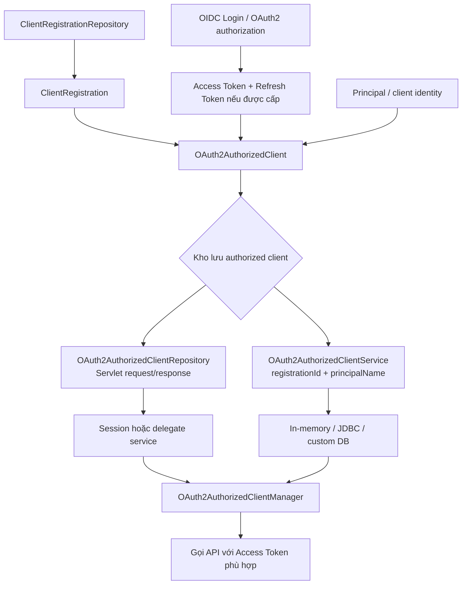
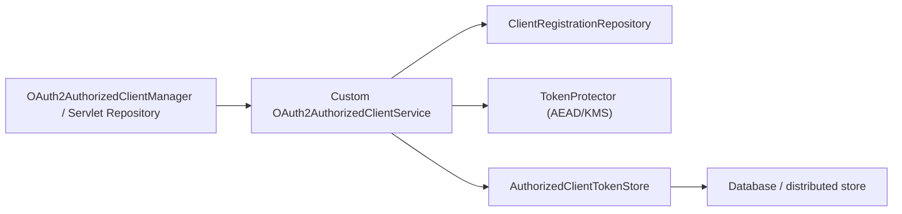

# 14.12. Repository hoặc service tùy chỉnh cho kho dữ liệu của ứng dụng

Khi một ứng dụng **Spring Security OAuth 2.0 / OpenID Connect (OIDC) Client** đăng nhập người dùng hoặc gọi API thay mặt một client, Spring Security cần quản lý kết quả cấp quyền đã nhận được: **Access Token**, **Refresh Token** nếu có, client registration tương ứng và danh tính/ngữ cảnh gắn với token. Đối tượng đảm nhiệm việc biểu diễn kết quả này là `OAuth2AuthorizedClient`.

Trong ví dụ đơn giản, token có thể được lưu trong bộ nhớ hoặc gắn với HTTP session. Nhưng hệ thống thực tế có thể cần **cơ sở dữ liệu riêng, lưu trữ phân tán, mã hóa token ở trạng thái nghỉ, phân tách tenant, chính sách xóa dữ liệu, giám sát refresh và kiểm soát đồng thời**. Khi đó, cần chọn đúng extension point:

- **`OAuth2AuthorizedClientRepository`**: API gắn với **HTTP request/response và `Authentication`** trong ứng dụng Servlet.
- **`OAuth2AuthorizedClientService`**: API lưu/tải authorized client bằng **registration ID và principal name**, không phụ thuộc trực tiếp vào HTTP request.

Bài này tập trung vào việc quyết định **khi nào dùng repository, khi nào dùng service, khi nào tùy chỉnh cả hai**, và cách kết nối chúng với Spring Security mà không làm lẫn lộn dữ liệu token, phiên đăng nhập và chính sách phân quyền.

## 1. Bối cảnh: tại sao cần kho `OAuth2AuthorizedClient`?

Một ứng dụng web OIDC có thể thực hiện:

1. Người dùng đăng nhập qua `oauth2Login()`.
2. Backend nhận Access Token và có thể nhận Refresh Token từ token endpoint.
3. Khi cần gọi API của provider, ứng dụng sử dụng Access Token tương ứng.
4. Khi Access Token hết hạn và có Refresh Token hợp lệ, Spring Security có thể xin Access Token mới theo cấu hình OAuth2 authorized client manager/provider.
5. Nếu người dùng rút quyền, token bị thu hồi hoặc tài khoản bị xóa, ứng dụng cần có chính sách làm sạch authorized client.

Một ứng dụng backend dùng `client_credentials` có nhu cầu khác một chút: token đại diện **cho chính ứng dụng/dịch vụ**, không có user login qua trình duyệt. Tuy nhiên, ứng dụng vẫn có thể dùng `OAuth2AuthorizedClient` để giữ Access Token cùng registration/ngữ cảnh kỹ thuật.



Sơ đồ minh họa các trách nhiệm và lựa chọn lưu trữ; không phải mọi ứng dụng dùng cả hai nhánh cùng một lúc. Điểm quan trọng là **token được quản lý dưới danh tính client đã được cấp quyền**, chứ không phải một biến global chứa «token mới nhất của hệ thống».

### 1.1. `OAuth2AuthorizedClient` chứa những gì?

Trong Spring Security, một authorized client thường chứa:

| Thành phần | Ý nghĩa |
|---|---|
| `ClientRegistration` | Thông tin client/provider/grant type mà token gắn với. |
| `principalName` | Tên principal/ngữ cảnh được Spring Security dùng để gắn authorized client. |
| `OAuth2AccessToken` | Giá trị Access Token, loại token (thường Bearer), thời điểm cấp/hết hạn và scopes. |
| `OAuth2RefreshToken` (có thể `null`) | Refresh Token nếu được cấp; dùng để xin token mới khi provider cho phép. |

**Không nên nhầm** authorized client với:

- **`OidcUser` / `OidcIdToken`**: thông tin danh tính OIDC đã được xác minh.
- **`SecurityContext`**: trạng thái authentication/authorities của người dùng trên các HTTP request.
- **`HttpSession`**: một cơ chế lưu trạng thái giữa các request của browser.
- **Authorization Server token store**: hệ thống phát hành/quản lý token ở phía provider, không phải nơi OAuth2 Client lưu bản sao token của mình.

`OAuth2AuthorizedClient` không tự chứa toàn bộ lịch sử SSO, quyền nghiệp vụ hay ID Token để ứng dụng phục hồi một lần đăng nhập từ kho token. Kho authorized client phục vụ **quản lý token phía client**, không thay thế session/authentication.

### 1.2. Vì sao không lưu một Access Token duy nhất cho toàn hệ thống?

Giả sử người dùng A và B cùng đăng nhập qua registration `company`. Họ có thể có:

```text
registrationId = company
principalName  = user-A
Access Token   = token-A

registrationId = company
principalName  = user-B
Access Token   = token-B
```

Nếu lưu theo khóa `company` đơn lẻ, token A có thể bị ghi đè bởi token B. Khi ứng dụng gọi API UserInfo hoặc API nghiệp vụ, đó là rủi ro **trộn danh tính và lộ dữ liệu chéo người dùng**.

Do vậy, khóa lưu trữ tối thiểu theo API service thường là **`(clientRegistrationId, principalName)`**. Trong ứng dụng nhiều tenant, `principalName` cần được thiết kế để không va chạm giữa các ngữ cảnh độc lập.

## 2. Phân biệt `OAuth2AuthorizedClientRepository` và `OAuth2AuthorizedClientService`

Hai interface có mục đích tương tự nhưng ngữ cảnh khác nhau.

### 2.1. `OAuth2AuthorizedClientRepository`: dành cho HTTP Servlet

Interface có các thao tác chính về mặt API:

```java
<T extends OAuth2AuthorizedClient> T loadAuthorizedClient(
    String clientRegistrationId,
    Authentication principal,
    HttpServletRequest request
);

void saveAuthorizedClient(
    OAuth2AuthorizedClient authorizedClient,
    Authentication principal,
    HttpServletRequest request,
    HttpServletResponse response
);

void removeAuthorizedClient(
    String clientRegistrationId,
    Authentication principal,
    HttpServletRequest request,
    HttpServletResponse response
);
```

Nó nhận **`HttpServletRequest`/`HttpServletResponse`**, nên phù hợp khi lưu authorized client dựa trên request hiện tại, cookie/session hoặc một ngữ cảnh Servlet cụ thể.

Ví dụ:

- User vừa hoàn tất `oauth2Login()`.
- Một MVC controller cần gọi API downstream thay mặt user.
- Ứng dụng muốn lưu token trong session hoặc gắn với user được xác thực ở request hiện tại.
- Có chính sách Servlet-specific về nơi lưu token/tenant.

### 2.2. `OAuth2AuthorizedClientService`: không phụ thuộc HTTP

Interface có các thao tác chính:

```java
<T extends OAuth2AuthorizedClient> T loadAuthorizedClient(
    String clientRegistrationId,
    String principalName
);

void saveAuthorizedClient(
    OAuth2AuthorizedClient authorizedClient,
    Authentication principal
);

void removeAuthorizedClient(
    String clientRegistrationId,
    String principalName
);
```

Không nhận request/response Servlet. Nó phù hợp hơn cho:

- Lưu authorized client vào **database** hoặc một service lưu trữ.
- Job nền, scheduled task, event consumer và tích hợp service-to-service.
- Nơi cần tái sử dụng token giữa nhiều request hoặc instance.
- Một authorized client manager hoạt động ngoài ngữ cảnh HTTP.

Tuy nhiên, **service không tự làm authentication hoặc quyết định quyền đọc token**. Nó vẫn phải được gọi với principal/registration thích hợp và storage phải có kiểm soát truy cập, isolation, encryption.

### 2.3. Bảng lựa chọn

| Yêu cầu | Repository | Service |
|---|---|---|
| Cần `HttpServletRequest`/`HttpServletResponse` để chọn nơi lưu | Phù hợp trực tiếp | Không chứa hai tham số này |
| OAuth2 login trong ứng dụng Servlet | Có thể được Spring Security dùng trực tiếp | Có thể được repository delegate xuống |
| Lưu trên JDBC/Redis/DB tùy chỉnh | Có thể tự triển khai nhưng phải xử lý Servlet context | Thường là extension point gọn hơn |
| Job nền không có HTTP request | Không tiện | Phù hợp |
| Cần partition theo tenant từ request | Có thể giải quyết ở repository boundary | Cần truyền tenant an toàn vào principal key hoặc mô hình store |
| Chia sẻ authorized clients giữa nhiều instance | Tùy implementation | Thích hợp khi backed by shared storage |
| Ánh xạ một principal sang token đang lưu | Dựa trên `Authentication` và request | Dựa trên `registrationId` và `principalName` |
| Quản lý HTTP session đăng nhập | Không phải nhiệm vụ chính | Không phải nhiệm vụ |
| Tự động refresh token | Không tự refresh | Không tự refresh |

**Đừng nhầm «có repository» với «tự động refresh»**. Việc authorize/refresh tùy `OAuth2AuthorizedClientManager` và `OAuth2AuthorizedClientProvider`. Repository/service là nơi lưu và tìm authorized client; quá trình token exchange/refresh là một trách nhiệm riêng.

## 3. Những implementation Spring Security thường gặp

Spring Security cung cấp các lựa chọn có sẵn trước khi cần viết mã tùy chỉnh.

| Implementation | Loại | Hành vi chính |
|---|---|---|
| `InMemoryOAuth2AuthorizedClientService` | Service | Lưu authorized client trong bộ nhớ của process. |
| `JdbcOAuth2AuthorizedClientService` | Service | Lưu authorized client bằng JDBC trong bảng/schema theo implementation Spring Security. |
| `HttpSessionOAuth2AuthorizedClientRepository` | Repository | Lưu authorized client trong HTTP session của ứng dụng Servlet. |
| `AuthenticatedPrincipalOAuth2AuthorizedClientRepository` | Repository | Dùng service cho principal đã xác thực và repository session cho ngữ cảnh anonymous theo implementation. |

Lựa chọn «in-memory» hữu ích khi chạy local/demo nhưng có hạn chế:

- Mất dữ liệu khi process restart.
- Các instance không nhìn thấy token của nhau.
- Không có cơ chế durability/backup.
- Dễ bất ngờ nếu hệ thống cần refresh token sau restart.

`JdbcOAuth2AuthorizedClientService` là điểm xuất phát hợp lý khi muốn persistence JDBC và không có yêu cầu lưu trữ quá đặc thù. **Không nên viết implementation mới chỉ để thay Map trong bộ nhớ bằng bảng DB**, nếu JDBC service đã phù hợp với môi trường và chính sách bảo vệ credential.

### 3.1. JDBC không đồng nghĩa mã hóa dữ liệu token

Một service JDBC có thể lưu token dưới dạng blob/byte string theo schema framework. Không được tự suy ra rằng nó đã:

- Mã hóa Access Token/Refresh Token bằng khóa do ứng dụng quản lý.
- Tách tenant trong mọi truy vấn.
- Tạo phiên đăng nhập cục bộ sau restart.
- Xóa/thu hồi token khi tài khoản bị vô hiệu hóa.
- Giải quyết race condition khi nhiều node cùng refresh token.

Những yêu cầu này cần được đánh giá và bổ sung bằng **mã hóa ở tầng lưu trữ, chính sách khóa, quyền DB, session lifecycle, token cleanup và concurrency control**.

## 4. Chọn chiến lược lưu trữ theo kiến trúc

### 4.1. Ứng dụng web nhỏ, một instance

Nếu token chỉ cần dùng trong lúc phiên người dùng đang sống và ứng dụng không cần durability qua restart, session-based repository có thể đáp ứng.

Ưu điểm: dễ hiểu vòng đời token gắn với browser session.

Rủi ro: restart/session timeout làm mất authorized client; nếu có nhiều replica không chia sẻ session, callback/login/authorized client có thể hoạt động không nhất quán.

### 4.2. Web application có nhiều instance

Nếu ứng dụng được triển khai qua nhiều node, có thể cần:

- **Shared session store** nếu HTTP session mang authorized client và SecurityContext.
- **Persistent authorized client service** nếu token được lưu theo principal để các node truy cập được.
- **Phân biệt** lifetime của HTTP session với lifetime của Access/Refresh Token.
- **Kiểm soát concurrency** khi hai request/node đồng thời thấy Access Token hết hạn.

Không nên mặc định giữ Refresh Token lâu hơn session mà không có chính sách. Persistence qua nhiều instance mang lại tính sẵn sàng, đồng thời làm tăng tác động nếu database bị lộ.

### 4.3. Background job / integration service

Nếu một job cần gọi API bằng `client_credentials`, có thể dùng `OAuth2AuthorizedClientService` và `AuthorizedClientServiceOAuth2AuthorizedClientManager`. Dữ liệu lưu thường gắn với principal kỹ thuật cố định của workload hoặc service.

Không dùng principal của người dùng đăng nhập qua browser khi token đại diện cho **dịch vụ**, và không lấy token của người dùng này để chạy job cho user khác nếu chưa có delegation/ủy quyền phù hợp.

### 4.4. Multi-tenant hoặc nhiều provider

Khi có nhiều tenant/provider, khóa dữ liệu cần tránh trộn:

```text
(tenant, issuer/registration, principal identity) -> authorized client
```

Interface service mặc định dùng hai tham số `(registrationId, principalName)`. Vì vậy, nếu storage cần thêm tenant, cần đưa tenant vào **ngữ cảnh identity key đáng tin cậy** hoặc thiết kế adapter/repository có partition rõ ràng, không lấy tenant tùy ý từ tham số HTTP mà chưa xác thực.

## 5. Ví dụ Spring Boot OIDC Client dùng Authorized Client

Trong `application.yml`:

```yaml
spring:
  security:
    oauth2:
      client:
        registration:
          company:
            provider: company-oidc
            client-id: ${OIDC_CLIENT_ID}
            client-secret: ${OIDC_CLIENT_SECRET}
            authorization-grant-type: authorization_code
            client-authentication-method: client_secret_basic
            redirect-uri: "{baseUrl}/login/oauth2/code/{registrationId}"
            scope:
              - openid
              - profile
              - email
        provider:
          company-oidc:
            issuer-uri: https://id.example.org/realms/company
```

Khi user đăng nhập, Spring Security có thể tạo một `OAuth2AuthorizedClient` cho registration `company`. Access Token trong authorized client có thể được dùng khi backend gọi API được cấp quyền.

Ví dụ MVC controller dùng `@RegisteredOAuth2AuthorizedClient` nếu ứng dụng đã cấu hình OAuth2 Client thích hợp:

```java
import java.time.Instant;
import java.util.Map;

import org.springframework.security.oauth2.client.OAuth2AuthorizedClient;
import org.springframework.security.oauth2.client.annotation.RegisteredOAuth2AuthorizedClient;
import org.springframework.web.bind.annotation.GetMapping;
import org.springframework.web.bind.annotation.RestController;

@RestController
public class TokenMetadataController {

    @GetMapping("/token-metadata")
    public Map<String, Object> metadata(
            @RegisteredOAuth2AuthorizedClient("company")
            OAuth2AuthorizedClient authorizedClient) {

        Instant expiry = authorizedClient
            .getAccessToken().getExpiresAt();

        return Map.of(
            "registrationId",
            authorizedClient.getClientRegistration().getRegistrationId(),
            "expiresAt",
            expiry == null ? "unknown" : expiry.toString()
        );
    }
}
```

Ví dụ chỉ trả metadata để minh họa injection; **không trả token value** qua API hay log. Trong sản phẩm thật, controller có thể giao Access Token cho một HTTP client server-side để gọi API, nhưng phải giữ token ở backend và dùng đúng audience/scope.

### 5.1. Không cần có Refresh Token trong mọi flow

`OAuth2AuthorizedClient.getRefreshToken()` có thể là `null`.

- Provider có thể không cấp Refresh Token.
- Client Credentials Grant thường không dùng Refresh Token.
- Một số registration chỉ cấp Access Token ngắn hạn và yêu cầu xin token mới theo grant.
- Chính sách `offline_access` và consent với OP có thể ảnh hưởng khả năng nhận refresh token trong OIDC.

Một custom store phải hỗ trợ **refresh token vắng mặt** thay vì giả định nó luôn có. Tuyệt đối không cố tạo «refresh token» từ Access Token hoặc ID Token.

## 6. Dùng `JdbcOAuth2AuthorizedClientService` trước khi tự viết

Với Spring JDBC, có thể khởi tạo `JdbcOAuth2AuthorizedClientService` và kết nối nó với repository của servlet.

Dependency ví dụ Gradle:

```gradle
dependencies {
    implementation("org.springframework.boot:spring-boot-starter-web")
    implementation("org.springframework.boot:spring-boot-starter-security")
    implementation("org.springframework.boot:spring-boot-starter-oauth2-client")
    implementation("org.springframework.boot:spring-boot-starter-jdbc")
    runtimeOnly("org.postgresql:postgresql")
}
```

Ví dụ Bean:

```java
import org.springframework.context.annotation.Bean;
import org.springframework.context.annotation.Configuration;
import org.springframework.jdbc.core.JdbcOperations;
import org.springframework.security.oauth2.client.OAuth2AuthorizedClientService;
import org.springframework.security.oauth2.client.JdbcOAuth2AuthorizedClientService;
import org.springframework.security.oauth2.client.registration.ClientRegistrationRepository;

@Configuration
public class AuthorizedClientStorageConfiguration {

    @Bean
    OAuth2AuthorizedClientService authorizedClientService(
            JdbcOperations jdbc,
            ClientRegistrationRepository registrations) {

        return new JdbcOAuth2AuthorizedClientService(
            jdbc,
            registrations
        );
    }
}
```

Cần chuẩn bị **schema database phù hợp với phiên bản Spring Security đang sử dụng**. Không copy tên cột từ một ví dụ tự chế rồi kỳ vọng `JdbcOAuth2AuthorizedClientService` hiểu được. Hãy sử dụng schema/migration đúng với implementation được cài đặt.

Ngoài ra:

- Tạo DataSource/JDBC connection theo cấu hình môi trường.
- Không ghi credential DB hoặc client secret vào source.
- Phân quyền tài khoản DB ở mức tối thiểu.
- Kiểm tra retention/cleanup và backup.
- Đánh giá encryption at rest, rotation của encryption keys và chính sách truy xuất token.
- Khi cần customization như mã hóa token theo tenant, có thể viết service riêng hoặc tầng storage bọc ngoài JDBC phù hợp.

### 6.1. Gắn service vào repository cho Servlet

Một Bean repository minh họa:

```java
import org.springframework.context.annotation.Bean;
import org.springframework.context.annotation.Configuration;
import org.springframework.security.oauth2.client.OAuth2AuthorizedClientService;
import org.springframework.security.oauth2.client.web.AuthenticatedPrincipalOAuth2AuthorizedClientRepository;
import org.springframework.security.oauth2.client.web.OAuth2AuthorizedClientRepository;

@Configuration
public class AuthorizedClientRepositoryConfiguration {

    @Bean
    OAuth2AuthorizedClientRepository authorizedClientRepository(
            OAuth2AuthorizedClientService authorizedClientService) {

        return new AuthenticatedPrincipalOAuth2AuthorizedClientRepository(
            authorizedClientService
        );
    }
}
```

`AuthenticatedPrincipalOAuth2AuthorizedClientRepository` thường delegate tới service khi principal đã được xác thực; với anonymous context, nó có chiến lược dựa trên session theo implementation mặc định.

Trong một cấu hình Security Filter Chain, có thể chỉ định repository cần dùng cho các cơ chế liên quan:

```java
import org.springframework.context.annotation.Bean;
import org.springframework.context.annotation.Configuration;
import org.springframework.security.config.annotation.web.builders.HttpSecurity;
import org.springframework.security.oauth2.client.web.OAuth2AuthorizedClientRepository;
import org.springframework.security.web.SecurityFilterChain;

@Configuration
public class WebSecurityConfiguration {

    @Bean
    SecurityFilterChain webChain(
            HttpSecurity http,
            OAuth2AuthorizedClientRepository authorizedClients)
            throws Exception {

        http
            .authorizeHttpRequests(auth -> auth
                .requestMatchers("/", "/public/**").permitAll()
                .anyRequest().authenticated()
            )
            .oauth2Login(login ->
                login.authorizedClientRepository(authorizedClients)
            )
            .oauth2Client(client ->
                client.authorizedClientRepository(authorizedClients)
            );

        return http.build();
    }
}
```

Các ví dụ cấu hình ở phần này được thiết kế để ghép thành một ứng dụng Spring Boot. Nếu dự án đã có `SecurityFilterChain`, thêm cấu hình vào chain hiện tại, **không copy nhiều Bean trùng matcher**.

Cũng cần lưu ý: repository được dùng trong các cơ chế Servlet, nhưng không phải mọi background job hoặc HTTP client đều mặc nhiên sử dụng Bean repository đó. Chúng có thể cần authorized client manager/service được cấu hình riêng.

## 7. Khi nào cần viết `OAuth2AuthorizedClientService` tùy chỉnh?

Một custom service thường hợp lý khi có một hoặc nhiều yêu cầu:

- Lưu token trong database đã có schema/ORM riêng.
- Mã hóa token tại tầng ứng dụng bằng KMS/envelope encryption.
- Tách tenant bằng schema/partition và chính sách kiểm soát truy cập riêng.
- Dùng Redis hoặc kho dữ liệu phân tán có TTL và eviction policy phù hợp.
- Cần soft-delete/audit metadata nhưng không được log raw token.
- Có chính sách vòng đời và token cleanup khác JDBC service mặc định.
- Cần kiểm soát race condition, versioning hoặc optimistic locking khi refresh.
- Cần quản trị phiên/token của người dùng qua một domain service.

Nên giữ **hợp đồng interface Spring Security** rõ ràng, để các thành phần OAuth2 Client còn lại vẫn có thể hoạt động. Custom service phải phục hồi `OAuth2AuthorizedClient` đầy đủ: đúng registration, principal name, Access Token timestamps/scopes và Refresh Token nếu có.

### 7.1. Ví dụ schema lưu trữ riêng

Một bảng **minh họa**, không phải schema mà `JdbcOAuth2AuthorizedClientService` mặc định yêu cầu:

```sql
CREATE TABLE app_oauth2_authorized_client (
    registration_id           VARCHAR(128) NOT NULL,
    principal_key             VARCHAR(512) NOT NULL,
    access_token_ciphertext   TEXT NOT NULL,
    access_issued_at          TIMESTAMP NOT NULL,
    access_expires_at         TIMESTAMP NOT NULL,
    access_scopes             TEXT,
    refresh_token_ciphertext  TEXT,
    refresh_issued_at         TIMESTAMP,
    refresh_expires_at        TIMESTAMP,
    token_version             BIGINT NOT NULL DEFAULT 0,
    updated_at                TIMESTAMP NOT NULL,
    PRIMARY KEY (registration_id, principal_key)
);
```

Mỗi cặp `(registration_id, principal_key)` chỉ có một authorized client đang lưu theo mô hình này. Nếu business cần nhiều bản ghi cho cùng key (ví dụ nhiều grant/scope/tenant), phải có partition hoặc định danh khác được thiết kế rõ ràng, đồng thời tương thích với interface Spring Security.

Các cột:

| Cột | Mục đích |
|---|---|
| `registration_id` | Khóa `ClientRegistration` đã đăng ký. |
| `principal_key` | Identity key ổn định của principal hoặc workload, theo chính sách ứng dụng. |
| `access_token_ciphertext` | Access Token đã mã hóa khi lưu. |
| `access_issued_at` / `access_expires_at` | Thời điểm token cấp/hết hạn, dùng khi quyết định refresh. |
| `access_scopes` | Scopes thực tế của Access Token được cấp. |
| `refresh_token_ciphertext` | Refresh Token đã mã hóa nếu có. |
| `refresh_issued_at` / `refresh_expires_at` | Metadata của Refresh Token, có thể vắng mặt. |
| `token_version` | Phiên bản dùng cho update có điều kiện/concurrency. |
| `updated_at` | Thời điểm lưu bản ghi cuối. |

Khi dùng schema thực tế, cần xem DBMS, định dạng timestamp/time zone, kích thước ciphertext, index, retention và chính sách xóa dữ liệu. **Không lưu Access Token/Refresh Token dạng plaintext chỉ vì cần debug dễ hơn.**

## 8. Thiết kế service tùy chỉnh theo nguyên tắc tách trách nhiệm

Để minh họa, ta phân thành:

1. `OAuth2AuthorizedClientService`: adapter tương thích Spring Security.
2. `AuthorizedClientTokenStore`: interface thao tác bản ghi ứng dụng.
3. `TokenProtector`: API mã hóa/giải mã token.
4. `ClientRegistrationRepository`: nguồn cấu hình registration khi phục hồi đối tượng.



Tách như vậy giúp thay công nghệ lưu trữ mà không trộn SQL và logic mã hóa vào Security Filter Chain. Token protector nên được triển khai theo tiêu chuẩn mật mã và hệ thống quản lý khóa, không tự sáng tạo thuật toán.

### 8.1. Model lưu trữ và các hợp đồng

Ví dụ Java 17+ (mỗi `public` top-level type phải được đặt trong file nguồn thích hợp khi triển khai thật):

```java
import java.time.Instant;
import java.util.Optional;
import java.util.Set;

public record StoredAuthorizedClient(
    String registrationId,
    String principalName,
    String accessTokenCiphertext,
    Instant accessIssuedAt,
    Instant accessExpiresAt,
    Set<String> accessScopes,
    String refreshTokenCiphertext,
    Instant refreshIssuedAt,
    Instant refreshExpiresAt,
    long version
) { }

public interface AuthorizedClientTokenStore {

    Optional<StoredAuthorizedClient> find(
        String registrationId,
        String principalName
    );

    void upsert(StoredAuthorizedClient value);

    void delete(String registrationId, String principalName);
}

public interface TokenProtector {

    String encrypt(
        String plaintext,
        String registrationId,
        String principalName
    );

    String decrypt(
        String ciphertext,
        String registrationId,
        String principalName
    );
}
```

Trong ví dụ, `TokenProtector` nhận registration ID và principal name để implementation có thể dùng chúng làm **associated data** (AAD) của authenticated encryption, ràng buộc ciphertext với ngữ cảnh lưu trữ.

Các type ở trên là **hợp đồng minh họa**; bài không triển khai đầy đủ JDBC, transaction và AES-GCM/KMS. Trong hệ thống thật, các phần đó phải được triển khai bằng thư viện đáng tin cậy và vận hành khóa an toàn. Không coi `encrypt` chỉ là Base64 encoding hoặc hash một chiều: token phải được **giải mã** khi client cần gửi đến provider/API, nên yêu cầu một cơ chế mã hóa có thể phục hồi và được bảo vệ.

### 8.2. Service thực hiện load/save/remove

Ví dụ adapter tập trung vào các bước chuyển đổi dữ liệu:

```java
import java.util.Set;

import org.springframework.security.core.Authentication;
import org.springframework.security.oauth2.client.OAuth2AuthorizedClient;
import org.springframework.security.oauth2.client.OAuth2AuthorizedClientService;
import org.springframework.security.oauth2.client.registration.ClientRegistration;
import org.springframework.security.oauth2.client.registration.ClientRegistrationRepository;
import org.springframework.security.oauth2.core.OAuth2AccessToken;
import org.springframework.security.oauth2.core.OAuth2RefreshToken;

public final class EncryptedAuthorizedClientService
        implements OAuth2AuthorizedClientService {

    private final ClientRegistrationRepository registrations;
    private final AuthorizedClientTokenStore store;
    private final TokenProtector protector;

    public EncryptedAuthorizedClientService(
            ClientRegistrationRepository registrations,
            AuthorizedClientTokenStore store,
            TokenProtector protector) {

        this.registrations = registrations;
        this.store = store;
        this.protector = protector;
    }

    @Override
    @SuppressWarnings("unchecked")
    public <T extends OAuth2AuthorizedClient> T loadAuthorizedClient(
            String registrationId,
            String principalName) {

        StoredAuthorizedClient row = store
            .find(registrationId, principalName)
            .orElse(null);

        if (row == null) {
            return null;
        }

        ClientRegistration registration =
            registrations.findByRegistrationId(registrationId);

        if (registration == null) {
            throw new IllegalStateException(
                "Unknown client registration: " + registrationId
            );
        }

        String accessValue = protector.decrypt(
            row.accessTokenCiphertext(),
            registrationId,
            principalName
        );

        OAuth2AccessToken access = new OAuth2AccessToken(
            OAuth2AccessToken.TokenType.BEARER,
            accessValue,
            row.accessIssuedAt(),
            row.accessExpiresAt(),
            row.accessScopes()
        );

        OAuth2RefreshToken refresh = null;
        if (row.refreshTokenCiphertext() != null) {
            String refreshValue = protector.decrypt(
                row.refreshTokenCiphertext(),
                registrationId,
                principalName
            );

            refresh = new OAuth2RefreshToken(
                refreshValue,
                row.refreshIssuedAt(),
                row.refreshExpiresAt()
            );
        }

        return (T) new OAuth2AuthorizedClient(
            registration,
            principalName,
            access,
            refresh
        );
    }

    @Override
    public void saveAuthorizedClient(
            OAuth2AuthorizedClient client,
            Authentication principal) {

        String registrationId =
            client.getClientRegistration().getRegistrationId();
        String principalName = principal.getName();

        if (!principalName.equals(client.getPrincipalName())) {
            throw new IllegalArgumentException(
                "Principal does not match authorized client"
            );
        }

        OAuth2AccessToken access = client.getAccessToken();

        if (!OAuth2AccessToken.TokenType.BEARER.equals(
                access.getTokenType())) {
            throw new IllegalArgumentException(
                "This store supports bearer access tokens only"
            );
        }

        OAuth2RefreshToken refresh = client.getRefreshToken();

        StoredAuthorizedClient row = new StoredAuthorizedClient(
            registrationId,
            principalName,
            protector.encrypt(
                access.getTokenValue(), registrationId, principalName),
            access.getIssuedAt(),
            access.getExpiresAt(),
            Set.copyOf(access.getScopes()),
            refresh == null ? null : protector.encrypt(
                refresh.getTokenValue(), registrationId, principalName),
            refresh == null ? null : refresh.getIssuedAt(),
            refresh == null ? null : refresh.getExpiresAt(),
            0L // Store thực tế cần quản lý version và concurrency
        );

        store.upsert(row);
    }

    @Override
    public void removeAuthorizedClient(
            String registrationId,
            String principalName) {

        store.delete(registrationId, principalName);
    }
}
```

**Đây là adapter minh họa về cách chuyển đổi và tách thành phần, không phải implementation production hoàn chỉnh.** Đặc biệt:

- `AuthorizedClientTokenStore` phải được cung cấp bằng JDBC/JPA/Redis hoặc công nghệ khác, có transaction và kiểm soát cạnh tranh.
- `TokenProtector` phải được triển khai bằng authenticated encryption, quản lý key/nonce đúng cách.
- Giá trị `version=0L` chỉ là placeholder; không được dùng để tuyên bố đã có optimistic locking.
- Ví dụ lưu token bearer vì đó là loại token thông dụng trong OAuth2 Client; loại khác cần định nghĩa schema/codec tương thích.
- Phải xác định xử lý timestamp null theo hợp đồng token thực tế và DBMS của ứng dụng.
- `Authentication.getName()` phải là principal key ổn định, nhất quán với nơi load và chiến lược multi-tenant.
- Không log `accessValue`, `refreshValue` hoặc `StoredAuthorizedClient` chứa ciphertext/metadata nhạy cảm.

Mã hóa token **không tự bảo đảm authorization**: lớp gọi service phải kiểm soát ai được tải authorized client của principal nào. Nếu một API công khai cho phép người dùng tùy ý nhập `principalName` rồi gọi `loadAuthorizedClient`, đây có thể là lỗ hổng lấy token chéo người dùng.

### 8.3. Đăng ký service tùy chỉnh

Một Bean ví dụ:

```java
import org.springframework.context.annotation.Bean;
import org.springframework.context.annotation.Configuration;
import org.springframework.security.oauth2.client.OAuth2AuthorizedClientService;
import org.springframework.security.oauth2.client.registration.ClientRegistrationRepository;

@Configuration
public class CustomAuthorizedClientConfiguration {

    @Bean
    OAuth2AuthorizedClientService authorizedClientService(
            ClientRegistrationRepository registrations,
            AuthorizedClientTokenStore store,
            TokenProtector protector) {

        return new EncryptedAuthorizedClientService(
            registrations,
            store,
            protector
        );
    }
}
```

Khi đã có Bean này, có thể dùng `AuthenticatedPrincipalOAuth2AuthorizedClientRepository` và authorized client manager tương thích như phần trước. **Không khai báo đồng thời hai Bean `OAuth2AuthorizedClientService` không phân biệt qualifier** rồi mong Spring tự chọn đúng.

## 9. Thiết kế `principalName` nhất quán và tránh va chạm danh tính

Một câu hỏi thường bị bỏ qua là: **`principalName` trong authorized client của ứng dụng là gì?**

Trong nhiều flow OIDC mặc định, `Authentication.getName()` có thể dựa trên `sub` của OIDC principal. Trong một hệ thống có nhiều issuer hoặc nhiều tenant, cùng một chuỗi `sub` có thể được sử dụng ở hai nguồn khác nhau.

Ví dụ:

```text
Issuer A:
  sub = 12345

Issuer B:
  sub = 12345
```

Nếu hai registration khác nhau, cặp `(registrationId, principalName)` đã giúp phân biệt khi mỗi registration thuộc issuer cụ thể. Nhưng khi một registration có logic tenant/provider động, hoặc ứng dụng dùng cùng tên principal không ổn định, có thể xuất hiện va chạm.

### 9.1. Một chiến lược khóa ổn định

Các lựa chọn cần xem xét:

- Dùng một **internal immutable user ID** đã được liên kết với `(issuer, sub)`.
- Dùng một principal key được chuẩn hóa gồm issuer/tenant/subject với cấu trúc không mơ hồ, nếu hệ thống cho phép.
- Giữ mỗi tenant/provider thành registration riêng nếu đó là hợp đồng thiết kế phù hợp.
- Trong custom store, dùng partition/tenant ID được xác thực ngoài cặp key interface mặc định.

Ví dụ khái niệm:

```text
principal_key = "app-user:4107"
registration  = "company-login"

principal_key = "service:shipping-worker"
registration  = "shipping-api"
```

Nếu muốn thay `Authentication.getName()` thành internal user ID, phải cấu hình principal/Authentication và authorized client storage **nhất quán**. Không chỉ thay khóa trong DB mà để Spring Security load bằng `sub` cũ, vì khi đó token mới được lưu dưới một key còn request tiếp theo tìm dưới key khác.

### 9.2. Không dùng email làm token storage key

Email có thể thay đổi, được tái cấp hoặc trùng giữa nhiều provider. Nếu dùng email làm `principalName`:

- Khi email đổi, authorized client có thể bị «mất» và token cũ trở thành orphan.
- Hai danh tính có cùng email có thể bị trộn.
- Dữ liệu token được lưu dưới một định danh cá nhân không cần thiết.

Nên dùng ID ổn định, không mang ngữ nghĩa có thể tái cấp, đồng thời quản lý account linking/identity migration theo quy trình được ủy quyền.

### 9.3. Principal kỹ thuật của Client Credentials

Với `client_credentials`, không có user browser. Một manager dựa trên service vẫn cần `principal` để tạo key lưu token. Có thể dùng một tên kỹ thuật cố định cho workload:

```text
registrationId = shipping-api
principalName  = service:shipping-worker
```

Không dùng principal kỹ thuật đó để ngụ ý quyền của một người dùng cụ thể. Token Client Credentials đại diện cho client theo scope/audience mà Authorization Server cấp; API vẫn phải kiểm tra token.

## 10. Kết nối service với `AuthorizedClientServiceOAuth2AuthorizedClientManager`

Đối với job hoặc service-to-service không có HTTP request, Spring Security có `AuthorizedClientServiceOAuth2AuthorizedClientManager`. Nó phù hợp khi authorized clients được lưu bằng `OAuth2AuthorizedClientService`.

Ví dụ registration:

```yaml
spring:
  security:
    oauth2:
      client:
        registration:
          shipping-api:
            provider: internal-auth
            client-id: ${SHIPPING_CLIENT_ID}
            client-secret: ${SHIPPING_CLIENT_SECRET}
            client-authentication-method: client_secret_basic
            authorization-grant-type: client_credentials
            scope:
              - shipping.read
        provider:
          internal-auth:
            token-uri: https://auth.example.org/oauth2/token
```

Bean authorized client manager:

```java
import org.springframework.context.annotation.Bean;
import org.springframework.context.annotation.Configuration;
import org.springframework.security.oauth2.client.AuthorizedClientServiceOAuth2AuthorizedClientManager;
import org.springframework.security.oauth2.client.OAuth2AuthorizedClientManager;
import org.springframework.security.oauth2.client.OAuth2AuthorizedClientProvider;
import org.springframework.security.oauth2.client.OAuth2AuthorizedClientProviderBuilder;
import org.springframework.security.oauth2.client.OAuth2AuthorizedClientService;
import org.springframework.security.oauth2.client.registration.ClientRegistrationRepository;

@Configuration
public class ServiceOAuth2ClientConfiguration {

    @Bean
    OAuth2AuthorizedClientManager serviceAuthorizedClientManager(
            ClientRegistrationRepository registrations,
            OAuth2AuthorizedClientService service) {

        OAuth2AuthorizedClientProvider provider =
            OAuth2AuthorizedClientProviderBuilder.builder()
                .clientCredentials()
                .build();

        AuthorizedClientServiceOAuth2AuthorizedClientManager manager =
            new AuthorizedClientServiceOAuth2AuthorizedClientManager(
                registrations,
                service
            );

        manager.setAuthorizedClientProvider(provider);
        return manager;
    }
}
```

Một service sử dụng manager:

```java
import org.springframework.security.oauth2.client.OAuth2AuthorizeRequest;
import org.springframework.security.oauth2.client.OAuth2AuthorizedClient;
import org.springframework.security.oauth2.client.OAuth2AuthorizedClientManager;
import org.springframework.stereotype.Service;

@Service
public class ShippingAccessTokenService {

    private final OAuth2AuthorizedClientManager manager;

    public ShippingAccessTokenService(
            OAuth2AuthorizedClientManager manager) {
        this.manager = manager;
    }

    public String accessTokenForShippingApi() {
        OAuth2AuthorizeRequest request =
            OAuth2AuthorizeRequest
                .withClientRegistrationId("shipping-api")
                .principal("service:shipping-worker")
                .build();

        OAuth2AuthorizedClient client = manager.authorize(request);

        if (client == null) {
            throw new IllegalStateException(
                "Shipping API authorization is unavailable"
            );
        }

        return client.getAccessToken().getTokenValue();
    }
}
```

Ví dụ trả raw token **bên trong service backend** để một HTTP client tin cậy gắn Bearer header. Không trả kết quả của method này trực tiếp qua public controller, không log token và không đưa nó vào URL. Trong ứng dụng thật, nên tích hợp token injection vào RestClient/WebClient hoặc HTTP client phù hợp để tránh lan truyền raw token qua nhiều lớp.

Với `client_credentials`, khi Access Token hết hạn, provider có thể cấp token mới theo grant; Refresh Token thường không được dùng. Việc authorize lại cần được thực hiện qua manager đã cấu hình, không tự sử dụng token hết hạn từ DB.

### 10.1. Không dùng sai loại manager trong background job

`DefaultOAuth2AuthorizedClientManager` chủ yếu hướng tới ngữ cảnh Servlet với `OAuth2AuthorizedClientRepository`. Nếu service chạy trong scheduled job và không có `HttpServletRequest`, nên chọn manager/service dành cho ngữ cảnh ngoài Servlet như `AuthorizedClientServiceOAuth2AuthorizedClientManager`.

Không tự tạo fake HTTP session chỉ để có thể load authorized client trong job; dùng abstraction tương ứng mục đích.

## 11. Refresh Token và tính nhất quán khi nhiều request đồng thời

Giả sử hai request của cùng principal cùng đọc một authorized client có Access Token đã hết hạn.

```text
Node A đọc token version=5, thấy expired
Node B đọc token version=5, thấy expired

Node A dùng Refresh Token R5 -> nhận Access Token A6, Refresh Token R6
Node B cũng dùng R5 -> provider có thể từ chối hoặc thu hồi token family

Node A lưu version=6
Node B cố lưu kết quả khác / ghi đè
```

Một số provider dùng **refresh token rotation**: mỗi lần refresh cấp Refresh Token mới và vô hiệu hóa token cũ. Nếu hai node dùng lại R5, hậu quả có thể nghiêm trọng hơn chỉ là một request thất bại.

### 11.1. Persistence không tự giải quyết race condition

Ngay cả khi dùng database và `upsert`, hai refresh request vẫn có thể xảy ra đồng thời. Storage phải được thiết kế cùng **cơ chế phối hợp refresh**:

- Dùng lock theo `(registrationId, principalName)` hoặc single-flight logic khi phù hợp.
- Có thể dùng distributed lock nếu nhiều instance.
- Dùng optimistic version để ngăn kết quả cũ ghi đè token mới.
- Sau khi giành lock, **đọc lại** trạng thái token trước khi refresh.
- Lưu Access Token và Refresh Token mới **nguyên tử** khi provider phát cả hai.
- Đặt timeout và cơ chế xử lý khi refresh thất bại.
- Chú ý tình huống request đến provider thành công nhưng ghi DB thất bại: rotation có thể khiến Refresh Token cũ không còn sử dụng được.

**Chỉ có `token_version` trong bảng chưa tự đủ**; mã update cần kiểm tra version và chỉ chấp nhận một lần cập nhật hợp lệ. Distributed locking và token endpoint behavior phải được xem xét như một thiết kế thống nhất.

### 11.2. Không log Refresh Token khi có lỗi

Refresh Token là credential nhạy cảm, thường có thời hạn dài hơn Access Token. Không ghi raw Refresh Token vào log SQL, APM, exception message hoặc request tracing. Nếu cần kiểm tra rotation, ghi một version/diagnostic ID nội bộ không thể dùng để truy cập tài nguyên.

### 11.3. Không tự fallback sang token của user khác

Nếu refresh thất bại cho principal A, không lấy token còn sống của principal B hoặc service principal khác để «giữ tính sẵn sàng». Điều này phá vỡ ranh giới user/tenant và có thể tạo truy cập dữ liệu trái phép.

## 12. Lưu token an toàn: encryption at rest, key management và audit

Token value trong `OAuth2AuthorizedClient` là **credential**, không phải dữ liệu hồ sơ thông thường.

### 12.1. Những lớp bảo vệ cần có

| Lớp | Kiểm soát đề xuất |
|---|---|
| **Transport** | TLS giữa app và token endpoint/API; TLS tới DB hoặc store khi cần. |
| **Database permissions** | Tài khoản DB chỉ có quyền thao tác bảng cần thiết, không cấp quyền admin. |
| **Encryption at rest** | Mã hóa token bằng cơ chế được kiểm chứng, ví dụ AEAD và KMS/envelope encryption. |
| **Key management** | Phân quyền khóa, rotation, audit, tách khóa khỏi ciphertext và source. |
| **Principal isolation** | Đọc/ghi token chỉ theo đúng registration và principal được xác thực/ủy quyền. |
| **Backup** | Backup được mã hóa; chính sách retention và khả năng xóa dữ liệu. |
| **Logging** | Redact token, header Authorization, Refresh Token, cookie và các credential. |
| **Lifecycle** | Token cleanup, revoke khi phù hợp, xử lý account deletion/consent revoked. |

Không nên phát biểu rằng database encryption/TDE đã tự bảo vệ hết mọi tình huống. Một DB user bị chiếm quyền đọc hoặc một process ứng dụng bị compromise vẫn có thể tiếp cận token theo đường hợp lệ. Cần least privilege, secret isolation và kiểm soát truy cập ở tầng ứng dụng.

### 12.2. Mã hóa token không phải Base64 hoặc hashing

Token cần được dùng lại để gửi cho Authorization Server/Resource Server, nên không thể chỉ hash một chiều nếu vẫn muốn đọc token. Base64 chỉ là encoding, không bảo mật.

Một thiết kế phù hợp có thể dùng AEAD (như AES-GCM) với nonce ngẫu nhiên/duy nhất theo yêu cầu thuật toán, AAD gắn với registration/principal, khóa được quản lý ngoài DB và format ciphertext có version. **Không tự chế cipher hoặc tái sử dụng nonce không an toàn**.

### 12.3. Key rotation và dữ liệu đã mã hóa

Khi luân chuyển khóa mã hóa, cần xác định:

- Ciphertext hiện đang dùng key version nào.
- Khóa cũ được giữ trong khoảng thời gian nào để giải mã dữ liệu chưa được re-encrypt.
- Khi nào re-encrypt record, tránh làm gián đoạn login/API.
- Cách xử lý token record không giải mã được.
- Khi user bị xóa, dữ liệu ciphertext và backup được xử lý theo retention policy ra sao.

Không viết fallback «giải mã thất bại thì dùng raw ciphertext như Access Token», vì đó là lỗi bảo mật và giao thức. Khi không thể giải mã, phải xử lý thất bại có kiểm soát và yêu cầu authorization mới khi phù hợp.

## 13. Vòng đời authorized client: lưu, refresh, remove và thu hồi

Nên có chính sách rõ cho từng sự kiện:

| Sự kiện | Điều cần cân nhắc với authorized client |
|---|---|
| Login thành công | Save token đúng principal/registration nếu cần lưu. |
| Gọi API | Load và authorize/refresh theo manager; dùng token đúng scope/audience. |
| Access Token expired | Refresh nếu có Refresh Token hợp lệ; nếu không, thực hiện grant phù hợp hoặc yêu cầu login. |
| Refresh bị từ chối (`invalid_grant`) | Có thể cần remove authorized client không còn dùng được và yêu cầu authorization lại. |
| Người dùng logout ứng dụng | Quyết định có xóa local authorized client và/hoặc revoke token ở provider không. |
| Account bị khóa/xóa | Ngừng dùng token và xóa/revoke theo chính sách; invalidate phiên nếu cần. |
| User rút consent tại OP | Token có thể bị thu hồi; app phải xử lý lỗi API/refresh và cleanup. |
| Registration bị xóa/thay đổi | Dữ liệu token cũ có thể không giải mã/khôi phục đúng client; cần migration/cleanup. |
| Backup/retention hết hạn | Xóa bản ghi và bản sao theo chính sách dữ liệu. |

**Logout không đồng nghĩa token revocation.** Xóa browser session hoặc `SecurityContext` không tự làm Access Token được cấp trở nên vô hiệu ở mọi Resource Server. Tùy provider, app có thể cần Token Revocation Endpoint hoặc một chính sách riêng. Ngược lại, xóa authorized client trong DB chỉ làm ứng dụng không tìm thấy token đó nữa; không bảo đảm token đã bị thu hồi ở provider.

### 13.1. Phân biệt xóa local và revoke remote

- `removeAuthorizedClient(registrationId, principalName)`: xóa record phía **OAuth2 Client**.
- Token revocation API tại provider: yêu cầu **Authorization Server** vô hiệu hóa token theo chính sách.
- Invalidate HTTP session: xóa hoặc vô hiệu hóa trạng thái **browser login** tại ứng dụng.
- OIDC logout tại OP: tác động đến **phiên SSO** theo giao thức/logout configuration.

Một chính sách offboarding có thể cần kết hợp cả bốn, tùy mức độ nhạy cảm, tính năng OP và yêu cầu thu hồi.

### 13.2. Không giữ Refresh Token vô thời hạn

Một Refresh Token có thể có TTL hoặc bị thu hồi, rotation, thay đổi consent hoặc chính sách provider. Kho token cần retention/cleanup theo quy định, kể cả khi record không được sử dụng lâu.

Không dùng `AccessToken.expiresAt` như «thời hạn tồn tại tối đa của mọi authorized client» khi Refresh Token còn hợp lệ và được phép dùng; ngược lại, không giữ record mãi chỉ vì có Refresh Token. Chính sách cleanup phải dựa trên **token lifecycle và nhu cầu thực tế của ứng dụng**.

## 14. Tùy chỉnh repository khi cần logic theo HTTP request

Khi storage cần biết ngữ cảnh Servlet, có thể triển khai `OAuth2AuthorizedClientRepository` riêng hoặc bọc một repository/service có sẵn.

Ví dụ nhu cầu:

- Chính sách lưu token khác nhau giữa browser user và anonymous request.
- Dựa trên tenant được xác thực bởi ứng dụng trong request để chọn partition.
- Chọn session store hoặc persistent service theo route/tenant, với quy tắc bảo mật rõ ràng.
- Làm audit metadata của request (không ghi token), liên kết diagnostic ID.

### 14.1. Ranh giới quan trọng của custom repository

Một repository tự viết cần thực hiện đúng các thao tác `load/save/remove` theo `OAuth2AuthorizedClientRepository`. Khi triển khai:

1. Không tin `tenantId` hoặc `principalName` do client HTTP tùy ý đưa vào.
2. Xác minh `Authentication` hợp lệ và tài khoản được phép truy cập authorized client.
3. Bảo đảm `save` và `load` tạo **cùng khóa**.
4. Không vô tình cho một anonymous request truy xuất persistent token của người đã đăng nhập.
5. Đảm bảo remove đúng principal/registration, không xóa tất cả token của tenant ngoài ý muốn.
6. Tránh ghi token vào request attributes hay cookie plaintext.
7. Nếu delegate sang service, phải dùng consistent principal key giữa repository và service.

### 14.2. Dùng adapter sẵn có là lựa chọn ít rủi ro hơn

Khi yêu cầu chỉ là **lưu DB thay vì session**, thường không cần tự viết Servlet repository. Có thể:

```text
Spring Security Servlet
    |
    v
AuthenticatedPrincipalOAuth2AuthorizedClientRepository
    |
    v
Custom OAuth2AuthorizedClientService
    |
    v
Encrypted DB Token Store
```

Adapter này giúp tái sử dụng hành vi framework cho ngữ cảnh authenticated principal, trong khi logic persistence nằm tại service. Chỉ tùy biến repository khi thật sự cần semantics phụ thuộc HTTP context.

## 15. Khác biệt giữa authorized client store và HTTP session store

Một lỗi kiến trúc thường gặp là cho rằng «đã lưu OAuth2AuthorizedClient vào database thì người dùng đăng nhập vẫn còn sau restart».

Điều đó **không đúng**.

| Dữ liệu | Kho thường dùng | Vai trò |
|---|---|---|
| `OAuth2AuthorizedClient` | Service/repository, memory/JDBC/custom store | Lưu token đã được cấp cho client/principal. |
| `SecurityContext` | Session/security context repository | Nhận diện user đã xác thực tại request ứng dụng. |
| `OAuth2AuthorizationRequest` đang chờ callback | Authorization request repository, thường HTTP session | Liên kết `state` và request gốc trong authorization code flow. |
| HTTP session | Servlet container/Spring Session | Giữ trạng thái browser giữa requests. |
| Hồ sơ/role nghiệp vụ | Database/domain service | Quyết định account status và quyền ứng dụng. |

Ứng dụng có thể lưu Refresh Token lâu hơn session, nhưng **không được lấy token tồn tại trong DB làm bằng chứng user browser đã đăng nhập**. Authentication phải được xây dựng bằng cơ chế phù hợp với giao thức và chính sách.

Ngược lại, session còn sống không bảo đảm Access Token còn hạn; muốn gọi API phải dùng authorized client manager/provider đúng cách.

### 15.1. Session phân tán không đồng nghĩa custom authorized client service

Spring Session lưu trạng thái session phân tán là một khả năng. Nó có thể giúp các node truy cập cùng `SecurityContext` và dữ liệu session khác theo cấu hình, nhưng không tự giải quyết mọi yêu cầu như mã hóa token, TTL riêng, refresh concurrency hoặc audit authorized client.

Custom service là một lựa chọn khác, và một ứng dụng có thể dùng cả hai tùy kiến trúc.

## 16. Multi-tenant: thiết kế partition và kiểm soát quyền lấy token

Trong hệ thống nhiều tenant, rủi ro nghiêm trọng nhất là **token tenant A được dùng để gọi API tenant B**.

Ví dụ dữ liệu:

```text
tenant=alpha
registration=crm-api
principal=app-user:4107
token=token-alpha-4107

tenant=beta
registration=crm-api
principal=app-user:4107
token=token-beta-4107
```

Nếu storage key chỉ là `(crm-api, app-user:4107)` mà hai tenant dùng cùng registration, record có thể ghi đè. Cách sửa cần là **thiết kế key/partition rõ ràng**:

- Registration riêng theo tenant nếu OP/client contract cần tách thực sự.
- Principal key chứa tenant khi đó là identity ổn định và được lấy từ ngữ cảnh tin cậy.
- Custom store có cột tenant và policy row-level security thích hợp.
- Tách database/schema theo tenant nếu yêu cầu isolation cao.

**Không chỉ thêm cột tenant trong SQL mà bỏ qua nó khi load.** Query must use trusted tenant boundary. Một authorization check ở controller không đủ nếu service vẫn có thể load token của tenant khác qua khóa không phân tách.

### 16.1. Multi-provider và issuer isolation

Tương tự, hai OP có thể cấp token cho hai subject trùng tên. Trong OIDC, identity nên gắn với `(issuer, sub)`. Authorized client cần liên kết với registration/provider đúng; không tải token theo `sub` đơn lẻ rồi gửi tới API của issuer khác.

Đặc biệt, `ClientRegistration` có `registrationId` và thông tin provider endpoint. Khi registration đổi issuer hoặc token endpoint, phải xử lý dữ liệu token cũ có chủ đích; không âm thầm dùng Refresh Token cũ ở provider mới.

## 17. Lỗi thường gặp và cách phân loại

| Triệu chứng | Nguyên nhân đáng xem | Hướng xử lý |
|---|---|---|
| Sau restart không còn token. | Dùng `InMemoryOAuth2AuthorizedClientService`. | Chọn persistence hoặc yêu cầu authorize lại theo thiết kế. |
| Một node gọi API được, node khác không. | Session/store cục bộ hoặc shared store không nhất quán. | Kiểm tra distributed session/persistent service và key. |
| `loadAuthorizedClient` luôn `null`. | Sai `registrationId` hoặc `principalName`, record chưa lưu, bị xóa/TTL. | Quan sát key an toàn và flow save/load. |
| Token của user A được dùng cho user B. | Khóa lưu thiếu principal/tenant isolation hoặc nguồn principal không tin cậy. | Xem lại key, authorization check và partition. |
| Gặp `invalid_grant` khi refresh. | Refresh Token hết hạn, bị thu hồi, đã rotation hoặc tranh chấp refresh. | Xử lý failure/removal và authorize lại đúng cách. |
| Hai node đồng thời refresh rồi mất token. | Không có coordination, optimistic locking hoặc atomic update. | Single-flight/lock và versioning theo key. |
| Token đọc từ DB không dùng được. | Ciphertext sai key/AAD, timestamp bị lỗi, serialization hỏng. | Kiểm tra encryption/key rotation, record codec, không fallback plaintext. |
| OAuth2 Login thành công nhưng request sau vẫn anonymous. | Session/`SecurityContext` không được lưu/khôi phục. | Kiểm tra cookie/session/security context, không chỉ authorized client DB. |
| Logout xong vẫn gọi được API bằng token cũ. | Xóa session nhưng chưa remove/revoke authorized client. | Định nghĩa lifecycle logout/revocation rõ ràng. |
| Có Access Token nhưng API trả 403. | Scope/audience/policy API không đủ. | Kiểm tra Resource Server và quyền API, không chỉ storage. |
| Job nền báo không có HTTP request. | Dùng manager/repository dựa trên Servlet. | Chuyển sang service-backed manager cho background context. |
| Khóa token trong DB không tồn tại sau email đổi. | Dùng email làm `principalName`. | Dùng key ổn định; có migration chính thức. |
| Refresh Token bị lộ trong log. | SQL/debug/HTTP tracing không redact credential. | Tắt raw payload logging, redact và xử lý sự cố. |
| Authorized client còn nhưng registration đã bị xóa. | Kho token và cấu hình client không nhất quán. | Migration/cleanup record; không tái sử dụng với provider khác. |

### 17.1. `null` không luôn là lỗi

`loadAuthorizedClient(...)` có thể trả `null` khi chưa từng authorize cho principal/registration. Đối với một manager hỗ trợ grant tương ứng, đây có thể là tín hiệu cần thực hiện authorization mới. Nhưng nếu user login mới đã thành công và lẽ ra token được lưu, cần kiểm tra luồng save, principalName và repository/service đang dùng.

### 17.2. Tìm thấy record không có nghĩa token còn hợp lệ

Token có thể hết hạn, bị revoke hoặc không đúng audience/scope. Authorized client manager/provider và Resource Server vẫn phải kiểm tra theo vai trò giao thức.

### 17.3. Token persistence và logout có thể có yêu cầu trái nhau

Một sản phẩm muốn user logout là xóa tất cả token cục bộ; sản phẩm khác muốn duy trì tích hợp được user consent qua nhiều lần login. Hai nhu cầu dẫn đến retention/revocation khác nhau. Phải thiết kế dựa trên mục đích và quyền người dùng, không để mặc định framework vô tình trở thành chính sách sản phẩm.

## 18. Quan sát hệ thống mà không ghi raw token

Có thể ghi những thông tin đã chuẩn hóa:

- `registrationId`.
- Loại principal: browser user/service, dưới định danh nội bộ được phép ghi log.
- Kết quả load/save/remove: found/missing/success/failure.
- Tuổi token, thời gian đến expiry, trạng thái refresh (không ghi token).
- Số lần refresh, token rotation conflict, DB latency, encryption/decryption error count.
- Instance ID, correlation ID và loại storage.
- Mã lỗi OAuth2 chuẩn hóa từ provider, không kèm credential.

Không ghi:

- Access Token, Refresh Token, authorization code, ID Token.
- Client secret, private key, token decryption key.
- Header `Authorization`, cookie phiên.
- Raw SQL parameters hoặc toàn bộ `OAuth2AuthorizedClient.toString()` nếu có thể chứa dữ liệu nhạy cảm.
- Ciphertext/nonce/AAD không cần thiết lên log công khai.

Ví dụ metric:

| Metric | Ý nghĩa |
|---|---|
| `authorized_client.load.hit/miss` | Phát hiện lỗi storage key hoặc record mất. |
| `authorized_client.save.duration` | Độ trễ persistence. |
| `authorized_client.refresh.success/failure` | Sự ổn định của token refresh. |
| `authorized_client.refresh.conflict` | Có tranh chấp nhiều node cùng refresh. |
| `authorized_client.decrypt.failure` | Sai key/rotation hoặc record hỏng. |
| `authorized_client.cleanup.deleted` | Theo dõi retention và xóa record cũ. |

Không dùng email, raw subject, token hay ciphertext làm metric labels; chúng có thể làm tăng cardinality và rò dữ liệu. Registration alias hoặc environment là những chiều phân tích phù hợp hơn.

## 19. Các tình huống kiểm thử cần có trong một thiết kế custom store

Khi triển khai thật, cần xây chiến lược kiểm thử theo interface và chính sách bảo mật:

| Tình huống | Kết quả mong muốn |
|---|---|
| Save rồi load cùng registration/principal | Trả authorized client tương ứng, đủ access/refresh metadata. |
| Load khác principal | Không tìm thấy token của principal khác. |
| Load khác registration | Không trả token từ registration cũ. |
| Refresh Token không được cấp | Lưu và phục hồi hợp lệ với refresh token `null`. |
| Access Token có scopes khác nhau | Không làm mất scopes trong codec DB. |
| Token hết hạn | Manager/provider xử lý authorize/refresh, không dùng bừa token expired. |
| Remove record | Load sau đó trả `null`; theo chính sách có thể thêm remote revocation. |
| Hai node refresh cùng key | Không ghi đè token mới bằng state cũ theo cơ chế concurrency đã thiết kế. |
| Rotation trả Refresh Token mới | Access/Refresh Token cập nhật nguyên tử và đúng version. |
| Sai decryption key hoặc AAD | Từ chối dùng token, không trả plaintext/ciphertext lỗi. |
| Đổi client registration config | Record cũ được xử lý theo chính sách migration/cleanup. |
| Account bị xóa/khóa | Token bị ngừng sử dụng, cleanup/revoke theo chính sách. |
| Logout browser | Session và authorized client có hành vi đúng retention policy. |
| Nhiều tenant cùng principal ID | Không tải chéo token giữa tenants. |
| Background job | Service-backed manager hoạt động không cần HTTP request. |
| DB/store unavailable | Không dùng token của user khác hoặc fallback không an toàn. |

Những tình huống này là ví dụ cho kiến trúc authorized client storage; việc triển khai test/Content QA nằm ngoài phạm vi của bài hướng dẫn lưu trữ STEP 4.

## 20. Anti-pattern cần tránh

### 20.1. Tự lưu Access Token vào một biến static

```java
// SAI: mọi người dùng dùng chung một token
static String currentAccessToken;
```

Một biến global không gắn principal/registration sẽ dẫn đến trộn token giữa users, mất an toàn trong multi-thread/multi-instance và không có lifecycle phù hợp.

### 20.2. Dùng `OAuth2AuthorizedClientService` như một endpoint public

Không tạo API dạng:

```text
GET /tokens?principalName=someone-else
-> raw Access Token
```

Chỉ vì service cho phép `loadAuthorizedClient(registrationId, principalName)` không có nghĩa mọi caller được quyền chọn principal tùy ý. Tầng API phải xác thực và giới hạn truy cập, thường không cần trả token value cho browser.

### 20.3. Lưu Refresh Token plaintext trong DB/log

Refresh Token có thể cho phép xin token mới, nên khi lộ hậu quả thường lớn. Cần mã hóa ở nơi lưu phù hợp và không log raw token. Cơ chế masking ở UI không bảo vệ một DB table plaintext.

### 20.4. Dùng một kho chung không phân tenant

Nếu registration/principal key không phân biệt tenant, token của tenant A có thể bị lấy bởi B. Đặt tenant boundary vào identity key/partition và enforcement ở load/save/remove.

### 20.5. Xóa session rồi xem như token đã bị revoke

Logout cục bộ không mặc định thu hồi Access Token ở Authorization Server/Resource Server. Phải định nghĩa rõ token revocation và cleanup.

### 20.6. Nghĩ rằng DB persistence sẽ khôi phục `SecurityContext`

Authorized client lưu token phía OAuth2 Client; session authentication là dữ liệu khác. Nếu mất HTTP session, browser không tự trở thành authenticated chỉ vì token còn ở DB.

### 20.7. Refresh theo cách không có coordination

Hai node dùng cùng Refresh Token với rotation có thể khiến các phiên mất khả năng refresh hoặc làm token bị revoke. Cần coordination phù hợp với provider, storage và mức độ cạnh tranh.

### 20.8. Tự động retry với token của một principal khác

Khi refresh/authorize thất bại, chỉ retry theo chính sách của chính registration/principal đang xử lý. Không chuyển sang service account hoặc token khác để bypass quyền.

## 21. Lộ trình triển khai thực tế

Khi bắt đầu thiết kế kho authorized client:

1. **Xác định flow:** `authorization_code` gắn user hay `client_credentials` gắn service? Có Refresh Token không?
2. **Định nghĩa dữ liệu:** registration ID, principal key, Access/Refresh Token, issued/expires, scopes, version.
3. **Chọn extension point:** Servlet repository, service, hoặc repository delegate xuống service.
4. **Ưu tiên implementation có sẵn:** in-memory cho demo, JDBC cho persistence thông dụng.
5. **Chọn principal/tenant key ổn định:** không dựa vào email hoặc input chưa xác thực.
6. **Thiết kế bảo mật dữ liệu:** encryption, KMS/secret management, DB permissions, logging/redaction.
7. **Thiết kế lifecycle:** save/load/remove, refresh rotation, logout, revoke, account deletion và retention.
8. **Xử lý multi-instance:** transaction, locking/versioning, session sharing nếu cần.
9. **Tích hợp manager đúng ngữ cảnh:** Servlet-backed hoặc service-backed cho background job.
10. **Theo dõi vận hành:** hit/miss, refresh conflicts, encryption failures, cleanup và audit.

### 21.1. Một kiến trúc tham chiếu

```text
             Spring Security OAuth2 Client
                        |
           +------------+-------------+
           |                          |
      Web Login / HTTP              Background Jobs
           |                          |
           v                          v
 OAuth2AuthorizedClientRepository   AuthorizedClientServiceOAuth2AuthorizedClientManager
           |                          |
           +------> OAuth2AuthorizedClientService <------+
                              |
                              v
                  Custom encrypted service
                              |
                  +-----------+-----------+
                  |                       |
                  v                       v
             TokenProtector          TokenStore
             (KMS / AEAD)           (JDBC / Redis)
                                          |
                                          v
                                  Principal / tenant
                                  isolation + versioning
```

Mô hình này giữ giao thức OAuth2/OIDC trong Spring Security, còn phần tùy biến tập trung ở **persistence và chính sách bảo vệ token**.

## 22. Tài liệu tham khảo

- [Spring Security Reference — OAuth2 Client Core](https://docs.spring.io/spring-security/reference/servlet/oauth2/client/core.html)
- [Spring Security Reference — OAuth2 Login (Servlet)](https://docs.spring.io/spring-security/reference/servlet/oauth2/login/index.html)
- [Spring Security API — OAuth2AuthorizedClient](https://docs.spring.io/spring-security/site/docs/current/api/org/springframework/security/oauth2/client/OAuth2AuthorizedClient.html)
- [Spring Security API — OAuth2AuthorizedClientService](https://docs.spring.io/spring-security/site/docs/current/api/org/springframework/security/oauth2/client/OAuth2AuthorizedClientService.html)
- [Spring Security API — OAuth2AuthorizedClientRepository](https://docs.spring.io/spring-security/site/docs/current/api/org/springframework/security/oauth2/client/web/OAuth2AuthorizedClientRepository.html)
- [Spring Security API — JdbcOAuth2AuthorizedClientService](https://docs.spring.io/spring-security/site/docs/current/api/org/springframework/security/oauth2/client/JdbcOAuth2AuthorizedClientService.html)
- [Spring Security API — AuthorizedClientServiceOAuth2AuthorizedClientManager](https://docs.spring.io/spring-security/site/docs/current/api/org/springframework/security/oauth2/client/AuthorizedClientServiceOAuth2AuthorizedClientManager.html)
- [OAuth 2.0 — RFC 6749](https://www.rfc-editor.org/rfc/rfc6749)
- [OAuth 2.0 Token Revocation — RFC 7009](https://www.rfc-editor.org/rfc/rfc7009)
- [OAuth 2.0 Security Best Current Practice — RFC 9700](https://www.rfc-editor.org/rfc/rfc9700)

**Kết luận:** Chọn `OAuth2AuthorizedClientRepository` khi cần tích hợp với ngữ cảnh HTTP Servlet; chọn `OAuth2AuthorizedClientService` khi cần lưu authorized client độc lập request, đặc biệt trong JDBC/custom database hoặc background jobs. Nhiều ứng dụng có thể dùng repository delegate xuống service. Bất kể lựa chọn nào, kho token phải bảo đảm **đúng registration, đúng principal, đúng tenant, bảo vệ Access/Refresh Token, hỗ trợ vòng đời và concurrency**, đồng thời không nhầm authorized client persistence với phiên đăng nhập, xác thực OIDC hoặc quyền nghiệp vụ.

