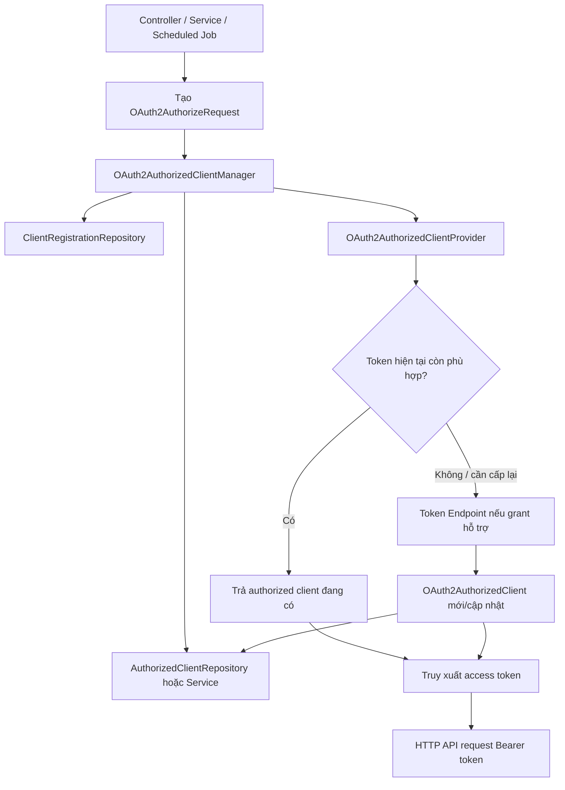

# 15.1. OAuth2AuthorizedClientManager và OAuth2AuthorizeRequest

Trong **Spring Security OAuth 2.0 / OpenID Connect (OIDC) Client**, đăng nhập thành công và gọi API bằng OAuth2 access token là **hai nhu cầu có liên quan nhưng không đồng nhất**.

Khi người dùng đăng nhập bằng `oauth2Login()`, Spring Security xác minh kết quả OIDC và tạo `Authentication` đại diện cho người dùng trong `SecurityContext`. Nhưng nếu backend muốn gọi một API khác, nó còn cần **access token hợp lệ, dành cho đúng OAuth2 client và tài nguyên**. Token đó có thể đã được cấp lúc login, đã hết hạn, cần refresh, hoặc chưa được cấp vì đây là luồng `client_credentials` chạy trong tác vụ nền.

**`OAuth2AuthorizedClientManager`** là thành phần điều phối việc tìm, cấp mới, cấp lại và lưu kết quả ủy quyền OAuth2 Client. Đầu vào của nó là **`OAuth2AuthorizeRequest`**: một yêu cầu nêu rõ client registration hoặc authorized client cần sử dụng, principal liên quan và các thuộc tính bổ sung. Kết quả thành công là **`OAuth2AuthorizedClient`** chứa thông tin registration cùng access token (và refresh token nếu có).

Bài học này tập trung vào **Spring Boot 3.x, Spring Security 6.x**, với những ví dụ cho cả **Servlet/Spring MVC có HTTP request** và **backend chạy không có HTTP request**. Mục tiêu là hiểu rõ **khi nào nên dùng manager nào, cách tạo `OAuth2AuthorizeRequest`, vòng đời token, cách phân biệt danh tính người dùng và service account, và những lỗi phổ biến khi gọi API**.

## 1. Vị trí của Client Manager trong kiến trúc OAuth2 Client

Một ứng dụng có thể cần hai loại hành động:

- **Đăng nhập cho người dùng:** Browser → OP → callback → `OAuth2AuthenticationToken` trong `SecurityContext`.
- **Gọi một API từ backend:** Ứng dụng → Token Endpoint nếu cần token → API nhận `Authorization: Bearer ...`.

`OAuth2AuthorizedClientManager` phục vụ nhu cầu thứ hai và có thể được sử dụng sau nhu cầu thứ nhất.



Không phải mọi lần gọi `authorize()` đều tạo một HTTP request mới tới Token Endpoint. Manager có thể tìm được authorized client đang có và trả lại khi chưa cần reauthorization. Khi token hết hạn hoặc sắp hết hạn, provider có thể áp dụng refresh token hoặc client credentials tùy grant và cấu hình.

Đồng thời, **manager không phải Authorization Server**: nó không tự phát hành token, không thay quy trình kiểm tra access token tại API và không tự đặt quyền của người dùng.

## 2. Bốn khái niệm cốt lõi cần tách biệt

| Thành phần | Chức năng | Ví dụ |
| --- | --- | --- |
| **`ClientRegistration`** | Thông tin định nghĩa OAuth2 client: client ID, secret, grant, token endpoint, scopes, provider | Registration ID `inventory-service`, grant `client_credentials` |
| **`OAuth2AuthorizedClient`** | Một registration đã có access token/refresh token tương ứng với principal | `inventory-service` được cấp token hết hạn lúc 10:30 |
| **`OAuth2AuthorizeRequest`** | Thông tin đầu vào cho một lần gọi `authorize()`, xác định client/principal và attributes | Xin token cho `inventory-service` dưới principal name `inventory-job` |
| **`OAuth2AuthorizedClientManager`** | Điều phối authorize/reauthorize, phối hợp provider và persistence | `AuthorizedClientServiceOAuth2AuthorizedClientManager` cho scheduled job |

### 2.1. Client registration không phải authorized client

`ClientRegistration` mô tả **ứng dụng đã được đăng ký với provider ra sao**. Nó có thể tồn tại ngay từ startup dù chưa có token nào:

```text
ClientRegistration
  registrationId: inventory-service
  clientId: inventory-backend
  grantType: client_credentials
  clientAuthenticationMethod: client_secret_basic
  tokenUri: https://idp.example.com/oauth2/token
  scopes: inventory.read
```

`OAuth2AuthorizedClient` là trạng thái **sau khi token được cấp**:

```text
OAuth2AuthorizedClient
  clientRegistration: inventory-service
  principalName: inventory-job
  accessToken: Bearer <secret-token>
  accessTokenExpiresAt: ...
  refreshToken: có hoặc không tùy grant/provider
```

Không đưa raw access token vào log hoặc REST response để quan sát trạng thái. Ví dụ dùng placeholder; trong runtime `OAuth2AuthorizedClient.getAccessToken()` trả một `OAuth2AccessToken` chứa token value nhạy cảm.

### 2.2. `Authentication` khác `OAuth2AuthorizedClient`

Sau OIDC Login:

```text
SecurityContext
  +-- OAuth2AuthenticationToken
        +-- principal = OidcUser
        +-- authorities = quyền của người dùng

OAuth2AuthorizedClientRepository / Service
  +-- (registration, principalName)
        +-- access token
        +-- refresh token nếu có
```

`OAuth2AuthenticationToken` cho Spring biết **ai đang đăng nhập và có authorities gì**. `OAuth2AuthorizedClient` giữ token để ứng dụng **truy cập một tài nguyên bên ngoài**. Một người dùng có thể có nhiều authorized clients (nhiều registration hoặc nhiều quyền), nhưng thường có một `Authentication` hiện tại trong session của website.

Không cố đọc access token từ `Authentication.getCredentials()` rồi dùng làm Bearer token cho API. Hãy lấy token qua authorized client abstraction.

### 2.3. “Principal” của yêu cầu manager có phải luôn là user?

Không. `OAuth2AuthorizeRequest` cần một principal để liên kết authorization state:

- Với browser user: dùng `Authentication` của người dùng đã xác thực.
- Với `client_credentials` chạy từ job: có thể dùng **một principal name ổn định đại diện workload**, ví dụ `inventory-job` hoặc `internal-service`.

Ở `client_credentials`, principal string này **không làm token trở thành token của một end user**. Grant xác thực chính client tại Authorization Server. Chuỗi principal chủ yếu là khóa liên kết token được lưu trong authorized client service theo cách manager hoạt động.

Không dùng principal name do client HTTP tùy ý gửi để thay người dùng trong hệ thống hoặc để đọc token của principal khác.

## 3. Giao diện `OAuth2AuthorizedClientManager`

Đây là giao diện trung tâm:

```java
import org.springframework.lang.Nullable;
import org.springframework.security.oauth2.client.OAuth2AuthorizedClient;
import org.springframework.security.oauth2.client.OAuth2AuthorizedClientManager;
import org.springframework.security.oauth2.client.OAuth2AuthorizeRequest;

// Chữ ký khái niệm:
// @Nullable
// OAuth2AuthorizedClient authorize(OAuth2AuthorizeRequest authorizeRequest);
```

Khi gọi:

```java
OAuth2AuthorizedClient client = manager.authorize(authorizeRequest);
```

một số kết quả có thể xảy ra:

1. **Trả authorized client mới:** nhà cung cấp grant thực hiện authorization và nhận token thành công.
2. **Trả authorized client có sẵn:** client đã được cấp token và chưa cần reauthorization.
3. **Trả `null`:** manager/provider không thể hoặc không có cơ chế authorize phù hợp với yêu cầu hiện tại, ví dụ không có provider hỗ trợ grant đã chỉ định.
4. **Ném `OAuth2AuthorizationException` hoặc exception liên quan:** quá trình authorize/reauthorize được thực hiện nhưng Authorization Server trả lỗi hoặc xảy ra lỗi phù hợp.

**Không giả định `authorize()` luôn trả token mới hoặc luôn ném exception khi không được hỗ trợ.** Code gọi manager cần xử lý `null` theo API contract và xử lý lỗi thật bằng cách thích hợp.

### 3.1. “Authorize” có nghĩa gì ở đây?

Trong API này, `authorize` là thao tác **đảm bảo có một authorized client phù hợp**, không phải một lời gọi trực tiếp đến **Authorization Endpoint** trên browser.

Đối với `client_credentials`, manager có thể yêu cầu token trực tiếp ở Token Endpoint.

Đối với Authorization Code Flow, **người dùng cần đã hoàn tất front-channel login/consent** hoặc ứng dụng đã có authorized client được lưu. Gọi `manager.authorize(...)` từ một job không có browser **không tự mở cửa sổ đăng nhập** hoặc tự tạo một authorization code.

## 4. `OAuth2AuthorizeRequest` gồm những gì?

`OAuth2AuthorizeRequest` là một object đầu vào có chủ đích. Hai cách khởi tạo thường gặp:

### 4.1. Chọn bằng registration ID

```java
OAuth2AuthorizeRequest request =
        OAuth2AuthorizeRequest
                .withClientRegistrationId("inventory-service")
                .principal("inventory-job")
                .build();
```

Manager tra `ClientRegistration` mang ID này trong `ClientRegistrationRepository`, rồi tìm authorized client hiện tại cho principal tương ứng trong repository/service.

Dạng này thường phù hợp khi caller biết **registration ID ổn định** nhưng không cần trực tiếp giữ instance token cũ.

### 4.2. Chọn bằng authorized client có sẵn

```java
OAuth2AuthorizeRequest request =
        OAuth2AuthorizeRequest
                .withAuthorizedClient(existingAuthorizedClient)
                .principal(authentication)
                .build();
```

Dạng này hữu ích khi bạn đã có đối tượng `OAuth2AuthorizedClient` và cần đưa nó cho manager xem xét reauthorization. Vẫn cần principal đúng ngữ cảnh; không được lấy authorized client của người A rồi truyền principal người B như một cách chuyển token giữa tài khoản.

### 4.3. Principal có thể là `Authentication` hoặc String

Trong code web:

```java
Authentication authentication =
        SecurityContextHolder.getContext().getAuthentication();

OAuth2AuthorizeRequest request = OAuth2AuthorizeRequest
        .withClientRegistrationId("calendar-login")
        .principal(authentication)
        .build();
```

Trong service-to-service:

```java
OAuth2AuthorizeRequest request = OAuth2AuthorizeRequest
        .withClientRegistrationId("inventory-service")
        .principal("inventory-job")
        .build();
```

Sự khác biệt **không phải chỉ là cú pháp**:

- Với web user, principal đại diện cho người dùng đã đăng nhập.
- Với client credentials, principal là khóa ổn định để phân biệt trạng thái authorized client phía backend, không hàm ý user delegation.

Nếu cùng registration có thể được authorize cho nhiều users, không sử dụng một principal name chung `"user"` để lưu token của mọi người. Làm vậy có thể khiến token của user này bị lấy cho user khác tùy persistence implementation và caller.

### 4.4. Thuộc tính bổ sung của request

`OAuth2AuthorizeRequest` còn có **attributes** dành cho ngữ cảnh cụ thể, được manager ánh xạ thành thuộc tính của `OAuth2AuthorizationContext` khi các providers cần. Các ví dụ nâng cao có thể dùng attributes để mô tả username/password theo grant legacy, authorization-related parameters hoặc dữ liệu tùy biến của một provider đã được thiết kế.

Một ví dụ minh họa không chứa credential:

```java
OAuth2AuthorizeRequest request =
        OAuth2AuthorizeRequest
                .withClientRegistrationId("inventory-service")
                .principal("inventory-job")
                .attributes(attributes -> attributes.put(
                        "request-purpose", "nightly-sync"))
                .build();
```

**Lưu ý:** đưa attribute vào request không tự khiến OP thay đổi scope hoặc tự gắn nó vào HTTP token request. Chỉ khi provider hoặc `contextAttributesMapper` có cơ chế sử dụng attribute đó, nó mới có tác động tương ứng.

Không dùng `attributes` để lén đưa token/secret/issuer tùy ý từ HTTP input chưa được xác minh vào quy trình authorize.

## 5. Các thành phần manager phối hợp bên dưới

`OAuth2AuthorizedClientManager` là lớp điều phối, không tự định nghĩa mọi grant. Các thành phần thường gặp:

| Thành phần | Trách nhiệm |
| --- | --- |
| `ClientRegistrationRepository` | Tra `ClientRegistration` từ registration ID. |
| `OAuth2AuthorizedClientRepository` | Lưu/tìm authorized client trong ngữ cảnh HTTP request/response; phù hợp ứng dụng Servlet. |
| `OAuth2AuthorizedClientService` | Lưu/tìm authorized client không phụ thuộc trực tiếp HTTP request/response; phù hợp background hoặc hệ thống có storage riêng. |
| `OAuth2AuthorizedClientProvider` | Xử lý grant/reauthorization theo `OAuth2AuthorizationContext`. |
| `OAuth2AuthorizationContext` | Ngữ cảnh nội bộ gồm registration, principal, authorized client hiện có và attributes provider cần. |
| `OAuth2AuthorizationSuccessHandler` | Có thể lưu authorized client sau khi authorize thành công. |
| `OAuth2AuthorizationFailureHandler` | Có thể loại bỏ authorized client không còn hợp lệ trong những điều kiện failure phù hợp. |

```text
OAuth2AuthorizeRequest
    |
    v
OAuth2AuthorizedClientManager
    +--> resolve ClientRegistration
    +--> resolve existing OAuth2AuthorizedClient
    +--> build OAuth2AuthorizationContext
    |       client registration + principal + attributes
    |
    +--> OAuth2AuthorizedClientProvider.authorize(context)
    |       - authorization_code (khi có ngữ cảnh phù hợp)
    |       - refresh_token
    |       - client_credentials
    |       - custom grant (nếu được cấu hình/hỗ trợ)
    |
    +--> success/failure handling
    +--> persist/remove authorized client
    |
    v
OAuth2AuthorizedClient hoặc null
```

`OAuth2AuthorizedClientProvider` quyết định có cần và có thể thực hiện authorization không. Nếu provider không hỗ trợ grant hoặc không có điều kiện reauthorize, tùy trường hợp manager có thể trả lại client hiện có hoặc `null`. Không tự gọi HTTP token endpoint từ mọi service vì manager đã được thiết kế để phối hợp các bước đó.

## 6. Hai triển khai manager quan trọng

Trong ứng dụng Spring Security Servlet, bạn sẽ gặp hai triển khai chính.

| Triển khai | Bối cảnh phù hợp | Storage liên quan |
| --- | --- | --- |
| **`DefaultOAuth2AuthorizedClientManager`** | Xử lý trong **Servlet HTTP request** và các luồng gần với web principal/session | `ClientRegistrationRepository` + `OAuth2AuthorizedClientRepository` |
| **`AuthorizedClientServiceOAuth2AuthorizedClientManager`** | Xử lý **không có Servlet HTTP request**, ví dụ scheduled job, message consumer, service-to-service | `ClientRegistrationRepository` + `OAuth2AuthorizedClientService` |

### 6.1. `DefaultOAuth2AuthorizedClientManager` dành cho HTTP request

Manager này tích hợp với `OAuth2AuthorizedClientRepository`, sử dụng thông tin HTTP request/response khi cần để tìm/lưu authorized client của user. Nó rất phù hợp khi controller đang xử lý request có `Authentication` từ `oauth2Login()`.

Nó **không phải lựa chọn tốt cho scheduled task** hoàn toàn không có Servlet request. Nếu gọi trong một job độc lập, bạn có thể gặp lỗi thiếu servlet request context hoặc cách lưu token không phù hợp.

### 6.2. `AuthorizedClientServiceOAuth2AuthorizedClientManager` dành cho backend job

Manager này dùng `OAuth2AuthorizedClientService` và không cần HTTP request để lưu/tra token. Ví dụ:

- Job đồng bộ hàng tồn kho chạy 5 phút/lần.
- Message consumer gửi dữ liệu đến một API nội bộ.
- Batch process thực hiện `client_credentials`.
- Service background cần lấy token theo principal/service identity đã được định trước.

Dù không phụ thuộc HTTP request, nó vẫn cần **đúng client registration, grant, client authentication và storage**.

### 6.3. Không “chuyển đổi” token giữa hai manager tùy ý

Một authorized client được lưu theo `OAuth2AuthorizedClientRepository` của web session **không mặc định xuất hiện** trong `OAuth2AuthorizedClientService` của background manager, và ngược lại. Chúng có thể cùng dùng một service bên dưới nếu được cấu hình như vậy, nhưng không được giả định.

Trong ứng dụng có cả web user login và machine-to-machine calls, nên đặt rõ **hai manager** hoặc các nhánh authorization tương ứng, tránh lẫn token của user với token của service.

## 7. `OAuth2AuthorizedClientProvider`: chọn grant và làm mới token

Một manager không tự “biết” cách xin token nếu không có provider phù hợp. Có thể cấu hình các provider bằng builder:

```java
import org.springframework.security.oauth2.client.OAuth2AuthorizedClientProvider;
import org.springframework.security.oauth2.client.OAuth2AuthorizedClientProviderBuilder;

OAuth2AuthorizedClientProvider provider =
        OAuth2AuthorizedClientProviderBuilder.builder()
                .authorizationCode()
                .refreshToken()
                .clientCredentials()
                .build();
```

Bảng ý nghĩa:

| Provider | Khi nào hữu ích | Hành vi cần hiểu |
| --- | --- | --- |
| `authorizationCode()` | Authorization Code Flow liên quan browser và callback | Không tự hiển thị consent/login page từ background; cần front-channel flow và state đã được xử lý phù hợp. |
| `refreshToken()` | Authorized client đã có refresh token và access token cần cấp lại | Gọi Token Endpoint bằng refresh token theo điều kiện provider; không phải mọi grant có refresh token. |
| `clientCredentials()` | Client backend tự gọi API bằng danh tính của ứng dụng | Có thể xin access token mới khi chưa có hoặc đã cần reauthorize; không đại diện end user. |

Các grant/provider mở rộng khác có thể tồn tại tùy phiên bản và custom implementation. Không sử dụng password grant legacy như một lựa chọn mặc định cho ứng dụng mới; phần lớn kịch bản hiện đại nên dùng Authorization Code + PKCE cho end user hoặc client credentials cho machine-to-machine.

### 7.1. Thứ tự provider có quan trọng không?

Một composite provider sẽ thử những triển khai thành phần theo cách nó được cấu hình. Mỗi provider quyết định có xử lý được `OAuth2AuthorizationContext` hay không. Khi không có provider phù hợp hoặc không cần reauthorization, kết quả có thể là `null` ở tầng provider và được manager diễn giải theo ngữ cảnh.

Để dễ vận hành, **chỉ cấu hình những grant mà ứng dụng thực sự cần**. Đối với một service chỉ chạy `client_credentials`, builder có `clientCredentials()` là đủ; không phải thêm `authorizationCode()` chỉ vì đó là OAuth2.

### 7.2. Access token hết hạn khi nào?

Một `OAuth2AccessToken` thường có thời điểm:

```java
client.getAccessToken().getIssuedAt();
client.getAccessToken().getExpiresAt();
```

Provider có thể áp dụng **clock skew** để tránh dùng token vừa sát lúc hết hạn. Giá trị skew và cách refresh cụ thể tùy provider và cấu hình; không tự cắt hạn token bằng việc so đồng hồ local với thời điểm `exp` rồi bỏ qua manager.

Một manager có thể trả authorized client còn token, hoặc xin/refresh token trước khi request HTTP được gửi. Nhưng nó **không bảo đảm API sẽ chấp nhận token**: API còn kiểm tra issuer, audience, scope, quyền và trạng thái thu hồi.

## 8. Ví dụ A — Web user đăng nhập OIDC rồi gọi API thay mặt người dùng

Giả sử website có `calendar-login`, dùng Authorization Code Flow và muốn gọi Calendar API thay mặt người đã đăng nhập.

### 8.1. Cấu hình OAuth2/OIDC Client

```yaml
spring:
  security:
    oauth2:
      client:
        registration:
          calendar-login:
            provider: calendar-oidc
            client-id: ${CALENDAR_CLIENT_ID}
            client-secret: ${CALENDAR_CLIENT_SECRET}
            client-authentication-method: client_secret_basic
            authorization-grant-type: authorization_code
            scope:
              - openid
              - profile
              - calendar.read
            redirect-uri: "{baseUrl}/login/oauth2/code/{registrationId}"
        provider:
          calendar-oidc:
            issuer-uri: ${CALENDAR_ISSUER_URI}
```

`calendar.read` là scope minh họa: OP thực phải công bố và chấp nhận scope tương ứng; không phải tên scope chuẩn của mọi provider.

Browser bắt đầu đăng nhập:

```text
GET /oauth2/authorization/calendar-login
```

Sau callback thành công, Spring Security có thể lưu `OAuth2AuthorizedClient` tương ứng với registration và principal. **Đừng dùng `client_credentials` ở đây nếu yêu cầu là API thao tác thay mặt user.**

### 8.2. Tạo web manager dùng repository

```java
import org.springframework.context.annotation.Bean;
import org.springframework.context.annotation.Configuration;
import org.springframework.security.oauth2.client.DefaultOAuth2AuthorizedClientManager;
import org.springframework.security.oauth2.client.OAuth2AuthorizedClientManager;
import org.springframework.security.oauth2.client.OAuth2AuthorizedClientProvider;
import org.springframework.security.oauth2.client.OAuth2AuthorizedClientProviderBuilder;
import org.springframework.security.oauth2.client.registration.ClientRegistrationRepository;
import org.springframework.security.oauth2.client.web.OAuth2AuthorizedClientRepository;

@Configuration
public class WebOAuth2ClientManagerConfig {

    @Bean
    OAuth2AuthorizedClientManager userAuthorizedClientManager(
            ClientRegistrationRepository registrations,
            OAuth2AuthorizedClientRepository authorizedClients) {

        OAuth2AuthorizedClientProvider provider =
                OAuth2AuthorizedClientProviderBuilder.builder()
                        .authorizationCode()
                        .refreshToken()
                        .build();

        DefaultOAuth2AuthorizedClientManager manager =
                new DefaultOAuth2AuthorizedClientManager(
                        registrations, authorizedClients);

        manager.setAuthorizedClientProvider(provider);
        return manager;
    }
}
```

Manager này dành cho lời gọi **có Servlet request**. Nó không tự chạy login khi user chưa từng authorize; Authorization Code Flow phải được bắt đầu qua browser và hoàn tất bằng callback tương ứng.

### 8.3. `SecurityFilterChain` cho website

```java
import org.springframework.context.annotation.Bean;
import org.springframework.context.annotation.Configuration;
import org.springframework.security.config.Customizer;
import org.springframework.security.config.annotation.web.builders.HttpSecurity;
import org.springframework.security.web.SecurityFilterChain;

@Configuration
class WebSecurityConfig {

    @Bean
    SecurityFilterChain webSecurityFilterChain(HttpSecurity http)
            throws Exception {

        http
            .authorizeHttpRequests(auth -> auth
                .requestMatchers("/", "/error", "/assets/**").permitAll()
                .anyRequest().authenticated()
            )
            .oauth2Login(Customizer.withDefaults());

        return http.build();
    }
}
```

Đoạn `SecurityFilterChain` là cấu hình minh họa cho **web application**. Việc đặt `userAuthorizedClientManager` thành bean không tự thay đổi security chain; mỗi thành phần có trách nhiệm riêng.

### 8.4. Dùng manager trong controller

Ví dụ Spring 6.1+ / Spring Boot 3.2+ sử dụng `RestClient`:

```java
import org.springframework.beans.factory.annotation.Qualifier;
import org.springframework.security.core.Authentication;
import org.springframework.security.oauth2.client.OAuth2AuthorizedClient;
import org.springframework.security.oauth2.client.OAuth2AuthorizedClientManager;
import org.springframework.security.oauth2.client.OAuth2AuthorizeRequest;
import org.springframework.web.bind.annotation.GetMapping;
import org.springframework.web.bind.annotation.RestController;
import org.springframework.web.client.RestClient;

@RestController
class CalendarController {

    private final OAuth2AuthorizedClientManager manager;

    private final RestClient calendarApi =
            RestClient.create("https://calendar-api.example.com");

    CalendarController(
            @Qualifier("userAuthorizedClientManager")
            OAuth2AuthorizedClientManager manager) {
        this.manager = manager;
    }

    @GetMapping("/my-calendar")
    String myCalendar(Authentication authentication) {
        OAuth2AuthorizeRequest request =
                OAuth2AuthorizeRequest
                        .withClientRegistrationId("calendar-login")
                        .principal(authentication)
                        .build();

        OAuth2AuthorizedClient client = manager.authorize(request);

        if (client == null) {
            throw new IllegalStateException(
                    "Calendar client is not authorized for this user");
        }

        return calendarApi.get()
                .uri("/events")
                .headers(headers -> headers.setBearerAuth(
                        client.getAccessToken().getTokenValue()))
                .retrieve()
                .body(String.class);
    }
}
```

**Giả định:** OP đã cấp access token có audience và scope phù hợp cho `calendar-api.example.com`, user đã hoàn tất Authorization Code Flow, controller chạy trong request Servlet đã xác thực, và service ngoài thực sự hỗ trợ Bearer token. `RestClient` được giới thiệu từ Spring Framework 6.1; với bản Spring Boot 3.0/3.1, bạn có thể dùng HTTP client khác hoặc nâng phiên bản phù hợp.

Không trả token value về browser và không gắn token vào query string của API. Chỉ gửi Bearer token tới **API host tin cậy đã cấu hình**, không lấy URL tự do từ user input để tránh làm lộ token qua SSRF/open redirects. Với production, nên đưa logic gọi API vào service thay vì controller và xử lý lỗi backend/API rõ ràng.

### 8.5. Nếu authorized client chưa tồn tại thì sao?

Có thể browser đã đăng nhập bằng một registration khác, hoặc chưa đồng ý scope `calendar.read`. Khi đó việc gọi:

```java
manager.authorize(
    OAuth2AuthorizeRequest.withClientRegistrationId("calendar-login")
        .principal(authentication).build()
);
```

**không tự hiển thị màn hình consent**. `authorizationCode()` không thể tạo code hợp lệ từ không khí. Kết quả có thể là `null` nếu chưa có điều kiện để authorization, hoặc lỗi theo ngữ cảnh hiện tại.

Ứng dụng cần thiết kế luồng **bắt đầu authorization request từ browser** tại `/oauth2/authorization/calendar-login`, sau đó xử lý callback và quay lại thao tác đang làm. Với yêu cầu incremental authorization hoặc scope thay đổi theo chức năng, cần cấu hình consent/authorization request phù hợp và bảo đảm kiểm tra scope được cấp, thay vì chỉ giả định thêm scope vào request manager là đủ.

### 8.6. Dùng `@RegisteredOAuth2AuthorizedClient` khi phù hợp

Một số controller có thể dùng trực tiếp argument resolver thay vì tự gọi manager:

```java
import org.springframework.security.oauth2.client.OAuth2AuthorizedClient;
import org.springframework.security.oauth2.client.annotation.RegisteredOAuth2AuthorizedClient;
import org.springframework.web.bind.annotation.GetMapping;
import org.springframework.web.bind.annotation.RestController;

@RestController
class CalendarTokenStateController {

    @GetMapping("/calendar-token-state")
    String tokenState(
            @RegisteredOAuth2AuthorizedClient("calendar-login")
            OAuth2AuthorizedClient client) {

        return client.getClientRegistration().getRegistrationId();
    }
}
```

Cách này hữu ích khi framework đã tích hợp resolver và authorized client có sẵn/được xử lý phù hợp. Tuy nhiên, hiểu `OAuth2AuthorizedClientManager` vẫn cần thiết để cấu hình refresh, service-to-service và gọi API ở service không đi qua controller argument resolver.

## 9. Ví dụ B — `client_credentials` cho scheduled job không có HTTP request

Giả sử một backend mỗi giờ lấy dữ liệu tồn kho từ API nội bộ, **không hành động thay mặt end user**. Đây là một tình huống thích hợp cho grant `client_credentials`.

### 9.1. Registration dành cho machine-to-machine

```yaml
spring:
  security:
    oauth2:
      client:
        registration:
          inventory-service:
            provider: inventory-auth
            client-id: ${INVENTORY_CLIENT_ID}
            client-secret: ${INVENTORY_CLIENT_SECRET}
            client-authentication-method: client_secret_basic
            authorization-grant-type: client_credentials
            scope:
              - inventory.read
        provider:
          inventory-auth:
            token-uri: ${INVENTORY_TOKEN_URI}
```

Trong cấu hình này:

- `inventory-service` là client registration ID trong Spring.
- `client_credentials` nói rằng token đại diện cho **client application**.
- `token-uri` là Token Endpoint dùng cho machine-to-machine; không cần cấu hình browser callback cho grant này.
- `inventory.read` là scope minh họa, phải được Authorization Server chấp nhận và API công nhận.
- Không có `openid`: đây không phải flow OIDC end-user login.

Thường `client_credentials` **không trả refresh token**; manager có thể yêu cầu access token mới khi access token cũ hết hạn hoặc cần reauthorize.

### 9.2. Cấu hình manager dành cho service

```java
import org.springframework.context.annotation.Bean;
import org.springframework.context.annotation.Configuration;
import org.springframework.security.oauth2.client.AuthorizedClientServiceOAuth2AuthorizedClientManager;
import org.springframework.security.oauth2.client.OAuth2AuthorizedClientManager;
import org.springframework.security.oauth2.client.OAuth2AuthorizedClientProvider;
import org.springframework.security.oauth2.client.OAuth2AuthorizedClientProviderBuilder;
import org.springframework.security.oauth2.client.OAuth2AuthorizedClientService;
import org.springframework.security.oauth2.client.registration.ClientRegistrationRepository;

@Configuration
public class ServiceOAuth2ClientManagerConfig {

    @Bean
    OAuth2AuthorizedClientManager serviceAuthorizedClientManager(
            ClientRegistrationRepository registrations,
            OAuth2AuthorizedClientService authorizedClients) {

        OAuth2AuthorizedClientProvider provider =
                OAuth2AuthorizedClientProviderBuilder.builder()
                        .clientCredentials()
                        .build();

        AuthorizedClientServiceOAuth2AuthorizedClientManager manager =
                new AuthorizedClientServiceOAuth2AuthorizedClientManager(
                        registrations, authorizedClients);

        manager.setAuthorizedClientProvider(provider);
        return manager;
    }
}
```

Đây là manager dùng **`OAuth2AuthorizedClientService`**, không cần `HttpServletRequest` hay `HttpServletResponse`. Với tác vụ backend, nó phù hợp hơn `DefaultOAuth2AuthorizedClientManager`.

### 9.3. Gọi manager trong service

```java
import org.springframework.beans.factory.annotation.Qualifier;
import org.springframework.security.oauth2.client.OAuth2AuthorizedClient;
import org.springframework.security.oauth2.client.OAuth2AuthorizedClientManager;
import org.springframework.security.oauth2.client.OAuth2AuthorizeRequest;
import org.springframework.stereotype.Service;
import org.springframework.web.client.RestClient;

@Service
public class InventoryApiClient {

    private final OAuth2AuthorizedClientManager manager;

    private final RestClient inventoryApi =
            RestClient.create("https://inventory-api.example.com");

    public InventoryApiClient(
            @Qualifier("serviceAuthorizedClientManager")
            OAuth2AuthorizedClientManager manager) {
        this.manager = manager;
    }

    public String fetchStock() {
        OAuth2AuthorizeRequest request =
                OAuth2AuthorizeRequest
                        .withClientRegistrationId("inventory-service")
                        .principal("inventory-job")
                        .build();

        OAuth2AuthorizedClient client = manager.authorize(request);

        if (client == null) {
            throw new IllegalStateException(
                    "No OAuth2 client-credentials authorization available");
        }

        return inventoryApi.get()
                .uri("/stock")
                .headers(headers -> headers.setBearerAuth(
                        client.getAccessToken().getTokenValue()))
                .retrieve()
                .body(String.class);
    }
}
```

Ví dụ dùng `RestClient` (Spring Framework 6.1+/Spring Boot 3.2+). Với phiên bản cũ hơn, thay phần HTTP client bằng thư viện tương thích; **manager và `OAuth2AuthorizeRequest` không phụ thuộc RestClient**.

Quan sát:

- `.principal("inventory-job")` là **tên ổn định cho workload**, không phải `OidcUser`.
- Access token được cấp cho client `inventory-service`, không mặc định có danh tính hoặc permission của một người dùng.
- Khi gọi lặp lại, manager/provider có thể **dùng lại authorized client hiện có**, và khi cần sẽ xin token mới.
- Chỉ gửi Bearer token đến **inventory API** đã định; không chuyển token qua API có audience khác.

### 9.4. Gắn với một scheduled job

Nếu muốn tự động hóa gọi API trong Spring application:

```java
import org.springframework.scheduling.annotation.Scheduled;
import org.springframework.stereotype.Component;

@Component
class InventorySyncJob {

    private final InventoryApiClient inventoryApiClient;

    InventorySyncJob(InventoryApiClient inventoryApiClient) {
        this.inventoryApiClient = inventoryApiClient;
    }

    @Scheduled(fixedDelayString = "${INVENTORY_SYNC_DELAY_MS:3600000}")
    void sync() {
        String response = inventoryApiClient.fetchStock();

        // Chỉ minh họa gọi service.
        // Production: parse/validate response và cập nhật dữ liệu có kiểm soát.
        // Không log response nếu nó chứa dữ liệu nhạy cảm.
    }
}
```

Để chạy `@Scheduled`, ứng dụng còn cần `@EnableScheduling` ở cấu hình phù hợp. Không gọi `fetchStock()` ở mỗi HTTP request chỉ để “giữ token sống”; có thể để job hoặc event-driven service gọi khi thật sự cần.

### 9.5. Principal name có cần phân biệt theo job không?

Nếu cùng registration phục vụ các tác vụ **thực sự có cùng quyền client_credentials** và cùng storage, một principal name ổn định có thể cho phép dùng lại trạng thái authorized client.

Nếu có các quyền khác nhau, hãy cân nhắc **tách registrations/scopes/credentials** thay vì đặt nhiều tên principal tùy ý rồi tin rằng Authorization Server sẽ cấp quyền khác theo chuỗi đó. `principal("inventory-job")` **không phải một tham số OAuth2 chuẩn gửi tới Token Endpoint để thay quyền**.

## 10. So sánh User Login và Machine-to-Machine

| Tiêu chí | OIDC user login / Authorization Code | Client Credentials / service-to-service |
| --- | --- | --- |
| Ai xác thực? | End user qua OP; client cũng có thể xác thực tại Token Endpoint | Client application tại Token Endpoint |
| Cần browser redirect? | Có trong flow thông thường | Không |
| Có `OidcUser`? | Có nếu OIDC login thành công | Không, bản thân grant không xác thực end user |
| Registration grant | `authorization_code` | `client_credentials` |
| Principal trong authorize request | `Authentication` của user | String/Authentication đại diện service workload |
| Manager phù hợp | `DefaultOAuth2AuthorizedClientManager` trong Servlet request | `AuthorizedClientServiceOAuth2AuthorizedClientManager` |
| Persistence thường dùng | Authorized client repository gắn web request/session hoặc service phù hợp | Authorized client service (in-memory/database/distributed) |
| Refresh token | Có thể có tùy OP/consent/scopes | Thường không cấp, xin access token mới khi cần |
| Access token có quyền của ai? | Token được cấp với ngữ cảnh end user/client và scopes/audience | Quyền của client ứng dụng đã đăng ký |
| Được dùng thay nhau không? | Không | Không |

**Không lấy token client_credentials để gọi API thay mặt một user cụ thể** nếu API yêu cầu user delegation. Và cũng không giữ token của end user trong một background job dùng chung giữa mọi tài khoản.

## 11. `OAuth2AuthorizedClientRepository` và `OAuth2AuthorizedClientService`

Một manager cần biết **lưu token ở đâu** và **lấy token cũ bằng khóa nào**.

### 11.1. Repository cho Servlet request

`OAuth2AuthorizedClientRepository` có ngữ cảnh HTTP để lưu/tìm authorized client. Một implementation có thể gắn dữ liệu với session; implementation khác có thể dùng service bên dưới. Các thông tin quan trọng khi xác định vị trí lưu:

- Registration ID.
- Principal name.
- Request/response và session nếu storage phụ thuộc web.
- Policy logout/session expiration.
- Khả năng chạy trên nhiều instance.

Đừng mặc định `OAuth2AuthorizedClientRepository` là “một map trong HTTP session”: điều này phụ thuộc implementation và cấu hình.

### 11.2. Service cho tác vụ không có HTTP request

`OAuth2AuthorizedClientService` cung cấp API theo registration ID và principal name, không bắt buộc có Servlet request. Các triển khai thường thấy:

- In-memory storage cho trường hợp đơn giản.
- JDBC/custom storage có lưu token ở database.
- Storage phân tán với cơ chế bảo vệ credential phù hợp.

Nếu ứng dụng có nhiều instance, mỗi JVM dùng in-memory service độc lập có thể xin nhiều token lặp lại. Đây không nhất thiết sai về tính đúng đắn, nhưng ảnh hưởng chi phí, rate limits và cách rotation/refresh.

### 11.3. Authorized client không phải user profile

`OAuth2AuthorizedClient` là dữ liệu có **credential nhạy cảm**. Nó không nên được serialize rồi đưa vào response của controller hoặc ghi vào cache public vì nó mang access token và có thể cả refresh token.

Với logout:

- Xóa Spring application session không tự đảm bảo token trong database service bị xóa.
- Xóa authorized client không đồng nghĩa OP đã thu hồi access/refresh token.
- Muốn revoke token hoặc logout OP cần thiết kế workflow riêng khi provider hỗ trợ.

Việc chọn storage cần đi kèm TTL/retention, encryption, access control và dọn token theo principal/registration.

## 12. Vòng đời token khi gọi `authorize()` nhiều lần

Giả sử token `T1` của `inventory-service` được cấp lúc 09:00, hết hạn khoảng 10:00. Đây là một trình tự minh họa:

```text
09:00  authorize(inventory-service, inventory-job)
       -> không có authorized client
       -> client_credentials token request
       -> lưu authorized client với T1

09:15  authorize(...)
       -> tìm T1 còn phù hợp
       -> có thể dùng lại T1, không gọi Token Endpoint

09:59  authorize(...)
       -> provider xét T1 sắp/hết hạn theo clock skew
       -> xin T2 theo client_credentials
       -> cập nhật authorized client

10:05  authorize(...)
       -> tìm T2 còn hợp lệ
       -> tiếp tục dùng T2
```

**Không có một SLA bảo đảm mọi lời gọi đúng thời điểm trên đều dùng hoặc refresh token theo bảng này.** Hành vi thực tế phụ thuộc clock skew, provider, đồng hồ hệ thống, grant, access-token lifetime và storage. Dòng thời gian chỉ giải thích ý nghĩa reauthorization.

### 12.1. Refresh Token Grant

Trong Authorization Code Flow, nếu OP đã cấp refresh token và client được phép sử dụng:

```text
AuthorizedClient có access token cũ + refresh token
             |
             v
Manager/refreshToken provider nhận thấy cần reauthorize
             |
             v
POST Token Endpoint với grant_type=refresh_token
             |
             v
OP cấp access token mới
             |
             +--> có thể rotate refresh token
             |
             v
Lưu OAuth2AuthorizedClient mới/cập nhật
```

Điểm cần chú ý:

- **Không phải mọi OIDC login có refresh token.**
- Không phải refresh token sống vô hạn; OP có thể revoke hoặc rotate.
- Reauthorization có thể thất bại khi refresh token bị thu hồi/hết hạn, khi đó ứng dụng có thể phải yêu cầu user đăng nhập lại.
- Nếu OP rotate refresh token, authorized client storage cần giữ **refresh token mới** một cách an toàn.
- Token còn hạn không đồng nghĩa API cấp quyền cho mọi endpoint; audience/scope/permissions được resource server kiểm tra riêng.

### 12.2. Khi API trả 401, manager có tự hiểu không?

Giả sử manager vừa trả token đang còn hạn nhưng resource server trả `401 invalid_token` do token bị thu hồi, audience sai hoặc chính sách thay đổi.

**Chỉ gọi `authorize()` không làm manager biết kết quả của request đến resource server.** Manager không phải API client interceptor trừ khi bạn tích hợp nó vào HTTP client phù hợp. Nếu muốn xử lý failure response, cần một cơ chế HTTP client hoặc application layer:

1. Nhận biết lỗi Bearer token tương ứng.
2. Phân biệt token hết hạn/invalid token với thiếu scope (`403`) hay lỗi nghiệp vụ.
3. Thông báo failure handler/quản lý authorized client theo cơ chế được hỗ trợ khi phù hợp.
4. Retry **có giới hạn và chỉ khi an toàn**, tránh lặp vô hạn hoặc replay thao tác POST không idempotent.

Không làm vòng lặp “API 401 → xin token mới → gọi lại” vô hạn. Nếu token sai audience, xin cùng loại token mới sẽ không giải quyết.

## 13. Error handling và `authorize() == null`

Một implementation nên phân biệt **không hỗ trợ authorize** với **authorization thất bại**.

### 13.1. Xử lý `null`

```java
OAuth2AuthorizedClient client = manager.authorize(request);

if (client == null) {
    throw new IllegalStateException(
            "Authorized client is unavailable for the requested registration");
}
```

`null` có thể xảy ra khi provider không hỗ trợ grant/cấu hình hiện tại, hoặc thiếu trạng thái thích hợp để tiến hành authorization. Đừng vội chuyển `null` thành `401 Unauthorized` từ API bên ngoài: không có API request nào nhất thiết đã được gửi.

Với website, bạn có thể hướng user bắt đầu một authorization flow phù hợp. Với batch job, `null` thường cần cảnh báo vận hành về cấu hình registration/provider hoặc principal/state.

### 13.2. Lỗi từ Token Endpoint

Một số lỗi thường gặp:

| OAuth2 error | Nguyên nhân khả dĩ | Hướng xử lý |
| --- | --- | --- |
| `invalid_client` | Sai client ID/secret, phương thức client authentication không phù hợp | So client registration và OP policy; không log credential |
| `unauthorized_client` | Client không được phép dùng grant hoặc scope | Xác nhận grant `client_credentials`/`authorization_code` đã được cấp |
| `invalid_scope` | Scope không được OP hỗ trợ/cho phép | Kiểm tra `scope` của registration và quyền tại OP |
| `invalid_grant` | Authorization code/refresh token không hợp lệ, hết hạn, redirect URI hoặc PKCE sai | Điều tra grant và correlation; không tự quy thành lỗi manager |
| `temporarily_unavailable` | OP/Token Endpoint gặp sự cố tạm | Dùng retry có giới hạn, backoff và quan sát hệ thống |
| Lỗi TLS/DNS/proxy | Không gọi được endpoint tin cậy | Sửa chứng chỉ, trust store, mạng; không tắt TLS verification |

Một `OAuth2AuthorizationException` chứa thông tin OAuth2 error thích hợp; application layer nên xử lý theo nhóm lỗi và không trả raw error description chứa token/secret cho browser.

### 13.3. Log những gì là đủ?

Thông tin nên ghi ở mức vừa đủ:

- Registration ID, loại grant, tên thành phần gọi.
- Token operation: `authorize` / `reauthorize` / `refresh` / `failed`.
- Request/correlation ID nội bộ không dùng làm credential.
- Mã lỗi đã chuẩn hóa, HTTP status của OP nếu có.
- Độ trễ, tần suất token request, số lần retry.

**Không ghi** client secret, access token, refresh token, raw JWT, authorization code, session ID, PKCE verifier, `Authorization` header hay URL chứa credential. Token response body và exception stack có thể chứa thông tin nhạy cảm; redaction phải áp dụng ở cả HTTP client/gateway/tracing.

## 14. Nhiều client registrations và chọn đúng token

Một hệ thống có thể dùng ba registrations:

```text
calendar-login    -> authorization_code (user calendar)
inventory-service -> client_credentials (inventory API)
billing-service   -> client_credentials (billing API)
```

Không thể sử dụng token `inventory-service` để gọi Billing API chỉ vì cả hai đều là Bearer tokens. Resource server có thể kiểm tra:

- Issuer của access token.
- Audience/resource indicator.
- Scope/permissions.
- Client identity.
- Với user delegation: subject và quyền của end user.

Một lựa chọn token đúng phải bắt đầu từ **mục đích gọi API và registration tương ứng**.

### 14.1. Registration ID là khóa cấu hình, không phải URL tùy ý

Ví dụ:

```java
OAuth2AuthorizeRequest.withClientRegistrationId("billing-service")
        .principal("billing-worker")
        .build();
```

Ứng dụng quyết định dùng `billing-service` vì đang gọi Billing API. Không nhận `registrationId`, `issuer-uri` hoặc `token-uri` tùy ý từ một query parameter rồi cho manager xin token gửi đến host do user chỉ định. Cách đó có thể tạo ra **confused deputy/SSRF** hoặc rò client credentials.

### 14.2. Principal identity và multi-tenant

Trong hệ thống đa tenant, nếu mỗi tenant có client registration/credential riêng, cần ánh xạ tenant **phía server** đến registration được quản lý. Không chỉ truyền `principal("tenant-" + request.getParameter("tenant"))` rồi cho rằng đã tách quyền.

Nếu cùng registration được dùng để quản lý token cho nhiều users, authorized client storage cần key theo đúng authenticated principal để không trả token của user A cho user B. Với client credentials, quyền gắn với registration/OP; đổi principal string không tạo tenant isolation ở Authorization Server.

## 15. Tùy biến success/failure handling

Hai triển khai manager hỗ trợ các hook xử lý kết quả authorization, ví dụ `setAuthorizationSuccessHandler(...)` và `setAuthorizationFailureHandler(...)` theo API tương ứng.

Về ý nghĩa:

- **Success handler:** quyết định lưu authorized client sau khi authorization/reauthorization thành công, có thể phục vụ storage tùy biến.
- **Failure handler:** khi xác thực/reauthorization thất bại trong những tình huống phù hợp, có thể xóa authorized client cũ khỏi repository/service để tránh tái sử dụng credential đã bị từ chối.

Trong cấu hình thông dụng, manager có các handler mặc định phù hợp với loại storage. **Không thay handler bằng logic chỉ log rồi bỏ qua lưu token** nếu bạn vẫn muốn manager duy trì authorized client. Nếu tự cấu hình, hãy xác định rõ:

1. Token nào được lưu, dưới registration và principal nào.
2. Khi refresh token rotate, giá trị mới có được lưu không.
3. Khi nhận `invalid_grant`, có cần xóa authorized client không.
4. Khi token endpoint không khả dụng tạm thời, có nên giữ authorized client hiện có cho mục đích khác không.
5. Có nguy cơ ghi đè token mới bởi token cũ khi nhiều request cùng reauthorize không.

### 15.1. Tại sao không xóa token khi mọi API trả 403?

`403 Forbidden` có thể nói access token **không có quyền** hoặc user không được phép thao tác, không nhất thiết token đã hết hạn. Xóa token và xin lại có thể tạo vòng lặp mà không khắc phục policy. Chỉ loại bỏ authorized client khi có cơ sở rõ ràng về credential invalidation, ví dụ cơ chế failure handler xử lý lỗi thích hợp.

### 15.2. Thao tác update token cần nhất quán

Hai worker cùng phát hiện token sắp hết hạn có thể đồng thời xin token mới. Với lưu trữ phân tán, cần quan tâm:

- Tính nhất quán của authorized client save/load.
- Refresh token rotation và race khi hai worker cùng dùng refresh token cũ.
- Khóa/điều phối reauthorization khi OP yêu cầu.
- Retry/backoff khi gặp rate limit.
- Có nên chia sẻ token machine-to-machine giữa các instance hay để mỗi instance có token riêng.

Không giả định manager tự cung cấp distributed locking cho mọi storage hoặc grant. Những vấn đề này phụ thuộc provider và implementation của authorized client service/repository.

## 16. Context attributes và khả năng mở rộng

`OAuth2AuthorizeRequest` có `attributes`, còn `OAuth2AuthorizationContext` được provider dùng ở thời điểm authorize. Một manager có thể nhận `contextAttributesMapper` để chuyển attributes của request sang context của provider.

Ví dụ muốn gắn một mục đích nội bộ:

```java
OAuth2AuthorizeRequest request = OAuth2AuthorizeRequest
        .withClientRegistrationId("inventory-service")
        .principal("inventory-job")
        .attributes(map -> map.put("purpose", "sync-stock"))
        .build();
```

Điều này **không tự động gửi `purpose=sync-stock` tới OP**. Nó chỉ trở thành dữ liệu có thể được truyền/đọc trong pipeline nếu manager/provider được cấu hình để sử dụng nó.

Một số extension point chuyên biệt có thể tùy biến token request, clock skew, grant handling hoặc context mapping; khi cần hãy dựa vào phiên bản Spring Security và contract chính thức. Không tự chuyển raw user HTTP parameters thành token endpoint parameters nếu chưa có chính sách xác thực/ủy quyền rõ ràng.

### 16.1. Vì sao không chỉnh scope bằng cách thêm chuỗi tùy tiện?

Scopes thường được xác định ở `ClientRegistration` và cấp phép tại OP. Một yêu cầu ứng dụng “muốn thêm scope” **không đồng nghĩa** Authorization Server đã cấp scope đó, đặc biệt với Authorization Code Flow cần user consent.

Nếu yêu cầu chỉ số ít endpoint API có scope khác, có thể dùng **registration riêng** hoặc luồng incremental authorization phù hợp, bảo đảm client luôn kiểm tra token được cấp có scope/audience đáp ứng yêu cầu.

Không cố lấy token nhiều quyền hơn bằng cách ép một attribute vào authorize request mà không thay client registration và consent policy.

## 17. Những nhầm lẫn dễ gặp

### 17.1. “Gọi manager là sẽ bật màn hình đăng nhập”

Không. Manager điều phối authorized client và grant providers. **Front-channel redirect tới OP** thuộc luồng OAuth2 Login/Authorization Request của browser. Một scheduled job không có browser không thể hoàn tất Authorization Code Flow chỉ bằng `authorize()`.

### 17.2. “Mỗi lần authorize là một HTTP POST tới Token Endpoint”

Không. Authorized client hiện có có thể được dùng lại. Provider xem xét thời hạn token và điều kiện reauthorization theo grant/cấu hình.

### 17.3. “`principal("service")` là service account được OP xác thực”

Không theo nghĩa OIDC end user. Trong `client_credentials`, Authorization Server xác thực **client application** bằng credential của registration; principal string ở Spring manager giúp quản lý authorized client storage. Nó không tự tạo user ở OP.

### 17.4. “Có access token thì đã đăng nhập website”

Không. Token có thể được cấp bằng `client_credentials` mà không có end user. Web login cần `Authentication` phù hợp trong `SecurityContext` theo flow OIDC/authentication.

### 17.5. “Có `OAuth2AuthenticationToken` thì access token ở `getCredentials()`”

Không. Access token để gọi API được quản lý qua authorized client abstraction. Authentication phục vụ principal và authorities của ứng dụng.

### 17.6. “Dùng `DefaultOAuth2AuthorizedClientManager` trong @Scheduled cũng được”

Không nên: manager này dành cho Servlet HTTP request và repository tương ứng. Job không có request nên dùng `AuthorizedClientServiceOAuth2AuthorizedClientManager`.

### 17.7. “Một token Bearer có thể gửi đến mọi API”

Không. Access token có scope, audience và quyền tương ứng với tài nguyên được cấp phép. Không tái sử dụng token cho host/tài nguyên khác nếu nó không được phát hành cho mục đích đó.

### 17.8. “Refresh token chắc chắn luôn tồn tại”

Không. Nó phụ thuộc OP, grant, scope, loại client và consent. Với `client_credentials` thường không có refresh token; khi access token hết hạn, provider có thể xin token mới bằng client credentials.

### 17.9. “`authorize() == null` có nghĩa secret sai”

Không nhất thiết. `null` có thể báo manager/provider không thể xử lý request hiện tại. Secret sai khi Token Endpoint thực sự nhận request thường được biểu diễn bằng OAuth2 authorization error thích hợp như `invalid_client`.

### 17.10. “Vừa thêm `OAuth2AuthorizedClientManager` là mọi HTTP client tự gắn Bearer token”

Không. Bạn phải chủ động lấy authorized client và gắn token, hoặc cấu hình **HTTP client integration** của Spring Security. Một `RestClient` tự tạo không tự tìm token từ manager nếu không có interceptor/filter tương ứng.

## 18. Vận hành an toàn và bảo mật token

### 18.1. Secret management

Client ID và client secret phải đến từ môi trường runtime hoặc secret store:

```yaml
spring:
  security:
    oauth2:
      client:
        registration:
          inventory-service:
            client-id: ${INVENTORY_CLIENT_ID}
            client-secret: ${INVENTORY_CLIENT_SECRET}
```

Không commit secret thật vào Git. Hạn chế truy cập đến secret trong CI/CD, containers, secret manager và hệ thống log. Khi rotate client secret, cần đồng bộ OP và application runtime.

### 18.2. Token storage

Access/refresh token là credential có thể cho phép truy cập API. Tối thiểu:

- Dùng HTTPS/TLS khi gọi OP và API.
- Giới hạn quyền đọc/ghi storage chứa `OAuth2AuthorizedClient`.
- Bảo vệ dữ liệu sao lưu, session replication và tracing.
- Không đưa raw token vào log, metric label, exception response hoặc browser.
- Xác định TTL, cleanup, logout và token revocation nếu cần.
- Với storage phân tán, xem xét tính nhất quán của refresh token rotation.

### 18.3. Tránh rò token qua redirect và SSRF

Ví dụ nguy hiểm:

```java
// Anti-pattern: URL đích do người dùng đưa vào.
String target = request.getParameter("url");
httpClient.get(URI.create(target), bearerToken);
```

Nếu user điều khiển `target`, ứng dụng có thể gửi Bearer token đến host ngoài dự kiến. Sử dụng base URL được kiểm soát, danh sách API hosts cho phép, không tự follow redirect tới bên thứ ba kèm Authorization header và không để client tùy ý thay issuer/token endpoint.

### 18.4. Phân quyền API không đến từ tên principal của manager

Đối với Resource Server, quyền cuối cùng do **access token và chính sách API** quyết định. Việc đặt principal name `"admin"` trong `OAuth2AuthorizeRequest` không tạo quyền admin trên API. Với user delegation, API cần access token đúng subject/client/scopes. Với client credentials, API cần nhận biết quyền client ứng dụng theo cách Authorization Server cấp.

## 19. Quan sát và chẩn đoán trong ứng dụng thật

### 19.1. Bảng triệu chứng

| Triệu chứng | Vùng cần xem | Cách tiếp cận |
| --- | --- | --- |
| `authorize()` luôn trả `null` | Provider/grant, authorized client state | Xác định grant registration và provider manager đã cấu hình; user đã hoàn tất authorization flow chưa? |
| `@Scheduled` ném lỗi thiếu Servlet request | Manager được chọn | Dùng `AuthorizedClientServiceOAuth2AuthorizedClientManager` và `OAuth2AuthorizedClientService`. |
| Người dùng A gọi API bằng token của B | Principal name và storage key | Kiểm tra authorization request principal, repository key và không dùng principal dùng chung cho mọi users. |
| Web login được nhưng manager không tìm token | Repository/service không chung storage hoặc sai registration | So `OAuth2AuthorizedClientRepository` của login với manager; xác nhận principal và registration. |
| Token Endpoint trả `invalid_client` | Client credentials/auth method | Kiểm tra client ID/secret, `client-authentication-method`, issuer/token endpoint. |
| Token Endpoint trả `invalid_grant` | Authorization code/refresh token | Kiểm tra hết hạn, một lần sử dụng, redirect URI, PKCE, refresh token rotation. |
| Token trả về nhưng API `401` | Access token audience/issuer/expiry | Xác minh token dành cho API đúng chưa; Resource Server có chấp nhận issuer và audience không? |
| API `403` | Scope/permissions | Token có quyền cần thiết không? User/client có bị policy từ chối không? |
| Nhiều instance xin token liên tục | Authorized client service lưu cục bộ | Xem storage chia sẻ hoặc điều phối token acquisition phù hợp. |
| Refresh token bị dùng hai lần | Concurrency/race | Thiết kế atomic update/locking phù hợp khi provider rotate refresh token. |
| Job lần đầu chạy được, lần sau lỗi | Token expiry/refresh/retry | Kiểm tra provider hỗ trợ reauthorization, token storage, clock skew và error handling. |
| Client ID đúng nhưng manager không hoạt động | Registration chưa được bind | Kiểm tra property prefix và tên registration ID, profile/environment. |
| Resource Server JwtDecoder đã cấu hình nhưng manager không lấy token | Nhầm vai trò Resource Server và Client | Cần OAuth2 Client registration/provider; Resource Server chỉ xác minh token đi vào. |
| Secret bị ghi vào log HTTP | Logging/APM/proxy | Redact Authorization header và form body token request; không dump raw request/response. |

### 19.2. Logging an toàn

Ví dụ trong môi trường phát triển:

```yaml
logging:
  level:
    org.springframework.security.oauth2.client: DEBUG
```

Không dùng DEBUG như lý do ghi token vào log. Thực tế log mức này có thể khác theo phiên bản; cần giám sát và tắt sau khi chẩn đoán.

Những thông tin hữu ích để ghi nhận:

```text
registrationId = inventory-service
grantType      = client_credentials
operation      = authorize
outcome        = success / null / OAuth2 error
durationMs     = ...
requestId      = non-sensitive-correlation-id
```

Không log raw `access_token`, `refresh_token`, client secret, OAuth2 authorization code, PKCE verifier, session cookie hoặc JWT đầy đủ.

## 20. Bài tập thực hành

### Bài tập 1 — Chọn manager phù hợp

Một ứng dụng có controller đã xác thực `OidcUser` và cần gọi Calendar API thay mặt người dùng.

**Câu hỏi:** nên dùng `DefaultOAuth2AuthorizedClientManager` hay `AuthorizedClientServiceOAuth2AuthorizedClientManager`? Principal nào phù hợp?

**Gợi ý:** Trong Servlet request, `DefaultOAuth2AuthorizedClientManager` với `OAuth2AuthorizedClientRepository` là lựa chọn tự nhiên. Tạo `OAuth2AuthorizeRequest` theo `calendar-login` và truyền `Authentication` hiện tại. Token phải gắn với user đã authorize.

### Bài tập 2 — Tác vụ nền

Một scheduled job lấy dữ liệu tồn kho mỗi giờ; không có người dùng nào đang thao tác.

**Câu hỏi:** có nên gọi `oauth2Login()` hay dùng `client_credentials`?

**Gợi ý:** Dùng registration `client_credentials` và `AuthorizedClientServiceOAuth2AuthorizedClientManager`. Principal name ổn định để lưu authorized client không đồng nghĩa end user.

### Bài tập 3 — Phân biệt `null` và lỗi cấp token

`manager.authorize(request)` trả `null` khi registration dùng `authorization_code` nhưng chưa có authorized client và job không có browser.

**Câu hỏi:** Có nên retry liên tục và báo “sai client secret” không?

**Gợi ý:** Không. Manager không thể tự hoàn tất browser authorization/consent. Cần front-channel flow hoặc chọn grant phù hợp với tác vụ.

### Bài tập 4 — Cấp lại token

Job `client_credentials` chạy lúc 09:00, 09:10 và 09:50. Token có hiệu lực trong một giờ.

**Câu hỏi:** Tại sao ba lần gọi không bắt buộc là ba token requests?

**Gợi ý:** Manager có thể dùng lại authorized client đang có, rồi xin token mới khi cần theo thời hạn và clock skew.

### Bài tập 5 — Thay principal name

Backend có registration `inventory-service` và principal `inventory-job`. Lập trình viên thay bằng `principal("ceo")` với hy vọng được scope admin.

**Câu hỏi:** Vì sao không đúng?

**Gợi ý:** Grant `client_credentials` xác thực client bằng credential. Principal name của request manager không thay đổi danh tính/quyền đã đăng ký tại Authorization Server.

### Bài tập 6 — Hai users cùng registration

User A và B đều đăng nhập bằng `calendar-login`. Một service luôn tạo request `.principal("shared-user")` rồi lưu token theo cùng khóa.

**Câu hỏi:** Rủi ro gì?

**Gợi ý:** Authorized client của users có thể bị lẫn theo key trong storage. Dùng `Authentication` đã xác thực của đúng user và repository/service có khả năng phân vùng chính xác.

### Bài tập 7 — Access token bị API từ chối

Manager trả token còn hạn, nhưng Calendar API đáp `403 insufficient_scope`.

**Câu hỏi:** Có nên xóa token và xin lại mãi không?

**Gợi ý:** Không. Token có thể không được cấp scope phù hợp, và reauthorize cùng registration không tạo quyền mới. Cần thay đổi consent/registration hoặc chính sách cấp quyền tại OP/API.

### Bài tập 8 — Storage nhiều instance

Hai node ứng dụng dùng in-memory `OAuth2AuthorizedClientService` cho cùng registration machine-to-machine.

**Câu hỏi:** Vì sao Token Endpoint bị gọi nhiều hơn dự kiến?

**Gợi ý:** Mỗi node có trạng thái token riêng. Đánh giá storage/điều phối phân tán nếu cần tránh cấp token trùng, đồng thời xử lý rate limits và failure.

### Bài tập 9 — Token refresh bị đua nhau

Hai request song song cùng thấy access token sắp hết hạn và dùng cùng refresh token. OP bật refresh token rotation.

**Câu hỏi:** Điều gì có thể xảy ra?

**Gợi ý:** Một request refresh thành công, request kia dùng refresh token cũ và có thể bị từ chối; token mới có nguy cơ bị ghi đè bởi trạng thái cũ. Cần cơ chế consistency/locking phù hợp với storage và OP.

### Bài tập 10 — Kết nối HTTP client

Ứng dụng có `OAuth2AuthorizedClientManager` nhưng tạo `RestClient.create("https://api...")` và không gắn token.

**Câu hỏi:** Vì sao API trả 401?

**Gợi ý:** Manager không tự gắn header cho HTTP client bất kỳ. Cần chủ động lấy authorized client và set Bearer token, hoặc cấu hình interceptor/filter tích hợp OAuth2 Client.

## 21. Những ý chính cần ghi nhớ

```text
Caller cần gọi API có OAuth2
           |
           v
Tạo OAuth2AuthorizeRequest
  - registrationId hoặc authorizedClient
  - principal phù hợp
  - attributes khi thật sự cần
           |
           v
Chọn OAuth2AuthorizedClientManager
  - Servlet request -> DefaultOAuth2AuthorizedClientManager
  - Background/service -> AuthorizedClientServiceOAuth2AuthorizedClientManager
           |
           v
Manager phối hợp:
  ClientRegistrationRepository
  AuthorizedClientRepository / Service
  OAuth2AuthorizedClientProvider
           |
           v
Đã có token phù hợp? --- Có ---> Dùng lại authorized client
           |
          Chưa
           |
           v
Grant có thể authorize/reauthorize?
  - refresh_token, client_credentials, ...
           |
      +----+----+
      |         |
     Không      Có
      |         |
      v         v
    null      Token Endpoint
                |
                v
          Lưu authorized client
                |
                v
         Lấy access token
                |
                v
     Gửi Bearer đến API tin cậy
```

Các nguyên tắc cốt lõi:

1. **`OAuth2AuthorizeRequest`** nói rõ *đang yêu cầu authorized client nào* và *gắn với principal nào*.
2. **`OAuth2AuthorizedClientManager`** phối hợp tra/lưu authorized client, lựa chọn grant provider và reauthorization.
3. **`OAuth2AuthorizedClient`** mang access token/refresh token để dùng khi gọi API; nó **không phải `Authentication` trong `SecurityContext`**.
4. **`DefaultOAuth2AuthorizedClientManager`** phù hợp với **Servlet HTTP request**; **`AuthorizedClientServiceOAuth2AuthorizedClientManager`** phù hợp với **backend không có HTTP request**.
5. **`authorizationCode()`** không tự mở browser login từ background. **`clientCredentials()`** dùng danh tính ứng dụng, **`refreshToken()`** chỉ hoạt động khi có refresh token hợp lệ.
6. `authorize()` **không đảm bảo luôn trả token mới**; có thể trả client đã có, trả `null` hoặc ném lỗi cấp token.
7. **Principal identity là khóa bảo mật quan trọng cho token storage**. Không dùng principal chung cho nhiều end users và không coi principal name là quyền của OP.
8. **Không gửi Bearer token tới host tùy ý**, không trả token cho browser và không log secret/token.
9. **Token lifecycle, storage, multi-instance, refresh rotation và failure handling** là một phần thiết kế OAuth2 Client, không chỉ là chuyện gọi một phương thức.
10. **API authorization là trách nhiệm của Resource Server**, với audience/scope/permissions phù hợp; manager không thể tạo quyền mà OP chưa cấp.

### Tài liệu tham khảo

- [Spring Security Reference — OAuth 2.0 Client](https://docs.spring.io/spring-security/reference/servlet/oauth2/client/index.html).
- [Spring Security Reference — Core Interfaces and Classes](https://docs.spring.io/spring-security/reference/servlet/oauth2/client/core.html).
- [Spring Security Reference — Authorized Clients](https://docs.spring.io/spring-security/reference/servlet/oauth2/client/authorized-clients.html).
- [Spring Security Reference — OAuth 2.0 Login](https://docs.spring.io/spring-security/reference/servlet/oauth2/login/index.html).
- [Spring Security API — OAuth2AuthorizedClientManager](https://docs.spring.io/spring-security/site/docs/current/api/org/springframework/security/oauth2/client/OAuth2AuthorizedClientManager.html).
- [Spring Security API — OAuth2AuthorizeRequest](https://docs.spring.io/spring-security/site/docs/current/api/org/springframework/security/oauth2/client/OAuth2AuthorizeRequest.html).
- [Spring Security API — DefaultOAuth2AuthorizedClientManager](https://docs.spring.io/spring-security/site/docs/current/api/org/springframework/security/oauth2/client/DefaultOAuth2AuthorizedClientManager.html).
- [Spring Security API — AuthorizedClientServiceOAuth2AuthorizedClientManager](https://docs.spring.io/spring-security/site/docs/current/api/org/springframework/security/oauth2/client/AuthorizedClientServiceOAuth2AuthorizedClientManager.html).
- [Spring Security API — OAuth2AuthorizedClientProviderBuilder](https://docs.spring.io/spring-security/site/docs/current/api/org/springframework/security/oauth2/client/OAuth2AuthorizedClientProviderBuilder.html).
- [RFC 6749 — The OAuth 2.0 Authorization Framework](https://www.rfc-editor.org/rfc/rfc6749).
- [RFC 9700 — Best Current Practice for OAuth 2.0 Security](https://www.rfc-editor.org/rfc/rfc9700).
