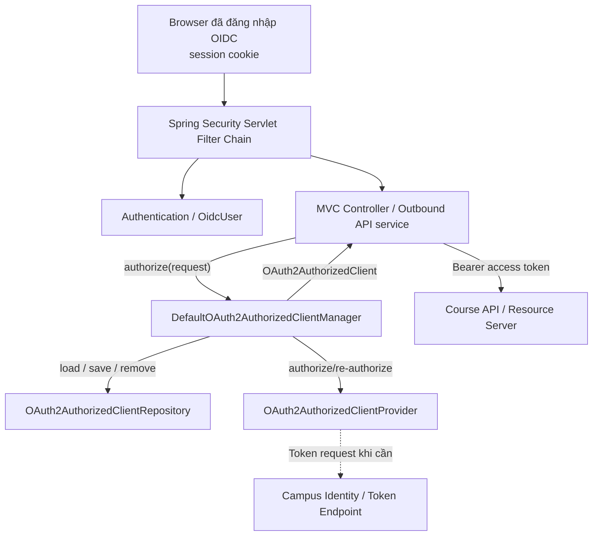
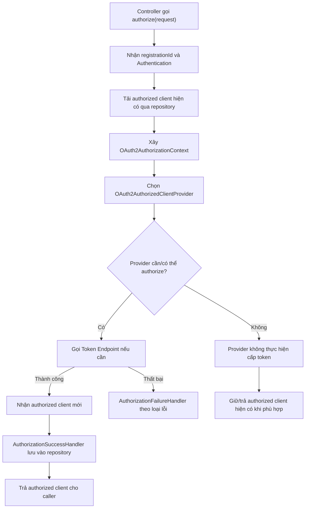
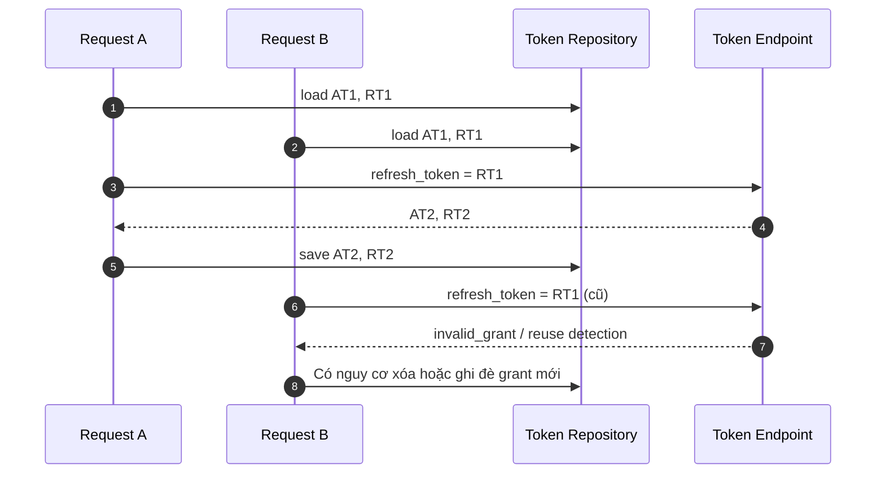

# 15.2. DefaultOAuth2AuthorizedClientManager trong ngữ cảnh Servlet

## Mục tiêu bài học

Sau bài học này, bạn có thể:

- Giải thích **`DefaultOAuth2AuthorizedClientManager`** giải quyết vấn đề gì trong Spring Security OAuth 2.0/OIDC Client trên **Servlet stack**.
- Phân biệt rõ `ClientRegistration`, `OAuth2AuthorizedClient`, `OAuth2AuthorizedClientRepository`, `OAuth2AuthorizedClientProvider`, `OAuth2AuthorizeRequest` và `OAuth2AuthorizedClientManager`.
- Mô tả toàn bộ quá trình **tìm authorized client đã lưu → kiểm tra điều kiện cần cấp/cấp lại token → chọn provider phù hợp → lưu trạng thái sau khi thành công hoặc xử lý thất bại**.
- Tạo bean `DefaultOAuth2AuthorizedClientManager` với các provider `authorization_code`, `refresh_token`, `client_credentials` theo đúng nhu cầu.
- Gọi manager từ **Spring MVC controller** hoặc tầng outbound HTTP client có ngữ cảnh request đã xác thực, và lấy access token đúng người dùng/registration.
- Hiểu vì sao manager dựa trên Servlet cần **`HttpServletRequest` và `HttpServletResponse`** và không nên dùng trực tiếp trong `@Scheduled` job không có request.
- Thiết kế cách lưu authorized client, refresh token rotation, concurrent requests, success/failure handler và cách bảo vệ token.
- Nhận diện những nguyên nhân thường gặp của `null`, `ClientAuthorizationRequiredException`, `invalid_grant`, sai principal và lỗi thiếu request context.

## 1. Bối cảnh: một lần đăng nhập không đủ cho mọi lần gọi API

Giả sử **Learning Portal** là ứng dụng Spring Boot MVC dùng **Campus Identity** làm OpenID Provider. Sinh viên đăng nhập bằng Authorization Code Flow, Spring Security xác minh ID Token và tạo phiên đăng nhập web.

Sau đó Portal cần gọi **Course API** thay mặt sinh viên:

```http
GET /api/me/courses HTTP/1.1
Host: courses.example.org
Authorization: Bearer <access-token>
```

Access token có thời hạn. Người dùng có thể ở trang suốt buổi học, trong khi access token chỉ có hiệu lực vài phút. Ứng dụng cần giải quyết các câu hỏi:

1. Người dùng hiện tại đã có **authorized client** cho registration `campus` chưa?
2. Nếu có, access token còn dùng được không?
3. Nếu access token sắp/hết hạn và có refresh token hợp lệ, có thể gọi Token Endpoint để xin token mới không?
4. Nếu token mới được cấp, trạng thái phải được **lưu lại ở đâu**?
5. Nếu quá trình làm mới thất bại, ứng dụng phải xử lý token đã lưu như thế nào?

Spring Security cung cấp một abstraction:

```java
OAuth2AuthorizedClientManager
```

Với ứng dụng Servlet đang xử lý HTTP request, một implementation quan trọng là:

```java
DefaultOAuth2AuthorizedClientManager
```

Nó **điều phối trạng thái ủy quyền OAuth2 Client** trong ngữ cảnh request, phối hợp repository và provider thích hợp. Nó không phải một Authorization Server, không tự xác thực mật khẩu End-User, không phải Resource Server và không thay thế các quy tắc bảo vệ API.

> **Ý tưởng chính:** `DefaultOAuth2AuthorizedClientManager` là bộ điều phối để ứng dụng Servlet **có được `OAuth2AuthorizedClient` phù hợp** khi cần gọi tài nguyên bằng OAuth2, bao gồm việc sử dụng token đã lưu và, khi được cấu hình, cấp lại token.

### 1.1. Vai trò trong kiến trúc



Không phải request nào cũng cần gọi Token Endpoint. Nếu trạng thái authorized client còn phù hợp, manager có thể trả về client đã có, không thực hiện một HTTP call cấp token mới.

## 2. Những đối tượng cần phân biệt

| Đối tượng | Chịu trách nhiệm chính | Có lưu access token không? |
| --- | --- | --- |
| `ClientRegistration` | Cấu hình OAuth2 Client: client ID, provider, grant, scope, endpoint | Không |
| `ClientRegistrationRepository` | Tìm `ClientRegistration` theo `registrationId` | Không |
| `Authentication` | Danh tính/authorities đang xác thực trong request | Không phải kho token OAuth2 |
| `OAuth2AuthorizedClient` | Trạng thái một client được ủy quyền cho một principal: access token, refresh token tùy chọn | **Có** |
| `OAuth2AuthorizedClientRepository` | Lưu/tải/xóa authorized client trong **ngữ cảnh Servlet HTTP request** | Quản lý đối tượng chứa token |
| `OAuth2AuthorizedClientProvider` | Thực hiện grant/reauthorization khi điều kiện phù hợp | Có thể tạo authorized client mới |
| `OAuth2AuthorizeRequest` | Đầu vào cho manager: registration/authorized client, principal và các attributes | Không phải token store |
| `DefaultOAuth2AuthorizedClientManager` | Điều phối provider, repository, lưu kết quả và xử lý thất bại | Không tự là kho lưu |
| `OAuth2AuthorizedClientService` | Lưu/tải authorized client theo principal name và registration ID, không cần Servlet request | Quản lý đối tượng chứa token |

Một authorized client có thể hiểu như:

```text
OAuth2AuthorizedClient
  registration = campus
  principalName = student-9b71
  accessToken = AT1 (issuedAt / expiresAt / scopes)
  refreshToken = RT1 (nếu OP cấp)
```

Nó khác với `OidcUser`:

```text
OidcUser
  subject = student-9b71
  idToken = kết quả xác thực người dùng
  claims = hồ sơ đã được chia sẻ
```

**ID Token chứng minh kết quả xác thực với OIDC Client; Access Token được dùng để gọi Resource Server.** Không gửi ID Token như một Bearer access token chỉ vì cả hai là JWT.

### 2.1. Registration ID khác Client ID

Ví dụ:

```yaml
registration:
  campus:
    client-id: learning-portal-web
```

- `campus` là **registration ID của Spring**.
- `learning-portal-web` là **OAuth Client ID được OP cấp**.

`OAuth2AuthorizeRequest.withClientRegistrationId("campus")` chọn registration bằng **khóa nội bộ**. Manager sau đó dùng thông tin OAuth Client thật từ registration.

### 2.2. Authorized client gắn với principal

Trong ứng dụng có nhiều người dùng:

```text
student A + campus -> AuthorizedClient A (AT-A / RT-A)
student B + campus -> AuthorizedClient B (AT-B / RT-B)
student A + partner -> AuthorizedClient A/partner
```

Không thể chỉ khóa cache theo `"campus"` rồi dùng chung token giữa hai người. Repository/service phải phân tách đúng theo authentication, session hoặc principal, có xét tenant khi kiến trúc yêu cầu.

## 3. Giao diện `OAuth2AuthorizedClientManager`

API chính:

```java
public interface OAuth2AuthorizedClientManager {

    OAuth2AuthorizedClient authorize(
        OAuth2AuthorizeRequest authorizeRequest
    );
}
```

Tùy API và phiên bản, kết quả có thể là `null` khi provider không hỗ trợ hoặc không thể thực hiện authorization phù hợp; lỗi khi thực hiện grant cũng có thể được ném ra.

Manager nhận một `OAuth2AuthorizeRequest`, thường được xây bằng builder:

```java
OAuth2AuthorizeRequest request =
    OAuth2AuthorizeRequest
        .withClientRegistrationId("campus")
        .principal(authentication)
        .build();

OAuth2AuthorizedClient authorizedClient =
    authorizedClientManager.authorize(request);
```

`authentication` ở đây đại diện cho **người dùng hiện tại** trong request, ví dụ kết quả OIDC Login. Với workload machine-to-machine, principal có thể là danh tính dịch vụ do ứng dụng thiết kế.

### 3.1. Hai cách chỉ định đầu vào

Manager có thể nhận yêu cầu với:

- **`clientRegistrationId`**: tìm registration và authorized client hiện có để quyết định cấp/cấp lại token.
- **`OAuth2AuthorizedClient` hiện có**: xử lý lại trạng thái đã có qua API builder phù hợp.

Trong MVC app đa số trường hợp sử dụng:

```java
.withClientRegistrationId("campus")
```

vì repository sẽ quản lý authorized client tương ứng với registration và principal.

### 3.2. `principal` trong authorize request không phải API audience

Một request:

```java
OAuth2AuthorizeRequest.withClientRegistrationId("campus")
    .principal(authentication)
    .build();
```

không có nghĩa `authentication.getName()` sẽ được đưa vào `aud` của access token. Principal dùng để xác định **đối tượng nhận quyền/khóa lưu trữ**; Authorization Server quyết định token, scope và audience theo grant cùng chính sách.

## 4. `DefaultOAuth2AuthorizedClientManager` dành cho Servlet HTTP request

Constructor quan trọng:

```java
new DefaultOAuth2AuthorizedClientManager(
    ClientRegistrationRepository clientRegistrationRepository,
    OAuth2AuthorizedClientRepository authorizedClientRepository
);
```

Hai dependency có trách nhiệm riêng:

- **ClientRegistrationRepository:** biết cách tìm client config khi được yêu cầu `registrationId`.
- **OAuth2AuthorizedClientRepository:** biết cách tải, lưu hoặc xóa authorized client theo **Authentication và HTTP request/response**.

Điều này khiến `DefaultOAuth2AuthorizedClientManager` phù hợp với:

- Spring MVC controller.
- Service xử lý một request đang đi qua Servlet filter chain.
- Thành phần HTTP client tích hợp với Spring Security trong ngữ cảnh request hiện tại.

Nó không phải lựa chọn tự nhiên cho:

- `@Scheduled` job chạy không có HTTP request.
- Message consumer không có `HttpServletRequest`.
- Workload độc lập chạy sau khi browser/session đã kết thúc.
- WebFlux application với reactive API.

Ở các tình huống không có Servlet context, nên dùng `AuthorizedClientServiceOAuth2AuthorizedClientManager` với `OAuth2AuthorizedClientService`, hoặc abstraction phù hợp loại ứng dụng.

### 4.1. Vì sao cần HTTP request/response?

Trong Spring MVC, HTTP request mang ngữ cảnh liên quan đến:

- `SecurityContext` và `Authentication`.
- HTTP session (khi dùng).
- Cookie phiên và thông tin request hiện tại.
- Repository implementation có thể lưu token theo session hoặc principal.
- `HttpServletResponse` để hỗ trợ các thao tác lưu/xóa phụ thuộc response.

Ví dụ method của repository:

```java
OAuth2AuthorizedClient client =
    repository.loadAuthorizedClient(
        "campus",
        authentication,
        httpServletRequest
    );
```

Và khi lưu:

```java
repository.saveAuthorizedClient(
    authorizedClient,
    authentication,
    httpServletRequest,
    httpServletResponse
);
```

Manager dùng các thao tác này để không yêu cầu mọi caller tự quản lý vòng đời token.

### 4.2. Request context không đồng nghĩa HTTP session

Đối với một user đã đăng nhập:

```text
Browser cookie -> request -> SecurityContext -> Authentication
```

Repository có thể chọn lưu trong **HTTP session**, hoặc một service store theo principal. Vì vậy manager **cần request context để giao tiếp với repository**, nhưng không có nghĩa nó luôn lưu token trực tiếp trong một biến session.

## 5. Cấu hình manager trong Spring Boot

Một ví dụ cấu hình Servlet OAuth2 Client:

```java
@Configuration
class OAuth2ClientManagerConfig {

    @Bean
    OAuth2AuthorizedClientManager authorizedClientManager(
            ClientRegistrationRepository registrations,
            OAuth2AuthorizedClientRepository authorizedClients) {

        OAuth2AuthorizedClientProvider provider =
            OAuth2AuthorizedClientProviderBuilder.builder()
                .authorizationCode()
                .refreshToken()
                .clientCredentials()
                .build();

        DefaultOAuth2AuthorizedClientManager manager =
            new DefaultOAuth2AuthorizedClientManager(
                registrations, authorizedClients
            );

        manager.setAuthorizedClientProvider(provider);
        return manager;
    }
}
```

Các import và dependency được lược bỏ để tập trung vào API. Mã phù hợp với nhóm API Spring Security OAuth2 Client hiện đại; dự án thật cần dùng phiên bản Spring Boot/Spring Security tương thích.

Ở đây:

1. `authorizationCode()` cho phép provider xử lý trường hợp Authorization Code Grant theo ngữ cảnh phù hợp.
2. `refreshToken()` cho phép re-authorization bằng refresh token khi điều kiện đáp ứng.
3. `clientCredentials()` hỗ trợ workload client credentials nếu ứng dụng có registration dạng đó.
4. `setAuthorizedClientProvider` chỉ rõ tập provider mà manager có thể dùng.
5. Constructor gắn manager với repository Servlet để lưu/truy xuất state.

**Chỉ bật các grant thực sự cần thiết và được provider cho phép.** Nếu web Portal chỉ dùng Authorization Code + Refresh Token, không bắt buộc phải cấu hình client credentials.

### 5.1. Lưu ý về bean auto-configuration

Trong Spring Boot, nhiều bean như `ClientRegistrationRepository`, `OAuth2AuthorizedClientRepository`, `OAuth2AuthorizedClientService` hoặc thành phần manager có thể được khởi tạo tự động tùy phiên bản và cấu hình.

Đừng khai báo thêm bean chỉ vì ví dụ có `@Bean` nếu project hiện có một manager đáp ứng đúng nhu cầu. Khi override, hãy xác định bean nào được sử dụng bởi:

- OAuth2 Login.
- Argument resolver `@RegisteredOAuth2AuthorizedClient`.
- Tích hợp `RestClient`, `WebClient` hoặc client HTTP khác.
- Service tùy biến gọi `authorize()`.

Một trong những nguồn lỗi là có **nhiều manager/repository khác nhau** mà các thành phần không chia sẻ cùng authorized client store.

### 5.2. Cấu hình registration OIDC tương ứng

Ví dụ `application.yml`:

```yaml
spring:
  security:
    oauth2:
      client:
        registration:
          campus:
            provider: campus
            client-id: ${CAMPUS_CLIENT_ID}
            client-secret: ${CAMPUS_CLIENT_SECRET}
            client-authentication-method: client_secret_basic
            authorization-grant-type: authorization_code
            redirect-uri: "{baseUrl}/login/oauth2/code/{registrationId}"
            scope:
              - openid
              - profile
              - courses.read
        provider:
          campus:
            issuer-uri: https://login.example.org/realms/campus
```

Giả định Campus Identity thực sự hỗ trợ OIDC Discovery, đã cấp client ID/secret cho backend và cho phép scope/API cần thiết. Các URL trong bài chỉ minh họa. Secret phải lấy qua môi trường hoặc secret manager và không commit trực tiếp vào source.

SecurityFilterChain của Portal:

```java
@Configuration
class WebSecurityConfiguration {

    @Bean
    SecurityFilterChain securityFilterChain(HttpSecurity http) throws Exception {
        http
            .authorizeHttpRequests(auth -> auth
                .requestMatchers("/", "/error", "/assets/**").permitAll()
                .anyRequest().authenticated()
            )
            .oauth2Login(Customizer.withDefaults())
            .oauth2Client(Customizer.withDefaults());

        return http.build();
    }
}
```

`oauth2Login()` triển khai login tương tác, còn `oauth2Client()` bật phần chức năng OAuth2 Client tích hợp phục vụ authorized client. Manager giải quyết việc sử dụng/cấp lại authorized client sau khi đăng nhập.

### 5.3. `oauth2Login()` và manager có vai trò khác nhau

| Việc cần thực hiện | Thành phần chủ yếu |
| --- | --- |
| Redirect người dùng đến OP | OAuth2 Authorization Request Redirect Filter |
| Nhận callback với authorization code | OAuth2 Login Authentication Filter |
| Đổi code lấy token và tạo OIDC principal | OAuth2/OIDC Login authentication |
| Lưu authorized client ban đầu | Cơ chế authorized client của OAuth2 Client/Login |
| Lấy authorized client khi gọi API | Repository hoặc manager |
| Refresh access token khi cần | Manager + `refreshToken()` provider + Token Endpoint |
| Kiểm soát quyền trên Course API | Resource Server và authorization nghiệp vụ |

Đừng dùng `DefaultOAuth2AuthorizedClientManager` như một hàm “login user” thay thế cả Authorization Code Flow.

## 6. Bên trong `authorize()`: manager làm những bước nào?

Một hành trình điển hình khi caller yêu cầu `campus`:



Sơ đồ là mô hình diễn giải: chi tiết code phụ thuộc Spring Security version và provider chain. Ví dụ refresh token provider thường **không refresh** nếu token chưa đến ngưỡng refresh hoặc không có refresh token. Manager không “nhất định” gọi Token Endpoint cho mọi request.

### 6.1. Tải authorized client hiện có

Manager dùng registration ID, principal và HTTP request để tìm trạng thái:

```text
registrationId = campus
principal      = sinh viên A
repository     = authorized client của A/campus nếu tồn tại
```

Nếu user A chưa từng ủy quyền cho `campus`, repository có thể trả `null`. Provider được cấu hình quyết định có thể khởi tạo authorization hay không.

Nếu user A đã đăng nhập qua OIDC, authorized client được lưu sau token exchange thường có sẵn. Nhưng nếu user đang login qua provider khác, không có gì đảm bảo `campus` đã được cấp quyền.

### 6.2. Tạo authorization context

Manager xây context từ:

- ClientRegistration đã được yêu cầu hoặc từ authorized client sẵn có.
- `Authentication`/principal.
- Các attribute do request hoặc context attributes mapper cung cấp.
- Trạng thái access token/refresh token hiện tại.

Một `OAuth2AuthorizedClientProvider` sử dụng context để quyết định có thể authorize, refresh hoặc cấp token theo grant nào.

### 6.3. Delegate cho provider

`OAuth2AuthorizedClientProvider` là abstraction thực thi một hoặc nhiều grant. Provider composite từ builder có thể chọn hành vi theo registration và trạng thái hiện có.

Ví dụ:

```text
Authorized client tồn tại, access token còn hạn
  -> refreshToken provider có thể không làm gì.

Authorized client tồn tại, access token gần hết hạn, có refresh token
  -> refreshToken provider có thể gọi Token Endpoint.

Registration dùng client_credentials, chưa có authorized client
  -> clientCredentials provider có thể xin token lần đầu.

Registration dùng authorization_code nhưng chưa có browser authorization
  -> không thể tự sản sinh authorization code chỉ bằng một HTTP POST.
```

Nếu không có provider nào có thể thực hiện authorization, đừng coi manager là dịch vụ “tạo token bất kể điều kiện”. Có thể cần browser interactive login hoặc xin lại consent.

### 6.4. Lưu khi thành công

Khi manager thực hiện authorization/re-authorization thành công, success handler mặc định thường lưu authorized client qua repository.

Ví dụ trước refresh:

```text
authorized client A/campus
  accessToken = AT1
  refreshToken = RT1
```

Sau Token Endpoint trả token mới:

```text
authorized client A/campus
  accessToken = AT2
  refreshToken = RT2 (nếu provider rotate)
```

Đối tượng cập nhật cần được lưu để request sau không tiếp tục dùng token cũ.

### 6.5. Xử lý lỗi

Khi authorization thất bại, manager có thể gọi `OAuth2AuthorizationFailureHandler`. Với cấu hình mặc định thường thấy, lỗi như `invalid_grant` có thể khiến authorized client đã lưu bị xóa để tránh tái sử dụng grant không hợp lệ.

**Không phải mọi lỗi đều đáng xóa token.** Timeout hoặc HTTP 5xx có thể tạm thời; việc xóa grant có thể khiến người dùng phải đăng nhập lại không cần thiết. Tùy biến failure handler cần phân loại lỗi và bảo toàn chính sách lưu trữ phù hợp.

## 7. Ví dụ controller gọi manager để lấy access token

Một cách sử dụng điển hình là để backend gọi API bằng access token của người dùng hiện tại:

```java
@RestController
class CourseProxyController {

    private final OAuth2AuthorizedClientManager clientManager;
    private final RestClient restClient;

    CourseProxyController(
            OAuth2AuthorizedClientManager clientManager,
            RestClient.Builder restClientBuilder) {
        this.clientManager = clientManager;
        this.restClient = restClientBuilder.build();
    }

    @GetMapping("/api/my-courses")
    String myCourses(Authentication authentication) {

        OAuth2AuthorizeRequest request =
            OAuth2AuthorizeRequest.withClientRegistrationId("campus")
                .principal(authentication)
                .build();

        OAuth2AuthorizedClient client =
            clientManager.authorize(request);

        if (client == null) {
            throw new IllegalStateException(
                "OAuth2 client is not authorized for this request"
            );
        }

        String accessToken =
            client.getAccessToken().getTokenValue();

        return restClient.get()
            .uri("https://courses.example.org/api/me/courses")
            .headers(headers -> headers.setBearerAuth(accessToken))
            .retrieve()
            .body(String.class);
    }
}
```

Ví dụ giả định:

- `/api/my-courses` đã được bảo vệ bởi Spring Security.
- Request hiện tại có `Authentication` của người dùng đăng nhập OIDC.
- Registration `campus` được cấp scope và token phù hợp với Course API.
- `DefaultOAuth2AuthorizedClientManager` đang được gọi **trong ngữ cảnh Servlet request**.
- Các import/dependency và timeout/exception mapping được bổ sung trong ứng dụng thật.

**Không được trả access token về client browser** chỉ vì controller đã nhận được nó. Portal đóng vai backend/BFF có thể gọi Course API ở server và trả DTO đã lọc cho frontend.

### 7.1. Kết quả `null` có ý nghĩa gì?

Manager có thể không trả một authorized client khi không thể thực hiện authorization theo provider/context. Một số lỗi grant thay vì `null` sẽ xuất hiện dưới dạng exception.

Trong ứng dụng thật, nên phân biệt:

- Không có grant cần thiết → điều hướng người dùng đến authorization flow phù hợp.
- Refresh token bị từ chối → cần đăng nhập/xin quyền lại.
- Token Endpoint tạm thời lỗi → thông báo lỗi phụ thuộc hệ thống, có thể retry phù hợp.
- Registration không tồn tại → lỗi cấu hình.
- Thiếu Servlet request context → lỗi sử dụng manager sai môi trường.

Không viết logic “nếu manager trả null thì dùng một access token dự phòng của user khác”.

### 7.2. Vì sao không lấy token trực tiếp từ OIDC principal?

`OidcUser` là danh tính được xác thực. Một `OidcUser` có `OidcIdToken` và claims, không phải nơi quản lý toàn bộ vòng đời access token dành cho Resource Server.

Manager và authorized client store phụ trách token ủy quyền. Phân tách:

```text
@AuthenticationPrincipal OidcUser
  -> danh tính đã đăng nhập (iss, sub, claims)

OAuth2AuthorizedClientManager
  -> access token/refresh token của registration + principal

Course API
  -> kiểm tra Bearer access token và quyền truy cập API
```

## 8. Spring MVC và `@RegisteredOAuth2AuthorizedClient`

Spring Security cung cấp một cách ngắn gọn trong controller:

```java
@RegisteredOAuth2AuthorizedClient("campus")
OAuth2AuthorizedClient authorizedClient
```

Ví dụ:

```java
@GetMapping("/api/me/token-status")
Map<String, Object> status(
        @RegisteredOAuth2AuthorizedClient("campus")
        OAuth2AuthorizedClient authorizedClient) {

    return Map.of(
        "registrationId",
        authorizedClient.getClientRegistration().getRegistrationId(),
        "expiresAt",
        String.valueOf(
            authorizedClient.getAccessToken().getExpiresAt()
        )
    );
}
```

Đây chỉ là endpoint minh họa; không nên công khai metadata token nếu không cần, và **không bao giờ** trả `getTokenValue()` ra API debug.

Argument resolver cho annotation có thể sử dụng authorized client manager để tìm hoặc authorize client theo cấu hình. Vì vậy nó không nhất thiết giống việc chỉ gọi `repository.loadAuthorizedClient(...)`.

| Cách truy cập | Hành vi nổi bật |
| --- | --- |
| `repository.loadAuthorizedClient(...)` | Chỉ **tải đối tượng đã lưu** |
| `manager.authorize(...)` | Có thể **authorize/refresh**, xử lý provider/handler và lưu kết quả |
| `@RegisteredOAuth2AuthorizedClient` | Resolve client cho controller, có thể dùng manager theo cấu hình |
| `AuthorizedClientService.loadAuthorizedClient(...)` | Chỉ tải theo principal name và registration, không cần request |

Nếu hệ thống muốn kiểm soát rõ lỗi refresh và API call, việc gọi manager trong một service chuyên trách thường giúp tập trung logic hơn so với đưa mọi xử lý vào controller.

## 9. `OAuth2AuthorizedClientProvider`: chọn đúng grant

Manager không tự biết bạn muốn hỗ trợ những grant nào. `OAuth2AuthorizedClientProviderBuilder` giúp ghép các provider phù hợp.

Ví dụ:

```java
OAuth2AuthorizedClientProvider provider =
    OAuth2AuthorizedClientProviderBuilder.builder()
        .authorizationCode()
        .refreshToken()
        .build();
```

### 9.1. Authorization Code provider

Authorization Code Grant yêu cầu browser authorization step:

```text
Browser -> Authorization Server
      -> Callback có authorization code
      -> Client đổi code lấy token
```

Không thể chỉ gọi:

```java
manager.authorize(
    OAuth2AuthorizeRequest.withClientRegistrationId("campus")
        .principal(authentication)
        .build()
);
```

trong một job bất kỳ và mong nhận token authorization code cho người dùng chưa đăng nhập. Nếu không có authorization phù hợp, hệ thống cần tương tác browser/authorization request và các cơ chế redirect của Spring Security.

Với OIDC Login, việc trao đổi code ban đầu thường đã được `oauth2Login()` xử lý, và authorized client được lưu sau login.

### 9.2. Refresh Token provider

Provider `refreshToken()` có thể dùng refresh token để xin access token mới khi cần:

```text
Trước:
  AT1 hết hạn / gần hết hạn
  RT1 hợp lệ

Token Endpoint:
  grant_type=refresh_token
  refresh_token=RT1
  client authentication theo registration

Sau:
  AT2 và có thể RT2
```

Refresh token không nhất thiết được cấp cho mọi client. OIDC provider có thể yêu cầu `offline_access` hoặc chính sách riêng để cấp refresh token; việc xin scope không bảo đảm provider sẽ cấp.

Một số token response chỉ trả access token mới mà không có refresh token mới; trong trường hợp đó logic quản lý phải giữ refresh token phù hợp theo hành vi provider. Với rotation, phải lưu RT2 chính xác.

### 9.3. Client Credentials provider

Provider `clientCredentials()` hỗ trợ grant của **ứng dụng**, không phải token thay mặt một End-User:

```yaml
registration:
  course-sync:
    authorization-grant-type: client_credentials
    client-id: ${SYNC_CLIENT_ID}
    client-secret: ${SYNC_CLIENT_SECRET}
    scope:
      - courses.sync
```

Client Credentials thường phù hợp cho backend-to-backend. Một service đồng bộ dữ liệu không có browser sẽ thuận tiện hơn khi dùng **`AuthorizedClientServiceOAuth2AuthorizedClientManager`**, thay vì phụ thuộc vào Servlet request.

### 9.4. Không nhầm `refreshToken()` với timer tự động

Provider thường đánh giá trạng thái khi manager **được gọi**. Không có nghĩa Spring tạo một background timer quét mọi token và refresh trước khi người dùng vào trang.

```text
09:00: Login, có AT1
09:04: Không có request, manager không được gọi
09:10: Browser gọi /api/my-courses
09:10: authorize() phát hiện cần refresh nếu provider/config cho phép
```

Sự trì hoãn làm mới đến lúc có request là hành vi thường phù hợp cho web app; nhu cầu proactive/background cần thiết kế khác.

## 10. HTTP request context: phần dễ sử dụng sai nhất

`DefaultOAuth2AuthorizedClientManager` dùng repository Servlet có chữ ký:

```java
OAuth2AuthorizedClient loadAuthorizedClient(
    String clientRegistrationId,
    Authentication principal,
    HttpServletRequest request
);
```

Khi chạy dưới `DispatcherServlet` với Spring Security, request/response có thể được lấy từ Servlet request context hoặc cung cấp qua context attributes theo API phiên bản đang dùng.

Nhưng trong:

```java
@Scheduled
void pollCourses() {
    // Không có browser request.
}
```

không có sẵn một request/response tương ứng. Nếu gọi manager Servlet mà không truyền hoặc không có context cần thiết, có thể gặp lỗi thiếu request hoặc không tải được authorized client.

**Không tạo một fake `HttpServletRequest` cho job nền chỉ để ép dùng manager Servlet.** Hãy lựa chọn manager/service được thiết kế cho bài toán không có HTTP request.

### 10.1. Context attributes mapper

Manager có hook:

```java
manager.setContextAttributesMapper(...);
```

Hook này biến các attributes từ `OAuth2AuthorizeRequest` thành map thuộc tính dùng trong `OAuth2AuthorizationContext`, để các provider đọc giá trị cần thiết.

Các attribute có thể phục vụ một số grant hoặc provider/customization phụ thuộc context. Đây **không phải** cơ chế để thay issuer, bypass authentication hoặc tự cấp quyền.

Nếu muốn sửa mapping, cần nắm provider nào sẽ đọc những key nào và giữ nguyên các giá trị cần thiết của default behavior. Cấu hình sai có thể khiến một provider không thể thực hiện authorization.

### 10.2. Truyền request/response trực tiếp

Một số API/integration cho phép gắn `HttpServletRequest` và `HttpServletResponse` vào attributes của `OAuth2AuthorizeRequest` khi dùng manager trong logic không trực tiếp nằm trong controller nhưng **vẫn** có request Servlet hợp lệ.

Vì API/constant có thể khác theo phiên bản Spring Security, cách an toàn là dùng integration chính thức của version hiện tại thay vì tự đặt các chuỗi attribute key tùy ý.

Nguyên tắc:

- Request/response phải thuộc **giao dịch HTTP thật** đang thực hiện.
- Principal phải đúng người dùng/grant.
- Repository cần sử dụng cùng store với ứng dụng login.
- Không đưa request/response object vào cache hoặc giữ lâu sau request.

## 11. Lựa chọn `OAuth2AuthorizedClientRepository`

Manager cần repository nhưng **không áp đặt** một chiến lược lưu trữ duy nhất.

### 11.1. `HttpSessionOAuth2AuthorizedClientRepository`

Lưu authorized client trong HTTP session:

```java
@Bean
OAuth2AuthorizedClientRepository authorizedClientRepository() {
    return new HttpSessionOAuth2AuthorizedClientRepository();
}
```

Hữu ích khi grant chỉ cần sống trong phiên browser.

Lưu ý:

- Khi session hết hạn hoặc bị invalidate, authorized client trong session cũ không còn truy cập được.
- Trong môi trường nhiều instance, cần chiến lược shared session, sticky session hoặc cơ chế phù hợp.
- Session store chứa token nhạy cảm, cần bảo vệ.
- Xóa session local không nhất thiết thu hồi token ở Authorization Server.

### 11.2. `AuthenticatedPrincipalOAuth2AuthorizedClientRepository`

Implementation này thường dùng:

- **`OAuth2AuthorizedClientService`** cho principal đã xác thực.
- Repository khác, thường dựa vào session, khi principal không được xác thực theo tiêu chí implementation.

Ví dụ:

```java
@Bean
OAuth2AuthorizedClientRepository authorizedClientRepository(
        OAuth2AuthorizedClientService service) {

    return new AuthenticatedPrincipalOAuth2AuthorizedClientRepository(service);
}
```

Đặc điểm quan trọng: token cho authenticated principal có thể được lưu theo **registration ID và principal name** trong service store, thay vì chỉ trong phiên của browser.

Nếu dùng `JdbcOAuth2AuthorizedClientService`, trạng thái token có thể tồn tại lâu hơn session web, tùy chính sách dữ liệu và cleanup. Việc logout khỏi browser không mặc nhiên đảm bảo token ở service store được xóa.

### 11.3. So sánh chiến lược lưu

| Tiêu chí | HTTP session repository | Principal + authorized client service |
| --- | --- | --- |
| Khóa chính | Ngữ cảnh phiên/session | Registration ID + principal name |
| Phù hợp | Web login chỉ dùng token khi còn phiên | Token cần được quản lý tách khỏi session khi cho phép |
| Nhiều instance | Cần shared session/sticky route theo mô hình | Cần service store dùng chung, ví dụ JDBC |
| Logout | Invalidate session có thể loại local token | Có thể cần gọi remove/revoke riêng |
| Background access | Không trực tiếp | Service manager có thể tận dụng đúng grant |
| Rủi ro | Session hijack, session store bị lộ | Database token leakage, va chạm principal name, retention |

Không dùng email làm khóa principal một cách vô điều kiện: email có thể đổi, trùng ở các OP khác nhau. Trong OIDC, một danh tính thường cần `(issuer, subject)` để liên kết an toàn với user nội bộ.

## 12. Success handler và failure handler

`DefaultOAuth2AuthorizedClientManager` cung cấp cơ chế xử lý sau khi authorization thành công/thất bại.

### 12.1. Thành công

Khi provider tạo authorized client mới, success handler có thể lưu nó vào repository. Hành vi mặc định của manager thường đã đảm nhiệm điều này.

Một nhu cầu tùy biến có thể là:

- Ghi metric `refresh_success` theo registration.
- Audit loại grant đã được dùng mà không log token.
- Bổ sung quy tắc lưu đặc biệt trong store nhiều tenant.

**Cảnh báo:** Khi thay authorization success handler, cần bảo đảm **vẫn lưu updated authorized client**. Nếu chỉ ghi log thành công và quên persistence, các request sau có thể tiếp tục đọc access token cũ hoặc refresh token đã bị rotate.

### 12.2. Thất bại

Authorization failure handler có thể:

- Xóa authorized client không còn hợp lệ nếu grant đã bị OP từ chối.
- Ghi metric theo loại lỗi.
- Thông báo caller cần re-authorization.
- Bảo toàn state trong một số lỗi mạng tạm thời.

Ví dụ phân loại:

| Lỗi | Khả năng | Hướng xử lý |
| --- | --- | --- |
| `invalid_grant` khi refresh | Refresh token hết hiệu lực, bị thu hồi hoặc reuse | Xóa/tránh dùng grant cũ, yêu cầu re-authorization |
| `invalid_client` | Client ID/secret/method không đúng | Sửa registration và Token Endpoint client authentication |
| HTTP 5xx | Token Endpoint tạm lỗi | Retry có giới hạn/circuit breaker theo chính sách |
| Timeout sau refresh request | Có thể server đã rotate token nhưng client không nhận response | Xử lý trạng thái không chắc chắn; tránh retry mù với token cũ |
| Thiếu authorized client | Chưa có authorization hoặc store không tìm thấy | Khởi tạo authorization phù hợp hoặc thông báo cần login |
| Thiếu Servlet context | Gọi manager ở môi trường sai | Chuyển sang service manager hoặc integration có request thật |

Không nên cấu hình “xóa authorized client cho mọi exception” nếu mất kết nối mạng cũng khiến người dùng phải đăng nhập lại hàng loạt.

## 13. Refresh token rotation và concurrent requests

Một tình huống phổ biến trong web app: người dùng mở nhiều tab, mỗi tab cùng lúc gọi API khi access token gần hết hạn.

Trạng thái ban đầu:

```text
Authorized client:
  accessToken = AT1 (hết hạn)
  refreshToken = RT1
```

Hai request A, B cùng đọc token từ repository:



Tùy provider, refresh token rotation và reuse detection có thể làm RT1 mất hiệu lực ngay sau khi A thành công. Request B sử dụng RT1 cũ có thể bị từ chối; trong một số chính sách, toàn bộ token family có thể bị thu hồi.

`DefaultOAuth2AuthorizedClientManager` cung cấp abstraction authorize và persistence, **không phải distributed lock** để đảm bảo chỉ một request refresh mỗi grant ở mọi JVM.

### 13.1. Giải pháp thiết kế

Có thể cân nhắc:

- **Single-flight refresh** theo registration + principal/tenant: các request chờ một tác vụ refresh chung.
- **Optimistic concurrency/version** khi ghi token store: tránh ghi đè state mới bằng state cũ.
- **Lock phân tán** khi chạy nhiều instance và cùng dùng shared token store.
- **Đọc lại phiên bản token mới** sau lỗi `invalid_grant` do race nếu có cơ sở an toàn theo chính sách.
- Kiểm soát retry khi token endpoint timeout.
- Không mở rộng thời hạn refresh token hoặc bỏ reuse detection để tránh xử lý cạnh tranh.

Những kỹ thuật này là trách nhiệm kiến trúc ứng dụng/authorized client store. Không mặc định mọi implementation repository/service có sẵn đồng bộ đa node.

### 13.2. Không bỏ qua refresh token mới

Nếu OP trả:

```text
AT2 + RT2
```

mà ứng dụng chỉ lưu `AT2` và vẫn giữ `RT1`, lần refresh kế tiếp có thể thất bại. Hãy bảo đảm authorized client cập nhật được lưu nguyên vẹn theo thư viện và chính sách của provider.

## 14. Khi nào dùng `AuthorizedClientServiceOAuth2AuthorizedClientManager`?

So sánh hai implementation:

| Tiêu chí | `DefaultOAuth2AuthorizedClientManager` | `AuthorizedClientServiceOAuth2AuthorizedClientManager` |
| --- | --- | --- |
| Bối cảnh | **Servlet request context** | Ngoài HTTP request hoặc service-level |
| State store | `OAuth2AuthorizedClientRepository` | `OAuth2AuthorizedClientService` |
| Phụ thuộc `HttpServletRequest/Response` | Có, qua repository/context | Không |
| Phù hợp | MVC controller, web request, outbound API call của user | Scheduled job, message listener, batch, service |
| Hỗ trợ refresh/token grants | Qua configured provider | Qua configured provider |
| Principal | Authentication đang xử lý request hoặc principal chỉ định đúng | Tên/danh tính principal do caller quản lý |
| Cần quản lý token an toàn | Có | Có |

Ví dụ manager dành cho job nền:

```java
@Bean
OAuth2AuthorizedClientManager backgroundClientManager(
        ClientRegistrationRepository registrations,
        OAuth2AuthorizedClientService service) {

    OAuth2AuthorizedClientProvider provider =
        OAuth2AuthorizedClientProviderBuilder.builder()
            .clientCredentials()
            .build();

    AuthorizedClientServiceOAuth2AuthorizedClientManager manager =
        new AuthorizedClientServiceOAuth2AuthorizedClientManager(
            registrations, service
        );

    manager.setAuthorizedClientProvider(provider);
    return manager;
}
```

Trong `@Scheduled` job, có thể dùng principal ổn định cho workload:

```java
OAuth2AuthorizeRequest request =
    OAuth2AuthorizeRequest.withClientRegistrationId("course-sync")
        .principal("course-sync-job")
        .build();

OAuth2AuthorizedClient client =
    backgroundClientManager.authorize(request);
```

Ví dụ này chỉ thích hợp khi registration `course-sync` cho phép `client_credentials` và quyền tương ứng. Đây không phải cách giả lập End-User OIDC login.

### 14.1. Không chuyển token user sang job nền bằng cách dùng chung principal tùy ý

Một ứng dụng có thể muốn thực hiện offline processing thay mặt người dùng; nếu OP cho phép offline access/refresh token, cần consent, lưu bền vững đúng danh tính, chính sách revocation và bảo vệ grant.

Không dùng:

```text
principal = "admin"
```

cho mọi user delegated token chỉ để job tải được một authorized client. Việc này có thể làm sai đối tượng nhận quyền và lộ dữ liệu. Dùng principal identity cụ thể, đã được ánh xạ tin cậy, và policy thích hợp.

## 15. Đăng nhập, logout và authorized client là ba vòng đời liên quan nhưng khác nhau

Trong một ứng dụng OIDC:

```text
OIDC Login
    -> Spring Security Authentication
    -> Session/SecurityContext
    -> OAuth2AuthorizedClient được lưu

Sau đó:
    -> Manager lấy/làm mới OAuth2AuthorizedClient
    -> Dùng Access Token gọi Course API
```

Khi logout:

- Session local có thể bị hủy.
- `Authentication`/`SecurityContext` local có thể bị xóa.
- Nếu token lưu trong session, authorized client có thể mất theo session.
- Nếu token lưu trong persistent service, record token có thể vẫn tồn tại cho đến khi được xóa theo chính sách.
- OP có thể vẫn giữ SSO session và refresh token nếu không có quy trình logout/revocation phù hợp.

**Remove authorized client ở repository khác với token revocation tại Authorization Server**. Nếu cần thu hồi grant, tích hợp revocation endpoint hoặc cơ chế do OP cung cấp, có kiểm soát authorization và lỗi.

### 15.1. Không dùng manager như công cụ logout

`authorize()` được thiết kế để có được authorized client, không phải để thu hồi grant. Dùng repository/service remove và OP revocation theo nhu cầu. Tránh vô tình gọi `authorize()` để “kiểm tra token” trong endpoint logout, vì có thể refresh token ngay trước khi xóa nó.

## 16. Security: điều manager làm và không làm

`DefaultOAuth2AuthorizedClientManager` giúp điều phối **OAuth2 Client authorization**. Nó không thể thay thế:

- Authentication filter và OIDC ID Token validation cho phiên đăng nhập.
- Kiểm tra access token tại Resource Server.
- Quy tắc `@PreAuthorize`, role/scope và ownership của Course API.
- Cookie security, CSRF protection, session fixation protection.
- Bảo vệ secret/refresh token ở database/KMS/secret manager.
- Cơ chế khóa phân tán khi refresh token bị rotation.
- Thiết kế tenant isolation và audit.

### 16.1. Token chỉ đi đến đúng Resource Server

Một access token nhận được qua manager không tự phù hợp với mọi API.

Ví dụ:

```text
AT for Course API
  scopes: courses.read
  audience: course-api
```

Không dùng token này để gọi một API khác mà không có quyền. API đích có trách nhiệm kiểm tra signature/introspection, issuer, audience, expiration và permissions theo profile của nó.

### 16.2. Không trả token cho frontend

Tránh:

```java
@GetMapping("/api/token")
String token(...) {
    return authorizedClient.getAccessToken().getTokenValue();
}
```

Một BFF/server-side client nên dùng token **ở backend** để gọi API và trả dữ liệu nghiệp vụ đã lọc. Nếu frontend là public client trực tiếp, đó là một kiến trúc OAuth khác cần thiết kế token và browser security riêng.

### 16.3. Dữ liệu cần bảo vệ trong logs

Có thể log an toàn một số metadata:

```text
registrationId = campus
principalReference = hashed/internal-id
authorizationAttempt = refresh
result = success
accessTokenExpiry = <timestamp>
correlationId = <safe-id>
```

Không log:

```text
access_token
refresh_token
client_secret
raw ID Token
client_assertion
authorization code
HTTP Authorization header
session cookie
```

Dù access token hết hạn, việc lộ refresh token có thể cho phép xin access token mới. Token store phải được bảo vệ theo mức nhạy cảm của credential, không chỉ như một cache hiệu năng.

## 17. Chẩn đoán các lỗi thường gặp

| Hiện tượng | Nguyên nhân có thể | Hướng xử lý |
| --- | --- | --- |
| `manager.authorize()` trả `null` | Provider không hỗ trợ grant/trạng thái, registration chưa được ủy quyền | Kiểm tra provider chain, grant và flow đã hoàn tất |
| Không tìm thấy registration | `registrationId` không tồn tại hoặc dùng nhầm `clientId` | Kiểm tra key dưới `spring.security.oauth2.client.registration` |
| Không có authorized client sau login | Repository/store khác nhau, principal name khác hoặc session mất | Đối chiếu cấu hình login, repository và Authentication |
| Access token hết hạn nhưng không refresh | Thiếu `refreshToken()` provider, không có refresh token hoặc không đến điều kiện | Kiểm tra provider và Token Endpoint response |
| `ClientAuthorizationRequiredException` | Cần interactive authorization code flow | Chuyển người dùng tới authorization flow; không tự tạo code |
| `invalid_grant` khi refresh | Refresh token hết hạn, bị thu hồi, rotate/reuse | Re-authorization, xử lý state mới và đồng bộ concurrency |
| `invalid_client` tại Token Endpoint | Secret, private key hoặc client authentication method sai | Kiểm tra ClientRegistration và chính sách OP |
| Job nền lỗi do thiếu servlet request | Dùng `DefaultOAuth2AuthorizedClientManager` ngoài HTTP request | Dùng `AuthorizedClientServiceOAuth2AuthorizedClientManager` |
| Người A gọi API bằng token người B | Cache/store phân tách principal không đúng | Kiểm tra binding user/tenant/registration và concurrency |
| Request A refresh thành công, B lại xóa token | Refresh token rotation race và failure handler | Single-flight/locking/versioning; phân loại lỗi |
| Sau logout token vẫn ở DB | Lưu bằng service store có vòng đời khác session | Định nghĩa remove/revocation policy |
| Token mới không được dùng ở request sau | Custom success handler quên save hoặc instance dùng store khác | Kiểm tra persistence và multi-node store |
| `@RegisteredOAuth2AuthorizedClient` không có token | Request principal/registration/provider không phù hợp | Kiểm tra resolver, manager bean và OAuth2 login |
| `403` ở Resource Server dù manager trả token | Token không có scope/role/ownership cần thiết | Sửa quyền/consent/API authorization, không nới lỏng manager |
| `401` ở Resource Server | Token sai issuer/audience, hết hạn hoặc không hợp lệ | Kiểm tra token cấp cho đúng API và Resource Server validation |

### 17.1. Quy trình điều tra theo từng lớp

1. **Registration:** `registrationId`, `clientId`, grant type, Token Endpoint và scopes có đúng không?
2. **Authentication:** Request thuộc user/service principal nào? Có đúng security chain không?
3. **Repository:** Authorized client của registration và principal đó đang lưu ở đâu?
4. **Provider:** Grant nào được cấu hình? Access token đã hết hạn? Có refresh token không?
5. **Token Endpoint:** Authorization Server trả lỗi thuộc loại nào?
6. **Persistence:** Token/refresh token mới đã được lưu chưa? Có nhiều instance không?
7. **Resource Server:** Access token được chấp nhận không, và user có quyền nghiệp vụ không?

Tránh sửa lỗi manager bằng cách tắt xác minh token ở API hoặc sử dụng client secret/token của tài khoản khác.

## 18. Bài tập thực hành

### Bài tập 1 — Chọn đúng manager

Hệ thống có:

- Controller Servlet `/api/my-courses` nhận browser session của sinh viên.
- Scheduled job `course-sync` chạy hàng giờ và dùng Client Credentials.

**Câu hỏi:** Dùng manager nào?

**Đáp án:** `DefaultOAuth2AuthorizedClientManager` với repository Servlet cho controller; `AuthorizedClientServiceOAuth2AuthorizedClientManager` với service store cho job nền.

### Bài tập 2 — Phân biệt repository và manager

Cho:

```java
OAuth2AuthorizedClient client =
    repository.loadAuthorizedClient("campus", auth, request);
```

**Câu hỏi:** Nếu access token đã hết hạn, lời gọi trên có tự xin token mới không?

**Đáp án:** Không. Repository chỉ tải state. Cần manager/provider có thể làm mới theo grant và lưu phiên bản cập nhật.

### Bài tập 3 — Vì sao cần `refreshToken()`?

Cấu hình chỉ có:

```java
OAuth2AuthorizedClientProviderBuilder.builder()
    .authorizationCode()
    .build();
```

Sau login, Portal có refresh token nhưng access token hết hạn.

**Câu hỏi:** Có nên mong manager tự refresh không?

**Đáp án:** Không. Phải cấu hình refresh token provider hoặc cơ chế làm mới khác phù hợp, và OP phải cho phép refresh grant.

### Bài tập 4 — Kết quả từ manager

Có hai người dùng A và B, cùng registration `campus`. Controller gọi:

```java
manager.authorize(
    OAuth2AuthorizeRequest.withClientRegistrationId("campus")
        .principal(authentication)
        .build()
);
```

**Câu hỏi:** `authentication` phải đại diện cho ai?

**Đáp án:** Principal được xác thực của **request hiện tại**. Không sử dụng Authentication của user khác hoặc một service principal chung cho delegated user grants.

### Bài tập 5 — Refresh token rotation

Hai request cùng có RT1. A đổi được RT2, B vẫn gửi RT1 và bị `invalid_grant`.

**Câu hỏi:** Chỉ thay manager bean có đủ để loại race không?

**Đáp án:** Không. Cần cơ chế concurrency control ở application/token store, phân loại lỗi và cập nhật đúng phiên bản token.

### Bài tập 6 — Background job gọi manager Servlet

Một method `@Scheduled` dùng `DefaultOAuth2AuthorizedClientManager` nhưng không có `HttpServletRequest`.

**Câu hỏi:** Nên xử lý thế nào?

**Đáp án:** Sử dụng manager dựa trên `OAuth2AuthorizedClientService`, với registration/grant/principal phù hợp cho job, thay vì giả lập request browser.

### Bài tập 7 — Xóa authorized client sau logout

Portal lưu authorized client qua JDBC service store; logout đã xóa HTTP session nhưng refresh token vẫn còn ở DB.

**Câu hỏi:** Có phải Spring Security đã không logout?

**Đáp án:** Không nhất thiết. Local session, authorized client persistence và OP revocation là các vòng đời khác nhau. Cần thiết kế chính sách xóa/revoke rõ ràng.

### Bài tập 8 — Không tiết lộ token

Một developer muốn trả:

```json
{
  "accessToken": "<raw-token>",
  "refreshToken": "<raw-refresh-token>"
}
```

từ controller để frontend gọi API.

**Câu hỏi:** Với mô hình backend/BFF, cách phù hợp hơn là gì?

**Đáp án:** Giữ token tại backend, manager cấp/refresh theo request, backend gọi Resource Server bằng Bearer token rồi trả DTO nghiệp vụ đã lọc. Không dùng API debug để phát lộ credential.

## 19. Câu hỏi tự kiểm tra

**1. `DefaultOAuth2AuthorizedClientManager` có phải Token Endpoint của Authorization Server không?**

> Không. Đây là thành phần Spring Security phía Client, điều phối việc tìm/cấp/cấp lại authorized client.

**2. Vì sao constructor nhận `ClientRegistrationRepository` và `OAuth2AuthorizedClientRepository`?**

> Một bên cung cấp cấu hình client, bên còn lại cung cấp trạng thái authorized client đã được lưu gắn với principal và HTTP request.

**3. `authorize()` có luôn gọi Token Endpoint không?**

> Không. Nếu token hiện có vẫn phù hợp hoặc provider không cần/có thể thực hiện authorization, không nhất thiết có token HTTP request.

**4. `OAuth2AuthorizedClientProvider` có vai trò gì?**

> Xử lý những grant/reauthorization được cấu hình, ví dụ authorization code, refresh token hoặc client credentials.

**5. Manager có tự làm mới token khi không có request nào không?**

> Không theo nghĩa timer mặc định. Nó thường xét và cấp lại token khi caller gọi `authorize()`.

**6. Vì sao manager Servlet không phù hợp cho scheduled job?**

> Vì nó được thiết kế để dùng authorized client repository có HTTP request/response context, trong khi scheduled job thường không có Servlet request.

**7. `OAuth2AuthorizedClient` khác `OidcUser` ở đâu?**

> Authorized client chứa OAuth2 token state; OidcUser đại diện cho danh tính OIDC và claims đã xác thực.

**8. Khi refresh thành công và OP trả refresh token mới, điều gì quan trọng?**

> Phải lưu authorized client mới đúng cách, tránh giữ refresh token cũ và giải quyết race nếu có nhiều request đồng thời.

**9. Có thể gọi `repository.loadAuthorizedClient(...)` để tự refresh không?**

> Không. Repository chỉ quản lý lưu/tải/xóa; manager phối hợp provider để cấp/cấp lại token.

**10. Manager có bảo đảm người dùng đủ quyền đọc một bản ghi trong Course API không?**

> Không. Resource Server và service nghiệp vụ phải kiểm tra access token, scope, role và ownership của tài nguyên.

---

## Ghi nhớ

**`DefaultOAuth2AuthorizedClientManager`** là implementation của **`OAuth2AuthorizedClientManager`** dành cho **Spring Security OAuth2/OIDC Client trong ngữ cảnh Servlet HTTP request**. Nó phối hợp `ClientRegistrationRepository`, `OAuth2AuthorizedClientRepository` và chuỗi `OAuth2AuthorizedClientProvider` để **lấy authorized client hiện có, thực hiện re-authorization khi cần, lưu token mới và xử lý lỗi**. Với web controller đã đăng nhập OIDC, hãy dùng manager để lấy access token phù hợp cho API và giữ token ở backend; với background job không có HTTP request, chọn **`AuthorizedClientServiceOAuth2AuthorizedClientManager`**. Trong sản xuất, cần bảo vệ repository, phân tách principal/tenant, xử lý refresh token rotation, success/failure handler, logout/revocation và quyền truy cập tài nguyên độc lập với việc token được cấp thành công.
