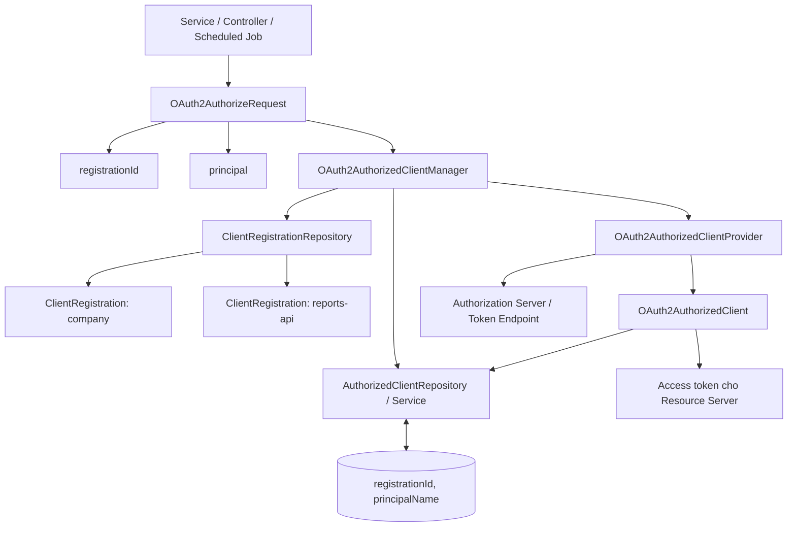

# 15.6. Chọn registration ID và principal khi yêu cầu authorize

## 1. Bài toán: cùng một Client Manager, nhưng lấy token cho ai và ứng dụng nào?

Trong **Spring Security OAuth 2.0 / OIDC Client**, một hệ thống có thể quản lý nhiều đăng ký OAuth2 Client (`ClientRegistration`) và nhiều danh tính yêu cầu cấp quyền. Khi cần lấy, sử dụng hoặc làm mới access token, ứng dụng không thể chỉ gọi một phương thức chung chung kiểu “lấy token mới nhất”. Nó phải chỉ rõ:

1. **`registrationId`:** chọn cấu hình OAuth2 Client nào, ví dụ `company`, `partner` hay `reports-api`.
2. **`principal`:** authorized client đó thuộc danh tính/ngữ cảnh nào, ví dụ nhân viên đã đăng nhập hoặc một principal kỹ thuật ổn định cho background job.

Spring Security đưa hai lựa chọn này vào **`OAuth2AuthorizeRequest`**, là đối tượng được truyền đến **`OAuth2AuthorizedClientManager.authorize(...)`**.

Giả sử ứng dụng **Employee Portal** có ba luồng:

- Nhân viên đăng nhập bằng OIDC tại OP công ty, sau đó backend gọi API thay mặt nhân viên qua registration `company`.
- Người dùng thuộc đối tác đăng nhập bằng OIDC tại OP khác, dùng registration `partner`.
- Scheduled job gọi Reports API với `client_credentials`, dùng registration `reports-api` và principal kỹ thuật `reports-batch`.

Mỗi luồng có thể xin access token, nhưng **không được trộn token của các nhà cung cấp, principal hoặc mục đích khác nhau**.

> **Điểm cốt lõi:** `registrationId` chọn **OAuth2 Client configuration**, còn `principal` là thông tin **ngữ cảnh danh tính** mà manager/service dùng khi tra cứu, lưu và cấp lại authorized client. Cả hai phải xuất phát từ nguồn đáng tin cậy và ổn định theo chính sách của ứng dụng.

Bài học thuộc chương **“15. Client Manager”**, tập trung vào cách xây yêu cầu authorize chính xác, không nhầm `OAuth2AuthorizeRequest` với authorization request gửi qua browser đến Authorization Endpoint.

## 2. Các khái niệm nền tảng

### 2.1. `OAuth2AuthorizedClientManager` làm gì?

`OAuth2AuthorizedClientManager` là abstraction điều phối vòng đời của **authorized client** khi ứng dụng cần quyền truy cập tài nguyên. Nó phối hợp:

- `ClientRegistrationRepository` để tìm registration.
- `OAuth2AuthorizedClientRepository` hoặc `OAuth2AuthorizedClientService` để tìm token đã lưu.
- `OAuth2AuthorizedClientProvider` để thực hiện những grant được hỗ trợ, chẳng hạn Authorization Code, Client Credentials hoặc Refresh Token.
- Các success/failure handlers để lưu hoặc xử lý authorized client khi cấp quyền thành công/thất bại.

Một lệnh authorize có thể dẫn đến:

- Trả về `OAuth2AuthorizedClient` đã tồn tại, còn phù hợp.
- Lấy token mới từ Authorization Server khi grant được hỗ trợ và đủ điều kiện.
- Refresh token khi access token hết hạn hoặc gần hết hạn và có refresh token hợp lệ.
- Trả `null` khi provider không thực hiện được authorization cho ngữ cảnh hiện tại.
- Ném exception nếu authorization thất bại hoặc request/cấu hình không hợp lệ.

**Authorize ở đây không đồng nghĩa “đăng nhập người dùng”.** Đặc biệt với `client_credentials`, không có user/browser login, nhưng manager vẫn cần một principal để định danh bản ghi authorized client.

### 2.2. Phân biệt các request cùng có chữ authorization

| Đối tượng | Khi nào dùng? | Dữ liệu đáng chú ý |
| --- | --- | --- |
| **`OAuth2AuthorizationRequest`** | Khi browser chuẩn bị được redirect tới Authorization Endpoint | `client_id`, `redirect_uri`, `scope`, `state`, PKCE, `nonce` |
| **`OAuth2AuthorizeRequest`** | Khi code ứng dụng gọi `OAuth2AuthorizedClientManager.authorize(...)` | **`clientRegistrationId` hoặc authorized client**, **`principal`**, attributes tùy ngữ cảnh |
| **`OAuth2AuthorizationCodeGrantRequest`** | Khi đổi authorization code lấy token tại Token Endpoint | Registration và authorization exchange |
| **`OAuth2AuthorizedClient`** | Khi client đã được cấp token | Registration, principal name, access token, refresh token nếu có |

Ví dụ:

```java
OAuth2AuthorizeRequest request = OAuth2AuthorizeRequest
        .withClientRegistrationId("reports-api")
        .principal("reports-batch")
        .build();

OAuth2AuthorizedClient authorizedClient =
        authorizedClientManager.authorize(request);
```

Đoạn code trên **không tạo HTTP redirect tới OP**. Với registration `reports-api` được cấu hình `client_credentials` và manager/provider phù hợp, nó có thể tạo **token request backend-to-backend** để lấy access token cho service account. Với registration `authorization_code` chưa được cấp quyền, quy trình có thể cần browser authorization flow thay vì chỉ gọi manager trong background.

### 2.3. Sơ đồ các thành phần



Sơ đồ minh họa trách nhiệm; thứ tự tra cứu/lưu chi tiết tùy loại manager, trạng thái token, grant và phiên bản Spring Security.

## 3. Chọn `registrationId`: quyết định client và provider nào được dùng

### 3.1. Registration ID đến từ đâu?

Một ứng dụng Spring Boot có thể khai báo trong `application.yml`:

```yaml
spring:
  security:
    oauth2:
      client:
        registration:
          company:
            provider: company-idp
            client-id: ${COMPANY_OIDC_CLIENT_ID}
            client-secret: ${COMPANY_OIDC_CLIENT_SECRET}
            authorization-grant-type: authorization_code
            redirect-uri: "{baseUrl}/login/oauth2/code/{registrationId}"
            scope:
              - openid
              - profile
              - email

          reports-api:
            provider: reports-as
            client-id: ${REPORTS_CLIENT_ID}
            client-secret: ${REPORTS_CLIENT_SECRET}
            authorization-grant-type: client_credentials
            scope:
              - reports.read

        provider:
          company-idp:
            issuer-uri: https://login.example.com/realms/company
          reports-as:
            token-uri: https://auth.example.com/oauth2/token
```

Các tên host và credentials là ví dụ. Khi triển khai thật, phải sử dụng metadata/issuer/endpoint của Authorization Server tin cậy và nạp secret từ hệ thống cấu hình an toàn.

Những khóa dưới `registration` là:

```text
company
reports-api
```

Đó chính là **registration ID** mà code Java truyền vào `OAuth2AuthorizeRequest.withClientRegistrationId(...)`.

### 3.2. `registrationId` khác `clientId` và `issuer`

| Trường | Ví dụ | Ý nghĩa |
| --- | --- | --- |
| **`registrationId`** | `company` | Khóa nội bộ Spring dùng để chọn `ClientRegistration` |
| **`clientId`** | `employee-portal-web` | Định danh client đã đăng ký tại Authorization Server |
| **`issuerUri`** | `https://login.example.com/realms/company` | Định danh OP tin cậy cho OIDC |
| **`tokenUri`** | `https://auth.example.com/oauth2/token` | Endpoint backend dùng để xin/refresh token |
| **`principalName`** | `employee-4821` | Khóa danh tính/ngữ cảnh của authorized client |
| **`grantType`** | `authorization_code` hoặc `client_credentials` | Cách client được cấp token |

Đừng viết:

```java
// SAI về mặt ý định nếu "employee-portal-web" là client_id ở OP:
OAuth2AuthorizeRequest.withClientRegistrationId("employee-portal-web");
```

trong khi repository chỉ có registration `company`. Đối số phải là **khóa đăng ký của Spring**, không phải `client_id`.

### 3.3. Hậu quả khi chọn nhầm registration

Nếu lấy `reports-api` thay vì `company`:

- Token có thể được cấp qua **Client Credentials**, không đại diện cho nhân viên đã đăng nhập.
- Token endpoint/issuer khác.
- Scope có thể là `reports.read` thay vì scope đăng nhập người dùng.
- Audience của access token có thể dành cho API khác.
- Resource Server có thể từ chối token bằng `401`/`403`.
- Tệ hơn, nếu ứng dụng gửi một Bearer token hợp lệ nhưng không đúng nơi, nó có thể làm lộ quyền truy cập hoặc tạo hành vi sai về ủy quyền.

Vì vậy, chọn registration ID là một quyết định **về hệ thống bảo mật**, không chỉ là tên tham số cấu hình.

## 4. Chọn `principal`: authorized client thuộc ngữ cảnh nào?

### 4.1. `principal` là một `Authentication`

Trong yêu cầu authorize, API `principal(...)` nhận một **`Authentication`**. Spring Security sẽ dùng ngữ cảnh principal này để xác định tên principal và những dữ liệu cần thiết cho quá trình authorization.

Trong ứng dụng có người dùng đã đăng nhập:

```java
public OAuth2AuthorizedClient authorizeForUser(
        Authentication authentication,
        OAuth2AuthorizedClientManager manager) {

    OAuth2AuthorizeRequest request = OAuth2AuthorizeRequest
            .withClientRegistrationId("company")
            .principal(authentication)
            .build();

    return manager.authorize(request);
}
```

Ví dụ này giả định `authentication` là đối tượng **đã được Spring Security xác thực** ở request hiện tại và manager phù hợp với Servlet HTTP context đã được cấu hình. Không tự khởi tạo `Authentication` giả với quyền bất kỳ chỉ để truy xuất token của người dùng khác.

### 4.2. `principal(String)` dành cho định danh kỹ thuật ổn định

Builder của `OAuth2AuthorizeRequest` cũng hỗ trợ convenience method nhận tên principal dạng String. Điều này hữu ích ở service-tier/background nơi không có authenticated browser user:

```java
OAuth2AuthorizeRequest request = OAuth2AuthorizeRequest
        .withClientRegistrationId("reports-api")
        .principal("reports-batch")
        .build();
```

Trong ví dụ:

- `reports-api` là registration client credentials.
- `reports-batch` là **tên định danh kỹ thuật do backend quản trị**.
- Principal name ổn định để load/save cùng authorized client ở các lần chạy tiếp theo.
- Tên này không phải email người dùng, không phải client secret, không phải một tài khoản đã tương tác đăng nhập với OP.

**`principal("reports-batch")` không chứng minh caller sở hữu danh tính “reports-batch”.** Đây là một cách cung cấp ngữ cảnh cho manager. Authorization và quyền gọi service của chính ứng dụng phải được bảo vệ bằng lớp xác thực/ủy quyền riêng.

### 4.3. Principal ảnh hưởng trực tiếp tới khóa lưu token

Với `OAuth2AuthorizedClientService`, bản ghi thường được xác định bởi cặp:

```text
(clientRegistrationId, principalName)
```

Ví dụ:

| Registration ID | Principal name | Ý nghĩa |
| --- | --- | --- |
| `company` | `employee-4821` | Token gắn với nhân viên 4821 ở company client |
| `company` | `employee-9274` | Token khác, của nhân viên 9274 |
| `partner` | `partner-user-14` | Token của người dùng partner |
| `reports-api` | `reports-batch` | Token cho job service-to-service |
| `reports-api` | `reports-manual` | Một namespace principal khác nếu có chủ đích |

Hai authorized client có cùng `registrationId` nhưng **khác principal name** thường không được tra cứu từ cùng một row. Nếu cùng principal name nhưng **khác registrationId**, chúng cũng là hai cặp khóa khác nhau.

> **Rủi ro nghiêm trọng:** Nếu code nhận `principalName` tùy ý từ URL/body của người dùng rồi gọi manager/service với tên đó, kẻ tấn công có thể cố tải authorized client gắn với người dùng khác. Tên principal khi chọn token **không phải một quyền do client tự khai báo**.

### 4.4. Sự khác biệt giữa `Authentication.getName()` và `sub` OIDC

Với OIDC Login, principal `OidcUser` có thể có tên dựa trên `sub` theo cấu hình mặc định; tuy nhiên ứng dụng có thể tùy chỉnh `userNameAttributeName` hoặc principal name strategy.

Vì thế:

- Đừng mặc định `Authentication.getName()` luôn bằng email.
- Đừng mặc định `Authentication.getName()` luôn bằng `sub` trong mọi app.
- Khi có nhiều issuer, `sub` chỉ có ý nghĩa duy nhất **trong phạm vi issuer**. Thiết kế principal namespace cần tránh đụng nhau giữa tenant/issuer khi dùng chung registration hoặc store.
- Nếu đổi chiến lược đặt tên principal, những token cũ trong `OAuth2AuthorizedClientService` có thể không còn được tìm thấy bằng tên mới.

Trong ứng dụng đa tenant, cần có **định danh ổn định và được phân vùng đúng** theo hợp đồng lưu trữ. Ví dụ, không thể trộn user có cùng chuỗi username từ hai tenant mà vẫn dùng chung registration và principal key nếu chúng phải được cách ly.

## 5. Xây dựng `OAuth2AuthorizeRequest` đúng cách

### 5.1. Dùng `withClientRegistrationId(...)`

Đây là cách phổ biến nhất:

```java
OAuth2AuthorizeRequest authorizeRequest =
        OAuth2AuthorizeRequest
            .withClientRegistrationId("company")
            .principal(authentication)
            .build();

OAuth2AuthorizedClient authorizedClient =
        authorizedClientManager.authorize(authorizeRequest);
```

Ý nghĩa:

1. Manager tìm cấu hình `company` từ `ClientRegistrationRepository`.
2. Manager/repository tìm authorized client phù hợp với principal.
3. Nếu authorized client hiện có và đủ điều kiện sử dụng, có thể được trả về.
4. Nếu cần và có provider tương ứng, manager có thể authorize/refresh.
5. Kết quả được trả về dạng `OAuth2AuthorizedClient` hoặc theo contract xử lý khác khi không thể thực hiện.

**Không gọi `authorizeRequest.getPrincipal()` để tự suy ra người dùng đã được xác thực**; nguồn Authentication hợp lệ phải đến từ hệ thống bảo mật của ứng dụng.

### 5.2. Dùng `withAuthorizedClient(...)`

Nếu code đã có một `OAuth2AuthorizedClient` được cấp trước đó và muốn manager xử lý lại theo ngữ cảnh tương ứng, có thể truyền trực tiếp object đó:

```java
OAuth2AuthorizeRequest authorizeRequest =
        OAuth2AuthorizeRequest
            .withAuthorizedClient(existingAuthorizedClient)
            .principal(authentication)
            .build();

OAuth2AuthorizedClient result =
        authorizedClientManager.authorize(authorizeRequest);
```

Đoạn code giả định `existingAuthorizedClient` được lấy từ nguồn tin cậy cho **đúng principal/registration**. Builder có thể lấy registration ID từ authorized client đã truyền.

Lựa chọn này hữu ích trong integration đã có authorized client do Spring Security resolver/repository cung cấp. **Không nhận một đối tượng authorized client do user tùy ý dựng rồi coi đó là bằng chứng được phép dùng token**.

### 5.3. Với nhiều kiểu request, luôn truyền principal nhất quán

`OAuth2AuthorizeRequest` có thể được tạo bởi controller, service, framework argument resolver hoặc WebClient integration. Nếu mỗi nơi sử dụng một principal name khác nhau cho cùng token, hệ thống có thể:

- Không tải được authorized client đã lưu.
- Xin authorization/token mới không cần thiết.
- Tạo nhiều row dữ liệu trùng mục đích.
- Gặp refresh token rotation race khi hai khóa vô tình dùng cùng credential.
- Không xóa đúng token khi người dùng ngắt liên kết.
- Định tuyến sai quyền giữa các user/tenant.

Vì vậy cần quy ước **principal naming policy** cho từng use case, không để mỗi controller tùy chọn một chuỗi khác nhau.

## 6. Phân biệt manager Servlet và service-tier

### 6.1. `DefaultOAuth2AuthorizedClientManager`

Đây là manager phù hợp với **HTTP Servlet request**, dùng `OAuth2AuthorizedClientRepository`:

```java
import org.springframework.context.annotation.Bean;
import org.springframework.context.annotation.Configuration;
import org.springframework.security.oauth2.client.DefaultOAuth2AuthorizedClientManager;
import org.springframework.security.oauth2.client.OAuth2AuthorizedClientManager;
import org.springframework.security.oauth2.client.OAuth2AuthorizedClientProvider;
import org.springframework.security.oauth2.client.OAuth2AuthorizedClientProviderBuilder;
import org.springframework.security.oauth2.client.registration.ClientRegistrationRepository;
import org.springframework.security.oauth2.client.web.OAuth2AuthorizedClientRepository;

@Configuration
public class ServletAuthorizedClientConfig {

    @Bean("servletAuthorizedClientManager")
    OAuth2AuthorizedClientManager servletAuthorizedClientManager(
            ClientRegistrationRepository registrations,
            OAuth2AuthorizedClientRepository authorizedClients) {

        OAuth2AuthorizedClientProvider provider =
                OAuth2AuthorizedClientProviderBuilder.builder()
                    .authorizationCode()
                    .refreshToken()
                    .build();

        var manager = new DefaultOAuth2AuthorizedClientManager(
                registrations,
                authorizedClients);
        manager.setAuthorizedClientProvider(provider);
        return manager;
    }
}
```

Manager trên dùng request/response và Authentication theo ngữ cảnh Servlet khi load/save authorized client. Nó có thể được sử dụng ở controller/service **được gọi trong một HTTP request**.

Chú ý:

- `authorizationCode()` không biến service Java bình thường thành browser login flow. Nếu chưa có authorized client và cần user authorization, Spring Security có thể phải khởi tạo redirect và xử lý callback bằng cơ chế OAuth2 tương ứng.
- `refreshToken()` hoạt động khi đã có authorized client và refresh token phù hợp với grant/provider.
- Việc chỉ tạo bean manager không tự đảm bảo mọi endpoint WebClient/RestClient sử dụng nó; cần wire vào HTTP client tương ứng.

### 6.2. `AuthorizedClientServiceOAuth2AuthorizedClientManager`

Đối với scheduled job, queue consumer hoặc background service **không có `HttpServletRequest`**, Spring Security có **service-tier manager** làm việc với `OAuth2AuthorizedClientService`:

```java
import org.springframework.context.annotation.Bean;
import org.springframework.context.annotation.Configuration;
import org.springframework.security.oauth2.client.AuthorizedClientServiceOAuth2AuthorizedClientManager;
import org.springframework.security.oauth2.client.OAuth2AuthorizedClientManager;
import org.springframework.security.oauth2.client.OAuth2AuthorizedClientProvider;
import org.springframework.security.oauth2.client.OAuth2AuthorizedClientProviderBuilder;
import org.springframework.security.oauth2.client.OAuth2AuthorizedClientService;
import org.springframework.security.oauth2.client.registration.ClientRegistrationRepository;

@Configuration
public class ServiceTierOAuth2Config {

    @Bean("serviceTierAuthorizedClientManager")
    OAuth2AuthorizedClientManager serviceTierAuthorizedClientManager(
            ClientRegistrationRepository registrations,
            OAuth2AuthorizedClientService authorizedClients) {

        OAuth2AuthorizedClientProvider provider =
                OAuth2AuthorizedClientProviderBuilder.builder()
                    .clientCredentials()
                    .build();

        var manager = new AuthorizedClientServiceOAuth2AuthorizedClientManager(
                registrations,
                authorizedClients);
        manager.setAuthorizedClientProvider(provider);
        return manager;
    }
}
```

Với một `ClientRegistration` kiểu `client_credentials`, manager này có thể xin token trong scheduled job mà không cần trình duyệt.

**Không chỉ chuyển từ Servlet manager sang service-tier manager để né lỗi “không có HTTP request”** nếu nghiệp vụ thực tế cần Authorization Code user consent. Phải giữ đúng bản chất grant. Background job cần quyền thay mặt user có thể phải sử dụng authorized client đã được user cấp trước đó và một cơ chế retention/refresh phù hợp, không được tự nhận principal người dùng từ input không đáng tin cậy.

### 6.3. So sánh nhanh

| Đặc điểm | Servlet manager | Service-tier manager |
| --- | --- | --- |
| Class | `DefaultOAuth2AuthorizedClientManager` | `AuthorizedClientServiceOAuth2AuthorizedClientManager` |
| Nguồn lưu token | `OAuth2AuthorizedClientRepository` | `OAuth2AuthorizedClientService` |
| Có thể dùng HTTP request/response | Có, đây là ngữ cảnh chính | Không bắt buộc |
| Phù hợp cho | Web controller, MVC integration, user session | Scheduled job, background consumer, service |
| Grant điển hình | Authorization Code và Refresh Token | Client Credentials, Refresh Token theo cấu hình |
| Principal | Authenticated user trong request | Principal kỹ thuật hoặc đối tượng auth đã được ủy quyền rõ ràng |
| Cách lưu token | Repository có thể dùng session hoặc service | Service lưu theo registration/principal |

Đừng trộn API Servlet với reactive WebFlux. Trong reactive stack có `ReactiveOAuth2AuthorizedClientManager`, trả `Mono<OAuth2AuthorizedClient>` và dùng repository/service reactive riêng.

## 7. Ví dụ thực tế A: lấy authorized client cho người dùng đã đăng nhập

### 7.1. Mục tiêu

Employee Portal đang có user đăng nhập OIDC bằng registration `company`. Controller cần access token để backend gọi một API được phép truy cập nhân danh người dùng đó.

Điều kiện tiên quyết:

- Người dùng đã được Spring Security xác thực; không dùng user ID từ query param thay cho Authentication.
- `ClientRegistration` `company` đã được cấu hình.
- Manager sử dụng store phù hợp với login/repository để tải được authorized client đã lưu.
- Token phải có scope/audience đúng với API đích. OIDC login thành công **không tự bảo đảm access token dùng được ở mọi API**.

### 7.2. Service sử dụng principal từ `Authentication`

```java
package com.example.portal.api;

import org.springframework.beans.factory.annotation.Qualifier;
import org.springframework.security.authentication.AnonymousAuthenticationToken;
import org.springframework.security.core.Authentication;
import org.springframework.security.oauth2.client.OAuth2AuthorizeRequest;
import org.springframework.security.oauth2.client.OAuth2AuthorizedClient;
import org.springframework.security.oauth2.client.OAuth2AuthorizedClientManager;
import org.springframework.stereotype.Service;

@Service
public class EmployeeApiTokenService {

    private final OAuth2AuthorizedClientManager manager;

    public EmployeeApiTokenService(
            @Qualifier("servletAuthorizedClientManager")
            OAuth2AuthorizedClientManager manager) {
        this.manager = manager;
    }

    public OAuth2AuthorizedClient authorizeForCurrentUser(
            Authentication authentication) {

        if (authentication == null
                || !authentication.isAuthenticated()
                || authentication instanceof AnonymousAuthenticationToken) {
            throw new IllegalStateException(
                    "Authenticated user is required");
        }

        OAuth2AuthorizeRequest authorizeRequest =
                OAuth2AuthorizeRequest
                    .withClientRegistrationId("company")
                    .principal(authentication)
                    .build();

        OAuth2AuthorizedClient client = manager.authorize(authorizeRequest);

        if (client == null) {
            throw new IllegalStateException(
                    "OAuth2 client is not authorized for this user");
        }

        return client;
    }
}
```

### 7.3. Controller dùng Authentication thực từ Spring Security

```java
package com.example.portal.web;

import java.util.Map;

import org.springframework.security.core.Authentication;
import org.springframework.web.bind.annotation.GetMapping;
import org.springframework.web.bind.annotation.RestController;

import com.example.portal.api.EmployeeApiTokenService;

@RestController
public class EmployeeController {

    private final EmployeeApiTokenService tokenService;

    public EmployeeController(EmployeeApiTokenService tokenService) {
        this.tokenService = tokenService;
    }

    @GetMapping("/employee/token-status")
    public Map<String, String> tokenStatus(Authentication authentication) {
        var authorizedClient =
                tokenService.authorizeForCurrentUser(authentication);

        return Map.of(
                "registrationId",
                authorizedClient.getClientRegistration().getRegistrationId(),
                "principalName",
                authorizedClient.getPrincipalName(),
                "expiresAt",
                authorizedClient.getAccessToken().getExpiresAt().toString()
        );
    }
}
```

Ví dụ endpoint trả **metadata**, không trả giá trị access token. Trong sản phẩm thật, cần cân nhắc không công khai principal name nếu đó là thông tin cá nhân hoặc định danh nội bộ. Với nhu cầu gọi API, token nên được gắn vào **outbound request tới host API đáng tin cậy**, không trả token nguyên văn cho browser.

Điểm quan trọng nhất là **`Authentication` được inject vào controller từ Spring Security**, sau đó truyền nguyên ngữ cảnh ấy cho manager. Không sử dụng:

```java
// Cách không an toàn: client của browser tự chọn principalName.
String principalName = request.getParameter("principal");
OAuth2AuthorizeRequest.withClientRegistrationId("company")
        .principal(principalName)
        .build();
```

Một principal string tùy ý **không chứng minh** danh tính caller. Khi hệ thống có token lưu theo principal, dùng input chưa được xác thực để chọn khóa là nguy cơ nhầm quyền.

### 7.4. Nếu chưa có authorized client thì sao?

Trong ví dụ người dùng đã OIDC login, `OAuth2AuthorizedClient` có thể đã được Spring Security lưu khi callback thành công. Nếu chưa có:

- Với Authorization Code, manager có thể báo cần browser authorization hoặc không thể hoàn tất trong ngữ cảnh hiện tại; phải có cấu hình login/`oauth2Client` đúng để đưa user qua consent/authorization flow.
- Với chỉ refreshToken provider, không có token cũ/refresh token thì không thể tự cấp token mới thay user.
- Với Client Credentials, có thể cấp token mới nếu registration/provider hỗ trợ và backend có client credentials.

**Không tự sinh một `OAuth2AuthorizedClient` giả hoặc gán một access token của người khác** để làm cho `authorize(...)` “thành công”.

## 8. Ví dụ thực tế B: Client Credentials trong background job

### 8.1. Cần principal ổn định, nhưng không cần user login

Scheduled job mỗi giờ gọi Reports API. Registration `reports-api` có grant `client_credentials`. Ta chọn một principal kỹ thuật có ý nghĩa, ví dụ `reports-batch`, và sử dụng nhất quán.

```java
package com.example.portal.reports;

import org.springframework.beans.factory.annotation.Qualifier;
import org.springframework.security.oauth2.client.OAuth2AuthorizeRequest;
import org.springframework.security.oauth2.client.OAuth2AuthorizedClient;
import org.springframework.security.oauth2.client.OAuth2AuthorizedClientManager;
import org.springframework.stereotype.Service;

@Service
public class ReportsAuthorizationService {

    private final OAuth2AuthorizedClientManager manager;

    public ReportsAuthorizationService(
            @Qualifier("serviceTierAuthorizedClientManager")
            OAuth2AuthorizedClientManager manager) {
        this.manager = manager;
    }

    public OAuth2AuthorizedClient getClientForReportsJob() {
        OAuth2AuthorizeRequest request = OAuth2AuthorizeRequest
                .withClientRegistrationId("reports-api")
                .principal("reports-batch")
                .build();

        OAuth2AuthorizedClient authorizedClient = manager.authorize(request);

        if (authorizedClient == null) {
            throw new IllegalStateException(
                    "reports-api could not be authorized");
        }

        return authorizedClient;
    }
}
```

Trong ví dụ trên:

- `reports-api` chọn **token endpoint, client ID/secret, grant và scopes**.
- `reports-batch` định danh **bản ghi token cho job**. Nó không phải người dùng thật và không thay thế việc bảo vệ quyền chạy job.
- Service-tier manager có thể dùng JDBC/in-memory authorized client service để tái sử dụng token còn hạn.
- Nếu token cần cấp mới, manager phối hợp `clientCredentials` provider và Token Endpoint.
- Access token thường đại diện cho **ứng dụng/service**, không đại diện nhân viên cụ thể.

### 8.2. Điều gì xảy ra nếu principal thay đổi mỗi lần chạy?

Giả sử code sinh principal bằng timestamp:

```java
// Không nên làm thế cho cùng một service client ổn định.
String principalName = "reports-batch-" + System.nanoTime();
```

Mỗi lần `authorize(...)` sẽ dùng một principal key khác. Hệ quả:

- Token đã lưu không được tra cứu lại theo key cũ.
- Có thể phải xin access token mới không cần thiết.
- Bảng JDBC/cache có nhiều authorized client trùng mục đích.
- Khó cleanup và quan sát.
- Rate limit/token quota ở Authorization Server có thể tăng.

**Dùng principal kỹ thuật ổn định** cho một phạm vi ủy quyền ổn định. Khi thật sự cần cách ly theo tenant hoặc workload, đặt tên/namespace có chủ đích và kiểm soát danh sách giá trị.

### 8.3. Chia sẻ token giữa nhiều job hay tách riêng?

Nếu hai background jobs có cùng registration `reports-api` và principal `reports-batch`, chúng có thể dùng chung trạng thái authorized client trong store. Việc này chỉ hợp lý nếu:

- Hai job cùng trust boundary.
- Cùng client ID/scopes/audience và quyền truy cập.
- Không vi phạm yêu cầu audit/cách ly.
- Các lần cấp token đồng thời và cache/refresh được xử lý phù hợp.

Nếu hai workload cần quyền khác nhau, nên có **ClientRegistration** riêng hoặc principal namespace riêng cùng chính sách token tương ứng. **Principal name riêng không tự làm token có ít scope hơn**: scopes và grant vẫn phụ thuộc ClientRegistration và Authorization Server.

## 9. Vì sao `principal` không thể chọn tùy tiện cho Authorization Code user token?

### 9.1. Principal là khóa truy xuất token có thể rất nhạy cảm

Trong một kho authorized client JDBC, các row có thể giống:

```text
oauth2_authorized_client
  client_registration_id | principal_name
  ---------------------------------------
  company                | employee-4821
  company                | employee-9274
  reports-api            | reports-batch
```

Nếu một API không kiểm tra user hiện tại mà chấp nhận request:

```http
GET /internal/token?registrationId=company&principalName=employee-9274
```

rồi tự động gọi manager với `principalName=employee-9274`, nó có thể truy xuất hoặc sử dụng token **không thuộc quyền của caller**. Đó là một dạng rủi ro truy cập sai đối tượng (IDOR/confused deputy) khi thiết kế tầng ứng dụng.

### 9.2. Nguyên tắc an toàn

1. **Principal của user:** lấy từ `Authentication` đã được Spring Security xác minh, không từ query/header tùy ý.
2. **Principal của service:** là hằng số/config được backend kiểm soát, không phải “tên user do người gọi tự khai báo”.
3. **Registration:** chọn từ tập allowlist gắn với nghiệp vụ, không mở một API “choose any client” cho mọi caller.
4. **Quyền gọi API:** phải kiểm tra riêng; token có thể hợp lệ nhưng caller không được phép yêu cầu server dùng nó.
5. **Tenant boundary:** không cho input tenant tùy ý quyết định cả registration và principal nếu chưa được xác thực/ủy quyền.
6. **Logging:** không log access/refresh token khi truy cập sai key hoặc lỗi manager.

### 9.3. Có thể truyền tên principal thay cho Authentication thật không?

Về API, `OAuth2AuthorizeRequest.Builder.principal(String)` hỗ trợ trường hợp này. Nhưng điều đó chỉ có nghĩa **manager có một principal name để gắn token**. Nó **không xác thực caller**, không bảo đảm principal là user đang login và không cho phép impersonation.

Phân biệt hai tình huống:

| Tình huống | Chọn principal đúng cách |
| --- | --- |
| Browser user đang đăng nhập và gọi API thay mặt chính họ | `principal(authentication)` với Authentication đã xác thực |
| Background Client Credentials job | `principal("stable-service-name")` |
| Scheduled sync thay mặt một user đã cấp quyền từ trước | Dùng danh tính user/token store theo quy trình ủy quyền được quản trị; service phải có quyền thực hiện tác vụ thay user |
| Client ngoài gửi `principalName` muốn server dùng token của người khác | **Không chấp nhận** nếu chưa có quyền riêng rõ ràng |
| Một tenant chọn tenantId bất kỳ trong query | Xác minh membership/authorization trước khi ánh xạ sang registration/principal |

Trong triển khai thực, một service có quyền ủy quyền theo user có thể chủ động dùng principal name của user đã cấp quyền trước đó, nhưng điều đó cần **bằng chứng ủy quyền của chính hệ thống**, không thể dựa trên tên chuỗi trong request.

## 10. Chọn registration khi gọi API bằng WebClient

### 10.1. Vì sao HTTP client cũng cần lựa chọn tường minh?

Ứng dụng thường không gọi `OAuth2AuthorizedClientManager.authorize(...)` trực tiếp ở mọi controller. Thay vào đó, nó dùng một HTTP client tích hợp Spring Security OAuth2 Client để tự lấy access token và đặt:

```http
Authorization: Bearer <access-token>
```

vào outbound request.

Nếu có nhiều registrations, HTTP client cần biết **registration ID nào** nên dùng và **principal nào** đang gọi. Tránh cấu hình khiến token của một user được tự động gửi đến mọi request HTTP outbound, nhất là request tới hostname không tin cậy.

### 10.2. Ví dụ WebClient trên Servlet stack

`WebClient` thuộc module Spring WebFlux HTTP client, nhưng vẫn có thể được sử dụng trong ứng dụng **Spring MVC/Servlet** nếu dependency phù hợp hiện diện. Ví dụ sử dụng `ServletOAuth2AuthorizedClientExchangeFilterFunction` và một manager đã cấu hình:

```java
package com.example.portal.api;

import org.springframework.beans.factory.annotation.Qualifier;
import org.springframework.context.annotation.Bean;
import org.springframework.context.annotation.Configuration;
import org.springframework.security.oauth2.client.OAuth2AuthorizedClientManager;
import org.springframework.security.oauth2.client.web.reactive.function.client.ServletOAuth2AuthorizedClientExchangeFilterFunction;
import org.springframework.web.reactive.function.client.WebClient;

@Configuration
public class UserApiWebClientConfig {

    @Bean
    WebClient userApiWebClient(
            @Qualifier("servletAuthorizedClientManager")
            OAuth2AuthorizedClientManager manager) {

        var oauth2 =
                new ServletOAuth2AuthorizedClientExchangeFilterFunction(manager);

        return WebClient.builder()
                .baseUrl("https://user-api.example.com")
                .apply(oauth2.oauth2Configuration())
                .build();
    }
}
```

Nếu dùng Spring Boot Servlet với `spring-boot-starter-web`, cần bổ sung module `spring-webflux` (hoặc dependency thích hợp) để sử dụng `WebClient`. Ví dụ trên vẫn sử dụng **Servlet security manager**, không biến `SecurityFilterChain` thành reactive.

Khi gọi API nhân danh user đã authenticated, có thể chỉ định cả registration và Authentication trong request attributes:

```java
import static org.springframework.security.oauth2.client.web.reactive.function.client
        .ServletOAuth2AuthorizedClientExchangeFilterFunction.authentication;
import static org.springframework.security.oauth2.client.web.reactive.function.client
        .ServletOAuth2AuthorizedClientExchangeFilterFunction.clientRegistrationId;

import org.springframework.security.core.Authentication;
import org.springframework.web.reactive.function.client.WebClient;
import reactor.core.publisher.Mono;

public Mono<String> userProfileFromApi(
        WebClient userApiWebClient,
        Authentication authentication) {

    return userApiWebClient.get()
            .uri("/api/me")
            .attributes(clientRegistrationId("company"))
            .attributes(authentication(authentication))
            .retrieve()
            .bodyToMono(String.class);
}
```

Đoạn này là một **phương thức minh họa**; trong ứng dụng thật, `WebClient` được inject vào service và Authentication được lấy từ một request đã xác thực. Với **`DefaultOAuth2AuthorizedClientManager`**, HTTP servlet request/response cần được cung cấp hoặc có mặt trong ngữ cảnh phù hợp. Khi logic chạy qua scheduler hay luồng bất đồng bộ không giữ request context, không nên giả định manager Servlet vẫn hoạt động; hãy dùng service-tier manager nếu use case cho phép.

Quan trọng nhất:

- `clientRegistrationId("company")` chọn **registration**.
- `authentication(authentication)` chỉ định **principal/ngữ cảnh bảo mật của request**.
- `WebClient` tích hợp manager để tra cứu/cấp token rồi thêm Bearer token.
- URL đích là host API được ứng dụng kiểm soát. Không dùng HTTP client có filter OAuth để gọi một URL tùy ý do browser nhập mà không có allowlist.

### 10.3. Chọn authorized client đã có thay vì registration ID

Nếu controller đã có một `OAuth2AuthorizedClient` đúng ngữ cảnh, có thể đưa trực tiếp client đó vào request:

```java
import static org.springframework.security.oauth2.client.web.reactive.function.client
        .ServletOAuth2AuthorizedClientExchangeFilterFunction.oauth2AuthorizedClient;

Mono<String> response = userApiWebClient.get()
        .uri("/api/me")
        .attributes(oauth2AuthorizedClient(authorizedClient))
        .retrieve()
        .bodyToMono(String.class);
```

`authorizedClient` phải đến từ nguồn tin cậy và phù hợp với user hiện tại. Cách này rõ ràng khi API/controller đã sử dụng argument resolver hoặc manager để có authorized client cụ thể.

**Không nên mặc định `setDefaultOAuth2AuthorizedClient(true)` cho một WebClient dùng với mọi URL.** Một cơ chế chọn token ngầm có thể khiến token của user bị đính kèm vào request outbound không dự kiến. Ưu tiên lựa chọn tường minh theo registration hoặc authorized client.

### 10.4. MVC argument resolver: một lựa chọn khác

Spring Security Servlet hỗ trợ injection authorized client vào MVC handler khi cấu hình phù hợp:

```java
import org.springframework.security.oauth2.client.OAuth2AuthorizedClient;
import org.springframework.security.oauth2.client.annotation.RegisteredOAuth2AuthorizedClient;
import org.springframework.web.bind.annotation.GetMapping;
import org.springframework.web.bind.annotation.RestController;

@RestController
public class AccountsController {

    @GetMapping("/accounts/info")
    public String info(
            @RegisteredOAuth2AuthorizedClient("company")
            OAuth2AuthorizedClient authorizedClient) {

        return "Using client registration: "
                + authorizedClient.getClientRegistration().getRegistrationId();
    }
}
```

Cách này làm **registration ID rõ ngay trong signature** và Spring Security sẽ sử dụng cơ chế authorized client phù hợp với request. Nó không tự đảm bảo user được cấp mọi scope/audience của API đích, và không nên dùng để trả token thô về browser.

Đối với ứng dụng có yêu cầu rõ về principal và cơ chế lựa chọn token phức tạp, tạo `OAuth2AuthorizeRequest` tường minh giúp dễ kiểm soát và quan sát hơn.

## 11. Chọn registration và principal trong hệ thống đa provider / đa tenant

### 11.1. Bài toán đa provider

Giả sử Employee Portal chấp nhận:

- `company`: OIDC issuer của nhân viên công ty.
- `partner`: OIDC issuer của đối tác.
- `reports-api`: Client Credentials cho API nội bộ.

Một user đang đăng nhập qua `partner` **không tự nhiên có token cho `company`**. Khi controller gọi manager:

```java
OAuth2AuthorizeRequest.withClientRegistrationId("company")
        .principal(partnerAuthentication)
        .build();
```

manager có thể không tìm được authorized client tương ứng. Nếu Authorization Code flow cho `company` cần user consent, một phiên đăng nhập `partner` không tự cấp quyền tại `company`.

Đừng dùng `registrationId` từ câu query do browser gửi để tự động chuyển sang issuer bất kỳ. Nếu sản phẩm có chức năng “Connect another account”, nó phải có flow cấp quyền rõ ràng và xử lý consent/callback theo provider được phê duyệt.

### 11.2. Ánh xạ tenant sang registration bằng allowlist

Một kiến trúc multi-tenant có thể cần chọn registration dựa trên tenant của user. Ví dụ có một service quản lý mapping tin cậy:

```java
public String registrationForAuthorizedTenant(String tenantId) {
    return switch (tenantId) {
        case "north" -> "north-oidc";
        case "south" -> "south-oidc";
        default -> throw new IllegalArgumentException(
                "Unsupported tenant");
    };
}
```

**Điều kiện quan trọng:** tenantId phải đã được xác thực/ủy quyền cho user hiện tại. Hàm mapping trên chỉ minh họa **allowlist**, không thay bước kiểm tra user có thuộc tenant được chọn hay không.

Luồng an toàn:

```text
Request chọn tenant
       |
       v
Authentication đã xác thực
       |
       v
Kiểm tra user có quyền với tenant đó
       |
       +-- Không -> 403 Forbidden
       |
       v
Mapping tenant -> registrationId được quản trị
       |
       v
OAuth2AuthorizeRequest.principal(authentication)
       |
       v
OAuth2AuthorizedClientManager.authorize(...)
```

Không đưa `issuer_uri`, `token_uri` hoặc `client_secret` từ input chưa tin cậy vào một `ClientRegistration` động. Ngoài lộ secret, cách đó còn có thể tạo SSRF/nhầm nhà cung cấp.

### 11.3. Ranh giới của cặp khóa authorized client

Trong service lưu trữ, một cặp:

```text
(clientRegistrationId, principalName)
```

chưa tự thể hiện tất cả trường hợp multi-tenant. Nếu hai tenant dùng chung `clientRegistrationId` và user ở hai tenant có `principalName` giống nhau, có thể xảy ra collision.

Các giải pháp thiết kế tùy kiến trúc:

1. Dùng **registration ID riêng theo tenant/issuer**, khi số lượng registration có thể quản lý được.
2. Dùng **principal name ổn định có namespace theo issuer/tenant**, nếu chuẩn hóa ở cùng tầng lưu trữ và không làm lệch Authentication.
3. Dùng repository/service lưu token tùy biến có **tenant-aware key**, nếu phần mềm multi-tenant động yêu cầu.
4. Bảo đảm mọi thao tác load/save/remove dùng cùng quy tắc key.
5. Tránh ánh xạ user theo email nếu email có thể trùng, thay đổi hoặc không được xác minh.

Đừng chỉ thêm tiền tố tenant vào một string ở một controller trong khi callback/login vẫn lưu authorized client dưới principal khác. Khi đó manager có thể không tìm được row, và nguy cơ trộn quyền chưa thực sự được giải quyết.

### 11.4. Client Credentials cũng cần cách ly workload

Nếu cùng `client_credentials` client phục vụ nhiều tenant, việc dùng chung một access token có thể trái với chính sách isolation, audit hoặc scope. Nên quyết định:

- Mỗi tenant dùng client registration riêng?
- Có một client registration chung nhưng token có tenant claim/audience riêng?
- Cần lấy token riêng theo workload hay chỉ dùng một service identity?
- Principal name trong kho token có đủ phân vùng theo chính sách không?

**Đổi principal name không tự đổi `scope` hoặc `audience` mà Authorization Server cấp.** Nếu cần token khác quyền, registration/request và chính sách Authorization Server phải thực sự cấp quyền khác nhau.

## 12. Lựa chọn registration và principal trong một số grant

| Grant type | Registration điển hình | Principal nên dùng | Cách lấy token |
| --- | --- | --- | --- |
| `authorization_code` | `company`, `partner` | Authentication của user đã được xác thực hoặc principal đã được cấp quyền rõ ràng | User authorization qua browser, callback và token exchange |
| `client_credentials` | `reports-api` | Principal service/workload ổn định | Backend gọi token endpoint bằng client credentials |
| `refresh_token` | Registration gốc của authorized client | **Giữ đúng principal đã lưu authorized client** | Dùng refresh token gắn với authorized client cũ |
| `password` (legacy) | Chỉ trong hệ thống cũ có lý do đặc biệt | Principal theo chính sách riêng | Grant cũ không phù hợp với thiết kế OAuth hiện đại; tránh với hệ thống mới |
| JWT bearer/token exchange (nếu được hỗ trợ) | Registration được thiết kế cho grant đó | Principal/ngữ cảnh được xác minh theo hợp đồng | Tùy extension và provider |

**Grant type là thuộc tính của registration**, còn principal là ngữ cảnh manager dùng để lưu/tra cứu. Không thể “đổi sang Client Credentials” chỉ bằng cách truyền `principal("service")` cho registration `authorization_code`.

### 12.1. Khi refresh token, principal phải nhất quán

Giả sử lần OIDC login đầu tiên lưu authorized client dưới:

```text
(company, employee-4821)
```

Sau một thời gian, code lại gọi:

```java
OAuth2AuthorizeRequest.withClientRegistrationId("company")
        .principal("employee-4821@example.com")
        .build();
```

Nếu tên mới không khớp `employee-4821`, manager có thể không tìm thấy authorized client cũ, dù access/refresh token vẫn nằm trong database. Kết quả có thể là cần authorize lại hoặc không thể refresh theo flow mong muốn.

Giữ **principal naming strategy ổn định từ login đến lần sử dụng/refresh sau**. Nếu có migration tên principal, cần migration kho token hoặc chính sách reauthorization, không sửa ngẫu nhiên ở caller.

### 12.2. Khi Client Credentials dùng principal của user

Đôi khi code viết:

```java
OAuth2AuthorizeRequest.withClientRegistrationId("reports-api")
        .principal(userAuthentication)
        .build();
```

nơi `reports-api` dùng `client_credentials`. API này vẫn có thể lấy token với client identity của ứng dụng; nhưng nếu service lưu theo principal user, cùng một client token có thể bị nhân bản dưới nhiều user key.

Điều đó thường **không cần thiết** nếu token đại diện cho ứng dụng và có cùng scopes/audience. Nên dùng principal kỹ thuật ổn định. Nếu nghiệp vụ bắt buộc tách authorized client theo user/tenant để audit hoặc policy, cần thiết kế rõ để không đánh đồng **client identity** với **user authorization**.

## 13. Khi nào sử dụng `withAuthorizedClient(...)` thay vì `withClientRegistrationId(...)`?

### 13.1. `withClientRegistrationId`

Phù hợp khi code biết **registration cần dùng** nhưng không giữ object authorized client:

```java
OAuth2AuthorizeRequest.withClientRegistrationId("reports-api")
        .principal("reports-batch")
        .build();
```

Manager có thể tự load token hiện có hoặc xin token mới nếu provider hỗ trợ.

### 13.2. `withAuthorizedClient`

Phù hợp khi code đã có một authorized client đáng tin cậy (ví dụ do MVC argument resolver trả về), muốn dùng cùng đăng ký và ngữ cảnh đó:

```java
OAuth2AuthorizeRequest.withAuthorizedClient(existingAuthorizedClient)
        .principal(authentication)
        .build();
```

Manager có thể sử dụng trạng thái authorized client đã được truyền vào khi điều phối provider, tùy thuộc registration, token expiry và cấu hình manager.

### 13.3. Bảng lựa chọn

| Bạn đang có | Lựa chọn phù hợp |
| --- | --- |
| Chỉ biết registration ID và principal | `withClientRegistrationId(id)` |
| Có authorized client đã được lấy từ repository cho user hiện tại | `withAuthorizedClient(client)` |
| Cần thực hiện Client Credentials trong background | `withClientRegistrationId(id).principal(stableServiceName)` |
| User đã login và cần access token cho API | `withClientRegistrationId(id).principal(authentication)` hoặc authorized client đã được giải quyết an toàn |
| Có một OAuth2AuthorizedClient do input bên ngoài dựng | **Không được mặc định tin**; phải lấy từ nguồn đáng tin cậy |
| Muốn chuyển token của user A sang user B | **Không** giải quyết bằng thay principal; cần quyền/ủy quyền hợp lệ |

## 14. Thuộc tính bổ sung của `OAuth2AuthorizeRequest`

Ngoài registration và principal, builder còn cho phép đưa vào **attributes** để hỗ trợ những provider/manager cần thêm ngữ cảnh.

Ví dụ cấu trúc:

```java
OAuth2AuthorizeRequest request =
        OAuth2AuthorizeRequest
            .withClientRegistrationId("reports-api")
            .principal("reports-batch")
            .attributes(attributes -> {
                attributes.put("operation", "scheduled-report");
            })
            .build();
```

Một attribute tùy biến như `operation` **không tự động trở thành token request parameter**, claim trong token hay scope tại OP. Nó chỉ được dùng nếu manager/context attributes mapper/provider của ứng dụng có logic hiểu và xử lý key đó.

Trong Servlet manager, `HttpServletRequest` và `HttpServletResponse` cũng có thể là ngữ cảnh cần thiết để load/save `OAuth2AuthorizedClientRepository`. Spring Security thường lấy từ HTTP request context hoặc những attribute được truyền theo cơ chế tương ứng.

Nếu code chạy ngoài request thread, đừng tự thêm một request giả vào attributes để đánh lừa manager Servlet. Hãy chọn **service-tier manager**, hoặc thiết kế flow phù hợp với bản chất authorization.

### 14.1. Đừng dùng attributes để giả mạo authentication

`attributes` không thay thế `principal(authentication)` và không tự cấp quyền cho caller. Ví dụ:

```java
.attributes(attrs -> attrs.put("username", "admin"))
```

không thể được hiểu là người dùng đã đăng nhập với role admin. Nếu ứng dụng tự tạo một `contextAttributesMapper` sử dụng dữ liệu không tin cậy để quyết định user/scopes, đó là **rủi ro riêng của custom code**, không phải một tính năng tự động của OAuth2 Client.

### 14.2. Khi cần thêm scope động

Một số use case cần incremental authorization hoặc scope thay đổi theo nghiệp vụ. Không nên suy luận “đổi principal hoặc attribute tùy ý là đủ để xin scope cao hơn”.

Scope thực tế còn phụ thuộc:

- `ClientRegistration.scope` và provider.
- Authorization request/consent.
- Tập scopes được Authorization Server cấp.
- Authorized client hiện có có phù hợp scope mới không.
- Chính sách Resource Server khi kiểm tra access token.

Nếu cần scope động, phải sử dụng API/flow hỗ trợ đúng cách và kiểm soát việc xin quyền; không tự ghi đè access token đã lưu cho cùng principal/registration bằng token ít scope hơn hoặc khác mục đích mà không có chính sách.

## 15. Xử lý kết quả `authorize(...)` đúng cách

### 15.1. `OAuth2AuthorizedClient` được trả về

Một yêu cầu authorize thành công có thể trả:

```java
OAuth2AuthorizedClient client = manager.authorize(request);

if (client == null) {
    throw new IllegalStateException(
            "Authorization was not available for the current context");
}

String registrationId =
        client.getClientRegistration().getRegistrationId();

String principalName = client.getPrincipalName();

var accessToken = client.getAccessToken();
```

Cần phân biệt:

- `registrationId` từ object trả về nên đúng registration mà application mong muốn.
- `principalName` là chủ sở hữu/ngữ cảnh authorized client.
- `accessToken` là **credential nhạy cảm**; chỉ dùng để gọi resource endpoint phù hợp.
- `client.getRefreshToken()` có thể `null`, nhất là `client_credentials` hoặc provider không cấp refresh token.

### 15.2. `null` có phải luôn là lỗi kết nối Authorization Server không?

Không. Theo contract, manager có thể trả `null` khi authorization không được thực hiện cho ngữ cảnh hiện tại, ví dụ provider chain không hỗ trợ grant hoặc không có điều kiện cần thiết. Một HTTP timeout/token error có thể được báo bằng exception thay vì `null`.

Vì vậy:

- `null` → xác định provider/grant/context có thực hiện được authorization không.
- Exception OAuth2 → xác định error code và giai đoạn token/authorization.
- Không có authorized client trong store → kiểm tra registration, principal, lưu trữ và flow cấp quyền.
- Resource Server trả 401/403 sau đó → đó có thể là lỗi token audience/scope hoặc quyền API, không nhất thiết manager không hoạt động.

### 15.3. Các exception thường gặp

| Triệu chứng | Nguyên nhân cần xem |
| --- | --- |
| Không tồn tại registration ID | ID sai, config không có client, sai provider |
| `invalid_client` | Sai client ID/secret, phương thức xác thực client hoặc app registration |
| `invalid_grant` | Authorization code/refresh token hết hạn, đã dùng, sai PKCE/redirect hoặc rotation |
| `unauthorized_client` | Client không được phép dùng grant |
| `invalid_scope` | Scope không được Authorization Server cấp |
| Lỗi session/callback ở Authorization Code | Chưa hoàn thành interactive authorization, state/cookie/redirect sai |
| Không có HTTP request trong Servlet manager | Chọn sai loại manager/ngữ cảnh thực thi |
| Store không tìm thấy authorized client | Principal name/registration ID khác key khi save |
| DB lỗi khi load/save token | Lỗi authorized client service, không phải OIDC token signature |
| Token tồn tại nhưng API trả 401/403 | Token không phù hợp audience/scope/expiry, hoặc API từ chối quyền |

Khi login OIDC, việc token được cấp không tự chứng minh quyền API. Resource Server phải xác minh access token và authorization policy riêng.

## 16. Nguyên tắc vận hành với token store: principal là một phần khóa dữ liệu

### 16.1. In-memory và JDBC cùng cần key nhất quán

Trong Servlet stack, hai implementation thường gặp của `OAuth2AuthorizedClientService` là:

- `InMemoryOAuth2AuthorizedClientService`.
- `JdbcOAuth2AuthorizedClientService`.

Dù lưu ở memory hay JDBC, ý nghĩa của principal name vẫn quan trọng. Với bảng JDBC, khóa chính thường là:

```sql
PRIMARY KEY (client_registration_id, principal_name)
```

Nếu hai request dùng khác principalName, service có thể coi chúng là hai authorized clients khác nhau. Nếu dùng chung principalName không phù hợp, hệ thống có thể chia sẻ token không đúng phạm vi.

### 16.2. Khi thay đổi principal naming strategy

Ví dụ trước đây user token lưu dưới:

```text
(company, user@example.com)
```

Sau khi thay OIDC mapping, Authentication.getName() trở thành:

```text
(company, employee-4821)
```

Token cũ dưới email không được tìm bằng subject mới. Nếu ứng dụng muốn giữ quyền đã cấp, cần migration có kiểm soát hoặc quy trình user authorize lại. Không viết fallback tìm theo email chưa được xác minh và chuyển token sang subject khác.

### 16.3. Khi thay đổi registration ID

Đổi `company` thành `company-oidc` ảnh hưởng:

- `OAuth2AuthorizeRequest.withClientRegistrationId(...)`.
- Endpoint bắt đầu authorization qua browser `/oauth2/authorization/{registrationId}`.
- Callback mặc định `/login/oauth2/code/{registrationId}` khi dùng template tương ứng.
- Khóa lưu authorized client.
- Mọi mã WebClient/RestClient hoặc service đang chọn registration.

Việc đổi tên registration không chỉ là refactor biến. Cần đồng bộ cấu hình, callback ở provider, token store và các call sites; nếu không, manager có thể không tìm được token cũ hoặc không chạy flow như dự kiến.

### 16.4. Concurrent authorize và refresh token rotation

Nếu nhiều worker/nodes cùng gọi `authorize(...)` cho cùng cặp `(registrationId, principalName)` khi access token hết hạn, chúng có thể đồng thời dùng một refresh token cũ. Với provider bật refresh token rotation, một request có thể thành công và request còn lại bị `invalid_grant` hoặc khiến token family bị xử lý theo chính sách reuse detection.

Chọn principal ổn định giúp lưu trữ nhất quán, **nhưng không tự đồng bộ việc refresh giữa các node**. Với triển khai nhiều instance cần xem xét:

- Đồng bộ authorize theo cặp khóa (distributed lock hoặc cơ chế phù hợp).
- Đọc lại authorized client sau khi lock được cấp.
- Optimistic concurrency/versioning khi lưu.
- Giới hạn retry, không tái sử dụng refresh token đã rotation một cách mù quáng.
- Metric theo registration và loại lỗi, không log token.

### 16.5. Logout và xóa authorized client

Khi user logout, việc xóa SecurityContext/session **không tự động đảm bảo** mọi authorized client trong service đã bị xóa/revoked. Nếu muốn xóa token, phải dùng đúng **cặp registration ID và principal name** theo policy.

Ví dụ:

```java
authorizedClientService.removeAuthorizedClient(
        "company",
        authentication.getName());
```

Không dùng một principalName khác với key đã lưu, vì sẽ xóa sai row hoặc không xóa gì. Xóa local token cũng **không tự revoke** access/refresh token tại Authorization Server.

## 17. Bảo mật: tránh token mix-up và confused deputy

### 17.1. Bảng các nguồn không nên tin trực tiếp

| Nguồn | Nguy cơ nếu dùng trực tiếp làm registration/principal |
| --- | --- |
| `?clientRegistrationId=...` từ browser | Caller chọn một OAuth client không được phép |
| `?principalName=...` từ browser | Caller thử truy xuất token của người khác |
| HTTP header `X-User-Id` không được gateway xác thực | Giả mạo user/tenant |
| Email chưa được xác minh | Nhầm người dùng khi email thay đổi hoặc trùng |
| `sub` lấy từ JWT chưa xác minh | Đọc được payload nhưng không chứng minh chữ ký |
| `issuer-uri` lấy từ input tùy ý | SSRF, chuyển token request/secret đến host không tin cậy |
| Principal name ngẫu nhiên theo request | Không reuse token, tạo token store phình to |
| Registration ID luôn chọn default bất kể API destination | Gửi token nhầm Resource Server hoặc tenant |

### 17.2. Cách chọn theo nguyên tắc ít quyền nhất

- Backend xác định **registration được phép** theo nghiệp vụ, không theo chuỗi tùy ý từ người gọi.
- Dùng **Authentication đã được xác thực** cho user-bound authorized client.
- Dùng **principal kỹ thuật ổn định** cho background Client Credentials.
- Phân tách registrations khi client IDs, scopes, audience, issuer hoặc trust boundary khác nhau.
- Kiểm tra quyền user/tenant **trước khi** yêu cầu server sử dụng token thay mặt họ.
- Chỉ gắn Bearer token vào API hostname/path được kiểm soát, hạn chế redirect outbound làm lộ header.
- Không log, export hoặc hiển thị access token/refresh token, `Authorization` header, client secret.
- Tách **quyền gọi Client Manager của ứng dụng** khỏi **quyền do Authorization Server cấp**; cả hai đều cần được kiểm soát.

### 17.3. Token được cấp cho client nào không phải user nào cũng được dùng

Ví dụ access token có `scope=reports.read` do `reports-api` client credentials nhận được. Điều đó chứng minh Authorization Server đã cấp quyền cho **client identity** tương ứng; nó **không tự cho phép mọi user Employee Portal gọi chức năng reports**.

Endpoint `/reports` vẫn cần authentication và authorization theo chính sách ứng dụng. Nếu user A được phép xem dữ liệu nhưng user B không, backend phải kiểm tra quyền của B **trước khi sử dụng token M2M của chính mình** để truy vấn tài nguyên thay B.

## 18. Quan sát lỗi và logging an toàn

### 18.1. Những thông tin nên ghi

```text
oauth2.authorize
  registration_id=company
  principal_type=interactive_user
  result=existing_token
  elapsed_ms=11

oauth2.authorize
  registration_id=reports-api
  principal_type=service
  result=token_acquired
  elapsed_ms=216

oauth2.authorize
  registration_id=reports-api
  principal_type=service
  result=failure
  oauth_error=invalid_client
```

Đây là format minh họa, không phải một metric/log tự sinh mặc định của Spring Security.

Có thể đo:

- Số lần `authorize(...)` theo registration.
- Tỷ lệ có sẵn authorized client, cấp mới, refresh, không thể authorize.
- Thời gian gọi Token Endpoint.
- Lỗi theo grant, registration, category.
- Số row trong authorized client store theo registration.
- Lỗi load/save và concurrent refresh.

### 18.2. Những thông tin không nên log

- Raw access token/refresh token/ID Token.
- `client_secret`, Basic Authorization header hoặc client assertion.
- Authorization code, PKCE code verifier, OIDC nonce.
- Principal name/email/subject cụ thể trong metric label công khai, vì vấn đề riêng tư và cardinality.
- Toàn bộ OAuth2AuthorizeRequest hoặc OAuth2AuthorizedClient dump nếu thư viện/serializer có thể đưa token vào output.
- URL tùy ý chứa thông tin nhạy cảm.

Thay vì ghi principalName cụ thể, có thể ghi **principal category** như `service` hay `interactive_user`, và một correlation ID không phải token để tra cứu yêu cầu tại hệ thống logging có kiểm soát.

## 19. Kịch bản thực hành và kỳ vọng

Những tình huống dưới đây là **ví dụ hành vi cần hiểu**, không phải kết quả đã chạy với Authorization Server hoặc database thật.

### 19.1. Case A: User đã có token cho `company`

```text
Input:
  registrationId = company
  principal      = Authentication của employee-4821

Store:
  (company, employee-4821) -> access token còn hạn

Expected:
  Manager có thể trả OAuth2AuthorizedClient tương ứng.
  Không tự đổi sang reports-api.
```

Nếu access token còn hợp lệ theo chính sách manager/provider, không cần bắt người dùng đăng nhập lại chỉ để lấy lại cùng token.

### 19.2. Case B: Cùng user nhưng chọn `partner`

```text
Input:
  registrationId = partner
  principal      = Authentication của employee-4821

Store:
  (company, employee-4821) có row
  (partner, employee-4821) không có row

Expected:
  Không dùng token company như token partner.
  Nếu cần Authorization Code, phải có flow cấp quyền hợp lệ.
```

Registration thay đổi có thể đồng nghĩa Authorization Server và client ID khác nhau.

### 19.3. Case C: Client Credentials dùng principal cố định

```text
Input:
  registrationId = reports-api
  principal      = reports-batch
  grant          = client_credentials

Store:
  (reports-api, reports-batch) có token, còn hạn

Expected:
  Có thể reuse token theo cùng key và provider policy.
```

Nếu đổi principal thành `reports-batch-1699999999`, manager có thể coi là key khác, tạo thêm token/row.

### 19.4. Case D: Browser gửi principal của người khác

```text
Request:
  GET /api/reports?principalName=employee-9274

Current Authentication:
  employee-4821

Expected:
  Không dùng principalName từ query để lấy token employee-9274.
  Chỉ sử dụng Authentication đã xác thực và policy cho phép.
```

Đây là vấn đề kiểm tra quyền của ứng dụng trước khi gọi manager. Không dựa vào việc backend “có thể load token” để kết luận caller được phép sử dụng nó.

### 19.5. Case E: Background job gọi Servlet manager

```text
Context:
  Scheduled job, không có HttpServletRequest.

Manager:
  DefaultOAuth2AuthorizedClientManager

Expected:
  Có thể thiếu HTTP request/response context và thất bại.
  Dùng AuthorizedClientServiceOAuth2AuthorizedClientManager
  cho service-tier theo grant phù hợp.
```

Không dựng `MockHttpServletRequest` trong production chỉ để chạy scheduled task.

### 19.6. Case F: Principal đổi tên sau migration

```text
Before:
  (company, user@example.com) -> token

After:
  authentication.getName() = employee-4821

Expected:
  Lookup bằng key mới không tìm thấy token theo key cũ.
  Cần migration/re-authorize policy đã thiết kế.
```

### 19.7. Case G: Manager không hỗ trợ grant của registration

```text
Registration:
  reports-api -> client_credentials

Provider chain:
  chỉ bật authorizationCode() và refreshToken()

Expected:
  Không thể cấp token mới theo client_credentials từ provider chain này.
  Cần cấu hình clientCredentials() khi use case cho phép.
```

### 19.8. Case H: M2M token đúng nhưng user không đủ quyền

```text
User:
  authenticated, role=viewer

Backend:
  reports-api client credentials có scope reports.read

App policy:
  /admin/reports yêu cầu ROLE_ADMIN

Expected:
  User bị từ chối tại application authorization.
  Không dùng scope service token để nâng quyền user.
```

## 20. Bảng troubleshooting

| Triệu chứng | Nguyên nhân khả dĩ | Hướng xử lý |
| --- | --- | --- |
| `ClientRegistration` không tìm thấy | Dùng `clientId` thay registration ID, hoặc registration chưa cấu hình | Kiểm tra `spring.security.oauth2.client.registration.*` |
| `authorize(...)` trả `null` | Provider không hỗ trợ grant/context không đủ | Xem provider chain, grant, khả năng authorization |
| `invalid_client` | Sai client ID/secret/cách client authentication | Kiểm tra registration và OP |
| `invalid_grant` | Code/refresh token hết hạn, rotation, PKCE/redirect mismatch | Xác định grant và token lifecycle |
| Manager không load được token đã lưu | PrincipalName/registration ID khác key lúc save | Đối chiếu key lưu trữ |
| User đăng nhập nhưng manager không tìm thấy authorized client | Login/repository và manager đang dùng store khác nhau | Kiểm tra `OAuth2AuthorizedClientRepository`/service |
| Browser phải login lại sau restart | Session mất, token persistence không thay session | Kiểm tra HTTP session/SecurityContext |
| Background job báo thiếu request context | Dùng Servlet manager ngoài HTTP request | Dùng service-tier manager |
| Mỗi job run lại tạo token/row mới | PrincipalName thay đổi mỗi lần chạy | Dùng service principal ổn định |
| User A truy xuất được token của B | Principal lấy từ input hoặc thiếu authorization | Dùng Authentication đã xác thực, kiểm tra quyền |
| Partner API trả 401 với company token | Dùng sai registration/token audience | Chọn đúng registration, kiểm tra issuer/audience |
| API trả 403 dù token hợp lệ | Scope/role/authorization policy không đáp ứng | Kiểm tra quyền ở Resource Server |
| OAuth2 Login cần browser nhưng code gọi manager trong background | Nhầm Authorization Code với Client Credentials | Thiết kế authorization flow đúng grant |
| Refresh token lỗi ngẫu nhiên trên nhiều node | Concurrent refresh/rotation, cache stale | Đồng bộ theo key, xem token lifecycle |
| Không xóa được token khi logout | Dùng principal name khác hoặc chưa có cleanup policy | Xóa đúng `(registrationId, principalName)` |
| WebClient gửi Bearer token tới host không mong muốn | Dùng default authorized client quá rộng | Chọn token tường minh và giới hạn destination |
| Thay registration ID khiến token cũ “mất” | Khóa storage thay đổi | Migration hoặc yêu cầu authorize lại |

### 20.1. Sơ đồ chọn bước điều tra

```text
Ứng dụng cần access token
        |
        v
Chọn registrationId từ cấu hình/allowlist
        |
        +-- Sai ID? -> không có ClientRegistration
        |
        v
Chọn principal từ Authentication tin cậy hoặc service identity
        |
        +-- Không đúng principal? -> load nhầm / không tìm token
        |
        v
Chọn manager theo HTTP context
        |
        +-- Servlet request -> DefaultOAuth2AuthorizedClientManager
        |
        +-- Background job   -> AuthorizedClientServiceOAuth2AuthorizedClientManager
        |
        v
Manager lấy existing authorized client
        |
        +-- Không có? -> grant hỗ trợ xin token mới không?
        |
        +-- Có? -> token còn phù hợp hay cần refresh?
        |
        v
Provider được chọn có thể authorize?
        |
        +-- Không -> null / lỗi cần phân loại
        |
        v
OAuth2AuthorizedClient được trả về
        |
        v
Kiểm tra API destination, scope/audience và quyền nghiệp vụ
        |
        v
Gửi Bearer access token tới API được phép
```

## 21. Những câu hỏi thường gặp

### 21.1. `principal` trong `OAuth2AuthorizeRequest` có bắt buộc không?

Có, builder yêu cầu một principal để làm ngữ cảnh authorize. Với user-bound flow, truyền **Authentication đã xác thực**. Với Client Credentials service-tier, dùng principal kỹ thuật ổn định.

### 21.2. `registrationId` có phải client ID do OP cấp không?

Không. `registrationId` là khóa trong `ClientRegistrationRepository` của Spring. `clientId` là định danh tại Authorization Server. Chúng có thể trùng nếu bạn cố ý đặt vậy, nhưng không có yêu cầu phải trùng.

### 21.3. Dùng `principal("employee-4821")` có đăng nhập thành employee-4821 không?

Không. Nó không tạo user login session, không chứng minh người gọi là user đó. Đây chỉ là principal context cho authorize/token storage; ứng dụng phải có authorization kiểm soát việc sử dụng.

### 21.4. Tại sao cùng registration mà thay principal thì xin token mới?

Vì principal name là một phần khóa authorized client. Khi key khác, manager/service có thể không tìm thấy token đã lưu. Với Client Credentials, cần dùng một service principal ổn định nếu muốn reuse cùng token.

### 21.5. Đã có `OAuth2AuthorizedClient`, có cần truyền registration ID nữa không?

Có thể dùng `OAuth2AuthorizeRequest.withAuthorizedClient(existingClient)` để cung cấp existing authorized client, thay cho `withClientRegistrationId(...)`. Nhưng vẫn phải truyền principal đúng và bảo đảm client đến từ nguồn tin cậy.

### 21.6. Khi nào dùng `DefaultOAuth2AuthorizedClientManager`?

Khi làm việc trong **Servlet HTTP request** và dùng `OAuth2AuthorizedClientRepository`. Ví dụ MVC controller, WebClient tích hợp Servlet hoặc user-bound API call trong request.

### 21.7. Khi nào dùng `AuthorizedClientServiceOAuth2AuthorizedClientManager`?

Khi làm việc ở **service tier/background** không có HTTP request, đặc biệt với `client_credentials` và một `OAuth2AuthorizedClientService` lưu token phù hợp.

### 21.8. Vì sao `oauth2Login` đã thành công mà manager không có token?

Có thể login repository và manager dùng kho lưu trữ khác nhau; principal name bị đổi; registration ID không khớp; hoặc authorized client bị xóa/không còn hợp lệ. Login session và authorized client token store là hai lớp riêng.

### 21.9. Nếu API chỉ định một registration mặc định cho tất cả request thì có an toàn không?

Chỉ phù hợp khi mọi request outbound có cùng destination và trust boundary rõ ràng. Với HTTP client dùng cho nhiều host/tenant, chọn token mặc định quá rộng có thể gây rò Bearer token. Ưu tiên lựa chọn tường minh.

### 21.10. Có thể chọn registration theo tenant không?

Có, nhưng tenant phải được xác thực/ủy quyền và mapping phải dựa trên allowlist/config tin cậy. Cần bảo đảm principal key và kho authorized client không bị trộn giữa tenant.

### 21.11. `authorize(...)` tự động refresh token không?

Nếu manager/provider được cấu hình `refreshToken()`, authorized client có refresh token phù hợp và điều kiện refresh được đáp ứng, manager có thể làm mới token. Nó không phải hành vi được bảo đảm cho mọi grant hoặc mọi provider.

### 21.12. `authorize(...)` trả `null` có nghĩa access token sai không?

Không nhất thiết. Có thể manager không thể thực hiện authorization cho grant/context hiện tại. Token sai/OP lỗi thường có thể biểu hiện bằng exception. Cần phân biệt contract `null` với OAuth2 error và Resource Server response.

## 22. Tổng kết

Để gọi **`OAuth2AuthorizedClientManager.authorize(...)`** đúng trong Spring Security OAuth 2.0/OIDC Client, cần chọn **hai yếu tố độc lập nhưng liên kết chặt chẽ**:

1. **`registrationId`** — chọn OAuth2 Client đã cấu hình, gồm grant type, client credentials, scopes, issuer/token endpoint và provider.
2. **`principal`** — xác định danh tính/ngữ cảnh mà authorized client thuộc về, và thường là một phần khóa tra cứu/lưu token cùng registration ID.

Mẫu code cốt lõi:

```java
// User-bound OAuth2 Client trong HTTP request:
OAuth2AuthorizeRequest userRequest = OAuth2AuthorizeRequest
        .withClientRegistrationId("company")
        .principal(authentication)
        .build();

OAuth2AuthorizedClient userClient =
        servletAuthorizedClientManager.authorize(userRequest);

// Client Credentials trong background:
OAuth2AuthorizeRequest serviceRequest = OAuth2AuthorizeRequest
        .withClientRegistrationId("reports-api")
        .principal("reports-batch")
        .build();

OAuth2AuthorizedClient serviceClient =
        serviceTierAuthorizedClientManager.authorize(serviceRequest);
```

Các biến `authentication` và hai manager trong đoạn minh họa phải được tạo/inject theo những cấu hình đúng ngữ cảnh ở phần trên.

Những nguyên tắc cần nhớ:

- **Không nhầm** registration ID với client ID.
- **Không dùng input từ browser** làm principal để tự chọn token của người dùng khác.
- **Không dùng user principal ngẫu nhiên** cho một Client Credentials job cố định.
- **Không nhầm** `OAuth2AuthorizeRequest` với `OAuth2AuthorizationRequest` của browser redirect.
- **Không nhầm** token storage với SecurityContext/session; cả hai có vòng đời riêng.
- **Chọn đúng manager** cho Servlet request hoặc service tier.
- **Giới hạn quyền** theo registration/tenant/API và tránh gửi Bearer token tới destination không mong muốn.
- **Xử lý null, exception, refresh và concurrency** theo grant, phiên bản và chính sách Authorization Server.

Hiểu rõ registration và principal giúp tránh lỗi khó phát hiện như token không được reuse, unauthorized client không tìm thấy sau login, token lưu trùng lặp hoặc nghiêm trọng hơn là **sử dụng token sai user/tenant** khi gọi API.

### Tài liệu tham khảo

- [Spring Security — OAuth2 Client, Authorized Client Manager (Servlet)](https://docs.spring.io/spring-security/reference/servlet/oauth2/client/authorized-clients.html)
- [Spring Security — Core Interfaces and Classes của OAuth2 Client](https://docs.spring.io/spring-security/reference/servlet/oauth2/client/core.html)
- [Spring Security — OAuth2 Client Authorization Grants](https://docs.spring.io/spring-security/reference/servlet/oauth2/client/authorization-grants.html)
- [Spring Security — OAuth2 Login (Servlet)](https://docs.spring.io/spring-security/reference/servlet/oauth2/login/index.html)
- [Spring Security API — OAuth2AuthorizeRequest](https://docs.spring.io/spring-security/reference/api/java/org/springframework/security/oauth2/client/OAuth2AuthorizeRequest.html)
- [Spring Security API — OAuth2AuthorizedClientManager](https://docs.spring.io/spring-security/reference/api/java/org/springframework/security/oauth2/client/OAuth2AuthorizedClientManager.html)
- [Spring Security API — DefaultOAuth2AuthorizedClientManager](https://docs.spring.io/spring-security/reference/api/java/org/springframework/security/oauth2/client/DefaultOAuth2AuthorizedClientManager.html)
- [Spring Security API — AuthorizedClientServiceOAuth2AuthorizedClientManager](https://docs.spring.io/spring-security/reference/api/java/org/springframework/security/oauth2/client/AuthorizedClientServiceOAuth2AuthorizedClientManager.html)
- [RFC 6749 — The OAuth 2.0 Authorization Framework](https://www.rfc-editor.org/rfc/rfc6749)
- [RFC 9700 — Best Current Practice for OAuth 2.0 Security](https://www.rfc-editor.org/rfc/rfc9700)
