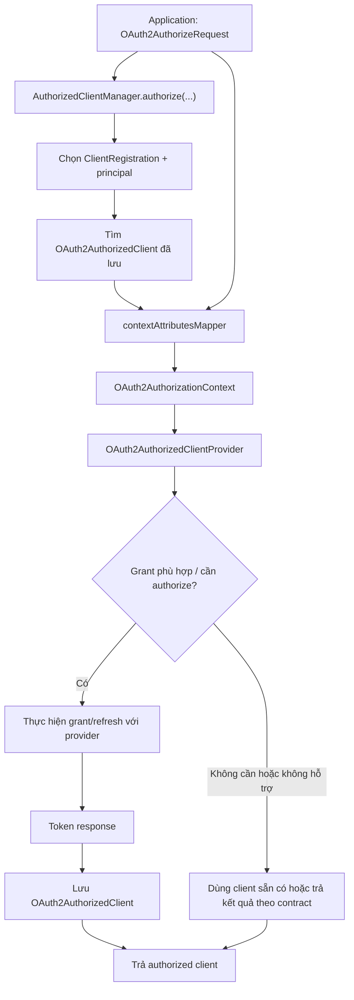
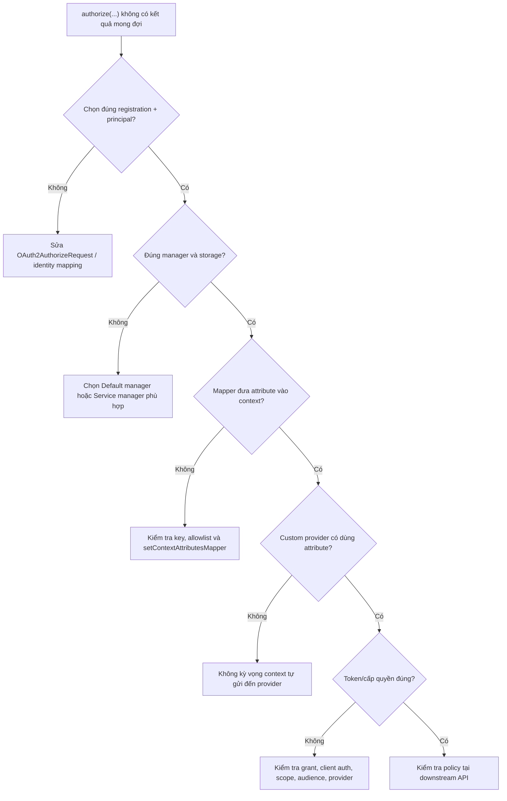

# 15.7. Context attributes và bổ sung thông tin cho quá trình authorize

Trong **Spring Security OAuth 2.0 / OpenID Connect (OIDC) Client**, `OAuth2AuthorizedClientManager` là thành phần phối hợp việc tìm authorized client đã có, cấp quyền lần đầu hoặc thực hiện lại việc cấp quyền khi cần, chẳng hạn refresh access token. Ở phần lớn trường hợp, manager chỉ cần biết **`clientRegistrationId`** và **principal**. Tuy nhiên, một hệ thống thực tế còn có ngữ cảnh của lần gọi: đang chạy job nào, ở tenant nào, tác vụ nghiệp vụ gì, cần ghi dấu correlation ID nào, hoặc chính sách nào phải được kiểm tra trước khi xin token.

Spring Security cung cấp cơ chế **context attributes** để mang những thông tin bổ sung đó qua quá trình `authorize(...)`. Cốt lõi của cơ chế này là:

1. Người gọi tạo `OAuth2AuthorizeRequest` và gắn attributes.
2. `OAuth2AuthorizedClientManager` lấy yêu cầu, tìm `ClientRegistration` và authorized client liên quan.
3. Một **context attributes mapper** chuyển thông tin từ authorize request thành attributes của `OAuth2AuthorizationContext`.
4. `OAuth2AuthorizedClientProvider` có thể đọc các attributes trong context để quyết định cách xử lý authorization.
5. Manager trả về `OAuth2AuthorizedClient` khi phù hợp và phối hợp lưu/xóa trạng thái theo cấu hình.

**Nguyên tắc quan trọng:** context attributes là **dữ liệu nội bộ của luồng Spring Security**, không phải một phần bắt buộc của giao thức OAuth 2.0 và **không tự động được gửi tới authorization endpoint hoặc token endpoint**. Muốn thêm scope, `resource`, `audience`, `login_hint` hoặc thông tin khác vào HTTP request của provider, ứng dụng phải tùy biến **đúng điểm mở rộng** tương ứng; chỉ `put(...)` vào context không tạo ra hiệu ứng đó.

## 1. Tại sao cần thêm thông tin vào quá trình authorize?

Giả sử một hệ thống quản lý kho có ba tác vụ:

| Tình huống | Grant / loại client | Ngữ cảnh bổ sung hữu ích |
|---|---|---|
| Người dùng đăng nhập OIDC | `authorization_code` | Registration cần dùng, phiên browser, yêu cầu xác thực phù hợp; phần lớn do framework quản lý. |
| Job đồng bộ hàng tồn gọi Inventory API | `client_credentials` | Mã tác vụ, tenant đã xác minh, correlation ID của công việc, policy dịch vụ. |
| Backend gọi Reports API thay mặt người dùng | `authorization_code` đã được cấp và có thể dùng `refresh_token` | Danh tính người dùng, chức năng gọi API, tenant nội bộ, chính sách token được phép sử dụng. |
| Tích hợp nhiều nhà cung cấp | Nhiều `ClientRegistration` | Mã registration đã chọn, mục tiêu API và quy tắc ràng buộc giữa provider/tenant. |

Ví dụ một job đồng bộ có thể truyền:

```text
clientRegistrationId = inventory-service
principal             = service:inventory-sync
attributes:
  app.tenantId         = tenant-north
  app.operation        = inventory.import
  app.correlationId    = job-c7e5
```

Những giá trị ở trên **không làm token tự có quyền tenant-north**. Chúng cho phép thành phần được ứng dụng viết thêm kiểm tra rằng một job được phép dùng registration này, hoặc hỗ trợ correlation ở mức không nhạy cảm. Quyền thật sự của token phụ thuộc Authorization Server; Resource Server vẫn phải kiểm tra token và quyền đối với tenant/tài nguyên.

### 1.1. Phân biệt ba câu hỏi

- **Tôi đang xin/lấy lại authorized client nào?** Chọn bằng registration ID, principal và loại storage/manager.
- **Tôi muốn thành phần authorize biết thêm điều gì?** Đưa vào context attributes, sau đó mapper/provider có thể sử dụng.
- **Tôi muốn Authorization Server nhận thêm tham số giao thức nào?** Tùy chỉnh Authorization Request Resolver, token response client hoặc điểm mở rộng theo grant type. Đây là thao tác **khác** với đặt context attribute.

Thiết kế tốt là xác định rõ mục đích từng dữ liệu, thay vì tạo một map lớn chứa mọi thông tin request rồi kỳ vọng Spring tự xử lý.

## 2. Các đối tượng và ranh giới dữ liệu

| Đối tượng / API | Dữ liệu chính | Ai dùng? |
|---|---|---|
| `OAuth2AuthorizeRequest` | `clientRegistrationId` hoặc authorized client đã có, `principal`, `attributes` của lời gọi | Đầu vào của `OAuth2AuthorizedClientManager.authorize(...)`. |
| `OAuth2AuthorizationContext` | `ClientRegistration`, principal, authorized client hiện có và attributes đã được manager xây dựng | Đầu vào mà `OAuth2AuthorizedClientProvider` nhận. |
| `contextAttributesMapper` | Hàm chuyển `OAuth2AuthorizeRequest` thành `Map<String,Object>` cho context | Manager gọi để chuẩn bị context cho provider. |
| `OAuth2AuthorizedClientProvider` | Xem grant, trạng thái token và các context attributes | Quyết định có thể ủy quyền/tái ủy quyền hay không và trả authorized client. |
| `ClientRegistration` | `registrationId`, `clientId`, grant type, scopes mặc định, token/authorization URI, authentication method | Cấu hình OAuth2 client; **không tự thay đổi chỉ vì context attribute khác**. |
| `OAuth2AuthorizedClient` | Registration, principal name, access/refresh token, thời gian hiệu lực | Kết quả authorization được quản lý/lưu lại. |
| `OAuth2AuthorizationRequest` | `state`, `redirectUri`, scopes, `additionalParameters`, dữ liệu PKCE/OIDC | **Browser authorization redirect**; khác với `OAuth2AuthorizeRequest` gửi tới manager. |

Tên hai lớp dễ nhầm nhất:

```text
OAuth2AuthorizeRequest
  -> yêu cầu từ code ứng dụng gửi cho AuthorizedClientManager

OAuth2AuthorizationRequest
  -> yêu cầu giao thức dùng khi redirect browser tới Authorization Server
```

Hai đối tượng xuất hiện ở những tầng khác nhau. `OAuth2AuthorizeRequest.attributes` không tự chuyển thành `OAuth2AuthorizationRequest.additionalParameters`.

Tương tự, một attribute tên `"scope"` trong context **không tự động sửa** `ClientRegistration.getScopes()`, access token đang lưu hoặc `scope` của HTTP token request.

## 3. Luồng dữ liệu qua OAuth2AuthorizedClientManager



Luồng này mang tính khái niệm. Chi tiết khi provider trả `null`, khi manager trả client hiện có, cách lưu và exception/failure handling phụ thuộc loại manager, grant provider và phiên bản Spring Security.

### 3.1. Context tồn tại trong phạm vi một lời gọi authorize

`OAuth2AuthorizationContext` được tạo để provider xử lý một lần authorize cụ thể. Nó **không phải** chỗ lưu bền vững ngữ cảnh tenant, mã nghiệp vụ hay session data.

Khi gọi authorize lần tiếp theo, ứng dụng phải cung cấp lại những attributes mà tác vụ đó cần, hoặc có mapper đáng tin cậy lấy chúng từ nguồn khác. Không giả định context của lần gọi trước được bảo lưu trong `OAuth2AuthorizedClient` hoặc database.

### 3.2. Không phải attribute nào cũng ảnh hưởng đến provider chuẩn

Những provider có sẵn như `clientCredentials()`, `refreshToken()` hoặc `authorizationCode()` xử lý theo giao thức và những quy tắc riêng của chúng. Một custom attribute `app.correlationId` **không có hiệu ứng mặc định** nếu không có thành phần nào đọc nó.

Ví dụ đặt `app.tenantId` chỉ giúp ích khi một **custom `OAuth2AuthorizedClientProvider`**, custom manager/converter hoặc business layer chủ động sử dụng giá trị đó. Đây là cơ chế mở rộng ngữ cảnh, không phải tính năng tự động đính kèm tenant vào token.

## 4. Tạo OAuth2AuthorizeRequest kèm attributes

Builder hỗ trợ ghi thêm attributes bằng một consumer:

```java
import org.springframework.security.oauth2.client.OAuth2AuthorizeRequest;

OAuth2AuthorizeRequest authorizeRequest =
        OAuth2AuthorizeRequest
                .withClientRegistrationId("inventory-service")
                .principal("service:inventory-sync")
                .attributes(attributes -> {
                    attributes.put("app.tenantId", "tenant-north");
                    attributes.put("app.operation", "inventory.import");
                    attributes.put("app.correlationId", "job-c7e5");
                })
                .build();
```

Ý nghĩa:

- `withClientRegistrationId("inventory-service")` yêu cầu manager lựa chọn registration này.
- `principal("service:inventory-sync")` cung cấp chủ thể logic của lời gọi. Với `client_credentials`, đây **không phải** user đăng nhập trình duyệt.
- `attributes(...)` ghi các key/value bổ sung cho authorize request.

Trên thực tế, `principal` còn có thể là một `Authentication` đã được Spring Security xác thực. Trong một web request, lấy principal từ `SecurityContext` hoặc tham số `Authentication` đã xác thực; không tạo principal tùy ý từ tên người dùng mà browser tự gửi.

### 4.1. Dùng hằng khóa thay vì literal phân tán

Nếu nhiều module phối hợp, đặt tên khóa có namespace riêng để tránh va chạm:

```java
public final class BusinessAuthorizeAttributes {
    public static final String TENANT_ID = "app.tenantId";
    public static final String OPERATION = "app.operation";
    public static final String CORRELATION_ID = "app.correlationId";

    private BusinessAuthorizeAttributes() {}
}
```

Sau đó:

```java
OAuth2AuthorizeRequest request =
        OAuth2AuthorizeRequest.withClientRegistrationId("inventory-service")
                .principal("service:inventory-sync")
                .attributes(attributes -> {
                    attributes.put(
                            BusinessAuthorizeAttributes.TENANT_ID,
                            validatedTenantId);
                    attributes.put(
                            BusinessAuthorizeAttributes.OPERATION,
                            "inventory.import");
                })
                .build();
```

`validatedTenantId` phải là dữ liệu đã được hệ thống xác minh; đừng lấy trực tiếp `?tenantId=...` từ URL hoặc body request rồi dùng làm chính sách chọn token.

### 4.2. Khi đã có OAuth2AuthorizedClient

Ngoài builder theo registration ID, ứng dụng có thể xây authorize request từ một authorized client có sẵn nếu API phiên bản được dùng hỗ trợ. Điều quan trọng là manager cần biết registration và principal liên quan để xử lý trạng thái token.

Khi sử dụng lại authorized client, context attributes vẫn chỉ mô tả **lần gọi hiện tại**. Chúng không có chức năng thay đổi `principalName` của client đã lưu hoặc làm access token nhận scope mới.

## 5. ContextAttributesMapper là gì?

Các manager như `DefaultOAuth2AuthorizedClientManager` và `AuthorizedClientServiceOAuth2AuthorizedClientManager` cung cấp phương thức:

```java
setContextAttributesMapper(
        Function<OAuth2AuthorizeRequest, Map<String, Object>> mapper);
```

Về ý nghĩa, mapper nhận authorize request và trả về map các thuộc tính được gắn vào `OAuth2AuthorizationContext`. Thay vì để mọi dữ liệu không đáng tin từ caller chảy thẳng vào provider, mapper là nơi thích hợp để **lọc, chuẩn hóa và chọn đúng các trường mà provider tùy chỉnh được phép nhìn thấy**.

Ví dụ:

```text
OAuth2AuthorizeRequest.attributes:
    app.tenantId       = tenant-north
    app.operation      = inventory.import
    app.correlationId  = job-c7e5
    debug.secret       = <untrusted-or-sensitive>

contextAttributesMapper:
    chỉ lấy app.tenantId, app.operation, app.correlationId

OAuth2AuthorizationContext.attributes:
    app.tenantId       = tenant-north
    app.operation      = inventory.import
    app.correlationId  = job-c7e5
```

### 5.1. Ví dụ mapper có allowlist

```java
import java.util.HashMap;
import java.util.Map;
import org.springframework.security.oauth2.client.OAuth2AuthorizeRequest;

static Map<String, Object> mapBusinessContext(
        OAuth2AuthorizeRequest request) {

    Map<String, Object> mapped = new HashMap<>();

    Object tenant = request.getAttributes().get(
            BusinessAuthorizeAttributes.TENANT_ID);
    if (tenant instanceof String id
            && id.matches("[a-z0-9-]{1,50}")) {
        mapped.put(BusinessAuthorizeAttributes.TENANT_ID, id);
    }

    Object operation = request.getAttributes().get(
            BusinessAuthorizeAttributes.OPERATION);
    if ("inventory.import".equals(operation)
            || "inventory.reconcile".equals(operation)) {
        mapped.put(
                BusinessAuthorizeAttributes.OPERATION, operation);
    }

    Object correlationId = request.getAttributes().get(
            BusinessAuthorizeAttributes.CORRELATION_ID);
    if (correlationId instanceof String value
            && value.length() <= 64) {
        mapped.put(
                BusinessAuthorizeAttributes.CORRELATION_ID, value);
    }

    return mapped;
}
```

Đây là phương thức minh họa cần đặt trong class ứng dụng cùng với `BusinessAuthorizeAttributes`. Việc regex đúng cú pháp **không chứng minh một người dùng có quyền với tenant**: danh tính/tenant phải được xác thực bởi thành phần nghiệp vụ phía server trước khi tạo authorize request.

**Cẩn trọng khi thay mapper mặc định:** `setContextAttributesMapper(...)` thay thế logic mapper được manager dùng. Nếu một grant/provider đang dựa vào attribute chuẩn hoặc mapper mặc định của phiên bản Spring Security cụ thể, mapper mới phải giữ hành vi cần thiết. Không tùy tiện copy toàn bộ request map chỉ để “không mất gì”; hãy xác định rõ các giá trị mà luồng hiện tại thật sự cần.

## 6. Ví dụ đầy đủ: service manager và client_credentials

Một công việc đồng bộ chạy ngoài HTTP request nên dùng một manager phù hợp với **service context**, ví dụ `AuthorizedClientServiceOAuth2AuthorizedClientManager`. Dưới đây là cách tích hợp context attributes qua các phần cấu hình.

### 6.1. Cấu hình ClientRegistration

```yaml
spring:
  security:
    oauth2:
      client:
        registration:
          inventory-service:
            provider: company
            client-id: "${INVENTORY_CLIENT_ID}"
            client-secret: "${INVENTORY_CLIENT_SECRET}"
            client-authentication-method: client_secret_basic
            authorization-grant-type: client_credentials
            scope:
              - inventory.read
              - inventory.write
        provider:
          company:
            token-uri: "https://idp.example.org/realms/company/protocol/openid-connect/token"
```

`client_credentials` lấy token thay mặt danh tính **client/service**, không xác thực người dùng cuối qua trình duyệt. Token sẽ có scope thực tế do Authorization Server cấp và cần đúng audience/Resource Server. Hai scope `inventory.read` và `inventory.write` chỉ là ví dụ phụ thuộc hợp đồng API.

### 6.2. Khai báo AuthorizedClientManager

```java
import java.util.HashMap;
import java.util.Map;

import org.springframework.context.annotation.Bean;
import org.springframework.context.annotation.Configuration;
import org.springframework.security.oauth2.client.AuthorizedClientServiceOAuth2AuthorizedClientManager;
import org.springframework.security.oauth2.client.OAuth2AuthorizedClientManager;
import org.springframework.security.oauth2.client.OAuth2AuthorizedClientProvider;
import org.springframework.security.oauth2.client.OAuth2AuthorizedClientProviderBuilder;
import org.springframework.security.oauth2.client.OAuth2AuthorizedClientService;
import org.springframework.security.oauth2.client.registration.ClientRegistrationRepository;

@Configuration
class InventoryOAuth2Config {

    @Bean
    OAuth2AuthorizedClientManager inventoryAuthorizedClientManager(
            ClientRegistrationRepository registrations,
            OAuth2AuthorizedClientService authorizedClientService) {

        OAuth2AuthorizedClientProvider provider =
                OAuth2AuthorizedClientProviderBuilder.builder()
                        .clientCredentials()
                        .build();

        var manager =
                new AuthorizedClientServiceOAuth2AuthorizedClientManager(
                        registrations, authorizedClientService);

        manager.setAuthorizedClientProvider(provider);

        // Mapper chọn những thuộc tính nghiệp vụ được cho phép.
        manager.setContextAttributesMapper(authorizeRequest -> {
            Map<String, Object> mapped = new HashMap<>();
            Object tenant = authorizeRequest.getAttributes()
                    .get(BusinessAuthorizeAttributes.TENANT_ID);

            if (tenant instanceof String id
                    && id.matches("[a-z0-9-]{1,50}")) {
                mapped.put(BusinessAuthorizeAttributes.TENANT_ID, id);
            }

            Object operation = authorizeRequest.getAttributes()
                    .get(BusinessAuthorizeAttributes.OPERATION);

            if ("inventory.import".equals(operation)
                    || "inventory.reconcile".equals(operation)) {
                mapped.put(BusinessAuthorizeAttributes.OPERATION, operation);
            }

            return mapped;
        });

        return manager;
    }
}
```

Ở đoạn code này, provider `clientCredentials()` mặc định được dùng để xin/làm mới access token theo grant. Mapper đã chuẩn bị context, nhưng **provider mặc định không tự thêm `app.tenantId` vào HTTP POST token endpoint**. Nếu muốn áp dụng chính sách tenant ở bước authorization, cần có logic ứng dụng hoặc custom provider đọc thuộc tính đó.

Một ứng dụng có nhiều luồng, chẳng hạn thêm `refreshToken()` hoặc `authorizationCode()`, phải cấu hình provider chain theo những grant cần hỗ trợ. Không bật các grant chỉ vì “có thể sau này cần”; mỗi grant đòi hỏi điều kiện khác nhau.

### 6.3. Gọi manager từ background worker

```java
import org.springframework.security.oauth2.client.OAuth2AuthorizeRequest;
import org.springframework.security.oauth2.client.OAuth2AuthorizedClient;
import org.springframework.security.oauth2.client.OAuth2AuthorizedClientManager;

class InventorySyncJob {

    private final OAuth2AuthorizedClientManager manager;
    private final TenantPolicy tenantPolicy;

    InventorySyncJob(
            OAuth2AuthorizedClientManager manager,
            TenantPolicy tenantPolicy) {
        this.manager = manager;
        this.tenantPolicy = tenantPolicy;
    }

    OAuth2AuthorizedClient authorizedClientFor(String tenantId) {
        // Quyền sử dụng tenant phải do policy phía server xác minh.
        String approvedTenant = tenantPolicy.requireAllowed(tenantId);

        OAuth2AuthorizeRequest request =
                OAuth2AuthorizeRequest
                        .withClientRegistrationId("inventory-service")
                        .principal("service:inventory-sync:" + approvedTenant)
                        .attributes(attributes -> {
                            attributes.put(
                                    BusinessAuthorizeAttributes.TENANT_ID,
                                    approvedTenant);
                            attributes.put(
                                    BusinessAuthorizeAttributes.OPERATION,
                                    "inventory.import");
                        })
                        .build();

        OAuth2AuthorizedClient client = manager.authorize(request);

        if (client == null) {
            throw new IllegalStateException(
                    "Could not authorize inventory-service");
        }
        return client;
    }
}
```

`TenantPolicy` là service nghiệp vụ giả định phải được triển khai. Tên principal có tenant ở ví dụ giúp **phân tách khóa lưu authorized client** giữa các tenant đã xác minh. Nó **không buộc Authorization Server cấp token được ràng buộc vào tenant**: muốn token có audience/tenant/permission tương ứng, cần cấu hình provider, registration hoặc token request theo contract và policy riêng.

Khi dùng `clientCredentials`, nếu token của provider có quyền truy cập mọi tenant và ứng dụng chỉ thay principal name để tạo nhiều dòng lưu, đó vẫn là nhiều bản ghi cho **một quyền token giống nhau**, không phải isolation ở provider. Đừng nhầm sự tách biệt storage với quyền truy cập do Authorization Server phát hành.

### 6.4. Điều gì được lưu lại?

`AuthorizedClientServiceOAuth2AuthorizedClientManager` có thể lưu `OAuth2AuthorizedClient` theo `registrationId` và principal name thông qua service. Những custom context attributes như `app.operation` hoặc `app.correlationId` **không phải trường chuẩn được lưu trong `OAuth2AuthorizedClient`**.

Vì vậy:

- Lần gọi đầu có `app.operation=inventory.import` không bảo đảm lần gọi tiếp theo thấy attribute đó nếu ứng dụng không truyền lại.
- Thay `app.operation` không tự tạo một client registration mới.
- Nếu cần audit lâu dài, lưu một audit event riêng theo chính sách, không dùng OAuth2AuthorizedClient storage như kho dữ liệu nghiệp vụ.

## 7. Custom provider đọc context attributes

Một lý do chính để dùng context attributes là cho **OAuth2AuthorizedClientProvider tùy chỉnh** đọc dữ liệu nghiệp vụ. Provider có API:

```java
OAuth2AuthorizedClient authorize(
        OAuth2AuthorizationContext context);
```

Trong provider, có thể đọc thuộc tính:

```java
String tenantId = context.getAttribute(
        BusinessAuthorizeAttributes.TENANT_ID);
String operation = context.getAttribute(
        BusinessAuthorizeAttributes.OPERATION);
```

Provider tùy chỉnh có thể thực thi một policy trước khi delegate cho provider OAuth2 chuẩn, hoặc tham gia vào một grant được Authorization Server hỗ trợ. Ví dụ bên dưới chỉ bảo vệ việc gọi client credentials; nó **không tạo một loại grant mới**.

### 7.1. Wrapper kiểm tra ngữ cảnh trước khi delegate

```java
import org.springframework.security.oauth2.client.OAuth2AuthorizedClient;
import org.springframework.security.oauth2.client.OAuth2AuthorizedClientProvider;
import org.springframework.security.oauth2.client.OAuth2AuthorizedClientProviderBuilder;
import org.springframework.security.oauth2.client.OAuth2AuthorizationContext;

final class TenantAwareClientProvider
        implements OAuth2AuthorizedClientProvider {

    private final OAuth2AuthorizedClientProvider delegate =
            OAuth2AuthorizedClientProviderBuilder.builder()
                    .clientCredentials()
                    .build();

    private final TenantPolicy tenantPolicy;

    TenantAwareClientProvider(TenantPolicy tenantPolicy) {
        this.tenantPolicy = tenantPolicy;
    }

    @Override
    public OAuth2AuthorizedClient authorize(
            OAuth2AuthorizationContext context) {

        if (!"inventory-service".equals(
                context.getClientRegistration().getRegistrationId())) {
            return null;
        }

        String tenantId = context.getAttribute(
                BusinessAuthorizeAttributes.TENANT_ID);
        String operation = context.getAttribute(
                BusinessAuthorizeAttributes.OPERATION);

        // Chính sách server: không tin chỉ vì context có chuỗi tenant.
        tenantPolicy.requireAllowedOperation(
                context.getPrincipal(), tenantId, operation);

        return delegate.authorize(context);
    }
}
```

`TenantPolicy` vẫn là thành phần ứng dụng cần triển khai. Trong ứng dụng thực, cần xác định **khi nào kiểm tra policy**, kể cả lúc manager trả về client đã có mà không cần xin token mới. Nếu policy bảo vệ một hành động API, phải kiểm tra lại policy **ngay khi thực hiện hành động**; chỉ kiểm tra trong provider là chưa đủ vì provider có thể không được gọi trong mọi nhánh sử dụng token.

Để sử dụng wrapper:

```java
var manager = new AuthorizedClientServiceOAuth2AuthorizedClientManager(
        registrations, authorizedClientService);

manager.setAuthorizedClientProvider(
        new TenantAwareClientProvider(tenantPolicy));

manager.setContextAttributesMapper(
        InventoryOAuth2Context::mapBusinessContext);
```

`InventoryOAuth2Context.mapBusinessContext` là phương thức mapper **giả định** có logic tương tự mục 5.1. Đây là các đoạn minh họa hướng cấu hình, không phải file Java độc lập đã có toàn bộ phụ thuộc.

### 7.2. Một provider custom trả gì?

Theo contract, provider có thể:

- Trả `OAuth2AuthorizedClient` khi nó đã xử lý việc cấp/tái cấp quyền.
- Trả `null` khi nó không hỗ trợ hoặc không cần tiến hành authorization cho context hiện tại.
- Ném ngoại lệ OAuth2 khi authorization thực sự thất bại, theo loại lỗi và chính sách của ứng dụng.

**Đừng xem `null` luôn là lỗi.** Manager có thể giữ lại authorized client hiện có theo contract. Việc kiểm tra có token dùng được và có quyền truy cập API vẫn cần được thực hiện ở vị trí thích hợp.

Khi tạo custom provider, không cần thay đổi toàn bộ pipeline nếu chỉ muốn quan sát thêm thông tin: có thể bọc một provider chuẩn, giữ các quy tắc thời hạn, refresh và grant do Spring Security hỗ trợ.

## 8. Web manager: context attributes trong Servlet request

Ở ứng dụng Spring MVC chạy trong HTTP request, `DefaultOAuth2AuthorizedClientManager` phối hợp với `OAuth2AuthorizedClientRepository` thay vì service-only storage.

Ví dụ cấu hình nguyên tắc:

```java
import java.util.HashMap;
import java.util.Map;
import org.springframework.context.annotation.Bean;
import org.springframework.security.oauth2.client.DefaultOAuth2AuthorizedClientManager;
import org.springframework.security.oauth2.client.OAuth2AuthorizedClientManager;
import org.springframework.security.oauth2.client.OAuth2AuthorizedClientProviderBuilder;
import org.springframework.security.oauth2.client.registration.ClientRegistrationRepository;
import org.springframework.security.oauth2.client.web.OAuth2AuthorizedClientRepository;

@Bean
OAuth2AuthorizedClientManager webAuthorizedClientManager(
        ClientRegistrationRepository registrations,
        OAuth2AuthorizedClientRepository repository) {

    var manager = new DefaultOAuth2AuthorizedClientManager(
            registrations, repository);

    manager.setAuthorizedClientProvider(
            OAuth2AuthorizedClientProviderBuilder.builder()
                    .authorizationCode()
                    .refreshToken()
                    .clientCredentials()
                    .build());

    manager.setContextAttributesMapper(authorizeRequest -> {
        Map<String, Object> attributes = new HashMap<>();

        Object operation = authorizeRequest.getAttributes()
                .get(BusinessAuthorizeAttributes.OPERATION);

        if ("reports.read".equals(operation)) {
            attributes.put(
                    BusinessAuthorizeAttributes.OPERATION, operation);
        }
        return attributes;
    });

    return manager;
}
```

Đây là một ví dụ thay thế cho service manager ở mục 6, không nên khai báo hai bean `OAuth2AuthorizedClientManager` cùng kiểu mà không dùng qualifier hoặc cách chọn rõ ràng. Với `DefaultOAuth2AuthorizedClientManager`, request/response Servlet phải hiện diện đúng ngữ cảnh khi repository cần chúng; API manager cũng có các context attributes liên quan HTTP request/response do framework quản lý.

### 8.1. Không lấy tenant từ request parameter rồi tự tin cậy

Ví dụ nguy hiểm:

```java
// KHÔNG NÊN: tenant do browser tự khai báo được tin ngay.
String tenant = httpServletRequest.getParameter("tenant");

OAuth2AuthorizeRequest request =
        OAuth2AuthorizeRequest.withClientRegistrationId("reports-api")
                .principal(authentication)
                .attributes(attributes -> {
                    attributes.put("app.tenantId", tenant);
                })
                .build();
```

Browser có thể thay `tenant` trong URL. Nếu application lấy giá trị đó để chọn kho token, client registration hoặc quyền gọi API mà không xác minh, có thể xảy ra nhầm lẫn giữa tenant và rò rỉ dữ liệu.

Cách đúng là lấy tenant đã được xác thực và được server xác nhận là thuộc phạm vi principal:

```java
String trustedTenantId =
        tenantResolver.requireAuthorizedTenant(
                authentication, requestedTenantId);
```

`tenantResolver` là service nghiệp vụ do ứng dụng xây dựng; nó nên kiểm tra membership/permission, không chỉ regex tên tenant.

### 8.2. Khác với request attributes của MVC

Trong Servlet, `request.setAttribute("key", value)` đặt một thuộc tính lên `HttpServletRequest`. Trong Spring Security OAuth2 Client, `OAuth2AuthorizeRequest.attributes(...)` đặt dữ liệu vào **authorize request object**. Hai map này không tự là một.

Nếu muốn đọc context từ `HttpServletRequest` và đưa vào `OAuth2AuthorizationContext`, ứng dụng phải kiểm soát luồng dữ liệu, đi qua API/mapper phù hợp, và tránh đưa nguyên tất cả request attributes vào vùng authorization.

### 8.3. Không nhầm với WebClient OAuth2 attributes

Một số tích hợp HTTP outbound cho phép chỉ định registration hoặc authorized client bằng attributes trên request của `WebClient`/`RestClient`. Đây lại là một lớp context khác: thông tin để filter/interceptor chọn authorized client. Không mặc định rằng tên attribute tùy chỉnh ở HTTP client sẽ tự xuất hiện trong `OAuth2AuthorizationContext` trừ khi adapter tương ứng chuyển tiếp nó.

Khi dùng HTTP client OAuth2 tích hợp, nên chọn API được Spring Security phiên bản đó cung cấp để truyền registration/authorized client, thay vì tự chèn mọi dữ liệu vào request attributes rồi mong mapper hiểu.

## 9. Context attributes có thể dùng để bổ sung thông tin gì?

Một nguyên tắc thực dụng là dùng context attributes cho **metadata điều phối authorization**, không chứa dữ liệu mật.

| Thông tin | Có thể truyền qua context? | Lưu ý |
|---|---|---|
| `app.operation` | Có | Dùng enum/allowlist cho chức năng nghiệp vụ. |
| `app.tenantId` | Có, nếu đã xác minh | Không tự tạo token tenant-specific chỉ nhờ attribute. |
| `app.correlationId` | Có | Giữ định dạng giới hạn, chỉ dùng để trace an toàn. |
| `app.jobType` | Có | Hữu ích để policy custom phân biệt job định kỳ. |
| `app.resourceCode` | Có, nếu có hợp đồng | Chỉ là mã nội bộ; không tự đưa thành HTTP `resource` parameter. |
| `client-secret` | Không nên | Quản lý trong `ClientRegistration`/secret store và cấu hình client authentication. |
| `access_token`/`refresh_token` | Không nên | Đã có `OAuth2AuthorizedClient` và cơ chế lưu token chuyên dụng. |
| `code_verifier`/`state`/`nonce` | Không tự chèn tùy ý | Dữ liệu bảo mật của Authorization Code/OIDC flow cần được framework duy trì theo request tương ứng. |
| Scope tùy ý từ browser | Không nên | Phải có allowlist, quyền của client và cơ chế giao thức thích hợp. |
| Tên người dùng chưa xác thực | Không nên dùng làm nguồn authorization | Lấy principal từ `Authentication` hợp lệ hoặc service identity đã xác minh. |

Không đặt cả một `HttpServletRequest`, `Authentication` mutable do user tạo, object ORM có dữ liệu cá nhân hay payload lớn vào context chỉ vì mapper chấp nhận `Object`. Context ngắn gọn giúp giảm nguy cơ lộ bí mật, phụ thuộc vòng đời request và lỗi phân phối qua nhiều lớp.

## 10. Scope, resource, audience: context không phải tham số OAuth2

Một yêu cầu nghiệp vụ phổ biến:

> Khi gọi API A, xin scope `reports.read`; khi gọi API B, xin scope `reports.export` và audience tương ứng.

Chỉ thêm:

```java
attributes.put("scope", "reports.export");
attributes.put("audience", "https://reports.example.org");
```

**không bảo đảm token endpoint nhận hai giá trị này.** Tùy grant và provider, cách đúng có thể là:

1. **ClientRegistration riêng** với scope/token-uri/client ID/phạm vi đã được provider đăng ký.
2. **Tùy chỉnh Authorization Request Resolver** khi browser khởi động `authorization_code` để thêm scope hoặc tham số OIDC/provider phù hợp.
3. **Tùy chỉnh token response client hoặc grant provider** khi provider hỗ trợ tham số thêm ở token endpoint.
4. **Sử dụng extension có contract rõ ràng** cho requested scopes/resource, nếu Spring Security phiên bản đang dùng hỗ trợ; không tự giả định mọi phiên bản có cùng behavior.

### 10.1. Ví dụ nhiều ClientRegistration

```yaml
spring:
  security:
    oauth2:
      client:
        registration:
          reports-read:
            provider: company
            client-id: "${REPORT_READ_CLIENT_ID}"
            client-secret: "${REPORT_READ_CLIENT_SECRET}"
            authorization-grant-type: client_credentials
            scope: [reports.read]
          reports-export:
            provider: company
            client-id: "${REPORT_EXPORT_CLIENT_ID}"
            client-secret: "${REPORT_EXPORT_CLIENT_SECRET}"
            authorization-grant-type: client_credentials
            scope: [reports.export]
        provider:
          company:
            token-uri: "https://idp.example.org/oauth2/token"
```

Chọn `reports-read` hay `reports-export` bằng registration ID giúp client manager sử dụng cấu hình scope tương ứng. Provider phải được thiết lập để cấp đúng quyền cho từng client. Một context attribute `app.operation` vẫn hữu ích để policy biết tác vụ đang xin token, nhưng **registration** mới là yếu tố mang các cấu hình OAuth2 đã định nghĩa.

### 10.2. Ví dụ tham số tùy chỉnh ở token endpoint

Nếu Authorization Server yêu cầu tham số `resource` cho client credentials theo hợp đồng, trong các phiên bản Spring Security có hỗ trợ `RestClientClientCredentialsTokenResponseClient` có thể tùy chỉnh parameters converter:

```java
import org.springframework.http.LinkedMultiValueMap;
import org.springframework.http.MultiValueMap;
import org.springframework.security.oauth2.client.endpoint.RestClientClientCredentialsTokenResponseClient;

var tokenClient = new RestClientClientCredentialsTokenResponseClient();

tokenClient.addParametersConverter(grantRequest -> {
    MultiValueMap<String, String> extras = new LinkedMultiValueMap<>();
    extras.add("resource", "https://inventory-api.example.org");
    return extras;
});
```

Đoạn này minh họa việc **tùy chỉnh token request ở HTTP boundary**, chưa bao gồm bước gắn token client vào `ClientCredentialsOAuth2AuthorizedClientProvider` và manager. Để có hành vi đầy đủ, cần cấu hình provider dùng token response client này theo API phiên bản Spring Security thực tế.

Không lấy `resource` trực tiếp từ browser hoặc một context attribute không được kiểm soát để gửi tới provider. Resource/audience phải thuộc allowlist và đúng quyền đăng ký của client. Cách yêu cầu resource tùy vào protocol extension và provider; `resource` không phải tham số bắt buộc của mọi OAuth2 token request.

### 10.3. Context không tự làm mới quyền đã được cấp

Nếu access token được lưu với scope `reports.read`, lần gọi authorize sau thêm `app.operation=reports.export` vẫn có thể nhận **authorized client cũ** nếu manager thấy nó còn hợp lệ. Không coi context mới là bằng chứng token đã có `reports.export`.

Nếu tính năng cần quyền mới hoặc audience khác, phải có chiến lược cấp quyền phù hợp, chọn đúng registration/token và kiểm tra quyền thực tế ở Resource Server. Refresh token thông thường không tự mở rộng scope vượt quyền đã được cấp.

## 11. Context attributes và khóa lưu OAuth2AuthorizedClient

Trong `OAuth2AuthorizedClientService`, authorized client được tra cứu theo **`(clientRegistrationId, principalName)`**. Attributes như `app.tenantId` hay `app.operation` **không tự là thành phần của khóa này**.

Ví dụ hai lần gọi:

```text
Call A:
  registrationId = inventory-service
  principal      = service:inventory
  app.tenantId   = tenant-north

Call B:
  registrationId = inventory-service
  principal      = service:inventory
  app.tenantId   = tenant-south
```

Ở service lưu trữ mặc định, cả hai lần có **cùng cặp khóa**. Nếu token của tenant-north thực sự khác token của tenant-south, chỉ thay attribute là không đủ để đảm bảo isolation.

Thiết kế cần một cơ chế phân vùng đúng bản chất:

- Registration ID riêng khi các client/issuer/scope khác nhau.
- Principal name logic riêng, được server xác minh, khi cần tách authorized client theo tenant.
- Kho token tách theo tenant hoặc key tùy chỉnh có isolation phù hợp.
- Policy đối chiếu token audience/tenant/scope ở Resource Server.

Chỉ thêm tenant vào principal name giúp tách **bản ghi lưu**; nó không tự làm token phát hành cho tenant đó. Mối quan hệ giữa token và tenant phải được Authorization Server/Resource Server hiểu, hoặc được ứng dụng bảo vệ bằng policy phía server.

### 11.1. Đừng dùng request ID làm principal name

Một anti-pattern:

```java
OAuth2AuthorizeRequest.withClientRegistrationId("inventory-service")
        .principal("job:" + java.util.UUID.randomUUID())
        .build();
```

Nếu không có lý do cố ý tách authorization, mỗi lần gọi sẽ dùng một principal khác và có thể tạo nhiều authorized client/token không cần thiết. `app.correlationId` mới là vị trí thích hợp cho một request/job ID chỉ dùng chẩn đoán; principal name nên ổn định theo chủ thể logic.

### 11.2. Khi principal đến từ OIDC Login

Trong Servlet web flow, `Authentication.getName()` thường phản ánh tên của `OidcUser`. Giá trị có thể dựa trên `sub` hoặc name attribute được cấu hình. Nếu ứng dụng đổi principal từ `sub` sang email, authorized client cũ có thể không được tìm thấy.

Với nhiều issuer, `sub` chỉ có tính duy nhất trong miền issuer; đừng dùng riêng `sub` để suy luận cùng local user. Cặp (`iss`, `sub`) hữu ích cho identity mapping, còn chiến lược principalName trong storage phải được thống nhất và không gây va chạm giữa tenant/registration.

## 12. Refresh token và client hiện có: attributes ảnh hưởng đến đâu?

Một manager có thể thực hiện nhiều việc tùy ngữ cảnh:

1. Tìm authorized client đã có.
2. Trả lại client nếu không cần reauthorization.
3. Dùng refresh token để lấy access token mới khi grant/provider cho phép.
4. Xin token bằng `client_credentials` khi cần.
5. Với authorization code flow, phối hợp authorization flow dựa trên browser khi cần cấp quyền người dùng.

Custom attributes chỉ ảnh hưởng nếu các thành phần trong đường xử lý **thực sự sử dụng chúng**.

Ví dụ:

```text
Lần 1:
  app.operation = inventory.import
  -> manager xin token cho inventory-service

Lần 2:
  app.operation = inventory.reconcile
  -> manager có thể dùng lại authorized client còn hợp lệ
```

Nếu service phải cấm nghiệp vụ `inventory.reconcile`, chính sách đó cần được áp dụng **trước thao tác API**, không chỉ khi token provider được gọi. Một custom provider có thể chỉ chạy logic trong những nhánh nhất định; không dùng nó như lớp phân quyền duy nhất cho tất cả request đến API.

### 12.1. Cần retry thế nào khi token endpoint lỗi?

Context attribute `app.correlationId` có thể giúp trace một token request bị timeout, nhưng không phải lý do để retry vô hạn. Với `authorization_code`, code có thể chỉ dùng được một lần; retry sau timeout có thể gặp `invalid_grant` vì provider đã tiêu thụ code.

Với `client_credentials`, chính sách retry cần xét rate limit, lỗi tạm thời, khả năng cấp token trùng lặp, backoff và hướng dẫn của provider. Không đưa token, client secret hoặc credential vào log chỉ để theo dõi các lần retry.

## 13. So sánh các điểm mở rộng đúng nhu cầu

| Nhu cầu | Điểm mở rộng nên xem xét | Không nên hiểu nhầm |
|---|---|---|
| Truyền mã job/tenant đã xác minh để provider custom biết | `OAuth2AuthorizeRequest.attributes` + `setContextAttributesMapper` | Không tự tạo tham số HTTP OAuth2. |
| Kiểm tra metadata trước khi custom grant chạy | Custom `OAuth2AuthorizedClientProvider` | Không thay thế authorization tại Resource Server. |
| Yêu cầu scope khác nhau ở browser login | `ClientRegistration` hoặc `OAuth2AuthorizationRequestResolver` | Context attributes không tự sửa redirect `scope`. |
| Gửi tham số riêng đến token endpoint | Token response client / parameters converter tương ứng grant | Không đưa dữ liệu tùy ý từ browser vào token request. |
| Đổi client/provider/audience | Registration, provider config hoặc extension được hỗ trợ | `app.audience` không tự thay issuer/token-uri. |
| Tìm/lưu token cho background job | `AuthorizedClientServiceOAuth2AuthorizedClientManager` và `OAuth2AuthorizedClientService` | Không cần giả lập `HttpServletRequest`. |
| Lấy token trong Servlet request | `DefaultOAuth2AuthorizedClientManager` và `OAuth2AuthorizedClientRepository` | Không mặc định cùng storage với service manager. |
| Theo dõi nghiệp vụ lâu dài | Audit event riêng, có data minimization | Context attributes không phải database audit. |
| Phân quyền xem báo cáo của tenant | API/service policy, tenant-aware identity | Có access token không đồng nghĩa có quyền mọi dữ liệu. |

### 13.1. Không nhầm với Authentication.details

`Authentication.getDetails()` có thể chứa thông tin phụ thuộc cơ chế authentication, ví dụ chi tiết của web request. Nhưng `Authentication.details` và `OAuth2AuthorizationContext.attributes` là hai cấu trúc riêng. Một giá trị trong `details` không tự được mapper chuyển thành context attribute, và không nên cố nhồi dữ liệu tenant nhạy cảm vào mọi nơi chỉ để các lớp “có thể tìm thấy”.

### 13.2. Không nhầm với Authorization Request additionalParameters

Một ví dụ OIDC:

```java
// Tùy chỉnh request redirect khi browser bắt đầu đăng nhập:
resolver.setAuthorizationRequestCustomizer(builder ->
        builder.additionalParameters(params ->
                params.put("prompt", "select_account")));
```

Đây là tùy chỉnh `OAuth2AuthorizationRequest`, không phải `OAuth2AuthorizeRequest` của manager. `prompt` được gửi tới **authorization endpoint** nếu provider hỗ trợ; nó không tương đương custom attribute `app.operation` dùng trong quá trình chọn/refresh authorized client.

## 14. Kiểm thử và quan sát việc truyền context

Một hệ thống dùng context mapper/provider tùy chỉnh nên xác định các tình huống kiểm thử:

| Tình huống | Điều cần xác minh |
|---|---|
| Authorize request có tenant hợp lệ | Mapper chuyển đúng `app.tenantId` vào `OAuth2AuthorizationContext`. |
| Tenant sai định dạng hoặc vắng mặt | Mapper không chuyển giá trị ngoài allowlist; policy xử lý đúng. |
| Browser giả mạo tenant khác | Service phía server từ chối trước khi lấy token/gọi API. |
| Cùng registration/principal nhưng operation thay đổi | Không giả định authorized client/token được cấp scope mới. |
| Manager có client còn hiệu lực | Nghiệp vụ vẫn được phân quyền khi gọi API, kể cả không có token request mới. |
| Hai tenant dùng chung registration | Storage và quyền token có isolation đúng thiết kế. |
| Refresh/retry | Context cần thiết được cung cấp lại; không log token/secret và không retry sai giao thức. |
| Service manager và web manager | Đọc/ghi đúng kho lưu trữ của từng môi trường. |

### 14.1. Ví dụ unit test ý tưởng với mapper

Có thể test riêng việc chuyển context mà **không cần gọi token endpoint**:

```java
OAuth2AuthorizeRequest request =
        OAuth2AuthorizeRequest.withClientRegistrationId("inventory-service")
                .principal("service:inventory")
                .attributes(attributes -> {
                    attributes.put("app.tenantId", "tenant-north");
                    attributes.put("app.operation", "inventory.import");
                    attributes.put("untrusted", "should-not-pass");
                })
                .build();

Map<String, Object> mapped =
        InventoryOAuth2Context.mapBusinessContext(request);

// Trong unit test, kiểm tra:
// mapped.get("app.tenantId") == "tenant-north"
// mapped.get("app.operation") == "inventory.import"
// !mapped.containsKey("untrusted")
```

`InventoryOAuth2Context` là class do ứng dụng tự viết từ ví dụ mapper trước đó. Unit test này chỉ chứng minh dữ liệu được lọc/chuyển qua map; nó **không chứng minh** Authorization Server sẽ nhận `tenant` hoặc access token sẽ có scope nhất định.

### 14.2. Trace an toàn ở mức nghiệp vụ

Một log có kiểm soát có thể ghi:

```text
authorize.operation=inventory.import
authorize.registrationId=inventory-service
authorize.correlationId=job-c7e5
authorize.result=success
```

Hạn chế log tenant ID/principal theo chính sách dữ liệu và tránh ghi:

- `client_secret`, access token, refresh token, ID Token.
- Authorization code, `code_verifier`, session cookie.
- Header `Authorization`, HTTP body của token endpoint.
- Toàn bộ map attributes nếu nó có thể chứa dữ liệu cá nhân hoặc secret.

Correlation ID có thể được sinh phía server để tránh dùng giá trị độc hại hoặc quá dài do browser truyền. Truy vết nên hữu ích mà không làm lộ credential.

## 15. Chẩn đoán lỗi thường gặp

| Triệu chứng | Nguyên nhân có thể | Cách điều tra |
|---|---|---|
| `context.getAttribute("app.tenantId")` trả `null` | Mapper không chuyển key, key đặt sai, caller không truyền, manager không dùng mapper mong đợi | Đối chiếu builder, mapper và provider trong cùng một luồng authorize. |
| Đã `put("scope", ...)` nhưng token scope không đổi | Context không tự sửa request giao thức | Chọn registration hoặc tùy chỉnh đúng authorization/token endpoint. |
| Provider custom không được gọi | Manager dùng provider chain khác hoặc client còn hợp lệ và flow không cần provider như mong đợi | Kiểm tra manager bean, grant, authorized client và thứ tự chain. |
| Thay operation nhưng vẫn dùng token cũ | Token vẫn còn hiệu lực, context không thay storage key/scope | Phân biệt policy nghiệp vụ và token lifecycle; kiểm tra tại API. |
| Hai tenant dùng nhầm token | Cùng registration/principal key hoặc token không tenant-aware | Thiết kế lại key/registration/policy; xác minh issuer/audience/tenant ở API. |
| Service manager không thấy token web session | Storage là `OAuth2AuthorizedClientRepository` của Servlet, không phải service dùng ngoài web | Kiểm tra manager và implementation storage. |
| Background job tạo nhiều token | Principal chứa UUID/timestamp hoặc storage không bền vững | Dùng service principal ổn định và persistence đúng yêu cầu. |
| Thêm custom mapper làm hỏng một grant | Thay logic mapper mặc định mà không giữ attribute cần thiết | Xem contract của provider/grant trên phiên bản Spring đang dùng. |
| Token endpoint báo `invalid_client` | Client credentials hoặc authentication method sai | Kiểm tra `ClientRegistration`/provider, không sửa context nghiệp vụ tùy tiện. |
| Token endpoint báo `invalid_scope` | Scope chưa được phép hoặc được yêu cầu sai cơ chế | Kiểm tra registration, redirect/token request thực và policy provider. |
| User OIDC Login có quyền nhưng API trả 403 | Access token không đúng audience/scope hoặc user thiếu quyền tài nguyên | Kiểm tra token dùng cho API và authorization của Resource Server. |
| Context làm rò dữ liệu bí mật | Ghi log nguyên map hoặc đưa token/secret vào attributes | Loại bỏ dữ liệu mật, giới hạn logging và sử dụng secret store/token storage chuyên dụng. |

### 15.1. Quy trình chẩn đoán theo thứ tự



Nếu vấn đề là `invalid_grant`, mất session hoặc PKCE sai trong authorization-code flow, đừng chỉ nhìn context mapper của client manager. Những lỗi đó có thể thuộc giai đoạn browser Authorization Request, callback hoặc token exchange, là các vùng dữ liệu bảo mật khác.

## 16. Ví dụ tổng hợp: điều phối job đa tenant đúng ranh giới

Giả sử doanh nghiệp vận hành dịch vụ đồng bộ tồn kho cho nhiều cửa hàng. Mỗi tác vụ phải dùng đúng tenant và Inventory API.

```text
Job Scheduler
    |
    | jobId, tenantId, operation
    v
TenantPolicy.requireAllowed(...)
    |
    | approved tenant
    v
OAuth2AuthorizeRequest
    | registrationId = inventory-service
    | principal      = service:inventory-sync:<trustedTenant>
    | attributes:
    |    app.tenantId
    |    app.operation
    |    app.correlationId
    v
AuthorizedClientServiceOAuth2AuthorizedClientManager
    |
    +--> ClientRegistrationRepository
    +--> OAuth2AuthorizedClientService
    +--> contextAttributesMapper
    +--> OAuth2AuthorizedClientProvider
    |
    v
OAuth2AuthorizedClient
    |
    | Access Token
    v
Inventory Resource Server
    |
    +--> Verify token (issuer, audience, exp, scope)
    +--> Verify tenant / resource ownership
    v
Allowed inventory operation
```

Các điểm bảo vệ:

1. `tenantId` của job được kiểm tra bằng policy phía server, không dựa vào query parameter tự do.
2. `registrationId` chỉ tới client đã đăng ký với provider có quyền phù hợp.
3. `principal` dùng giá trị ổn định và phân vùng đúng chủ thể logic; không lấy random ID chỉ để làm khóa.
4. Mapper chỉ chuyển metadata cần thiết; không chuyển secret.
5. Provider/custom policy có thể đọc context để thực hiện kiểm tra điều phối, nhưng Resource Server vẫn quyết định quyền truy cập tài nguyên.
6. Token đã cấp chỉ có quyền/audience do Authorization Server quyết định; context attributes không tự thêm tenant hoặc scope.
7. Audit và correlation được lưu vào hệ thống giám sát phù hợp, không lưu trong `OAuth2AuthorizedClient` như một cơ sở dữ liệu nghiệp vụ.
8. Khi token còn hợp lệ và được dùng lại, policy tại điểm thực hiện thao tác vẫn phải được kiểm tra.

Mô hình này minh họa giá trị thực sự của context attributes: **mang thông tin đã được kiểm soát qua pipeline authorize để các thành phần mở rộng phối hợp**, đồng thời giữ các ranh giới giữa authentication, token issuance và business authorization.

## 17. Câu hỏi ôn tập

1. `OAuth2AuthorizeRequest` khác `OAuth2AuthorizationRequest` ở mục đích và thời điểm sử dụng như thế nào?
2. Context attributes được tạo ở đâu và chuyển thành `OAuth2AuthorizationContext` bằng thành phần nào?
3. Vì sao thêm `app.tenantId` vào `OAuth2AuthorizeRequest.attributes` không làm access token tự ràng buộc với tenant đó?
4. `setContextAttributesMapper(...)` nhận và trả kiểu dữ liệu gì? Khi thay mapper mặc định cần lưu ý điều gì?
5. Khi nào nên dùng `DefaultOAuth2AuthorizedClientManager` và khi nào dùng `AuthorizedClientServiceOAuth2AuthorizedClientManager`?
6. Nếu muốn thêm `resource` vào token endpoint, tại sao phải tìm đúng token response client/provider extension?
7. Vì sao context attributes không tự trở thành thành phần của khóa `(registrationId, principalName)` trong storage?
8. Tại sao provider custom kiểm tra permission lúc authorize chưa đủ để bảo vệ mọi request tới Resource Server?
9. Trong background `client_credentials`, vì sao nên dùng principal logic ổn định thay vì UUID ngẫu nhiên?
10. Làm sao kiểm thử việc mapper chuyển tenant/operation mà không cần token thật hoặc gửi bí mật lên log?

## Tài liệu tham khảo

- [Spring Security Reference — OAuth2 Client (Servlet)](https://docs.spring.io/spring-security/reference/servlet/oauth2/client/index.html)
- [Spring Security Reference — OAuth2 Client Core Model](https://docs.spring.io/spring-security/reference/servlet/oauth2/client/core.html)
- [Spring Security Reference — OAuth2 Client Authorized Client Manager](https://docs.spring.io/spring-security/reference/servlet/oauth2/client/authorized-clients.html)
- [Spring Security Reference — OAuth2 Client (Reactive)](https://docs.spring.io/spring-security/reference/reactive/oauth2/client/index.html)
- [Spring Security API — OAuth2AuthorizeRequest](https://docs.spring.io/spring-security/reference/api/java/org/springframework/security/oauth2/client/OAuth2AuthorizeRequest.html)
- [Spring Security API — OAuth2AuthorizationContext](https://docs.spring.io/spring-security/reference/api/java/org/springframework/security/oauth2/client/OAuth2AuthorizationContext.html)
- [Spring Security API — OAuth2AuthorizedClientProvider](https://docs.spring.io/spring-security/reference/api/java/org/springframework/security/oauth2/client/OAuth2AuthorizedClientProvider.html)
- [Spring Security API — DefaultOAuth2AuthorizedClientManager](https://docs.spring.io/spring-security/reference/api/java/org/springframework/security/oauth2/client/web/DefaultOAuth2AuthorizedClientManager.html)
- [Spring Security API — AuthorizedClientServiceOAuth2AuthorizedClientManager](https://docs.spring.io/spring-security/reference/api/java/org/springframework/security/oauth2/client/AuthorizedClientServiceOAuth2AuthorizedClientManager.html)
- [RFC 6749 — OAuth 2.0 Authorization Framework](https://datatracker.ietf.org/doc/html/rfc6749)
