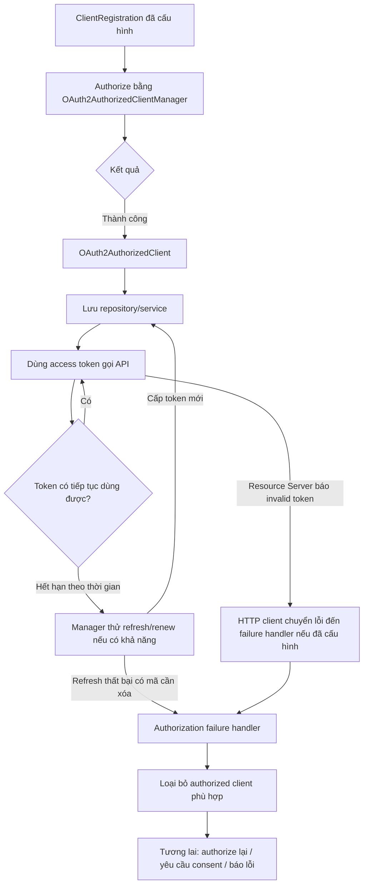
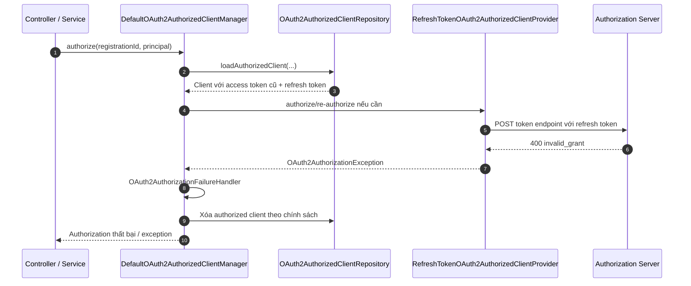
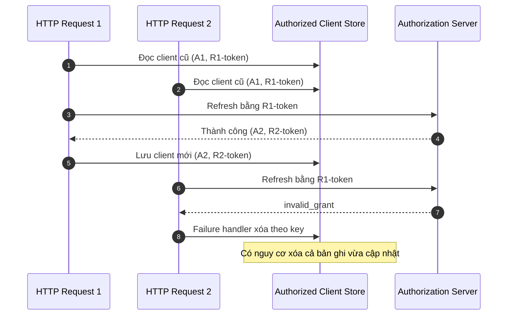

# 15.9. Authorization failure handler và xử lý authorized client không còn hợp lệ

Trong **Spring Security OAuth 2.0 / OIDC Client**, một `OAuth2AuthorizedClient` chứa thông tin `ClientRegistration`, principal và token đã được cấp. Nó có thể được giữ trong HTTP session hoặc một kho lưu trữ độc lập để tái sử dụng khi ứng dụng gọi Resource Server.

Nhưng authorized client không tồn tại vĩnh viễn. Người dùng có thể thu hồi consent; refresh token có thể hết hạn, bị rotate hoặc bị revoke; Authorization Server có thể trả `invalid_grant`; Resource Server có thể từ chối access token bằng `invalid_token`. Nếu ứng dụng vẫn tái sử dụng bản ghi cũ, các lần gọi tiếp theo có thể liên tục thất bại.

Spring Security cung cấp **`OAuth2AuthorizationFailureHandler`** và implementation **`RemoveAuthorizedClientOAuth2AuthorizationFailureHandler`** để xử lý trường hợp này có kiểm soát: phát hiện thất bại authorization phù hợp, loại bỏ authorized client đã mất hiệu lực khỏi đúng kho lưu trữ, rồi để lần sử dụng sau thực hiện authorization hoặc re-authorization theo cấu hình.

Bài học giải thích cụ thể **khi nào failure handler chạy**, **xóa authorized client có ý nghĩa gì**, **vì sao lỗi từ Authorization Server khác 401/403 của Resource Server**, cách cấu hình trong Servlet và service-level manager, cũng như các chiến lược tránh redirect loop, retry vô hạn và xóa nhầm token của người dùng khác.

> Ngữ cảnh chính: Spring Boot 3.x, Spring Security 6.x trên Servlet stack, gồm `DefaultOAuth2AuthorizedClientManager`, `AuthorizedClientServiceOAuth2AuthorizedClientManager` và các HTTP client tích hợp. API cần được đối chiếu với phiên bản Spring Security thực tế; ví dụ domain `example.test` chỉ mang tính minh họa.

## 1. Tóm tắt vòng đời authorized client

**`ClientRegistration`** mô tả cấu hình client: `registrationId`, `clientId`, client secret khi áp dụng, grant type, scope, token endpoint và các thông tin provider.

**`OAuth2AuthorizedClient`** biểu diễn trạng thái sau khi authorization thành công:

```text
ClientRegistration: company
Principal:          alice
Access token:       <opaque-or-jwt>
Expires at:         2026-11-16T10:00:00Z
Refresh token:      <optional>
```

Trong Java, có thể lấy thông tin:

```java
OAuth2AuthorizedClient client = /* đã được Spring Security quản lý */;
String registrationId =
    client.getClientRegistration().getRegistrationId();
String principalName = client.getPrincipalName();
OAuth2AccessToken accessToken = client.getAccessToken();
OAuth2RefreshToken refreshToken = client.getRefreshToken(); // Có thể null
```

**Access token và refresh token là thông tin xác thực nhạy cảm**. Đừng in các giá trị token vào log, response HTML/JSON, URL hoặc ticket hỗ trợ.

Một vòng đời điển hình:



**Việc một token tới thời điểm hết hạn không nhất thiết là authorization failure**: manager có thể chủ động refresh thành công rồi lưu authorized client mới. Failure handler quan trọng khi *quá trình cấp lại token hoặc sử dụng token thực sự thất bại* và ứng dụng cần tránh dùng lại trạng thái không còn hợp lệ.

## 2. Ba loại lỗi không nên đánh đồng

### 2.1. Authorization Server từ chối cấp hoặc cấp lại token

Ví dụ khi refresh:

```http
POST /oauth2/token HTTP/1.1
Host: id.example.test
Content-Type: application/x-www-form-urlencoded

grant_type=refresh_token&refresh_token=<redacted>
```

Authorization Server trả:

```http
HTTP/1.1 400 Bad Request
Content-Type: application/json

{
  "error": "invalid_grant",
  "error_description": "Refresh token is invalid or revoked"
}
```

`invalid_grant` là lỗi **ở token endpoint**. Khi refresh token bị revoke/hết hạn hoặc không còn khớp client, bản ghi authorized client lưu token cũ thường không còn giá trị để re-authorize bằng refresh token ấy.

`DefaultOAuth2AuthorizedClientManager` và `AuthorizedClientServiceOAuth2AuthorizedClientManager` đều có cơ chế failure handler mặc định loại bỏ authorized client đã lưu khi thất bại phù hợp, điển hình là `invalid_grant`.

### 2.2. Resource Server từ chối access token

Ứng dụng dùng token để gọi API:

```http
GET /v1/reports HTTP/1.1
Host: api.example.test
Authorization: Bearer <redacted>
```

API có thể trả:

```http
HTTP/1.1 401 Unauthorized
WWW-Authenticate: Bearer error="invalid_token"
```

Đây là lỗi **từ Resource Server**, không phải từ token endpoint. `OAuth2AuthorizedClientManager` không tự biết mọi phản hồi HTTP của API nếu bạn tự tạo một `RestClient`/`HttpURLConnection` riêng không chuyển lỗi sang nó.

Nếu dùng `OAuth2ClientHttpRequestInterceptor` của Spring Security và cấu hình `authorizationFailureHandler(...)`, HTTP client có thể chuyển các lỗi authentication/authorization được nhận diện từ Resource Server đến failure handler để cân nhắc loại bỏ authorized client không còn dùng được.

### 2.3. API trả 403 vì không đủ quyền

Ví dụ:

```http
HTTP/1.1 403 Forbidden
WWW-Authenticate: Bearer error="insufficient_scope", scope="reports.write"
```

Token có thể **hợp lệ về mặt xác thực** nhưng không có quyền gọi API này. Việc xóa token rồi xin lại **cùng scope cũ** có thể chỉ dẫn đến một vòng lỗi mới.

Do vậy, 401/403 không phải tín hiệu chung “xóa mọi authorized client”. Phải xét **error code, ngữ cảnh request, registration, principal và chính sách API**. Với lỗi `insufficient_scope`, cần xem scope, consent và phân quyền thay vì mặc định refresh để có thêm quyền.

| Nguồn lỗi | Ví dụ | Ý nghĩa chính | Hành động hợp lý |
| --- | --- | --- | --- |
| Token endpoint | `invalid_grant` | Refresh token hoặc grant không hợp lệ | Loại authorized client cũ khi phù hợp; authorization mới |
| Token endpoint | `invalid_client` | Client authentication/configuration sai | Cảnh báo cấu hình; không retry token cũ vô hạn |
| Resource Server | 401 + `invalid_token` | Access token không được chấp nhận | Loại token/client hỏng nếu error được nhận diện; xin lại token khi được phép |
| Resource Server | 403 + `insufficient_scope` | Thiếu quyền/scope | Sửa scope/consent/policy; không coi là token hỏng |
| Resource Server | 503 / timeout | Sự cố hạ tầng nhất thời | Retry có giới hạn nếu an toàn; không tự xóa client |
| Browser authorization | `access_denied` | User/OP từ chối authorization | Thông báo cho user; không cưỡng bức redirect lại |
| Client-side correlation | `invalid_state` | Callback không khớp giao dịch | Từ chối flow, kiểm tra session; không liên quan trực tiếp token cache cũ |

## 3. OAuth2AuthorizationFailureHandler là gì?

Spring Security định nghĩa functional interface:

```java
package org.springframework.security.oauth2.client;

@FunctionalInterface
public interface OAuth2AuthorizationFailureHandler {

    void onAuthorizationFailure(
        OAuth2AuthorizationException authorizationException,
        Authentication principal,
        Map<String, Object> attributes);
}
```

Đây là chữ ký minh họa theo API Spring Security. Ba tham số mang ngữ cảnh:

- **`OAuth2AuthorizationException`**: lỗi OAuth2, có thể lấy `getError().getErrorCode()`.
- **`Authentication principal`**: danh tính mà authorization/re-authorization đang thực hiện. Không phải raw access token.
- **`Map<String, Object> attributes`**: các thuộc tính liên quan đến context, có thể chứa `HttpServletRequest`/`HttpServletResponse` khi chạy trong môi trường Servlet.

Handler có thể ghi event nội bộ, xóa authorized client theo chính sách, cập nhật metric hoặc phối hợp các hành động bảo mật. Nó **không phải** `AuthenticationFailureHandler` của login form/OIDC callback và không phải global handler cho mọi exception HTTP.

### 3.1. Đối tượng OAuth2Error

Một authorization exception có `OAuth2Error`:

```java
String errorCode = authorizationException.getError().getErrorCode();
String description = authorizationException.getError().getDescription();
String errorUri = authorizationException.getError().getUri();
```

Trong thực tế:

- Sử dụng **`errorCode`** để phân loại bằng allowlist.
- `description` có thể đến từ nhà cung cấp bên ngoài; không render hoặc log nguyên văn một cách tùy tiện.
- `errorUri` là URL tài liệu tùy chọn, **không phải URL an toàn để tự động redirect hoặc backend fetch**.

Handler nên dùng mã lỗi và metadata an toàn, không đưa credential hoặc dữ liệu không tin cậy vào log.

### 3.2. Handler được gọi ở thời điểm nào?

Handler được kích hoạt khi thành phần đã được cấu hình nhận diện một **authorization failure**. Ví dụ:

1. Manager đang refresh token và token endpoint trả `invalid_grant`.
2. HTTP client interceptor chuyển lỗi token từ Resource Server đến handler khi đã đăng ký.
3. Một implementation của manager/provider phát hiện lỗi ủy quyền và gọi handler theo hợp đồng của nó.

Ngược lại, một REST controller tự gửi bearer token rồi nhận 401 **không mặc định khiến manager tự động chạy failure handler**. Cần dây nối giữa HTTP client và handler hoặc logic ứng dụng tương ứng.

## 4. RemoveAuthorizedClientOAuth2AuthorizationFailureHandler

Spring Security cung cấp implementation **`RemoveAuthorizedClientOAuth2AuthorizationFailureHandler`**.

Nó dùng một chiến lược `OAuth2AuthorizedClientRemover` để xóa authorized client **chỉ khi mã lỗi thuộc tập error codes được cấu hình**.

Khái niệm:

```text
OAuth2AuthorizationException
    |
    v
errorCode thuộc tập configured remove codes?
    |
    +--- Không ---> Không xóa authorized client bằng handler này
    |
    +--- Có -----> Xác định registration ID + principal
                    |
                    v
                 Remover
                    |
                    +-- OAuth2AuthorizedClientRepository (Servlet)
                    |
                    +-- OAuth2AuthorizedClientService (service-level)
```

Implementation này có thể tạo với:

```java
new RemoveAuthorizedClientOAuth2AuthorizationFailureHandler(remover);
```

hoặc chỉ định tập error code riêng:

```java
new RemoveAuthorizedClientOAuth2AuthorizationFailureHandler(
    remover,
    Set.of("invalid_grant", "invalid_token"));
```

Đây là hình thức minh họa; việc thêm/bớt mã vào tập xóa phải dựa vào giao thức và chính sách ứng dụng, không phải cách “chữa mọi lỗi” chung.

**Không nên mặc định xóa client cho mọi exception.** Một lỗi timeout của network không chứng minh refresh token đã bị thu hồi. Xóa bừa có thể khiến người dùng liên tục phải đăng nhập lại hoặc làm tăng tải lên OP.

### 4.1. Tập mã mặc định

Class có hằng:

```java
RemoveAuthorizedClientOAuth2AuthorizationFailureHandler
    .DEFAULT_REMOVE_AUTHORIZED_CLIENT_ERROR_CODES
```

Hằng biểu diễn tập OAuth 2.0 error codes mặc định dẫn tới removal. **Nội dung tập này nên được xác minh theo phiên bản Spring Security bạn triển khai**, thay vì tự suy đoán rằng mọi 401 hoặc 403 đều nằm trong đó.

Tài liệu manager xác nhận trường hợp cơ bản: **`invalid_grant` trong quá trình refresh là một lý do để loại bỏ authorized client trước đó**.

### 4.2. Constructor nhận remover, không nhận trực tiếp repository

Trong Spring Security 6.x, constructor nhận:

```java
RemoveAuthorizedClientOAuth2AuthorizationFailureHandler(
    RemoveAuthorizedClientOAuth2AuthorizationFailureHandler
        .OAuth2AuthorizedClientRemover remover)
```

`OAuth2AuthorizedClientRemover` là functional interface với tham số registration ID, `Authentication` và attributes.

Đừng viết code dựa trên giả định `new RemoveAuthorizedClientOAuth2AuthorizationFailureHandler(repository)` nếu API phiên bản bạn đang dùng không có constructor như vậy. Với HTTP client interceptor, Spring Security cung cấp **factory method** hỗ trợ repository/service để tạo failure handler phù hợp, được trình bày ở mục 8.

## 5. DefaultOAuth2AuthorizedClientManager trong Servlet

`DefaultOAuth2AuthorizedClientManager` là manager thông dụng trong **`HttpServletRequest` context**. Nó sử dụng:

- **`ClientRegistrationRepository`**: tìm cấu hình client theo registration ID.
- **`OAuth2AuthorizedClientRepository`**: lưu, tải và loại bỏ authorized client với request/response/principal.
- **`OAuth2AuthorizedClientProvider`**: xử lý những grant được bật, ví dụ authorization code, refresh token, client credentials.
- **Success/failure handlers**: quyết định persistence của client khi authorization hoàn tất hoặc thất bại.

Quy trình khi refresh token:



Mô tả cho thấy trách nhiệm logic, không yêu cầu bạn tự gọi `onAuthorizationFailure(...)` trong controller. Với manager mặc định, các thành phần đã phối hợp việc này.

### 5.1. Cấu hình manager cơ bản

```java
import org.springframework.context.annotation.Bean;
import org.springframework.context.annotation.Configuration;
import org.springframework.security.oauth2.client.OAuth2AuthorizedClientManager;
import org.springframework.security.oauth2.client.OAuth2AuthorizedClientProvider;
import org.springframework.security.oauth2.client.OAuth2AuthorizedClientProviderBuilder;
import org.springframework.security.oauth2.client.registration.ClientRegistrationRepository;
import org.springframework.security.oauth2.client.web.DefaultOAuth2AuthorizedClientManager;
import org.springframework.security.oauth2.client.web.OAuth2AuthorizedClientRepository;

@Configuration
class ServletAuthorizedClientConfig {

    @Bean
    OAuth2AuthorizedClientManager authorizedClientManager(
            ClientRegistrationRepository registrations,
            OAuth2AuthorizedClientRepository authorizedClients) {

        OAuth2AuthorizedClientProvider provider =
            OAuth2AuthorizedClientProviderBuilder.builder()
                .authorizationCode()
                .refreshToken()
                .clientCredentials()
                .build();

        DefaultOAuth2AuthorizedClientManager manager =
            new DefaultOAuth2AuthorizedClientManager(
                registrations, authorizedClients);

        manager.setAuthorizedClientProvider(provider);

        // Không gọi setAuthorizationFailureHandler nếu muốn
        // dùng behavior mặc định: removal cho invalid_grant...
        return manager;
    }
}
```

Đây là cấu hình tham khảo cho Servlet app. Có hệ thống Spring Boot đã tạo bean manager phù hợp, không cần định nghĩa lại nếu chưa có nhu cầu tùy biến.

**Điểm đáng lưu ý:** nếu bạn gọi `manager.setAuthorizationFailureHandler(customHandler)`, bạn đang **thay thế handler mặc định**. Nếu custom handler chỉ log mà không gọi cleanup tương ứng, bạn có thể vô tình làm mất hành vi xóa authorized client bị `invalid_grant`.

### 5.2. Không sửa lỗi refresh bằng cách cập nhật expiresAt

Một access token đã hết hạn có thể được refresh; nhưng nếu refresh token bị revoke, việc tự đặt `expiresAt` sang ngày mai hoặc bỏ qua check expiration không giúp token hợp lệ ở Authorization Server/Resource Server.

Cách xử lý đúng là thừa nhận grant đã không còn hiệu lực, loại bỏ trạng thái không thể tái sử dụng và **thực hiện authorization mới** nếu người dùng hoặc nghiệp vụ được phép.

## 6. Manager dành cho service hoặc background task

Không phải luồng nào cũng chạy trong Servlet request. Ví dụ:

- `@Scheduled` job gọi API bằng `client_credentials`.
- Queue consumer gọi một Resource Server thay mặt ứng dụng.
- Service worker không có `HttpServletRequest`.
- Batch import cần lấy token máy–máy.

Trong ngữ cảnh này, thường dùng:

**`AuthorizedClientServiceOAuth2AuthorizedClientManager`** với **`OAuth2AuthorizedClientService`**.

Khác với Servlet manager, service-level manager lưu token theo registration ID và principal name trong service; không đòi hỏi HTTP request/response để thao tác.

### 6.1. Cấu hình manager service-level

```java
import org.springframework.context.annotation.Bean;
import org.springframework.context.annotation.Configuration;
import org.springframework.security.oauth2.client.AuthorizedClientServiceOAuth2AuthorizedClientManager;
import org.springframework.security.oauth2.client.OAuth2AuthorizedClientManager;
import org.springframework.security.oauth2.client.OAuth2AuthorizedClientProvider;
import org.springframework.security.oauth2.client.OAuth2AuthorizedClientProviderBuilder;
import org.springframework.security.oauth2.client.OAuth2AuthorizedClientService;
import org.springframework.security.oauth2.client.registration.ClientRegistrationRepository;

@Configuration
class ServiceClientManagerConfig {

    @Bean
    OAuth2AuthorizedClientManager machineAuthorizedClientManager(
            ClientRegistrationRepository registrations,
            OAuth2AuthorizedClientService authorizedClientService) {

        OAuth2AuthorizedClientProvider provider =
            OAuth2AuthorizedClientProviderBuilder.builder()
                .clientCredentials()
                .refreshToken()
                .build();

        AuthorizedClientServiceOAuth2AuthorizedClientManager manager =
            new AuthorizedClientServiceOAuth2AuthorizedClientManager(
                registrations,
                authorizedClientService);

        manager.setAuthorizedClientProvider(provider);

        // Mặc định cũng có failure handler để xóa
        // authorized client cho các lỗi phù hợp.
        return manager;
    }
}
```

Mỗi client registration chỉ dùng grant thực sự được cấu hình và được Authorization Server chấp nhận. **`client_credentials` không phải đăng nhập người dùng**; service sử dụng một principal kỹ thuật ổn định.

### 6.2. Ví dụ gọi authorize trong job

```java
import org.springframework.security.oauth2.client.OAuth2AuthorizeRequest;
import org.springframework.security.oauth2.client.OAuth2AuthorizedClient;
import org.springframework.security.oauth2.client.OAuth2AuthorizedClientManager;

class BillingJob {

    private final OAuth2AuthorizedClientManager manager;

    BillingJob(OAuth2AuthorizedClientManager manager) {
        this.manager = manager;
    }

    OAuth2AuthorizedClient getBillingClient() {
        OAuth2AuthorizeRequest request =
            OAuth2AuthorizeRequest.withClientRegistrationId("billing-service")
                .principal("billing-worker")
                .build();

        OAuth2AuthorizedClient client = manager.authorize(request);

        if (client == null) {
            throw new IllegalStateException(
                "Client authorization not supported or unavailable");
        }

        return client;
    }
}
```

Để gắn đúng manager khi có nhiều bean, cấu hình `@Qualifier`/tên bean theo quy ước dự án. Đừng lấy nhầm Servlet manager cho thread background không có HTTP request.

**Lưu ý:** `manager.authorize(...)` trả `null` khi grant không được hỗ trợ hoặc authorization không cần được thực hiện trong một số tình huống theo hợp đồng API; nhiều thất bại token endpoint được biểu diễn bằng exception. Không mặc định rằng mọi lỗi đều trả `null`.

## 7. Tùy chỉnh authorization failure handler mà không mất cleanup

Khi triển khai thực tế, bạn có thể muốn:

1. Ghi nhận sự kiện refresh token không hợp lệ.
2. Phân nhóm lỗi để hiển thị UX hoặc tạo cảnh báo.
3. **Vẫn giữ behavior xóa authorized client cũ** khi mã lỗi thuộc loại cần loại bỏ.

Cách hợp lý là **delegate tới `RemoveAuthorizedClientOAuth2AuthorizationFailureHandler`** thay vì chỉ thay handler bằng logger.

### 7.1. Ví dụ service-level: logging + xóa

```java
import org.slf4j.Logger;
import org.slf4j.LoggerFactory;
import org.springframework.context.annotation.Bean;
import org.springframework.context.annotation.Configuration;
import org.springframework.security.oauth2.client.AuthorizedClientServiceOAuth2AuthorizedClientManager;
import org.springframework.security.oauth2.client.OAuth2AuthorizationFailureHandler;
import org.springframework.security.oauth2.client.OAuth2AuthorizedClientManager;
import org.springframework.security.oauth2.client.OAuth2AuthorizedClientProviderBuilder;
import org.springframework.security.oauth2.client.OAuth2AuthorizedClientService;
import org.springframework.security.oauth2.client.RemoveAuthorizedClientOAuth2AuthorizationFailureHandler;
import org.springframework.security.oauth2.client.registration.ClientRegistrationRepository;

@Configuration
class ObservedClientManagerConfig {

    private static final Logger log =
        LoggerFactory.getLogger(ObservedClientManagerConfig.class);

    @Bean
    OAuth2AuthorizedClientManager observedMachineClientManager(
            ClientRegistrationRepository registrations,
            OAuth2AuthorizedClientService storage) {

        AuthorizedClientServiceOAuth2AuthorizedClientManager manager =
            new AuthorizedClientServiceOAuth2AuthorizedClientManager(
                registrations, storage);

        manager.setAuthorizedClientProvider(
            OAuth2AuthorizedClientProviderBuilder.builder()
                .clientCredentials()
                .refreshToken()
                .build());

        // Remover nhận registrationId, Authentication, context attributes.
        OAuth2AuthorizationFailureHandler removeOnKnownError =
            new RemoveAuthorizedClientOAuth2AuthorizationFailureHandler(
                (registrationId, principal, attributes) ->
                    storage.removeAuthorizedClient(
                        registrationId, principal.getName()));

        manager.setAuthorizationFailureHandler(
            (exception, principal, attributes) -> {
                String category =
                    classify(exception.getError().getErrorCode());

                // Không log exception/description/raw token.
                log.warn("OAuth2 client authorization failed: category={}",
                    category);

                // Giữ cơ chế xóa theo tập lỗi mặc định của Spring Security.
                removeOnKnownError.onAuthorizationFailure(
                    exception, principal, attributes);
            });

        return manager;
    }

    private static String classify(String code) {
        if ("invalid_grant".equals(code)) {
            return "invalid_grant";
        }
        if ("invalid_client".equals(code)) {
            return "client_configuration";
        }
        if ("temporarily_unavailable".equals(code)) {
            return "provider_unavailable";
        }
        return "authorization_failed";
    }
}
```

Ví dụ này minh họa service-level persistence và cách *delegate*. `RemoveAuthorizedClientOAuth2AuthorizationFailureHandler` quyết định **khi nào mã lỗi yêu cầu xóa**, còn remover lambda biết **xóa ở đâu**: `storage.removeAuthorizedClient(registrationId, principal.getName())`.

Nếu ứng dụng dùng repository phụ thuộc request Servlet, phải dùng remover phù hợp với repository và HTTP context (hoặc API trợ giúp sẵn có), **không lấy service-level remover áp dụng cho một nơi lưu khác**.

### 7.2. Vì sao không xóa ở mọi lỗi?

Một handler sai dễ gặp:

```java
// KHÔNG NÊN: xóa token cho mọi lỗi bất kể nguyên nhân.
manager.setAuthorizationFailureHandler((exception, principal, attrs) -> {
    authorizedClientService.removeAuthorizedClient(
        "company", principal.getName());
});
```

Vấn đề:

- Hardcode registration `company` có thể xóa nhầm client trong ứng dụng nhiều provider.
- Lỗi timeout có thể làm mất token vẫn còn hợp lệ.
- Xóa ngay trên mọi loại lỗi có thể gây prompt login/consent lặp.
- Không xét trường hợp nhiều lần refresh đồng thời.
- Không rõ nguồn lưu hiện tại là repository hay service.

**Thay bằng handler có chính sách dựa trên error code và context**, và để remover sử dụng registration ID mà framework chuyển đến.

### 7.3. Nếu cần tập mã removal tùy chỉnh

Constructor cho phép cấu hình tập mã:

```java
new RemoveAuthorizedClientOAuth2AuthorizationFailureHandler(
    remover,
    Set.of("invalid_grant", "invalid_token"));
```

Không sao chép ví dụ này một cách máy móc: cần nghiên cứu mã lỗi thực tế ở bước authorization hay Resource Server, điều kiện bạn muốn xóa và hệ quả của mỗi loại. Dùng hằng tập mặc định của Spring Security khi không có lý do cụ thể để khác nó.

## 8. Lỗi từ Resource Server: phải nối failure handler vào HTTP client

Đây là điểm khác biệt quan trọng giữa **“refresh tại token endpoint thất bại”** và **“access token gửi API bị từ chối”**.

Khi dùng Spring Framework `RestClient` kết hợp Spring Security, **`OAuth2ClientHttpRequestInterceptor`** hỗ trợ:

- Đưa bearer access token thích hợp vào outbound request.
- Dùng `OAuth2AuthorizedClientManager` để tìm/cấp/refresh authorized client theo cấu hình.
- Chuyển authentication/authorization error từ Resource Server tới `OAuth2AuthorizationFailureHandler` nếu đã đăng ký.

Lớp `OAuth2ClientHttpRequestInterceptor` có trong Spring Security từ phiên bản **6.4**. Dự án dùng Spring Security cũ hơn cần dùng tích hợp HTTP client hỗ trợ tương ứng hoặc cơ chế tự xử lý có kiểm soát.

### 8.1. Cấu hình RestClient trong Servlet với repository

```java
import org.springframework.context.annotation.Bean;
import org.springframework.context.annotation.Configuration;
import org.springframework.security.oauth2.client.OAuth2AuthorizationFailureHandler;
import org.springframework.security.oauth2.client.OAuth2AuthorizedClientManager;
import org.springframework.security.oauth2.client.web.OAuth2AuthorizedClientRepository;
import org.springframework.security.oauth2.client.web.client.OAuth2ClientHttpRequestInterceptor;
import org.springframework.web.client.RestClient;

@Configuration
class ReportsRestClientConfig {

    @Bean
    RestClient reportsRestClient(
            OAuth2AuthorizedClientManager manager,
            OAuth2AuthorizedClientRepository storage) {

        OAuth2ClientHttpRequestInterceptor interceptor =
            new OAuth2ClientHttpRequestInterceptor(manager);

        OAuth2AuthorizationFailureHandler failureHandler =
            OAuth2ClientHttpRequestInterceptor
                .authorizationFailureHandler(storage);

        interceptor.setAuthorizationFailureHandler(failureHandler);

        return RestClient.builder()
            .baseUrl("https://api.example.test")
            .requestInterceptor(interceptor)
            .build();
    }
}
```

Ở ví dụ:

1. Manager lấy token cho client.
2. Interceptor gắn Bearer Authorization header tới API.
3. API có thể trả 401/403 với OAuth2 Bearer error.
4. Interceptor đưa lỗi được nhận diện sang failure handler.
5. Failure handler có thể xóa authorized client trong **`OAuth2AuthorizedClientRepository`**, tùy error code.

**Không có bảo đảm cứ HTTP 403 là authorized client bị xóa.** Interceptor truyền thông tin lỗi; handler quyết định có xóa hay không dựa trên tập mã lỗi được cấu hình.

### 8.2. Chỉ định registration trong lời gọi API

```java
import static org.springframework.security.oauth2.client.web.client
    .RequestAttributeClientRegistrationIdResolver.clientRegistrationId;

// Một service chạy trong request có Authentication tương ứng.
String body = reportsRestClient.get()
    .uri("/v1/reports")
    .attributes(clientRegistrationId("company"))
    .retrieve()
    .body(String.class);
```

Trong Java thực tế, một static import phải nằm trên **một dòng**:

```java
import static org.springframework.security.oauth2.client.web.client.RequestAttributeClientRegistrationIdResolver.clientRegistrationId;
```

Với `clientRegistrationId("company")`, interceptor biết registration nào cần lấy token. Nếu HTTP client gọi nhiều API, cần đảm bảo từng lời gọi chỉ định registration đúng để tránh gửi token cho API không tương ứng.

### 8.3. Nếu dùng OAuth2AuthorizedClientService

Với một client service-level hoặc kho token riêng, Spring Security có factory method tương tự:

```java
OAuth2AuthorizationFailureHandler handler =
    OAuth2ClientHttpRequestInterceptor
        .authorizationFailureHandler(authorizedClientService);

interceptor.setAuthorizationFailureHandler(handler);
```

Chọn **repository hay service đúng với nơi manager thực sự lưu authorized client**. Nếu manager ghi vào service A nhưng failure handler xóa repository B, token lỗi có thể còn nguyên trong A và tiếp tục được tái sử dụng.

### 8.4. Tại sao phải cấu hình cả client manager lẫn HTTP interceptor?

Hai nguồn lỗi đi qua hai đường khác nhau:

```text
[Authorization Server]
    |
    | refresh token -> invalid_grant
    v
OAuth2AuthorizedClientManager
    |
    v
Authorization failure handler
    |
    v
Xóa authorized client nếu phù hợp

[Resource Server]
    |
    | Bearer access token -> 401 invalid_token
    v
OAuth2ClientHttpRequestInterceptor
    |
    v
Configured OAuth2AuthorizationFailureHandler
    |
    v
Xóa authorized client nếu phù hợp
```

**Cấu hình failure handler trên manager không tự động khiến mọi RestClient tùy biến chuyển lỗi Resource Server đến handler.** Đường thứ hai cần HTTP client integration.

## 9. Phân biệt HTTP status với OAuth2 error code

Một vài trường hợp minh họa:

### 9.1. 401 + invalid_token

```http
HTTP/1.1 401 Unauthorized
WWW-Authenticate: Bearer realm="reports", error="invalid_token"
```

Đây là tín hiệu điển hình access token không dùng được: expired, revoked, malformed hoặc bị từ chối vì lý do khác. Với HTTP client được cấu hình handler, authorized client có thể bị loại khỏi cache; lần gọi sau có thể lấy token mới hoặc yêu cầu authorization lại.

### 9.2. 403 + insufficient_scope

```http
HTTP/1.1 403 Forbidden
WWW-Authenticate: Bearer error="insufficient_scope",
                  scope="reports.write"
```

Token vẫn có thể xác thực hợp lệ, nhưng không được phép ghi báo cáo. Cần cấp đúng scope/consent hoặc thay chính sách API. Nếu bạn cứ loại client và xin lại token cùng scope, lỗi sẽ tái diễn.

### 9.3. 401 không có Bearer challenge hợp lệ

```http
HTTP/1.1 401 Unauthorized
Content-Type: text/plain

Upstream authentication failed
```

Có thể response do API gateway, proxy hoặc cơ chế xác thực khác phát ra. Không mặc định đây là `invalid_token` của OAuth2 Resource Server. Cần quan sát `WWW-Authenticate`, loại response, nơi phát sinh và tài liệu API.

### 9.4. 500, 502, 503 và timeout

Đây thường là vấn đề hạ tầng hoặc lỗi ứng dụng phía API. Chúng không chứng minh refresh token đã bị thu hồi. Nên phân loại theo chính sách retry/circuit breaker, không tự xóa authorized client ngay khi thấy exception bất kỳ.

## 10. Điều gì thực sự xảy ra sau khi xóa authorized client?

**Xóa bản ghi nội bộ** không đồng nghĩa với bất kỳ hành động nào sau đây:

- Không tự thu hồi access token hoặc refresh token tại Authorization Server.
- Không tự logout người dùng khỏi OpenID Provider.
- Không tự xóa SecurityContext hay HTTP session đăng nhập.
- Không tự cấp quyền hoặc consent mới.
- Không bảo đảm lời gọi API tiếp theo sẽ thành công.
- Không xóa mọi authorized client khác của cùng user.

Một ví dụ trong ứng dụng:

```text
Trước:
  company + alice -> { access_token=A1, refresh_token=R1 }

Refresh:
  R1 -> token endpoint -> invalid_grant

Failure handler:
  remove(company, alice)

Sau:
  company + alice -> không còn record trong storage

Lần dùng sau:
  manager cần authorize lại nếu grant/flow hỗ trợ
```

Trong authorization_code, yêu cầu cấp mới có thể cần **trình duyệt đi qua OP**; nếu người dùng không có phiên/consent phù hợp, UI cần cho phép họ đăng nhập hoặc cấp quyền lại.

Trong client_credentials, manager có thể lấy token ứng dụng mới trực tiếp từ token endpoint nếu client credentials vẫn đúng.

### 10.1. Không xóa toàn bộ session của user vì một token API hỏng

Người dùng có thể đăng nhập bằng `company-login` nhưng cũng có authorized client `calendar-api`. Nếu calendar token bị revoke, thông thường chỉ cần xử lý record calendar phù hợp.

```text
(company-login, alice) -> OIDC login session
(calendar-api, alice)  -> OAuth2 token để đọc lịch
(reports-api, alice)   -> OAuth2 token để xem báo cáo
```

Nếu `calendar-api` bị `invalid_grant`, đừng xóa nhầm `reports-api` hoặc toàn bộ `SecurityContext` mà không có chính sách logout/ủy quyền liên quan.

### 10.2. Trường hợp thật sự muốn revoke token

Nếu sản phẩm yêu cầu thu hồi token ở OP khi logout/ngắt kết nối tài khoản, cần sử dụng cơ chế **token revocation endpoint** khi Authorization Server hỗ trợ, cùng authentication và error handling phù hợp. Thao tác đó khác với `RemoveAuthorizedClientOAuth2AuthorizationFailureHandler`, vốn chủ yếu **dọn trạng thái tại client**.

## 11. Phân biệt AuthorizedClientRepository và AuthorizedClientService

Hai abstraction đều lưu authorized client nhưng phạm vi thao tác khác nhau:

| Thành phần | Ngữ cảnh phổ biến | Chữ ký thao tác loại bỏ |
| --- | --- | --- |
| **`OAuth2AuthorizedClientRepository`** | Servlet request/response | `removeAuthorizedClient(registrationId, principal, request, response)` |
| **`OAuth2AuthorizedClientService`** | Service/background, không phụ thuộc Servlet request | `removeAuthorizedClient(registrationId, principalName)` |

Đối với Servlet manager, handler cần lấy đúng HTTP context nếu repository yêu cầu. Đối với service-level manager, chỉ cần registration ID và principal name đã xác định.

### 11.1. Cẩn trọng khi nhiều manager trong cùng ứng dụng

Một hệ thống có thể có:

```text
Web manager:
  DefaultOAuth2AuthorizedClientManager
  OAuth2AuthorizedClientRepository (session)

Job manager:
  AuthorizedClientServiceOAuth2AuthorizedClientManager
  OAuth2AuthorizedClientService (database)
```

Nếu token lỗi nằm trong database nhưng handler xóa session repository, lần authorize sau có thể lại dùng token cũ từ database. Các thành phần manager, store và failure handler phải thành một bộ cấu hình nhất quán.

### 11.2. Token storage phải được bảo vệ

Khi lưu authorized client trong database/Redis:

- Mã hóa dữ liệu nhạy cảm khi lưu trữ theo chính sách, bảo vệ keys.
- Giới hạn quyền đọc/ghi của dịch vụ và quyền của người vận hành.
- Có retention, TTL hoặc chiến lược cleanup phù hợp.
- Tách registration, principal, tenant và môi trường để tránh trộn dữ liệu.
- Không log toàn bộ object `OAuth2AuthorizedClient` hoặc token value.
- Thiết kế giao thức cập nhật/xóa khi nhiều instance cùng thao tác.

## 12. Khi nhiều request cùng refresh token: race condition

Một tình huống khó xảy ra dưới tải nhẹ nhưng quan trọng trong production:

1. Access token A1 đã hết hạn.
2. Hai HTTP request R1 và R2 của cùng user/registration chạy gần đồng thời.
3. Cả hai đọc authorized client cũ có refresh token R1.
4. R1 refresh thành công, OP cấp access token A2 và refresh token R2 theo rotation.
5. R2 cố dùng refresh token R1 đã bị sử dụng, token endpoint trả `invalid_grant`.
6. Handler của R2 xóa authorized client theo key, có thể xóa luôn bản ghi mới A2/R2 do request đầu vừa lưu.



**Cơ chế handler mặc định không tự cam kết giải quyết mọi race condition ở kho lưu trữ tùy biến**. Nếu ứng dụng có traffic lớn và refresh token rotation, cần cân nhắc:

- **Single-flight/lock theo `(registrationId, principal)`** cho quá trình refresh.
- **Optimistic locking** hoặc version field cho record token.
- **Compare-and-delete**: chỉ xóa khi record trong store vẫn là phiên bản/token generation mà request lỗi đã dùng.
- Cơ chế phân phối giữa nhiều instance hoặc shared storage.
- Chính sách refresh sớm có giới hạn, TTL và token rotation phù hợp.
- Không replay một refresh token cũ sau khi token endpoint đã báo `invalid_grant`.

Đây là chiến lược vận hành cho hệ thống đồng thời; tùy persistence implementation, việc áp dụng cần được thiết kế ở lớp store/manager thay vì chỉ chèn logic vào controller.

## 13. Xử lý UX sau khi authorized client bị xóa

Khi việc xóa xảy ra, ứng dụng không nên che giấu sự kiện bằng redirect loop.

### 13.1. Với người dùng đăng nhập qua browser

Nếu token cho API thứ ba bị revoke:

- Giữ trạng thái đăng nhập ứng dụng nếu còn hợp lệ và chính sách cho phép.
- Hiển thị “Kết nối với dịch vụ đã hết hiệu lực; vui lòng kết nối lại”.
- Cung cấp nút bắt đầu authorization mới cho **đúng registration**.
- Chỉ retry flow tự động khi biết có thể hoàn tất không tương tác và không vượt qua lựa chọn consent của người dùng.
- Nếu OP trả `access_denied`, tôn trọng việc user từ chối; không điều hướng vô hạn về OP.

Ví dụ UI logic:

```text
Trang reports
  |
  +-- Có authorized client -> gọi API
  |
  +-- invalid_grant -> xóa record reports-api
                      |
                      v
             "Kết nối Reports đã hết hiệu lực"
                      |
                      v
             Nút "Kết nối lại Reports"
                      |
                      v
             /oauth2/authorization/reports-api
```

Không tự gắn `error_description` từ provider vào HTML/redirect URL. Thông điệp UI nên do ứng dụng kiểm soát.

### 13.2. Với machine-to-machine

Nếu `client_credentials` token không còn hợp lệ nhưng client ID/secret vẫn đúng, manager có thể lấy token mới theo provider được cấu hình. Nếu token endpoint trả `invalid_client` do secret sai, cần cảnh báo vận hành và chặn retry vô hạn; đăng nhập lại bằng browser không giải quyết được.

### 13.3. Với thao tác POST/PUT nhạy cảm

Giả sử người dùng gửi `POST /payments`, HTTP client gọi downstream API và nhận lỗi bearer token. Không nên tự động thực hiện lại request ghi nếu không có idempotency key hoặc bảo đảm hệ thống không thực thi một phần.

Một cách xử lý phù hợp:

1. Dọn authorized client hỏng theo chính sách.
2. Trả lỗi có thể xử lý cho caller.
3. Khi có token mới, chỉ cho phép user hoặc workflow thực hiện lại theo quy tắc idempotency.
4. Tránh tạo lệnh thanh toán/đơn hàng trùng.

## 14. Không thay AuthorizationFailureHandler bằng AuthenticationFailureHandler

Hai tên gần giống nhau nhưng nằm ở hai lớp khác nhau:

| Thành phần | Xử lý lỗi gì? | Vị trí điển hình |
| --- | --- | --- |
| **`OAuth2AuthorizationFailureHandler`** | Authorization hoặc re-authorization của OAuth2 Client thất bại, ví dụ refresh token bị từ chối | `OAuth2AuthorizedClientManager` hoặc HTTP client tích hợp |
| **`AuthenticationFailureHandler`** | Quá trình xác thực người dùng qua filter thất bại, ví dụ OIDC login callback lỗi | `oauth2Login().failureHandler(...)` |
| **HTTP exception handler / error handler** | API downstream trả 4xx/5xx hoặc controller ném exception | REST client/controller/service |

Một ứng dụng có thể dùng cả ba, nhưng chúng không tự thay thế nhau.

Ví dụ `oauth2Login().failureHandler(...)` có thể đưa user về trang login sau lỗi callback. Nó **không tự biết** rằng refresh token đã bị revoke sau ba giờ khi background job gọi API.

Ngược lại, manager failure handler có thể loại authorized client cũ nhưng **không tự render trang HTML** cho người dùng. UX phải được xử lý ở web/controller/service layer.

## 15. Điều gì xảy ra khi không có refresh token?

Với Authorization Code Flow, OP không nhất thiết cấp refresh token. Nếu access token hết hạn và authorized client không có `getRefreshToken()`, manager không thể làm refresh token grant với dữ liệu đó.

Tùy cấu hình:

- User có thể cần bắt đầu authorization flow lại.
- Với `client_credentials`, client lấy token mới trực tiếp khi cần.
- Nếu ứng dụng dùng grant mở rộng, cần provider thích hợp.
- Manager có thể trả authorized client cũ khi reauthorization không được hỗ trợ/cần thiết theo hợp đồng; HTTP client vẫn phải xử lý token bị API từ chối.

Không cố dựng refresh token giả hoặc tự dùng ID Token để xin access token mới nếu Authorization Server không hỗ trợ flow tương ứng.

## 16. Token expiry không giống token revocation

Hai tình huống đều có thể dẫn đến việc token không dùng được, nhưng cách phát hiện khác nhau:

### 16.1. Expiration dự đoán được

`OAuth2AccessToken.getExpiresAt()` cho biết thời điểm hết hạn. Manager/provider có thể dùng thông tin này cùng clock skew để quyết định refresh trước khi gọi API.

### 16.2. Revocation thường phải được phát hiện từ bên ngoài

Authorization Server có thể revoke token trước expiration. Client không thể suy ra chỉ từ `expiresAt`. Resource Server có thể báo `invalid_token`; một số kiến trúc sử dụng introspection, revocation events hoặc tín hiệu từ provider để phát hiện.

**Đặt `expiresAt` sang tương lai không khiến token bị revoke trở lại hợp lệ**. Tương tự, một token chưa hết hạn theo đồng hồ của client vẫn có thể bị Resource Server từ chối.

### 16.3. Refresh token rotation

Một số provider trả refresh token mới khi refresh và thu hồi token cũ ngay. Client phải lưu **authorized client cập nhật** chứa token mới. Nếu tự lưu chỉ access token và bỏ refresh token mới, lần refresh sau có thể dùng R cũ dẫn tới `invalid_grant`.

Success handler và persistence strategy không kém quan trọng failure handler: sau cấp thành công cần ghi lại **cả bộ token mới** theo đúng repository/service.

## 17. Ví dụ end-to-end trong Servlet

Giả sử portal cho người dùng đăng nhập bằng OIDC registration `company` rồi gọi Reports API qua registration `reports-api`. Khi API trả lỗi token không hợp lệ, ứng dụng muốn dọn trạng thái reports-api.

### 17.1. Registration

```yaml
spring:
  security:
    oauth2:
      client:
        registration:
          company:
            provider: company
            client-id: ${LOGIN_CLIENT_ID}
            client-secret: ${LOGIN_CLIENT_SECRET}
            authorization-grant-type: authorization_code
            redirect-uri: "{baseUrl}/login/oauth2/code/{registrationId}"
            scope: openid, profile

          reports-api:
            provider: company
            client-id: ${REPORTS_CLIENT_ID}
            client-secret: ${REPORTS_CLIENT_SECRET}
            authorization-grant-type: authorization_code
            redirect-uri: "{baseUrl}/login/oauth2/code/{registrationId}"
            scope: reports.read

        provider:
          company:
            issuer-uri: https://id.example.test/realms/company
```

Đây là mô hình minh họa hai registration cùng OP. Scope `reports.read` là scope API giả định và phải được OP cấp quyền cho `reports-api`. Người dùng login bằng `company` không tự có token cho `reports-api`; có thể cần authorization bổ sung.

### 17.2. SecurityFilterChain

```java
import org.springframework.context.annotation.Bean;
import org.springframework.context.annotation.Configuration;
import org.springframework.security.config.Customizer;
import org.springframework.security.config.annotation.web.builders.HttpSecurity;
import org.springframework.security.web.SecurityFilterChain;

@Configuration
class SecurityConfig {

    @Bean
    SecurityFilterChain securityFilterChain(HttpSecurity http) throws Exception {
        return http
            .authorizeHttpRequests(auth -> auth
                .requestMatchers("/", "/error", "/public/**").permitAll()
                .anyRequest().authenticated())
            .oauth2Login(Customizer.withDefaults())
            .oauth2Client(Customizer.withDefaults())
            .build();
    }
}
```

### 17.3. RestClient có failure handler

```java
import org.springframework.context.annotation.Bean;
import org.springframework.context.annotation.Configuration;
import org.springframework.security.oauth2.client.OAuth2AuthorizedClientManager;
import org.springframework.security.oauth2.client.web.OAuth2AuthorizedClientRepository;
import org.springframework.security.oauth2.client.web.client.OAuth2ClientHttpRequestInterceptor;
import org.springframework.web.client.RestClient;

@Configuration
class ReportsApiConfig {

    @Bean
    RestClient reportsApiRestClient(
            OAuth2AuthorizedClientManager authorizedClientManager,
            OAuth2AuthorizedClientRepository authorizedClients) {

        OAuth2ClientHttpRequestInterceptor interceptor =
            new OAuth2ClientHttpRequestInterceptor(authorizedClientManager);

        interceptor.setAuthorizationFailureHandler(
            OAuth2ClientHttpRequestInterceptor
                .authorizationFailureHandler(authorizedClients));

        return RestClient.builder()
            .baseUrl("https://api.example.test")
            .requestInterceptor(interceptor)
            .build();
    }
}
```

### 17.4. Service chỉ định đúng registration

```java
import static org.springframework.security.oauth2.client.web.client.RequestAttributeClientRegistrationIdResolver.clientRegistrationId;

import org.springframework.stereotype.Service;
import org.springframework.web.client.RestClient;

@Service
class ReportsService {

    private final RestClient reportsApiRestClient;

    ReportsService(RestClient reportsApiRestClient) {
        this.reportsApiRestClient = reportsApiRestClient;
    }

    String loadReports() {
        return reportsApiRestClient.get()
            .uri("/v1/reports/mine")
            .attributes(clientRegistrationId("reports-api"))
            .retrieve()
            .body(String.class);
    }
}
```

Khi Reports API trả lỗi OAuth2 Bearer token được interceptor nhận diện và chuyển tiếp, failure handler có thể loại record `reports-api` tương ứng. Lần sử dụng kế tiếp sẽ phải authorize lại hoặc nhận token mới nếu được hỗ trợ.

### 17.5. Controller không tự quản lý refresh token

```java
import org.springframework.http.ResponseEntity;
import org.springframework.web.bind.annotation.GetMapping;
import org.springframework.web.bind.annotation.RestController;

@RestController
class ReportsController {

    private final ReportsService reportsService;

    ReportsController(ReportsService reportsService) {
        this.reportsService = reportsService;
    }

    @GetMapping("/reports")
    ResponseEntity<String> reports() {
        String data = reportsService.loadReports();
        return ResponseEntity.ok(data);
    }
}
```

Controller tập trung vào response nghiệp vụ. Hệ thống thực tế cần có exception handler phù hợp để chuyển lỗi “cần kết nối lại”, “thiếu scope” hay “API tạm thời không khả dụng” thành UX/API response ổn định. Không trả raw access token hoặc exception có data từ provider ra browser.

## 18. Thử nghiệm các tình huống theo logic giao thức

Để hiểu failure handler thực sự xử lý gì, có thể xét các tình huống sau trong môi trường local/staging.

| Tình huống | Tín hiệu | Hành vi mong đợi |
| --- | --- | --- |
| Access token hết hạn, refresh token hợp lệ | Token endpoint trả token mới | Manager lưu authorized client mới, không coi là failure |
| Refresh token bị revoke | Token endpoint trả `invalid_grant` | Failure handler loại record cũ khi phù hợp; lần sau authorize lại |
| Resource Server từ chối access token | 401 Bearer `invalid_token` | HTTP interceptor chuyển lỗi tới handler; record có thể bị xóa |
| Resource Server thiếu scope | 403 `insufficient_scope` | Báo thiếu quyền; không mặc định xóa rồi retry vô hạn |
| Network tới OP timeout | IOException/timeout | Phân loại sự cố mạng, không tự khẳng định token bị revoke |
| API trả 503 | Service unavailable | Retry có giới hạn nếu idempotent; không xóa token |
| User từ chối consent | `access_denied` | Hiển thị lỗi/cho bắt đầu lại khi user muốn, tránh redirect loop |
| Authorized client không có refresh token | Access token hết hạn | Cần authorization mới hoặc grant khác nếu được phép |
| Hai request refresh cùng token | Race / rotation | Tránh xóa record mới bằng compare-and-delete, lock hoặc version |
| Multiple registration | Chỉ `reports-api` lỗi | Chỉ loại client tương ứng; không xóa `company` của user |
| Job client_credentials bị secret sai | `invalid_client` | Cảnh báo cấu hình/secret, không spam retry vô hạn |
| Access token bị revoke nhưng app session còn | Resource Server báo invalid token | Có thể yêu cầu cấp lại quyền API, không nhất thiết logout SSO |

**Không chạy thao tác thu hồi token trên production chỉ để “thử handler”**. Có thể dùng Authorization Server test với token ngắn hạn, test accounts, provider giả lập hoặc mock HTTP response thích hợp trong quy trình kiểm thử riêng của dự án.

## 19. Giám sát và logging an toàn

Một authorization failure thường chứa context đủ để vận hành phân loại mà **không cần log raw token**.

Schema event có thể là:

```json
{
  "event": "oauth2_authorization_failure",
  "category": "invalid_grant",
  "registration_id": "reports-api",
  "stage": "token_refresh",
  "environment": "staging",
  "trace_id": "internal-request-trace",
  "action": "remove_authorized_client"
}
```

Đây là schema minh họa do ứng dụng định nghĩa, không phải JSON Spring Security tự động tạo.

Các trường nên dùng có kiểm soát:

- `registration_id` từ client registration cấu hình tin cậy.
- Mã nhóm lỗi thuộc tập giá trị hữu hạn.
- Stage logic: authorization, refresh, Resource Server request.
- Kết quả: kept, removed, retry scheduled, reauthorization required.
- Trace ID nội bộ được sinh bởi hệ thống.

Không ghi:

- Access token hoặc refresh token, kể cả “chỉ vài ký tự đầu”.
- Client secret, password, authorization code hoặc PKCE code_verifier.
- Raw `Authorization` / `Cookie` / `Set-Cookie` headers.
- Nguyên `error_description` hoặc `error_uri` từ provider nếu chưa lọc và kiểm soát.
- Payload ID Token/UserInfo có dữ liệu nhận dạng cá nhân.
- Nguyên URL token request hoặc response chứa credential.

### 19.1. Metric nên phân loại theo category, không theo raw description

Một dashboard có thể theo dõi:

```text
oauth2_authorization_failure_total{registration="reports-api",category="invalid_grant"}
oauth2_authorization_failure_total{registration="company",category="provider_unavailable"}
oauth2_authorized_client_removed_total{registration="reports-api"}
```

Nhãn metric phải có tập giá trị hữu hạn. Không đưa raw `error_description`, email hay principal tùy ý làm metric label vì gây cardinality cao và có thể rò dữ liệu.

### 19.2. Phân biệt tỷ lệ failure và removal

Không phải mọi failure đều nên xóa token. Nếu số lượng authorization failures tăng nhưng removal gần bằng 0, có thể là network hoặc cấu hình scope. Nếu removal tăng đột ngột sau OP thay đổi refresh policy, cần điều tra token rotation, clock skew, revoked refresh tokens và đồng thời refresh.

## 20. Troubleshooting thường gặp

| Triệu chứng | Nguyên nhân có thể | Hướng xử lý |
| --- | --- | --- |
| `invalid_grant` lặp lại trên mọi request | Handler mặc định bị custom handler thay mất cleanup | Delegate sang `RemoveAuthorizedClientOAuth2AuthorizationFailureHandler` |
| Đã xóa authorized client nhưng API vẫn dùng token cũ | Manager ghi vào store A, handler xóa store B; HTTP client cache riêng | Đối chiếu manager/repository/service và nơi token thực sự được lấy |
| 401 từ API không kích hoạt handler | HTTP client không nối lỗi Resource Server tới handler | Cấu hình `OAuth2ClientHttpRequestInterceptor.setAuthorizationFailureHandler(...)` |
| 403 bị xóa token rồi hiện consent lặp | Chính sách xóa quá rộng hoặc không phân biệt `insufficient_scope` | Phân loại error code; sửa scope/permission |
| Refresh thành công nhưng request khác gây `invalid_grant` | Rotation và nhiều request refresh đồng thời | Lock/CAS/version cho token persistence |
| Lỗi network làm mất mọi token | Cleanup trong `catch(Exception)` quá rộng | Chỉ xóa khi lỗi có căn cứ và mã phù hợp |
| Logout app nhưng API token còn sống | Xóa local token không phải revocation ở AS | Dùng revocation flow nếu cần; phân biệt logout SSO |
| User vẫn đăng nhập nhưng một API yêu cầu reconnect | Authorized client API bị xóa, session SSO vẫn hợp lệ | UI hướng dẫn cấp quyền lại đúng registration |
| Background job lỗi vì thiếu HTTP context | Dùng Servlet manager trong thread không request | Dùng `AuthorizedClientServiceOAuth2AuthorizedClientManager` |
| Multi-tenant user A dùng nhầm token B | Storage key hoặc principal resolution sai | Scope token theo đúng principal/tenant/registration |
| Sau khi đổi secret mọi job nhận `invalid_client` | Secret/config AS chưa đồng bộ | Kiểm tra secret rotation và cấu hình deployment |
| API không nhận `invalid_token` khi token chưa hết hạn | Token bị revoke/audience sai/issuer sai | Xem resource challenge, policy API và token claims phù hợp |

### 20.1. Không thấy cleanup khi đã tự viết failure handler

Sai ví dụ:

```java
manager.setAuthorizationFailureHandler(
    (exception, principal, attributes) -> {
        log.warn("OAuth client failed"); // Chỉ log, không remove.
    });
```

Sau khi set, hành vi mặc định đã bị thay. Cần cho custom handler **gọi một cleanup handler** như ví dụ mục 7 hoặc chủ động triển khai removal đúng registration/principal/store.

### 20.2. Xóa nhầm registration hoặc principal

Sai ý tưởng:

```java
authorizedClientService.removeAuthorizedClient("company", "alice");
```

Nếu đang xử lý lỗi của `reports-api` và principal là `bob`, lệnh xóa này không giải quyết được lỗi, thậm chí ảnh hưởng người khác.

Luôn lấy registration và principal từ ngữ cảnh authorization đã được xác thực, không hardcode hoặc tin raw query parameter.

### 20.3. Resource Server trả 401 do audience sai

API yêu cầu access token có audience `reports-api`, nhưng client gửi token chỉ dành cho `userinfo`. API có thể trả `invalid_token` hoặc thông điệp tương tự.

Nếu handler xóa record, token mới từ **cùng registration với audience sai** có thể vẫn bị từ chối. Cần sửa registration, scope, token audience/AS policy thay vì lặp cấp token.

## 21. Câu hỏi tự kiểm tra

**Câu 1.** Refresh token bị revoke và token endpoint trả `invalid_grant`. Spring Security manager nên làm gì với authorized client cũ?

> Đây là tình huống điển hình để failure handler loại bỏ authorized client đã lưu, tránh tái sử dụng refresh token không còn hợp lệ. Lần sử dụng sau phải authorize theo grant/flow phù hợp.

**Câu 2.** Bạn tự viết `setAuthorizationFailureHandler(...)` chỉ để ghi log. Vì sao `invalid_grant` sau đó lặp mãi?

> Vì handler tùy chỉnh đã thay handler cleanup mặc định. Cần delegate tới `RemoveAuthorizedClientOAuth2AuthorizationFailureHandler` hoặc triển khai removal theo cùng chính sách.

**Câu 3.** Một API trả HTTP 403 với `error="insufficient_scope"`. Có chắc token đã bị revoke không?

> Không. Token có thể còn hợp lệ nhưng không được cấp đủ scope/quyền. Cần điều tra consent, scope và authorization policy; không xóa token rồi retry vô hạn theo cùng cấu hình.

**Câu 4.** Bạn đã cấu hình failure handler trên `DefaultOAuth2AuthorizedClientManager`, nhưng Resource Server trả 401 và không có cleanup. Tại sao?

> Vì manager xử lý authorization/re-authorization; outbound HTTP client phải được tích hợp để chuyển Resource Server failure đến handler. Với Spring Security 6.4+, có thể dùng `OAuth2ClientHttpRequestInterceptor` và cấu hình authorization failure handler.

**Câu 5.** Trong `@Scheduled` job không có `HttpServletRequest`, manager nào thường phù hợp?

> `AuthorizedClientServiceOAuth2AuthorizedClientManager` với `OAuth2AuthorizedClientService`, thay vì manager/repository phụ thuộc HTTP request.

**Câu 6.** Xóa `OAuth2AuthorizedClient` có đồng nghĩa đã logout người dùng khỏi OP không?

> Không. Đây là thao tác dọn trạng thái/token ở phía client. Logout SSO và token revocation tại OP là những flow riêng.

**Câu 7.** Hai request refresh đồng thời cùng dùng refresh token cũ, một request thành công, request kia nhận `invalid_grant`. Vì sao có nguy cơ?

> Request thất bại có thể xóa authorized client mới vừa được request kia lưu. Cần xem concurrency control, optimistic versioning hoặc compare-and-delete cho token persistence.

**Câu 8.** Có nên gọi token endpoint tự động 10 lần sau khi nhận `invalid_grant` không?

> Không. Mã này thường báo grant/refresh token không hợp lệ; retry bằng cùng credential nhiều lần không giải quyết được và tăng tải. Cần loại bỏ trạng thái lỗi, xử lý authorization mới hoặc sửa cấu hình.

**Câu 9.** Access token hết hạn theo `expiresAt`, nhưng refresh thành công. Failure handler có bắt buộc chạy không?

> Không. Đây là re-authorization thành công: manager lưu token mới qua success behavior. Failure handler dành cho các thất bại phù hợp.

**Câu 10.** App có authorized client `calendar-api` và `reports-api`. Reports token lỗi có nên xóa calendar token không?

> Không, nếu lỗi chỉ thuộc `reports-api`. Xóa phải gắn với đúng registration và principal; mỗi authorized client có vòng đời độc lập.

## 22. Ghi nhớ

```text
OAuth2AuthorizedClientManager
    |
    +-- Cấp / refresh token THÀNH CÔNG
    |       |
    |       v
    |   Success handler -> lưu authorized client mới
    |
    +-- Cấp / refresh token THẤT BẠI
            |
            v
       OAuth2AuthorizationFailureHandler
            |
            v
       RemoveAuthorizedClientOAuth2AuthorizationFailureHandler
            |
            +-- Error code thuộc tập removal?
                    |
                    +-- Không -> Giữ state, xử lý lỗi phù hợp
                    |
                    +-- Có  -> Loại đúng authorized client
                                 |
                                 v
                           Authorization mới khi được phép

Resource Server 401/403
    |
    v
OAuth2ClientHttpRequestInterceptor
    |
    v
Failure handler (cần cấu hình nối)
    |
    v
Đánh giá error code trước khi loại authorized client
```

Các nguyên tắc cốt lõi:

- **`OAuth2AuthorizationFailureHandler`** xử lý thất bại khi OAuth2 Client authorize/re-authorize; mặc định manager có handler dọn authorized client khi gặp lỗi thích hợp như `invalid_grant`.
- **`RemoveAuthorizedClientOAuth2AuthorizationFailureHandler`** xóa theo error code, registration và principal; không xóa mọi token cho mọi exception.
- **Lỗi token endpoint khác lỗi Resource Server**. Để xử lý 401/403 ở outbound API call, HTTP client cần chuyển lỗi tới handler theo tích hợp hỗ trợ.
- **Servlet và service-level manager dùng kho lưu trữ khác nhau**: chọn repository/service đúng nơi token được lưu.
- **Removal không phải logout hoặc revocation ở Authorization Server**; nó chỉ bỏ authorized client khỏi cache/store của ứng dụng.
- **Không retry vô hạn hay tự động lặp thao tác ghi**. Khi grant không còn hợp lệ, cần re-authorize có kiểm soát hoặc yêu cầu người dùng kết nối lại.
- **Chú ý token rotation và concurrent refresh** để tránh request thất bại xóa mất bản ghi token mới hợp lệ.

### Tài liệu tham khảo chính thức

- [Spring Security — OAuth2 Client: Core Interfaces and Classes (Servlet)](https://docs.spring.io/spring-security/reference/6.5/servlet/oauth2/client/core.html)
- [Spring Security API — OAuth2AuthorizationFailureHandler](https://docs.spring.io/spring-security/reference/6.5/api/java/org/springframework/security/oauth2/client/OAuth2AuthorizationFailureHandler.html)
- [Spring Security API — RemoveAuthorizedClientOAuth2AuthorizationFailureHandler](https://docs.spring.io/spring-security/reference/6.5/api/java/org/springframework/security/oauth2/client/RemoveAuthorizedClientOAuth2AuthorizationFailureHandler.html)
- [Spring Security API — DefaultOAuth2AuthorizedClientManager](https://docs.spring.io/spring-security/reference/6.5/api/java/org/springframework/security/oauth2/client/web/DefaultOAuth2AuthorizedClientManager.html)
- [Spring Security API — AuthorizedClientServiceOAuth2AuthorizedClientManager](https://docs.spring.io/spring-security/reference/6.5/api/java/org/springframework/security/oauth2/client/AuthorizedClientServiceOAuth2AuthorizedClientManager.html)
- [Spring Security API — OAuth2ClientHttpRequestInterceptor](https://docs.spring.io/spring-security/reference/6.5/api/java/org/springframework/security/oauth2/client/web/client/OAuth2ClientHttpRequestInterceptor.html)
- [RFC 6749 — OAuth 2.0 Error Response](https://www.rfc-editor.org/rfc/rfc6749#section-5.2)
- [RFC 6750 — Bearer Token Error Codes](https://www.rfc-editor.org/rfc/rfc6750#section-3.1)
