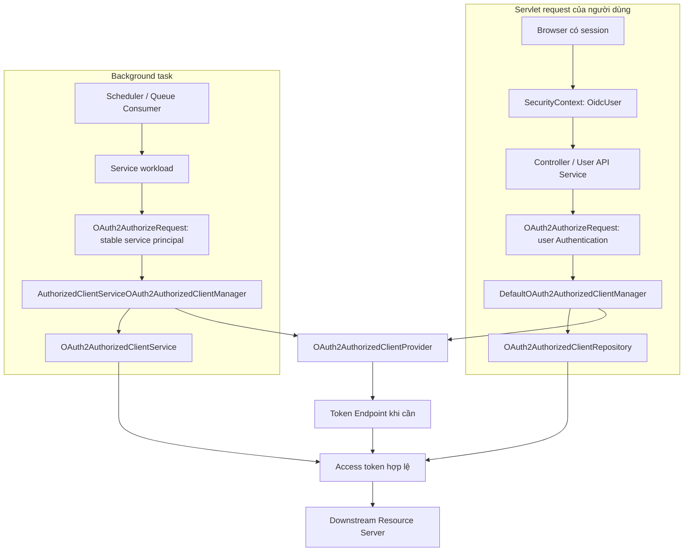
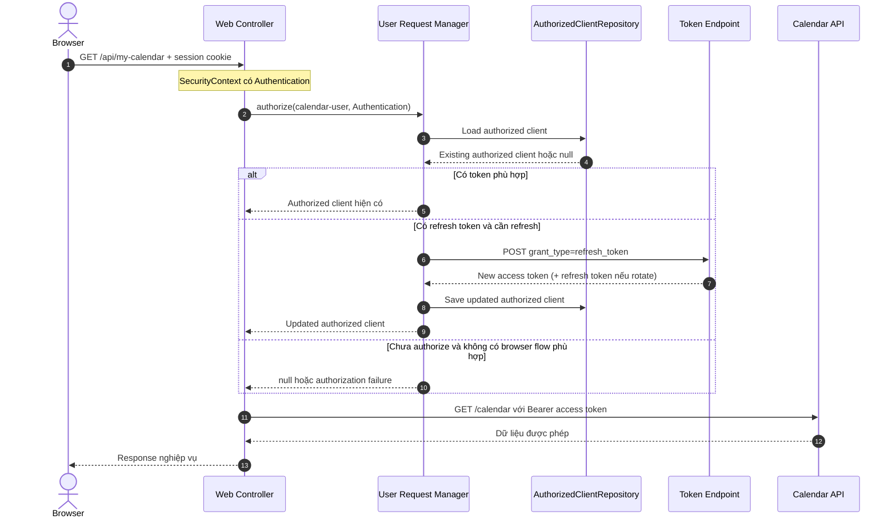
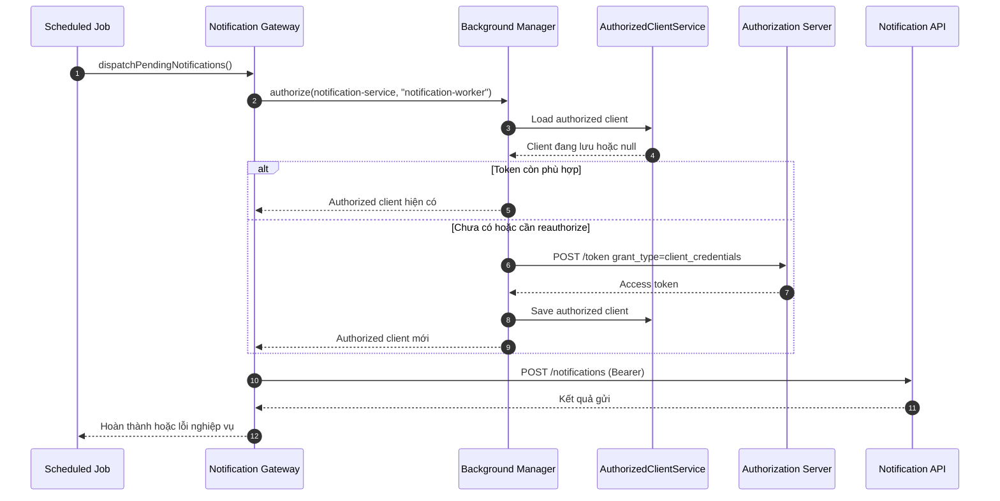
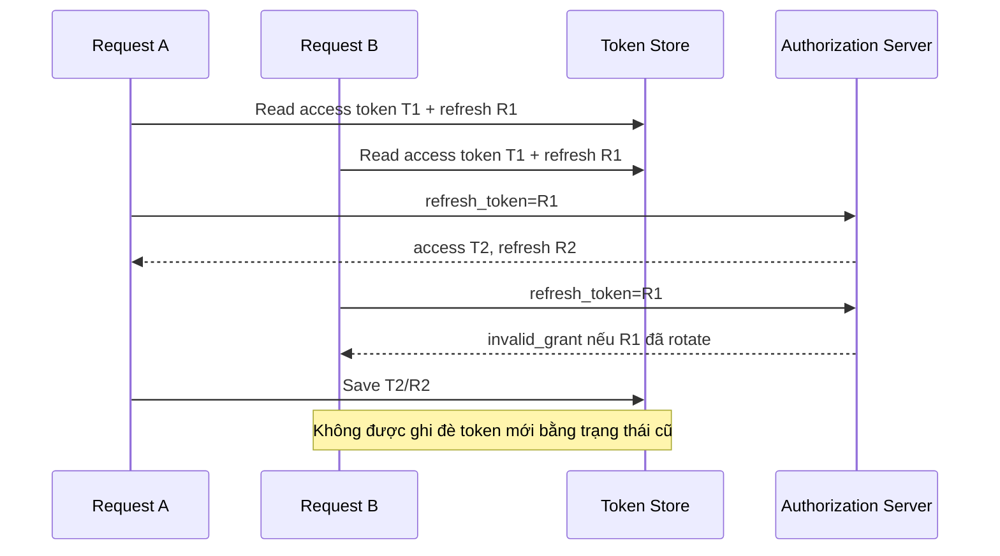

# 15.12. Thiết kế manager cho request người dùng và tác vụ nền

Trong một hệ thống **Spring Security OAuth 2.0 / OpenID Connect (OIDC) Client**, cùng một ứng dụng có thể có hai nhu cầu rất khác nhau:

1. **Request của người dùng:** người dùng đăng nhập qua browser bằng OIDC, sau đó mở trang hoặc gọi API của ứng dụng; backend cần access token để gọi một API bên ngoài **thay mặt người dùng đó**.
2. **Tác vụ nền:** scheduler, queue consumer hoặc batch process tự chạy mà **không có HTTP request hay phiên đăng nhập người dùng**; backend cần access token để gọi API bằng **danh tính của chính ứng dụng**.

Cả hai nhu cầu có thể dùng interface `OAuth2AuthorizedClientManager`, nhưng **không nên mặc định dùng một manager, một principal và một nơi lưu token cho mọi trường hợp**. Bối cảnh HTTP, quyền của token, cách xác định principal, loại OAuth2 grant và vòng đời lưu trữ khác nhau.

Bài học này xây dựng một thiết kế có chủ đích cho **Spring Boot 3.x / Spring Security 6.x, Servlet và `oauth2Login()`**, gồm:

- Phân tách **`DefaultOAuth2AuthorizedClientManager`** cho request người dùng và **`AuthorizedClientServiceOAuth2AuthorizedClientManager`** cho tác vụ nền.
- Khai báo các `ClientRegistration` với grant type, scopes, credential và API đích tương ứng.
- Tạo `OAuth2AuthorizeRequest` đúng principal, đúng registration.
- Dùng authorized client repository/service để lấy, làm mới và lưu token.
- Tránh rò token giữa các users, tenants, providers và workflows.
- Xử lý token refresh, đồng thời, lỗi, logout, rate limits và vận hành nhiều instance.
- Thiết kế khi một tác vụ nền **thật sự phải hành động thay mặt một người dùng** thay vì dùng `client_credentials`.

Các hostname, scopes và credential trong ví dụ chỉ dùng minh họa. Bạn cần thay bằng thông tin do Authorization Server và API thực cung cấp; không dùng chuỗi placeholder làm secret trong hệ thống chạy thật.

## 1. Vì sao không dùng chung một cách xin token cho tất cả?

Một HTTP request của user có thể gắn với:

```text
Browser
  -> session cookie
  -> SecurityContext
  -> Authentication (OidcUser)
  -> OAuth2AuthorizedClient của user
```

Trong khi một scheduled job có thể chỉ có:

```text
Scheduler
  -> application/service identity
  -> ClientRegistration dùng client_credentials
  -> OAuth2AuthorizedClient của workload
```

Nếu cùng một service cố đọc `SecurityContextHolder` ở cả hai môi trường, job thường không có authentication của browser. Nếu thay bằng cách hardcode một principal chung `"user"` để đọc token của người dùng, bạn có nguy cơ **dùng token của người A cho người B**. Nếu dùng `client_credentials` cho một API cần quyền theo người dùng, API có thể từ chối vì token **không có end-user delegation**.

Nguyên tắc kiến trúc:

> **Một yêu cầu cấp token phải nói rõ ai là chủ thể được ủy quyền, client registration nào đang dùng, grant nào phù hợp và token được lưu theo khóa nào.**

“Có token” chưa đủ. Token phải được phát hành cho đúng **issuer, audience/resource, scope và principal/client context**.

## 2. Thành phần của một thiết kế OAuth2 Client đúng

| Thành phần | Vai trò | Lưu ý thiết kế |
| --- | --- | --- |
| `ClientRegistration` | Mô tả OAuth2 client đã đăng ký tại Authorization Server | Grant type, ID, secret, token endpoint, scope phải đúng |
| `OAuth2AuthorizeRequest` | Đầu vào của một lần manager authorize | Chọn registration/authorized client và principal |
| `OAuth2AuthorizedClientManager` | Điều phối lấy token cũ/cấp mới/reauthorize | Chọn implementation theo ngữ cảnh HTTP |
| `OAuth2AuthorizedClientProvider` | Thực hiện grant/reauthorization phù hợp | Ví dụ authorization code, refresh token, client credentials |
| `OAuth2AuthorizedClientRepository` | Tìm/lưu authorized client trong môi trường Servlet | Có thể dùng request, response và session |
| `OAuth2AuthorizedClientService` | Tìm/lưu authorized client không phụ thuộc Servlet request | Phù hợp scheduled job và storage riêng |
| `OAuth2AuthorizedClient` | Trạng thái được cấp quyền, chứa access/refresh token | Credential nhạy cảm, không trả về frontend |
| `Authentication` | Danh tính và authorities của user hiện tại | Không đồng nhất với OAuth2AuthorizedClient |

### 2.1. Phân biệt `Authentication` và `OAuth2AuthorizedClient`

Một lần OIDC login thành công thường tạo `OAuth2AuthenticationToken` chứa `OidcUser` và authorities cho authorization của website. Song song, Spring Security OAuth2 Client có thể lưu `OAuth2AuthorizedClient` theo registration và principal, chứa access token/refresh token nếu được cấp.

```text
SecurityContext                          Authorized Client Storage
+--------------------------------+      +----------------------------------+
| Authentication                 |      | OAuth2AuthorizedClient           |
|  - OidcUser                    |      |  - ClientRegistration            |
|  - authorities                 |      |  - principalName                 |
|  - authenticated = true        |      |  - accessToken                   |
|                                |      |  - refreshToken (nếu có)         |
+--------------------------------+      +----------------------------------+
    Dùng để bảo vệ app endpoints             Dùng để gọi downstream APIs
```

Một token client credentials **không tạo ra `OidcUser` của người dùng**. Ngược lại, một người dùng đã login **không đương nhiên có token cho mọi API**.

### 2.2. `authorize()` không đồng nghĩa “luôn POST /token”

Một lời gọi:

```java
OAuth2AuthorizedClient client = manager.authorize(request);
```

có thể:

- Trả authorized client đã tồn tại và chưa cần cấp lại.
- Xin token lần đầu cho grant hỗ trợ và lưu authorized client.
- Reauthorize, ví dụ refresh token hoặc xin lại token client credentials khi cần.
- Trả `null` nếu không có cách authorize phù hợp với ngữ cảnh/provider.
- Ném lỗi OAuth2 phù hợp khi thực hiện authorize nhưng Authorization Server từ chối.

Vì vậy không thiết kế code như thể mỗi lần request HTTP đến là một lần gọi Token Endpoint. Đồng thời, luôn có kế hoạch xử lý `null` và lỗi.

## 3. Sơ đồ kiến trúc: hai luồng tách biệt



Sơ đồ cho thấy **hai manager khác nhau nhưng cùng giao diện** và có thể dùng các provider/grant khác nhau. Token storage được tách theo **ngữ cảnh authorization**; nó không nhất thiết phải là hai database vật lý, nhưng phải phân tách đúng principal, registration, lifecycle và chính sách truy cập.

## 4. Chọn loại manager theo ngữ cảnh chạy

### 4.1. `DefaultOAuth2AuthorizedClientManager` — luồng Servlet

Manager này phối hợp:

```text
ClientRegistrationRepository
+
OAuth2AuthorizedClientRepository
+
OAuth2AuthorizedClientProvider
```

Nó phù hợp với **web request có `HttpServletRequest` và `HttpServletResponse`**, nơi authorized client có thể liên kết với phiên và principal của người dùng. Nó được thiết kế để làm việc trong ngữ cảnh Servlet request.

Kịch bản điển hình:

1. User đăng nhập bằng `oauth2Login()`.
2. `SecurityContext` chứa `Authentication` của user.
3. Controller/service trong request gọi `manager.authorize(...)`.
4. Manager tìm authorized client tương ứng với registration và principal.
5. Nếu cần và có khả năng, provider refresh token; nếu không cần thì dùng client hiện có.
6. Backend gửi access token đến API đích đáng tin cậy.

**Không nên dùng manager này ở `@Scheduled` chạy không có Servlet request**, vì nó dựa vào ngữ cảnh HTTP/repository. Nếu code trong job cố lấy request hiện tại có thể thất bại hoặc hành vi lưu token không đúng mong muốn.

### 4.2. `AuthorizedClientServiceOAuth2AuthorizedClientManager` — tác vụ không có request

Manager này phối hợp:

```text
ClientRegistrationRepository
+
OAuth2AuthorizedClientService
+
OAuth2AuthorizedClientProvider
```

Nó không cần HTTP request/response để tra và lưu authorized client. Phù hợp với:

- `@Scheduled` job.
- Kafka/RabbitMQ consumer.
- Batch import/export.
- Service-to-service integration.
- Một số luồng xử lý async đã tách khỏi HTTP lifecycle.

Một tác vụ nền thông thường dùng `client_credentials` khi **ứng dụng tự hoạt động**, không hành động thay mặt user. Manager có thể tìm access token còn hiệu lực hoặc xin token mới từ Token Endpoint.

### 4.3. Không chọn manager chỉ theo tên lớp controller hay service

Quyết định phải dựa trên **authorization context**, không dựa trên class name. Một service có thể được gọi từ controller **và** scheduler. Nếu service ngầm lấy manager từ request hiện tại, scheduled invocation có thể hỏng.

Cách thiết kế rõ hơn là tách:

- **`UserCalendarGateway`**: yêu cầu `Authentication` của user đang đăng nhập.
- **`SystemNotificationGateway`**: yêu cầu service principal cố định và registration client credentials.

Nếu hai luồng cùng gọi một API, có thể tái sử dụng HTTP client/serialization/business logic bên dưới, nhưng **không tự động tái sử dụng phương thức lấy token**.

## 5. Phân biệt grant type của hai dòng nghiệp vụ

| Thuộc tính | User request | Background workload |
| --- | --- | --- |
| Grant type thông dụng | `authorization_code` | `client_credentials` |
| Cần browser redirect? | Có, trong OIDC login thông thường | Không |
| Có end-user principal? | Có `Authentication` từ SecurityContext | Thường không |
| Ai có quyền trong access token? | Theo ủy quyền user/client và OP | Theo quyền được cấp cho client application |
| Manager phù hợp | `DefaultOAuth2AuthorizedClientManager` | `AuthorizedClientServiceOAuth2AuthorizedClientManager` |
| Lấy authorization code bằng manager? | Không; cần front-channel flow | Không áp dụng |
| Làm mới token | `refresh_token` nếu được cấp | Thường xin access token mới với `client_credentials` |
| Storage key | Registration + principal user thích hợp | Registration + stable workload principal |
| Khi user logout | Cần xem xét session/authorized client/token revocation | Không nên xóa token dịch vụ chỉ vì một user logout |

**`client_credentials` không phải cách bỏ qua consent của end user.** Nếu một API bắt buộc dùng user-delegated token, grant ứng dụng có thể không được phép truy cập hoặc có phạm vi quyền khác. Cần thiết kế mô hình ủy quyền đúng.

## 6. Cấu hình hai client registrations trong Spring Boot

Giả sử một ứng dụng có:

- `calendar-user`: người dùng đăng nhập OIDC và cho phép backend đọc lịch cá nhân.
- `notification-service`: backend gửi thông báo từ scheduled job bằng danh tính của ứng dụng.

### 6.1. `application.yml`

```yaml
spring:
  security:
    oauth2:
      client:
        registration:
          calendar-user:
            provider: calendar-oidc
            client-id: ${CALENDAR_OIDC_CLIENT_ID}
            client-secret: ${CALENDAR_OIDC_CLIENT_SECRET}
            client-authentication-method: client_secret_basic
            authorization-grant-type: authorization_code
            scope:
              - openid
              - profile
              - calendar.read
            redirect-uri: "{baseUrl}/login/oauth2/code/{registrationId}"

          notification-service:
            provider: notification-as
            client-id: ${NOTIFY_CLIENT_ID}
            client-secret: ${NOTIFY_CLIENT_SECRET}
            client-authentication-method: client_secret_basic
            authorization-grant-type: client_credentials
            scope:
              - notifications.send

        provider:
          calendar-oidc:
            issuer-uri: ${CALENDAR_ISSUER_URI}
          notification-as:
            token-uri: ${NOTIFY_TOKEN_URI}
```

Những scope `calendar.read` và `notifications.send` chỉ để minh họa. Authorization Server thực phải hỗ trợ, cấp chúng cho đúng client, và API đích phải hiểu chúng. Nếu notification Authorization Server có OIDC/OAuth2 discovery hỗ trợ, bạn có thể cấu hình metadata phù hợp; ở ví dụ này chỉ cần token endpoint cho client credentials.

**Không sử dụng một secret chung cho cả hai registrations** trừ khi chính sách Authorization Server thực sự yêu cầu; nên cấp credential riêng để phân tách vòng đời, quyền và rotation.

### 6.2. `application.properties` tương đương

```properties
spring.security.oauth2.client.registration.calendar-user.provider=calendar-oidc
spring.security.oauth2.client.registration.calendar-user.client-id=${CALENDAR_OIDC_CLIENT_ID}
spring.security.oauth2.client.registration.calendar-user.client-secret=${CALENDAR_OIDC_CLIENT_SECRET}
spring.security.oauth2.client.registration.calendar-user.client-authentication-method=client_secret_basic
spring.security.oauth2.client.registration.calendar-user.authorization-grant-type=authorization_code
spring.security.oauth2.client.registration.calendar-user.scope=openid,profile,calendar.read
spring.security.oauth2.client.registration.calendar-user.redirect-uri={baseUrl}/login/oauth2/code/{registrationId}
spring.security.oauth2.client.provider.calendar-oidc.issuer-uri=${CALENDAR_ISSUER_URI}

spring.security.oauth2.client.registration.notification-service.provider=notification-as
spring.security.oauth2.client.registration.notification-service.client-id=${NOTIFY_CLIENT_ID}
spring.security.oauth2.client.registration.notification-service.client-secret=${NOTIFY_CLIENT_SECRET}
spring.security.oauth2.client.registration.notification-service.client-authentication-method=client_secret_basic
spring.security.oauth2.client.registration.notification-service.authorization-grant-type=client_credentials
spring.security.oauth2.client.registration.notification-service.scope=notifications.send
spring.security.oauth2.client.provider.notification-as.token-uri=${NOTIFY_TOKEN_URI}
```

Chọn YAML **hoặc** properties theo dự án. Không ghi credential thật vào source control. Các biến môi trường phải được cấp bởi runtime/secret manager; đừng cho rằng Spring tự đọc một file `.env` không có cơ chế nạp.

### 6.3. Các URL có vai trò khác nhau

Đối với `calendar-user`:

```text
Browser bắt đầu login:
GET /oauth2/authorization/calendar-user

OIDC callback:
GET /login/oauth2/code/calendar-user?code=...&state=...
```

Đối với `notification-service`:

```text
Backend -> POST Token Endpoint với grant_type=client_credentials
Không có browser redirect hoặc callback.
```

Không cố khởi tạo user login cho registration `notification-service` qua `/oauth2/authorization/notification-service` vì grant này không phải Authorization Code Flow.

## 7. Cấu hình hai manager thành hai bean riêng

Với Spring Security 6 trên Servlet, một cấu hình Java có thể khai báo:

```java
import org.springframework.context.annotation.Bean;
import org.springframework.context.annotation.Configuration;
import org.springframework.security.oauth2.client.AuthorizedClientServiceOAuth2AuthorizedClientManager;
import org.springframework.security.oauth2.client.DefaultOAuth2AuthorizedClientManager;
import org.springframework.security.oauth2.client.OAuth2AuthorizedClientManager;
import org.springframework.security.oauth2.client.OAuth2AuthorizedClientProvider;
import org.springframework.security.oauth2.client.OAuth2AuthorizedClientProviderBuilder;
import org.springframework.security.oauth2.client.OAuth2AuthorizedClientService;
import org.springframework.security.oauth2.client.registration.ClientRegistrationRepository;
import org.springframework.security.oauth2.client.web.OAuth2AuthorizedClientRepository;

@Configuration
public class OAuth2ClientManagersConfig {

    @Bean("userRequestClientManager")
    OAuth2AuthorizedClientManager userRequestClientManager(
            ClientRegistrationRepository registrations,
            OAuth2AuthorizedClientRepository authorizedClientRepository) {

        OAuth2AuthorizedClientProvider userProvider =
                OAuth2AuthorizedClientProviderBuilder.builder()
                        .authorizationCode()
                        .refreshToken()
                        .build();

        DefaultOAuth2AuthorizedClientManager manager =
                new DefaultOAuth2AuthorizedClientManager(
                        registrations, authorizedClientRepository);
        manager.setAuthorizedClientProvider(userProvider);

        return manager;
    }

    @Bean("backgroundClientManager")
    OAuth2AuthorizedClientManager backgroundClientManager(
            ClientRegistrationRepository registrations,
            OAuth2AuthorizedClientService authorizedClientService) {

        OAuth2AuthorizedClientProvider backgroundProvider =
                OAuth2AuthorizedClientProviderBuilder.builder()
                        .clientCredentials()
                        .build();

        AuthorizedClientServiceOAuth2AuthorizedClientManager manager =
                new AuthorizedClientServiceOAuth2AuthorizedClientManager(
                        registrations, authorizedClientService);
        manager.setAuthorizedClientProvider(backgroundProvider);

        return manager;
    }
}
```

**Ý nghĩa:** cả hai bean cùng implement `OAuth2AuthorizedClientManager`, nhưng dùng **hai storage abstractions** và **hai tập grant providers** khác nhau. Cách này tránh lỗi chọn nhầm loại manager hoặc vô tình cho background job sử dụng user session.

Trong Spring Boot, `ClientRegistrationRepository`, `OAuth2AuthorizedClientRepository` và `OAuth2AuthorizedClientService` có thể được cấu hình tự động tùy starter và beans đã khai báo. Nếu ứng dụng thay storage mặc định, phải cung cấp đúng implementation cho manager tương ứng; không tạo một service “rỗng” chỉ để bean được khởi tạo.

### 7.1. Vì sao dùng tên bean rõ ràng?

Vì có **hai bean cùng type**, injection không có qualifier có thể mơ hồ. Hãy chỉ rõ:

```java
public CalendarApiGateway(
        @Qualifier("userRequestClientManager")
        OAuth2AuthorizedClientManager manager) {
    this.manager = manager;
}
```

Và với job:

```java
public NotificationApiGateway(
        @Qualifier("backgroundClientManager")
        OAuth2AuthorizedClientManager manager) {
    this.manager = manager;
}
```

Các ví dụ dưới đây dùng constructor injection/`@Qualifier` để chống chọn nhầm. Không thêm `@Primary` vô điều kiện nếu hai manager thực sự có vai trò khác nhau; một bean mặc định bị dùng sai có thể khiến bug khó phát hiện.

### 7.2. Provider cho mỗi manager không cần giống nhau

Manager của user có thể cần:

```java
OAuth2AuthorizedClientProviderBuilder.builder()
        .authorizationCode()
        .refreshToken()
        .build();
```

Manager của workload thường chỉ cần:

```java
OAuth2AuthorizedClientProviderBuilder.builder()
        .clientCredentials()
        .build();
```

Việc không đưa `clientCredentials()` vào user manager giúp tránh cấp token ứng dụng ở đường code vốn chỉ nên gọi API thay mặt user. Ngược lại, background manager không cần `authorizationCode()` nếu không có luồng browser.

Đây là **defense in depth về cấu hình**, không thay thế việc bảo vệ service APIs và kiểm tra registration ID tại caller.

## 8. `SecurityFilterChain` phục vụ luồng đăng nhập người dùng

Để browser có thể đăng nhập OIDC bằng `calendar-user`:

```java
import org.springframework.context.annotation.Bean;
import org.springframework.context.annotation.Configuration;
import org.springframework.security.config.Customizer;
import org.springframework.security.config.annotation.web.builders.HttpSecurity;
import org.springframework.security.web.SecurityFilterChain;

@Configuration
public class WebSecurityConfig {

    @Bean
    SecurityFilterChain webSecurityFilterChain(HttpSecurity http)
            throws Exception {

        http
            .authorizeHttpRequests(authorize -> authorize
                .requestMatchers("/", "/login", "/error", "/assets/**")
                    .permitAll()
                .anyRequest()
                    .authenticated()
            )
            .oauth2Login(Customizer.withDefaults());

        return http.build();
    }
}
```

`oauth2Login()` đảm nhận browser redirect/callback, OIDC ID Token validation, tạo `Authentication` và lưu authorized client theo các thành phần mặc định/cấu hình. **`userRequestClientManager` không thay thế các filter login**: nó sử dụng authorized client khi backend cần access token sau đó.

Một ứng dụng production có thể thêm URL authorization, method security và CSRF protection thích hợp; ví dụ trên chỉ nhằm cho thấy vị trí login và giới hạn truy cập cơ bản.

### 8.1. Khi nhiều registrations tồn tại, phải chọn đúng login registration

Nếu có thêm nhiều OIDC registrations, user bắt đầu flow từ:

```text
/oauth2/authorization/{registrationId}
```

Trong ví dụ này, user chọn `calendar-user`. Khi callback thành công, `OAuth2AuthorizedClient` của `calendar-user` có thể được lưu cho principal tương ứng. Việc khai báo `notification-service` trong cùng file YAML **không làm client credentials token tự thuộc về user**.

## 9. Luồng request của user: từ `Authentication` tới Bearer token

### 9.1. Luồng từng bước



Cần lưu ý:

- Authentication hiện tại **phải thuộc user đang thực hiện request**.
- Client registration phải đúng API/scopes mà user đã ủy quyền.
- Token chỉ được chuyển đến **host API đáng tin cậy**, không qua URL do browser cung cấp tùy ý.
- Nếu chưa có authorized client, `authorize()` không tự tạo browser authorization code hay consent.
- Khi user logout hoặc mất phiên, không được âm thầm dùng token của một principal khác để gọi API.

### 9.2. Dùng `OAuth2AuthorizeRequest` đúng principal

```java
import org.springframework.security.core.Authentication;
import org.springframework.security.oauth2.client.OAuth2AuthorizedClient;
import org.springframework.security.oauth2.client.OAuth2AuthorizeRequest;

OAuth2AuthorizeRequest authorizeRequest =
        OAuth2AuthorizeRequest
                .withClientRegistrationId("calendar-user")
                .principal(authentication)
                .build();

OAuth2AuthorizedClient authorizedClient =
        userRequestClientManager.authorize(authorizeRequest);

if (authorizedClient == null) {
    throw new IllegalStateException(
            "Current user has no usable calendar authorization");
}
```

**Không dùng**:

```java
// Anti-pattern khi phục vụ nhiều người dùng:
.principal("shared-user")
```

Nếu persistence key dựa vào registration và principal name, một tên dùng chung có thể khiến token của hai người dùng bị nhầm trong các trường hợp thiết kế sai storage/caller.

### 9.3. Service gọi Calendar API

Ví dụ dùng `RestClient` của Spring Framework 6.1+ (thường trong Spring Boot 3.2+):

```java
import org.springframework.beans.factory.annotation.Qualifier;
import org.springframework.security.core.Authentication;
import org.springframework.security.oauth2.client.OAuth2AuthorizeRequest;
import org.springframework.security.oauth2.client.OAuth2AuthorizedClient;
import org.springframework.security.oauth2.client.OAuth2AuthorizedClientManager;
import org.springframework.stereotype.Service;
import org.springframework.web.client.RestClient;

@Service
public class UserCalendarGateway {

    private final OAuth2AuthorizedClientManager manager;
    private final RestClient calendarApi =
            RestClient.create("https://calendar-api.example.com");

    public UserCalendarGateway(
            @Qualifier("userRequestClientManager")
            OAuth2AuthorizedClientManager manager) {
        this.manager = manager;
    }

    public String loadMyCalendar(Authentication authentication) {
        OAuth2AuthorizeRequest authorizeRequest =
                OAuth2AuthorizeRequest
                        .withClientRegistrationId("calendar-user")
                        .principal(authentication)
                        .build();

        OAuth2AuthorizedClient client =
                manager.authorize(authorizeRequest);

        if (client == null) {
            throw new IllegalStateException(
                    "Calendar account is not authorized");
        }

        return calendarApi.get()
                .uri("/v1/events")
                .headers(headers -> headers.setBearerAuth(
                        client.getAccessToken().getTokenValue()))
                .retrieve()
                .body(String.class);
    }
}
```

Ứng dụng thực nên xử lý lỗi `null`/authorize failure bằng một luồng “Kết nối lại tài khoản” có kiểm soát và map lỗi phù hợp thay vì để lộ `IllegalStateException` tới browser. Ví dụ chỉ minh họa logic lấy token.

**Không trả raw access token trong response** và không đưa nó vào log. Một API có thể từ chối token vì audience/scope/authorization dù token chưa hết hạn; manager không thay resource-server policy.

### 9.4. Controller truyền Authentication hiện tại

```java
import org.springframework.security.core.Authentication;
import org.springframework.web.bind.annotation.GetMapping;
import org.springframework.web.bind.annotation.RestController;

@RestController
public class MyCalendarController {

    private final UserCalendarGateway gateway;

    public MyCalendarController(UserCalendarGateway gateway) {
        this.gateway = gateway;
    }

    @GetMapping("/api/my-calendar")
    String myCalendar(Authentication authentication) {
        return gateway.loadMyCalendar(authentication);
    }
}
```

Khi endpoint được Spring Security bảo vệ, `Authentication` được lấy từ `SecurityContext` của đúng request. Controller không nên nhận một `username` tùy ý từ browser để tra authorized client của user khác.

### 9.5. Nếu login bằng OP khác thì sao?

Giả sử user đăng nhập website qua registration `corporate-login` nhưng chưa authorize `calendar-user`. Gọi manager với `calendar-user` có thể không tìm được authorized client tương ứng cho principal hiện tại.

Hệ thống phải thiết kế một **account linking / consent flow** rõ ràng để người dùng tự bắt đầu `/oauth2/authorization/calendar-user`, xác minh callback, và lưu authorized client đúng user. Không coi một user session được xác thực bằng OP A là quyền tự động dùng token từ OP B.

Trong ứng dụng nhiều OP, cần kiểm tra cách ánh xạ `(issuer, subject)` sang internal account; không dùng mỗi email để kết luận hai principal là một người.

## 10. Luồng tác vụ nền: từ service principal tới token

Tác vụ nền thường không có `HttpServletRequest` và không nên phụ thuộc `SecurityContextHolder` của browser.

### 10.1. Sơ đồ luồng client credentials



Authorization Server xác thực **client application** từ `client_id`, `client_secret` hoặc phương thức client authentication được đăng ký. Chuỗi `"notification-worker"` không được dùng để cấp quyền như một end user; nó giúp manager xác định authorized client state trong storage.

### 10.2. Service gọi Notification API

```java
import org.springframework.beans.factory.annotation.Qualifier;
import org.springframework.security.oauth2.client.OAuth2AuthorizeRequest;
import org.springframework.security.oauth2.client.OAuth2AuthorizedClient;
import org.springframework.security.oauth2.client.OAuth2AuthorizedClientManager;
import org.springframework.stereotype.Service;
import org.springframework.web.client.RestClient;

@Service
public class SystemNotificationGateway {

    private static final String WORKLOAD_PRINCIPAL =
            "notification-worker";

    private final OAuth2AuthorizedClientManager manager;
    private final RestClient notificationApi =
            RestClient.create("https://notify-api.example.com");

    public SystemNotificationGateway(
            @Qualifier("backgroundClientManager")
            OAuth2AuthorizedClientManager manager) {
        this.manager = manager;
    }

    public String sendSystemNotice(String payload) {
        OAuth2AuthorizeRequest authorizeRequest =
                OAuth2AuthorizeRequest
                        .withClientRegistrationId("notification-service")
                        .principal(WORKLOAD_PRINCIPAL)
                        .build();

        OAuth2AuthorizedClient client =
                manager.authorize(authorizeRequest);

        if (client == null) {
            throw new IllegalStateException(
                    "Notification service authorization unavailable");
        }

        return notificationApi.post()
                .uri("/v1/notifications")
                .headers(headers -> headers.setBearerAuth(
                        client.getAccessToken().getTokenValue()))
                .body(payload)
                .retrieve()
                .body(String.class);
    }
}
```

Đây là ví dụ tối thiểu. Trong production, payload phải được validate, giới hạn kích thước, xử lý kết quả API, timeout/retries và idempotency; không lưu thông tin nhạy cảm trong payload/log. Nếu API dùng JSON, nên đặt `Content-Type: application/json` và dùng DTO có contract rõ ràng, thay vì gửi chuỗi `String` mơ hồ.

### 10.3. Scheduler kích hoạt service

```java
import org.springframework.scheduling.annotation.Scheduled;
import org.springframework.stereotype.Component;

@Component
public class NotificationDispatchJob {

    private final SystemNotificationGateway gateway;

    public NotificationDispatchJob(SystemNotificationGateway gateway) {
        this.gateway = gateway;
    }

    @Scheduled(fixedDelayString = "${NOTIFY_DELAY_MS:300000}")
    public void dispatch() {
        // Minh họa thao tác: payload trong thực tế đến từ queue/database.
        gateway.sendSystemNotice("{\"kind\":\"system-heartbeat\"}");
    }
}
```

Để scheduling chạy, thêm `@EnableScheduling` vào cấu hình Spring phù hợp. Ví dụ này chỉ minh họa manager trong job; **không đưa heartbeat giả lập vào hệ thống production nếu không có mục đích nghiệp vụ**.

Không dùng `SecurityContextHolder.getContext().getAuthentication()` trong job rồi hy vọng đó là user vừa mở trang gần nhất: SecurityContext ở một request thread **không phải session toàn cục** và không tự truyền qua background thread.

### 10.4. Vì sao phải dùng một principal name ổn định?

`AuthorizedClientServiceOAuth2AuthorizedClientManager` thường dùng registration và principal name để tìm authorized client đã lưu. Nếu mỗi lần chạy lại sinh principal như `"job-" + currentTimeMillis()`, manager có thể xem đó là nhiều trạng thái khác nhau và xin token mới lặp lại không cần thiết.

Dùng tên ổn định:

```text
registrationId = notification-service
principalName  = notification-worker
```

Tuy nhiên, nếu một hệ thống có **nhiều clients khác quyền**, hãy tách registrations/credentials/scopes. Không thể tạo thêm quyền ở OP chỉ bằng cách đổi principal name thành `admin`.

## 11. Thiết kế không làm rò token giữa user và workload

Một lỗi nghiêm trọng có thể xuất hiện khi cùng một tầng service nhận cả user request và background job, nhưng dùng một thuộc tính mutable/global để giữ “token hiện tại”:

```java
// Anti-pattern: KHÔNG DÙNG
private String currentAccessToken;

public void onUserRequest(String userToken) {
    currentAccessToken = userToken;
}

public void scheduledWork() {
    callApi(currentAccessToken);
}
```

Nếu ứng dụng nhiều request đồng thời, job có thể gửi token của người dùng bất kỳ, gây lộ dữ liệu hoặc vượt quyền. Token không được lưu vào mutable singleton field như “session hiện tại”.

### 11.1. Những ranh giới cần giữ

| Ranh giới | Cách áp dụng |
| --- | --- |
| **User vs service** | Registration và manager riêng; không dùng service token khi API đòi user delegation |
| **User A vs User B** | Authorized client gắn principal user đáng tin cậy; không dùng `"shared-user"` |
| **Provider A vs Provider B** | Mỗi registration có issuer/client credentials riêng; xác minh đúng issuer và audience |
| **Tenant A vs Tenant B** | Tenant identity xuất phát server-side, ánh xạ tới registration/policy được phê duyệt |
| **API X vs API Y** | Chỉ gửi token đến API có audience/resource/scope tương ứng |
| **Web session vs background store** | Repository/service phù hợp lifecycle và access control |
| **Test vs production** | Không dùng production client secret/token trong fixture, logs hay test containers |

### 11.2. Token của user không nên sống trong job dùng chung

Ngay cả khi một job được kích hoạt bởi user (ví dụ “xuất báo cáo”), bản thân job có thể chạy sau khi HTTP request kết thúc. Nếu công việc cần dùng **token của chính user** ở thời điểm xử lý, thiết kế phải nêu rõ:

- Ai đã ủy quyền và cho phép lưu/refresh token?
- Token được lưu theo internal user identity và registration nào?
- Quyền nào được phép dùng khi job chạy trễ?
- Điều gì xảy ra khi user logout, thu hồi consent hoặc bị vô hiệu hóa?
- Làm sao tránh user A kích hoạt một job lấy token của user B?
- Có bắt buộc refresh token hay cơ chế token exchange/delegation không?

**Không giải quyết bằng cách đổi principal thành `"system"` rồi dùng `client_credentials`**, vì đó là quyền của ứng dụng, không phải quyền của user.

## 12. Background job cần “on-behalf-of user”: ba phương án

Không phải tác vụ nền nào cũng dùng `client_credentials`. Một luồng sync lịch cá nhân hoặc upload tệp thay mặt user có thể cần **delegated access token**.

### 12.1. Phương án A — Dùng authorized client của user với storage bền vững

Luồng tổng quát:

1. User thực hiện OAuth2 Authorization Code + consent.
2. Ứng dụng lưu `OAuth2AuthorizedClient` cho **đúng internal user/registration**, có bảo vệ token.
3. Job được queue kèm **internal user ID/tenant/work item ID**, không kèm raw token.
4. Worker xác thực quyền chạy và tra token của đúng user qua storage/service được phép.
5. Worker dùng manager/service logic phù hợp để refresh khi được cấp refresh token; nếu mất authorization thì yêu cầu user kết nối lại.

```text
Browser user consent
    |
    v
Authorized client của user (protected store)
    |
    v
Job message: internalUserId + taskId (không chứa token)
    |
    v
Worker xác minh task owner và quyền hiện tại
    |
    v
Đọc/reauthorize token user đúng registration
    |
    v
Gọi API theo delegated permission
```

Trong mô hình này, background worker thường sẽ cần **`AuthorizedClientServiceOAuth2AuthorizedClientManager`** hoặc cơ chế tách biệt tương đương, vì không có Servlet request. Điều kiện quan trọng là **authorized client của user thật sự được lưu trong service mà worker truy cập được**; repository dựa trên session có thể không phù hợp cho job sau khi session kết thúc.

**Không giả định rằng đặt một service manager vào job là nó sẽ đọc được mọi token mà `oauth2Login()` từng lưu trong session.** Bạn cần chủ động thiết kế repository/service storage và mối quan hệ identity mapping.

### 12.2. Phương án B — Token Exchange / On-Behalf-Of nếu Authorization Server hỗ trợ

Một số hệ thống hỗ trợ **OAuth 2.0 Token Exchange (RFC 8693)** hoặc một cơ chế delegation/on-behalf-of chuyên biệt. Client trình bày một credential hợp lệ theo quy tắc Authorization Server để lấy token được giới hạn cho tài nguyên/danh tính tiếp theo.

Đây là **một grant/workflow khác**, không xảy ra chỉ vì đặt `.principal(userName)` vào `OAuth2AuthorizeRequest`. Cần:

- Hỗ trợ chính thức từ Authorization Server và Spring/HTTP client integration phù hợp.
- Chính sách audience/resource, scopes và subject delegation rõ ràng.
- Xác minh token nguồn, hạn dùng, actor/subject và các điều kiện trust.
- Giới hạn token mới theo API và tác vụ thực sự cần.

### 12.3. Phương án C — Chuyển hoạt động thành quyền của service thật sự

Nếu business action không cần ngữ cảnh ủy quyền của user (ví dụ gửi thông báo hệ thống), hãy đổi contract thành **service-to-service** với `client_credentials`. Lúc đó audit actor của job là service; user đã yêu cầu job (nếu có) chỉ là **business audit context**, không biến service token thành user token.

Việc lựa chọn phải dựa trên **authorization semantics của API**, không dựa trên khả năng code lấy token dễ hay khó.

## 13. Repository/service: nên lưu token ở đâu?

### 13.1. Ngữ cảnh request người dùng

Một `OAuth2AuthorizedClientRepository` có thể gắn token với web principal/session hoặc ủy quyền lưu sang `OAuth2AuthorizedClientService` tùy implementation. Bạn cần xác định:

- User principal name được dùng để phân vùng dữ liệu.
- Registration ID gắn với provider và scopes.
- Session timeout và logout ảnh hưởng token thế nào.
- Khi browser session hết hạn, token có cần xóa không?
- Có yêu cầu truy cập token ở background worker không?
- Có nhiều node/instance phục vụ cùng user không?

**Không kết luận “token đã ở trong Redis” chỉ vì HTTP session dùng Spring Session Redis**: authorized client repository có thể lưu khác, tùy cấu hình.

### 13.2. Ngữ cảnh tác vụ nền

`OAuth2AuthorizedClientService` thường được thiết kế lưu theo registration/principal, với triển khai:

- **In-memory:** đơn giản, nhưng mỗi instance có state riêng và restart làm mất token.
- **JDBC/database:** cho phép chia sẻ/persist nhưng cần bảo vệ credential, concurrency và cleanup.
- **Custom distributed store:** cho TTL, atomic updates và access control theo kiến trúc.

Với `client_credentials`, việc mất access token trong cache thường có thể khắc phục bằng cách xin mới, nhưng có thể tăng tải Token Endpoint hoặc chạm rate limit. Với **refresh token của end user**, mất token hoặc ghi đè do race có thể buộc người dùng consent/login lại.

### 13.3. Đừng gộp session store với token store một cách vô ý

`SecurityContext` được thiết kế cho authenticated principal trên request. `OAuth2AuthorizedClient` chứa bearer credentials. Hai thứ có lifecycle khác nhau; lưu toàn bộ token vào session user tùy ý để job dùng sau là sai ranh giới bảo mật.

Quản lý token cần cân nhắc:

- Encryption at rest và TLS tới storage.
- Quyền đọc token theo service/tenant.
- TTL hoặc retention policy phù hợp.
- Cleanup khi user disconnect/revoke consent.
- Audit truy cập token, nhưng **không ghi raw token**.
- Bảo vệ backups, snapshot và replication.
- Xử lý key rotation/refresh token rotation nhất quán.

## 14. Token reuse, refresh và client credentials reauthorization

### 14.1. Một authorized client có thể được dùng nhiều lần

Giả sử token cho `notification-service` được cấp lúc 09:00 và hết hạn lúc 10:00.

```text
09:00  Job gọi authorize()
       -> chưa có authorized client
       -> POST grant_type=client_credentials
       -> nhận access token T1, lưu lại

09:15  Job gọi authorize()
       -> authorized client T1 còn dùng được
       -> có thể trả T1, không cần POST /token

09:59  Job gọi authorize()
       -> T1 gần hết hạn theo clock skew
       -> provider có thể cấp T2 và lưu lại

10:05  Job gọi authorize()
       -> dùng T2 nếu vẫn hợp lệ
```

Thời điểm cụ thể chỉ là ví dụ. Clock skew, expiry, concurrency, provider và chính sách Authorization Server quyết định khi nào manager reauthorize. **Đừng giả định mỗi gọi manager đồng nghĩa cấp token mới**.

### 14.2. User refresh token

Với `calendar-user`, nếu OP cấp refresh token và manager có `refreshToken()` provider:

```text
Authorized client có:
  access token (hết hạn / sắp hết hạn)
  refresh token (còn hợp lệ)
          |
          v
Manager reauthorize qua refresh_token grant
          |
          v
Authorization Server trả token mới
          |
          v
Lưu OAuth2AuthorizedClient cập nhật
```

Không phải OIDC client nào cũng có refresh token. `offline_access` hoặc cấu hình consent/OP có thể ảnh hưởng việc cấp refresh token, nhưng không phải mọi OP đều dùng cùng quy tắc. **Refresh token là credential rất nhạy cảm** và có thể bị rotate/revoke.

Nếu refresh thất bại, người dùng có thể phải đăng nhập/consent lại. Một job chạy thay mặt user cần chiến lược “authorization required” riêng, không tự lấy token của user khác hoặc dùng service token để che lỗi.

### 14.3. Client credentials thường xin token mới thay vì refresh

Theo thiết kế phổ biến, Authorization Server không cấp refresh token với `client_credentials`. Khi access token hết hạn, provider có thể thực hiện lại `grant_type=client_credentials` bằng credential của application.

Điều này độc lập với `oauth2Login()` và không yêu cầu browser. Tuy nhiên, backend phải biết khi OP bị rate limit, credential hết hạn, certificate lỗi hoặc policy scopes thay đổi.

## 15. Đồng thời và nhiều instance: những race cần thiết kế

Hai requests cùng một user có thể đồng thời thấy token gần hết hạn. Tương tự, hai job workers cùng cố lấy token cho một registration.

### 15.1. Hai user requests cùng refresh



Một số OP rotate refresh token một lần dùng; request thứ hai có thể thất bại. Tệ hơn, một failure handler không hiểu concurrency có thể xóa authorized client **mà request A vừa cập nhật**.

Các lựa chọn kiến trúc:

- Single-flight refresh trong phạm vi một process (nếu phù hợp).
- Lock/lease phân tán theo registration + principal với TTL và giải phóng an toàn.
- Compare-and-swap/versioned storage để không ghi đè kết quả mới.
- Khi refresh thất bại do race, đọc lại store trước khi quyết định xóa trạng thái.
- Giới hạn retries và áp dụng backoff khi OP bị rate limit.
- Quan sát token refresh failure rate, nhưng không log token.

**`OAuth2AuthorizedClientManager` không tự hứa cung cấp distributed locking cho mọi implementation của storage**. Các đặc tính này thuộc về thiết kế storage/provider và logic orchestration bổ sung.

### 15.2. Nhiều workers cùng xin client credentials

Với `notification-service`, hai worker có thể cùng không thấy token rồi cùng gọi Token Endpoint. Có thể chấp nhận nếu OP/giới hạn tải cho phép, hoặc cần shared store/cơ chế điều phối nếu số lượng rất lớn.

Đừng hy sinh tính sẵn sàng toàn hệ thống để “bảo đảm luôn chỉ có một token”. Hãy cân bằng rate limit, hiệu lực token, cache consistency, process restarts và khả năng retry.

### 15.3. Không dùng `ThreadLocal` như kho token dài hạn

`SecurityContextHolder` thông thường gắn context với luồng xử lý hiện tại. Executor, async processing hoặc scheduler có thread khác và không tự nhận mọi thuộc tính từ request thread. Chuyển SecurityContext bừa bãi sang background job có thể tạo rủi ro dùng quyền stale hoặc sai actor.

Khi job cần delegated user access, **lưu một work item gắn internal identity được xác minh** và truy cập authorized client qua storage an toàn; không chuyển raw `SecurityContext` hoặc access token trong queue message nếu không có lý do và biện pháp bảo vệ cụ thể.

## 16. Thiết kế HTTP client và API boundary

Một manager lấy token nhưng **không tự gắn Bearer token vào bất kỳ RestClient nào**. Với một `RestClient` tạo bằng `RestClient.create(...)`, bạn phải:

1. Gọi manager để lấy authorized client.
2. Chọn đúng token.
3. Gắn `Authorization: Bearer <token>` vào request tới API tin cậy.
4. Phân biệt lỗi network/HTTP của API với lỗi authorize/token endpoint.

Có thể tích hợp Spring Security với `RestClient`/`WebClient` qua interceptor/filter phù hợp trong phiên bản hỗ trợ, nhưng cần cấu hình manager và registration đúng chỗ; không giả định có bean manager là mọi HTTP client tự được trang bị OAuth2.

### 16.1. Tránh SSRF hoặc gửi token sai host

Không làm:

```java
// SAI: URL do caller không tin cậy điều khiển.
String url = request.getParameter("target");
client.get().uri(url)
        .headers(h -> h.setBearerAuth(accessToken))
        .retrieve();
```

Nếu người dùng có thể chọn đích, ứng dụng dễ gửi token tới host do người tấn công kiểm soát. Thay bằng base URL/host allowlist được quản lý phía server, không tự follow redirect cross-origin kèm Authorization header.

### 16.2. API trả 401/403 thì làm gì?

| Response từ API | Có thể chỉ ra | Hướng xử lý |
| --- | --- | --- |
| `401 invalid_token` | Token sai audience, hết hạn, bị revoke, signature/issuer không được chấp nhận | Kiểm tra token policy; xử lý failure/re-authorization phù hợp nếu là invalid token |
| `403 insufficient_scope` | Token có hiệu lực nhưng thiếu quyền/scope | Không retry cấp lại cùng scope vô hạn; xem consent/registration/authorization policy |
| `429 Too Many Requests` | API rate limit | Backoff và retry có giới hạn; tôn trọng response policy |
| `5xx` | API backend lỗi | Retry chỉ khi an toàn/idempotent, có circuit breaker nếu cần |
| Network timeout | Không rõ API đã xử lý thao tác hay chưa | Với POST, dùng idempotency key hoặc nghiệp vụ chống gửi trùng |

Manager không thể tự biết resource server vừa trả `401` nếu không có HTTP-client integration hoặc application-layer failure handling. Đặc biệt, **POST gửi thông báo không được retry vô hạn** vì có thể tạo thông báo trùng.

## 17. Security boundary giữa principal và authorized client storage

Một `OAuth2AuthorizeRequest` có thể được tạo theo:

```java
OAuth2AuthorizeRequest.withClientRegistrationId("calendar-user")
        .principal(authentication)
        .build();
```

hoặc:

```java
OAuth2AuthorizeRequest.withClientRegistrationId("notification-service")
        .principal("notification-worker")
        .build();
```

Hai hình thức này giống API builder nhưng khác **trust boundary**.

### 17.1. Nguyên tắc cho user request

- Principal phải lấy từ `SecurityContext` đã xác thực, không lấy từ query `?user=...`.
- Registration ID phải nằm trong nhóm cho phép của functionality, không do client tự đưa bất kỳ giá trị nào.
- Nếu một user có nhiều OP accounts, phải có account-linking policy rõ.
- Storage không được trả authorized client của user khác do trùng `principalName` không đủ phân vùng.
- Khi user disconnect, xử lý revocation/cleanup của authorized client tương ứng.

### 17.2. Nguyên tắc cho service workload

- Principal name được ứng dụng định nghĩa ổn định, ví dụ `notification-worker`.
- Không gắn workload principal theo user input để thay quyền.
- Grant `client_credentials` phải được đăng ký riêng với scopes tối thiểu.
- Không trộn service account token vào `SecurityContext` của browser như thể người dùng đã đăng nhập.
- Không cho người dùng đổi `client_id`, `token-uri`, `issuer-uri` hoặc API host từ HTTP input.

### 17.3. Nguyên tắc cho multi-tenant

Nếu mỗi tenant có client credentials khác nhau, có thể ánh xạ **tenant nội bộ đã xác thực** tới registration được quản lý:

```text
Authenticated tenant + operation
        |
        v
Server-side tenant-to-registration mapping
        |
        v
Approved ClientRegistration
        |
        v
OAuth2AuthorizeRequest (stable workload principal)
        |
        v
Token for the correct tenant / API audience
```

Tuyệt đối không coi `tenantId` trong URL là bằng chứng duy nhất của quyền chọn registration. Nếu sử dụng dynamic registration, phải bảo vệ cả nguồn metadata và đường đi của credential để tránh confused deputy/SSRF.

## 18. Logout, session timeout và vòng đời công việc nền

### 18.1. User logout

Khi user logout khỏi website:

- `SecurityContext` và session có thể bị xóa theo cấu hình.
- Authorized client lưu trong session có thể mất theo session.
- Token trong `OAuth2AuthorizedClientService` hoặc database khác có thể vẫn tồn tại.
- Logout tại OP là một luồng OIDC riêng.
- Token revocation cần thiết kế thêm khi OP hỗ trợ.

**Không mặc định “logout xóa mọi OAuth2 token ở mọi hệ thống”**. Cần quyết định liệu user đã ngắt kết nối calendar, chỉ logout phiên web, hay thu hồi consent hoàn toàn.

### 18.2. Background token không nên phụ thuộc logout của một user

`notification-service` dùng client credentials của application. Việc một user logout **không nên tùy tiện hủy** token chung của scheduled job, trừ khi nghiệp vụ thật sự gắn việc đó với vòng đời tài khoản.

Ngược lại, nếu job chạy delegated user access, logout hoặc thu hồi consent có thể yêu cầu hủy job, dừng retry hoặc xóa authorized client của user. Chính sách phải được ghi rõ thay vì dựa trên storage tình cờ còn dữ liệu.

### 18.3. Session timeout khác token expiry

HTTP session, ID Token, access token, refresh token và job queue có **thời gian sống khác nhau**. Manager không nên tự cho rằng token đã hết hạn chỉ vì browser session hết hạn, hoặc cho phép job tiếp tục vô hạn vì refresh token vẫn còn.

Đối với tác vụ nền chạy thay user, xác định:

- Deadline công việc.
- Thời hạn và scope user consent.
- Điều kiện reauthorization.
- Chính sách hủy theo logout/account disable.
- Quyền dữ liệu tại thời điểm job thực thi.

## 19. Cấu hình failure/success handling khi cần mở rộng

Cả hai manager đều cho phép tùy biến `OAuth2AuthorizedClientProvider` và các handler liên quan đến kết quả authorize theo API. Các handler có thể quyết định lưu authorized client mới/cập nhật hoặc xử lý việc loại bỏ client cũ khi lỗi cụ thể.

Ví dụ ý nghĩa:

```text
authorize()
  |
  +-- thành công mới / reauthorize
  |     -> success handler lưu authorized client
  |
  +-- lỗi authorization (ví dụ refresh token invalid_grant)
  |     -> failure handler theo policy
  |
  +-- không thể xử lý grant trong context
        -> kết quả có thể null / existing client theo manager semantics
```

Đừng ghi đè success handler bằng code “chỉ để log” rồi làm mất persistence. Đừng xóa mọi authorized client bất kể loại lỗi; một lỗi network tạm thời có thể khác `invalid_grant` do refresh token bị revoke.

Với storage có concurrency, xem xét **atomic conditional delete** nếu có nguy cơ failure của request cũ xóa token mới do request khác vừa lưu.

## 20. Thiết kế kiểm thử theo hai ngữ cảnh

Các test phải phân biệt **authorization orchestration** và **API business behavior**. Không phải mọi test cần OP thật, nhưng test chỉ mock manager cũng không chứng minh token flow thật hoạt động.

### 20.1. Test luồng request user

Các tình huống đáng kiểm tra:

1. User A đã login với `calendar-user` → manager nhận đúng `Authentication` A và registration.
2. User B có session khác → không đọc token của A.
3. User login bằng provider khác nhưng chưa consent calendar → ứng dụng xử lý thiếu authorized client rõ ràng.
4. Token sắp hết hạn, refresh token hợp lệ → authorized client cập nhật đúng.
5. Refresh token invalid → báo yêu cầu kết nối/đăng nhập lại, không lấy service token thay thế.
6. User có nhiều tenants → API call chỉ truy cập tài nguyên user có quyền.
7. Browser logout → request mới không thể tự dùng authorized client cũ khi chưa được xác thực đúng.

### 20.2. Test luồng background

1. Job chạy **không có HttpServletRequest** vẫn lấy được token client credentials.
2. Token còn hiệu lực được tái sử dụng phù hợp; không gọi Token Endpoint vô hạn.
3. Token hết hạn → provider xin lại theo grant; không chờ browser redirect.
4. Sai client secret → lỗi authorize được xử lý, không ghi secret.
5. OP timeout/rate limit → retry/backoff có giới hạn.
6. Hai workers cùng xin token → storage không ghi đè trạng thái nhạy cảm theo kiểu bất ngờ.
7. API trả `403` → không tự chuyển sang token người dùng hoặc tự tăng scope.
8. Job dùng registration `notification-service` chứ không lấy `calendar-user` vì tên service giống nhau.

### 20.3. Test ranh giới user và service

Một bộ kiểm thử quan trọng cần chứng minh **không thể vượt ranh giới**:

| Test | Kết quả mong đợi |
| --- | --- |
| Browser user gọi endpoint yêu cầu Notification Service token mà không có quyền nghiệp vụ | Request bị chặn bởi URL/method authorization |
| Client HTTP tự gửi `registrationId=notification-service` để yêu cầu token | Ứng dụng bỏ qua hoặc từ chối lựa chọn không được phép |
| User A thay `principalName` thành user B trong request | Không có đường đi nhận input này từ user |
| Background job chạy sau khi web session A hết hạn | Vẫn chạy nếu là job app-only; không dùng token A |
| Delegated user job bị thu hồi consent | Dừng hoặc chuyển “authorization required”, không dùng token của user khác |
| Đích API bị redirect sang host khác | Không forward Bearer token tới host không nằm trong allowlist |

## 21. Ví dụ tổ chức code theo trách nhiệm

Một cấu trúc khái niệm rõ ràng cho module:

```text
com.example.integration
  |
  +-- config/
  |    +-- OAuth2ClientManagersConfig
  |    +-- WebSecurityConfig
  |
  +-- user/
  |    +-- MyCalendarController
  |    +-- UserCalendarGateway
  |
  +-- system/
  |    +-- NotificationDispatchJob
  |    +-- SystemNotificationGateway
  |
  +-- policy/
  |    +-- ApiAudiencePolicy
  |    +-- TenantRegistrationPolicy
  |
  +-- persistence/
       +-- AuthorizedClientStorageConfig
```

Không cần chính xác các package này. Điều cần giữ là **đường code user-delegated và app-only có API rõ**, manager được inject bằng qualifier, và storage/policy được phân định.

### 21.1. Tránh một “universal token helper” nhận tất cả input

Một anti-pattern:

```java
// SAI nếu các input được lấy trực tiếp từ HTTP/queue không tin cậy:
String getToken(String registrationId,
                String principalName,
                String tokenEndpoint,
                String scope);
```

Hàm này khiến caller có thể đổi provider, principal, token endpoint hoặc scopes. Nếu security boundary không được kiểm soát, nó trở thành **confused deputy**.

Thiết kế tốt hơn là hai API có mục đích rõ:

```java
String getUserCalendar(Authentication userAuthentication);

String sendSystemNotification(NotificationCommand command);
```

Mỗi API tự cố định registration, chọn đúng manager và áp dụng policy nghiệp vụ. Nếu cần mở rộng hỗ trợ nhiều providers, dùng bảng ánh xạ được phê duyệt phía server chứ không nhận arbitrary URLs/credentials.

### 21.2. Nên tách token acquisition khỏi HTTP client không?

Có, khi ứng dụng đủ lớn, có thể đưa việc gọi manager vào một lớp adapter cụ thể, ví dụ `UserAccessTokenProvider` và `ServiceAccessTokenProvider`. Tuy nhiên, **không nên biến provider thành hàm trả raw token cho mọi caller** nếu có thể dùng HTTP client interceptor gắn token trực tiếp. Cần giữ credential nằm trong boundary ít code được quyền truy cập nhất.

Ví dụ code của bài để lộ `getTokenValue()` trong adapter nhằm giải thích cơ chế, nhưng production nên hạn chế quyền tiếp cận raw token và tránh ghi vào tracing.

## 22. Troubleshooting: xác định lỗi theo tầng

| Triệu chứng | Tầng nguyên nhân thường gặp | Hướng điều tra |
| --- | --- | --- |
| `@Scheduled` báo thiếu servlet request | Dùng `DefaultOAuth2AuthorizedClientManager` ngoài HTTP | Dùng `AuthorizedClientServiceOAuth2AuthorizedClientManager` |
| User login thành công nhưng `authorize()` trả `null` | Chưa có authorized client đúng registration, không thể chạy authorization code tự động | Kiểm tra login/consent flow và repository |
| Manager không tìm token sau callback | Repository/service khác nơi login đã lưu | Xác định integration và storage thực tế |
| User A gọi Calendar API bằng token B | Principal/storage isolation | Không dùng principal chung; xác minh session/account/registration |
| Job lúc đầu chạy, restart thì xin token mới | In-memory storage mất state | Thường bình thường; cân nhắc persistent/distributed storage theo tải |
| Nhiều instance gọi token endpoint quá thường xuyên | Cache không chia sẻ hoặc principal thay đổi mỗi lần | Stable workload principal, storage và rate-limit strategy |
| Token endpoint trả `invalid_client` | Sai ID/secret/authentication method/client registration | Kiểm tra secrets và OP policy, không log credential |
| Token endpoint trả `invalid_grant` | Refresh token hết hạn/rotate hoặc code/PKCE sai | Phân biệt grant thực tế; không coi mọi lỗi là sai manager |
| Backend có token nhưng API `401` | Token sai issuer/audience/expiry hoặc bị revoke | Kiểm tra contract của Resource Server |
| API `403 insufficient_scope` | Token thiếu scope/quyền | Không retry cấp lại vô hạn; xem scope/consent/policy |
| Job chạy user-delegated sau logout | Lifecycle delegated token không rõ | Quyết định retention/revocation/consent và policy job |
| Race refresh tạo `invalid_grant` thất thường | Hai requests dùng cùng refresh token đã rotate | Atomic update/locking và xử lý retry có kiểm soát |
| RestClient gửi request không có Authorization header | Chưa tích hợp manager vào HTTP client | Gắn Bearer token thủ công hoặc cấu hình interceptor |
| Token bị lộ trong log HTTP | Logger/APM/proxy dump request | Redact Authorization và token endpoint form bodies |
| Đăng nhập browser bị vòng lặp | Cấu hình OAuth2 Login/callback/session, không nhất thiết manager | Xem URL callbacks, state, session và security chain |
| Sau Spring Security upgrade behavior khác | API/auto-config/provider default thay đổi | Đối chiếu tài liệu theo phiên bản và tests có kiểm soát |

### 22.1. Log tối thiểu nhưng hữu ích

Ví dụ metadata có thể ghi trong app:

```text
operation=oauth2_authorize
registrationId=notification-service
grantType=client_credentials
caller=NotificationDispatchJob
outcome=success
durationMs=...
requestId=non-sensitive-internal-id
```

Đối với request user, tránh log email, `sub` raw và session cookie khi không cần. Nếu cần correlation theo người dùng, dùng audit reference được cấp quyền truy cập và retention riêng.

**Tuyệt đối không log** access token, refresh token, client secret, authorization code, PKCE verifier, full ID Token hoặc header `Authorization`.

## 23. Các sai lầm thường gặp khi thiết kế manager

### 23.1. Dùng một manager mặc định cho cả web và job

Có vẻ tiện vì cả hai cùng type, nhưng ngữ cảnh HTTP và repository/service khác nhau. Hậu quả có thể là lỗi không tìm thấy request hoặc lưu token ở nơi job không truy cập được.

**Cách sửa:** đăng ký hai bean theo mục đích, inject bằng `@Qualifier` và test khi không có Servlet request.

### 23.2. Hardcode một bearer token trong cấu hình

```properties
external.api.token=eyJ...
```

Token có expiry/audience/scope và là credential nhạy cảm. Hardcode token làm hỏng vòng đời refresh/rotation và dễ rò dữ liệu. Dùng registration + manager/authorized client storage.

### 23.3. Lấy user token cho job chạy hệ thống

Nếu job chỉ cần quyền ứng dụng, token của một user ngẫu nhiên có thể hết hạn, thiếu quyền, bị revoke hoặc gây sai audit actor. Dùng `client_credentials` với registration riêng.

### 23.4. Lấy service token để thay cho delegated user token

Ngược lại, nếu nghiệp vụ yêu cầu quyền của user, service token có thể không đại diện user và có thể vượt/quên các ràng buộc consent. Dùng delegated authorization hoặc token exchange được OP hỗ trợ.

### 23.5. Lấy principal từ tham số URL

```text
GET /api/calendar?principal=another-user
```

Nếu backend dùng chuỗi này để tìm token, user A có thể yêu cầu token của user B. Principal phải đến từ authentication đã được xác minh và internal account mapping tin cậy.

### 23.6. Dùng một registration cho mọi APIs

Scopes/audience/client credentials có thể khác nhau. Không dùng token cấp cho Notification API để gọi Calendar API hoặc Billing API khi không được phép. Tách registrations theo trust boundary và permission model.

### 23.7. Retry mọi lỗi bằng cách xin token mới

`403 insufficient_scope` hoặc `401 invalid_audience` không tự được sửa bằng cách xin lại cùng một token. Chỉ reauthorize khi có căn cứ về token lifecycle/invalid_token và policy cho phép. Với POST có side effects, tránh retry không idempotent.

### 23.8. Coi `authorize() == null` là chứng cứ token endpoint trả lỗi

`null` có thể báo không có grant/provider phù hợp hoặc không có khả năng authorize trong ngữ cảnh hiện tại. Cần phân biệt với `OAuth2AuthorizationException` khi Token Endpoint thật sự từ chối.

### 23.9. Lưu token user trong singleton mutable field

Không. Singleton service được dùng bởi nhiều request và threads. Token phải được quản lý theo authorized client storage, gắn đúng principal/registration.

### 23.10. Cho rằng Spring Session tự giải quyết mọi race

Spring Session giúp lưu HTTP session phân tán nhưng không nhất thiết giải quyết atomic refresh, refresh token rotation hoặc uniqueness của principal/storage key. Cần thiết kế concurrency riêng.

## 24. Bài tập thực hành

### Bài 1 — Chọn manager

Một người dùng đã login qua `calendar-user` và gọi `GET /api/my-calendar`. Một job `NotificationDispatchJob` chạy mỗi năm phút.

**Câu hỏi:** Nên dùng manager nào cho từng luồng?

**Gợi ý:** Controller/service chạy trong Servlet request → `DefaultOAuth2AuthorizedClientManager`. Job không có request → `AuthorizedClientServiceOAuth2AuthorizedClientManager`.

### Bài 2 — Principal có ý nghĩa gì?

Job dùng:

```java
OAuth2AuthorizeRequest.withClientRegistrationId("notification-service")
        .principal("system-admin")
        .build();
```

**Câu hỏi:** Điều đó có cấp admin role trên API không?

**Gợi ý:** Không. `client_credentials` được Authorization Server cấp theo quyền của client registration; principal string là khóa lưu trữ bên Spring.

### Bài 3 — Không có token user

User đã login bằng `corporate-login` nhưng chưa authorize `calendar-user`. Manager user trả `null`.

**Câu hỏi:** Có nên dùng notification service token để gọi Calendar API?

**Gợi ý:** Không. Cần browser authorization/consent cho `calendar-user` hoặc contract API phù hợp. Service token không tự đại diện user.

### Bài 4 — Job hành động thay mặt user

User bấm “Đồng bộ lịch tối nay”, worker chạy sau sáu giờ, không còn web session.

**Câu hỏi:** Có thể giữ `Authentication` của request trong một static field cho job không?

**Gợi ý:** Không. Cần internal user/work item reference, authorized client storage bảo mật, consent/retention và cách refresh/delegation phù hợp.

### Bài 5 — Dùng chung principal name

Hai user A/B đều được manager gọi với `.principal("shared")`.

**Câu hỏi:** Lỗi gì có thể xuất hiện?

**Gợi ý:** Token bị lưu/tra theo một khóa chung; có nguy cơ gửi token A cho B. Dùng principal đã xác thực và storage phân vùng đúng.

### Bài 6 — Token vẫn còn hạn nhưng API 401

Manager trả token có `expiresAt` trong tương lai, API lại từ chối vì `aud` sai.

**Câu hỏi:** Xin token mới cùng registration giải quyết được không?

**Gợi ý:** Không nếu OP vẫn cấp audience không phù hợp. Cần cấu hình đúng resource indicator/audience/client registration và API policy.

### Bài 7 — Nhiều instance

Hai replicas chạy `notification-service` và mỗi replica dùng in-memory authorized client service.

**Câu hỏi:** Vì sao Token Endpoint có thể thấy hai requests cấp token trong cùng phút?

**Gợi ý:** Mỗi process có storage riêng. Cân nhắc shared storage hoặc chấp nhận số token requests theo rate limit và thiết kế.

### Bài 8 — Refresh token rotation

Hai HTTP requests cùng user thấy access token sắp hết hạn; request A refresh thành công, request B nhận `invalid_grant`.

**Câu hỏi:** Có nên xóa authorized client mà A vừa lưu không?

**Gợi ý:** Không được xóa bừa. Cần re-read/versioning/atomic conditional remove hoặc locking để không làm mất trạng thái mới.

### Bài 9 — Ứng dụng có manager nhưng không có Bearer header

`RestClient` được tạo bằng `RestClient.create("https://calendar-api.example.com")` và gọi `.get()` không set Authorization.

**Câu hỏi:** Tại sao API trả 401?

**Gợi ý:** Manager không tự gắn token vào mọi HTTP client. Cần tích hợp interceptor hoặc đặt Bearer token đúng cách.

### Bài 10 — Logout khác token revoke

User logout website nhưng một job delegated vẫn có refresh token lưu database.

**Câu hỏi:** Điều này có hợp lệ không?

**Gợi ý:** Phụ thuộc consent, product policy và retention. Cần quy định rõ logout phiên web có hủy background delegated authorization hay không; không dựa vào sự tồn tại tình cờ của token.

### Bài 11 — Chọn registration từ HTTP input

Browser gửi `?registrationId=notification-service` vào endpoint gọi API.

**Câu hỏi:** Có nên chuyển nguyên chuỗi này vào manager không?

**Gợi ý:** Không. Backend phải tự quyết định registration từ tính năng/authorization đã kiểm chứng, không cho client tự chọn credential hoặc token endpoint.

### Bài 12 — Provider lỗi tạm thời

Token Endpoint trả `temporarily_unavailable`, job đang gửi thông báo có thể lặp lại.

**Câu hỏi:** Retry thế nào?

**Gợi ý:** Backoff, số lần tối đa, dead-letter/reconciliation khi cần, idempotency key và không log secret/token. Không tạo vòng lặp vô hạn hoặc gửi trùng thông báo.

## 25. Kết luận: quy tắc chọn manager

```text
Cần access token để gọi API
           |
           v
API cần quyền của ai?
           |
     +-----+--------------------------+
     |                                |
 User đã authorize                  Ứng dụng tự chạy
     |                                |
 Có Servlet request?              Không có Servlet request
     |                                |
     v                                v
DefaultOAuth2Authorized-      AuthorizedClientService-
ClientManager                 OAuth2AuthorizedClientManager
     |                                |
OAuth2AuthorizeRequest         OAuth2AuthorizeRequest
  registrationId = user client   registrationId = service client
  principal = Authentication     principal = stable workload name
     |                                |
OAuth2AuthorizedClient-        OAuth2AuthorizedClient-
Repository                     Service
     |                                |
authorization_code             client_credentials
+ refresh_token khi có          + reauthorize khi cần
     |                                |
     +--------------+-----------------+
                    |
                    v
          OAuth2AuthorizedClient
                    |
                    v
          Bearer token cho API đúng audience
```

Những nguyên tắc cần ghi nhớ:

1. **Chọn manager theo ngữ cảnh HTTP và mô hình authorized client storage**: `DefaultOAuth2AuthorizedClientManager` cho Servlet request; `AuthorizedClientServiceOAuth2AuthorizedClientManager` cho tác vụ không có request.
2. **Tách registrations và grant providers theo mục đích**: Authorization Code/OIDC cho end user, client credentials cho workload app-only.
3. **`OAuth2AuthorizeRequest` phải mang principal đáng tin cậy**: `Authentication` của user trong request; tên workload ổn định cho service.
4. **Authorized client là trạng thái chứa credential**, khác với `SecurityContext`/`Authentication`. Không nhân bản raw token vào session tùy tiện hoặc global field.
5. **Background job cần delegated user access là bài toán khác `client_credentials`**: yêu cầu consent/token storage/delegation policy và lifecycle rõ ràng.
6. **Manager không tự mở browser login**; `authorizationCode()` không thể lấy code khi không có front-channel flow.
7. **`authorize()` có thể trả client cũ, client mới, `null` hoặc lỗi**. Caller phải xử lý từng trường hợp.
8. **Token refresh và storage nhiều instance cần kiểm soát concurrency**, nhất là refresh token rotation và atomic updates.
9. **Chỉ gửi token đến API tin cậy đúng audience/scope**, không cho client điều khiển token endpoint hoặc registration tùy ý.
10. **Đưa failure handling, logout, retention và kiểm thử tách biệt user/service vào kiến trúc ngay từ đầu**, thay vì coi lấy token là một utility method vô trạng thái.

### Tài liệu tham khảo

- [Spring Security Reference — OAuth 2.0 Client](https://docs.spring.io/spring-security/reference/servlet/oauth2/client/index.html).
- [Spring Security Reference — OAuth 2.0 Client Core Interfaces](https://docs.spring.io/spring-security/reference/servlet/oauth2/client/core.html).
- [Spring Security Reference — Authorized Clients](https://docs.spring.io/spring-security/reference/servlet/oauth2/client/authorized-clients.html).
- [Spring Security Reference — OAuth 2.0 Login](https://docs.spring.io/spring-security/reference/servlet/oauth2/login/index.html).
- [Spring Security API — OAuth2AuthorizedClientManager](https://docs.spring.io/spring-security/site/docs/current/api/org/springframework/security/oauth2/client/OAuth2AuthorizedClientManager.html).
- [Spring Security API — OAuth2AuthorizeRequest](https://docs.spring.io/spring-security/site/docs/current/api/org/springframework/security/oauth2/client/OAuth2AuthorizeRequest.html).
- [Spring Security API — DefaultOAuth2AuthorizedClientManager](https://docs.spring.io/spring-security/site/docs/current/api/org/springframework/security/oauth2/client/DefaultOAuth2AuthorizedClientManager.html).
- [Spring Security API — AuthorizedClientServiceOAuth2AuthorizedClientManager](https://docs.spring.io/spring-security/site/docs/current/api/org/springframework/security/oauth2/client/AuthorizedClientServiceOAuth2AuthorizedClientManager.html).
- [Spring Security API — OAuth2AuthorizedClientProviderBuilder](https://docs.spring.io/spring-security/site/docs/current/api/org/springframework/security/oauth2/client/OAuth2AuthorizedClientProviderBuilder.html).
- [Spring Security Reference — CSRF Protection](https://docs.spring.io/spring-security/reference/servlet/exploits/csrf.html).
- [OpenID Connect Core 1.0](https://openid.net/specs/openid-connect-core-1_0.html).
- [RFC 6749 — OAuth 2.0 Authorization Framework](https://www.rfc-editor.org/rfc/rfc6749).
- [RFC 8693 — OAuth 2.0 Token Exchange](https://www.rfc-editor.org/rfc/rfc8693).
- [RFC 9700 — OAuth 2.0 Security Best Current Practice](https://www.rfc-editor.org/rfc/rfc9700).
