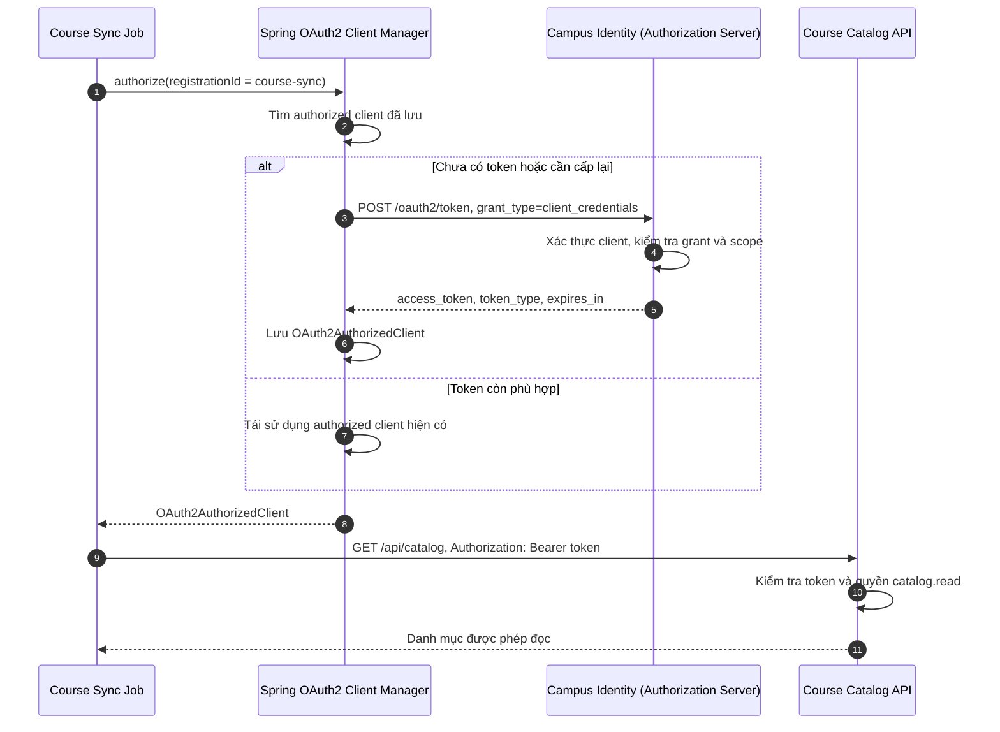
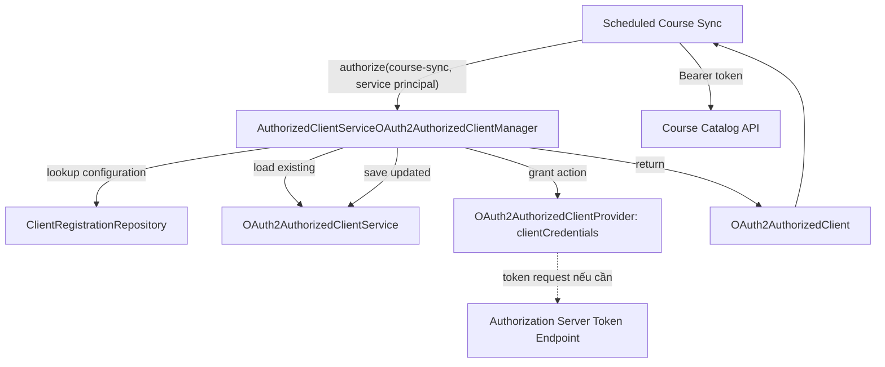
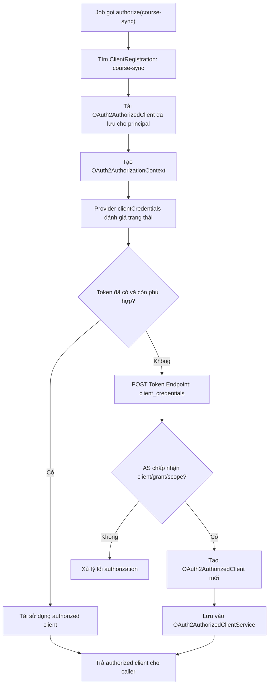

# 16.1. Luồng client credentials trong Spring Security

## Mục tiêu bài học

Sau bài học này, bạn có thể:

- Giải thích **OAuth 2.0 Client Credentials Grant** là gì và khi nào nên sử dụng trong tích hợp **machine-to-machine (M2M)**.
- Phân biệt luồng `client_credentials` với **Authorization Code + OIDC Login**: không có trình duyệt, authorization code, redirect URI, ID Token hay End-User đăng nhập.
- Đọc một HTTP token request có `grant_type=client_credentials`, cách client xác thực tại Token Endpoint và cách dùng access token để gọi Resource Server.
- Cấu hình Spring Boot/Spring Security **OAuth2 Client** với `authorization-grant-type: client_credentials`, Client ID/secret, Token Endpoint và scopes.
- Sử dụng **`AuthorizedClientServiceOAuth2AuthorizedClientManager`** cùng `OAuth2AuthorizedClientProvider` để lấy và tái sử dụng access token trong service hoặc scheduled job không có Servlet request.
- Hiểu vai trò của `ClientRegistration`, `OAuth2AuthorizedClient`, `OAuth2AuthorizedClientService`, principal name và các phương thức xác thực client.
- Phân biệt **client authorization** với **authorization nghiệp vụ ở API**; nhận biết các lỗi `invalid_client`, `unauthorized_client`, `invalid_scope`, token hết hạn và thiếu quyền.
- Thiết kế vòng đời token, cache, xoay secret, triển khai nhiều instance và bảo vệ dữ liệu nhạy cảm khi tích hợp thực tế.

## 1. Bối cảnh: một service cần gọi service khác

Giả sử hệ thống **Learning Platform** có:

- **Course Sync Service**: một Spring Boot service chạy theo lịch, đồng bộ danh mục khóa học.
- **Campus Identity**: Authorization Server (AS) cấp access token cho các client đã đăng ký.
- **Course Catalog API**: Resource Server nhận access token để cho phép đọc danh mục.

Không có sinh viên hay giảng viên nào cần mở trình duyệt hoặc đăng nhập khi job đồng bộ chạy. Service cần chứng minh **chính nó** được phép gọi API.

Một luồng đơn giản:

```text
Course Sync Service
  |
  | POST Token Endpoint
  | grant_type=client_credentials
  | xác thực client bằng ID/secret hoặc phương thức đã đăng ký
  v
Campus Identity / Authorization Server
  |
  | access_token + token_type + expires_in
  v
Course Sync Service
  |
  | Authorization: Bearer <access-token>
  v
Course Catalog API / Resource Server
  |
  | xác minh token + scope/authority + chính sách truy cập
  v
Danh sách khóa học được phép đọc
```

Đây là **OAuth 2.0 Client Credentials Grant**. Nó phù hợp khi quyền truy cập được cấp cho **ứng dụng/service**, không phải cho một người dùng hiện diện trong browser.

> **Nguyên tắc quan trọng:** Với `client_credentials`, client **tự xác thực với Authorization Server để xin access token**, rồi dùng token đó truy cập API trong phạm vi được cấp. Token này **không chứng minh danh tính của một End-User**.

### 1.1. Các thực thể trong luồng

| Thực thể | Vai trò | Ví dụ |
| --- | --- | --- |
| OAuth Client | Ứng dụng xin token | Course Sync Service |
| Authorization Server | Xác thực client, quyết định scope/quyền và cấp token | Campus Identity |
| Resource Server | Kiểm tra token và áp dụng chính sách API | Course Catalog API |
| Resource Owner | Chủ thể của tài nguyên theo mô hình OAuth | Trong client credentials, client hành động dựa trên quyền của chính mình; không có bước người dùng cấp quyền tương tác |
| Access Token | Credential cho phép gọi API | Token có scope `catalog.read` |
| Client Credentials | Thông tin client dùng xác thực tại AS | Client ID + secret, hoặc private-key JWT/mTLS theo hỗ trợ |

Trong OAuth 2.0, Client Credentials Grant dùng khi client hành động **thay mặt chính nó** hoặc truy cập tài nguyên đã được sắp đặt trước theo quyền được cấp. Không tự gắn quyền của một người dùng cụ thể vào token M2M chỉ vì service có thể biết email hoặc user ID đó.

### 1.2. Sơ đồ sequence



Manager giúp ứng dụng **không phải tự tạo HTTP token request mỗi lần job chạy** và không phải lưu access token trong biến toàn cục tùy tiện.

## 2. Phân biệt Client Credentials với Authorization Code và OIDC Login

| Tiêu chí | Client Credentials | Authorization Code / OIDC Login |
| --- | --- | --- |
| Chủ thể đang được xác thực để xin token | **OAuth Client** | Người dùng xác thực tại OP, client cũng có thể phải xác thực ở Token Endpoint |
| Cần browser redirect đến Authorization Server? | **Không** | Có, trong luồng web tương tác thường gặp |
| Có Authorization Code? | Không | Có |
| Có `redirect_uri`/callback? | Không dùng cho grant này | Có |
| Token request | `grant_type=client_credentials` | `grant_type=authorization_code`, `code`, `redirect_uri`... |
| Có ID Token theo chuẩn OIDC Login? | **Không** | Có khi flow thực hiện OIDC và có scope `openid` |
| Có End-User principal `OidcUser`? | Không phải kết quả của client credentials | Có thể có sau OIDC Login |
| Quyền token đại diện | Quyền **của ứng dụng/service** | Quyền mà client được cấp trong ngữ cảnh người dùng |
| Trường hợp điển hình | Scheduled sync, batch, backend-to-backend | Website cho người dùng đăng nhập, gọi API thay mặt người dùng |
| Refresh token | Theo RFC 6749, **SHOULD NOT** được cấp trong client credentials | Có thể được cấp theo chính sách |

Ví dụ một request thuộc Authorization Code Flow:

```text
POST /oauth2/token
grant_type=authorization_code
code=<code-from-browser-callback>
redirect_uri=https://portal.example.org/login/oauth2/code/campus
```

Trong khi Client Credentials:

```text
POST /oauth2/token
grant_type=client_credentials
scope=catalog.read
```

Client Credentials **không có bước gửi người dùng đến `/oauth2/authorization/{registrationId}`** để xin authorization code. Phần lớn cấu hình không cần `redirect-uri`, `authorization-uri` hoặc `oauth2Login()` chỉ để lấy token M2M.

### 2.1. Client Credentials có phải “đăng nhập bằng tài khoản service” không?

Có thể dùng cách nói không chính thức “service đăng nhập với AS”, nhưng về mặt OAuth 2.0 đây là **client authentication + token grant**, không phải phiên đăng nhập của người dùng.

Sau khi lấy token, Spring Security không tự tạo một `OidcUser` hoặc HTTP session cho người dùng. Một method `@AuthenticationPrincipal OidcUser user` trong controller web không phải cách lấy danh tính của client credentials token.

### 2.2. Có cần scope `openid` không?

Thông thường **không**. `openid` kích hoạt yêu cầu OpenID Connect Authentication để nhận ID Token trong những flow OIDC thích hợp. Client Credentials nhằm lấy **access token** cho API và không có End-User để xác thực.

Scopes nên mô tả quyền API mà Authorization Server và Resource Server đã thống nhất, ví dụ:

```text
catalog.read
catalog.sync
reports.generate
```

Không coi việc thêm `openid`, `profile`, `email` là cách tự động lấy danh tính người dùng qua client credentials.

## 3. HTTP token request trong Client Credentials Grant

Theo OAuth 2.0, client gửi token request tới **Token Endpoint** của Authorization Server bằng HTTPS và form URL-encoded.

Ví dụ:

```http
POST /oauth2/token HTTP/1.1
Host: identity.example.org
Content-Type: application/x-www-form-urlencoded
Authorization: Basic <base64-of-encoded-client-id-and-secret>
Accept: application/json

grant_type=client_credentials&scope=catalog.read
```

Các thành phần:

- `grant_type=client_credentials`: chỉ rõ loại grant cần thực hiện.
- `scope=catalog.read`: phạm vi client yêu cầu, tùy chọn trong giao thức nhưng bị giới hạn bởi cấu hình/quyền server.
- `Authorization: Basic ...`: một cách **xác thực confidential client** tại Token Endpoint, nếu registration cho phép `client_secret_basic`.
- HTTPS: bảo vệ credential và access token trên đường truyền.

**Client ID không phải secret.** Client secret mới là credential nhạy cảm; token nhận được cũng phải bảo vệ như credential.

### 3.1. Ví dụ `curl` cho môi trường kiểm thử

Khi AS chấp nhận `client_secret_basic`, có thể minh họa:

```bash
curl --fail-with-body --request POST \
  'https://identity.example.org/oauth2/token' \
  --header 'Content-Type: application/x-www-form-urlencoded' \
  --user "${SYNC_CLIENT_ID}:${SYNC_CLIENT_SECRET}" \
  --data-urlencode 'grant_type=client_credentials' \
  --data-urlencode 'scope=catalog.read'
```

Đây chỉ là công cụ kiểm tra giao thức, không phải phương án đưa secret vào log/build script hay lịch sử shell của môi trường sản xuất. `curl --user` xử lý Basic authentication nhưng cách truyền secret qua dòng lệnh có thể lộ qua môi trường/thông tin tiến trình tùy hệ điều hành; dùng phương án quản lý secret an toàn của hạ tầng.

Theo RFC 6749, client ID/secret trong HTTP Basic có quy tắc encode phù hợp form encoding trước khi kết hợp thành credential. Nếu có ký tự đặc biệt, hãy dùng thư viện chuẩn thay vì tự nối rồi Base64 theo cảm tính.

### 3.2. Token response điển hình

Authorization Server có thể trả:

```http
HTTP/1.1 200 OK
Content-Type: application/json
Cache-Control: no-store
Pragma: no-cache

{
  "access_token": "<opaque-or-jwt-access-token>",
  "token_type": "Bearer",
  "expires_in": 3600,
  "scope": "catalog.read"
}
```

Các giá trị là minh họa.

- `access_token`: credential dùng gọi API.
- `token_type`: ví dụ `Bearer`.
- `expires_in`: thời gian hiệu lực tính bằng giây từ thời điểm phát hành theo giao thức.
- `scope`: có thể có để mô tả phạm vi thực sự được cấp.

**Access token không bắt buộc là JWT.** Một Authorization Server có thể cấp opaque token và Resource Server dùng introspection hoặc cơ chế khác theo hợp đồng tích hợp. Client không cần tự parse JWT chỉ để biết phải gửi Bearer token nào.

### 3.3. Refresh token thường không được cấp

Đối với Client Credentials Grant, RFC 6749 nêu refresh token **SHOULD NOT** được cấp. Thực tế tích hợp thông dụng là:

```text
Access token AT1 hết hạn
    -> Client lại xác thực tại Token Endpoint
    -> grant_type=client_credentials
    -> Access token AT2 mới
```

Đừng thiết kế phụ thuộc vào một refresh token trong luồng này. Nếu provider có hành vi khác theo extension/profile riêng, phải đọc chính sách nhà cung cấp và cấu hình Spring phù hợp; không tự xem việc có refresh token là mặc định.

### 3.4. Token Endpoint có thể từ chối request

Ví dụ response lỗi:

```http
HTTP/1.1 401 Unauthorized
Content-Type: application/json

{
  "error": "invalid_client"
}
```

Nguyên nhân có thể là Client ID/secret không đúng, phương thức xác thực không được chấp nhận hoặc client chưa được đăng ký.

Một lỗi khác:

```json
{
  "error": "invalid_scope"
}
```

có thể xuất hiện khi client yêu cầu scope không tồn tại hoặc không được cho phép. Không sửa lỗi bằng cách tăng quyền tùy ý ở Resource Server.

## 4. Client authentication khác Client Credentials Grant

Hai khái niệm có chữ “client” nhưng là hai trục độc lập.

**Grant type** mô tả căn cứ để xin access token:

```text
grant_type=client_credentials
```

**Client authentication method** mô tả cách Token Endpoint xác thực ứng dụng gọi nó:

```text
client_secret_basic
client_secret_post
private_key_jwt
client_secret_jwt
tls_client_auth / self_signed_tls_client_auth (nếu provider hỗ trợ)
```

Ví dụ một registration:

```yaml
authorization-grant-type: client_credentials
client-authentication-method: client_secret_basic
```

Không có mâu thuẫn: grant là `client_credentials`, còn cách chứng minh client là HTTP Basic.

| Cặp cấu hình | Ý nghĩa |
| --- | --- |
| `client_credentials` + `client_secret_basic` | Dùng ID/secret xác thực bằng HTTP Basic rồi xin access token M2M |
| `client_credentials` + `private_key_jwt` | Dùng JWT ký bằng private key làm bằng chứng xác thực client rồi xin token M2M |
| `client_credentials` + `client_secret_jwt` | Dùng HMAC JWT dựa trên shared secret để xác thực client |
| `authorization_code` + `client_secret_basic` | Client xác thực bằng Basic khi đổi code của một luồng có browser |
| `refresh_token` + `private_key_jwt` | Client có thể dùng JWT client authentication khi refresh một grant được cho phép |

Các phương thức nâng cao cần sự hỗ trợ của provider và cấu hình token HTTP client/signing keys tương ứng. Chỉ đổi tên `client-authentication-method` trong YAML không bảo đảm mọi phiên bản Spring tự tạo được client assertion JWT.

### 4.1. Confidential client phù hợp hơn public client

Client Credentials Grant được dùng với **confidential clients** có khả năng giữ credential an toàn ở backend. Không đặt client secret trong:

- JavaScript chạy ở browser.
- Mobile application binary không có cơ chế backend phù hợp.
- Trang HTML hoặc source map được tải công khai.
- Repo Git, Docker image hoặc log hệ thống.

Nếu frontend muốn gọi API thay mặt người dùng, hãy chọn kiến trúc OAuth phù hợp (ví dụ Authorization Code với PKCE hoặc backend/BFF), không nhúng Client Credentials secret để xin token trực tiếp trong trình duyệt.

## 5. Cấu hình Spring Boot: một ClientRegistration dùng `client_credentials`

Một cấu hình tối thiểu cho Course Sync Service:

```yaml
spring:
  security:
    oauth2:
      client:
        registration:
          course-sync:
            provider: campus-auth
            client-id: ${COURSE_SYNC_CLIENT_ID}
            client-secret: ${COURSE_SYNC_CLIENT_SECRET}
            client-authentication-method: client_secret_basic
            authorization-grant-type: client_credentials
            scope:
              - catalog.read

        provider:
          campus-auth:
            token-uri: https://identity.example.org/oauth2/token
```

Các host và credentials trong bài chỉ là minh họa; cần đăng ký client thực tế với Authorization Server, bật grant `client_credentials` và cấp scope `catalog.read` theo chính sách.

Giải thích:

- `course-sync`: **registration ID nội bộ** của Spring Security.
- `campus-auth`: **provider alias** liên kết registration với Token Endpoint.
- `${COURSE_SYNC_CLIENT_ID}`: Client ID AS cấp cho service.
- `${COURSE_SYNC_CLIENT_SECRET}`: secret nằm trong môi trường/secret manager.
- `client_secret_basic`: phương thức xác thực client tại Token Endpoint.
- `client_credentials`: grant type, cho phép service xin token không cần End-User.
- `catalog.read`: scope yêu cầu, không tự bảo đảm quyền được cấp.

### 5.1. Vì sao không có `redirect-uri`?

Client Credentials Grant **không có browser callback**; service gọi Token Endpoint trực tiếp. Vì thế không cần:

```yaml
redirect-uri: "{baseUrl}/login/oauth2/code/{registrationId}"
```

Cũng không bắt buộc khai báo `authorization-uri`, `user-info-uri`, `jwk-set-uri` hoặc OIDC `issuer-uri` chỉ để thực hiện grant M2M với một Token Endpoint được cấu hình trực tiếp.

Nếu provider hỗ trợ Authorization Server Metadata hoặc OIDC Discovery, có thể dùng metadata tương ứng tùy tích hợp, nhưng **đừng nhầm OIDC Login với Client Credentials**.

### 5.2. Có cần `oauth2Login()` không?

Không. Một service chỉ gọi API theo `client_credentials` không cần login page:

```java
http.oauth2Login(Customizer.withDefaults());
```

`oauth2Login()` phục vụ luồng đăng nhập tương tác của End-User. Service-to-service client credentials có thể hoạt động chỉ qua cấu hình OAuth2 Client và manager/service, không cần Servlet login filter.

### 5.3. Dependency trong Spring Boot

Trong dự án Maven Spring Boot, dependency OAuth2 Client thường là:

```xml
<dependency>
    <groupId>org.springframework.boot</groupId>
    <artifactId>spring-boot-starter-oauth2-client</artifactId>
</dependency>
```

Nếu ứng dụng là web MVC, có thể cần starter web phù hợp:

```xml
<dependency>
    <groupId>org.springframework.boot</groupId>
    <artifactId>spring-boot-starter-web</artifactId>
</dependency>
```

Các version cụ thể được quản lý theo Spring Boot BOM hoặc build configuration. Ví dụ trong bài không cố định một version để tránh trộn API giữa các đời Spring Security.

## 6. Các đối tượng Spring Security tham gia vào luồng

| Thành phần | Vai trò |
| --- | --- |
| `ClientRegistration` | Mô tả Client ID, secret/auth method, grant type, scopes, Token Endpoint |
| `ClientRegistrationRepository` | Tìm registration theo `registrationId`, ví dụ `course-sync` |
| `OAuth2AuthorizeRequest` | Đầu vào cho manager: registration ID, principal dùng làm khóa ngữ cảnh và attributes |
| `OAuth2AuthorizedClientManager` | Giao diện điều phối lấy/cấp/cấp lại authorized client |
| `OAuth2AuthorizedClientProvider` | Thực thi grant tương ứng khi cần; ở đây là `clientCredentials()` |
| `AuthorizedClientServiceOAuth2AuthorizedClientManager` | Manager phù hợp cho service hoặc job **không có Servlet request** |
| `OAuth2AuthorizedClientService` | Lưu/tải authorized client theo registration và principal name |
| `OAuth2AuthorizedClient` | Chứa registration, principal name, access token, optional refresh token |
| `OAuth2AccessTokenResponseClient<OAuth2ClientCredentialsGrantRequest>` | HTTP Token Endpoint client cho Client Credentials Grant, khi cần cấu hình riêng |
| `DefaultOAuth2AuthorizedClientManager` | Manager dùng repository trong **Servlet request context**, thường không phải lựa chọn cho scheduled job |

Một đường đi logic:



### 6.1. Principal name trong Client Credentials không phải End-User

Dù `OAuth2AuthorizeRequest` yêu cầu principal, nó không có nghĩa đang có người dùng đăng nhập. Với service M2M, caller có thể dùng một tên ổn định như:

```text
course-sync-service
```

Spring dùng principal name để **phân vùng khóa authorized-client store**. Token mà Authorization Server cấp vẫn căn cứ client credentials, scopes và chính sách của client, không dựa vào một người dùng ảo có tên như vậy.

Đừng đặt principal name khác ngẫu nhiên ở mỗi lần gọi nếu muốn cache được authorized client. Ngược lại, nếu cùng một registration được dùng trong các tenant/bối cảnh phân tách, cần quản lý khóa principal/tenant rõ ràng để không chia sẻ token ngoài ý muốn.

## 7. Vì sao nên dùng service-based manager cho scheduled jobs?

Một ứng dụng Spring có hai kiểu ngữ cảnh:

**Servlet HTTP request:**

```text
Browser request
  -> SecurityFilterChain
  -> HttpServletRequest / HttpServletResponse
  -> Authentication
  -> Controller
```

**Background execution:**

```text
@Scheduled job
  -> Không có browser request
  -> Không có HttpServletRequest/Response tự nhiên
  -> Có thể không có Authentication của End-User
```

`DefaultOAuth2AuthorizedClientManager` được thiết kế để phối hợp `OAuth2AuthorizedClientRepository` có HTTP request/response context; nó phù hợp khi đang ở Servlet request.

Đối với job không có request, nên dùng:

```java
AuthorizedClientServiceOAuth2AuthorizedClientManager
```

và:

```java
OAuth2AuthorizedClientService
```

Như vậy manager có thể lấy/lưu token theo registration ID và một tên principal ổn định **mà không cần giả lập HTTP session**.

### 7.1. So sánh hai manager

| Tiêu chí | `DefaultOAuth2AuthorizedClientManager` | `AuthorizedClientServiceOAuth2AuthorizedClientManager` |
| --- | --- | --- |
| Bối cảnh chính | Servlet request | Scheduled job, service/background |
| State store | `OAuth2AuthorizedClientRepository` | `OAuth2AuthorizedClientService` |
| Có cần HTTP request/response context? | Có trong cơ chế repository | Không |
| Có hỗ trợ Client Credentials? | Có nếu provider được cấu hình | Có nếu provider được cấu hình |
| Có thể tái sử dụng token? | Có, theo repository | Có, theo service store |
| Phù hợp job không có request? | Không nên là mặc định | **Phù hợp** |
| Có tự kiểm tra quyền API? | Không | Không |

**Lưu ý:** Service-based manager cũng có thể được dùng bên trong ứng dụng Servlet nếu đó là lựa chọn kiến trúc phù hợp. Khác biệt không nằm ở việc service chạy trên Tomcat hay không, mà nằm ở **có cần ngữ cảnh HTTP request** cho trạng thái OAuth không.

## 8. Tạo `OAuth2AuthorizedClientManager` cho Client Credentials

Ví dụ Java cấu hình một manager dùng cho M2M:

```java
@Configuration
class MachineToMachineOAuth2Configuration {

    @Bean
    OAuth2AuthorizedClientManager serviceAuthorizedClientManager(
            ClientRegistrationRepository registrations,
            OAuth2AuthorizedClientService authorizedClients) {

        OAuth2AuthorizedClientProvider provider =
            OAuth2AuthorizedClientProviderBuilder.builder()
                .clientCredentials()
                .build();

        AuthorizedClientServiceOAuth2AuthorizedClientManager manager =
            new AuthorizedClientServiceOAuth2AuthorizedClientManager(
                registrations, authorizedClients
            );

        manager.setAuthorizedClientProvider(provider);
        return manager;
    }
}
```

Từng bước:

1. `ClientRegistrationRepository` cho biết Token Endpoint, client auth method và grant type của registration `course-sync`.
2. `OAuth2AuthorizedClientService` lưu trạng thái token cho registration và service principal.
3. `clientCredentials()` kích hoạt provider thực hiện Client Credentials Grant khi cần.
4. `AuthorizedClientServiceOAuth2AuthorizedClientManager` điều phối việc tải/cấp/cập nhật authorized client.
5. Bean trả về dưới giao diện `OAuth2AuthorizedClientManager` để service khác sử dụng.

Nếu có nhiều manager beans trong cùng ứng dụng, hãy dùng tên bean hoặc `@Qualifier` phù hợp tại injection point để tránh chọn nhầm manager dành cho Servlet request.

### 8.1. Authorized-client service dùng loại lưu trữ nào?

Một số implementation thường gặp:

- `InMemoryOAuth2AuthorizedClientService`: trạng thái chỉ nằm trong JVM; thuận tiện cho development, demo và các workload đơn giản.
- `JdbcOAuth2AuthorizedClientService`: lưu qua JDBC; có thể được nhiều instance truy cập nếu dùng chung database.
- Service tùy biến: tùy hạ tầng, có thể lưu trong một persistence layer khác với các ràng buộc bảo mật thích hợp.

Đối với Client Credentials, có thể không cần lưu token lâu dài hơn thời hạn access token. Tuy nhiên, sử dụng service manager vẫn giúp phân tách đúng registration/principal và tránh tự tạo cache tùy tiện.

**Không suy đoán rằng in-memory store được chia sẻ giữa các instance.** Nếu có năm pod, mỗi pod có thể tự xin token riêng khi store cục bộ chưa có authorized client. Điều này có thể chấp nhận hoặc cần tối ưu tùy rate limit của Authorization Server.

### 8.2. Không cần refresh token provider cho grant thông dụng này

Vì Client Credentials thường không có refresh token, manager M2M có thể chỉ cấu hình:

```java
OAuth2AuthorizedClientProviderBuilder.builder()
    .clientCredentials()
    .build();
```

Khi access token hết hạn hoặc sắp hết hạn theo clock skew, provider sẽ dùng lại **Client Credentials Grant** để lấy token mới.

Nếu thêm `.refreshToken()` vào builder, nó không tự tạo refresh token từ không khí. Chỉ provider có dữ liệu/grant thích hợp mới thực hiện thao tác refresh.

## 9. Gọi manager trong scheduled job

Giả sử service chạy đồng bộ danh mục bằng `@Scheduled`:

```java
@Component
class CourseSyncJob {

    private final OAuth2AuthorizedClientManager clientManager;
    private final RestClient restClient;

    CourseSyncJob(
            @Qualifier("serviceAuthorizedClientManager")
            OAuth2AuthorizedClientManager clientManager,
            RestClient.Builder restClientBuilder) {
        this.clientManager = clientManager;
        this.restClient = restClientBuilder.build();
    }

    @Scheduled(fixedDelayString = "${sync.delay-ms:600000}")
    public void sync() {
        OAuth2AuthorizeRequest authorizeRequest =
            OAuth2AuthorizeRequest
                .withClientRegistrationId("course-sync")
                .principal("course-sync-service")
                .build();

        OAuth2AuthorizedClient authorizedClient =
            clientManager.authorize(authorizeRequest);

        if (authorizedClient == null) {
            throw new IllegalStateException(
                "Unable to obtain an OAuth2 authorized client"
            );
        }

        String accessToken =
            authorizedClient.getAccessToken().getTokenValue();

        String json = restClient.get()
            .uri("https://courses.example.org/api/catalog")
            .headers(headers -> headers.setBearerAuth(accessToken))
            .retrieve()
            .body(String.class);

        // Parse dữ liệu, kiểm tra và đồng bộ bằng service nghiệp vụ.
        // Không log accessToken hoặc toàn bộ raw response nhạy cảm.
    }
}
```

Đây là ví dụ tập trung vào luồng OAuth2 Client. Trong ứng dụng thật phải có import, cấu hình scheduling (`@EnableScheduling` hoặc cơ chế tương ứng), timeout, kiểm tra lỗi HTTP, retry có giới hạn, hợp đồng API và logic đồng bộ nghiệp vụ.

**Điều cần hiểu:**

- `@Scheduled` chạy **không cần người dùng đăng nhập**.
- `.principal("course-sync-service")` là **khóa nhận diện phục vụ authorized-client store**, không phải người dùng Campus Identity.
- `authorize()` có thể trả authorized client đang còn phù hợp hoặc xin token mới qua Token Endpoint.
- Bearer access token chỉ được gửi đến **Course Catalog API** đã được cấu hình tin cậy và có scope/audience phù hợp.
- Response JSON chứa dữ liệu nghiệp vụ, không phải token để gửi lại browser.

### 9.1. Có thể gọi manager từ service thường không?

Có. Caller không bắt buộc phải là `@Scheduled`:

```java
@Service
class CatalogTokenService {

    private final OAuth2AuthorizedClientManager clientManager;

    CatalogTokenService(
            @Qualifier("serviceAuthorizedClientManager")
            OAuth2AuthorizedClientManager clientManager) {
        this.clientManager = clientManager;
    }

    String getAccessToken() {
        OAuth2AuthorizeRequest request =
            OAuth2AuthorizeRequest
                .withClientRegistrationId("course-sync")
                .principal("course-sync-service")
                .build();

        OAuth2AuthorizedClient client =
            clientManager.authorize(request);

        if (client == null) {
            throw new IllegalStateException(
                "OAuth2 authorization unavailable"
            );
        }

        return client.getAccessToken().getTokenValue();
    }
}
```

Trong hệ thống sản xuất, API trả `String` token nên có phạm vi sử dụng hẹp; cân nhắc tích hợp HTTP client chịu trách nhiệm gắn Bearer token để tránh token bị truyền qua quá nhiều tầng. Không lưu token trong field singleton lâu dài chỉ để tránh gọi manager.

### 9.2. Manager không nhất thiết gọi Token Endpoint mỗi lần

Giả sử một token sống 30 phút:

```text
09:00  authorize() -> xin AT1
09:05  authorize() -> tái sử dụng AT1
09:20  authorize() -> tái sử dụng AT1 nếu vẫn đủ hạn
09:30  authorize() -> AT1 hết/sắp hết hạn, xin AT2
```

Thời điểm refresh/reauthorize thực tế phụ thuộc `expiresAt`, clock skew và logic provider được dùng. Không hard-code rằng cứ sau đúng 30 phút phải phát token mới; token có thể được cấp với TTL khác hoặc AS áp dụng chính sách khác.

### 9.3. Vì sao principal name cần ổn định?

Manager/service store thường khóa dữ liệu theo:

```text
(clientRegistrationId, principalName)
```

Nếu mỗi lần gọi sử dụng:

```java
.principal(UUID.randomUUID().toString())
```

thì mỗi lần sẽ được coi là một khóa lưu khác. Manager khó tìm lại authorized client để tái sử dụng token, gây nhiều request đến Token Endpoint và tăng số bản ghi không cần thiết.

Một service có một registration M2M thường dùng một principal name ổn định, ví dụ:

```text
course-sync-service
```

Nếu cần phân tách các tenant hoặc scope khác nhau, hãy thiết kế registration/khóa/tenant rõ ràng, không chỉ thay principal tùy tiện để “xin token khác”.

## 10. Bên trong `authorize()`: manager phối hợp provider và service

Quy trình logic:



Đây là sơ đồ khái niệm. Spring có thể hiện thực chi tiết thông qua manager, provider composite và success/failure handler khác nhau theo phiên bản. Điểm cần ghi nhớ là:

- `ClientRegistration` xác định **cách và nơi xin token**.
- `OAuth2AuthorizedClientService` giữ **token đã được cấp**.
- `OAuth2AuthorizedClientProvider` thực hiện grant khi cần.
- Manager điều phối và trả `OAuth2AuthorizedClient`.
- Caller dùng access token đúng mục đích và Resource Server kiểm tra quyền.

### 10.1. Token chưa hết hạn: có phải manager phát token mới?

Không nhất thiết. Nếu provider thấy access token hiện tại còn đủ hiệu lực, nó có thể không thực hiện lại grant. Manager có thể trả authorized client đang có.

### 10.2. Token gần hết hạn: tại sao không chờ đúng `expiresAt`?

Độ lệch đồng hồ, thời gian mạng và độ trễ request có thể khiến token hết hạn trong lúc đang gọi Resource Server. Spring Security provider có cơ chế **clock skew** để xem token là cần cấp lại sớm hơn một chút khi phù hợp.

Không sử dụng toàn bộ TTL được cấp một cách mù quáng khi request có thể kéo dài hoặc clock giữa các node bị lệch. Đồng bộ NTP và cấu hình giới hạn hợp lý.

### 10.3. Có `OAuth2AuthorizedClient` không nghĩa access token luôn dùng được

Token có thể:

- Đã bị AS thu hồi.
- Không có scope mà API yêu cầu.
- Dành cho audience/Resource Server khác.
- Hết hạn hoặc không còn được API đích chấp nhận do policy mới.
- Bị loại khỏi authorization bởi thay đổi client permissions.

Manager giúp quản lý vòng đời token, **không chứng minh Resource Server sẽ cho phép mọi request**.

## 11. Cấu hình thuần Java cho `ClientRegistration`

Nếu không muốn dùng YAML hoặc cần tạo registration theo cấu hình riêng, có thể minh họa `ClientRegistration` builder:

```java
@Bean
ClientRegistrationRepository clientRegistrationRepository(
        @Value("${course-sync.client-id}") String clientId,
        @Value("${course-sync.client-secret}") String clientSecret) {

    ClientRegistration registration =
        ClientRegistration.withRegistrationId("course-sync")
            .clientId(clientId)
            .clientSecret(clientSecret)
            .clientAuthenticationMethod(
                ClientAuthenticationMethod.CLIENT_SECRET_BASIC
            )
            .authorizationGrantType(
                AuthorizationGrantType.CLIENT_CREDENTIALS
            )
            .tokenUri("https://identity.example.org/oauth2/token")
            .scope("catalog.read")
            .clientName("Course Sync")
            .build();

    return new InMemoryClientRegistrationRepository(registration);
}
```

Ở đây:

```text
registrationId = course-sync
clientId       = do Authorization Server cấp
grantType      = client_credentials
tokenUri       = Token Endpoint thực tế
```

Cần lưu ý nếu Spring Boot đã tự tạo bean `ClientRegistrationRepository` từ YAML thì không khai báo thêm bean mâu thuẫn mà không có kế hoạch. Builder trên minh họa cách ánh xạ cấu hình, không phải bắt buộc viết Java để dùng client credentials.

### 11.1. Không cần cấu hình Authorization Endpoint cho grant này

Client Credentials dùng **Token Endpoint trực tiếp**. Vì vậy:

```java
.tokenUri("https://identity.example.org/oauth2/token")
```

là phần cốt lõi, còn authorization endpoint dành cho browser redirect không phải yêu cầu của grant.

### 11.2. Nhiều registration cho nhiều API

Một service có thể gọi hai hệ thống có Authorization Server khác nhau:

```text
course-sync   -> identity.example.org -> Course Catalog API
report-sync   -> accounts.example.net -> Reporting API
```

Mỗi registration có thể giữ `clientId`, secret, scopes, token endpoint và client authentication method riêng.

Không lấy access token của `course-sync` để gọi Reporting API chỉ vì cả hai dùng OAuth. API có thể yêu cầu audience/scope/issuer khác.

## 12. Khi ứng dụng Servlet vẫn có công việc M2M

Một Spring Boot MVC application đôi khi vừa cho người dùng đăng nhập OIDC, vừa chạy job nền đồng bộ dữ liệu:

```text
Browser -> OIDC Login -> Web controllers
                         |
                         +--> gọi API thay mặt user
                         |
                         +--> scheduled M2M job (không phải user)
```

Có thể cần **hai manager**:

| Tác vụ | Manager thường phù hợp |
| --- | --- |
| Web controller gọi API bằng delegated user access token | `DefaultOAuth2AuthorizedClientManager` và `OAuth2AuthorizedClientRepository` |
| Job M2M `client_credentials` không có request | `AuthorizedClientServiceOAuth2AuthorizedClientManager` và `OAuth2AuthorizedClientService` |

Một cấu hình minh họa hai bean:

```java
@Configuration
class OAuth2ManagersConfiguration {

    @Bean("webClientManager")
    OAuth2AuthorizedClientManager webClientManager(
            ClientRegistrationRepository registrations,
            OAuth2AuthorizedClientRepository repository) {

        DefaultOAuth2AuthorizedClientManager manager =
            new DefaultOAuth2AuthorizedClientManager(
                registrations, repository
            );

        manager.setAuthorizedClientProvider(
            OAuth2AuthorizedClientProviderBuilder.builder()
                .authorizationCode()
                .refreshToken()
                .build()
        );

        return manager;
    }

    @Bean("serviceClientManager")
    OAuth2AuthorizedClientManager serviceClientManager(
            ClientRegistrationRepository registrations,
            OAuth2AuthorizedClientService service) {

        AuthorizedClientServiceOAuth2AuthorizedClientManager manager =
            new AuthorizedClientServiceOAuth2AuthorizedClientManager(
                registrations, service
            );

        manager.setAuthorizedClientProvider(
            OAuth2AuthorizedClientProviderBuilder.builder()
                .clientCredentials()
                .build()
        );

        return manager;
    }
}
```

Các bean/implementation của repository và service phải được ứng dụng cung cấp hoặc được Boot cấu hình đúng. Với nhiều bean cùng interface, injection point cần `@Qualifier` để chọn đúng.

**Không dùng Authentication của người đang xem web để làm principal cho job M2M.** Job có định danh service riêng; Client Credentials Access Token không đại diện cho người dùng web đó.

## 13. Resource Server sẽ kiểm tra access token như thế nào?

Sau khi xin token, Course Sync Service gửi:

```http
GET /api/catalog HTTP/1.1
Host: courses.example.org
Authorization: Bearer <access-token>
```

Course Catalog API phải kiểm tra access token theo chính sách:

- Token hợp lệ về chữ ký/issuer hoặc introspection, tùy token format.
- `exp`, `nbf` và các điều kiện thời gian áp dụng.
- Audience hoặc Resource Indicator phù hợp với API khi provider/protocol sử dụng.
- Scope/authority, ví dụ `catalog.read`.
- Chính sách cụ thể của endpoint và định danh client được phép.
- Bất kỳ ràng buộc sender-constrained token nào nếu môi trường dùng mTLS/DPoP.

Không phải access token nào cũng chứa cùng tập claims. Với opaque token, Resource Server có thể dùng introspection. Với JWT, có thể xác minh bằng public key được cấu hình tin cậy. Quy tắc cụ thể thuộc về hợp đồng Authorization Server ↔ Resource Server.

### 13.1. Cấu hình Resource Server JWT minh họa

Một API riêng có thể cấu hình:

```yaml
spring:
  security:
    oauth2:
      resourceserver:
        jwt:
          issuer-uri: https://identity.example.org
```

Và SecurityFilterChain:

```java
@Bean
SecurityFilterChain apiSecurity(HttpSecurity http) throws Exception {
    http
        .authorizeHttpRequests(auth -> auth
            .requestMatchers("/api/catalog")
                .hasAuthority("SCOPE_catalog.read")
            .anyRequest().authenticated()
        )
        .oauth2ResourceServer(oauth2 -> oauth2
            .jwt(Customizer.withDefaults())
        );

    return http.build();
}
```

Ví dụ giả định AS phát hành JWT access token, issuer đúng và scopes được ánh xạ sang `SCOPE_...` theo cấu hình mặc định của Spring Security. Trong hệ thống thực, cần thêm audience validation hoặc các điều kiện khác phù hợp API; **chỉ có `issuer-uri` không tự đủ để bảo đảm token được phát hành cho API cụ thể**.

Cần phân biệt hai ứng dụng:

- **Course Sync Service** là OAuth2 Client xin access token.
- **Course Catalog API** là Resource Server nhận và kiểm tra token.

Không chỉ cấu hình OAuth2 Client ở caller rồi mặc nhiên cho rằng API đã an toàn.

### 13.2. Scope là quyền tối thiểu, không phải quyền vô hạn

Nếu token được cấp:

```text
scope = catalog.read
```

thì API có thể cho đọc danh mục nhưng không cho:

```text
POST /api/catalog
DELETE /api/catalog/123
```

trừ khi có scopes/permissions khác và chính sách cho phép. Quyền client credentials được thiết kế theo **least privilege**: client chỉ nhận phạm vi đủ để thực hiện nhiệm vụ của mình.

### 13.3. Không suy ra một người dùng từ `sub` của access token M2M

Nếu access token là JWT và chứa `sub`, ý nghĩa `sub` phụ thuộc profile Authorization Server. Nó có thể chỉ đến client/service hoặc một subject kỹ thuật, **không phải End-User**.

Đừng lấy `sub` của M2M token rồi gán thành user ID của sinh viên trong Course API. Nếu endpoint cần hành động thay mặt người dùng cụ thể, phải có giao thức và chính sách delegation phù hợp, không thay bằng client credentials.

## 14. Những thay đổi khi Access Token hết hạn

Manager có thể tái sử dụng access token còn phù hợp. Khi token hết hoặc gần hết hạn, provider `clientCredentials()` có thể thực hiện grant mới:

```text
AT1 -> hết hạn
    -> POST Token Endpoint với client credentials
    -> nhận AT2
    -> lưu authorized client mới
```

Trong Client Credentials Grant thông dụng, không có bước refresh bằng `grant_type=refresh_token`.

### 14.1. Cấu hình clock skew

Spring Security có các provider như `ClientCredentialsOAuth2AuthorizedClientProvider` với cơ chế đánh giá expiration cùng clock skew. Ý nghĩa:

```text
expiresAt = 10:00:00
clockSkew = 00:01:00

Tại 09:59:15:
  Token có thể được xem là đến thời điểm cần cấp lại,
  tránh dùng token hết hạn giữa chừng.
```

Con số trên minh họa, không phải mặc định bắt buộc của mọi phiên bản Spring Security. Nếu cần tinh chỉnh, sử dụng API `setClockSkew` hoặc configurer tương ứng **đúng phiên bản** và kiểm tra yêu cầu về độ trễ mạng.

### 14.2. Không có yêu cầu token phải thay đổi mỗi lần

Authorization Server có thể trả access token mới có giá trị khác, hoặc có chiến lược cache theo policy. Client không được tự suy luận grant thành công chỉ dựa trên token string khác token trước.

Hãy dựa trên token response hợp lệ, thời hạn được thư viện quản lý và việc Resource Server chấp nhận token.

### 14.3. Retry sau lỗi mạng

Nếu gọi Token Endpoint timeout, có thể AS đã xử lý request nhưng response chưa đến client. Với client credentials, việc thử lại có thể xin thêm token, gây tải không cần thiết nhưng thường không có vấn đề reuse refresh token như ở rotating refresh grant.

Dù vậy, cần:

- Backoff và retry có giới hạn.
- Không retry vô hạn khi `invalid_client` hoặc `unauthorized_client`.
- Theo dõi rate limit của AS.
- Không log request có client secret.
- Áp dụng circuit breaker khi dependency không sẵn sàng.
- Tránh một cụm nhiều instance đồng loạt xin token khi AS vừa hồi phục.

## 15. Dùng token store đúng cách

`OAuth2AuthorizedClientService` lưu authorized client theo tổ hợp:

```text
clientRegistrationId + principalName
```

Ví dụ:

```text
("course-sync", "course-sync-service")
```

Có thể sử dụng:

```java
OAuth2AuthorizedClient client =
    authorizedClientService.loadAuthorizedClient(
        "course-sync",
        "course-sync-service"
    );
```

Nhưng lời gọi `loadAuthorizedClient` **chỉ tải state**, không cấp token và không đảm bảo access token còn hạn. Khi cần token dùng ngay, nên gọi manager.

### 15.1. Không tự cache token theo `registrationId` toàn cục nếu có nhiều ngữ cảnh

Một ứng dụng đơn tenant có thể dùng một principal name ổn định cho một service registration. Nhưng nếu hệ thống phục vụ nhiều tenant có những client credentials khác nhau, việc dùng chung cache key `course-sync` sẽ có nguy cơ chia sẻ token sai tenant.

Thiết kế nên phân tách bằng registration và định danh service/tenant cụ thể, đồng thời bảo đảm ClientRegistration thật sự tương ứng với credentials/issuer/quyền của tenant.

### 15.2. Nhiều instance có thể cùng xin token

Nếu dùng `InMemoryOAuth2AuthorizedClientService`:

```text
Pod A -> cache A
Pod B -> cache B
Pod C -> cache C
```

Mỗi pod có thể tự xin token lần đầu. Điều này có thể chấp nhận với token TTL dài và số pod nhỏ. Nếu cần hạn chế request Token Endpoint ở cụm lớn, cân nhắc shared store/cache có phân vùng và bảo mật thích hợp.

**Đừng giả định `OAuth2AuthorizedClientService` tự giải quyết distributed locking.** Nếu nhiều instance cùng refresh/cấp lại token, cần đánh giá rate limit và concurrency theo đặc tính grant/provider.

### 15.3. Có nên lưu access token vào database không?

Có thể, nhưng phải cân nhắc:

- Token là credential nhạy cảm: mã hóa khi lưu phù hợp threat model, hạn chế quyền đọc.
- Thời hạn token thường ngắn; không cần giữ vô hạn.
- Cleanup bản ghi cũ và token không còn dùng.
- Không ghi token vào audit logs.
- Có cơ chế rotate client secret và revoke grant nếu bị lộ.
- Cần đánh giá lợi ích persistence so với việc mỗi instance tự xin token.

Tránh viết custom serialization làm lộ token qua JSON API hoặc metrics.

## 16. Bảo vệ client credentials và access token

### 16.1. Quản lý secret

Client secret phải:

- Đủ độ mạnh và được AS cấp/quản lý phù hợp.
- Lưu trong secret manager, keystore hoặc môi trường bảo mật.
- Chỉ được đọc bởi service identity có quyền.
- Không nằm trong source code, repository công khai hay frontend.
- Có quy trình xoay và thu hồi khi bị lộ.
- Được truyền đến Token Endpoint qua HTTPS.

Ví dụ YAML:

```yaml
client-secret: ${COURSE_SYNC_CLIENT_SECRET}
```

không phải phương án bảo vệ hoàn chỉnh nếu biến môi trường bị in ra log, crash dump hoặc access rộng; cần áp dụng chính sách hạ tầng tương ứng.

### 16.2. Không trả access token về API frontend

Ví dụ code nguy hiểm:

```java
@GetMapping("/debug/token")
String token() {
    return clientManager.authorize(request)
        .getAccessToken()
        .getTokenValue();
}
```

M2M token có thể cấp quyền dịch vụ rộng và không gắn với người dùng. Nếu browser nhận được token, kẻ có quyền truy cập browser/devtools hoặc XSS có thể lợi dụng nó.

Với kiến trúc backend, token chỉ nên được sử dụng trong server-to-server HTTP client gọi Resource Server hợp lệ.

### 16.3. Cẩn thận với logging HTTP client

Một số thư viện có thể log HTTP headers/body ở mức DEBUG. Với Token Endpoint, log đó có thể chứa:

```text
Authorization: Basic ...
client_secret=...
access_token=...
```

Với Resource Server, có thể chứa:

```text
Authorization: Bearer ...
```

Phải cấu hình lọc/redact thông tin nhạy cảm và kiểm soát access vào log. Không dùng token thật trong tài liệu hoặc unit test snapshots.

### 16.4. Phân tách quyền service theo nhiệm vụ

Thay vì một client có mọi quyền:

```text
course-service-admin -> catalog.read, catalog.write,
                        grades.read, grades.write, users.admin
```

nên có registration chuyên dụng cho sync:

```text
course-sync -> catalog.read
```

Nếu service bị xâm nhập, phạm vi thiệt hại được giới hạn hơn. API vẫn phải thực thi authorization cho từng endpoint.

## 17. Các lỗi thường gặp

| Triệu chứng | Nguyên nhân có thể | Hướng xử lý |
| --- | --- | --- |
| Token Endpoint trả `invalid_client` | Client ID/secret sai, phương thức client authentication không đúng | Kiểm tra registration AS, secret và `client-authentication-method` |
| Token Endpoint trả `unauthorized_client` | Client chưa được phép sử dụng `client_credentials` | Bật/đăng ký grant đúng ở AS |
| Token Endpoint trả `unsupported_grant_type` | AS không hỗ trợ grant hoặc endpoint sai | Xác minh capability/Token Endpoint và grant được hỗ trợ |
| Token Endpoint trả `invalid_scope` | Scope yêu cầu chưa được đăng ký/cho phép | Sửa cấu hình scope và quyền cấp ở AS |
| `authorize()` trả `null` | Provider không thể authorize theo cấu hình/context | Kiểm tra `clientCredentials()` provider, registration và manager |
| Missing `ClientRegistration` | Dùng sai registration ID hoặc thiếu cấu hình | Kiểm tra key dưới `registration` |
| Mỗi lần job chạy đều gọi Token Endpoint | Principal name thay đổi, service store không giữ state, token đã hết hạn | Dùng principal ổn định, xem store/expiry |
| Job `@Scheduled` lỗi vì thiếu HTTP context | Dùng manager dành cho Servlet request | Chuyển sang service-based manager |
| Gọi API bị `401` | Access token hết hạn, sai issuer/audience, token không hợp lệ | Xem token lifecycle và Resource Server validation |
| Gọi API bị `403` | Thiếu scope/authority/permissions | Cấp quyền tối thiểu phù hợp và kiểm tra mapping ở API |
| Server trả token nhưng thiếu field mong đợi | Token response không theo giao thức/hợp đồng | Kiểm tra provider và Token Response Client |
| Service cố dùng refresh token nhưng luôn `null` | Client Credentials thường không cấp refresh token | Xin access token mới bằng grant `client_credentials` |
| Token của tenant A dùng cho tenant B | Store/cache phân tách không đúng | Tách registration/credentials/tenant key |
| Client secret xuất hiện trong logs | Logging HTTP headers hoặc cấu hình debug quá rộng | Redact và giới hạn logs |
| Dùng token M2M làm session user | Nhầm Client Credentials với OIDC Login | Tách authentication người dùng và service authentication |
| API chấp nhận mọi token từ issuer | Resource Server thiếu audience/scope/authorization policy | Bổ sung kiểm tra đúng tài nguyên đích |

### 17.1. Khi bị `invalid_client`, kiểm tra gì trước?

Đối chiếu:

1. Token Endpoint có đúng không?
2. Client ID có khớp registration trên AS không?
3. Client secret/khóa ký còn hiệu lực không?
4. Phương thức xác thực client (`client_secret_basic`, `private_key_jwt`, v.v.) có được AS cho phép không?
5. HTTPS/proxy có làm thay đổi request hoặc header Authentication không?
6. Nếu dùng JWT client assertion, `aud`, chữ ký, `kid`, `exp`, `jti` đã đúng chính sách chưa?

Không chữa `invalid_client` bằng cách đổi scope hoặc tắt authentication tại API đích.

### 17.2. Khi bị `invalid_scope`, kiểm tra gì?

Ví dụ client yêu cầu:

```text
catalog.read catalog.write
```

nhưng AS chỉ cấp:

```text
catalog.read
```

Hoặc từ chối hoàn toàn vì scope không được phép.

Phải kiểm tra scopes được đăng ký, chính sách cấp quyền của AS và những gì Course Catalog API thật sự yêu cầu. Không đưa quyền ghi vào một job chỉ cần đọc dữ liệu.

### 17.3. Khi API trả `401` và `403`

Ý nghĩa thường gặp:

- `401 Unauthorized`: token không hợp lệ, hết hạn hoặc thiếu điều kiện xác thực.
- `403 Forbidden`: token có thể hợp lệ nhưng client không có quyền thực hiện tác vụ.

Đây là quy ước phổ biến; chi tiết phụ thuộc API. Đọc mã lỗi/challenge của Resource Server mà không log token. Nếu chỉ có thiếu scope, xin token mới **với cùng scope chưa được cấp** cũng không giải quyết được.

## 18. Kiểm thử tích hợp Client Credentials

### 18.1. Kiểm thử cấu hình và logic ứng dụng

Ở mức unit test, có thể:

- Mock `OAuth2AuthorizedClientManager` để trả một authorized client giả.
- Xác minh outbound client gắn Bearer token vào đúng endpoint.
- Kiểm tra xử lý khi manager trả `null` hoặc ném OAuth2 authorization exception.
- Kiểm tra không trả token về browser và không log secret.
- Kiểm tra service principal/registration ID ổn định.

Unit test mock **không** chứng minh AS cấp token thật hay API đã chấp nhận nó.

### 18.2. Kiểm thử HTTP Token Endpoint

Trong môi trường integration test có AS thật hoặc test server phù hợp:

1. Đăng ký một confidential client chỉ được phép `client_credentials`.
2. Gửi token request hợp lệ để xác minh `200 OK` và token response.
3. Thử sai client secret, mong `invalid_client`.
4. Thử grant không được phép, mong `unauthorized_client`.
5. Thử scope không được cấp, xác định chính sách từ chối.
6. Dùng token hợp lệ gọi Course API, mong được phép trên endpoint read.
7. Dùng token thiếu scope gọi endpoint write, mong bị từ chối.
8. Chờ token hết hạn hoặc dùng thời gian kiểm thử được kiểm soát để xác minh manager xin token mới.

Không chạy test với production client secret hoặc tài nguyên thực nhạy cảm chỉ để chứng minh ví dụ.

### 18.3. Quan sát logs và metrics

Chỉ log metadata an toàn:

```text
registrationId = course-sync
grantType = client_credentials
authorized = true
tokenExpiresAt = <timestamp>
tokenRequestCount = <count>
errorCode = invalid_scope
correlationId = <safe-id>
```

Không log `access_token`, `client_secret`, HTTP Authorization header hoặc raw token response.

Métrics hữu ích:

- Số token request theo registration.
- Tỷ lệ lỗi của Token Endpoint.
- Độ trễ token request.
- Số lần gọi Resource Server bị `401`/`403`.
- Tỷ lệ cache hit của authorized client.
- Số lần job retry và nguyên nhân.

## 19. Những tình huống thực tế

### Tình huống A — Course Sync chạy mỗi 10 phút

Job sử dụng registration `course-sync` và principal name ổn định. Lần đầu manager xin token, những lần sau tái sử dụng token còn hạn. Khi cần, nó xin token mới bằng `client_credentials`.

**Cách thiết kế:** dùng service-based manager, scope `catalog.read`, secret manager, bearer call trên backend và bounded retry.

### Tình huống B — Portal vừa có browser login, vừa có job nền

Web controller đăng nhập OIDC để hiển thị khóa học của sinh viên; job đồng bộ danh mục chạy không có End-User.

**Cách thiết kế:** tách delegated user flow và M2M flow; có thể dùng hai ClientRegistration và manager khác nhau. Không sử dụng access token của người dùng để chạy job hệ thống, cũng không dùng M2M token để giả định sinh viên đang đăng nhập.

### Tình huống C — Lộ client secret trong CI logs

Secret bị in qua command line hoặc debug logs. Người có quyền đọc log có thể mạo danh M2M client để xin token.

**Cách xử lý:** thu hồi/rotate secret, hạn chế quyền truy cập log, sửa logging pipeline, đánh giá các token đã được cấp và audit truy cập bất thường.

### Tình huống D — Thêm scope nhưng API vẫn trả 403

Client đã yêu cầu `catalog.write` trong YAML, nhưng AS chưa đăng ký/cấp quyền đó hoặc Course API đòi authority khác.

**Cách xử lý:** đối chiếu scope yêu cầu, scope được cấp trong token response/claims, mapping authority ở Resource Server và policy endpoint. Không coi việc khai báo scope ở client là quyền tự động.

### Tình huống E — Nhiều instance cùng xin token

Một cụm 20 pod dùng in-memory service store. Sau deploy, cả 20 pod cùng xin token một lần, làm tăng tải Token Endpoint.

**Cách xử lý:** đánh giá rate limit, sử dụng shared store nếu thực sự cần, áp dụng jitter/bounded retry; không ghi token vào cache công khai.

### Tình huống F — Có request HTTP nhưng vẫn dùng service manager

Một MVC application có endpoint quản trị kích hoạt đồng bộ dữ liệu hệ thống, không dùng token End-User. Service được gọi từ controller nhưng grant vẫn là `client_credentials`.

**Cách xử lý:** dùng service manager có principal dịch vụ ổn định là hoàn toàn hợp lý, vì token mang quyền của service, không gắn với session người dùng. Endpoint kích hoạt job vẫn phải **được phân quyền** để tránh người dùng bình thường gây tác vụ nhạy cảm.

### Tình huống G — API muốn biết sinh viên nào thao tác

Một API cần ghi nhận “sinh viên A đã sửa thông tin của chính mình”. Service gọi API bằng `client_credentials` nhưng muốn tự gán `userId=A` từ HTTP body.

**Cảnh báo:** token M2M chỉ chứng minh danh tính service. Nếu hệ thống cần danh tính và quyền của End-User, phải thiết kế delegation/on-behalf-of hoặc token exchange theo chính sách; không dùng dữ liệu request tự khai làm bằng chứng người dùng đã xác thực.

## 20. Bài tập thực hành

### Bài tập 1 — Chọn đúng grant

Một job chạy ban đêm, không có browser hay người dùng, cần lấy báo cáo thống kê tổng hợp qua API.

**Câu hỏi:** Grant nào phù hợp khi API cho phép service-level access?

**Đáp án:** `client_credentials`, với confidential client được đăng ký và scopes tối thiểu.

### Bài tập 2 — Xác định Token Endpoint request

Registration:

```yaml
registration:
  report-sync:
    provider: report-auth
    client-id: report-job
    client-secret: ${REPORT_SECRET}
    authorization-grant-type: client_credentials
    scope: [reports.read]

provider:
  report-auth:
    token-uri: https://identity.example.org/oauth2/token
```

**Câu hỏi:** Request cần grant và scope gì?

**Đáp án:**

```text
POST https://identity.example.org/oauth2/token
grant_type=client_credentials
scope=reports.read
```

Client còn phải xác thực theo phương thức đã đăng ký tại AS. Không cần `code`, `redirect_uri` hoặc OIDC ID Token.

### Bài tập 3 — Chọn manager cho job nền

Một service có method `@Scheduled`, không có `HttpServletRequest`.

**Câu hỏi:** Chọn `DefaultOAuth2AuthorizedClientManager` hay `AuthorizedClientServiceOAuth2AuthorizedClientManager`?

**Đáp án:** Chọn `AuthorizedClientServiceOAuth2AuthorizedClientManager`, lưu trạng thái qua `OAuth2AuthorizedClientService`.

### Bài tập 4 — Principal name là ai?

Job gọi:

```java
OAuth2AuthorizeRequest.withClientRegistrationId("course-sync")
    .principal("course-sync-service")
    .build();
```

**Câu hỏi:** `"course-sync-service"` có phải một sinh viên OIDC đang đăng nhập không?

**Đáp án:** Không. Đây là tên principal kỹ thuật của authorized client store, giúp manager lưu/tải token. Token được cấp theo client credentials của ứng dụng.

### Bài tập 5 — Token hết hạn

Access token đã hết hạn, service không có refresh token.

**Câu hỏi:** Có cần đăng nhập qua browser không?

**Đáp án:** Không. Với client credentials, manager dùng provider `clientCredentials()` và confidential client authentication để xin access token mới tại Token Endpoint.

### Bài tập 6 — Thiếu quyền tại Resource Server

Token hợp lệ có scope `catalog.read`, API đích yêu cầu `catalog.write`.

**Câu hỏi:** Manager có tự nâng quyền lên `catalog.write` không?

**Đáp án:** Không. Client phải được AS cấp scope phù hợp, và API vẫn phải thực thi policy. Không tự thay JWT claim/scope của access token.

### Bài tập 7 — Phân biệt Client ID và Registration ID

Cấu hình:

```yaml
registration:
  course-sync:
    client-id: sync-agent-prod
```

**Câu hỏi:** Gọi manager bằng ID nào, và Token Endpoint nhận Client ID nào?

**Đáp án:** Manager tìm registration `"course-sync"`, còn OAuth Client ID thực là `"sync-agent-prod"`.

### Bài tập 8 — Có nên nhúng secret trong SPA?

Frontend React muốn tự gọi Token Endpoint bằng `client_credentials`.

**Đáp án:** Không đặt client secret vào SPA/browser. Với trường hợp quyền của ứng dụng, backend nhận trách nhiệm xin token và gọi API; với quyền người dùng, chọn flow OAuth dành cho public client và chính sách phù hợp.

## 21. Câu hỏi ôn tập

**1. Client Credentials Grant giải quyết nhu cầu gì?**

> Cấp access token cho confidential client hành động với quyền của chính ứng dụng/service, thường dùng machine-to-machine, không cần người dùng tương tác.

**2. Có authorization code hoặc redirect URI trong luồng này không?**

> Không. Client gửi request trực tiếp đến Token Endpoint.

**3. `client_credentials` là grant type hay client authentication method?**

> Là **grant type**. Phương thức xác thực client có thể là `client_secret_basic`, `private_key_jwt`, mTLS... theo chính sách AS.

**4. Tại sao không dùng `oauth2Login()` để chạy scheduled sync?**

> `oauth2Login()` xử lý đăng nhập End-User qua browser, còn job M2M chỉ cần access token cấp cho client.

**5. Spring Security component nào phù hợp để xin token trong background job?**

> `AuthorizedClientServiceOAuth2AuthorizedClientManager` kết hợp `OAuth2AuthorizedClientService` và provider `clientCredentials()`.

**6. `OAuth2AuthorizeRequest.principal()` có phải ID người dùng thật không?**

> Với M2M, thường là service principal name ổn định dùng làm khóa lưu token; không chứng minh có End-User đăng nhập.

**7. Access token hết hạn có cần refresh token không?**

> Thông thường không. Client xin access token mới bằng Client Credentials Grant. RFC 6749 khuyến nghị không cấp refresh token cho grant này.

**8. Có được dùng access token M2M để gọi mọi API không?**

> Không. Resource Server phải xác minh token đúng audience/scope/quyền và chính sách của endpoint.

**9. Vì sao manager không xin token lại mỗi lần?**

> Manager/provider có thể tái sử dụng `OAuth2AuthorizedClient` đang có access token còn đủ hạn trong service store.

**10. ClientCredentials Grant có sinh OIDC ID Token và `OidcUser` không?**

> Không theo luồng chuẩn. Nó cấp access token cho client và không xác thực End-User như OIDC Login.

**11. Nếu job lấy token được nhưng Resource Server trả 403, lỗi nằm ở đâu?**

> Thường liên quan scopes, authorities, audience hoặc quyền ở API. Client authentication tại Token Endpoint thành công không bảo đảm mọi thao tác được phép.

**12. Nếu có nhiều instance và mỗi instance dùng in-memory store, token có được dùng chung không?**

> Không. Mỗi JVM có store riêng trừ khi kiến trúc cung cấp shared persistence/cache phù hợp.

---

## Ghi nhớ

**Client Credentials Grant** là luồng **OAuth 2.0 machine-to-machine**: một confidential client tự xác thực với **Token Endpoint**, gửi `grant_type=client_credentials`, nhận **access token** và dùng Bearer token để gọi Resource Server trong **phạm vi được cấp**. Luồng này **không có đăng nhập End-User, authorization code, redirect URI hay OIDC ID Token**. Trong Spring Security, cấu hình `ClientRegistration` với `authorization-grant-type: client_credentials`, Token Endpoint và client authentication phù hợp; với scheduled job hoặc service không có HTTP request, dùng **`AuthorizedClientServiceOAuth2AuthorizedClientManager`** cùng provider `clientCredentials()` để cấp và tái sử dụng token. Luôn giữ secret/token ở backend, phân tách registration/tenant, áp dụng least privilege, quản lý expiration, theo dõi lỗi Token Endpoint và kiểm tra quyền độc lập ở Resource Server.
