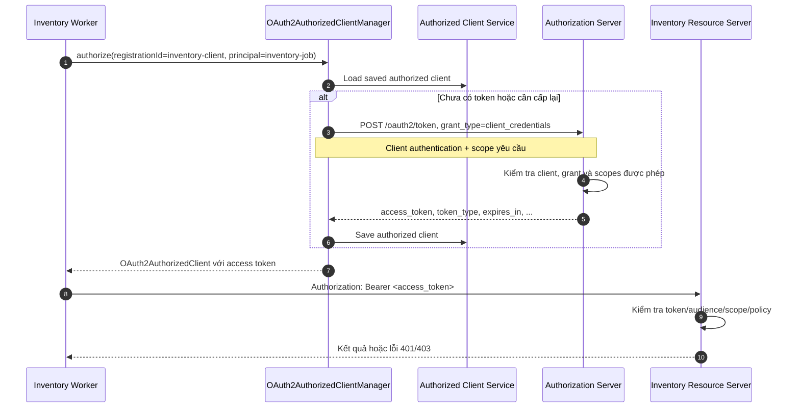

# 16.2. Cấu hình registration với grant client_credentials

## 1. Mục tiêu: đăng ký OAuth2 Client để service tự xin access token

Trong **Spring Security OAuth 2.0/OIDC Client**, grant **`client_credentials`** được dùng khi một ứng dụng cần xin **access token bằng danh tính và quyền của chính client** để gọi API được bảo vệ. Trường hợp điển hình:

- `billing-worker` gọi `invoice-api` theo lịch.
- `reporting-service` gọi `analytics-api` mà không có người dùng đang đăng nhập.
- Một backend gọi API của đối tác với client ID và client secret do đối tác cấp.
- Một tác vụ chạy nền cần quyền `inventory.read` của hệ thống, không phải quyền của một nhân viên cụ thể.

Trong Spring Boot/Spring Security, bước đầu là định nghĩa **client registration**: ứng dụng đang dùng client nào, provider nào, grant nào, scopes gì và cách chứng minh danh tính client với Token Endpoint.

Ví dụ đơn giản:

```yaml
spring:
  security:
    oauth2:
      client:
        registration:
          inventory-client:
            provider: company-auth
            client-id: ${INVENTORY_CLIENT_ID}
            client-secret: ${INVENTORY_CLIENT_SECRET}
            authorization-grant-type: client_credentials
            client-authentication-method: client_secret_basic
            scope:
              - inventory.read
        provider:
          company-auth:
            token-uri: https://auth.example.com/oauth2/token
```

Đoạn trên **chỉ khai báo cấu hình đăng ký**; việc lấy và sử dụng token diễn ra khi một **`OAuth2AuthorizedClientManager`** được gọi với `registrationId` tương ứng.

> **Điểm cốt lõi:** `client_credentials` không có browser redirect đến trang login, không có authorization code callback, không xác thực end-user và thông thường không tạo `OidcUser` hoặc ID Token của người dùng. Nó vẫn thuộc chức năng **OAuth2 Client** của Spring Security, dù module lớn có hỗ trợ OIDC Login.

### 1.1. Kết quả mong đợi

Sau khi hoàn thành phần cấu hình, một backend cần có khả năng:

1. Tra cứu `ClientRegistration` theo `registrationId` ổn định.
2. Biết chính xác **Token Endpoint**, grant type, scopes và phương thức client authentication.
3. Xin access token từ Authorization Server qua HTTPS mà không cần `HttpServletRequest` hay người dùng.
4. Lưu/tái sử dụng authorized client và cấp token mới khi cần.
5. Gửi access token đến **đúng Resource Server** cùng scope/audience được phép.
6. Không để lộ client secret, token hoặc dữ liệu nhạy cảm qua source code và logs.

## 2. Phân biệt các vai trò trước khi cấu hình

Các thuật ngữ thường bị nhầm:

| Thành phần | Vai trò trong `client_credentials` | Ví dụ |
| --- | --- | --- |
| **OAuth2 Client** | Ứng dụng muốn lấy access token | `inventory-worker` |
| **Authorization Server** | Xác thực client và cấp token theo chính sách | `https://auth.example.com` |
| **Token Endpoint** | HTTP endpoint nhận token request | `/oauth2/token` |
| **Resource Server** | API xác minh token và quyền trước khi trả dữ liệu | `https://inventory-api.example.com` |
| **Client registration** | Bản khai cấu hình phía Spring Security của một OAuth2 client | `inventory-client` |
| **Client ID** | Định danh client do Authorization Server cấp | `inventory-worker-prod` |
| **Client secret** | Một phương thức credential để client chứng minh danh tính | Được cấp qua secret manager |
| **Scope** | Quyền mà client yêu cầu và Authorization Server có thể cấp | `inventory.read` |
| **Access token** | Credential đã được cấp để gửi đến Resource Server | Bearer token/JWT hoặc opaque token |

Sơ đồ luồng:



**Không có browser trong sơ đồ.** `OAuth2 Client` có thể chạy trong một process không expose web UI, ví dụ command-line worker hoặc scheduled job.

### 2.1. So sánh với Authorization Code và OIDC Login

| Đặc điểm | `client_credentials` | `authorization_code` / OIDC Login |
| --- | --- | --- |
| Chủ thể cấp quyền | Ứng dụng/service client | Người dùng tương tác qua browser |
| Browser redirect | Không | Có |
| Authorization Endpoint | Không cần cho grant này | Có |
| Callback `redirect_uri` | Không dùng | Có |
| `state`, PKCE verifier, OIDC nonce | Không phải phần của grant này | Dùng theo authorization/OIDC flow |
| Token Endpoint | **Bắt buộc** để xin access token | Dùng để đổi authorization code lấy token |
| Client authentication | Có, theo phương thức đã đăng ký | Có thể, tùy loại client |
| Access token | **Có** khi cấp thành công | Thường có |
| Refresh token | Thông thường **không cấp** | Có thể cấp, tùy provider |
| ID Token OIDC | Không phải kết quả chuẩn của grant này | Có trong OIDC Login |
| End-user principal | Không có | Có, như `OidcUser` hoặc `OAuth2User` |

Vì vậy cấu hình `redirect-uri`, `authorization-uri`, `user-info-uri` và scopes `openid profile email` theo thói quen của OIDC Login thường **không cần thiết** cho một registration thuần `client_credentials`.

## 3. Cấu hình chính xác trong `application.yml`

### 3.1. Cấu hình tối thiểu có thể vận hành

```yaml
spring:
  security:
    oauth2:
      client:
        registration:
          reporting:
            provider: corporate-auth
            client-id: ${REPORTING_CLIENT_ID}
            client-secret: ${REPORTING_CLIENT_SECRET}
            authorization-grant-type: client_credentials
            client-authentication-method: client_secret_basic
            scope:
              - reports.read
              - reports.export
        provider:
          corporate-auth:
            token-uri: https://sso.example.com/oauth2/token
```

**Yêu cầu bên phía Authorization Server:** client `REPORTING_CLIENT_ID` phải được đăng ký/cho phép grant `client_credentials`, có client authentication tương ứng và được phê duyệt các scopes cần thiết. Chỉ khai báo scope trong YAML **không tự cấp quyền** tại Authorization Server.

Giải thích từng trường:

| Đường dẫn cấu hình | Ý nghĩa | Bắt buộc/khuyến nghị |
| --- | --- | --- |
| `registration.reporting` | **Registration ID** dùng để chọn client trong code | Phải có khóa registration |
| `registration.reporting.provider` | Trỏ tới khóa cấu hình provider | Hữu ích khi provider có nhiều registrations |
| `registration.reporting.client-id` | OAuth client ID do Authorization Server cấp | Cần có |
| `registration.reporting.client-secret` | Bí mật của confidential client, nếu dùng client secret | Cần nếu auth method yêu cầu |
| `registration.reporting.authorization-grant-type` | Chọn grant `client_credentials` | **Bắt buộc phải đúng** |
| `registration.reporting.client-authentication-method` | Cách gửi/chứng minh client credentials | Phải khớp provider |
| `registration.reporting.scope` | Những scopes xin trong token request | Tùy provider; thường nên khai rõ |
| `provider.corporate-auth.token-uri` | Token Endpoint thực tế của Authorization Server | Cần được xác định chính xác |
| `registration.reporting.client-name` | Tên hiển thị mô tả registration | Tùy chọn |
| `provider.corporate-auth.issuer-uri` | Issuer để discovery metadata khi provider hỗ trợ | Tùy kiến trúc; không thay thế việc grant đúng |

Một `registrationId` như `reporting` là **định danh nội bộ trong Spring Security**. Nó không nhất thiết trùng `client-id`, tên hệ thống, issuer hoặc tên API.

### 3.2. Vì sao nên tách `registration` và `provider`?

Giả sử doanh nghiệp cấp hai OAuth2 clients cùng một Authorization Server:

```yaml
spring:
  security:
    oauth2:
      client:
        registration:
          reporting-reader:
            provider: internal-auth
            client-id: ${REPORT_READER_CLIENT_ID}
            client-secret: ${REPORT_READER_CLIENT_SECRET}
            authorization-grant-type: client_credentials
            client-authentication-method: client_secret_basic
            scope: reports.read

          reporting-writer:
            provider: internal-auth
            client-id: ${REPORT_WRITER_CLIENT_ID}
            client-secret: ${REPORT_WRITER_CLIENT_SECRET}
            authorization-grant-type: client_credentials
            client-authentication-method: client_secret_basic
            scope: reports.write

        provider:
          internal-auth:
            token-uri: https://sso.example.com/oauth2/token
```

Ở đây:

- `reporting-reader` và `reporting-writer` là **hai client registrations riêng**.
- Cả hai dùng chung cấu hình **provider** có Token Endpoint `https://sso.example.com/oauth2/token`.
- Hai client IDs, secrets và scopes độc lập; nên tuân thủ **least privilege**.
- Code chọn chính xác registration phù hợp với API và hành động đang thực hiện.

Điều này an toàn hơn việc tạo một client có scope `reports.admin` cho mọi tác vụ, nếu provider và kiến trúc cho phép phân quyền theo chức năng.

### 3.3. Có thể không khai báo `provider` riêng không?

Trong một số trường hợp, Spring Boot hỗ trợ cấu hình provider trực tiếp qua các thuộc tính provider với một khóa thích hợp, hoặc dùng provider built-in. Tuy nhiên, nên **khai báo `provider` tường minh khi Token Endpoint không thuộc provider tích hợp sẵn**.

Dùng `registration.provider: corporate-auth` rõ ràng giúp tách:

- **Client identity/configuration:** client ID, secret, grant, scopes.
- **Provider metadata:** Token Endpoint và những endpoint khác khi được dùng.

Khi tên registration trùng với tên provider và framework có quy tắc suy luận, có thể bỏ `provider`, nhưng không nên dựa vào quy tắc suy luận mà chưa hiểu. Với hệ thống doanh nghiệp có nhiều clients và provider nội bộ, cấu hình tường minh thường dễ bảo trì hơn.

## 4. Token Endpoint: `token-uri` hay `issuer-uri`?

### 4.1. Cấu hình tĩnh bằng `token-uri`

Với service-to-service client chỉ sử dụng `client_credentials`, thường chỉ cần **Token Endpoint** của Authorization Server:

```yaml
spring:
  security:
    oauth2:
      client:
        registration:
          sync-job:
            provider: sync-as
            client-id: ${SYNC_CLIENT_ID}
            client-secret: ${SYNC_CLIENT_SECRET}
            authorization-grant-type: client_credentials
        provider:
          sync-as:
            token-uri: https://auth.corp.internal/oauth2/token
```

Ưu điểm:

- Đơn giản, chỉ mô tả endpoint cần cho grant.
- Không phụ thuộc vào OIDC discovery trong quá trình tạo registration.
- Hữu ích khi provider chỉ cung cấp OAuth 2.0 Token Endpoint và không hỗ trợ OIDC discovery.
- Dễ chỉ ra đường mạng mà backend phải có route/proxy/TLS.

Tuy nhiên, **không tự đoán đường dẫn token**. URI phải lấy từ tài liệu/config của Authorization Server. Các provider có cấu trúc URL khác nhau.

### 4.2. Dùng `issuer-uri` nếu có metadata chuẩn

Một số Authorization Server hỗ trợ OIDC hoặc OAuth2 Authorization Server Metadata:

```yaml
spring:
  security:
    oauth2:
      client:
        registration:
          sync-job:
            provider: corporate
            client-id: ${SYNC_CLIENT_ID}
            client-secret: ${SYNC_CLIENT_SECRET}
            authorization-grant-type: client_credentials
            scope: sync.run
        provider:
          corporate:
            issuer-uri: https://login.example.com/realms/corporate
```

Tùy phiên bản Spring Boot/Spring Security và endpoint metadata mà provider công bố, client registration có thể được tạo từ **metadata discovery**, trong đó có Token Endpoint.

Cần lưu ý:

1. `issuer-uri` phải là **issuer chính thức** của Authorization Server, không tùy tiện thay hostname để né lỗi mạng.
2. Discovery có thể yêu cầu backend truy cập provider **ngay khi khởi tạo ứng dụng**, nên DNS, route và CA trust có thể ảnh hưởng startup.
3. OAuth2 metadata hỗ trợ các phương thức/grants khác nhau; dù discovery thành công, client vẫn phải **được provider cho phép** `client_credentials`.
4. Có issuer metadata không có nghĩa ứng dụng đang làm **OIDC Login**. Grant được quyết định bởi `authorization-grant-type`.
5. Không tự giả định mọi Authorization Server hỗ trợ cùng đường dẫn `.well-known` hoặc cùng sơ đồ metadata.

Với môi trường cần tránh network dependency lúc khởi động, cấu hình `token-uri` tĩnh có thể phù hợp hơn. Dù chọn cách nào, Token Endpoint phải được tin cậy và kết nối qua TLS đúng chính sách.

### 4.3. Không dùng Authorization Endpoint thay Token Endpoint

Sai:

```yaml
provider:
  internal:
    token-uri: https://auth.example.com/oauth2/authorize
```

`/authorize` là endpoint browser tương tác với người dùng, **không** dùng để nhận `POST grant_type=client_credentials`. Một số provider trả HTML/redirect thay JSON token và developer dễ chẩn đoán nhầm thành lỗi JSON hoặc CSRF.

Đúng về nguyên tắc:

```text
OAuth2 Client  --POST client_credentials-->  Token Endpoint
OAuth2 Client  --Bearer access token----->  Resource Server API
```

Endpoint cụ thể vẫn phải lấy từ provider.

## 5. `client-authentication-method`: server xác thực client bằng cách nào?

`client_credentials` không nên bị hiểu thành “cứ có client ID là xin được token”. Authorization Server phải xác thực client thích hợp với phương thức đã đăng ký.

### 5.1. `client_secret_basic`

```yaml
registration:
  reporting:
    client-id: ${REPORTING_CLIENT_ID}
    client-secret: ${REPORTING_CLIENT_SECRET}
    authorization-grant-type: client_credentials
    client-authentication-method: client_secret_basic
```

Đây là cách phổ biến cho confidential client có secret: OAuth2 Client xác thực tại Token Endpoint bằng **HTTP Basic Authorization**, theo quy định về encoding và transport của OAuth2. Trên kết nối HTTPS, token request mang header tương tự:

```http
POST /oauth2/token HTTP/1.1
Host: auth.example.com
Authorization: Basic <encoded-client-credentials>
Content-Type: application/x-www-form-urlencoded

grant_type=client_credentials&scope=reports.read
```

Đây là ví dụ cấu trúc. Spring Security nên đảm nhiệm việc mã hóa/đưa credential vào request; **không tự tự chế Base64 header từ dữ liệu đầu vào** khi thư viện đã hỗ trợ.

**Bắt buộc sử dụng TLS** để bảo vệ client credentials. Base64 **không phải mã hóa bảo mật**.

### 5.2. `client_secret_post`

Một số Authorization Server yêu cầu client ID/secret nằm trong **form body** của Token Request:

```yaml
client-authentication-method: client_secret_post
```

Ví dụ:

```http
POST /oauth2/token HTTP/1.1
Host: auth.example.com
Content-Type: application/x-www-form-urlencoded

grant_type=client_credentials&client_id=<client-id>&client_secret=<secret>&scope=reports.read
```

Vẫn cần HTTPS và bảo vệ log request body. **Không tự đổi sang `client_secret_post` chỉ vì Basic bị từ chối**: nguyên nhân có thể là client ID/secret sai, chưa cho phép grant hoặc endpoint sai. Provider phải đăng ký/cho phép phương thức này.

### 5.3. Private key JWT, mTLS và phương thức khác

Các hệ thống bảo mật cao có thể dùng **`private_key_jwt`**, **mutual TLS (mTLS)** hoặc phương thức được Authorization Server hỗ trợ thay cho shared secret.

| Cơ chế | Cách xác thực client | Hệ quả cấu hình |
| --- | --- | --- |
| `client_secret_basic` | Shared secret qua HTTP Basic | Cấu hình client ID/secret và HTTPS |
| `client_secret_post` | Shared secret trong form body | Cấu hình provider chấp nhận phương thức này |
| `private_key_jwt` | Client ký JWT assertion bằng private key đã đăng ký | Cần signer, key rotation, assertion và token client hỗ trợ |
| mTLS | Client trình certificate/private key ở tầng TLS | Cần key material và HTTP client SSL context phù hợp |
| `none` | Không xác thực client | **Không phù hợp mặc định với confidential client dùng client_credentials**; cần kiểm tra giao thức/chính sách provider |

**Đặt một giá trị `client-authentication-method` vào YAML không tự tạo signer hoặc cấu hình mTLS.** Với JWT assertion hoặc mTLS, cần chuẩn bị thêm key/certificate, cấu hình HTTP token response client, quản lý secret/rotation và sử dụng extension points của đúng phiên bản Spring Security.

Không dùng phương thức `none` hoặc client secret rỗng như cách “vượt qua lỗi” ở môi trường sản xuất.

## 6. Scope, audience và Resource Server đích

### 6.1. `scope` là quyền xin cấp, không phải quyền mặc định được nhận

Ví dụ:

```yaml
scope:
  - invoices.read
  - invoices.export
```

Khi Token Endpoint hỗ trợ scope parameter, token request có thể gửi:

```text
grant_type=client_credentials
scope=invoices.read invoices.export
```

Authorization Server kiểm tra scopes mà client được phép và có thể:

- Cấp đúng các scopes.
- Cấp phạm vi hẹp hơn theo policy.
- Từ chối bằng lỗi như `invalid_scope`.
- Áp dụng các mặc định riêng nếu client không gửi scope.

Không nên suy ra token có quyền `invoices.export` chỉ vì YAML đã khai báo. Phải xác minh **response token/Resource Server policy** và thiết kế quyền tối thiểu.

### 6.2. Scope không thay thế audience

Một access token có thể được giới hạn cho một Resource Server thông qua audience (`aud`) hoặc cơ chế tương đương do provider định nghĩa.

Ví dụ công ty có hai API:

```text
Inventory API: inventory.read
Billing API: billing.read
```

Không nên gửi token cấp cho Inventory API tới Billing API rồi hy vọng scope/issuer trùng là được chấp nhận. Resource Server cần xác minh token dành cho đúng audience/chính sách.

Một số Authorization Server yêu cầu thêm **resource indicator** (RFC 8707) hoặc tham số **`audience`** riêng của nhà cung cấp để chỉ định API đích. Các parameter này **không phải thuộc tính chuẩn chung bắt buộc của Spring Boot registration cho mọi provider**.

Ví dụ khái niệm về Token Request mở rộng:

```text
grant_type=client_credentials
scope=inventory.read
resource=https://inventory-api.example.com
```

Để thêm tham số đặc thù, phải tùy biến **token request client/converter** phù hợp phiên bản Spring Security và hợp đồng của Authorization Server. **Chỉ thêm field tùy ý trong `application.yml` không tự làm Spring gửi parameter đó**.

### 6.3. Khi API yêu cầu roles thay vì scopes

Resource Server có thể ánh xạ scopes thành authorities dạng `SCOPE_inventory.read` hoặc triển khai chính sách roles riêng. OAuth2 Client chỉ xin token; **nó không quyết định API chấp nhận role nào**.

Nếu API trả `403`, kiểm tra scopes được cấp, audience và authorization rules ở Resource Server, chứ không chỉ kiểm tra việc Token Endpoint đã trả `200 OK`.

## 7. Spring Security có tạo ClientRegistration từ YAML như thế nào?

Thông qua Spring Boot configuration binding và OAuth2 Client auto-configuration, các mục dưới:

```text
spring.security.oauth2.client.registration.*
spring.security.oauth2.client.provider.*
```

được chuyển thành các đối tượng `ClientRegistration` và một `ClientRegistrationRepository`/phiên bản reactive phù hợp khi các điều kiện auto-configuration đáp ứng.

Ví dụ Spring Security Servlet đọc registration:

```java
@Service
class RegistrationInspector {

    private final ClientRegistrationRepository registrations;

    RegistrationInspector(ClientRegistrationRepository registrations) {
        this.registrations = registrations;
    }

    ClientRegistration reportingRegistration() {
        ClientRegistration registration =
            registrations.findByRegistrationId("reporting");

        if (registration == null) {
            throw new IllegalStateException(
                "OAuth2 registration 'reporting' is missing");
        }

        return registration;
    }
}
```

Có thể quan sát các field, **không log secret**:

```java
ClientRegistration registration = reportingRegistration();

String registrationId = registration.getRegistrationId();
AuthorizationGrantType grant = registration.getAuthorizationGrantType();
ClientAuthenticationMethod authenticationMethod =
    registration.getClientAuthenticationMethod();
String tokenUri = registration.getProviderDetails().getTokenUri();
Set<String> scopes = registration.getScopes();
```

Thông tin này giúp xác định lỗi cấu hình (sai grant, thiếu token URI, sai method) trước khi debug network/IdP.

### 7.1. Tạo registration bằng Java khi không dùng YAML

Trong trường hợp dynamic configuration hoặc xây application bằng Java:

```java
@Configuration
class ClientRegistrationConfiguration {

    @Bean
    ClientRegistrationRepository clientRegistrations(
            @Value("${REPORTING_CLIENT_ID}") String clientId,
            @Value("${REPORTING_CLIENT_SECRET}") String clientSecret) {

        ClientRegistration reporting =
            ClientRegistration.withRegistrationId("reporting")
                .clientId(clientId)
                .clientSecret(clientSecret)
                .clientAuthenticationMethod(
                    ClientAuthenticationMethod.CLIENT_SECRET_BASIC)
                .authorizationGrantType(
                    AuthorizationGrantType.CLIENT_CREDENTIALS)
                .scope("reports.read")
                .tokenUri("https://auth.example.com/oauth2/token")
                .clientName("Reporting Service Client")
                .build();

        return new InMemoryClientRegistrationRepository(reporting);
    }
}
```

**Lưu ý về biến cấu hình:** `${REPORTING_CLIENT_ID}` và `${REPORTING_CLIENT_SECRET}` trong annotation trên chỉ là ví dụ cách đọc property Spring Environment; nếu dự án dùng thư viện secret manager hoặc cấu hình typed properties, sử dụng nguồn bí mật theo kiến trúc thực tế.

Khi tự khai báo `ClientRegistrationRepository` bean, có thể ảnh hưởng auto-configuration của Boot. Không tạo đồng thời nhiều bean trùng chức năng mà không quyết định rõ bean nào là nguồn sự thật.

### 7.2. `ClientRegistration` và `OAuth2AuthorizedClient` là hai đối tượng khác nhau

```text
ClientRegistration:
    registrationId = reporting
    clientId = reporting-prod
    grantType = client_credentials
    tokenUri = https://auth.example.com/oauth2/token
    scopes = reports.read

OAuth2AuthorizedClient:
    clientRegistration = reporting registration
    principalName = batch-reporter
    accessToken = token đã được cấp
    refreshToken = thường không có đối với client_credentials
```

**Cấu hình registration đúng chưa đồng nghĩa đã có token.** Cần gọi manager để authorize và nhận `OAuth2AuthorizedClient`.

## 8. Cấu hình manager cho background job (Servlet/non-reactive)

Một ứng dụng service-to-service thường không có `HttpServletRequest`. Trong Spring Security Servlet/non-reactive, có thể dùng:

- `OAuth2AuthorizedClientService` để lưu authorized client.
- `AuthorizedClientServiceOAuth2AuthorizedClientManager` để tìm/nhận token.
- `OAuth2AuthorizedClientProviderBuilder` để chỉ bật grant `client_credentials`.

Ví dụ:

```java
@Configuration
class ReportingOAuth2ClientConfiguration {

    @Bean
    OAuth2AuthorizedClientService authorizedClientService(
            ClientRegistrationRepository registrations) {

        return new InMemoryOAuth2AuthorizedClientService(
            registrations);
    }

    @Bean
    OAuth2AuthorizedClientManager authorizedClientManager(
            ClientRegistrationRepository registrations,
            OAuth2AuthorizedClientService authorizedClients) {

        OAuth2AuthorizedClientProvider provider =
            OAuth2AuthorizedClientProviderBuilder.builder()
                .clientCredentials()
                .build();

        var manager =
            new AuthorizedClientServiceOAuth2AuthorizedClientManager(
                registrations, authorizedClients);

        manager.setAuthorizedClientProvider(provider);
        return manager;
    }
}
```

**Vì sao dùng service-based manager?** `DefaultOAuth2AuthorizedClientManager` thường được thiết kế cho ngữ cảnh có `HttpServletRequest` và `OAuth2AuthorizedClientRepository`. Batch/scheduler không có request người dùng, nên service-based manager thường là lựa chọn tự nhiên hơn.

### 8.1. Xin token qua manager

```java
@Service
class ReportingTokenProvider {

    private final OAuth2AuthorizedClientManager manager;

    ReportingTokenProvider(OAuth2AuthorizedClientManager manager) {
        this.manager = manager;
    }

    String accessTokenValue() {
        OAuth2AuthorizeRequest request =
            OAuth2AuthorizeRequest
                .withClientRegistrationId("reporting")
                .principal("reporting-worker")
                .build();

        OAuth2AuthorizedClient authorized = manager.authorize(request);

        if (authorized == null) {
            throw new IllegalStateException(
                "Unable to authorize reporting OAuth2 client");
        }

        return authorized.getAccessToken().getTokenValue();
    }
}
```

Trong thực tế, trả raw token value khỏi một service có thể làm tăng phạm vi dữ liệu nhạy cảm, nên thường tốt hơn để **HTTP client integration** lấy/đưa bearer token ở tầng gateway. Mục đích ví dụ là làm rõ API `authorize`.

`principal("reporting-worker")` **không đại diện cho người dùng đăng nhập**; đây là tên ổn định để authorized-client store phân biệt các lần authorize của tác vụ.

### 8.2. Gọi API với RestClient

Ví dụ Spring Framework 6.1+:

```java
@Service
class ReportGateway {

    private final OAuth2AuthorizedClientManager authorizedClientManager;
    private final RestClient restClient;

    ReportGateway(
            OAuth2AuthorizedClientManager authorizedClientManager,
            RestClient.Builder builder) {

        this.authorizedClientManager = authorizedClientManager;
        this.restClient = builder
            .baseUrl("https://reports-api.example.com")
            .build();
    }

    String fetchSummary() {
        OAuth2AuthorizeRequest authorizeRequest =
            OAuth2AuthorizeRequest
                .withClientRegistrationId("reporting")
                .principal("reporting-worker")
                .build();

        OAuth2AuthorizedClient authorized =
            authorizedClientManager.authorize(authorizeRequest);

        if (authorized == null) {
            throw new IllegalStateException(
                "Reporting client authorization failed");
        }

        return restClient.get()
            .uri("/reports/summary")
            .headers(headers -> headers.setBearerAuth(
                authorized.getAccessToken().getTokenValue()))
            .retrieve()
            .body(String.class);
    }
}
```

Lớp `ReportGateway` chỉ gửi bearer token tới **base URL cố định** của API cần truy cập. Không nên nhận URL đích tùy ý do người dùng cung cấp rồi gắn token lên mọi hostname; điều đó có thể gây **token exfiltration/SSRF**.

Spring Security có các giải pháp tích hợp OAuth2 với HTTP client giúp tự thêm bearer token theo authorized-client manager. Khi áp dụng, cần cấu hình registration rõ ràng và hạn chế **default client** gửi token tới API không liên quan.

### 8.3. Mỗi lần gọi API có phải xin token mới?

Không nhất thiết. Nếu manager có authorized client đã lưu và token còn sử dụng được theo chính sách, nó có thể tái sử dụng. Khi token hết hạn hoặc cần cấp lại, provider sẽ gọi Token Endpoint.

```text
Lần 1:
  store không có (reporting, reporting-worker)
  -> Token Endpoint: cấp token A
  -> save A

Lần 2:
  load A, token còn phù hợp
  -> reuse A

Lần 3 sau thời hạn:
  load A, cần cấp mới
  -> Token Endpoint: cấp token B
  -> save B
```

Access token `expiresAt` không tự làm entry trong `InMemoryOAuth2AuthorizedClientService` biến mất; manager/provider mới quyết định cấp lại khi có yêu cầu. Nếu dùng nhiều pod và in-memory service, mỗi pod có store riêng và có thể xin token độc lập.

## 9. Cấu hình tương đương trong WebFlux

WebFlux dùng cùng các property `spring.security.oauth2.client.registration.*` và `provider.*` ở mức ý tưởng cấu hình, nhưng sử dụng **reactive interfaces**:

- `ReactiveClientRegistrationRepository`
- `ReactiveOAuth2AuthorizedClientService`
- `InMemoryReactiveOAuth2AuthorizedClientService`
- `ReactiveOAuth2AuthorizedClientManager`
- `AuthorizedClientServiceReactiveOAuth2AuthorizedClientManager`
- `ReactiveOAuth2AuthorizedClientProviderBuilder`

Ví dụ:

```java
@Configuration
class ReactiveReportingOAuth2Configuration {

    @Bean
    ReactiveOAuth2AuthorizedClientService reactiveAuthorizedClients(
            ReactiveClientRegistrationRepository registrations) {

        return new InMemoryReactiveOAuth2AuthorizedClientService(
            registrations);
    }

    @Bean
    ReactiveOAuth2AuthorizedClientManager reactiveAuthorizedClientManager(
            ReactiveClientRegistrationRepository registrations,
            ReactiveOAuth2AuthorizedClientService authorizedClients) {

        ReactiveOAuth2AuthorizedClientProvider provider =
            ReactiveOAuth2AuthorizedClientProviderBuilder.builder()
                .clientCredentials()
                .build();

        var manager =
            new AuthorizedClientServiceReactiveOAuth2AuthorizedClientManager(
                registrations, authorizedClients);

        manager.setAuthorizedClientProvider(provider);
        return manager;
    }
}
```

Ví dụ gọi API bằng WebClient và reactive manager:

```java
@Service
class ReactiveReportGateway {

    private final ReactiveOAuth2AuthorizedClientManager manager;
    private final WebClient reports;

    ReactiveReportGateway(
            ReactiveOAuth2AuthorizedClientManager manager,
            WebClient.Builder builder) {

        this.manager = manager;
        this.reports = builder
            .baseUrl("https://reports-api.example.com")
            .build();
    }

    Mono<String> fetchSummary() {
        OAuth2AuthorizeRequest request =
            OAuth2AuthorizeRequest
                .withClientRegistrationId("reporting")
                .principal("reporting-worker")
                .build();

        return manager.authorize(request)
            .switchIfEmpty(Mono.error(
                new IllegalStateException("OAuth2 authorization unavailable")))
            .flatMap(client -> reports.get()
                .uri("/reports/summary")
                .headers(headers -> headers.setBearerAuth(
                    client.getAccessToken().getTokenValue()))
                .retrieve()
                .bodyToMono(String.class));
    }
}
```

**Không gọi `.block()` trong Reactor event loop** chỉ để lấy token đồng bộ. Chuỗi reactive nên được xử lý bằng `flatMap`, `map`, `WebClient`, timeouts và error handling phù hợp.

Cũng không đưa `ClientRegistrationRepository` Servlet vào code reactive khi cần `ReactiveClientRegistrationRepository`; hai kiểu không thay thế trực tiếp cho nhau.

## 10. Gói HTTP Token Request thực tế

Cấu hình registration dẫn tới một Token Request theo OAuth2. Với `client_secret_basic`, cấu trúc có thể tương tự:

```http
POST /oauth2/token HTTP/1.1
Host: auth.example.com
Authorization: Basic <credentials-encoded-according-to-OAuth2>
Content-Type: application/x-www-form-urlencoded
Accept: application/json

grant_type=client_credentials&scope=reports.read
```

Một token response minh họa:

```json
{
  "access_token": "REDACTED_ACCESS_TOKEN",
  "token_type": "Bearer",
  "expires_in": 3600,
  "scope": "reports.read"
}
```

Những điểm cần nhớ:

- `grant_type=client_credentials` là **form parameter** gửi Token Endpoint.
- Client authentication có thể nằm ở **HTTP Basic**, **form body**, mTLS hoặc JWT assertion theo hợp đồng.
- `scope` là chuỗi scopes phân tách bằng khoảng trắng theo chuẩn OAuth2, được Spring Security encode.
- `access_token` là credential sử dụng khi gọi API đích.
- `token_type` thường là `Bearer`, nhưng ứng dụng phải tuân thủ phương thức được hỗ trợ.
- `expires_in` mô tả thời gian hiệu lực token tính bằng giây theo response; library chuyển thành thời gian hạn trong token object.
- Provider có thể trả thêm field riêng; không suy ra mọi token đều là JWT hoặc đều có refresh token.
- Token response **không phải ID Token OIDC login** chỉ vì provider cũng hỗ trợ OIDC.

### 10.1. Thử Token Endpoint độc lập bằng curl

Có thể kiểm tra Token Endpoint trong môi trường phát triển, dùng credentials test đã được bảo vệ:

```bash
curl --request POST \
  --url https://auth.example.com/oauth2/token \
  --user "$CLIENT_ID:$CLIENT_SECRET" \
  --header "Content-Type: application/x-www-form-urlencoded" \
  --data-urlencode "grant_type=client_credentials" \
  --data-urlencode "scope=reports.read"
```

**Cẩn trọng:** đưa credential qua command-line có thể làm lộ qua shell history, process listing hoặc hệ thống giám sát. Dùng cách quản lý secret/kiểm thử phù hợp, không sao chép credentials thật vào tài liệu/ticket. Không log body token response trong production.

`curl` thành công chỉ chứng minh endpoint/credentials có thể hoạt động từ **môi trường chạy curl**. Java app có thể dùng proxy, truststore, DNS và HTTP client khác; cần kiểm tra từ đúng container/VM khi chẩn đoán lỗi.

## 11. Secret management: cấu hình an toàn qua môi trường

Client secret dùng trong `client_credentials` có quyền lấy token của ứng dụng; vì vậy phải xem như **credential nhạy cảm**.

### 11.1. Sử dụng biến môi trường hoặc secret store

Ví dụ an toàn hơn hard-code:

```yaml
client-id: ${REPORTING_CLIENT_ID}
client-secret: ${REPORTING_CLIENT_SECRET}
```

Ở production, giá trị có thể được cấp từ hệ thống quản lý secrets hoặc cơ chế deploy có quyền tối thiểu. Không commit các giá trị thật vào `application.yml`, Docker image, script CI hoặc README.

Khi quản lý môi trường:

- Có client credentials **riêng** cho dev/test/staging/production theo chính sách.
- Chỉ cấp scopes mà service cần.
- Bảo vệ quyền đọc secret cho process/pod liên quan.
- Không log full Spring Environment hoặc toàn bộ config property có secrets.
- Có kế hoạch **rotation client secret**, bao gồm thời điểm deploy và rollback.
- Cần hiểu khả năng provider chấp nhận secret cũ/mới song song trong cửa sổ rotation.
- Khi client bị xâm phạm, phối hợp vô hiệu hóa credential và đánh giá token còn hiệu lực.

### 11.2. TLS và proxy đến Token Endpoint

Backend phải có đường mạng tới Token Endpoint:

```text
Application pod -> DNS / route / egress proxy -> Authorization Server
```

Kiểm tra riêng:

- DNS của pod/VM có phân giải hostname không?
- Network policy/firewall có cho phép cổng HTTPS không?
- HTTP proxy egress có cần proxy authentication không?
- JVM/HTTP client có tin CA ký chứng chỉ của Authorization Server không?
- TLS hostname có khớp SAN và SNI không?
- Có kết nối nhầm HTTP endpoint hoặc hostname nội bộ khác issuer không?

**Không tắt certificate verification** hoặc dùng HTTP không mã hóa để vượt lỗi client secret. Cấu hình proxy trên một `WebClient` bean không bảo đảm Token Response Client của Spring Security tự sử dụng bean đó; khi cần tùy biến transport, phải dùng đúng điểm mở rộng tương ứng phiên bản/stack.

## 12. Client credentials và OIDC: ranh giới cần nắm

Tên module là **Spring Security OAuth 2.0 OIDC Client**, nhưng **grant `client_credentials` tự nó không phải một luồng OIDC đăng nhập người dùng**.

- Không cần scope `openid` chỉ để xin access token cho machine-to-machine API.
- Không có `OidcUser`/`OAuth2User` được tạo từ `client_credentials` theo cách OAuth2 Login tạo principal.
- Không cần browser login, authorization request, PKCE verifier, `state`, `nonce` hoặc callback.
- Có thể dùng **cùng Authorization Server** với các registrations OIDC Login, nhưng hai grants khác nhau.
- API Resource Server vẫn phải **xác minh access token** (JWT/JWKS hoặc introspection) và kiểm tra audience/scope.
- Không nhầm client ID với subject của một nhân viên. Token machine-to-machine thường đại diện cho client/service.
- Nếu provider có custom claims/roles trong token `client_credentials`, cách diễn giải phụ thuộc hợp đồng provider và Resource Server.

Ví dụ cùng một provider nhưng hai registrations:

```yaml
spring:
  security:
    oauth2:
      client:
        registration:
          employee-login:
            provider: company
            client-id: ${EMPLOYEE_PORTAL_CLIENT_ID}
            client-secret: ${EMPLOYEE_PORTAL_CLIENT_SECRET}
            authorization-grant-type: authorization_code
            redirect-uri: "{baseUrl}/login/oauth2/code/{registrationId}"
            scope: openid, profile, email

          reporting-service:
            provider: company
            client-id: ${REPORTING_CLIENT_ID}
            client-secret: ${REPORTING_CLIENT_SECRET}
            authorization-grant-type: client_credentials
            scope: reports.read

        provider:
          company:
            issuer-uri: https://login.example.com/realms/company
```

`employee-login` phục vụ **người dùng**, `reporting-service` phục vụ **service**. Mỗi registration cần client configuration và policy ở Authorization Server phù hợp; không dùng chung một credential quá nhiều quyền chỉ vì chung issuer.

## 13. Những lỗi thường gặp trong registration

### 13.1. `invalid_client`

Token Endpoint trả:

```json
{
  "error": "invalid_client"
}
```

Nguyên nhân có thể:

- `client-id` hoặc `client-secret` sai.
- Secret đã rotate hoặc bị vô hiệu.
- Cấu hình `client-authentication-method` không khớp provider.
- Client chưa được đăng ký đúng môi trường/realm/tenant.
- mTLS/private-key JWT credential không đúng khi dùng cơ chế nâng cao.

Cách xử lý: kiểm tra client ID, phương thức xác thực, cấu hình IdP và cách truyền secret từ môi trường. **Không mặc định đổi sang `client_secret_post` hoặc tắt TLS để thử vận may**.

### 13.2. `unauthorized_client`

Ví dụ:

```json
{
  "error": "unauthorized_client"
}
```

Thường cho biết client không được phép dùng grant/request tương ứng, chẳng hạn client chỉ được đăng ký `authorization_code` nhưng ứng dụng gửi `client_credentials`.

Kiểm tra **allowed grant types** và quyền của client tại Authorization Server.

### 13.3. `unsupported_grant_type`

Provider không hiểu hoặc không hỗ trợ `grant_type=client_credentials` tại Token Endpoint đang gọi. Có thể do cấu hình sai endpoint hoặc provider chưa bật grant này.

Không sửa YAML thành `authorization_code` chỉ để vượt lỗi; hai grants có luồng khác nhau.

### 13.4. `invalid_scope`

Scope được yêu cầu không tồn tại, bị viết sai hoặc chưa được phép cho client.

Ví dụ cấu hình sai:

```yaml
scope:
  - reports.admin
```

trong khi client chỉ được cấp `reports.read`. Giải pháp là chỉnh scope theo quyền được cấp hoặc xin cấp phép chính thức, không tự giả định API sẽ chấp nhận quyền khác.

### 13.5. 401/403 khi gọi Resource Server

Token Endpoint đã cấp token, nhưng API trả:

```text
401 Unauthorized
403 Forbidden
```

Cần kiểm tra **giai đoạn nào trả lỗi**:

- `401` ở Token Endpoint có thể liên quan client authentication.
- `401` ở API có thể do access token hết hạn, sai audience/issuer, chữ ký không hợp lệ, token không được gửi.
- `403` ở API có thể do thiếu scope/role/quyền nghiệp vụ.
- Một token hợp lệ theo chữ ký nhưng dành cho API khác vẫn có thể bị từ chối theo audience.

**Không trộn Authorization Server với Resource Server** khi chẩn đoán.

### 13.6. Spring báo thiếu ClientRegistration

Ví dụ code gọi:

```java
OAuth2AuthorizeRequest
    .withClientRegistrationId("reporting")
    .principal("reporting-worker")
    .build();
```

nhưng YAML chỉ có `registration.report-client`. Khi đó manager không thể tìm registration theo tên `reporting`.

Giải pháp: dùng **đúng registrationId**; không sử dụng `client-id` hoặc `provider` key như thể chúng là registration ID.

### 13.7. Sai `token-uri`

Nếu trỏ tới Authorization Endpoint, UserInfo Endpoint hoặc domain khác, có thể nhận HTML/302/404, TLS lỗi hoặc JSON parse error thay vì token response. Xác minh URL Token Endpoint từ tài liệu/metadata chính thức.

## 14. Bảng chẩn đoán theo tầng

| Biểu hiện | Tầng | Nguyên nhân cần nghĩ tới | Hướng kiểm tra |
| --- | --- | --- | --- |
| Ứng dụng không có registration | Spring config | Sai tên/indentation/properties, auto-config không đáp ứng | Đọc ClientRegistrationRepository và bean wiring |
| Grant không phải `client_credentials` | Registration | Nhầm sang `authorization_code` | `getAuthorizationGrantType()` |
| Token client không được gọi | Manager | Sai manager/provider, `authorize()` không chạy | AuthorizedClientManager bean, grant provider |
| Token request thiếu client auth | Token client | Sai authentication method | Provider và client auth config |
| Token Endpoint trả `invalid_client` | Authorization Server | Secret/method/tenant sai | Credential, client policy |
| Token Endpoint trả `unauthorized_client` | Authorization Server | Client không được phép grant | Allowed grants |
| Token Endpoint trả `invalid_scope` | Authorization Server | Scope chưa được phê duyệt | Client scopes, provider policy |
| Connect timeout | Network | Egress/firewall/proxy sai | Route, proxy, port HTTPS |
| PKIX/SSL error | TLS | Chưa tin CA, hostname mismatch | Truststore/JVM SSL client |
| Có access token nhưng API `401` | Resource Server | Token sai audience/issuer/expiry | API auth config, issued token |
| API `403` | Resource Server | Thiếu quyền/scope | API authorization policy |
| Job xin token mỗi lần | Token storage | Principal name thay đổi, không dùng chung store/manager | AuthorizedClientService và khóa lưu |
| Nhiều pod xin token đồng thời | Deployment | In-memory store per pod | Rate limits, shared/independent token strategy |
| Token được cấp nhưng bị leak log | Security/observability | Logging HTTP body/headers | Redaction, log level và APM |
| Retry vô hạn trên `invalid_client` | Error handling | Phân loại sai lỗi cấu hình thành lỗi mạng | Sửa config, bỏ retry không cần thiết |

### 14.1. Quan sát registration mà không tiết lộ secret

Những dữ liệu có thể dùng để chẩn đoán:

```text
registrationId=reporting
grantType=client_credentials
clientAuthMethod=client_secret_basic
tokenUriHost=auth.example.com
requestedScopes=[reports.read]
```

Tránh log:

```text
clientSecret=...
Authorization: Basic ...
Authorization: Bearer ...
access_token=...
refresh_token=...
```

Nếu cần xem HTTP request/response trong môi trường phát triển, phải bảo đảm công cụ logging có cơ chế **che credentials** và không đẩy token vào ticket/chat không được bảo vệ.

## 15. Các tình huống kiến trúc

### Tình huống A — Cron job không có người dùng đăng nhập

Một scheduled job cần gọi Reporting API mỗi 30 phút. Developer đang cố lấy `SecurityContextHolder.getContext().getAuthentication()` để làm principal.

**Phân tích:** `client_credentials` là quyền của service, không cần end-user. Dùng một **principal name ổn định** trong `OAuth2AuthorizeRequest`, ví dụ `reporting-worker`, và `AuthorizedClientServiceOAuth2AuthorizedClientManager`.

### Tình huống B — Hai API với quyền khác nhau

Service cần vừa đọc Inventory vừa ghi Billing. Đội phát triển muốn dùng một token có scopes rộng cho cả hai.

**Phân tích:** Xem xét tách registrations/client identities và scope theo least privilege. Nếu Authorization Server phát token có audience riêng, phải xin đúng audience cho từng API. Không gửi access token của Inventory tới Billing nếu token không dành cho Billing.

### Tình huống C — Môi trường staging chạy được, production báo `invalid_client`

Cùng YAML nhưng client secret lấy từ secret manager khác; production IdP yêu cầu `client_secret_basic`, còn cấu hình bị đặt `client_secret_post`.

**Hướng xử lý:** đối chiếu client registration thật ở production, method/secret rotation, Token Endpoint/realm, config binding. Không hard-code secret vào YAML để “debug nhanh”.

### Tình huống D — Token Endpoint không hỗ trợ OIDC discovery

Nhà cung cấp chỉ cho tài liệu endpoint `/oauth2/token` và không có issuer discovery chuẩn.

**Hướng xử lý:** dùng `provider.token-uri` trực tiếp cho grant `client_credentials`; không yêu cầu `issuer-uri` nếu provider không hỗ trợ và không cần metadata cho luồng khác.

### Tình huống E — Resource Server trả 403 sau khi đã cấp access token

Client nhận token thành công nhưng gọi `/api/export` bị từ chối.

**Hướng xử lý:** kiểm tra access token được cấp scopes nào, audience API, policy endpoint và client permissions ở IdP. Không nhầm token issuance với authorization thành công ở API.

### Tình huống F — Chạy cùng service trên 12 pods

Mỗi pod có `InMemoryOAuth2AuthorizedClientService`, nên mỗi pod xin token riêng.

**Phân tích:** Đó là đặc tính của in-memory storage. Nếu provider áp dụng rate limit nghiêm ngặt hoặc yêu cầu token consistency, cân nhắc shared store/coordination; không coi cấu hình `registration` đúng là đã giải quyết các vấn đề đồng bộ.

### Tình huống G — Provider dùng mTLS thay shared secret

IdP yêu cầu client certificate nhưng developer chỉ đặt `client-secret` và đổi method.

**Hướng xử lý:** cần client certificate/private key, HTTP client's SSL context và cách triển khai OAuth2 mTLS theo provider. Trường `client-authentication-method` không tự thiết lập TLS key material.

## 16. Bài tập thực hành

### Bài 1 — Cấu hình hai clients chung Token Endpoint

Yêu cầu:

- Registration `product-reader` dùng client ID/secret riêng, xin `products.read`.
- Registration `product-writer` dùng credentials riêng, xin `products.write`.
- Cả hai dùng Token Endpoint `https://login.example.com/oauth2/token`.
- Grant `client_credentials`, authentication method `client_secret_basic`.

Gợi ý YAML:

```yaml
spring:
  security:
    oauth2:
      client:
        registration:
          product-reader:
            provider: product-auth
            client-id: ${PRODUCT_READER_ID}
            client-secret: ${PRODUCT_READER_SECRET}
            authorization-grant-type: client_credentials
            client-authentication-method: client_secret_basic
            scope: products.read

          product-writer:
            provider: product-auth
            client-id: ${PRODUCT_WRITER_ID}
            client-secret: ${PRODUCT_WRITER_SECRET}
            authorization-grant-type: client_credentials
            client-authentication-method: client_secret_basic
            scope: products.write

        provider:
          product-auth:
            token-uri: https://login.example.com/oauth2/token
```

Khi chạy, chỉ gọi manager với registration phù hợp; không chuyển token của client reader vào endpoint writer.

### Bài 2 — Token Request trả `invalid_scope`

Client registration khai báo scope `finance.admin`, nhưng Authorization Server chỉ cho `finance.read`. Cần điều tra:

1. Scope đang gửi thực tế.
2. Scope/permission client được IdP cấp.
3. API đích thực sự yêu cầu scope nào.
4. Có cần cấp quyền chính thức hoặc giảm scope xuống mức tối thiểu không.

Không giải quyết bằng cách tắt authorization tại API.

### Bài 3 — Viết gateway cho background job

Tạo:

- Một `ClientRegistration` bằng YAML.
- Một `OAuth2AuthorizedClientService` in-memory.
- Một `AuthorizedClientServiceOAuth2AuthorizedClientManager` chỉ bật `clientCredentials()`.
- Một method gọi manager với `.principal("batch-worker")`, lấy access token và gọi API cố định.

Chú ý không log token value hoặc client secret.

### Bài 4 — Chuyển sang WebFlux

Dùng chính registration trong YAML nhưng thay các class Servlet service/manager bằng:

- `ReactiveClientRegistrationRepository`
- `ReactiveOAuth2AuthorizedClientService`
- `AuthorizedClientServiceReactiveOAuth2AuthorizedClientManager`

Kết hợp `Mono<OAuth2AuthorizedClient>` và `WebClient` bằng `flatMap`, không `block()`.

## 17. Câu hỏi ôn tập

**1. Vì sao `authorization-grant-type: client_credentials` quan trọng?**  
Nó xác định grant mà Spring Security OAuth2 Client sẽ dùng để xin token; không phải Authorization Code/browser flow.

**2. `registrationId` có phải `client-id` do IdP cấp không?**  
Không. Registration ID là khóa nội bộ Spring Security, client ID là định danh tại Authorization Server.

**3. Có cần `redirect-uri` cho `client_credentials` không?**  
Không. Grant này không có browser callback.

**4. Có cần scope `openid` để gọi API machine-to-machine không?**  
Không phải mặc định. `openid` dành cho yêu cầu xác thực OIDC, trong khi `client_credentials` xin access token cho service/API theo scopes được provider cho phép.

**5. Khi nào khai báo `provider.token-uri`?**  
Khi cần chỉ định Token Endpoint của Authorization Server, đặc biệt hữu ích với provider không có discovery.

**6. `client_secret_basic` khác `client_secret_post` ở đâu?**  
Một bên dùng HTTP Basic client authentication, bên kia gửi credentials trong form body. Cả hai phải được IdP cho phép và chạy qua TLS.

**7. Cấu hình `scope: reports.read` có tự cấp quyền không?**  
Không. Authorization Server quyết định phạm vi cấp; Resource Server kiểm tra quyền khi API được gọi.

**8. Nếu manager trả `null` thì có nên tự dựng access token không?**  
Không. Cần chẩn đoán provider/manager/registration, không tự tạo token.

**9. Vì sao batch job nên dùng service-based manager?**  
Vì không có Servlet request hoặc principal người dùng, và service-based manager làm việc với authorized-client storage theo tên principal ổn định.

**10. Token mới được cấp có chắc API chấp nhận không?**  
Không. API còn kiểm tra audience, issuer, expiry, scopes và chính sách nghiệp vụ.

**11. `client_credentials` có tạo `OidcUser` không?**  
Không theo luồng chuẩn. Nó không đăng nhập một người dùng qua OIDC.

**12. Có thể chia sẻ một in-memory authorized client giữa nhiều pods không?**  
Không tự động. Mỗi JVM có memory riêng.

**13. Muốn gửi tham số `resource` hoặc `audience` tới Token Endpoint thì làm thế nào?**  
Phải dựa trên hợp đồng provider và tùy biến token request client/converter ở điểm mở rộng phù hợp, không chỉ thêm thuộc tính tùy ý vào YAML rồi kỳ vọng framework gửi.

**14. Lỗi `invalid_client` có thể đến từ đâu?**  
Sai client ID/secret, phương thức client authentication, tenant/realm hoặc credential/certificate.

**15. Khi dùng mTLS có đủ chỉ khai báo `client-authentication-method` không?**  
Không. Còn cần cấu hình certificate/private key và HTTP client's TLS transport phù hợp.

## 18. Tài liệu tham khảo chính thức

- [Spring Security Reference — OAuth 2.0 Client (Servlet)](https://docs.spring.io/spring-security/reference/servlet/oauth2/client/index.html)
- [Spring Security Reference — OAuth2 Authorized Clients](https://docs.spring.io/spring-security/reference/servlet/oauth2/client/authorized-clients.html)
- [Spring Security Reference — OAuth 2.0 Client (Reactive)](https://docs.spring.io/spring-security/reference/reactive/oauth2/client/index.html)
- [Spring Security API — ClientRegistration](https://docs.spring.io/spring-security/site/docs/current/api/org/springframework/security/oauth2/client/registration/ClientRegistration.html)
- [Spring Security API — AuthorizationGrantType](https://docs.spring.io/spring-security/site/docs/current/api/org/springframework/security/oauth2/core/AuthorizationGrantType.html)
- [Spring Security API — ClientAuthenticationMethod](https://docs.spring.io/spring-security/site/docs/current/api/org/springframework/security/oauth2/core/ClientAuthenticationMethod.html)
- [Spring Security API — AuthorizedClientServiceOAuth2AuthorizedClientManager](https://docs.spring.io/spring-security/site/docs/current/api/org/springframework/security/oauth2/client/AuthorizedClientServiceOAuth2AuthorizedClientManager.html)
- [RFC 6749 — OAuth 2.0 Authorization Framework, Client Credentials Grant](https://www.rfc-editor.org/rfc/rfc6749#section-4.4)
- [RFC 6750 — Bearer Token Usage](https://www.rfc-editor.org/rfc/rfc6750)
- [RFC 8705 — OAuth 2.0 Mutual-TLS Client Authentication](https://www.rfc-editor.org/rfc/rfc8705)
- [RFC 8707 — Resource Indicators for OAuth 2.0](https://www.rfc-editor.org/rfc/rfc8707)

**Ghi nhớ:** Với `client_credentials`, cấu hình Spring Security cần có **client registration đúng grant, client ID và phương thức xác thực, scopes phù hợp và Token Endpoint đáng tin**. Registration chỉ mô tả cách xin token; **authorized-client manager** mới lấy/cấp lại token và HTTP client phải gửi access token tới **đúng Resource Server**. Không đưa browser/OIDC Login vào một grant machine-to-machine, không đưa secret vào source/log, và không nhầm token được cấp với quyền truy cập API chắc chắn thành công.
