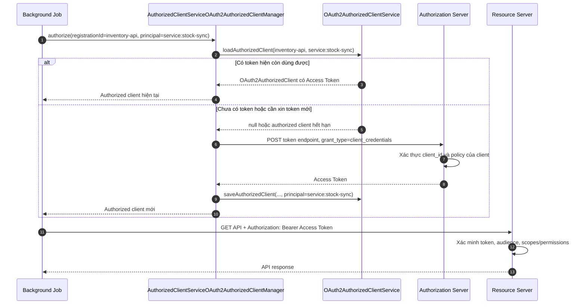

# 16.3. Định danh principal cho token thuộc ứng dụng

Trong **Spring Security OAuth 2.0 / OIDC Client**, không phải mọi Access Token đều đại diện cho người dùng vừa đăng nhập. Với **Client Credentials Grant**, ứng dụng backend dùng danh tính và credential của **chính OAuth2 client** để xin Access Token phục vụ một công việc máy-chủ-đến-máy-chủ (*machine-to-machine, M2M*). Không có trình duyệt, authorization code, OIDC ID Token hay quy trình người dùng đăng nhập trong grant này.

Tuy nhiên, khi dùng Spring Security, developer vẫn gặp tham số `principal`:

```java
OAuth2AuthorizeRequest request = OAuth2AuthorizeRequest
    .withClientRegistrationId("inventory-api")
    .principal("service:stock-sync")
    .build();
```

Tại sao một flow **không có end user** vẫn có principal? Giá trị này có phải `client_id`, tài khoản kỹ thuật tại Authorization Server, hay `sub` trong JWT không? Khi nào nhiều job nên dùng chung principal, khi nào cần tách riêng? Nếu lấy principal từ một HTTP request của người dùng thì có rủi ro gì?

Bài học này giải thích vai trò **service principal/technical principal** trong **`OAuth2AuthorizedClientManager`**, cách Spring Security dùng `principalName` để lưu và tải `OAuth2AuthorizedClient`, cách thiết kế khóa ổn định cho backend, và giới hạn bảo mật khi nhiều workload, tenant hoặc instance cùng sử dụng Client Credentials.

## 1. Bối cảnh: `client_credentials` không phải đăng nhập người dùng

Một ứng dụng backend có thể cần gọi API của một hệ thống khác để đồng bộ tồn kho:

```text
Ứng dụng inventory-worker
    |
    |  POST /oauth2/token
    |  grant_type=client_credentials
    |  client authentication: inventory-worker-client
    v
Authorization Server
    |
    |  Access Token
    v
Ứng dụng inventory-worker
    |
    |  Authorization: Bearer <access-token>
    v
Inventory API
```

Ở đây:

- Backend là **OAuth2 Client**.
- Authorization Server xác thực **client** bằng secret, private key, mTLS hoặc phương thức đã đăng ký.
- Authorization Server quyết định scopes/audience được cấp cho **client**.
- Resource Server kiểm tra Access Token và cho phép hoặc từ chối hành động theo chính sách.
- **Không có người dùng đăng nhập qua browser** trong grant này.

Một ví dụ token request ở mức giao thức:

```http
POST /oauth2/token HTTP/1.1
Host: auth.example.org
Authorization: Basic <encoded-client-credentials>
Content-Type: application/x-www-form-urlencoded

grant_type=client_credentials&scope=inventory.read
```

Authorization Server có thể trả:

```json
{
  "access_token": "<opaque-or-jwt-access-token>",
  "token_type": "Bearer",
  "expires_in": 300,
  "scope": "inventory.read"
}
```

Đây là dữ liệu minh họa. Response có thể khác theo provider và các extension. Theo OAuth 2.0, Refresh Token **thường không được cấp** cho Client Credentials Grant; khi Access Token hết hạn, backend thường xin token mới bằng cùng grant nếu vẫn được phép.

### 1.1. Principal ở đây không có nghĩa là end user

Trong lập trình ứng dụng, từ *principal* thường chỉ người dùng đang được xác thực. Nhưng trong Spring Security OAuth2 Client, từ này xuất hiện ở **hai tầng khác nhau**:

1. **Principal của `SecurityContext`**: đối tượng đại diện cho caller đang được xác thực ở request của ứng dụng, có thể là người dùng OIDC.
2. **Principal cung cấp cho `OAuth2AuthorizeRequest`**: đối tượng/chuỗi dùng làm **ngữ cảnh của authorized client** khi manager cấp, tải và lưu token.

Hai tầng có thể trùng nhau khi ứng dụng gọi API *on behalf of* user, nhưng với `client_credentials` **không cần và thường không nên** lấy principal của người dùng hiện tại. Một tên kỹ thuật ổn định như `service:stock-sync` là đủ để Spring Security quản lý token cho công việc nền.

**Nguyên tắc cốt lõi:** `principal("service:stock-sync")` trong Spring Security **không biến** token được cấp thành token của một user tên `stock-sync`. Authorization Server dựa vào **OAuth client registration và client authentication** để cấp quyền cho client.

## 2. Phân biệt bốn định danh rất dễ nhầm

Để cấu hình chính xác, cần tách các khái niệm:

| Định danh | Ví dụ | Xuất hiện ở đâu? | Ý nghĩa |
|---|---|---|---|
| **`registrationId`** | `inventory-api` | Cấu hình `spring.security.oauth2.client.registration` và `OAuth2AuthorizeRequest` | Khóa nội bộ chọn `ClientRegistration` trong Spring Security. |
| **`client_id`** | `inventory-worker-prod` | Client registration của Authorization Server và token request | Danh tính OAuth2 client mà Authorization Server biết và xác thực. |
| **`principalName` phía Spring** | `service:stock-sync` | `OAuth2AuthorizeRequest`, `OAuth2AuthorizedClient` và authorized client service | Khóa ngữ cảnh dùng để lưu/tải authorized client, **không tự động gửi đến token endpoint**. |
| **`sub` hoặc claim tương đương của Access Token** | `inventory-worker-prod`, hoặc giá trị khác | Token do Authorization Server phát hành, nếu token biểu diễn claim đó | Ngữ nghĩa phụ thuộc Authorization Server, định dạng token, profile và chính sách của Resource Server. |

Ví dụ cấu hình:

```yaml
spring:
  security:
    oauth2:
      client:
        registration:
          inventory-api:
            provider: internal-iam
            client-id: ${INVENTORY_CLIENT_ID}
            client-secret: ${INVENTORY_CLIENT_SECRET}
            client-authentication-method: client_secret_basic
            authorization-grant-type: client_credentials
            scope:
              - inventory.read
        provider:
          internal-iam:
            token-uri: https://auth.example.org/oauth2/token
```

Ở đây:

- `inventory-api` **không nhất thiết** bằng `client-id`.
- `provider: internal-iam` là tên alias cấu hình, không phải principal.
- `client-id` là định danh đăng ký bên Authorization Server.
- `service:stock-sync` có thể là **tên kỹ thuật do backend chủ động chọn**, không phải property bắt buộc trong YAML ở trên.
- Access Token được cấp có thể có claim `sub`, `client_id`, `azp` hoặc các claim khác theo Authorization Server; không tự giả định `sub` luôn bằng string principal phía Spring.

### 2.1. Spring principal có đi vào token request không?

Với Client Credentials Grant tiêu chuẩn, token request gửi những dữ liệu như:

```text
grant_type = client_credentials
client_id / client authentication = theo client registration
scope = theo request và chính sách được cho phép
```

Giá trị `principal("service:stock-sync")` được manager dùng làm ngữ cảnh lưu/tái sử dụng authorized client; **nó không phải một tham số OAuth 2.0 chuẩn được tự động gửi lên token endpoint**.

Vì vậy, đổi:

```java
.principal("service:stock-sync")
```

thành:

```java
.principal("alice@example.org")
```

**không làm Authorization Server xác thực Alice và không tạo delegated user token**. Nó chủ yếu thay khóa lookup/ghi authorized client phía ứng dụng. Nếu business thực sự cần gọi API thay mặt Alice, cần một flow delegation thích hợp như Authorization Code hoặc một token exchange/on-behalf-of extension được provider hỗ trợ, không phải đổi tên principal tùy tiện.

## 3. Vai trò của principal trong `OAuth2AuthorizedClient`

Spring Security dùng `OAuth2AuthorizedClient` để biểu diễn một client đã có Access Token và có thể có Refresh Token.

Một authorized client thường gồm:

```text
OAuth2AuthorizedClient
  ├── ClientRegistration
  │    ├── registrationId = inventory-api
  │    ├── clientId = inventory-worker-prod
  │    └── tokenUri = https://auth.example.org/oauth2/token
  ├── principalName = service:stock-sync
  ├── accessToken
  │    ├── value = <sensitive>
  │    ├── issuedAt
  │    ├── expiresAt
  │    └── scopes
  └── refreshToken = null (thường gặp với client_credentials)
```

Mỗi authorized client gắn với **một client registration** và **một principal name**.

Trong service mặc định và nhiều implementation, cặp khóa tra cứu về mặt API là:

```text
(clientRegistrationId, principalName)
```

Ví dụ:

| Registration | Principal name | Ý nghĩa bản ghi |
|---|---|---|
| `inventory-api` | `service:stock-sync` | Token đã lấy cho worker đồng bộ tồn kho. |
| `billing-api` | `service:invoice-sync` | Token cho job đồng bộ hóa đơn. |
| `inventory-api` | `service:nightly-audit` | Một entry khác, dù có thể dùng cùng `client_id` và scopes. |
| `inventory-api` | `service:stock-sync` | Cùng khóa như hàng 1, có thể tái sử dụng bản ghi đã lưu. |

**Cùng registration + cùng principal** giúp manager tìm lại authorized client của ngữ cảnh đó. **Cùng registration + khác principal** thường tạo các entry tách biệt trong store, có thể kéo theo nhiều lần xin token hơn. Điều đó **không** tự làm các entry có chính sách OAuth2 khác nhau ở Authorization Server.

### 3.1. Vì sao framework cần principal khi grant không có user?

`OAuth2AuthorizedClientManager` là abstraction dùng cho nhiều grant types, không chỉ Client Credentials:

- Với Authorization Code, token có thể gắn với người dùng đã đăng nhập.
- Với Client Credentials, token gắn với client nhưng manager vẫn cần một **khóa ổn định** để quản lý trạng thái của authorized client.
- Với các grant khác, ngữ cảnh principal có thể liên quan authorization đã được lưu trước đó.

Do vậy, Spring Security giữ một cách gọi thống nhất: `OAuth2AuthorizeRequest` luôn có ngữ cảnh principal. Với Client Credentials, ứng dụng có thể dùng **một principal kỹ thuật cố định** đại diện cho workload hoặc mục đích tích hợp.

### 3.2. Principal không phải kho chứa scope

Nếu hai job dùng cùng registration `inventory-api` nhưng principal khác nhau:

```text
service:stock-sync
service:inventory-report
```

đừng suy ra mỗi principal được Authorization Server cấp quyền khác nhau. Scope mà token có thể nhận vẫn bị ràng buộc bởi **client registration, tham số grant hợp lệ và chính sách Authorization Server**.

Muốn thực sự có hai mức quyền khác nhau, có thể cần hai client registrations hoặc client identities riêng, với scope/audience/policy khác nhau tại Authorization Server. Tên `principal` phía Spring **chỉ là một yếu tố quản lý token**, không phải cơ chế phân quyền độc lập.

## 4. Sơ đồ một lần authorize với service principal



Hành vi thực tế về thời điểm xin token lại phụ thuộc `OAuth2AuthorizedClientProvider`, token expiry, clock skew và cấu hình manager/service. Diagram thể hiện **luồng khái niệm**: lookup bằng registration + principal, authorize theo grant, lưu kết quả và dùng Access Token cho API.

Không cần HTTP session hoặc một `SecurityContext` của người dùng cho job chạy nền. Client Credentials là một workflow độc lập với OIDC browser login.

## 5. Chọn đúng `OAuth2AuthorizedClientManager`

Spring Security có các manager cho những ngữ cảnh khác nhau.

| Thành phần | Ngữ cảnh phổ biến | Kho lưu liên quan |
|---|---|---|
| `DefaultOAuth2AuthorizedClientManager` | Ứng dụng Servlet, request của browser hoặc MVC controller | `OAuth2AuthorizedClientRepository` gắn với HTTP request/response. |
| `AuthorizedClientServiceOAuth2AuthorizedClientManager` | Background job, scheduled task, service-to-service không có Servlet request | `OAuth2AuthorizedClientService`. |

Với Client Credentials chạy trong worker/service backend, **`AuthorizedClientServiceOAuth2AuthorizedClientManager`** thường là lựa chọn rõ ràng vì không cần tạo `HttpServletRequest` giả.

### 5.1. Dependency Spring Boot

Ví dụ Gradle:

```gradle
dependencies {
    implementation("org.springframework.boot:spring-boot-starter-oauth2-client")
    implementation("org.springframework.boot:spring-boot-starter-web")
}
```

Starter Web chỉ cần nếu ứng dụng thực sự có web endpoints hoặc dùng HTTP client của nền tảng theo thiết kế. Một background worker không bắt buộc có servlet web server; thành phần quan trọng cho flow là **OAuth2 Client**.

### 5.2. Registration cho Client Credentials

```yaml
spring:
  security:
    oauth2:
      client:
        registration:
          inventory-api:
            provider: internal-iam
            client-id: ${INVENTORY_CLIENT_ID}
            client-secret: ${INVENTORY_CLIENT_SECRET}
            client-authentication-method: client_secret_basic
            authorization-grant-type: client_credentials
            scope:
              - inventory.read
        provider:
          internal-iam:
            token-uri: https://auth.example.org/oauth2/token
```

Với `client_credentials`:

- Không có `redirect-uri` hay `/login/oauth2/code/{registrationId}`.
- Không có `authorization-endpoint` redirect người dùng trong grant này.
- Không cần `openid` để tạo một OIDC user principal.
- `client-secret`/credential phải nằm ở backend và được bảo vệ.
- `scope` phải phù hợp chính sách provider; không phải cứ khai báo scope là được cấp.
- `token-uri` là endpoint mà backend kết nối trực tiếp.

Chỉ cấu hình registration **chưa đủ** để tự động gắn Bearer token vào mọi HTTP call; vẫn cần một manager và HTTP client được tích hợp thích hợp.

## 6. Cấu hình manager cho ứng dụng không có người dùng

Một cấu hình minh họa theo Spring Security hiện đại:

```java
import org.springframework.context.annotation.Bean;
import org.springframework.context.annotation.Configuration;
import org.springframework.security.oauth2.client.AuthorizedClientServiceOAuth2AuthorizedClientManager;
import org.springframework.security.oauth2.client.OAuth2AuthorizedClientManager;
import org.springframework.security.oauth2.client.OAuth2AuthorizedClientProvider;
import org.springframework.security.oauth2.client.OAuth2AuthorizedClientProviderBuilder;
import org.springframework.security.oauth2.client.OAuth2AuthorizedClientService;
import org.springframework.security.oauth2.client.registration.ClientRegistrationRepository;

@Configuration
public class MachineTokenConfiguration {

    @Bean
    OAuth2AuthorizedClientManager machineAuthorizedClientManager(
            ClientRegistrationRepository registrations,
            OAuth2AuthorizedClientService authorizedClients) {

        OAuth2AuthorizedClientProvider provider =
            OAuth2AuthorizedClientProviderBuilder.builder()
                .clientCredentials()
                .build();

        AuthorizedClientServiceOAuth2AuthorizedClientManager manager =
            new AuthorizedClientServiceOAuth2AuthorizedClientManager(
                registrations,
                authorizedClients
            );

        manager.setAuthorizedClientProvider(provider);
        return manager;
    }
}
```

Các trách nhiệm:

1. `ClientRegistrationRepository` tìm cấu hình `inventory-api`.
2. `OAuth2AuthorizedClientService` tải/lưu Access Token theo registration và principal.
3. `OAuth2AuthorizedClientProvider` chỉ hỗ trợ Client Credentials trong ví dụ.
4. Manager phối hợp lookup, xin token khi cần và lưu authorized client.

Nếu ứng dụng đồng thời chạy `oauth2Login()`, không nên mặc định sử dụng manager dành cho Servlet trong background job. Có thể cấu hình hai manager riêng, với tên Bean/`@Qualifier` rõ ràng.

### 6.1. Vì sao tường minh `clientCredentials()`?

Một manager dùng provider chain để biết hỗ trợ grant nào. Việc cấu hình:

```java
OAuth2AuthorizedClientProviderBuilder.builder()
    .clientCredentials()
    .build();
```

giúp thể hiện đúng ý định sử dụng **machine token**, không vô tình trộn `authorization_code`, refresh token flow của user hoặc các grant khác khi chưa cần. Nếu hệ thống có nhiều loại client, có thể cấu hình provider chain theo chiến lược cụ thể; mỗi grant vẫn phải tuân thủ yêu cầu giao thức.

## 7. Định danh principal kỹ thuật trong `OAuth2AuthorizeRequest`

Một cách sử dụng phổ biến:

```java
import org.springframework.security.oauth2.client.OAuth2AuthorizeRequest;
import org.springframework.security.oauth2.client.OAuth2AuthorizedClient;
import org.springframework.security.oauth2.client.OAuth2AuthorizedClientManager;

public final class InventoryTokenProvider {

    private static final String REGISTRATION_ID = "inventory-api";
    private static final String SERVICE_PRINCIPAL = "service:stock-sync";

    private final OAuth2AuthorizedClientManager manager;

    public InventoryTokenProvider(OAuth2AuthorizedClientManager manager) {
        this.manager = manager;
    }

    public String getAccessTokenValue() {
        OAuth2AuthorizeRequest request = OAuth2AuthorizeRequest
            .withClientRegistrationId(REGISTRATION_ID)
            .principal(SERVICE_PRINCIPAL)
            .build();

        OAuth2AuthorizedClient authorizedClient = manager.authorize(request);

        if (authorizedClient == null) {
            throw new IllegalStateException(
                "Unable to obtain inventory API authorized client"
            );
        }

        return authorizedClient.getAccessToken().getTokenValue();
    }
}
```

`getAccessTokenValue()` trả giá trị token **bên trong backend** để HTTP client tin cậy dùng nó. **Không công khai method này qua controller trả raw token cho browser**, không ghi token vào log và không ghép token vào URL.

Hai chuỗi có công dụng khác nhau:

- `REGISTRATION_ID`: chỉ tới `ClientRegistration` với `client_id`, secret, token endpoint và scopes.
- `SERVICE_PRINCIPAL`: tên ổn định để lưu và tìm token trong authorized client service.

### 7.1. Tại sao nên dùng một constant ổn định?

Nếu mỗi lần authorize lại dùng một principal mới:

```java
// Không phù hợp nếu mục tiêu là tái sử dụng cùng authorized client:
.principal("service:stock-sync:" + java.util.UUID.randomUUID())
```

thì Spring Security có thể xem mỗi lần là một cặp key khác nhau, khiến authorized client service không tìm được token đã lưu lần trước. Hậu quả là xin token liên tục, tạo tải lên Authorization Server và gây tăng số entry trong storage.

Một principal ổn định theo **workload và phạm vi chia sẻ mong muốn** là cách đơn giản nhất để tăng khả năng reuse.

### 7.2. Tại sao không dùng timestamp, request ID hoặc session ID?

Các giá trị như:

```text
service:stock-sync:2026-11-16T09:00:00Z
request:9ad3...
session:JSESSIONID-...
```

không phù hợp làm principal của token ứng dụng nếu ý định là dùng chung token theo service. Chúng thay đổi thường xuyên hoặc phụ thuộc browser, gây phân mảnh cache và có thể làm lộ dữ liệu phiên vào tên khóa.

Dùng principal kiểu:

```text
service:stock-sync
```

hoặc:

```text
workload:inventory-worker
```

là đủ để chỉ ra mục đích quản lý token trong backend. Tên này không cần chứa credential hay thông tin người dùng.

### 7.3. Có bắt buộc tên principal phải bằng tên service trên Kubernetes không?

Không. `principalName` là chuỗi/identity context phía Spring Security. Nó có thể trùng với tên workload để dễ vận hành, nhưng đó là **quy ước nội bộ**, không phải chuẩn OAuth2 bắt buộc.

Nếu nhiều instance của cùng một workload cần chia sẻ token, nên dùng **cùng principal ổn định** và kho lưu dùng chung phù hợp. Nếu các workload phải cách ly token, cần xem xét thêm client registration/credential hoặc chính sách provider, không chỉ đổi tên principal.

## 8. Khi nào dùng chung principal và khi nào tách?

Đây là quyết định thiết kế quan trọng, vì cùng một registration có thể được nhiều job dùng.

### 8.1. Hai job cùng danh tính client, scope và mục đích

Ví dụ:

```text
Job A: đồng bộ đơn hàng
Job B: cập nhật trạng thái đồng bộ
Cùng OAuth2 Client Registration: order-api
Cùng credential, audience, scope và policy
```

Nếu hai job được phép dùng chung token của **chính ứng dụng**, có thể chọn một principal:

```text
principal = service:order-integration
```

Lợi ích: một entry authorized client cho cặp registration/principal, giảm token requests không cần thiết, dễ quan sát chung.

Điều kiện: hai job thực sự được phép chia sẻ cùng **đặc quyền client**; đây phải là quyết định bảo mật chứ không chỉ tối ưu hiệu năng.

### 8.2. Hai job khác mục đích, muốn quản lý token độc lập

Nếu hai job không muốn chia sẻ vòng đời lưu trữ:

```text
registration = order-api, principal = service:order-sync
registration = order-api, principal = service:order-audit
```

Spring Security có thể lưu hai authorized clients khác nhau, tùy thời điểm xin token. Nhưng nếu registration dùng cùng `client_id`/secret/scopes, Authorization Server vẫn đang xác thực **cùng một OAuth2 client**.

**Tách principal không tương đương tách quyền.** Nó chỉ tách **đối tượng quản lý token ở client side**. Muốn tách quyền thật, cần kiểm soát ở Authorization Server và Resource Server.

### 8.3. Hai service cần quyền khác nhau

Ví dụ inventory reader chỉ được đọc tồn kho, inventory writer được cập nhật:

| Workload | Quyền yêu cầu | Thiết kế đáng cân nhắc |
|---|---|---|
| `stock-reader` | `inventory.read` | Registration `inventory-read` với client/policy read-only. |
| `stock-writer` | `inventory.write` | Registration `inventory-write` với credential và scope được cho phép riêng. |

Không chỉ đặt:

```java
.principal("service:stock-writer")
```

rồi mong token được cấp `inventory.write` nếu registration chỉ cho `inventory.read`. Quyền phải được cấp qua cơ chế đăng ký, grant và policy của Authorization Server; Resource Server còn phải kiểm tra token.

### 8.4. Bảng chọn chiến lược

| Tình huống | Principal name | Registration/credential |
|---|---|---|
| Một worker đơn giản | Một chuỗi ổn định theo workload. | Một client registration. |
| Nhiều replica của cùng worker | Cùng principal nếu muốn dùng chung storage token. | Cùng registration nếu đó là một client identity. |
| Hai job dùng chung API và cùng đặc quyền | Có thể dùng chung principal theo integration. | Có thể chung registration. |
| Hai job cần lifecycle token tách biệt nhưng cùng quyền | Có thể dùng hai principal. | Có thể chung registration; không phải security isolation. |
| Hai service cần scope/audience khác nhau | Tên riêng giúp quản lý nhưng không cấp quyền. | Nên cân nhắc registration/client identity/policy riêng. |
| Job thực hiện thay mặt end user cụ thể | Không dùng một principal kỹ thuật để giả danh user. | Dùng grant/delegation phù hợp, không chỉ `client_credentials`. |
| Tenant cần phân quyền riêng | Phải có tenant boundary trong identity/storage. | Cần policy/credential/scope/audience phân biệt nếu quyền tenant thật sự tách. |

## 9. Cách Spring Security dùng `principalName` khi lưu token

Với `OAuth2AuthorizedClientService`, chữ ký API cơ bản là:

```java
<T extends OAuth2AuthorizedClient> T loadAuthorizedClient(
    String clientRegistrationId,
    String principalName
);

void saveAuthorizedClient(
    OAuth2AuthorizedClient authorizedClient,
    Authentication principal
);

void removeAuthorizedClient(
    String clientRegistrationId,
    String principalName
);
```

Khi manager dùng:

```java
OAuth2AuthorizeRequest request = OAuth2AuthorizeRequest
    .withClientRegistrationId("inventory-api")
    .principal("service:stock-sync")
    .build();
```

thì giá trị principal được dùng để tìm/ghi authorized client theo **ngữ cảnh đã cung cấp**. Tên service principal cần giữ nhất quán từ lúc save tới lúc load/remove.

Ví dụ về các cặp khóa:

```text
inventory-api | service:stock-sync     -> access token A
inventory-api | service:nightly-report -> access token B
billing-api   | service:stock-sync     -> access token C
```

`service:stock-sync` có thể xuất hiện ở nhiều registration; chính **cặp registration + principal** mới phân biệt authorized client trong service API.

### 9.1. Thực hiện lookup trực tiếp để hiểu cơ chế

Ví dụ code giải thích:

```java
import org.springframework.security.oauth2.client.OAuth2AuthorizedClient;
import org.springframework.security.oauth2.client.OAuth2AuthorizedClientService;

public class AuthorizedClientInspector {

    private final OAuth2AuthorizedClientService authorizedClients;

    public AuthorizedClientInspector(
            OAuth2AuthorizedClientService authorizedClients) {
        this.authorizedClients = authorizedClients;
    }

    public boolean hasStoredClient() {
        OAuth2AuthorizedClient client = authorizedClients
            .loadAuthorizedClient(
                "inventory-api",
                "service:stock-sync"
            );

        return client != null;
    }
}
```

Method này chỉ kiểm tra **có bản ghi đang lưu hay không**, không bảo đảm Access Token còn hạn, chưa bị revoke hoặc đúng audience/scope. Trong hệ thống thật, nên gọi **`OAuth2AuthorizedClientManager.authorize(...)`** trước khi dùng token để manager/provider có cơ hội xử lý token đã hết hạn theo grant.

### 9.2. Tên principal phải nhất quán khi remove

Nếu muốn xóa local authorized client:

```java
authorizedClients.removeAuthorizedClient(
    "inventory-api",
    "service:stock-sync"
);
```

Phải dùng **đúng cặp khóa**. Gọi remove với principal khác không xóa token của `service:stock-sync`.

Xóa authorized client khỏi **kho Spring Security Client** không đồng nghĩa Authorization Server đã revoke Access Token. Nếu cần thu hồi remote, phải có policy và cơ chế token revocation riêng khi provider hỗ trợ.

## 10. Nên chọn `OAuth2AuthorizedClientService` nào?

Một số implementation thường gặp:

| Service | Đặc điểm | Tình huống sử dụng |
|---|---|---|
| `InMemoryOAuth2AuthorizedClientService` | Lưu authorized client trong process. | Demo, single-instance, worker đơn giản không cần durability. |
| `JdbcOAuth2AuthorizedClientService` | Lưu vào database qua JDBC theo schema framework. | Nhiều lần restart hoặc nhiều node cần kho chung. |
| Custom `OAuth2AuthorizedClientService` | Lưu vào kho ứng dụng/KMS/encrypted DB/Redis theo chính sách. | Multi-tenant, mã hóa token, retention, audit/concurrency riêng. |

**Quan trọng:** service chỉ là kho dữ liệu. Nó không tự giải quyết tất cả tình huống token refresh, và không tự chứng minh token phù hợp với Resource Server.

### 10.1. Lưu trong bộ nhớ

Với một process:

```text
registrationId = inventory-api
principalName  = service:stock-sync
cached Access Token = ...
```

Mỗi lần job gọi manager trong cùng process, manager có thể dùng lại authorized client cho tới khi cần xin token mới.

Nhược điểm: process restart làm mất bản ghi; nhiều instance có cache riêng. Điều này có thể chấp nhận được nếu Client Credentials Grant cho phép xin token mới đơn giản và hệ thống không yêu cầu chia sẻ.

### 10.2. Lưu vào JDBC

Nếu cần persistence:

```java
import org.springframework.context.annotation.Bean;
import org.springframework.context.annotation.Configuration;
import org.springframework.jdbc.core.JdbcOperations;
import org.springframework.security.oauth2.client.JdbcOAuth2AuthorizedClientService;
import org.springframework.security.oauth2.client.OAuth2AuthorizedClientService;
import org.springframework.security.oauth2.client.registration.ClientRegistrationRepository;

@Configuration
public class TokenStorageConfiguration {

    @Bean
    OAuth2AuthorizedClientService authorizedClientService(
            JdbcOperations jdbc,
            ClientRegistrationRepository registrations) {

        return new JdbcOAuth2AuthorizedClientService(jdbc, registrations);
    }
}
```

Cần chuẩn bị schema database **đúng phiên bản Spring Security đang dùng** và bảo vệ credential trong DB. Không tự suy rằng JDBC service mặc định đã mã hóa Access Token theo khóa ứng dụng hoặc xử lý tất cả yêu cầu multi-tenant.

Nếu nhiều worker cùng dùng chung `registrationId` và `principalName` trong JDBC store, chúng có thể nhìn thấy cùng record; khi token hết hạn, vẫn cần đánh giá xử lý đồng thời.

### 10.3. Service tùy chỉnh cho nhiều tenant

Một custom service có thể dùng schema có tenant partition:

```text
tenant_id | registration_id | principal_key        | token_ciphertext
alpha     | inventory-api   | service:stock-sync   | <encrypted-token>
beta      | inventory-api   | service:stock-sync   | <encrypted-token>
```

Nhưng interface `OAuth2AuthorizedClientService` nhận `(registrationId, principalName)`, không có tham số tenant riêng. Vì vậy implementation cần **một cơ chế tenant context đáng tin cậy** hoặc quy ước principal/registration key đã được chuẩn hóa.

Không chỉ thêm cột `tenant_id` vào bảng mà bỏ qua cột ấy trong câu SQL lookup; như vậy có thể lấy token sai tenant.

## 11. Kết hợp manager với HTTP client gọi Resource Server

Một backend service thường không muốn gọi method trả raw token rồi truyền giá trị đó qua nhiều lớp. Nhưng để hiểu cơ chế, có thể tích hợp token provider với Spring `RestClient` theo cách đơn giản.

Giả sử đã có `InventoryTokenProvider` ở phần trước:

```java
import org.springframework.web.client.RestClient;

public final class InventoryApiClient {

    private final RestClient restClient;
    private final InventoryTokenProvider tokens;

    public InventoryApiClient(InventoryTokenProvider tokens) {
        this.tokens = tokens;
        this.restClient = RestClient.builder()
            .baseUrl("https://inventory.example.org")
            .build();
    }

    public String loadStockSnapshot() {
        String accessToken = tokens.getAccessTokenValue();

        return restClient.get()
            .uri("/api/stock/snapshot")
            .headers(headers -> headers.setBearerAuth(accessToken))
            .retrieve()
            .body(String.class);
    }
}
```

Đây là ví dụ đơn giản để nhấn mạnh **token được xin phía backend** và dùng trong header Bearer. Khi production, có thể dùng integration của Spring Security cho HTTP client theo phiên bản đang chạy, xử lý timeouts, retry, observation và error mapping tập trung.

Cần bảo đảm:

- `https://inventory.example.org` là API **được phép nhận token** của registration `inventory-api`.
- Access Token có audience/scope được Resource Server chấp nhận.
- Không theo redirect đến host không tin cậy kèm header Authorization.
- Không log raw token qua interceptors, APM hoặc HTTP debug.
- Không trả token value cho frontend chỉ để frontend gọi API nếu kiến trúc yêu cầu backend giữ credential.

### 11.1. Dùng manager ở mỗi lần cần token hay lưu token trong field?

Trong `InventoryTokenProvider`, gọi:

```java
manager.authorize(request)
```

mỗi khi chuẩn bị gọi API giúp manager xem xét authorized client đang lưu và tình trạng token.

Không nên lưu Access Token một lần lúc khởi động trong một field tĩnh rồi dùng mãi, vì token có thể hết hạn/revoke trong khi process vẫn chạy.

Cũng không nên tự viết logic «nếu còn 5 giây thì refresh» rải rác trong từng service; dùng `OAuth2AuthorizedClientManager` với provider và clock skew được cấu hình phù hợp.

### 11.2. API bên nhận không dựa vào Spring principal name

Resource Server chỉ nhìn thấy Access Token và thông tin xác thực request của API. Nó **không tự biết** rằng token phía client từng được lưu dưới `service:stock-sync`.

Vì vậy, API phải kiểm tra issuer/signature hoặc introspection, audience, scopes, policy và có thể client identity claim theo profile của Authorization Server. Nếu yêu cầu truy vết «job nào gọi API», cần một cơ chế attribution/audit đáng tin cậy, không chỉ đặt principal string nội bộ rồi mong Resource Server thấy nó.

## 12. Phân biệt `Authentication` của web user với service principal của M2M

Giả sử ứng dụng vừa có trang web cho nhân viên đăng nhập bằng OIDC, vừa có job đồng bộ tồn kho chạy nền.

Ở HTTP request, Spring Security có thể giữ:

```text
SecurityContext.Authentication.getName() = employee-sub-123
```

Nhưng job M2M nên dùng:

```text
OAuth2AuthorizeRequest.principal = service:stock-sync
```

Nếu code lấy principal của user đang truy cập trang rồi truyền vào manager dành cho Client Credentials:

```java
// Không phù hợp nếu mục tiêu là một token ứng dụng dùng chung:
OAuth2AuthorizeRequest.withClientRegistrationId("inventory-api")
    .principal(authentication.getName())
    .build();
```

có thể dẫn đến **mỗi người dùng web có một authorized client entry riêng** dù tất cả token đều xin bằng cùng OAuth2 client identity. Hậu quả:

- Tốn token requests/storage.
- Logic cache phụ thuộc không cần thiết vào user.
- Dễ nhầm rằng Access Token đại diện cho user.
- Có thể phát sinh rò rỉ ngữ cảnh nếu các lớp downstream dùng principalName như bằng chứng authorization.

Đối với một machine token chia sẻ theo workload, dùng principal cố định và tách rõ manager/service M2M.

### 12.1. Ngược lại, khi nào phải dùng principal của người dùng?

Nếu ứng dụng thực sự dùng **Authorization Code Grant** để gọi API thay mặt người dùng, mỗi authorized client có thể gắn với `Authentication` của user đó. Khi ấy principal name giúp tách Access/Refresh Token của các user trong storage.

Đây là flow khác `client_credentials`:

| Yếu tố | Authorization Code (user delegated) | Client Credentials (application) |
|---|---|---|
| Có user đăng nhập browser? | Thường có. | Không. |
| Có authorization code/callback? | Có. | Không. |
| Token đại diện cho ai? | Quyền đã được cấp trong ngữ cảnh user và client, theo provider. | Chính OAuth client / application. |
| Principal key trong authorized client | Thường gắn với user. | Nên gắn với workload/service context. |
| API có thể suy ra end user? | Theo token claims/delegation được kiểm tra. | Không nên suy ra end user. |
| Kịch bản | Ứng dụng gọi lịch làm việc của user. | Job đồng bộ kho hàng hằng đêm. |

Nếu yêu cầu «service cập nhật dữ liệu của Alice với quyền Alice», không giải quyết bằng cách `principal("alice")` trong request Client Credentials. Cần một grant hoặc cơ chế delegation mà Authorization Server chấp nhận.

## 13. Principal string và `Authentication` object

Builder `OAuth2AuthorizeRequest` có thể nhận một principal name dạng `String` hoặc một `Authentication` tùy API phiên bản Spring Security.

Với background job, cách đơn giản và dễ đọc:

```java
OAuth2AuthorizeRequest.withClientRegistrationId("inventory-api")
    .principal("service:stock-sync")
    .build();
```

Không cần tạo một `UsernamePasswordAuthenticationToken` giả với mật khẩu hoặc authorities của một người dùng. Giá trị string đủ để framework có một ngữ cảnh principal cho việc quản lý authorized client.

### 13.1. Principal name là tên **nội bộ**, không phải credential

Một principal hợp lý có thể:

```text
service:stock-sync
workload:inventory-importer
integration:crm-export
```

Nó không nên chứa:

```text
client_secret=...
access_token=...
user_email=...
JSESSIONID=...
api_key=...
```

Principal name có thể xuất hiện trong key database, log, metric hoặc message lỗi nếu ứng dụng không kiểm soát. Không nhúng credential hoặc dữ liệu cá nhân không cần thiết vào tên này.

### 13.2. Tên principal phải giữ ổn định trong vòng đời ứng dụng

Nếu đổi `service:stock-sync` thành `service:inventory-sync`, kho authorized client cũ có thể vẫn có bản ghi dưới khóa trước đó. Manager sẽ tìm theo khóa mới và xin token mới nếu cần.

Đây thường không phải lỗi protocol, nhưng nên có kế hoạch:

- Có cần migrate/xóa record cũ không?
- Có cần revoke token cũ ở Authorization Server không?
- Có ghi nhận đổi tên service trong logging/monitoring không?
- Nhiều instance có dùng đồng thời cả tên cũ và tên mới không?

Không đổi principal chỉ theo hostname/pod ID nếu mục tiêu là chia sẻ token giữa các replica.

## 14. Nhiều instance, shared store và tính đồng thời

Một ứng dụng chạy hai replica:

```text
Replica A -> principal=service:stock-sync
Replica B -> principal=service:stock-sync
```

Nếu mỗi replica dùng `InMemoryOAuth2AuthorizedClientService`, chúng có **hai cache riêng**, dù principal string giống nhau. Cùng principal không tự tạo shared state.

Nếu dùng `JdbcOAuth2AuthorizedClientService` với database chung, hai replica có thể dùng cùng cặp key:

```text
(inventory-api, service:stock-sync)
```

Nhưng vẫn phải nghĩ tới **race condition**.

### 14.1. Hai node cùng xin token mới

Tình huống:

```text
T0: database không có authorized client
T1: replica A load -> null
T2: replica B load -> null
T3: A gọi token endpoint, được token A
T4: B gọi token endpoint, được token B
T5: A lưu token A
T6: B lưu token B (ghi đè entry cùng key)
```

Với Client Credentials, việc hai request cùng xin token mới có thể hợp lệ theo provider nhưng gây lãng phí hoặc ảnh hưởng quota/rate limit. Trong một số provider, quy tắc giới hạn phiên/token còn có thể tạo thêm hệ quả.

Nếu tải lớn, cân nhắc:

- Single-flight trong một process để gộp các yêu cầu token đồng thời.
- Lock hoặc coordination phân tán cho shared store khi thật sự cần.
- Thiết kế cache TTL và clock skew phù hợp.
- Rate limiting/backoff khi token endpoint báo lỗi.
- Không giữ distributed lock quá lâu nếu mạng/provider chậm.
- Phân biệt trường hợp chỉ có vài duplicate token requests (có thể chấp nhận) với vấn đề refresh/revocation nghiêm trọng.

**Giá trị principal cố định giúp các node hướng tới cùng key, nhưng không giải quyết concurrency một mình.**

### 14.2. Client Credentials và Refresh Token

Client Credentials Grant thông thường **không có Refresh Token**. Khi Access Token hết hạn, `ClientCredentialsOAuth2AuthorizedClientProvider` có thể xin Access Token mới bằng cùng grant. Không thiết kế mặc định một luồng refresh-token rotation cho Client Credentials nếu provider không cung cấp cơ chế đó.

Nếu provider có extension riêng phát Refresh Token cho machine client, cần đọc hợp đồng cụ thể và cấu hình provider chain thích hợp; không giả định Spring tự xử lý mọi extension.

## 15. Cách phân tách tenant đúng nghĩa

Giả sử hệ thống SaaS có hai tenant `alpha` và `beta`. Backend gọi API của mỗi tenant.

Một lựa chọn tên:

```text
principal = service:stock-sync:tenant-alpha
principal = service:stock-sync:tenant-beta
```

Nếu cùng registration, hai tên này tạo **hai authorized client entries**, nhưng **không bảo đảm Access Token của alpha không dùng được ở beta**. Nếu client registration dùng cùng `client_id` và scope ở Authorization Server, token có thể có quyền như nhau theo policy provider.

### 15.1. Tách cache key khác tách đặc quyền

| Nhu cầu | Chỉ thêm tenant vào principal có đủ không? |
|---|---|
| Không ghi đè hai entries trong authorized client store | Có thể đủ khi key được thiết kế đúng. |
| Dễ theo dõi token acquisition theo workload/tenant | Có thể hỗ trợ, nhưng logging phải an toàn. |
| Buộc Authorization Server cấp audience riêng cho tenant | **Không.** Cần cấu hình grant/client/provider tương ứng. |
| Bảo đảm API chỉ cho phép dữ liệu tenant alpha | **Không.** Resource Server phải xác minh tenant/authorization. |
| Tách client secret, thu hồi credential theo tenant | **Không.** Cần client identity/credential riêng nếu yêu cầu. |
| Ngăn caller của tenant beta tải token alpha | **Không tự động.** Storage/API phải kiểm soát tenant context. |

### 15.2. Những phương án đáng cân nhắc

**Phương án A — Registration riêng theo tenant hoặc integration:**

```text
inventory-alpha -> client_id alpha-worker, scope alpha.inventory.read
inventory-beta  -> client_id beta-worker,  scope beta.inventory.read
```

Ưu điểm: chính sách Authorization Server và credential tách rõ. Chi phí: tăng số registrations/secret và yêu cầu vận hành.

**Phương án B — Một registration với API authorization theo tenant:**

Token được cấp cho client chung; Resource Server xác định tenant từ request và kiểm tra client có quyền trong tenant ấy. Trong mô hình này, principal tách tenant ở Spring chỉ hỗ trợ cache/observability, không thay thế policy của API.

**Phương án C — Custom store có tenant partition:**

Store dùng trusted tenant context và khóa có tenant để tránh trộn bản ghi. Vẫn phải kiểm soát quyền/token ở Authorization Server và Resource Server.

Không dùng `tenantId` từ query parameter chưa xác minh để quyết định principal/registration rồi gọi API nhạy cảm. Tenant boundary phải xuất phát từ policy và ngữ cảnh caller được xác thực/ủy quyền.

## 16. Không dùng `principalName` làm dữ liệu audit duy nhất ở API

Một công việc audit có thể hỏi: «Ai đã thực hiện yêu cầu thay đổi tồn kho lúc 02:00?»

Với Client Credentials, Resource Server có thể biết một **client application** đã gọi, nhưng không tự biết user nào đã yêu cầu job (nếu có). Spring principal `service:stock-sync` chỉ là tên local, không mặc định đi qua token.

Để audit có ý nghĩa:

1. Dùng client identity/claim từ **token được Resource Server xác minh** làm nguồn xác định machine caller.
2. Ghi một transaction/correlation ID nội bộ cho công việc.
3. Nếu job được kích hoạt bởi người dùng, lưu **nguồn kích hoạt** riêng trong audit có kiểm soát, không đưa user name giả vào `client_credentials` principal.
4. Khi cần delegation thực sự, dùng cơ chế OAuth2 được Authorization Server hỗ trợ và xác minh, không tự gắn header `X-User` chưa tin cậy.
5. Tránh ghi Access Token vào log để truy vết.

### 16.1. Token có claim `sub` là tên client?

Một số Authorization Server biểu diễn Client Credentials Access Token bằng JWT có `sub` hoặc claim tương tự trỏ tới client ID. Những provider khác có cách biểu diễn khác; Access Token cũng có thể là opaque.

Vì vậy:

- **Không giả định** `sub` của Access Token luôn bằng `principal("service:...")`.
- **Không giả định** claim `sub` của một machine token có ngữ nghĩa người dùng.
- Resource Server phải kiểm tra token theo profile/provider, audience/scope và chính sách của API.
- Nếu cần một machine identity chuẩn hóa cho authorization, xác định rõ claim và contract với Authorization Server.

## 17. Kiểm soát quyền ở Resource Server

Client Credentials Access Token chỉ có ý nghĩa khi Resource Server xác minh nó đúng cách.

Ví dụ Resource Server cần kiểm tra:

- Token do issuer đáng tin cậy phát hành hoặc introspection trả active.
- Chữ ký JWT/metadata hoặc cơ chế introspection phù hợp.
- Audience dành cho Inventory API.
- Scope/permission như `inventory.read` hoặc `inventory.write`.
- Client identity có được phép gọi endpoint này không.
- Giới hạn tenant/resource nếu API có multi-tenancy.
- Token chưa hết hạn, chưa bị thu hồi theo cơ chế provider/API.

Một chính sách API có thể thể hiện khái niệm:

```text
request GET /inventory/items:
    require valid machine access token
    require audience == inventory-api
    require scope includes inventory.read
    require tenant-specific permission if applicable
```

Không chỉ kiểm tra token có tồn tại hoặc có JWT signature hợp lệ rồi cho phép mọi API. **Principal name ở kho Spring Security phía caller không thay thế authorization ở Resource Server.**

### 17.1. Phân biệt `SCOPE_inventory.read` với service principal

Trong một Resource Server Spring Security, scope của JWT có thể được ánh xạ thành authority như `SCOPE_inventory.read` theo cấu hình.

Nhưng `service:stock-sync` do OAuth2 Client dùng để lưu token **không phải** một `GrantedAuthority` được Resource Server tự động nhận. Nếu API muốn phân quyền theo client identity, cần decoder/introspection/authority mapping được cấu hình thích hợp.

## 18. Cấu hình secret và client authentication phù hợp

Ví dụ trên dùng `client_secret_basic`. Tùy provider, Client Credentials có thể dùng:

- `client_secret_basic`: HTTP Basic header.
- `client_secret_post`: credential trong form body.
- `private_key_jwt`: JWT assertion ký bằng khóa riêng.
- mTLS: xác thực client bằng chứng chỉ, khi được hỗ trợ.
- Các phương thức/extension khác theo hợp đồng cụ thể.

`principal` phía Spring không ảnh hưởng đến phương thức client authentication. Cần cấu hình **client registration/credential đúng**.

### 18.1. Không đưa credential vào principal

Sai:

```java
// Không làm như vậy:
.principal("client-secret:" + actualClientSecret)
```

Principal có thể được sử dụng như khóa DB/log, nên credential sẽ bị phân tán sang những nơi không được thiết kế để bảo vệ secret.

Đúng hơn:

```java
.principal("service:stock-sync")
```

và giữ `client-secret` trong environment/secret manager. Nếu dùng mTLS hoặc `private_key_jwt`, khóa riêng/chứng chỉ cần được bảo vệ riêng với principal name.

### 18.2. HTTPS và bảo vệ token

- Gọi token endpoint qua HTTPS với TLS verification đúng.
- Không tắt xác minh certificate để giải quyết lỗi môi trường.
- Không đưa Access Token vào query string.
- Không log HTTP Basic header, client secret, client assertion hay raw token.
- Bảo vệ database/cache giữ authorized client, đặc biệt trong multi-instance.
- Đặt timeout, circuit breaker/backoff phù hợp khi provider chậm.
- Có quy trình rotation/revocation client credential theo chính sách tổ chức.

## 19. Các lỗi thường gặp về principal và cách xử lý

| Triệu chứng | Khả năng nguyên nhân | Cách điều tra |
|---|---|---|
| Token endpoint bị gọi ở mỗi request. | `principal` thay đổi liên tục hoặc không lưu/reuse authorized client. | Kiểm tra registration/principal ổn định, service instance và flow authorize. |
| Có nhiều entries cùng registration trong DB. | Nhiều principal names khác nhau từ user/request/job. | Đối chiếu chiến lược key, không log token value. |
| Job sau restart không tìm token. | Dùng in-memory store hoặc principal bị đổi tên. | Kiểm tra storage và key; Client Credentials có thể xin token mới. |
| Replica A có token, replica B không. | In-memory store riêng hoặc chưa có shared persistence. | Kiểm tra loại authorized client service. |
| `loadAuthorizedClient` trả `null`. | Sai registrationId/principalName, record chưa có hoặc đã bị xóa. | Kiểm tra cặp khóa và việc manager lưu token. |
| `manager.authorize(...)` trả `null`. | Provider chain không hỗ trợ grant hoặc không thể authorize theo config. | Kiểm tra `clientCredentials()`, registration và exception/log được làm sạch. |
| Token request trả `invalid_client`. | Client ID, secret, auth method hoặc policy provider sai. | Kiểm tra token endpoint/client registration, không chỉ principal. |
| Token request trả `invalid_scope`. | Scope không được cấp cho client. | Kiểm tra scopes và Authorization Server policy. |
| API trả 401. | Token hết hạn/sai issuer/audience hoặc không được API chấp nhận. | Phân biệt token acquisition với Resource Server validation. |
| API trả 403. | Scope/permission/tenant policy không đủ. | Kiểm tra quyền client thực tế ở Resource Server. |
| Dùng principal của user nhưng API không biết user ấy. | `client_credentials` không có user delegation. | Chọn grant phù hợp; không kỳ vọng principal string đi vào token. |
| Tenant alpha dùng nhầm quyền beta. | Chỉ tách principal cache mà không tách policy/tenant isolation. | Kiểm tra registration, token claims và API authorization. |
| Nhiều node cùng xin token rồi ghi đè. | Race khi cache miss/expiry. | Cân nhắc single-flight/distributed coordination. |
| Chuyển tên service làm «mất» authorized client. | Tên principal thay đổi. | Dùng key ổn định và migrate/cleanup có chủ đích. |

### 19.1. `manager.authorize(...)` trả null khác với token endpoint trả lỗi

`OAuth2AuthorizedClientManager.authorize(request)` có thể trả `null` khi không thể authorize theo provider chain/cấu hình trong một số trường hợp. Cũng có thể xảy ra exception khi token endpoint hoặc client authentication lỗi.

Không bắt mọi exception rồi trả một token giả hoặc token hết hạn từ cache:

```java
// SAI về nguyên tắc
try {
    return manager.authorize(request);
} catch (Exception ignored) {
    return tokenFromAnotherPrincipal;
}
```

Nếu không có authorized client hợp lệ, nên xử lý thất bại có kiểm soát, retry theo chính sách và không dùng token của principal/tenant khác.

### 19.2. Scope đúng nhưng API vẫn từ chối

Một Access Token có scope `inventory.read` vẫn có thể bị từ chối nếu audience sai, issuer không được tin cậy, token hết hạn hoặc client bị policy từ chối. Principal name local không giải quyết được những điều kiện ấy.

### 19.3. Không tìm thấy token sau khi đổi tên principal không phải lỗi OAuth2

Nếu đổi `service:stock-sync` thành `service:stock-sync-v2`, manager lookup dưới một key khác và có thể cấp token mới. Đây thường là thay đổi nội bộ của storage, không phải Authorization Server từ chối client. Vẫn cần cleanup record cũ và tránh dùng hai tên song song ngoài ý muốn.

## 20. Logging, observability và quản lý cardinality

Principal name là một nhãn hữu ích để xác định workload nào đang xin token, nhưng phải kiểm soát việc sử dụng trong log/metrics.

Có thể ghi:

- Tên `registrationId` đã cấu hình.
- **Principal category** như `service` hoặc một alias kỹ thuật trong allowlist.
- Kết quả load/authorize: cache hit, token issued, token renewed, failure.
- HTTP status và mã lỗi OAuth2 chuẩn hóa từ token endpoint.
- Thời gian request, latency và số lượng retries.
- Instance ID, diagnostic correlation ID và storage type.
- Thời gian còn hiệu lực của token ở dạng số, không phải giá trị token.

Không ghi:

- Access Token/Refresh Token hoặc `OAuth2AuthorizedClient` raw.
- Client secret, private key, client assertion.
- Header `Authorization` hoặc full token request body.
- Cookie phiên hoặc dữ liệu định danh người dùng nếu không cần.
- Principal name được tạo từ input tự do, vì có thể chứa dữ liệu cá nhân hoặc gây metric cardinality vô hạn.

### 20.1. Vì sao không dùng UUID request làm metric label?

Nếu mỗi request có principal mới:

```text
service:stock-sync:req-1
service:stock-sync:req-2
service:stock-sync:req-3
...
```

metrics sẽ có vô số nhãn khác nhau, trong khi authorized client service cũng bị phân mảnh. Dùng alias cố định như `service:stock-sync` và correlation ID riêng chỉ cho tracing theo quy định retention.

### 20.2. Không log Access Token để xác định token nào được dùng

Để quan sát rotation/expiry, có thể ghi metadata đã giới hạn như thời gian đến hạn hoặc mã correlation riêng. Không dùng raw token hoặc JWT header/payload chưa được đánh giá làm metric labels. Access Token là credential có thể được sử dụng bởi bên nắm giữ.

## 21. Kiểm thử các tình huống về định danh principal

Khi tích hợp, có thể xác định những tình huống chức năng sau:

| Tình huống | Kết quả mong đợi |
|---|---|
| Cùng `registrationId` và cùng service principal | Manager có thể tìm lại authorized client đã lưu và tái sử dụng khi còn hợp lệ. |
| Cùng registration nhưng đổi principal | Kho lưu phân biệt entry; có thể xin token khác. |
| Cùng principal nhưng đổi registration | Chọn client registration/token endpoint khác. |
| Principal được tạo theo UUID mỗi lần | Phát hiện token acquisition/store tăng bất thường; không dùng cho reusable M2M client. |
| Job không có HTTP request hoặc web SecurityContext | Service-backed manager vẫn dùng được. |
| Access Token đã hết hạn | Manager/provider xin token mới bằng Client Credentials theo config. |
| Client secret sai | Token endpoint từ chối; không tạo token giả. |
| Scope không được phép | Authorization Server từ chối hoặc cấp quyền theo policy; app không tự nâng scope. |
| Hai replica dùng in-memory service | Token cache tách biệt từng process, đúng với loại storage. |
| Hai replica dùng shared JDBC service | Có thể truy cập cùng key; đánh giá xử lý concurrent token acquisition. |
| Tenant alpha/beta có cache keys riêng nhưng chung client | Vẫn phải kiểm tra policy/API tenant boundary, không suy ra quyền riêng. |
| API nhận token rồi trả 403 | Phân biệt từ chối authorization với lỗi principal của Spring phía client. |
| Đổi tên principal cố định | Bản ghi cũ có thể thành orphan; cleanup/migration. |
| HTTP controller yêu cầu token raw | Không trả credential cho browser nếu không có thiết kế ủy quyền rõ. |
| Không có Refresh Token | Client Credentials vẫn có thể xin Access Token mới theo grant, không crash vì null refresh. |

Các tình huống giúp developer hiểu hành vi của principal và token storage; việc triển khai kiểm thử trong repository ứng dụng phụ thuộc phiên bản Spring Security và yêu cầu hệ thống.

## 22. Những anti-pattern cần tránh

### 22.1. Dùng principal của người dùng web cho machine token

```java
// Không phù hợp khi muốn một Access Token đại diện cho ứng dụng:
.principal(SecurityContextHolder.getContext()
    .getAuthentication().getName())
```

Nó có thể tạo một cache entry cho từng user và khiến developer hiểu nhầm token được cấp thay mặt user. Nếu service token dùng chung, chọn một principal kỹ thuật riêng.

### 22.2. Cho client tự đặt principal bằng query parameter

```java
// SAI: lấy principalName trực tiếp từ HTTP query không được tin cậy
String principal = request.getParameter("principal");
```

Một caller có thể khiến ứng dụng tải token lưu dưới key khác hoặc tạo hàng loạt cache entries. Principal phải được quyết định từ **cấu hình/authorization context đáng tin cậy**, không từ chuỗi tự do của browser.

### 22.3. Coi `principalName` là client credential

`principalName` không thay cho `client-id`, secret, JWT assertion hoặc mTLS certificate. Authorization Server không xác thực client bằng tên cache của Spring.

### 22.4. Dùng cùng registration cho hai vai trò cần phân quyền khác nhau

Nếu một service được phép đọc, một service được phép ghi, chỉ đổi tên principal không bảo đảm least privilege. Cần client identity/scope/policy thật sự tách biệt khi yêu cầu.

### 22.5. Dùng token M2M để giả danh end user

Không thêm `principal("alice")` rồi gửi token Client Credentials vào API yêu cầu quyền Alice. Flow này không mang user delegation. Hãy dùng grant thích hợp hoặc thiết kế quyền service rõ ràng.

### 22.6. Mỗi lần gọi API lại tạo principal ngẫu nhiên

Điều đó phá token reuse và tăng tải token endpoint. Ngữ cảnh principal của authorized client nên ổn định theo mục đích chia sẻ.

### 22.7. Nhầm shared principal với shared store

Hai replica dùng cùng tên principal nhưng lưu token trong memory của riêng mỗi replica vẫn có hai cache. Muốn shared persistence phải dùng store chung và quản lý concurrency phù hợp.

### 22.8. Trả machine token ra frontend

Một bearer token của ứng dụng có thể có quyền rộng hơn của từng user. Không đưa nó vào browser, log hoặc URL chỉ vì backend đã lấy được token thành công.

## 23. Kiến trúc tham chiếu cho Client Credentials trong production

Một cách tổ chức rõ ràng:

```text
                       Spring Boot Background Worker
                                  |
                                  v
                     InventoryIntegrationService
                                  |
                                  v
                       InventoryApiClient
                                  |
                                  v
                OAuth2AuthorizedClientManager
                (service-backed, client_credentials)
                                  |
                     +------------+-------------+
                     |                          |
                     v                          v
                ClientRegistration         AuthorizedClientService
                     |                          |
             client_id / auth method            |
             token endpoint / scopes             v
                     |                      Token Store
                     |                 (memory / JDBC / encrypted)
                     |                          |
                     +------------+-------------+
                                  |
                                  v
                          Authorization Server
                        POST grant_type=client_credentials
                                  |
                                  v
                          Access Token cho client
                                  |
                                  v
                          Resource Server API
                      kiểm tra issuer, audience, scope
```

Phân công trách nhiệm:

- **Application configuration** quyết định OAuth2 client registration, credential và scopes.
- **Service principal name** quyết định ngữ cảnh quản lý authorized client ở backend.
- **Authorized client manager/provider** quyết định khi nào xin hoặc sử dụng lại Access Token.
- **Authorized client service** lưu và tìm token theo registration/principal.
- **Token endpoint** xác thực client và cấp token theo quyền được phép.
- **Resource Server** xác minh token và thực thi API authorization.
- **Domain service** quyết định job được phép thực hiện hoạt động nghiệp vụ nào, theo tenant/resource khi có.

Mỗi tầng phải có ranh giới rõ ràng để một principal string nội bộ không bị sử dụng như bằng chứng về đặc quyền mà Authorization Server chưa cấp.

## 24. Trình tự thiết kế một service principal phù hợp

Khi triển khai một tích hợp Client Credentials mới:

1. **Xác định mục đích machine call:** job nào, API nào, có cần user delegation không?
2. **Đăng ký OAuth2 client tại Authorization Server:** client ID, credential, allowed grant, scopes/audience.
3. **Khai báo `ClientRegistration` trong Spring Boot:** đặt registration ID dễ hiểu và không đồng nhất máy móc với client ID.
4. **Đặt principal kỹ thuật ổn định:** ví dụ `service:stock-sync`, không có credential hoặc dữ liệu browser.
5. **Chọn manager/service cho background context:** `AuthorizedClientServiceOAuth2AuthorizedClientManager` và `clientCredentials()`.
6. **Xác định khả năng chia sẻ token:** giữa job/replica nào; chọn một hay nhiều principal keys.
7. **Quyết định persistence:** memory/JDBC/custom store, encryption và quyền đọc token.
8. **Kiểm soát multi-tenancy và least privilege:** không coi principal name là cách tách quyền thật.
9. **Xử lý expiry và concurrency:** gọi manager trước khi dùng token, giới hạn token endpoint requests nếu cần.
10. **Bảo vệ HTTP client:** HTTPS, Bearer header, không leak token qua redirect/log.
11. **Theo dõi vận hành:** cache misses, token acquisition failures, 401/403 từ Resource Server và rotation credential.
12. **Thiết kế cleanup:** đổi principal, xóa registration, khóa service hoặc revoke client credential.

Những điểm này làm rõ cách principal hỗ trợ quản lý token mà không tạo kỳ vọng sai về tính xác thực hoặc quyền của một người dùng.

## 25. Tài liệu tham khảo

- [Spring Security Reference — OAuth2 Client Core (Servlet)](https://docs.spring.io/spring-security/reference/servlet/oauth2/client/core.html)
- [Spring Security Reference — Authorized Client Manager](https://docs.spring.io/spring-security/reference/servlet/oauth2/client/authorized-clients.html)
- [Spring Security API — OAuth2AuthorizeRequest](https://docs.spring.io/spring-security/site/docs/current/api/org/springframework/security/oauth2/client/OAuth2AuthorizeRequest.html)
- [Spring Security API — OAuth2AuthorizedClient](https://docs.spring.io/spring-security/site/docs/current/api/org/springframework/security/oauth2/client/OAuth2AuthorizedClient.html)
- [Spring Security API — OAuth2AuthorizedClientService](https://docs.spring.io/spring-security/site/docs/current/api/org/springframework/security/oauth2/client/OAuth2AuthorizedClientService.html)
- [Spring Security API — AuthorizedClientServiceOAuth2AuthorizedClientManager](https://docs.spring.io/spring-security/site/docs/current/api/org/springframework/security/oauth2/client/AuthorizedClientServiceOAuth2AuthorizedClientManager.html)
- [Spring Security API — ClientCredentialsOAuth2AuthorizedClientProvider](https://docs.spring.io/spring-security/site/docs/current/api/org/springframework/security/oauth2/client/ClientCredentialsOAuth2AuthorizedClientProvider.html)
- [OAuth 2.0 RFC 6749 — Client Credentials Grant](https://www.rfc-editor.org/rfc/rfc6749#section-4.4)
- [OAuth 2.0 RFC 6750 — Bearer Token Usage](https://www.rfc-editor.org/rfc/rfc6750)
- [OAuth 2.0 Security Best Current Practice — RFC 9700](https://www.rfc-editor.org/rfc/rfc9700)

**Kết luận:** trong Client Credentials, `principal` của `OAuth2AuthorizeRequest` là **định danh ngữ cảnh quản lý authorized client ở phía Spring Security**, thường là một tên workload/service ổn định. Nó giúp Spring Security tìm, lưu và dùng lại token theo cặp `(registrationId, principalName)`. Nó **không** phải user đã đăng nhập, không thay `client_id`, không được tự gửi tới token endpoint như bằng chứng danh tính, và không tự tách quyền giữa các tenant. Danh tính và đặc quyền machine client vẫn do **client registration, client authentication, Authorization Server và Resource Server** quyết định; principal string chỉ hỗ trợ quản lý token chính xác, nhất quán và an toàn ở phía ứng dụng.

