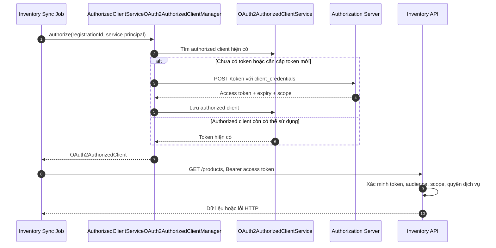

# 16.4. Lấy authorized client cho dịch vụ backend

Trong **Spring Security OAuth 2.0/OIDC Client**, không phải mọi ứng dụng đều phục vụ một người dùng đăng nhập qua trình duyệt. Một tác vụ đồng bộ dữ liệu, worker xử lý hàng đợi, scheduled job hoặc backend service có thể cần gọi một API khác **bằng danh tính và quyền của chính dịch vụ đó**.

Với trường hợp **machine-to-machine (M2M)**, OAuth 2.0 cung cấp **Client Credentials Grant**. Dịch vụ xác thực với Authorization Server (AS) bằng credential đã đăng ký, yêu cầu access token có scope phù hợp rồi dùng token đó khi gọi Resource Server.

Trong Spring Security, cách triển khai bền vững không phải tự gửi `POST /token` trước mỗi lần gọi API, mà thường là sử dụng:

- `ClientRegistrationRepository` để lấy cấu hình OAuth client.
- `OAuth2AuthorizedClientService` để lưu `OAuth2AuthorizedClient` theo registration và principal kỹ thuật.
- `OAuth2AuthorizedClientProvider` hỗ trợ `client_credentials`.
- **`AuthorizedClientServiceOAuth2AuthorizedClientManager`** để lấy token mới khi cần và tái sử dụng authorized client còn hiệu lực.

Sau đó service gọi:

```java
OAuth2AuthorizedClient authorizedClient =
    authorizedClientManager.authorize(authorizeRequest);
```

và dùng `authorizedClient.getAccessToken()` để gọi API.

**Điểm quan trọng:** principal dùng cho Client Credentials Grant trong `OAuth2AuthorizeRequest` là **khóa ngữ cảnh của phía client**, không phải một người dùng đã đăng nhập OIDC. Không tạo `OidcUser` giả và không dùng ID Token để thực hiện M2M.

## 1. Bối cảnh: một backend service cần access token

Giả sử có hệ thống:

- `inventory-sync`: Spring Boot scheduled worker, đồng bộ sản phẩm.
- `https://auth.example.org`: Authorization Server.
- `https://inventory-api.example.org`: Resource Server.
- OAuth client của worker có `client_id=inventory-sync-prod` và secret được quản lý an toàn.
- AS cho phép client xin scope `inventory.read`.

Worker chạy mỗi vài phút để đồng bộ danh mục. Nó không có trình duyệt và không có End-User cần đăng nhập.



Sơ đồ thể hiện logic khái niệm; implementation thực tế có thể kiểm tra điều kiện token/điểm lưu theo thứ tự riêng. **Không có bước authorization redirect, callback hay user consent trực tiếp trong mỗi request token** của Client Credentials Grant.

### 1.1. Những trường hợp sử dụng phù hợp

| Tình huống | Có End-User? | Grant thường phù hợp |
|---|---|---|
| Scheduled job gọi Inventory API | Không | `client_credentials` |
| Consumer lấy dữ liệu từ service khác | Không | `client_credentials` |
| Microservice gọi API bằng danh tính workload | Không | `client_credentials` hoặc cơ chế workload identity được AS hỗ trợ |
| Spring MVC gọi API thay mặt người dùng đang đăng nhập | Có | Authorization Code + access token của user |
| Batch xử lý offline nhưng cần quyền của một user cụ thể | Tùy thiết kế | Không tự đổi thành `client_credentials`; cần delegation/on-behalf-of hợp lệ |
| SPA thuần trên trình duyệt | Có | Authorization Code + PKCE, không nhúng client secret |

Client Credentials chỉ phù hợp khi API cho phép **client/workload** thực hiện thao tác. Nó không phải cách bỏ qua xác thực người dùng để truy cập dữ liệu mà lẽ ra đòi hỏi quyền được ủy quyền của một cá nhân.

## 2. Access token, ClientRegistration và OAuth2AuthorizedClient

Ba đối tượng thường bị nhầm:

### 2.1. ClientRegistration

`ClientRegistration` mô tả client đã đăng ký với AS:

```text
registrationId        = inventory-worker
clientId              = inventory-sync-prod
clientSecret          = <server-side secret>
authorizationGrantType = client_credentials
tokenUri              = https://auth.example.org/oauth2/token
scopes                = [inventory.read]
```

`registrationId` là tên cục bộ trong Spring. `clientId` là định danh AS cấp cho ứng dụng. Repository dùng `registrationId` để tra cấu hình; không nên lẫn hai giá trị.

### 2.2. OAuth2AccessToken

`OAuth2AccessToken` biểu diễn token được AS cấp, với:

- `tokenValue`: bearer token nhạy cảm.
- `tokenType`: thường là `Bearer`.
- `issuedAt`: thời điểm được phát.
- `expiresAt`: thời điểm hết hiệu lực.
- `scopes`: tập scope thực sự gắn với access token theo token response.

Scope được khai báo trong registration là **phạm vi yêu cầu**, còn `getScopes()` của token phản ánh **phạm vi được cấp** mà Spring đã nhận. Không tự cho rằng chúng luôn giống nhau.

### 2.3. OAuth2AuthorizedClient

`OAuth2AuthorizedClient` gắn **ClientRegistration** với **principal name** và **access token** hiện có (cùng refresh token nếu có).

```text
OAuth2AuthorizedClient
  ClientRegistration: inventory-worker
  principalName: inventory-sync-service
  AccessToken:
    scopes: inventory.read
    expiresAt: ...
```

Đối với `client_credentials`, thường **không có refresh token**. Khi access token không còn sử dụng được, manager dùng client credentials để xin **access token mới**, thay vì dựa vào một phiên đăng nhập End-User.

### 2.4. OAuth2AuthorizedClientManager

`OAuth2AuthorizedClientManager` điều phối việc:

1. Tra registration và authorized client đã lưu.
2. Quyết định có cần và có thể thực hiện authorization/re-authorization hay không.
3. Gọi provider `clientCredentials()` để lấy token khi thích hợp.
4. Lưu kết quả thành công.
5. Trả authorized client hiện tại hoặc đưa ra tín hiệu không thể authorize.

Không phải mỗi lần gọi `authorize(...)` đều gửi một request tới AS. **Việc tái sử dụng token còn hiệu lực** là một trong những lợi ích chính khi dùng manager.

## 3. Vì sao dịch vụ backend nên dùng AuthorizedClientServiceOAuth2AuthorizedClientManager?

Spring Security có nhiều loại manager.

| Thành phần | Thiết kế cho | Cơ chế lưu authorized client |
|---|---|---|
| `DefaultOAuth2AuthorizedClientManager` | Servlet request/response, chẳng hạn MVC web app/BFF | `OAuth2AuthorizedClientRepository` |
| **`AuthorizedClientServiceOAuth2AuthorizedClientManager`** | Context ngoài request: service, job, scheduler, message consumer | `OAuth2AuthorizedClientService` |
| `OAuth2AuthorizedClientManager` | Interface dùng bởi code gọi OAuth | Phụ thuộc implementation |

Scheduled job thường chạy trên thread không có:

```java
HttpServletRequest
HttpServletResponse
SecurityContext chứa người dùng login web
```

Do đó, nếu dùng `DefaultOAuth2AuthorizedClientManager` rồi cố tìm request HTTP trong scheduler, ứng dụng có thể lỗi hoặc buộc tạo request giả không cần thiết.

`AuthorizedClientServiceOAuth2AuthorizedClientManager` được thiết kế để làm việc với **principal name kỹ thuật** và một **`OAuth2AuthorizedClientService` độc lập với Servlet**.

### 3.1. Không cần tạo một user giả

Bạn không cần dựng:

```java
UsernamePasswordAuthenticationToken("admin", ...)
```

để “đóng vai” một nhân viên. Với Client Credentials Grant, có thể cung cấp một principal name ổn định trực tiếp vào `OAuth2AuthorizeRequest`:

```java
OAuth2AuthorizeRequest request =
    OAuth2AuthorizeRequest
        .withClientRegistrationId("inventory-worker")
        .principal("inventory-sync-service")
        .build();
```

Chuỗi `inventory-sync-service` được manager/service dùng để liên kết và tra authorized client. **Nó không được AS dùng làm danh tính End-User chỉ vì bạn đặt chuỗi đó trong Java**.

AS thực hiện client authentication bằng client ID và credential được cấu hình trong registration.

## 4. Dựng ứng dụng Spring Boot dùng Client Credentials

Ví dụ từ đầu đến cuối: backend worker cần lấy token để gọi Inventory API.

### 4.1. Dependencies

Gradle Groovy DSL:

```groovy
dependencies {
    implementation 'org.springframework.boot:spring-boot-starter'
    implementation 'org.springframework.boot:spring-boot-starter-oauth2-client'
    implementation 'org.springframework.boot:spring-boot-starter-web'
}
```

`spring-boot-starter-web` trong ví dụ phục vụ HTTP client tích hợp `RestClient` và có thể sử dụng thêm API HTTP nếu cần; **một background worker thuần túy không bắt buộc phải mở web endpoint** để dùng Client Credentials Grant. Có thể chọn dependency/ứng dụng non-web phù hợp với hệ thống.

Nếu chỉ cần Scheduled Job, có thể bật scheduling qua `@EnableScheduling`. Không cần `oauth2Login()` hoặc `SecurityFilterChain` dành cho login browser chỉ để xin token cho service.

### 4.2. application.yml

```yaml
spring:
  security:
    oauth2:
      client:
        registration:
          inventory-worker:
            provider: internal-as
            client-id: ${INVENTORY_CLIENT_ID}
            client-secret: ${INVENTORY_CLIENT_SECRET}
            client-authentication-method: client_secret_basic
            authorization-grant-type: client_credentials
            scope:
              - inventory.read
        provider:
          internal-as:
            token-uri: https://auth.example.org/oauth2/token
```

Giải thích:

- `registration.inventory-worker`: tên dùng trong code `withClientRegistrationId("inventory-worker")`.
- `provider: internal-as`: liên kết registration với `provider.internal-as`.
- `client-id`, `client-secret`: credential của **backend client**, phải lưu an toàn.
- `client-authentication-method: client_secret_basic`: client xác thực với Token Endpoint bằng HTTP Basic theo chính sách AS.
- `authorization-grant-type: client_credentials`: không có browser redirect/authorization code.
- `scope: inventory.read`: phạm vi token được **yêu cầu**, AS có thể hạn chế.
- `token-uri`: endpoint nhận token request của AS.

Cấu hình này **không có `redirect-uri`, `authorization-uri` hay `scope: openid`** vì đây không phải OIDC login của người dùng. Không cần ID token để chạy scheduled synchronization.

### 4.3. Request đến Token Endpoint

Khi manager cần cấp token, client có thể gửi request dạng:

```http
POST /oauth2/token HTTP/1.1
Host: auth.example.org
Authorization: Basic <client-credentials>
Content-Type: application/x-www-form-urlencoded
Accept: application/json

grant_type=client_credentials&scope=inventory.read
```

Phần Basic chứa client ID/secret theo HTTP Basic (được encode phù hợp, bảo vệ bởi **TLS**), không phải JWT access token. Một AS khác có thể yêu cầu `client_secret_post`, `private_key_jwt` hoặc mTLS; registration và token request client phải tương thích.

Token response ví dụ:

```json
{
  "access_token": "<opaque-or-jwt-access-token>",
  "token_type": "Bearer",
  "expires_in": 1800,
  "scope": "inventory.read"
}
```

Access token có thể là opaque string hoặc JWT. OAuth client **không cần tự giải mã JWT để dùng token**; nó gắn bearer credential vào request tới Resource Server. API chịu trách nhiệm xác minh token đúng issuer, audience, scope và chính sách.

## 5. Tạo OAuth2AuthorizedClientService

`OAuth2AuthorizedClientService` quản lý authorized client theo client registration và principal name. Các operation cốt lõi:

```java
OAuth2AuthorizedClient loadAuthorizedClient(
    String clientRegistrationId,
    String principalName
);

void saveAuthorizedClient(
    OAuth2AuthorizedClient authorizedClient,
    Authentication principal
);

void removeAuthorizedClient(
    String clientRegistrationId,
    String principalName
);
```

Không cần truy cập service trực tiếp mỗi lần muốn có token; manager sử dụng service bên trong.

### 5.1. Ví dụ in-memory cho bài học và môi trường đơn giản

```java
import org.springframework.context.annotation.Bean;
import org.springframework.context.annotation.Configuration;
import org.springframework.security.oauth2.client.InMemoryOAuth2AuthorizedClientService;
import org.springframework.security.oauth2.client.OAuth2AuthorizedClientService;
import org.springframework.security.oauth2.client.registration.ClientRegistrationRepository;

@Configuration
public class AuthorizedClientStoreConfig {

    @Bean
    OAuth2AuthorizedClientService authorizedClientService(
            ClientRegistrationRepository registrations) {
        return new InMemoryOAuth2AuthorizedClientService(registrations);
    }
}
```

**Lưu ý:** Spring Boot/Spring Security có thể tự cung cấp bean `OAuth2AuthorizedClientService` theo phiên bản và điều kiện auto-configuration. Khi đã có service phù hợp, không nhất thiết tạo bean trên. Nếu tạo thủ công, tránh trùng bean và xác định rõ implementation nào sẽ được manager sử dụng.

Ưu điểm in-memory: đơn giản, phù hợp demo hoặc một instance nhỏ.

Giới hạn:

- Token cache mất sau process restart.
- Mỗi instance có cache riêng, có thể gọi Token Endpoint lặp lại.
- Không cung cấp persistence/đồng bộ token cho một cluster.
- Các yêu cầu tuân thủ về mã hóa, kiểm soát truy cập và lưu token phải được tính đến khi chuyển sang storage khác.

### 5.2. Khi cần persistence

Có thể dùng `JdbcOAuth2AuthorizedClientService` hoặc implementation riêng dựa trên DB/distributed store, tùy Spring Security version và yêu cầu hệ thống.

Cần bảo vệ:

- Access token và các credential được lưu.
- Principal key, registration ID và quan hệ giữa chúng.
- Chính sách xóa/expire token.
- Quyền đọc/ghi DB.
- Encryption at rest và TLS khi truyền dữ liệu.
- Concurrency khi nhiều instance cùng lấy/cấp token.

Không copy toàn bộ `OAuth2AuthorizedClient` vào log hoặc đưa nó vào JSON response vì có thể chứa token nhạy cảm.

## 6. Cấu hình AuthorizedClientServiceOAuth2AuthorizedClientManager

Đây là lớp quan trọng nhất của bài học.

```java
import org.springframework.context.annotation.Bean;
import org.springframework.context.annotation.Configuration;
import org.springframework.security.oauth2.client.AuthorizedClientServiceOAuth2AuthorizedClientManager;
import org.springframework.security.oauth2.client.OAuth2AuthorizedClientManager;
import org.springframework.security.oauth2.client.OAuth2AuthorizedClientProvider;
import org.springframework.security.oauth2.client.OAuth2AuthorizedClientProviderBuilder;
import org.springframework.security.oauth2.client.OAuth2AuthorizedClientService;
import org.springframework.security.oauth2.client.registration.ClientRegistrationRepository;

@Configuration
public class BackendOAuthManagerConfig {

    @Bean
    OAuth2AuthorizedClientManager backendAuthorizedClientManager(
            ClientRegistrationRepository registrations,
            OAuth2AuthorizedClientService authorizedClientService) {

        OAuth2AuthorizedClientProvider provider =
            OAuth2AuthorizedClientProviderBuilder.builder()
                .clientCredentials()
                .build();

        var manager = new AuthorizedClientServiceOAuth2AuthorizedClientManager(
            registrations,
            authorizedClientService
        );

        manager.setAuthorizedClientProvider(provider);
        return manager;
    }
}
```

Ba đối tượng chính:

| Thành phần | Nguồn | Vai trò |
|---|---|---|
| `registrations` | Spring Boot client registration hoặc custom repository | Biết `client_id`, `token_uri`, grant và scope |
| `authorizedClientService` | InMemory/JDBC/custom | Lưu token theo registration và principal |
| `provider` | `OAuth2AuthorizedClientProviderBuilder` | Thực hiện grant `client_credentials` khi cần |
| `manager` | `AuthorizedClientServiceOAuth2AuthorizedClientManager` | Điều phối việc lấy/tái sử dụng token |

**Vì chỉ cần backend Client Credentials, provider chain chỉ bật `clientCredentials()`.** Không cần cấu hình `authorizationCode()`, `refreshToken()` hoặc `password()` để lấy token cho worker.

Một registration có grant type `authorization_code` không tự chuyển thành `client_credentials` chỉ vì provider chain có hỗ trợ grant đó. Loại grant cần khớp cấu hình client và sự cho phép của AS.

### 6.1. Tên bean và nhiều manager

Nếu hệ thống vừa có MVC web login vừa có background job, có thể tồn tại **hai OAuth2AuthorizedClientManager**:

- Servlet manager cho request/user session.
- Service manager cho scheduled worker.

Khi inject, có thể đặt bean name rõ:

```java
@Qualifier("backendAuthorizedClientManager")
OAuth2AuthorizedClientManager manager
```

Đừng để scheduler vô tình inject `DefaultOAuth2AuthorizedClientManager` vì nó mong đợi Servlet request context. Và đừng dùng service manager với một principal chung để quản lý token đại diện cho nhiều người dùng nếu không có chính sách tách identity phù hợp.

## 7. Lấy authorized client từ backend service

### 7.1. Xây OAuth2AuthorizeRequest

Trong service, dùng đúng `registrationId` và một principal name kỹ thuật ổn định.

```java
import org.springframework.security.oauth2.client.OAuth2AuthorizeRequest;

OAuth2AuthorizeRequest authorizeRequest =
    OAuth2AuthorizeRequest
        .withClientRegistrationId("inventory-worker")
        .principal("inventory-sync-service")
        .build();
```

- `inventory-worker`: tra registration đã khai báo trong YAML.
- `inventory-sync-service`: khóa principal dùng để lưu/tra authorized client.
- Không có `HttpServletRequest` hoặc End-User.
- Không cần tự xây HTTP Basic header; token response client mặc định sẽ xử lý theo `ClientRegistration`.

### 7.2. Gọi manager.authorize()

```java
import org.springframework.security.oauth2.client.OAuth2AuthorizedClient;

OAuth2AuthorizedClient authorizedClient =
    backendAuthorizedClientManager.authorize(authorizeRequest);

if (authorizedClient == null) {
    throw new IllegalStateException(
        "Cannot authorize OAuth client inventory-worker");
}
```

Kết quả `null` có thể xảy ra khi provider không thể authorize trong ngữ cảnh/loại grant hiện tại; tùy lỗi, manager cũng có thể ném `ClientAuthorizationException` hoặc exception phù hợp. Không nên mặc định mọi lần gọi sẽ trả token.

**Không in `authorizedClient.getAccessToken().getTokenValue()` ra log** để kiểm tra. Giá trị đó là bearer credential; ai sở hữu token có thể sử dụng nó cho đến khi hết hiệu lực hoặc bị thu hồi, trong phạm vi AS/API cho phép.

### 7.3. Tạo thành một service có thể inject

```java
import org.springframework.beans.factory.annotation.Qualifier;
import org.springframework.security.oauth2.client.OAuth2AuthorizeRequest;
import org.springframework.security.oauth2.client.OAuth2AuthorizedClient;
import org.springframework.security.oauth2.client.OAuth2AuthorizedClientManager;
import org.springframework.stereotype.Service;

@Service
public class InventoryAccessTokenService {

    private static final String REGISTRATION_ID = "inventory-worker";
    private static final String SERVICE_PRINCIPAL = "inventory-sync-service";

    private final OAuth2AuthorizedClientManager manager;

    public InventoryAccessTokenService(
            @Qualifier("backendAuthorizedClientManager")
            OAuth2AuthorizedClientManager manager) {
        this.manager = manager;
    }

    public OAuth2AuthorizedClient currentAuthorizedClient() {
        OAuth2AuthorizeRequest request =
            OAuth2AuthorizeRequest
                .withClientRegistrationId(REGISTRATION_ID)
                .principal(SERVICE_PRINCIPAL)
                .build();

        OAuth2AuthorizedClient authorizedClient =
            manager.authorize(request);

        if (authorizedClient == null) {
            throw new IllegalStateException(
                "No authorized client for " + REGISTRATION_ID
            );
        }

        return authorizedClient;
    }

    public String currentAccessTokenValue() {
        return currentAuthorizedClient()
            .getAccessToken()
            .getTokenValue();
    }
}
```

Phương thức `currentAccessTokenValue()` được dùng **chỉ trong backend** để thiết lập header của outgoing HTTP request. Không expose phương thức này qua controller công khai hoặc đưa giá trị vào log/tracing.

Một điểm thiết kế khác là return nguyên `OAuth2AuthorizedClient` để caller biết scopes/expiry và quyết định việc sử dụng token; cách này vẫn đòi caller bảo vệ token như secret.

## 8. Dùng token để gọi Resource Server

### 8.1. Service HTTP client đơn giản bằng RestClient

Giả sử API đích là `https://inventory-api.example.org`.

```java
import org.springframework.stereotype.Service;
import org.springframework.web.client.RestClient;

@Service
public class InventoryApiClient {

    private final InventoryAccessTokenService tokens;
    private final RestClient restClient;

    public InventoryApiClient(InventoryAccessTokenService tokens) {
        this.tokens = tokens;
        this.restClient = RestClient.builder()
            .baseUrl("https://inventory-api.example.org")
            .build();
    }

    public String fetchProducts() {
        String accessToken = tokens.currentAccessTokenValue();

        return restClient.get()
            .uri("/api/products")
            .headers(headers -> headers.setBearerAuth(accessToken))
            .retrieve()
            .body(String.class);
    }
}
```

Cách này có lợi cho học tập:

- Manager xử lý token lifecycle.
- Service chỉ gọi API đích và gửi bearer credential.
- API URL được cố định trong backend, không lấy từ user input.
- Token không được trả về frontend.

**Lưu ý phiên bản:** `RestClient` là API của Spring Framework 6.1+ trong hệ sinh thái Spring Boot tương ứng. Dự án dùng phiên bản cũ có thể dùng `WebClient` hoặc `RestTemplate` với integration phù hợp, nhưng vẫn có thể áp dụng cùng nguyên tắc manager/authorized client.

### 8.2. API có trách nhiệm kiểm tra token

Inventory API phải xác minh:

- Access token hợp lệ (chữ ký JWT hoặc introspection với opaque token).
- `iss` phù hợp Authorization Server đáng tin.
- `aud` hoặc resource binding đúng với Inventory API khi token/profile yêu cầu.
- Token còn hạn/chưa bị thu hồi theo chính sách.
- Scope `inventory.read` cho thao tác đọc.
- Quyền/chính sách workload hoặc tenant nếu API còn hạn chế dữ liệu.

Manager **không tự chứng minh API phải chấp nhận token**. Có thể lấy token thành công nhưng API vẫn trả `401` (token không hợp lệ/sai audience) hoặc `403` (thiếu quyền/scope).

### 8.3. Không đưa ID token vào API

Client Credentials Grant thường chỉ cấp access token, không cung cấp OIDC ID token cho End-User.

Ví dụ sai:

```http
Authorization: Bearer <some-oidc-id-token>
```

API phải nhận **access token phù hợp với Resource Server**, không dùng ID token như một credential thay thế chỉ vì token có dạng JWT.

## 9. Chạy trong scheduled job hoặc message consumer

### 9.1. Scheduled job

```java
import org.springframework.scheduling.annotation.Scheduled;
import org.springframework.stereotype.Component;

@Component
public class InventorySyncJob {

    private final InventoryApiClient inventoryApi;

    public InventorySyncJob(InventoryApiClient inventoryApi) {
        this.inventoryApi = inventoryApi;
    }

    @Scheduled(fixedDelayString = "PT5M")
    public void synchronize() {
        String payload = inventoryApi.fetchProducts();
        // Parse payload và đồng bộ dữ liệu theo logic nghiệp vụ.
        // Không log access token hoặc toàn bộ dữ liệu nhạy cảm.
    }
}
```

Bật scheduling:

```java
import org.springframework.context.annotation.Configuration;
import org.springframework.scheduling.annotation.EnableScheduling;

@Configuration
@EnableScheduling
public class SchedulingConfig {
}
```

`fixedDelayString = "PT5M"` minh họa khoảng đợi 5 phút giữa những lần thực hiện theo khả năng parse Duration của Spring phiên bản tương ứng. Có thể dùng cấu hình property hoặc fixedDelay theo milliseconds tùy version/nhu cầu.

Job **không cần** browser session hoặc một End-User để lấy access token. Khi chạy, `InventoryApiClient` gọi `InventoryAccessTokenService`, manager lấy token cũ hoặc xin token mới.

### 9.2. Message consumer

Một Kafka/RabbitMQ listener xử lý thông điệp cũng có thể dùng cùng `InventoryApiClient`. Tuy nhiên:

- Không lấy principal OAuth từ trường tùy ý trong message.
- Không cho message quyết định `tokenUri` hay `clientSecret`.
- Chọn registration từ cấu hình đã tin cậy.
- Nếu xử lý nhiều tenant, xác định chính sách workload/tenant và tách token khi cần.

Nếu message đại diện cho một thao tác mà user phải được ủy quyền riêng, Client Credentials token **không tự mang quyền của người dùng đó**. Cần cơ chế delegation hoặc kiểm tra quyền nghiệp vụ phù hợp.

## 10. Authorized client được tái sử dụng và làm mới như thế nào?

`clientCredentials()` provider quản lý việc lấy token theo nhu cầu. Về mặt khái niệm:

```text
authorize(request)
  |
  +-- Có authorized client và token chưa cần cấp lại?
  |       |
  |       +-- Có -> tiếp tục dùng authorized client đó
  |
  +-- Chưa có token, token đã/chuẩn bị hết hạn?
          |
          +-- Gửi token request client_credentials
          +-- Nhận access token mới
          +-- Lưu authorized client mới
          +-- Trả client cho caller
```

Không có yêu cầu rằng **mỗi API request phải gọi Token Endpoint**. Việc cache/reuse giúp giảm độ trễ, hạn chế tải lên AS và tránh vượt rate limit cấp token.

### 10.1. Không dùng refresh token làm điều kiện bắt buộc

Trong Client Credentials Grant chuẩn, AS thường không cấp refresh token; backend đã có khả năng tự xác thực client để xin access token mới. **Không cấu hình `refreshToken()` với kỳ vọng nó là cách làm mới duy nhất cho token `client_credentials`**.

Nếu một AS đặc thù cấp thêm refresh token cho grant này, cần xem contract và chính sách của AS, không mặc định đây là hành vi chuẩn.

### 10.2. Clock skew

Token có `expiresAt`, nhưng đồng hồ giữa app, AS và API có thể lệch hoặc một token sắp hết hạn khi request tới API. Spring Security client credentials provider có cơ chế **clock skew** để chủ động coi token gần expiry là cần được cấp lại.

Ví dụ API của các phiên bản Spring Security phù hợp:

```java
import java.time.Duration;
import org.springframework.security.oauth2.client.OAuth2AuthorizedClientProviderBuilder;

var provider = OAuth2AuthorizedClientProviderBuilder.builder()
    .clientCredentials(config -> config
        .clockSkew(Duration.ofSeconds(60)))
    .build();
```

Cấu hình này là minh họa và cần khớp phiên bản dependency. Clock skew không thay thế NTP/đồng bộ đồng hồ, và một giá trị quá lớn có thể làm tăng số lần xin token.

### 10.3. Nếu token vừa hết hạn giữa lúc lấy và lúc gọi API

Manager có thể trả token được coi là hợp lệ tại thời điểm authorize, nhưng token có thể hết hạn ngay khi API nhận request nếu request bị chậm. Vì vậy:

- Cấu hình clock skew hợp lý.
- Giới hạn timeout và độ dài batch.
- Xử lý `401` do API trả về theo chính sách an toàn.
- Không retry vô hạn với cùng bearer token.
- Khi cần, cho phép lấy token mới qua manager rồi retry **một lần có giới hạn** đối với thao tác phù hợp/idempotent.

Không tự parse JWT để sửa `exp` hoặc tự kéo dài thời hạn token. Thời hạn là khẳng định do AS phát, không phải dữ liệu client được thay đổi.

## 11. Principal name kỹ thuật và bộ nhớ cache

### 11.1. Vì sao authorize request vẫn có principal?

Dù không có End-User, `OAuth2AuthorizedClientService` vẫn dùng principal name để lưu/tra authorized client.

Ví dụ:

```text
(registrationId="inventory-worker", principalName="inventory-sync-service")
    -> authorized client có token A

(registrationId="billing-worker", principalName="billing-service")
    -> authorized client có token B
```

Principal name là **khóa logic lưu trữ**, không phải `sub` của OIDC ID token. Nó không quyết định AS có cấp token hay không. Client authentication vẫn dựa trên `client_id` và phương thức đã đăng ký.

### 11.2. Dùng principal ổn định để tái sử dụng token

Nếu mỗi lần gọi bạn tạo:

```java
.principal("sync-" + UUID.randomUUID())
```

authorized client service có thể xem mỗi lần là một principal mới, dẫn đến không tìm lại token cũ và xin token không cần thiết.

Dùng một principal name ổn định cho cùng workload/registration giúp manager tra lại authorized client.

Tuy nhiên, **đừng dùng cùng principal cho các ngữ cảnh cần tách biệt** nếu một registration/token có phạm vi khác giữa các tenant hoặc jobs. Khi hệ thống đa tenant, thiết kế key và client registration/credential để không sử dụng nhầm token.

### 11.3. Không lấy principal name từ input không đáng tin

Một request API hoặc message có thể chứa:

```json
{"principal": "admin-service"}
```

Không truyền thẳng giá trị đó vào `OAuth2AuthorizeRequest.principal(...)` rồi để nguồn bên ngoài chọn key token trong storage. Principal kỹ thuật phải được xác định từ cấu hình và policy tin cậy.

Nếu cần nhiều workload, hãy map từ một mã nhiệm vụ đã xác thực sang principal/registration được phép. Không cho thông điệp chọn token của workload có quyền cao hơn.

## 12. Nhiều registration cho nhiều API backend

Một dịch vụ có thể gọi hai Resource Server với scope và client identity riêng:

```yaml
spring:
  security:
    oauth2:
      client:
        registration:
          inventory-worker:
            provider: internal-as
            client-id: ${INVENTORY_CLIENT_ID}
            client-secret: ${INVENTORY_CLIENT_SECRET}
            client-authentication-method: client_secret_basic
            authorization-grant-type: client_credentials
            scope:
              - inventory.read

          billing-worker:
            provider: internal-as
            client-id: ${BILLING_CLIENT_ID}
            client-secret: ${BILLING_CLIENT_SECRET}
            client-authentication-method: client_secret_basic
            authorization-grant-type: client_credentials
            scope:
              - billing.write

        provider:
          internal-as:
            token-uri: https://auth.example.org/oauth2/token
```

Trong code:

```java
OAuth2AuthorizeRequest inventoryRequest =
    OAuth2AuthorizeRequest.withClientRegistrationId("inventory-worker")
        .principal("inventory-sync-service")
        .build();

OAuth2AuthorizeRequest billingRequest =
    OAuth2AuthorizeRequest.withClientRegistrationId("billing-worker")
        .principal("billing-settlement-service")
        .build();
```

Ưu điểm tách registration:

- Credential riêng cho từng nhiệm vụ.
- Scope tối thiểu theo API.
- Có thể rotate/revoke một client mà không ảnh hưởng client khác.
- Dễ phân biệt metrics và lỗi.
- Giảm rủi ro token của API A được gửi đến API B.

Không dùng một client có `*.*` scopes cho mọi chức năng chỉ để giảm số cấu hình. **Least privilege** phù hợp với hệ thống M2M vì worker thường hoạt động liên tục và có quyền thực hiện nhiều request tự động.

### 12.1. Resource indicator và audience

Một số AS dùng `resource` theo RFC 8707 hoặc `audience` theo extension riêng để xác định API đích. Khi đó, chỉ scope có thể chưa đủ.

Ví dụ Token Endpoint yêu cầu thêm:

```text
grant_type=client_credentials
scope=inventory.read
resource=https://inventory-api.example.org
```

Phần mở rộng này phải được cấu hình ở **token request client**, không phải tùy tiện chèn vào URL API hoặc lấy từ browser. Trong những phiên bản Spring Security hỗ trợ `RestClientClientCredentialsTokenResponseClient`, có thể bổ sung tham số theo registration.

```java
import org.springframework.security.oauth2.client.endpoint.RestClientClientCredentialsTokenResponseClient;
import org.springframework.util.LinkedMultiValueMap;

var tokenClient = new RestClientClientCredentialsTokenResponseClient();

tokenClient.addParametersConverter(grantRequest -> {
    var extra = new LinkedMultiValueMap<String, String>();

    if ("inventory-worker".equals(
            grantRequest.getClientRegistration().getRegistrationId())) {
        extra.add("resource", "https://inventory-api.example.org");
    }

    return extra;
});
```

Sau đó gắn token client vào provider `clientCredentials(...)`:

```java
var provider = OAuth2AuthorizedClientProviderBuilder.builder()
    .clientCredentials(config -> config
        .accessTokenResponseClient(tokenClient))
    .build();
```

**Lưu ý tương thích:** Những API `RestClient...` và token response client customization phụ thuộc phiên bản Spring Security (dòng 6.4+ có các API RestClient mới). Trên phiên bản cũ, có implementation khác tương ứng. Không thêm `resource` nếu AS không hỗ trợ; hãy dựa trên hợp đồng thực tế.

### 12.2. Không dùng scope để suy ra quyền user

Scope `billing.write` được cấp cho worker chỉ cho biết token có thể yêu cầu Billing API thực hiện thao tác tương ứng trong phạm vi policy. Nó không chứng minh rằng một nhân viên có quyền duyệt hóa đơn. Với các tác vụ thay mặt user, cần hệ thống ủy quyền user riêng hoặc cơ chế delegation đúng.

## 13. Xử lý khi authorize() không trả authorized client

### 13.1. Giá trị null

`OAuth2AuthorizedClientManager.authorize(...)` có thể trả `null` nếu provider không thể authorize theo registration/authorization context hiện tại.

Ví dụ:

- Không có registration phù hợp hoặc cấu hình grant không khớp.
- Provider chain không có `clientCredentials()` cho registration.
- Một grant khác yêu cầu dữ liệu mà current request không có.

Cần phân biệt từ đầu:

```java
OAuth2AuthorizedClient client = manager.authorize(request);

if (client == null) {
    throw new IllegalStateException(
        "Authorized client unavailable for inventory-worker");
}
```

Trong ứng dụng production, nên dùng exception nghiệp vụ/operational rõ ràng để caller biết **không thể gọi API**. Không tự gọi API bằng một token rỗng.

### 13.2. Authorization exception

Nếu Token Endpoint trả lỗi, manager có thể truyền exception như `ClientAuthorizationException` hoặc các OAuth2 authorization errors. Những lỗi thường gặp:

| Lỗi | Nguyên nhân có thể | Cách xử lý |
|---|---|---|
| `invalid_client` | Client ID/secret sai, auth method không đúng, client disabled | Kiểm tra AS registration và secret rotation |
| `unauthorized_client` | Client không được dùng grant `client_credentials` | Cấp quyền grant tại AS |
| `invalid_scope` | Scope không được phép hoặc sai tên | Kiểm tra allowed scopes và contract API |
| `unsupported_grant_type` | AS không hỗ trợ grant | Kiểm tra token endpoint và cấu hình AS |
| `invalid_request` | Form token request thiếu/sai tham số | Token request customization |
| HTTP `429` | Rate limit của AS | Tối ưu token reuse, backoff có giới hạn |
| HTTP `5xx` | AS tạm thời gặp lỗi | Retry thận trọng, circuit breaker nếu phù hợp |
| TLS/DNS timeout | Backend không gọi được Token Endpoint | Egress, DNS, proxy, truststore |

Không bắt mọi exception rồi tiếp tục bằng một token cũ đã hết hạn. Cần chính sách cụ thể về việc có được dùng token cached còn hiệu lực hay không. Không ghi client secret hoặc raw HTTP Basic vào log để điều tra.

### 13.3. API error khác Token Endpoint error

Hai tình huống khác nhau:

```text
Case A:
  manager.authorize(...) -> error invalid_client
  => Token Endpoint từ chối OAuth client.

Case B:
  manager.authorize(...) -> OAuth2AuthorizedClient
  GET inventory API -> 403
  => Token được cấp, nhưng API từ chối vì scope/policy.
```

Nếu lỗi `403` ở API, không nên đổi client secret một cách mù quáng. Hãy xem audience, granted scopes và quyền API.

## 14. Token cache, nhiều instance và concurrency

### 14.1. Một instance

Với `InMemoryOAuth2AuthorizedClientService`:

```text
Worker instance A:
  (inventory-worker, inventory-sync-service)
     -> access token A
```

Cùng instance có thể tái sử dụng token, giúp hạn chế gọi AS. Sau restart, cache mất và worker xin token mới nếu cần.

### 14.2. Nhiều instance

Nếu có ba replicas:

```text
Instance A -> cache token A
Instance B -> cache token B
Instance C -> cache token C
```

Điều này có thể chấp nhận nếu AS cho phép nhiều token và tải không lớn. Nếu cần chia sẻ token hoặc hạn chế token issuance, có thể dùng persistent/distributed authorized client service.

Tuy nhiên, chia sẻ token cũng có yêu cầu bảo vệ và concurrency: hai instance cùng thấy token sắp hết hạn có thể cùng gửi token request. `Client Credentials Grant` thường cho phép cấp token mới nhiều lần, nhưng vẫn có rate limit và chi phí vận hành.

### 14.3. Không giả định manager giải quyết mọi race condition

Manager thực hiện lifecycle theo contract của nó, nhưng không nhất thiết cung cấp **distributed lock** cho toàn cluster. Nếu hệ thống có tải cao, cân nhắc:

- Token TTL và clock skew thích hợp.
- Cache/persistence phù hợp.
- Rate limiting/backoff.
- Các quy tắc tránh cache stampede.
- Không retry đồng thời quá nhiều request khi AS lỗi.
- Metrics về số lần xin token mới và lỗi.

Không cache bearer token vào một biến `static String` vô hạn thời gian rồi bỏ qua `expiresAt`. Mục tiêu dùng manager là để tránh tự quản lý thiếu sót vòng đời access token.

## 15. Sự khác biệt giữa Client Credentials và Refresh Token

Một hiểu nhầm thường gặp: “Để backend tự động dùng token lâu dài thì bắt buộc phải có refresh token.”

Với **Client Credentials Grant**, backend đã có credential của chính OAuth client để xin token mới:

```text
Token expired
   |
   v
Client authenticates again at /token
   |
   v
AS issues new access token
```

Trong khi **Authorization Code Grant** có thể cấp refresh token để ứng dụng lấy access token mới mà không cần người dùng tương tác lại, theo chính sách OP.

| Tiêu chí | Client Credentials | Authorization Code + refresh |
|---|---|---|
| Chủ thể chính | Workload/client | User-delegated authorization |
| Có browser/End-User trong token flow? | Không | Có ở bước authorization ban đầu |
| Token lấy lại khi hết hạn | Thực hiện `client_credentials` mới | Dùng refresh token nếu được cấp và còn hợp lệ |
| Refresh token có thường có? | Không | Có thể có |
| Có OIDC ID Token để nhận diện End-User? | Không | Có nếu là OIDC Login |
| Manager phù hợp ngoài request | Service manager | Phụ thuộc ngữ cảnh và storage; không mặc định workload |

Không dùng `client_credentials` để tự nhận danh tính của một user chỉ vì client có quyền truy cập dữ liệu. Nếu API yêu cầu user delegation, cần flow hoặc token exchange/OBO thích hợp được AS và API hỗ trợ.

## 16. Bảo vệ client secret và access token

### 16.1. Client secret chỉ dành cho backend tin cậy

Trong YAML ví dụ:

```yaml
client-secret: ${INVENTORY_CLIENT_SECRET}
```

Secret thực tế nên được cung cấp qua secret manager, environment injection có kiểm soát hoặc cơ chế cấu hình được bảo vệ. Không hard-code secret production trong source code hay commit vào repository.

Nếu ứng dụng được đóng gói thành desktop/mobile/browser client, không nên coi secret nhúng trong binary hoặc JavaScript là bí mật. Những client đó cần cơ chế public client phù hợp, không phải `client_secret_basic` trong frontend.

### 16.2. Không xuất token ra log hoặc response

Những thông tin cần tránh:

```text
client_secret=<secret>
Authorization: Basic <base64-credentials>
Authorization: Bearer <access-token>
access_token=<token>
refresh_token=<token>
```

Đoạn an toàn hơn cho telemetry:

```text
event=client_credentials_authorization
registrationId=inventory-worker
principalKey=inventory-sync-service
grantType=client_credentials
outcome=success
grantedScopes=[inventory.read]
expiresInSeconds=<duration>
```

Ngay cả principal key và scope có thể là metadata nội bộ; áp dụng chính sách retention/logging phù hợp. Không log `OAuth2AuthorizedClient.toString()` nếu không biết nó có tiết lộ credential hay không.

### 16.3. Không gửi bearer token đến URL do nguồn ngoài kiểm soát

Ví dụ nguy hiểm:

```java
// KHÔNG an toàn nếu apiUrl do browser/message kiểm soát
restClient.get()
    .uri(apiUrl)
    .headers(h -> h.setBearerAuth(accessToken))
    .retrieve();
```

Nếu `apiUrl` trỏ đến máy chủ của attacker, credential sẽ bị gửi ra ngoài. Nên dùng client riêng có base URL cố định và kiểm soát redirect/host.

Nếu HTTP client tự đi theo redirect, hãy xác định liệu nó có chuyển `Authorization` header sang hostname khác hay không. Không phụ thuộc vào giả định “thư viện chắc sẽ bỏ header” khi không kiểm soát cấu hình.

### 16.4. HTTPS và outbound trust boundary

Token Endpoint và Resource Server phải được gọi qua kết nối bảo mật phù hợp:

- TLS với certificate/hostname validation.
- DNS và egress policy.
- Proxy đáng tin khi cần.
- Timeouts và retry giới hạn.
- Không cho dữ liệu người dùng quyết định `token-uri`.

Một OAuth client có client secret nếu bị dẫn đến token endpoint không đáng tin có thể rò rỉ credential. Vì vậy `ClientRegistration` và `provider.token-uri` là cấu hình thuộc vùng tin cậy của server.

## 17. Phân quyền API khi token đại diện workload

Với M2M, API nhận token thể hiện **danh tính client/workload**. Nó có thể chứa JWT claims:

```json
{
  "iss": "https://auth.example.org",
  "aud": "inventory-api",
  "client_id": "inventory-sync-prod",
  "scope": "inventory.read",
  "exp": 1924999999
}
```

Đây là **ví dụ profile access token**; không phải mọi AS đều dùng tên claim `client_id` hoặc luôn phát JWT.

Inventory API phải quyết định:

- Token có được phát bởi AS tin cậy không?
- Token có dành cho Inventory API không?
- Scope có đủ cho endpoint không?
- Client nào đang gọi?
- Client đó được phép truy cập dữ liệu tenant/đơn vị nào?
- Dịch vụ có thể đọc tất cả sản phẩm hay chỉ một phạm vi?

Trong Spring Resource Server JWT, `JwtGrantedAuthoritiesConverter` mặc định thường map scope thành authorities `SCOPE_...`. Ví dụ:

```java
http.authorizeHttpRequests(auth -> auth
    .requestMatchers(HttpMethod.GET, "/api/products/**")
        .hasAuthority("SCOPE_inventory.read")
    .anyRequest().authenticated()
).oauth2ResourceServer(resource -> resource.jwt(
    org.springframework.security.config.Customizer.withDefaults()
));
```

Đây là đoạn cấu hình API minh họa, giả sử lớp `HttpSecurity`/`HttpMethod` đã được import và API đã cấu hình JWT decoder/issuer. **Ngoài scope**, Resource Server cần kiểm tra audience và workload authorization phù hợp.

Không xem scope của Client Credentials token là quyền của một người dùng đã đăng nhập. Nó là quyền/phạm vi được AS cấp cho **client** trong ngữ cảnh grant.

## 18. Tùy chỉnh token response client cho Client Credentials

Một số Authorization Server yêu cầu form parameter đặc thù khi cấp token M2M, ví dụ `resource` theo RFC 8707.

Trong Spring Security hỗ trợ API `RestClientClientCredentialsTokenResponseClient`:

```java
import org.springframework.security.oauth2.client.endpoint.RestClientClientCredentialsTokenResponseClient;
import org.springframework.util.LinkedMultiValueMap;

var tokenClient = new RestClientClientCredentialsTokenResponseClient();

tokenClient.addParametersConverter(grantRequest -> {
    var parameters = new LinkedMultiValueMap<String, String>();
    parameters.add("resource", "https://inventory-api.example.org");
    return parameters;
});
```

Gắn vào provider:

```java
var provider = OAuth2AuthorizedClientProviderBuilder.builder()
    .clientCredentials(config ->
        config.accessTokenResponseClient(tokenClient))
    .build();

manager.setAuthorizedClientProvider(provider);
```

Giữ các trường chuẩn:

```text
grant_type=client_credentials
client authentication
optional scope
```

Không thay thế toàn bộ converter chỉ để thêm `resource`. Khi gọi AS có nhiều registrations, giới hạn tham số riêng theo registration/AS, không áp dụng indiscriminately cho mọi provider.

**Khác nhau giữa tham số và scope:** một token có scope `inventory.read` chưa chắc có audience `inventory-api`. Tùy AS, thêm `resource` ở Token Endpoint mới có ý nghĩa ràng buộc audience; API vẫn phải tự xác minh.

## 19. Testing và quan sát vận hành

STEP 4 tập trung soạn nội dung; khi xây hệ thống thật, cần thiết kế tình huống kiểm tra chức năng trước triển khai.

### 19.1. Các kịch bản cần nghĩ tới

| Kịch bản | Kỳ vọng về manager |
|---|---|
| Chưa có authorized client | Provider gửi client_credentials grant để lấy token |
| Access token còn hiệu lực | Tái sử dụng token; tránh xin mới không cần thiết |
| Token gần hết hạn | Có thể xin token mới theo expiration/clock skew |
| Client secret sai | Nhận lỗi client authentication; không có usable token |
| AS từ chối scope | Nhận OAuth error; không giả vờ có scope được cấp |
| AS tạm ngừng hoạt động | Trả lỗi có kiểm soát, không retry vô hạn |
| API trả 401 | Phân biệt lỗi token/audience/revocation với lỗi AS cấp token |
| API trả 403 | Scope hoặc quyền workload/resource không đủ |
| Nhiều job cùng gọi | Không trộn principal/registration và kiểm soát concurrency |
| Nhiều instance | Đánh giá cache, rate limit và persistence |
| Credential rotation | Cấu hình secret mới đồng bộ trên các instance |
| Token response thiếu trường bắt buộc | Không nhận một token không hợp lệ như thành công |

### 19.2. Theo dõi sự khác nhau giữa issuance và API call

Hai metric hữu ích:

```text
oauth_client_token_authorizations_total{
  registrationId="inventory-worker",
  outcome="success"
}

inventory_api_requests_total{
  operation="fetch-products",
  status="200"
}
```

Lấy token thành công không bảo đảm API call thành công. Nếu API 403, có thể là audience/scope hoặc quyền API; nếu token request `invalid_client`, cần xem client registration và AS.

### 19.3. Tái sử dụng token và đo độ trễ

Nếu mỗi request API đều dẫn đến token request, cần xem:

- Principal key có thay đổi ngẫu nhiên không.
- `OAuth2AuthorizedClientService` có bị tạo mới mỗi lần không.
- Manager bean có phải singleton được inject ổn định không.
- Token TTL có quá ngắn hoặc clock skew quá cao không.
- Có nhiều registration bị tráo giữa các lần gọi không.
- Nhiều instance có cache riêng hay không.

Chỉ tối ưu caching sau khi hiểu đúng security boundary. Việc tái sử dụng token không được dẫn đến chia sẻ token giữa những workload/tenant không được phép.

## 20. Anti-pattern phổ biến

### 20.1. Tự gọi Token Endpoint trước mọi API request

```java
// Ý tưởng không tốt: mỗi lần đều POST /token và tự parse response
String token = requestNewTokenByHand();
callInventoryApi(token);
```

Vấn đề: trùng lặp code, quản lý expiry/caching kém, dễ lộ secret, có thể vượt rate limit và khó xử lý lỗi OAuth chuẩn. Trừ khi có lý do đặc biệt, manager giúp đơn giản hóa vòng đời token.

### 20.2. Dùng Servlet manager trong scheduled job

```java
// Không phù hợp khi scheduled job không có HttpServletRequest
DefaultOAuth2AuthorizedClientManager manager = ...;
```

Thay bằng `AuthorizedClientServiceOAuth2AuthorizedClientManager` với `OAuth2AuthorizedClientService` khi chạy ngoài Servlet request.

### 20.3. Dùng user session token cho workload chung

Một scheduled worker không nên lấy access token của nhân viên gần nhất đăng nhập rồi giữ để gọi API. Điều này làm phụ thuộc quyền/phiên của user và có thể dẫn đến truy cập sai chủ thể.

Dùng registration `client_credentials` riêng với quyền workload tối thiểu.

### 20.4. Dùng principal name ngẫu nhiên

```java
.principal(java.util.UUID.randomUUID().toString())
```

Mỗi lần một key khác sẽ làm giảm khả năng tái sử dụng authorized client và có thể tạo nhiều bản ghi token không cần thiết. Dùng principal kỹ thuật ổn định theo policy.

### 20.5. Cache token bằng biến static vĩnh viễn

```java
private static String ACCESS_TOKEN;
```

Dùng như “cache” mà không quản lý expiry, rotation và isolation thường gây lỗi. Authorized client manager/service là abstraction thích hợp hơn.

### 20.6. Chấp nhận mọi scope vì token có chữ ký đúng

Chữ ký/issuer chứng minh token đến từ nguồn tin cậy, nhưng API vẫn cần audience, expiry, scope và quyền client/resource. Không tắt validation để M2M “dễ chạy”.

### 20.7. Gắn token vào URL do message đưa vào

Một thông điệp hàng đợi có `destination=https://external.example` không nên biến thành URL để gửi access token của internal service. Giữ host policy ở backend.

### 20.8. Giả định Client Credentials có ID token và refresh token

Không dùng `OidcUser`, `openid`, authorization code callback hoặc refresh-token lifecycle của user để mô hình hóa M2M. Client Credentials Grant có giao thức và chủ thể khác.

## 21. Tình huống nâng cao: cùng service có web request lẫn background job

Một Spring Boot ứng dụng có thể vừa:

- Phục vụ web UI, cho user đăng nhập OIDC.
- Có scheduled job gọi APIs bằng workload credential.

Khi đó cần **tách rõ hai nhóm authorized clients**:

```text
Web user login:
  ClientRegistration = company-oidc
  OAuth2 Login = Authorization Code + OIDC
  Principal = authenticated user
  Authorized client = user-delegated access token
  Manager = Servlet manager khi xử lý request

Background worker:
  ClientRegistration = inventory-worker
  Grant = client_credentials
  Principal = service identity key
  Authorized client = workload access token
  Manager = service manager ngoài request
```

Ví dụ inject manager rõ ràng:

```java
public InventorySyncJob(
        @Qualifier("backendAuthorizedClientManager")
        OAuth2AuthorizedClientManager manager) {
    this.manager = manager;
}
```

Với MVC web flow, một bean manager khác có thể là `DefaultOAuth2AuthorizedClientManager`. Tránh cấu hình một manager chung rồi cho scheduled job cố tra principal từ `SecurityContextHolder`: scheduler không có user login context theo mặc định.

Mỗi registration cần scope/credential tối thiểu theo mục đích. Không dùng `company-oidc` của web để thực hiện tác vụ M2M chỉ vì nó cũng có client secret.

## 22. Quy trình triển khai có chủ đích

Khi xây backend service dùng Client Credentials với Spring Security:

1. **Xác nhận có đúng là workload access không.** Nếu API cần quyền End-User, không tự chuyển sang Client Credentials.
2. **Đăng ký confidential client tại AS** với grant `client_credentials`, scopes và resource/audience phù hợp.
3. **Lưu client credential an toàn**, phân biệt môi trường và dịch vụ.
4. **Khai báo `ClientRegistration`** trong `spring.security.oauth2.client.registration.*` với `token-uri`/provider và auth method đúng.
5. **Chọn `OAuth2AuthorizedClientService`** theo phạm vi runtime: in-memory, JDBC hoặc store phù hợp.
6. **Tạo `AuthorizedClientServiceOAuth2AuthorizedClientManager`** cho các tác vụ không có Servlet request.
7. **Cấu hình `OAuth2AuthorizedClientProviderBuilder.builder().clientCredentials()`**; chỉ thêm custom token client/params khi AS yêu cầu.
8. **Dùng principal name kỹ thuật ổn định** và registration ID đúng trong `OAuth2AuthorizeRequest`.
9. **Gọi `authorize(...)`** trước khi lấy token, xử lý null và exception có chủ đích.
10. **Chỉ gửi bearer token đến Resource Server tin cậy**, tránh dynamic host và log token.
11. **Kiểm tra access token tại API** (issuer, audience, expiry, scope và workload permissions).
12. **Quản lý expiry, concurrency và rotation** khi chạy nhiều instance hoặc có lưu trữ lâu dài.
13. **Tách lỗi AS với lỗi API** để xử lý và quan sát chính xác.

**Ghi nhớ:** Với **Client Credentials Grant**, một backend service không cần người dùng đăng nhập để có access token. Trong Spring Security, **`AuthorizedClientServiceOAuth2AuthorizedClientManager`** phối hợp registration, service lưu authorized client và client-credentials provider để lấy/tái sử dụng token. Caller cung cấp **registration ID** và **principal kỹ thuật ổn định**, rồi dùng access token để gọi API tin cậy. Phần xác minh token và quyền truy cập tài nguyên vẫn thuộc **Resource Server**.

## 23. Tài liệu tham khảo

- [RFC 6749 — OAuth 2.0 Authorization Framework](https://www.rfc-editor.org/rfc/rfc6749): Client Credentials Grant, token endpoint, scopes và access tokens.
- [RFC 9700 — Best Current Practice for OAuth 2.0 Security](https://www.rfc-editor.org/rfc/rfc9700): khuyến nghị bảo vệ token và client credentials.
- [RFC 8707 — Resource Indicators for OAuth 2.0](https://www.rfc-editor.org/rfc/rfc8707): ràng buộc tài nguyên và audience.
- [RFC 9068 — JWT Profile for OAuth 2.0 Access Tokens](https://www.rfc-editor.org/rfc/rfc9068): JWT access token profile, claims và validation.
- [Spring Security — OAuth 2.0 Client](https://docs.spring.io/spring-security/reference/servlet/oauth2/client/index.html): `OAuth2AuthorizedClientManager`, `OAuth2AuthorizedClientService` và Client Credentials.
- [Spring Security — Servlet OAuth 2.0 Client Core Interfaces](https://docs.spring.io/spring-security/reference/servlet/oauth2/client/core.html): components và authorized client lifecycle.
- [Spring Security — OAuth 2.0 Resource Server](https://docs.spring.io/spring-security/reference/servlet/oauth2/resource-server/index.html): bearer token validation và authorization tại API.
