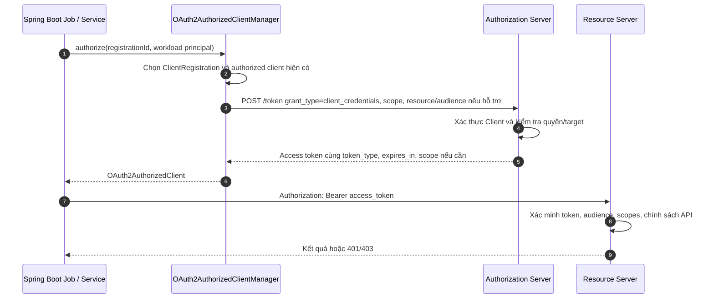

# 16.6. Yêu cầu scope, audience hoặc resource theo provider

> **Module:** Spring Security OAuth 2.0 OIDC Client  
> **Chương:** 16. Client Credentials  
> **Trọng tâm:** Cách ứng dụng Spring Security OAuth 2.0 Client yêu cầu quyền (`scope`) và đích nhận token (`audience` hoặc `resource`) trong **Client Credentials Grant**, khi Authorization Server có những hợp đồng khác nhau.

Khi một Spring Boot backend tự động gọi API mà không có người dùng đăng nhập tương tác, ứng dụng thường sử dụng OAuth 2.0 **Client Credentials Grant**. Client xác thực với Authorization Server (AS) bằng một phương thức được đăng ký, chẳng hạn `client_secret_basic` hoặc `private_key_jwt`, rồi nhận access token để gọi Resource Server.

Nhưng lấy được một access token **chưa chắc** gọi được API mong muốn. Một token có thể không có scope cần thiết, được phát cho resource khác, chứa audience không được API chấp nhận, hoặc đại diện cho Client chưa được phân quyền ở AS. Bởi vậy, ngoài `grant_type=client_credentials`, ứng dụng thường phải làm rõ:

- **`scope`:** những quyền nào Client xin được cấp?
- **`resource`:** token dự định sử dụng tại tài nguyên/API nào, theo **RFC 8707 Resource Indicators** nếu AS hỗ trợ?
- **`audience`:** token dự định dành cho đối tượng nhận nào, **theo extension riêng của một số nhà cung cấp**; không phải tham số chuẩn chung của token request trong RFC 6749.

Ba khái niệm có liên quan nhưng **không đồng nghĩa**. Điều quan trọng là xác định **hợp đồng thực tế của AS và Resource Server**, cấu hình Client phù hợp, rồi kiểm tra access token được cấp thay vì chỉ tin vào thông số ứng dụng đã gửi.

## 1. Mục tiêu học tập

Sau bài học, bạn có thể:

1. Mô tả Client Credentials Grant và Token Endpoint request chuẩn.
2. Phân biệt requested scopes, granted scopes và quyền thực tế tại Resource Server.
3. Phân biệt tham số `resource` theo RFC 8707 với claim `aud` trong access token.
4. Giải thích tại sao tham số `audience` ở Token Endpoint là một quy ước **phụ thuộc provider**.
5. Thiết kế Client registrations cho các API có scopes và resource/audience khác nhau.
6. Cấu hình `scope` trong `spring.security.oauth2.client.registration.<registrationId>.scope`.
7. Dùng điểm mở rộng `OAuth2AccessTokenResponseClient<OAuth2ClientCredentialsGrantRequest>` để bổ sung tham số token request khi provider yêu cầu.
8. Cấu hình `OAuth2AuthorizedClientManager` với Client Credentials provider phù hợp.
9. Tránh tái sử dụng nhầm access token khi cùng một registration thay đổi resource/audience động.
10. Phân tích cách Auth0, Microsoft Entra ID, Keycloak và các AS hỗ trợ RFC 8707 có thể khác nhau.
11. Chẩn đoán lỗi `invalid_scope`, `invalid_target`, `invalid_client`, `unauthorized_client` hoặc API trả 401/403.
12. Bảo vệ Client credentials, access tokens và ranh giới phân quyền máy–máy.

## 2. Vị trí của scope, audience và resource trong luồng

Client Credentials Grant không có bước browser redirect hay Authorization Code của một người dùng. Client trực tiếp liên hệ Token Endpoint:



Một hệ thống đúng phải phân biệt hai nơi đưa ra quyết định:

**Authorization Server** quyết định có cấp token cho Client, scope và resource được yêu cầu hay không.

**Resource Server** quyết định có chấp nhận token ở API đó và cho phép thao tác cụ thể hay không. Việc Token Endpoint trả HTTP 200 không thay thế bước kiểm tra thứ hai.

### 2.1. Client Credentials không phải đăng nhập OIDC của người dùng

Client Credentials cấp token trong ngữ cảnh **Client/workload**. Nó thường không có:

- end-user đăng nhập bằng browser;
- authorization code hay redirect URI;
- `OidcUser` của một người dùng;
- ID token OIDC để xác thực end-user;
- session web được tạo từ `oauth2Login()`.

Trong một số AS có claims như `sub`, `client_id` hoặc `azp` đại diện cho service principal; ý nghĩa phải đọc theo token profile của AS, **không suy ra đây là người dùng cuối**.

## 3. Token request cơ bản của client_credentials

Theo RFC 6749, một Client Credentials token request thường là HTTP POST với body `application/x-www-form-urlencoded`:

```http
POST /oauth2/token HTTP/1.1
Host: login.example.test
Authorization: Basic <redacted-client-credentials>
Content-Type: application/x-www-form-urlencoded

grant_type=client_credentials&scope=reports.read
```

Trong ví dụ, Client xác thực bằng HTTP Basic. Credential thực tế phải được truyền qua HTTPS và không xuất hiện trong tài liệu, logs hoặc phiên kiểm thử dùng chung.

**Các trường chính:**

| Trường | Ý nghĩa | Quy định chung |
|---|---|---|
| `grant_type=client_credentials` | Chọn grant máy–máy | Bắt buộc cho grant này |
| `scope` | Danh sách scopes được yêu cầu | Tùy chọn trong RFC 6749, nhưng AS có thể yêu cầu theo chính sách |
| Client authentication | Chứng minh Client được đăng ký | Client Credentials dành cho confidential clients theo mô hình OAuth 2.0 |
| `resource` | Định danh resource mà token được yêu cầu cho | Extension chuẩn RFC 8707, **chỉ dùng khi AS hỗ trợ** |
| `audience` | Gợi ý/khai báo audience theo hợp đồng riêng | **Không có ngữ nghĩa chuẩn chung** ở token request RFC 6749 |

AS có thể cho phép hoặc từ chối các scopes/resource được yêu cầu. Nó không bắt buộc phải phát token với tất cả các scopes Client xin. Ứng dụng cần biết chính sách của AS và Resource Server mục tiêu.

## 4. Scope là gì?

`scope` mô tả phạm vi quyền truy cập mà Client yêu cầu AS cấp cho access token. Ví dụ:

```text
scope=reports.read
scope=reports.read reports.export
scope=inventory.read inventory.write
```

Trên dây (wire format), danh sách nhiều scope là **chuỗi các tên phân tách bằng dấu cách**. Trong HTTP form body, khoảng trắng phải được form URL-encode phù hợp:

```text
grant_type=client_credentials
&scope=reports.read%20reports.export
```

Cách đặt tên scope là **hợp đồng giữa AS, Client và API**. OAuth 2.0 không định nghĩa rằng `reports.read` luôn có quyền nào trong mọi sản phẩm.

### 4.1. Scope được yêu cầu khác scope được cấp

Ví dụ Client xin:

```text
scope=reports.read reports.export
```

AS có thể cấp cả hai, cấp một phần theo chính sách, hoặc từ chối. Theo RFC 6749, nếu scope được cấp khác scope được yêu cầu, token response cần biểu thị scope thực tế:

```json
{
  "access_token": "<redacted>",
  "token_type": "Bearer",
  "expires_in": 3600,
  "scope": "reports.read"
}
```

Đó là response minh họa, không phải token thật. Client **không được tự coi** mình đã nhận `reports.export` chỉ vì nó đã gửi yêu cầu.

Trong Spring Security, scopes của access token có thể được truy xuất qua:

```java
Set<String> grantedScopes = authorizedClient
    .getAccessToken()
    .getScopes();
```

Nhưng quyền thật còn phụ thuộc Resource Server. API có thể yêu cầu nhiều điều kiện hơn một scope, như tenant, loại Client, đối tượng tài nguyên, network policy hoặc application roles.

### 4.2. Scope trong ClientRegistration

Trong Spring Boot:

```yaml
spring:
  security:
    oauth2:
      client:
        registration:
          reports-m2m:
            provider: internal-as
            client-id: report-worker
            client-secret: ${REPORTS_CLIENT_SECRET}
            client-authentication-method: client_secret_basic
            authorization-grant-type: client_credentials
            scope:
              - reports.read
              - reports.export

        provider:
          internal-as:
            token-uri: https://login.example.test/oauth2/token
```

Khi Spring Security thực hiện Client Credentials Grant theo registration này, các scopes được cấu hình là cơ sở cho yêu cầu cấp token.

**Lưu ý:** `scope` trong registration không phải toàn bộ chính sách AS. Client tương ứng còn phải **được cấp phép** xin những scopes đó tại Authorization Server. Nếu AS chỉ cho phép `reports.read`, khai báo thêm `reports.export` trong YAML không tạo quyền mới.

### 4.3. Scope không chỉ định chắc chắn audience

Một scope như `reports.read` có thể được AS ánh xạ tới API báo cáo, nhưng không có quy tắc OAuth 2.0 chung rằng scope tự động quyết định audience. Điều đó phụ thuộc AS. Nhiều AS yêu cầu chỉ rõ **resource** hoặc **audience**, kể cả khi Client đã nêu scope.

## 5. Audience: mục tiêu mà token dành cho

Trong OAuth 2.0 deployment dùng JWT access token, claim `aud` thường biểu thị những Resource Servers hoặc đối tượng nhận token mà token được phát hành cho. Ví dụ payload JWT minh họa:

```json
{
  "iss": "https://login.example.test",
  "sub": "service-account-42",
  "aud": "https://api.example.test/reports",
  "client_id": "report-worker",
  "scope": "reports.read",
  "iat": 1893452400,
  "exp": 1893456000
}
```

**Không lấy payload ví dụ này làm một JWT đã được xác minh.** Resource Server phải kiểm tra chữ ký hoặc introspection/token validity theo profile của AS, issuer, expiry, audience, scopes và các điều kiện bảo mật khác.

### 5.1. Phân biệt audience với Client ID

| Thuật ngữ | Ví dụ | Trả lời câu hỏi |
|---|---|---|
| `client_id` | `report-worker` | Client nào xin token? |
| Registration ID | `reports-m2m` | Spring Security dùng cấu hình Client nào? |
| Token audience `aud` | `https://api.example.test/reports` | Access token được cấp cho API/đích nào? |
| Requested scope | `reports.read` | Client muốn làm gì? |
| Granted scope | `reports.read` | AS cấp những quyền nào? |
| Issuer `iss` | `https://login.example.test` | AS nào phát hành token? |

Đừng đồng nhất token audience với `client_id` của machine Client. Một số provider biểu diễn audience bằng URI, số định danh API hoặc tên tài nguyên riêng. Resource Server phải biết và chấp nhận đúng giá trị theo **hợp đồng token**, không dựa vào suy đoán từ hostname.

### 5.2. Audience là điều kiện bảo vệ token

Giả sử Client có access token hợp lệ cho `inventory-api` nhưng lại đưa token đó đến `billing-api`. Billing API cần từ chối nếu audience không bao gồm đối tượng nhận mà API tin cậy.

Việc chấp nhận token chỉ vì chữ ký/issuer đúng nhưng `aud` sai là một dạng **token redirect/audience confusion**. Scope `read` giống nhau giữa hai API cũng không cho phép tự động dùng token chéo.

**Audience phải được Resource Server kiểm tra**, không chỉ được Client đưa vào token request. Token có thể là opaque (không phải JWT); khi đó API cần validation/introspection theo thiết kế của AS, thay vì giả định có thể decode JWT claim `aud`.

## 6. Resource parameter theo RFC 8707

RFC 8707 **Resource Indicators for OAuth 2.0** định nghĩa tham số `resource` để Client nói nó định sử dụng access token tại resource nào.

Ví dụ Token Endpoint request mở rộng:

```http
POST /oauth2/token HTTP/1.1
Host: login.example.test
Authorization: Basic <redacted-client-credentials>
Content-Type: application/x-www-form-urlencoded

grant_type=client_credentials&scope=inventory.read&resource=https%3A%2F%2Fapi.example.test%2Finventory
```

Ở dạng đọc dễ hơn:

```text
grant_type = client_credentials
scope      = inventory.read
resource   = https://api.example.test/inventory
```

Ý nghĩa: “Tôi là Client được đăng ký, muốn token có quyền `inventory.read` **cho tài nguyên** `https://api.example.test/inventory`.”

### 6.1. Resource indicator có phải URL endpoint gọi ngay không?

Không nhất thiết. `resource` là **resource identifier**, thường là một absolute URI, do AS/API xác định. Nó có thể giống base URL của Resource Server hoặc là một URI nhận diện logic. Client cần dùng giá trị **mà provider công bố**, không tự ghép host của API với endpoint path rồi giả định hợp lệ.

Ví dụ API thực:

```text
GET https://api.example.test/inventory/items
```

có thể yêu cầu resource identifier:

```text
https://api.example.test/inventory
```

chứ không phải toàn bộ URI `/inventory/items`. Đừng tự chọn resource indicator tùy tiện.

### 6.2. Nhiều resource indicators

RFC 8707 cho phép có thể đưa nhiều `resource` parameters nếu giao thức và AS hỗ trợ. Trên form body, đó là **các tham số lặp cùng tên**, không phải một chuỗi nối bằng dấu phẩy:

```text
grant_type=client_credentials
&scope=read
&resource=https%3A%2F%2Fapi.example.test%2Finventory
&resource=https%3A%2F%2Fapi.example.test%2Freports
```

Tuy nhiên, không phải AS nào cũng cho phép nhiều resources trong cùng một token. Việc yêu cầu nhiều resources có thể tăng phạm vi ảnh hưởng khi token bị lộ, nên **ưu tiên token riêng cho từng API/resource** khi sản phẩm không thật sự cần multi-resource tokens.

### 6.3. Khi resource không hợp lệ

RFC 8707 định nghĩa lỗi `invalid_target` khi resource được yêu cầu không phù hợp hoặc không được phép theo các điều kiện của AS. Một số provider cũng có thể dùng `invalid_scope`/`invalid_request` tùy hợp đồng.

Không xem `invalid_target` là vấn đề OAuth2 Client secret; trước hết kiểm tra giá trị resource, registration, scopes, chính sách AS và quyền của Client với resource đó.

### 6.4. Resource khác với token audience ở chỗ nào?

- **`resource`** là tham số của request, nói Client muốn access token dành cho đâu.
- **`aud`** là thông tin trong token/validation result, thể hiện audience thực tế được AS phát hành theo token profile.

Trong một deployment có RFC 8707, AS có thể dùng resource indicator để xác định audience của access token. Nhưng **không được giả định** mọi AS mapping `resource` thành `aud` theo một cách máy móc, đặc biệt nếu token opaque hoặc có format riêng.

## 7. audience ở Token Endpoint: extension phụ thuộc provider

Một số Authorization Servers (ví dụ Auth0 đối với các API đã đăng ký) dùng tham số `audience` trong token request:

```http
POST /oauth/token HTTP/1.1
Host: tenant.example.auth0.com
Content-Type: application/x-www-form-urlencoded

grant_type=client_credentials&client_id=<redacted>&client_secret=<redacted>&audience=https%3A%2F%2Fapi.example.test%2Freports
```

Đây là **ví dụ khái niệm về hợp đồng provider-specific**, không phải yêu cầu chọn `client_secret_post` làm phương thức xác thực khi triển khai Spring. Client authentication method thực tế phải trùng với cấu hình AS cho Client đó, có thể là HTTP Basic hay cách khác.

### 7.1. audience không phải synonym chuẩn của resource

Cả hai có thể dùng để chỉ đích nhận, nhưng:

- `resource` được chuẩn hóa bởi RFC 8707.
- `audience` không phải tham số chung của OAuth2 token request theo RFC 6749/8707; nó có semantics **do provider định nghĩa**.
- Một AS có thể yêu cầu `audience` nhưng không nhận `resource`.
- Một AS khác có thể nhận `resource` nhưng bỏ qua hoặc từ chối `audience`.
- Một AS thứ ba xác định audience qua Client registration, scope hoặc audience mapper mà không nhận tham số nào trong hai tham số đó.

**Quy tắc triển khai:** chỉ gửi `audience` nếu tài liệu Token Endpoint **của provider đang dùng** quy định hoặc AS có extension tương ứng. Không biến nó thành tham số toàn cục cho mọi OAuth2 Client registration.

### 7.2. Đừng tin request đã gửi hơn token nhận được

Client gửi:

```text
audience=https://api.example.test/reports
```

không tự chứng minh token được cấp có audience đó. Đích được cấp thực tế do AS quyết định. Khi dùng JWT access token, API phải xác minh `aud` theo contract. Với opaque token, API phải sử dụng cơ chế validation/introspection phù hợp.

## 8. Scope, audience và resource phải được thiết kế cùng nhau

Một cấu hình hoạt động đúng thường cần cả ba lớp:

| Lớp | Câu hỏi cần trả lời | Ví dụ |
|---|---|---|
| Client registration | Client nào được phép xin token? | `report-worker` |
| Resource/audience targeting | Token được cấp cho API nào? | `https://api.example.test/reports` |
| Scopes | Được phép làm những thao tác gì? | `reports.read` |
| Resource Server authorization | Request hiện tại có được thực hiện không? | GET report chỉ khi token hợp lệ và phạm vi phù hợp |

Một số lỗi thiết kế:

**Có scope nhưng thiếu audience:** AS phát token cho resource mặc định trong khi API đích yêu cầu audience khác.

**Có audience nhưng thiếu scope:** Resource Server nhận token đúng audience nhưng từ chối thao tác vì thiếu `reports.read`.

**Có scope và audience nhưng sai Client:** AS từ chối `unauthorized_client` hoặc `invalid_scope` vì machine Client không được phép xin quyền/resource đó.

**Có token đúng nhưng API vẫn trả 403:** API còn kiểm tra permissions/tenant/record-level policy; access token không thay thế mọi authorization rules.

## 9. Cấu hình nhiều Client registrations theo từng API

Đối với Client Credentials, cách vận hành đơn giản và dễ kiểm soát là đặt **một Client registration cho từng target/permission set cố định**, đặc biệt khi các resources dùng audience hoặc scope khác nhau.

Ví dụ:

```yaml
spring:
  security:
    oauth2:
      client:
        registration:
          reports-m2m:
            provider: internal-as
            client-id: report-worker
            client-secret: ${REPORTS_CLIENT_SECRET}
            client-authentication-method: client_secret_basic
            authorization-grant-type: client_credentials
            scope:
              - reports.read

          inventory-m2m:
            provider: internal-as
            client-id: inventory-worker
            client-secret: ${INVENTORY_CLIENT_SECRET}
            client-authentication-method: client_secret_basic
            authorization-grant-type: client_credentials
            scope:
              - inventory.read

        provider:
          internal-as:
            token-uri: https://login.example.test/oauth2/token
```

| Registration | Scope | Resource indicator giả định | API |
|---|---|---|---|
| `reports-m2m` | `reports.read` | `https://api.example.test/reports` | Reports |
| `inventory-m2m` | `inventory.read` | `https://api.example.test/inventory` | Inventory |

Hai registrations có thể dùng cùng AS/token endpoint nhưng khác Client IDs, scopes, permissions và resource. Nếu AS cho phép cùng một Client ID ở nhiều registrations với scopes khác nhau, vẫn phải kiểm tra cách AS ràng buộc grant/permission. Ví dụ chọn Client IDs riêng chỉ nhằm minh họa ranh giới dễ nhìn.

### 9.1. Vì sao không dùng một registration rồi đổi audience tùy từng request?

`OAuth2AuthorizedClientManager` thường tìm authorized client đã lưu bằng **registration ID + principal name**. Nếu cùng một key nhưng token request lúc thì xin token cho Reports, lúc thì xin token cho Inventory, có thể xảy ra:

1. Lần đầu xin token cho Reports và lưu dưới `(shared-client, job-worker)`.
2. Lần sau caller muốn Inventory nhưng manager tìm thấy token Reports còn hạn.
3. Manager có thể tái sử dụng authorized client hiện tại theo policy, không phát request mới với resource vừa thay đổi.
4. Ứng dụng vô tình gửi token Reports tới Inventory API, gây 401/403 hoặc vi phạm ranh giới token targeting.

Cùng một registration/principal không mặc nhiên phân biệt audience/resource động. **Không coi một `additionalParameters` khác nhau là một cache key khác nhau.** Nếu cần dynamic target, cần thiết kế cách phân vùng authorized clients/registration/keys hoặc manager tùy chỉnh rõ ràng và có cơ chế tránh trộn token.

### 9.2. Giữ permission set tối thiểu

Nếu job chỉ đọc reports, xin `reports.read`, không xin `reports.*` hoặc `admin` để “tránh lỗi”. Quyền quá rộng làm tăng hậu quả khi credential hoặc token bị lộ.

Trong hệ thống nhiều microservices, một token dùng cho mọi APIs có thể thuận tiện nhưng làm yếu nguyên tắc least privilege. Ưu tiên token theo resource và scope đủ dùng.

## 10. Spring Security lấy access token Client Credentials như thế nào?

Trong Spring Security Servlet, các thành phần thường là:

- `ClientRegistrationRepository`: định nghĩa registration và scope.
- `OAuth2AuthorizedClientService`: lưu authorized client/token cho registration và principal.
- `AuthorizedClientServiceOAuth2AuthorizedClientManager`: thực hiện ngoài HTTP request.
- `OAuth2AuthorizedClientProvider`: provider cho `client_credentials`.
- `OAuth2AccessTokenResponseClient<OAuth2ClientCredentialsGrantRequest>`: gọi Token Endpoint để lấy access token.

Điểm mở rộng để gửi **tham số riêng trong token request** nằm ở **token response client/converter**, không phải ở authorization request resolver của `oauth2Login()`.

### 10.1. Đừng đặt tham số ở sai endpoint

`prompt`, `login_hint`, `nonce` hay `state` thuộc các ngữ cảnh login khác. Trong Client Credentials Grant:

- Không có browser authorization request.
- Không có authorization code.
- Token request gửi trực tiếp `grant_type=client_credentials`.
- `scope` nằm trong token request.
- `resource` hoặc `audience`, nếu được hỗ trợ, cần thêm vào **token request form body**.

Chỉ tùy chỉnh `DefaultOAuth2AuthorizationRequestResolver` của OAuth2 Login **không** giúp thêm resource vào Client Credentials Token Endpoint request.

## 11. Ví dụ Spring Boot: manager cho client_credentials

Một bean manager ngoài HTTP request:

```java
package example.security;

import org.springframework.context.annotation.Bean;
import org.springframework.context.annotation.Configuration;
import org.springframework.security.oauth2.client.AuthorizedClientServiceOAuth2AuthorizedClientManager;
import org.springframework.security.oauth2.client.OAuth2AuthorizedClientManager;
import org.springframework.security.oauth2.client.OAuth2AuthorizedClientProvider;
import org.springframework.security.oauth2.client.OAuth2AuthorizedClientProviderBuilder;
import org.springframework.security.oauth2.client.OAuth2AuthorizedClientService;
import org.springframework.security.oauth2.client.registration.ClientRegistrationRepository;

@Configuration
class MachineClientConfig {

    @Bean("machineAuthorizedClientManager")
    OAuth2AuthorizedClientManager machineAuthorizedClientManager(
            ClientRegistrationRepository registrations,
            OAuth2AuthorizedClientService authorizedClients) {

        OAuth2AuthorizedClientProvider provider =
            OAuth2AuthorizedClientProviderBuilder.builder()
                .clientCredentials()
                .build();

        AuthorizedClientServiceOAuth2AuthorizedClientManager manager =
            new AuthorizedClientServiceOAuth2AuthorizedClientManager(
                registrations,
                authorizedClients
            );

        manager.setAuthorizedClientProvider(provider);
        return manager;
    }
}
```

Cấu hình này đủ về mặt ý tưởng để lấy token qua Client Credentials khi AS chấp nhận request chuẩn và không yêu cầu extra parameters. Khi cần `resource` hoặc `audience`, phải gắn **custom token response client** như mục tiếp theo.

### 11.1. Service không tự refresh hay tự thay scope

`OAuth2AuthorizedClientService.loadAuthorizedClient(...)` chỉ đọc bản ghi đã lưu. Manager/provider mới thực hiện authorization/reauthorization khi cần.

Khi đổi scopes trong YAML, một authorized client đang còn lưu có thể giữ token cũ với scopes cũ. Tùy AS/manager/lifecycle, cần invalidate hoặc reauthorize có kiểm soát. Không coi thay đổi registration ở runtime là cam kết token được cấp lập tức có scopes mới.

## 12. Thêm resource/audience vào token request bằng Spring Security

Trong Spring Security 6.4+ có API token response client dựa trên `RestClient` như `RestClientClientCredentialsTokenResponseClient`. Nó hỗ trợ tùy chỉnh request parameters qua các converters. Với dự án dùng phiên bản khác, API có thể là `DefaultClientCredentialsTokenResponseClient` và `setRequestEntityConverter(...)` hoặc điểm mở rộng tương ứng. **Hãy chọn đúng API theo phiên bản Spring Security thực tế**.

Ví dụ dưới minh họa cách thêm **các tham số tĩnh theo registration ID** mà không tự viết token HTTP client từ đầu.

### 12.1. Tạo token response client có custom parameters

```java
package example.security;

import org.springframework.context.annotation.Bean;
import org.springframework.context.annotation.Configuration;
import org.springframework.security.oauth2.client.endpoint.OAuth2ClientCredentialsGrantRequest;
import org.springframework.security.oauth2.client.endpoint.RestClientClientCredentialsTokenResponseClient;
import org.springframework.security.oauth2.core.endpoint.OAuth2AccessTokenResponse;
import org.springframework.security.oauth2.client.endpoint.OAuth2AccessTokenResponseClient;
import org.springframework.util.LinkedMultiValueMap;
import org.springframework.util.MultiValueMap;

@Configuration
class MachineTokenRequestConfig {

    @Bean
    OAuth2AccessTokenResponseClient<OAuth2ClientCredentialsGrantRequest>
            clientCredentialsTokenResponseClient() {

        RestClientClientCredentialsTokenResponseClient client =
            new RestClientClientCredentialsTokenResponseClient();

        client.addParametersConverter(grantRequest -> {
            MultiValueMap<String, String> parameters =
                new LinkedMultiValueMap<>();

            String registrationId = grantRequest
                .getClientRegistration()
                .getRegistrationId();

            if ("reports-m2m".equals(registrationId)) {
                // Chỉ khi Authorization Server hỗ trợ RFC 8707.
                parameters.add(
                    "resource",
                    "https://api.example.test/reports"
                );
            }

            if ("inventory-m2m".equals(registrationId)) {
                // Một resource indicator khác cho Client khác.
                parameters.add(
                    "resource",
                    "https://api.example.test/inventory"
                );
            }

            if ("auth0-reports".equals(registrationId)) {
                // Provider-specific: chỉ khi hợp đồng AS yêu cầu.
                parameters.add(
                    "audience",
                    "https://api.example.test/reports"
                );
            }

            return parameters;
        });

        return client;
    }
}
```

Phần imports trong mã minh họa có thể rút gọn nếu IDE hỗ trợ. Điểm chính là:

- Lấy `registrationId` từ `grantRequest.getClientRegistration()`, **không lấy từ một HTTP request do user tự gửi**.
- Dùng `MultiValueMap` để hỗ trợ cả tham số `resource` có thể lặp khi cần.
- Chỉ thêm parameter mà AS hiện tại hỗ trợ.
- Để `RestClientClientCredentialsTokenResponseClient` giữ trách nhiệm xây request chuẩn, form encoding và Client authentication method.
- Không ghi đè `grant_type`, `client_id`, `scope` hoặc confidential client credentials bằng dữ liệu tùy ý.

**Lưu ý phiên bản:** `RestClientClientCredentialsTokenResponseClient` và `addParametersConverter(...)` áp dụng với các nhánh Spring Security có cung cấp API đó; không giả định snippet này biên dịch nguyên vẹn trên mọi Spring Security 6.x/7.x.

### 12.2. Gắn token client vào OAuth2AuthorizedClientProvider

Thay builder client credentials bằng cấu hình dùng token response client ở trên:

```java
import org.springframework.beans.factory.annotation.Qualifier;
import org.springframework.context.annotation.Bean;
import org.springframework.security.oauth2.client.AuthorizedClientServiceOAuth2AuthorizedClientManager;
import org.springframework.security.oauth2.client.OAuth2AuthorizedClientManager;
import org.springframework.security.oauth2.client.OAuth2AuthorizedClientProvider;
import org.springframework.security.oauth2.client.OAuth2AuthorizedClientProviderBuilder;
import org.springframework.security.oauth2.client.OAuth2AuthorizedClientService;
import org.springframework.security.oauth2.client.endpoint.OAuth2AccessTokenResponseClient;
import org.springframework.security.oauth2.client.endpoint.OAuth2ClientCredentialsGrantRequest;
import org.springframework.security.oauth2.client.registration.ClientRegistrationRepository;

@Bean("machineAuthorizedClientManager")
OAuth2AuthorizedClientManager machineAuthorizedClientManager(
        ClientRegistrationRepository registrations,
        OAuth2AuthorizedClientService authorizedClients,
        OAuth2AccessTokenResponseClient<OAuth2ClientCredentialsGrantRequest>
            tokenResponseClient) {

    OAuth2AuthorizedClientProvider provider =
        OAuth2AuthorizedClientProviderBuilder.builder()
            .clientCredentials(configurer ->
                configurer.accessTokenResponseClient(tokenResponseClient))
            .build();

    AuthorizedClientServiceOAuth2AuthorizedClientManager manager =
        new AuthorizedClientServiceOAuth2AuthorizedClientManager(
            registrations,
            authorizedClients
        );

    manager.setAuthorizedClientProvider(provider);
    return manager;
}
```

Đoạn `@Bean` ở mục này là **phiên bản thay thế** bean manager trong mục 11; không khai báo cả hai manager cùng tên trong một Spring configuration. Nếu ứng dụng có nhiều `OAuth2AccessTokenResponseClient` hoặc managers, dùng bean names/`@Qualifier` phù hợp để tránh injection mơ hồ.

### 12.3. Vì sao không dùng một HTTP POST thủ công?

Có thể tự viết `RestClient.post()` gửi form, nhưng bạn sẽ phải tự xử lý:

- Client authentication method đúng theo registration.
- HTTP Basic và cách encode Client credentials đúng hợp đồng.
- Token Endpoint errors và OAuth2 error response.
- Token response parsing (`access_token`, `token_type`, `expires_in`, `scope`).
- Clock skew/expiry và authorized client persistence.
- Retry policy, logging và bảo mật secret.

Dùng `OAuth2AccessTokenResponseClient` có sẵn cùng converter tùy chỉnh **giảm nguy cơ vô tình bỏ qua phần protocol chuẩn**. Với AS có extension sâu hơn, cần xem điểm mở rộng cụ thể của Spring Security version.

## 13. Một cách khác: request entity converter cho phiên bản cũ

Trong các nhánh Spring Security dùng `DefaultClientCredentialsTokenResponseClient`, có thể tùy chỉnh `RequestEntity` bằng một converter kế thừa/bao bọc logic mặc định.

Mô hình ý tưởng:

```java
// Pseudocode minh họa thiết kế cho phiên bản cũ.
// Kiểm tra chính xác API và khả năng tùy chỉnh của version dự án.

OAuth2ClientCredentialsGrantRequestEntityConverter baseConverter = ...;

Converter<OAuth2ClientCredentialsGrantRequest, RequestEntity<?>>
    customConverter = grantRequest -> {
        RequestEntity<?> original = baseConverter.convert(grantRequest);

        // Tạo bản sao body form parameters từ original,
        // thêm resource hoặc audience theo registrationId,
        // GIỮ NGUYÊN headers, method, URL, client authentication.
        // Trả về RequestEntity mới.
        return updatedRequestEntity;
    };

DefaultClientCredentialsTokenResponseClient client =
    new DefaultClientCredentialsTokenResponseClient();

client.setRequestEntityConverter(customConverter);
```

**Không sao chép pseudocode như code chạy được.** Nó thể hiện nguyên tắc giữ toàn bộ request chuẩn và chỉ bổ sung tham số. Các lớp/method cụ thể, generic types và token clients hiện hành phải lấy từ Spring Security API version đang dùng.

Điều nguy hiểm nhất khi tự thay converter là làm mất `Authorization: Basic ...` hoặc ghi đè Content-Type, từ đó phát sinh `invalid_client` không liên quan tới resource/audience.

## 14. Dùng manager để xin token cho từng registration

Dùng một service nhận registration ID từ **danh sách cho phép** của ứng dụng:

```java
package example.machine;

import org.springframework.beans.factory.annotation.Qualifier;
import org.springframework.security.oauth2.client.OAuth2AuthorizeRequest;
import org.springframework.security.oauth2.client.OAuth2AuthorizedClient;
import org.springframework.security.oauth2.client.OAuth2AuthorizedClientManager;
import org.springframework.stereotype.Service;

@Service
public class MachineTokenService {

    private final OAuth2AuthorizedClientManager manager;

    public MachineTokenService(
            @Qualifier("machineAuthorizedClientManager")
            OAuth2AuthorizedClientManager manager) {
        this.manager = manager;
    }

    public OAuth2AuthorizedClient forReports() {
        return authorize("reports-m2m", "reports-worker");
    }

    public OAuth2AuthorizedClient forInventory() {
        return authorize("inventory-m2m", "inventory-worker");
    }

    private OAuth2AuthorizedClient authorize(
            String registrationId, String principalKey) {

        OAuth2AuthorizeRequest request = OAuth2AuthorizeRequest
            .withClientRegistrationId(registrationId)
            .principal(principalKey)
            .build();

        OAuth2AuthorizedClient authorized = manager.authorize(request);

        if (authorized == null) {
            throw new IllegalStateException(
                "OAuth2 authorization unavailable: " + registrationId
            );
        }

        return authorized;
    }
}
```

Hai methods `forReports()` và `forInventory()` chọn **registration ID đã được ứng dụng cấu hình sẵn**. Không tạo một HTTP endpoint kiểu:

```text
GET /machine-token?registrationId=...&audience=...&principal=...
```

để người dùng tùy ý điều khiển Client có thể xin access token cho API nào. Một endpoint như vậy dễ trở thành **token vending machine** nếu thiếu chính sách quyền chặt chẽ.

### 14.1. Principal trong Client Credentials là khóa storage

`principal("reports-worker")` không có nghĩa người dùng `reports-worker` đã đăng nhập. Nó chỉ biểu diễn một ngữ cảnh định danh ổn định để manager/service lưu authorized client.

Nếu đổi principal key mỗi lần, manager khó tái sử dụng token đã lưu. Nếu dùng chung principal key cho nhiều tenants khi Client registrations/scopes không được tách rõ, có nguy cơ lẫn token.

## 15. Gọi API đúng token đã được cấp

Sau khi lấy authorized client cho Reports:

```java
OAuth2AuthorizedClient client = machineTokenService.forReports();

String accessToken = client.getAccessToken().getTokenValue();

// Dùng accessToken làm Bearer token cho đúng Reports API qua HTTPS.
// Không trả nó về browser và không ghi ra log.
```

Với Spring `RestClient` (Spring Framework 6.1+/Spring Boot 3.2+):

```java
import org.springframework.stereotype.Component;
import org.springframework.web.client.RestClient;
import org.springframework.security.oauth2.client.OAuth2AuthorizedClient;

@Component
class ReportsApiClient {

    private final MachineTokenService tokens;
    private final RestClient restClient;

    ReportsApiClient(
            MachineTokenService tokens,
            RestClient.Builder builder) {
        this.tokens = tokens;
        this.restClient = builder
            .baseUrl("https://api.example.test/reports")
            .build();
    }

    String fetchSummary() {
        OAuth2AuthorizedClient authorized = tokens.forReports();

        return restClient.get()
            .uri("/summary")
            .headers(headers -> headers.setBearerAuth(
                authorized.getAccessToken().getTokenValue()))
            .retrieve()
            .body(String.class);
    }
}
```

Đây là ví dụ cho thấy token của registration `reports-m2m` được gửi tới **Reports API**, không phải Inventory API. Trong sản phẩm, ưu tiên các tích hợp HTTP client hỗ trợ OAuth2 và cơ chế quản lý token phù hợp với phiên bản dự án, thay vì truyền raw token qua nhiều tầng.

### 15.1. Scope và audience được API kiểm tra

Ngay cả khi `manager.authorize(...)` thành công, Resource Server còn phải:

1. Xác minh token/issuer/chữ ký hoặc introspection theo contract.
2. Kiểm tra thời hạn và trạng thái token.
3. Kiểm tra audience/resource được API chấp nhận.
4. Kiểm tra scopes và chính sách authorization tương ứng.
5. Kiểm tra quyền theo tenant/tài nguyên nếu có.

API `/reports/summary` có thể yêu cầu `reports.read`. Một token đúng audience nhưng không có scope này vẫn phải bị từ chối.

## 16. Token response: kiểm tra điều gì?

Một OAuth 2.0 Token Endpoint response điển hình:

```json
{
  "access_token": "<redacted>",
  "token_type": "Bearer",
  "expires_in": 3600,
  "scope": "reports.read"
}
```

Một số AS trả JWT access token có claim `aud`. Một số trả opaque token; Client không nhất thiết phải biết hoặc giải mã nội dung token để gọi API đúng chuẩn.

### 16.1. Granted scopes

Nếu Spring Security nhận `scope` trong token response, authorized client's `OAuth2AccessToken` có thể biểu diễn scopes được cấp:

```java
var granted = authorized.getAccessToken().getScopes();
boolean canRequestReportApi = granted.contains("reports.read");
```

Nhưng `canRequestReportApi` ở đây **không phải quyền cuối cùng**: Resource Server mới quyết định nhận token hay không. Ngoài ra, nếu AS không trả scope trong response khi scope cấp trùng scope yêu cầu, token client có thể sử dụng scopes của request theo quy tắc thư viện/protocol.

### 16.2. Audience trong access token

Đối với JWT access token, Resource Server thường kiểm tra `aud` theo AS/token profile, ví dụ:

```json
{
  "aud": ["https://api.example.test/reports"]
}
```

Nếu API đích kỳ vọng `https://api.example.test/inventory`, token này không phù hợp.

Không tự parse JWT ở Spring Client rồi cho rằng mình đã “kiểm tra đủ” audience. API phải có validation độc lập; nếu ứng dụng cần phân loại token trước khi gửi, hãy làm theo contract AS và thư viện phù hợp, tránh coi việc decode payload chưa verify là dữ liệu đáng tin.

## 17. Resource Server phải xác minh audience

Đây là ranh giới bắt buộc để resource/audience targeting có giá trị bảo mật.

Ví dụ với Spring Security Resource Server sử dụng JWT:

```yaml
spring:
  security:
    oauth2:
      resourceserver:
        jwt:
          issuer-uri: https://login.example.test
```

Cấu hình `issuer-uri` giúp API thiết lập xác minh issuer/khóa theo cơ chế của Spring Security. Nhưng **đừng mặc định rằng chỉ cấu hình issuer đã kiểm tra audience cụ thể của API**. Ứng dụng cần có audience validator phù hợp với deployment.

Ví dụ một validator audience đơn giản dùng cho token JWT đã được decoder kiểm tra các điều kiện nền tảng:

```java
import org.springframework.security.oauth2.core.OAuth2Error;
import org.springframework.security.oauth2.core.OAuth2TokenValidator;
import org.springframework.security.oauth2.core.OAuth2TokenValidatorResult;
import org.springframework.security.oauth2.jwt.Jwt;

OAuth2TokenValidator<Jwt> reportsAudienceValidator = jwt -> {
    if (jwt.getAudience().contains(
            "https://api.example.test/reports")) {
        return OAuth2TokenValidatorResult.success();
    }

    return OAuth2TokenValidatorResult.failure(
        new OAuth2Error(
            "invalid_token",
            "Token audience not accepted by Reports API",
            null
        )
    );
};
```

Validator này là **phần bổ sung** cho issuer, signature và timestamp validation; không thay các checks mặc định bằng mỗi phép kiểm tra `aud`. Trong cấu hình decoder tùy chỉnh, cần **kết hợp** với `JwtValidators.createDefaultWithIssuer(...)` hoặc các validators tương ứng phiên bản và profile token.

Nếu token opaque, Resource Server cần introspection/validation tương ứng và chính sách audience phù hợp với dữ liệu trả về. Không áp một ví dụ JWT vào mọi hệ thống.

## 18. Provider khác nhau: chiến lược tương ứng

### 18.1. Authorization Server hỗ trợ RFC 8707

Một AS hỗ trợ Resource Indicators có thể nhận:

```text
grant_type=client_credentials
scope=reports.read
resource=https://api.example.test/reports
```

Chiến lược:

- Dùng scopes trong ClientRegistration.
- Thêm `resource` trong token request converter.
- Kiểm tra resource identifier và policy AS cho Client.
- API kiểm tra token audience/scopes theo token profile.
- Dùng registration/authorized client key riêng cho resource nếu cần.

### 18.2. Auth0 — audience của API

Trong mô hình Machine-to-Machine của Auth0, Client thường cần chỉ rõ **audience** của API đã được đăng ký tại Auth0, ví dụ:

```text
grant_type=client_credentials
audience=https://api.example.test/reports
```

Scopes có thể được cấu hình theo permissions mà API công bố và quyền mà Client được cấp.

Chiến lược:

- Đăng ký Machine-to-Machine application và API/audience đúng trong Auth0 tenant.
- Cấp quyền Client đối với API/scopes cần dùng.
- Cấu hình Client authentication đúng.
- Thêm `audience` bằng token request converter cho **registration Auth0 cụ thể**.
- Kiểm tra audience/scopes khi API nhận access token.
- Không gửi `resource` thay `audience` nếu hợp đồng của endpoint đó không hỗ trợ.

Tài liệu và chính sách của Auth0 tenant đang dùng là nguồn quyết định giá trị audience thật, không phải URI ví dụ trong bài.

### 18.3. Microsoft Entra ID — scope dạng /.default trong v2 endpoint

Đối với Microsoft identity platform v2.0, Client Credentials Grant thường yêu cầu scope theo định dạng **resource application ID URI + `/.default`**, ví dụ:

```text
grant_type=client_credentials
scope=api://reports-service-app/.default
```

Hoặc một resource identifier tương ứng được cấu hình trong tenant. Giá trị `api://reports-service-app` chỉ minh họa; cần dùng Application ID URI thực tế.

Ý nghĩa:

- `/.default` yêu cầu những **application permissions đã được cấu hình và được consent** cho resource theo mô hình Microsoft identity platform.
- Không tự ghép `scope=reports.read reports.write` như một token request chung cho Client Credentials của Entra v2 khi provider yêu cầu `/.default`.
- Đảm bảo permission type là **application permissions/app roles**, không nhầm với delegated scopes cho người dùng.
- Token audience là resource mà Entra phát hành token cho; API phải xác minh đúng audience, issuer và app roles/scopes theo token profile.
- Nếu làm việc với v1 endpoint/legacy protocol dùng `resource`, đó là một hợp đồng khác; không trộn cách request của v1 và v2.

Ví dụ registration:

```yaml
spring:
  security:
    oauth2:
      client:
        registration:
          entra-reports:
            provider: entra-tenant
            client-id: ${ENTRA_CLIENT_ID}
            client-secret: ${ENTRA_CLIENT_SECRET}
            client-authentication-method: client_secret_post
            authorization-grant-type: client_credentials
            scope:
              - api://reports-service-app/.default
        provider:
          entra-tenant:
            token-uri: https://login.microsoftonline.com/example-tenant-id/oauth2/v2.0/token
```

Các giá trị tenant, Application ID URI và phương thức client authentication phải **đối chiếu với Client thực tế**; `client_secret_post` ở đây minh họa một cách gửi credentials mà provider hỗ trợ, không phải khuyến nghị bắt buộc cho mọi Entra Client.

Đặc biệt: token phát trong Client Credentials có thể dùng claim `roles` thay vì `scp`, bởi đây là app-only permissions chứ không phải delegated user scopes. Resource Server phải dùng hợp đồng token thích hợp, không đòi `scp` một cách máy móc.

### 18.4. Keycloak — scope và audience mapper

Với Keycloak, access token audience thường được quyết định qua Client scopes, audience mappers hoặc chính sách Keycloak, tùy phiên bản và cấu hình realm.

Chiến lược:

- Đăng ký confidential Client có service accounts/Client Credentials khả dụng.
- Cấu hình Client scopes và audience mapping tương ứng Resource Server.
- Xin scope phù hợp theo cơ chế Keycloak.
- Kiểm tra token được phát có audience mà API yêu cầu.
- Đừng giả định Keycloak luôn nhận `audience` trong token request theo ngữ nghĩa giống Auth0.

Một configuration như:

```yaml
registration:
  keycloak-inventory:
    provider: keycloak
    client-id: inventory-worker
    client-secret: ${KEYCLOAK_CLIENT_SECRET}
    authorization-grant-type: client_credentials
    scope: [inventory.read]

provider:
  keycloak:
    token-uri: https://id.example.test/realms/operations/protocol/openid-connect/token
```

chỉ mang tính minh họa YAML phần liên quan. Việc `aud` xuất hiện trong access token còn phụ thuộc chính sách/mappers của realm. Khi có khác biệt, sửa cấu hình Keycloak thay vì tự chèn claim `aud` vào token client-side.

### 18.5. So sánh chiến lược

| Provider/kiểu AS | Cách chỉ rõ đích thường gặp | Lưu ý |
|---|---|---|
| AS hỗ trợ RFC 8707 | Token request `resource=<URI>` | Có thể hỗ trợ nhiều resource indicators; kiểm tra policy |
| Auth0 M2M | Token request `audience=<API identifier>` | Extension theo Auth0; cần cấp quyền Client với API |
| Microsoft Entra v2 | `scope=<resource>/.default` | App-only permissions/admin consent và đúng resource |
| Keycloak | Client scopes/audience mapper; token endpoint theo hợp đồng | Không mặc định có tham số `audience` như Auth0 |
| AS riêng | Có thể dùng resource, audience, scope mapping hoặc registration policy | Đọc tài liệu triển khai hiện tại |

Những mô hình trên là ví dụ phổ biến, **không phải cam kết chung cho mọi tenant/version/provider configuration**.

## 19. Không trộn Client Credentials với OIDC Login

Trong module OAuth2/OIDC Client, hai luồng có thể dùng chung `ClientRegistrationRepository` hoặc Authorized Client Manager, nhưng mục đích khác:

| Tiêu chí | OIDC Login (Authorization Code) | Client Credentials |
|---|---|---|
| Chủ thể chính | Người dùng đã được OP xác thực | Client/service workload |
| Browser redirect | Có | Không |
| ID Token | Có theo OIDC Code Flow | Không phải phần bắt buộc của OAuth2 Client Credentials |
| Scope `openid` | Có ý nghĩa yêu cầu OIDC | Không dùng như “đăng nhập người dùng” |
| Principal storage | Người dùng đăng nhập | Workload key ổn định |
| Token target | Có thể phục vụ API người dùng được ủy quyền | API chấp nhận app-only/machine permissions |
| Audience/resource | Theo contract token của API | Theo AS/Resource Server contract |

Một lỗi nguy hiểm là **fallback từ token người dùng bị từ chối sang machine token có quyền rộng** chỉ để API tiếp tục trả dữ liệu. Đây là thay đổi mô hình quyền, không phải xử lý kỹ thuật tương đương.

## 20. Các lỗi phổ biến khi yêu cầu scope, audience hoặc resource

| Triệu chứng | Nguyên nhân có thể | Hướng kiểm tra |
|---|---|---|
| `invalid_scope` tại Token Endpoint | Scope không tồn tại/không được Client cấp phép hoặc cú pháp không phù hợp | Registration scope, AS Client permissions, format theo provider |
| `invalid_target` | Resource indicator không hợp lệ hoặc Client không được phép dùng | RFC 8707 support, resource URI, AS policy |
| `invalid_request` khi thêm `audience` | Provider không hỗ trợ tham số hoặc syntax sai | Tài liệu Token Endpoint cho Client cụ thể |
| `unauthorized_client` | Grant Client Credentials không được phép | Loại Client, grants được bật tại AS |
| `invalid_client` | Client ID/secret/authentication method không đúng | Credentials và cấu hình Client authentication |
| Token trả về nhưng API 401 | Audience/issuer/signature/expiry sai, token không được API chấp nhận | Resource Server validation và token profile |
| Token trả về nhưng API 403 | Scope/app roles/permission thiếu | Granted scopes, app roles, API authorization |
| Manager trả token của API khác | Cùng registration+principal cache cho target động | Tách registration/keys hoặc quản lý cache theo target |
| Thêm resource rồi không thấy `aud` mong muốn | AS mapping không như dự kiến | Token issuance policy, token profile, AS docs |
| `/.default` không hoạt động ở provider khác | Cú pháp đặc thù Entra v2 | Dùng scope format mà provider thực sự hỗ trợ |
| Client đổi YAML scopes nhưng vẫn thấy quyền cũ | Authorized client cũ còn được tái sử dụng | Token lifecycle/invalidation/re-authorization |
| Các pods phát nhiều token không cần thiết | In-memory storage riêng, principal key không ổn định | Shared service và chiến lược concurrency |
| Token request thiếu custom parameter | Chưa gắn token response client vào provider/manager | Kiểm tra bean wiring và phiên bản API |
| Token request bị mất Client Basic auth | Custom converter xây lại request không giữ headers | Giữ Client authentication chuẩn từ thư viện |
| Token opaque nên decode JWT lỗi | Access token không ở định dạng JWT | Dùng introspection/AS contract thay vì đoán token format |

### 20.1. Phân biệt lỗi Token Endpoint và Resource Server

**Token Endpoint lỗi:** Client chưa được cấp access token phù hợp. Sửa configuration của AS/Client, grant, scope, resource hoặc credentials.

**Resource Server lỗi:** Client có token nhưng API không nhận hoặc không cho phép. Kiểm tra token issuer, audience, expiry, scopes/app roles và business authorization.

Không dùng cùng một lối “xin token lại” cho mọi lỗi 403. API trả 403 vì thiếu quyền không được giải quyết bằng retry liên tục.

## 21. Lưu ý về caching và thay đổi token target theo từng lần gọi

Một số ứng dụng muốn truyền audience/resource như tham số runtime:

```java
getTokenFor("https://api.example.test/reports");
getTokenFor("https://api.example.test/inventory");
```

Đây không chỉ là bài toán thêm query parameter. Nó còn là bài toán **token partitioning**.

### 21.1. Vì sao token reuse có thể sai?

Giả sử manager được thiết kế lưu authorized client theo:

```text
registrationId = shared-m2m
principalName  = nightly-worker
```

Dù request thêm `resource=reports` hoặc `resource=inventory`, storage mặc định không tự bảo đảm hai token được lưu riêng. Khi manager thấy token còn hạn, nó có thể không gọi lại Token Endpoint để cập nhật resource.

### 21.2. Những phương án thiết kế

- **Tách registrations theo resource/API** và scopes cố định; đơn giản, dễ vận hành.
- Dùng **principal keys có namespace ổn định** khi cùng Client registration được chia thành các ngữ cảnh authorized client khác nhau và bảo đảm provider/manager token request tương ứng key đó.
- Với yêu cầu dynamic resource phức tạp, dùng custom authorized client manager/service hoặc cache có key thực sự bao gồm registration, resource/audience, scopes và principal/tenant, đồng thời kiểm thử reauthorization/concurrency.
- Không sử dụng URL/API target do caller không tin cậy đưa vào token request mà không có allowlist/policy.
- Không gửi một token có audience A sang API B chỉ vì Client ID giống nhau.

**Quan trọng:** chỉ đổi principal key không tự thay đổi extra `resource` parameter nếu converter vẫn tĩnh theo registration ID. Cần thiết kế cả **token request derivation và token storage key** nhất quán.

### 21.3. Thu hồi/invalidate khi scope hoặc resource thay đổi

Khi triển khai chính sách mới:

1. Xác định authorized clients/token đã được cấp trước đó.
2. Quyết định có xóa local storage để buộc xin token mới không.
3. Nếu yêu cầu revoke, dùng khả năng Token Revocation Endpoint của AS khi phù hợp.
4. Kiểm tra API nhận đúng audience/permissions.
5. Theo dõi 401/403 sau deployment; không bỏ validator để duy trì tương thích token cũ.

## 22. Bảo mật cho Client Credentials và token targeting

### 22.1. Bảo vệ Client credentials

- Không commit Client secret vào repository.
- Dùng environment/secret manager hoặc cơ chế credentials được tổ chức phê duyệt.
- Bảo vệ token request bằng TLS/HTTPS.
- Nếu AS hỗ trợ `private_key_jwt` hoặc mTLS, cân nhắc theo threat model và rotation plan.
- Không ghi request form/Basic Authorization header chứa secrets.
- Không cho frontend tự giữ machine Client credentials.

### 22.2. Bảo vệ access token

- Access token là bearer credential, không trả cho browser trừ khi kiến trúc cho phép rõ ràng.
- Không in token, không lưu trong URLs, không gửi qua email/ticket.
- Nếu dùng `JdbcOAuth2AuthorizedClientService`, bảo vệ database, backup và khóa mã hóa.
- Dùng lifetime/scopes tối thiểu phù hợp.
- Không chia token cho các APIs khác audience.
- Đối với API quan trọng, đánh giá sender-constrained access tokens nếu AS và Resource Server hỗ trợ.

### 22.3. Authorization ở Resource Server

Resource Server phải tự kiểm tra bearer token: issuer/keys/introspection, audience, expiry, scopes hoặc app roles và policy nghiệp vụ. Client-side yêu cầu `scope`/`audience` không có hiệu lực cưỡng chế ở phía API nếu API không kiểm tra token được phát.

### 22.4. Tránh biến API thành token vending machine

Một endpoint nội bộ chấp nhận `scope` và `audience` từ bất kỳ người gọi nào rồi xin machine token có thể dẫn tới **leo thang quyền**. Nếu phải cung cấp capability tương tự, cần allowlist theo service identity, quota, audit, giới hạn resources và không trả raw token cho caller ngoài thiết kế.

## 23. Logging và quan sát an toàn

Khi chẩn đoán token targeting, nên ghi **metadata**, không ghi credentials:

```text
event=client_credentials_authorization
registrationId=reports-m2m
requestedScopes=reports.read
requestedResource=https://api.example.test/reports
tokenEndpoint=https://login.example.test/oauth2/token
result=success
grantedScopes=reports.read
tokenValue=[never-log]
clientSecret=[never-log]
```

Với hệ thống có resource URI chứa tenant/user identifiers nhạy cảm, cũng cần mask hoặc hash trước khi log.

**Không ghi:** toàn bộ access token/refresh token, Basic auth header, client assertion JWT, client secret, token response raw body hoặc full network trace chứa credentials.

Có thể bật logging Spring Security ở mức DEBUG trong môi trường phát triển, nhưng phải kiểm soát HTTP client interceptors, request/response bodies và obfuscation. Không dựa vào DEBUG logs làm bằng chứng quyền: **quyền thực tế được AS phát và API kiểm tra**.

## 24. Thực hành A — Thêm scope cho Client Credentials

**Mục tiêu:** phân biệt scope yêu cầu, scope được AS cấp và quyền API.

**Chuẩn bị:** AS test, confidential Client với grant `client_credentials`, Resource Server yêu cầu `reports.read`, Spring Boot registration `reports-m2m`.

**Các bước:**

1. Cấu hình `scope: [reports.read]`.
2. Tạo manager `clientCredentials()` và authorize bằng principal `reports-worker`.
3. Quan sát token response metadata đã che token và granted scopes.
4. Gọi API đọc report; ghi trạng thái HTTP.
5. Thêm `reports.export` vào request nhưng chưa cấp permission ở AS.
6. Thử luồng mới sau khi làm sạch authorized client test để thấy AS từ chối hoặc chỉ cấp quyền phù hợp.
7. Cấp quyền trên test AS đúng cách rồi thử lại theo chính sách.

**Kết quả mong đợi:** khai báo scope trong YAML không tự tạo permission. AS quyết định token được cấp; API tự kiểm tra quyền.

**Câu hỏi:** vì sao `requestedScopes.contains("reports.export")` không đủ để cho phép export?

## 25. Thực hành B — Resource indicator RFC 8707

**Mục tiêu:** gửi `resource` tới một AS hỗ trợ RFC 8707.

**Chuẩn bị:** test AS hỗ trợ Resource Indicators và hai resources được đăng ký.

**Các bước:**

1. Chọn registration `inventory-m2m`.
2. Dùng custom token request converter bổ sung `resource=https://api.example.test/inventory`.
3. Đảm bảo request vẫn có `grant_type=client_credentials`, client authentication và scope.
4. Trong test logs an toàn, kiểm tra **sự có mặt** của `resource` đã URL-encode.
5. Gọi Inventory API bằng access token mới.
6. Thay resource bằng một URI không được Client phép dùng trong **test**; quan sát lỗi như `invalid_target` theo AS.
7. Khôi phục config hợp lệ.

**Kết quả mong đợi:** AS nhận định danh resource và có thể cấp hoặc từ chối token theo target. Không suy luận kết quả từ URL request: kiểm tra token/API response.

## 26. Thực hành C — audience theo hợp đồng Auth0 hoặc mock AS

**Mục tiêu:** thấy `audience` không thể được coi là tham số chung của mọi AS.

**Chuẩn bị:** Auth0 test tenant được phép sử dụng hoặc mock AS hỗ trợ extension `audience`; có API identifier và Client M2M đã được cấp quyền.

**Các bước:**

1. Đăng ký API identifier trong test AS.
2. Cấp permission để Client Credentials dùng API.
3. Thêm `audience=<API identifier>` bằng converter chỉ cho registration tương ứng.
4. Thực hiện `authorize()` và kiểm tra kết quả.
5. Trong mock AS không hỗ trợ `audience`, thử cùng tham số để quan sát có thể bị từ chối hoặc không được sử dụng.
6. Không cố chuyển sang `resource` nếu provider chưa công bố hỗ trợ.
7. Đối chiếu audience trong access token/API validation theo contract test.

**Kết quả mong đợi:** `audience` là extension provider-specific, việc chấp nhận và cách biểu diễn target do AS quyết định.

## 27. Thực hành D — Microsoft Entra v2 và /.default

**Mục tiêu:** phân biệt mô hình permission của Entra Client Credentials với scope tùy ý.

**Chuẩn bị:** test tenant, App registration của Client, Resource API có application permissions và admin consent thích hợp.

**Các bước:**

1. Cấu hình resource Application ID URI cho API thử nghiệm.
2. Cấp application permissions ở Client và thực hiện consent theo quy trình tenant.
3. Đặt registration scope dạng `api://<app-id-uri>/.default` theo tài liệu Entra v2.
4. Authorize Client bằng grant `client_credentials`.
5. Kiểm tra API/resource audience, các app roles/claims mà API kỳ vọng.
6. Thử cấu hình sai scope format trong test và xem lỗi Token Endpoint.
7. Không dùng token app-only làm thay thế delegated user token nếu API đòi user context.

**Kết quả mong đợi:** app-only permissions của Entra v2 khác delegated scopes trong login của người dùng. Giá trị `/.default` là quy ước provider, không phải scope format chuẩn chung cho mọi AS.

## 28. Thực hành E — Phát hiện reuse sai audience

**Mục tiêu:** hiểu rủi ro khi dùng một authorized client cache key cho nhiều API targets.

**Chuẩn bị:** hai APIs/Resource Servers test với audience khác nhau, mock AS hỗ trợ target-specific tokens.

**Các bước:**

1. Tạo registration `shared-m2m` và principal `nightly-worker`.
2. Lần đầu xin token cho Reports; lưu authorized client.
3. Giữ token còn hạn, đổi runtime target sang Inventory nhưng giữ cùng registration và principal.
4. Quan sát manager có thể tái sử dụng token Reports.
5. Thử gọi Inventory API: API phải từ chối token không đúng audience.
6. Sửa thiết kế bằng registrations tách biệt hoặc storage/request key phân vùng đúng theo target.
7. Chạy lại cả hai API requests với token phù hợp.

**Kết quả mong đợi:** token targeting phải thống nhất với cách cache/lưu authorized client. Extra token request parameter không tự thay storage key.

## 29. Thực hành F — Kiểm thử từ chối scope và resource

**Mục tiêu:** phân biệt lỗi protocol và lỗi phân quyền.

| Trường hợp | Dữ liệu test | Kết quả cần quan sát |
|---|---|---|
| Client secret sai | Client authentication không hợp lệ | AS có thể trả `invalid_client` |
| Scope không được cấp | Xin `reports.admin` chưa được AS cho phép | `invalid_scope` hoặc grant policy từ chối |
| Resource không được phép | Xin một resource URI sai | `invalid_target` ở AS hỗ trợ RFC 8707 |
| Grant chưa bật | Client không được phép dùng client_credentials | `unauthorized_client` |
| Audience sai ở API | Token ký đúng nhưng `aud` thuộc API khác | API 401/token invalid theo policy |
| Scope thiếu ở API | Token đúng audience nhưng không có `reports.read` | API 403 theo policy |
| Token hết hạn | Giữ token quá hạn | API từ chối, manager cấp lại khi phù hợp |
| Manager reuse sai target | Cùng registration/principal, target đổi | Phát hiện và sửa phân vùng authorized client |

Chỉ thực hiện với test credentials và Resource Servers kiểm soát được. Không đem raw token hoặc secret vào ghi chép.

## 30. Những hiểu lầm cần tránh

| Hiểu lầm | Cách hiểu đúng |
|---|---|
| “Scope và audience là một.” | Scope nói về quyền; audience nói về đối tượng nhận token. |
| “Resource là một trường bất kỳ giống audience.” | `resource` có RFC 8707; `audience` trong token request tùy provider. |
| “Gửi scope nghĩa AS phải cấp đủ.” | AS có thể giới hạn/từ chối; kiểm tra quyền được cấp. |
| “Có access token nghĩa API sẽ chấp nhận.” | API phải xác minh token, audience và quyền. |
| “Access token luôn là JWT có aud.” | Nó có thể opaque; validation tùy AS/API. |
| “Auth0 dùng audience nên mọi AS đều hỗ trợ audience.” | Sai; chỉ dùng khi provider định nghĩa. |
| “Entra v2 Client Credentials nhận scope bất kỳ như user-delegated OAuth.” | Thường dùng `resource/.default` và application permissions. |
| “Keycloak cứ gửi audience là được.” | Audience thường phụ thuộc mapper/client scopes và realm config. |
| “Tự thêm resource trong OAuth2 Login authorization request là đủ cho client_credentials.” | Client Credentials gọi thẳng Token Endpoint, cần custom token client ở đó. |
| “Đổi scope YAML là token cũ tự đổi.” | Authorized client đã lưu có thể còn token cũ; cần lifecycle policy. |
| “Một cache key registration/principal phân biệt mọi resource.” | Không; target động cần phân vùng đúng. |
| “Client Credentials tạo OidcUser của người dùng.” | Đây là machine authorization, không phải OIDC user login. |
| “Để tránh invalid_scope, cứ xin mọi quyền.” | Vi phạm least privilege và làm tăng rủi ro khi lộ token. |
| “Không có aud validator vẫn an toàn vì issuer đúng.” | API cần kiểm tra token dành cho đúng audience theo contract. |
| “API trả 403 thì cứ xin lại token.” | Thường là thiếu quyền thật; retry không tự tạo permission. |

## 31. Câu hỏi tự kiểm tra

**Câu 1.** Trong Client Credentials Grant, `scope` được gửi ở Authorization Endpoint hay Token Endpoint?

*Gợi ý:* grant này không có browser Authorization Endpoint flow.

**Câu 2.** Vì sao `scope=reports.read` không đủ chứng minh token được phát cho Reports API?

*Gợi ý:* scope và audience/resource là hai khía cạnh khác nhau.

**Câu 3.** RFC nào chuẩn hóa `resource` parameter?

*Gợi ý:* Resource Indicators for OAuth 2.0.

**Câu 4.** Có thể gửi `audience` tới mọi Token Endpoint chuẩn RFC 6749 không?

*Gợi ý:* không; đây là tham số do provider định nghĩa khi hỗ trợ.

**Câu 5.** JWT access token có `aud=reports-api`, Inventory API nên làm gì?

*Gợi ý:* từ chối nếu audience không đáp ứng chính sách Inventory API.

**Câu 6.** Nếu Spring Client đã xin `reports.export` nhưng token chỉ được cấp `reports.read`, ứng dụng có quyền export không?

*Gợi ý:* không; kiểm tra granted scope và API authorization.

**Câu 7.** Khi custom token request, tại sao phải giữ HTTP Basic/client authentication do Spring Security thực hiện?

*Gợi ý:* nếu mất credential, AS có thể trả `invalid_client` dù scope/resource đúng.

**Câu 8.** Token response client customizer phải gắn vào nhánh OAuth2 Login Authorization Request hay Client Credentials provider?

*Gợi ý:* Token Endpoint của Client Credentials.

**Câu 9.** Vì sao cache authorized client theo registration/principal có thể tái sử dụng nhầm token khi target thay đổi?

*Gợi ý:* extra resource/audience parameter không tự là một phần của storage key.

**Câu 10.** Vì sao `/.default` chỉ nên dùng trong ngữ cảnh AS quy định?

*Gợi ý:* đó là convention của Microsoft identity platform v2 cho resource permissions, không phải scope syntax phổ quát.

**Câu 11.** Với token opaque, Resource Server lấy thông tin audience/quyền ở đâu?

*Gợi ý:* validation/introspection hoặc hợp đồng AS, không parse JWT giả định.

**Câu 12.** Nếu API trả 403 vì thiếu permission, có nên lặp token request vô hạn với cùng Client credentials?

*Gợi ý:* không; sửa AS permission/scopes/API policy, không biến retry thành cấp quyền.

## 32. Tài liệu tham khảo

- [RFC 6749 — OAuth 2.0 Authorization Framework, Client Credentials Grant](https://www.rfc-editor.org/rfc/rfc6749#section-4.4): `grant_type=client_credentials` và `scope`.
- [RFC 8707 — Resource Indicators for OAuth 2.0](https://www.rfc-editor.org/rfc/rfc8707): tham số `resource` và xác định đích token.
- [RFC 9068 — JWT Profile for OAuth 2.0 Access Tokens](https://www.rfc-editor.org/rfc/rfc9068): các claims trong JWT access tokens, bao gồm audience theo profile.
- [RFC 9700 — OAuth 2.0 Security Best Current Practice](https://www.rfc-editor.org/rfc/rfc9700): token security, resource targeting và các khuyến nghị hiện đại.
- [Spring Security Reference — OAuth 2.0 Client](https://docs.spring.io/spring-security/reference/servlet/oauth2/client/index.html): cấu hình Client registrations và authorized clients trên Servlet.
- [Spring Security Reference — Core OAuth2 Client Classes](https://docs.spring.io/spring-security/reference/servlet/oauth2/client/core.html): authorized client manager, ClientRegistration, service.
- [Spring Security Reference — Authorized Clients](https://docs.spring.io/spring-security/reference/servlet/oauth2/client/authorized-clients.html): token management và authorized client behavior.
- [Spring Security API — RestClientClientCredentialsTokenResponseClient](https://docs.spring.io/spring-security/reference/api/java/org/springframework/security/oauth2/client/endpoint/RestClientClientCredentialsTokenResponseClient.html): Token Endpoint client và tùy chỉnh parameters ở các version hỗ trợ.
- [Spring Security API — OAuth2AuthorizedClientProviderBuilder](https://docs.spring.io/spring-security/reference/api/java/org/springframework/security/oauth2/client/OAuth2AuthorizedClientProviderBuilder.html): clientCredentials grant provider.
- [Spring Security API — AuthorizedClientServiceOAuth2AuthorizedClientManager](https://docs.spring.io/spring-security/reference/api/java/org/springframework/security/oauth2/client/AuthorizedClientServiceOAuth2AuthorizedClientManager.html): manager cho machine jobs ngoài HTTP.
- [Auth0 — Call Your API Using the Client Credentials Flow](https://auth0.com/docs/get-started/authentication-and-authorization-flow/client-credentials-flow/call-your-api-using-the-client-credentials-flow): ví dụ audience-specific Machine-to-Machine.
- [Microsoft identity platform — OAuth 2.0 Client Credentials Grant](https://learn.microsoft.com/en-us/entra/identity-platform/v2-oauth2-client-creds-grant-flow): scope `resource/.default` và application permissions.
- [Keycloak Server Administration Guide](https://www.keycloak.org/docs/latest/server_admin/): cấu hình Client scopes, audience mapping và service account.
- [RFC 7662 — OAuth 2.0 Token Introspection](https://www.rfc-editor.org/rfc/rfc7662): xác minh thông tin token opaque theo hợp đồng AS.

**Ghi nhớ:** với Spring Security Client Credentials, `scope` là yêu cầu về quyền; `resource` theo RFC 8707 hoặc `audience` theo extension của provider là yêu cầu về **đích token**. Đặt scopes trong `ClientRegistration`, thêm resource/audience ở **Token Endpoint request** bằng extension point phù hợp và chỉ cho registration cần thiết. Luôn kiểm tra token được cấp có đúng Resource Server và permissions mong muốn; thiết kế authorized-client storage/cache theo registration, principal và target để tránh dùng nhầm token giữa các APIs.
