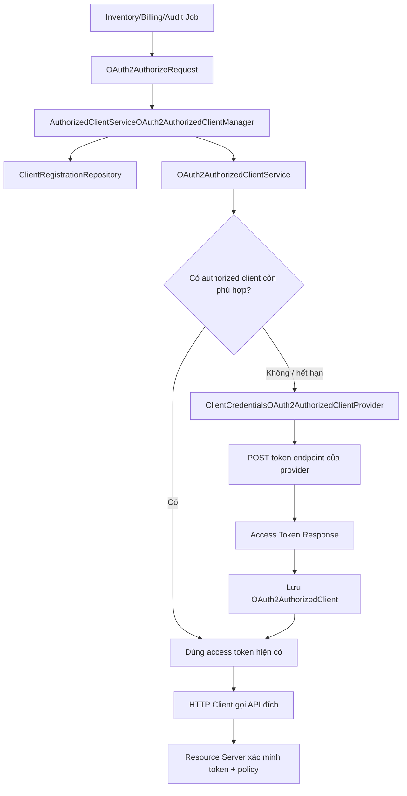
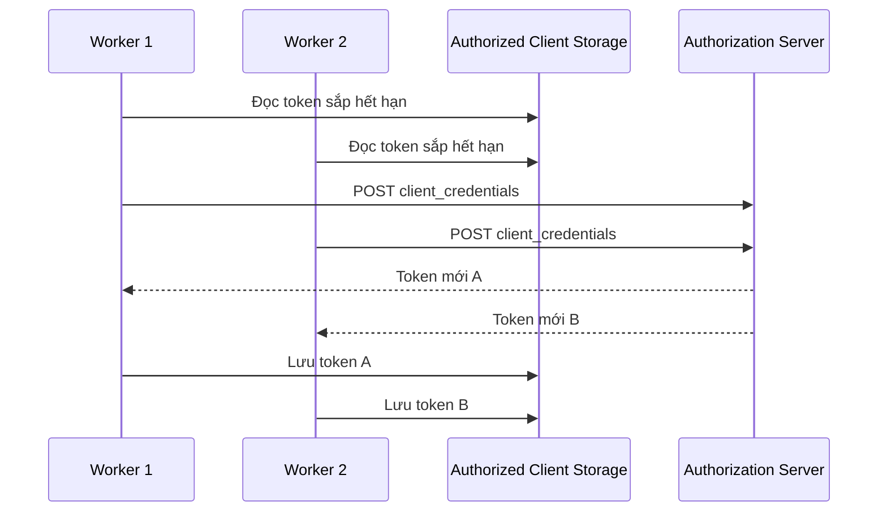
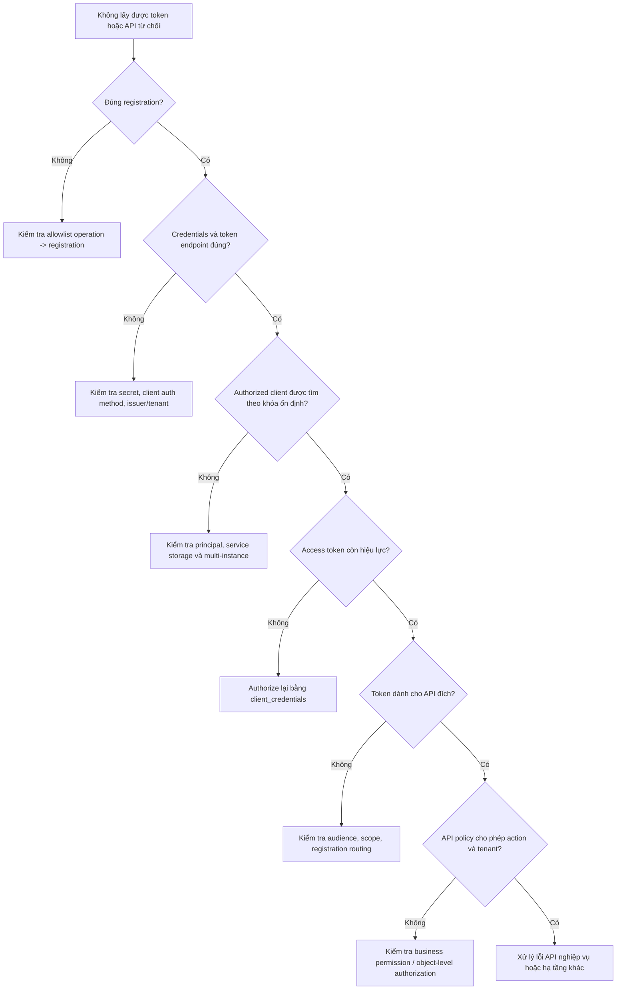
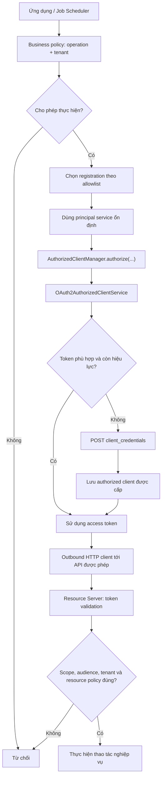

# 16.8. Quản lý token cho nhiều ứng dụng hoặc tài khoản dịch vụ

Trong một hệ thống nhỏ, backend có thể chỉ dùng một OAuth2 client để gọi một API. Tuy nhiên, hệ thống doanh nghiệp thường có **nhiều ứng dụng, nhiều tác vụ nền và nhiều tài khoản dịch vụ**: dịch vụ đồng bộ kho gọi Inventory API, hệ thống hóa đơn gọi Billing API, tiến trình kiểm toán gọi Audit API, và các môi trường hoặc tenant có chính sách riêng. Mỗi tích hợp có thể sở hữu `client_id`, phương thức xác thực, scope, audience và vòng đời token khác nhau.

Với **Spring Security OAuth 2.0 Client**, grant `client_credentials` cho phép một ứng dụng xác thực với Authorization Server bằng thông tin của **chính client** để lấy access token. Không có người dùng cuối đăng nhập trong grant này. Để vận hành an toàn ở quy mô nhiều ứng dụng hoặc service account, cần quản lý đúng cả ba lớp:

1. **Định danh và cấu hình client**: ứng dụng/tài khoản dịch vụ nào được đăng ký với Authorization Server?
2. **Lấy và lưu authorized client**: `OAuth2AuthorizedClientManager` chọn registration và principal nào, lấy lại token cũ hay xin token mới?
3. **Phân tách quyền và bảo vệ token**: token nào được gửi tới API nào, ai có quyền đọc kho token, và điều gì xảy ra khi credential bị thu hồi hoặc xoay vòng?

Bài học trình bày mô hình nhiều `ClientRegistration`, cách sử dụng `AuthorizedClientServiceOAuth2AuthorizedClientManager`, khóa tra cứu `(registrationId, principalName)`, thiết kế lưu trữ/caching, xử lý multi-tenant, ví dụ cấu hình Java/YAML, chiến lược vận hành và những lỗi thực tế.

## 1. Nhắc lại bản chất của Client Credentials Grant

Theo OAuth 2.0, `client_credentials` dùng cho tình huống client truy cập tài nguyên do chính nó sở hữu hoặc theo quyền đã được cấp cho client. Client gửi yêu cầu token trực tiếp từ backend đến **token endpoint**:

```http
POST /oauth2/token HTTP/1.1
Host: idp.example.org
Authorization: Basic <CLIENT_CREDENTIALS_REDACTED>
Content-Type: application/x-www-form-urlencoded
Accept: application/json

grant_type=client_credentials&scope=inventory.read
```

Authorization Server có thể trả:

```http
HTTP/1.1 200 OK
Content-Type: application/json
Cache-Control: no-store

{
  "access_token": "<ACCESS_TOKEN_REDACTED>",
  "token_type": "Bearer",
  "expires_in": 1800,
  "scope": "inventory.read"
}
```

Đây là ví dụ minh họa. Phương thức client authentication có thể khác HTTP Basic nếu provider hỗ trợ `private_key_jwt`, mTLS hoặc phương thức được đăng ký khác. Giá trị scope, thời hạn và token format do Authorization Server quyết định.

**Không có các bước sau trong luồng `client_credentials` thông thường:** redirect trình duyệt đến trang login, authorization code callback, xác thực người dùng cuối qua OIDC, ID Token hoặc session `OidcUser`. Access token đại diện cho **client/service identity**, không tự đại diện cho một nhân viên.

### 1.1. Khi nào dùng grant này?

| Tình huống | `client_credentials` phù hợp? | Lý do |
|---|---|---|
| Job định kỳ đọc tồn kho từ API đối tác | Có, nếu API cấp quyền cho service | Không cần người dùng tương tác. |
| Backend ghi dữ liệu hóa đơn bằng tài khoản dịch vụ | Có, khi service được cấp quyền tương ứng | Quyền của ứng dụng được quản lý riêng. |
| Người dùng đăng nhập bằng Google/Corporate IdP | Không, dùng OIDC Login/authorization code phù hợp | Phải xác thực danh tính người dùng. |
| Backend gọi API *thay mặt Alice*, cần quyền của Alice | Thường không | Token service không tự mang danh tính Alice; cần delegated user authorization/token exchange khi kiến trúc yêu cầu. |
| Mỗi khách hàng SaaS có credential dịch vụ riêng | Có thể | Phải thiết kế isolation theo client/tenant, issuer và API policy. |

Không sử dụng một token `client_credentials` có quyền rộng để âm thầm thay thế các kiểm tra phân quyền theo người dùng hoặc tenant.

## 2. Ba lớp định danh khi có nhiều ứng dụng

Những khái niệm dưới đây dễ bị nhầm:

| Khái niệm | Ví dụ | Vai trò |
|---|---|---|
| **`registrationId`** | `inventory-reader` | Khóa **nội bộ Spring** để tìm `ClientRegistration`. |
| **`clientId`** | `svc-inventory-ro-prod` | Danh tính OAuth2 client mà Authorization Server đã đăng ký. |
| **Service account** | `inventory-sync-service` | Danh tính dịch vụ do IdP/doanh nghiệp quản lý; có thể gắn với một hoặc nhiều client theo sản phẩm. |
| **`principalName`** | `service:inventory-sync` | Khóa chủ thể dùng để lưu/tra cứu `OAuth2AuthorizedClient` phía Spring. |
| **Issuer/Authorization Server** | `https://idp.example.org/realms/services` | Bên phát token, xác định trust domain. |
| **Audience/resource** | `https://inventory-api.example.org` | API đích mà token phải được chấp nhận; tùy contract của provider. |
| **Scope** | `inventory.read` | Phạm vi quyền được yêu cầu và được provider cấp. |

Trong nhiều trường hợp, doanh nghiệp quản lý **một service account cho mỗi ứng dụng/tích hợp**, nhưng đây không phải quan hệ bắt buộc 1:1 của OAuth2. Một service account có thể có nhiều OAuth2 client, hoặc hệ thống IdP có mô hình khác. Spring Security quan tâm đến `ClientRegistration` và authorized client; cần ánh xạ rõ với mô hình tài khoản dịch vụ của nhà cung cấp.

### 2.1. Một ứng dụng có thể quản lý nhiều client

Ví dụ `reporting-gateway` có thể đồng thời dùng:

```text
reporting-gateway
  |
  +-- registrationId = inventory-reader
  |       clientId = svc-inventory-ro-prod
  |       scope = inventory.read
  |       API = Inventory API
  |
  +-- registrationId = billing-writer
  |       clientId = svc-billing-write-prod
  |       scope = invoices.write
  |       API = Billing API
  |
  +-- registrationId = audit-exporter
          clientId = svc-audit-export-prod
          scope = audit.export
          API = Audit API
```

Đây là ba **client registration riêng**, không phải ba scope luôn được gộp vào một access token. Tách registration giúp quản lý credential, API đích, giới hạn quyền và audit riêng.

### 2.2. Một API có thể chấp nhận nhiều client

Inventory API có thể chấp nhận token từ `inventory-reader` và `inventory-reconciler` với quyền khác nhau:

| Client | Scope có thể được cấp | API policy |
|---|---|---|
| `inventory-reader` | `inventory.read` | Được đọc dữ liệu tồn kho được cho phép. |
| `inventory-reconciler` | `inventory.read inventory.adjust` | Có thể điều chỉnh tồn kho nếu đủ điều kiện nghiệp vụ. |
| `billing-writer` | `invoices.write` | Không được dùng để gọi Inventory API chỉ vì token có chữ ký hợp lệ. |

Resource Server phải xác minh issuer, audience, thời hạn, scope và những ràng buộc ứng dụng. **Chữ ký hợp lệ không có nghĩa token phù hợp với mọi API**.

## 3. Cấu hình nhiều ClientRegistration trong Spring Boot

Với ứng dụng Spring Boot Servlet, thêm starter OAuth2 Client và những dependency web cần thiết:

```xml
<dependencies>
    <dependency>
        <groupId>org.springframework.boot</groupId>
        <artifactId>spring-boot-starter-web</artifactId>
    </dependency>
    <dependency>
        <groupId>org.springframework.boot</groupId>
        <artifactId>spring-boot-starter-security</artifactId>
    </dependency>
    <dependency>
        <groupId>org.springframework.boot</groupId>
        <artifactId>spring-boot-starter-oauth2-client</artifactId>
    </dependency>
</dependencies>
```

Ví dụ `application.yml` với ba client dùng cùng provider:

```yaml
spring:
  security:
    oauth2:
      client:
        registration:
          inventory-reader:
            provider: corporate-services
            client-id: "${INVENTORY_READ_CLIENT_ID}"
            client-secret: "${INVENTORY_READ_CLIENT_SECRET}"
            authorization-grant-type: client_credentials
            client-authentication-method: client_secret_basic
            scope:
              - inventory.read

          billing-writer:
            provider: corporate-services
            client-id: "${BILLING_WRITE_CLIENT_ID}"
            client-secret: "${BILLING_WRITE_CLIENT_SECRET}"
            authorization-grant-type: client_credentials
            client-authentication-method: client_secret_basic
            scope:
              - invoices.write

          audit-exporter:
            provider: corporate-services
            client-id: "${AUDIT_EXPORT_CLIENT_ID}"
            client-secret: "${AUDIT_EXPORT_CLIENT_SECRET}"
            authorization-grant-type: client_credentials
            client-authentication-method: client_secret_basic
            scope:
              - audit.export

        provider:
          corporate-services:
            token-uri: "https://idp.example.org/realms/services/protocol/openid-connect/token"
```

Trong cấu hình này:

- **`registrationId`** chính là ba khóa `inventory-reader`, `billing-writer`, `audit-exporter` dưới `registration`.
- Mỗi registration có **client ID/secret riêng** và scope nhỏ nhất cần thiết.
- Cả ba dùng cùng token endpoint vì IdP hỗ trợ, nhưng không bắt buộc phải như vậy.
- `client_secret_basic` phù hợp khi provider đăng ký client dưới dạng confidential và chấp nhận HTTP Basic.
- Secret đến từ environment/secret manager, không đưa giá trị thật vào repository hoặc bản ghi log.

Nếu sử dụng `issuer-uri` và IdP cung cấp metadata/discovery tương thích, Spring có thể lấy token endpoint từ metadata. Với `client_credentials` không cần browser authorization endpoint, nhưng token URI vẫn phải đúng realm/tenant và được truy cập an toàn qua HTTPS.

### 3.1. Khi các client thuộc nhiều provider

Một ứng dụng có thể gọi cả Corporate IdP lẫn Partner IdP:

```yaml
spring:
  security:
    oauth2:
      client:
        registration:
          internal-inventory:
            provider: internal-idp
            client-id: "${INTERNAL_CLIENT_ID}"
            client-secret: "${INTERNAL_CLIENT_SECRET}"
            authorization-grant-type: client_credentials
            scope: [inventory.read]
          partner-orders:
            provider: partner-idp
            client-id: "${PARTNER_CLIENT_ID}"
            client-secret: "${PARTNER_CLIENT_SECRET}"
            authorization-grant-type: client_credentials
            scope: [orders.read]
        provider:
          internal-idp:
            token-uri: "https://idp.example.org/oauth2/token"
          partner-idp:
            token-uri: "https://identity.partner.example.org/oauth/token"
```

Mỗi client phải dùng token endpoint, credential, audience và trust domain đã đăng ký. Không gửi token của `internal-inventory` sang API đối tác chỉ vì cả hai là OAuth2 bearer token.

## 4. Thành phần Spring Security quản lý token

Với background worker hoặc service gọi API độc lập với HTTP request, mô hình thường gồm:



Sơ đồ thể hiện vòng đời điển hình. Chi tiết reauthorization, thời điểm được coi là hết hạn, cách xử lý lỗi và cách manager/provider phân nhánh tùy phiên bản Spring Security và cấu hình.

Các API chính:

| Thành phần | Trách nhiệm |
|---|---|
| `ClientRegistrationRepository` | Tìm cấu hình của `registrationId` được chọn. |
| `OAuth2AuthorizeRequest` | Đóng gói registration/principal và attributes của một lần gọi authorize. |
| `OAuth2AuthorizedClientManager` | Điều phối việc tìm client hiện có và cấp/tái cấp token. |
| `AuthorizedClientServiceOAuth2AuthorizedClientManager` | Manager dành cho ngữ cảnh **không phụ thuộc Servlet request**. |
| `OAuth2AuthorizedClientProvider` | Xử lý grant, chẳng hạn `client_credentials`. |
| `OAuth2AuthorizedClientService` | Lưu/tra cứu/xóa authorized client theo khóa. |
| `OAuth2AuthorizedClient` | Kết quả chứa registration, principal name, access token và có thể refresh token. |

Với `client_credentials`, token response thông thường không có refresh token; khi access token hết hạn, client xin **access token mới bằng client credentials**. Không tự thiết kế luồng refresh token cho client credentials nếu provider không có extension hỗ trợ.

## 5. Cấu hình AuthorizedClientManager cho nhiều service account

Một manager có thể phục vụ nhiều registration `client_credentials`. Không bắt buộc tạo một manager cho mỗi client nếu chúng dùng chung chiến lược lưu token và grant provider.

```java
import org.springframework.context.annotation.Bean;
import org.springframework.context.annotation.Configuration;
import org.springframework.security.oauth2.client.AuthorizedClientServiceOAuth2AuthorizedClientManager;
import org.springframework.security.oauth2.client.OAuth2AuthorizedClientManager;
import org.springframework.security.oauth2.client.OAuth2AuthorizedClientProvider;
import org.springframework.security.oauth2.client.OAuth2AuthorizedClientProviderBuilder;
import org.springframework.security.oauth2.client.OAuth2AuthorizedClientService;
import org.springframework.security.oauth2.client.registration.ClientRegistrationRepository;

@Configuration
class ServiceOAuth2Configuration {

    @Bean
    OAuth2AuthorizedClientManager serviceAuthorizedClientManager(
            ClientRegistrationRepository registrations,
            OAuth2AuthorizedClientService authorizedClients) {

        OAuth2AuthorizedClientProvider provider =
                OAuth2AuthorizedClientProviderBuilder.builder()
                        .clientCredentials()
                        .build();

        var manager =
                new AuthorizedClientServiceOAuth2AuthorizedClientManager(
                        registrations, authorizedClients);
        manager.setAuthorizedClientProvider(provider);

        return manager;
    }
}
```

Ý nghĩa:

1. `ClientRegistrationRepository` chứa ba registrations từ YAML.
2. `OAuth2AuthorizedClientService` là nơi lưu bản ghi token.
3. `clientCredentials()` khai báo manager chỉ dùng provider cho grant thích hợp.
4. Khi ứng dụng gọi `authorize(...)`, manager xác định registration theo request và kiểm tra authorized client đã lưu.

Không bật `authorizationCode()` hoặc `refreshToken()` trong manager background chỉ vì ứng dụng còn có OIDC Login ở nơi khác. Các grant này có điều kiện khác nhau và có thể không phù hợp với service identity.

### 5.1. Tạo yêu cầu authorize cho một service

```java
import org.springframework.security.oauth2.client.OAuth2AuthorizeRequest;
import org.springframework.security.oauth2.client.OAuth2AuthorizedClient;
import org.springframework.security.oauth2.client.OAuth2AuthorizedClientManager;

public final class ServiceTokenProvider {

    private final OAuth2AuthorizedClientManager manager;

    public ServiceTokenProvider(OAuth2AuthorizedClientManager manager) {
        this.manager = manager;
    }

    public OAuth2AuthorizedClient inventoryClient() {
        OAuth2AuthorizeRequest request =
                OAuth2AuthorizeRequest
                        .withClientRegistrationId("inventory-reader")
                        .principal("service:reporting-gateway")
                        .build();

        OAuth2AuthorizedClient authorized = manager.authorize(request);
        if (authorized == null) {
            throw new IllegalStateException(
                    "Không thể authorize inventory-reader");
        }
        return authorized;
    }
}
```

Ở đây `principal("service:reporting-gateway")` là **tên chủ thể logic phía Spring** để lưu/tra cứu authorized client, không phải OIDC `sub` của một nhân viên. Nó không phải secret cũng không được Authorization Server dùng làm bằng chứng xác thực client.

Nếu code chạy định kỳ, hãy dùng principal logic **ổn định** thay vì sinh UUID/timestamp mới ở mỗi lần gọi.

### 5.2. Tạo một lớp điều phối registration có allowlist

Một lỗi vận hành phổ biến là truyền nguyên `registrationId` từ frontend vào manager. Điều đó có thể cho phép người dùng kích hoạt client có scope mạnh hoặc lấy token dành cho một tích hợp không mong đợi.

Thay vào đó, ánh xạ nghiệp vụ tới danh sách registration phía server:

```java
import java.util.Map;
import org.springframework.security.oauth2.client.OAuth2AuthorizeRequest;
import org.springframework.security.oauth2.client.OAuth2AuthorizedClient;
import org.springframework.security.oauth2.client.OAuth2AuthorizedClientManager;

public final class OutboundServiceTokenProvider {

    private static final Map<String, String> REGISTRATIONS = Map.of(
            "INVENTORY_READ", "inventory-reader",
            "BILLING_WRITE", "billing-writer",
            "AUDIT_EXPORT", "audit-exporter");

    private final OAuth2AuthorizedClientManager manager;

    public OutboundServiceTokenProvider(
            OAuth2AuthorizedClientManager manager) {
        this.manager = manager;
    }

    public OAuth2AuthorizedClient forOperation(String operation) {
        String registrationId = REGISTRATIONS.get(operation);
        if (registrationId == null) {
            throw new IllegalArgumentException("Unknown service operation");
        }

        OAuth2AuthorizeRequest request =
                OAuth2AuthorizeRequest
                        .withClientRegistrationId(registrationId)
                        .principal("service:reporting-gateway")
                        .build();

        OAuth2AuthorizedClient client = manager.authorize(request);
        if (client == null) {
            throw new IllegalStateException(
                    "No authorized client: " + registrationId);
        }
        return client;
    }
}
```

Đây là lớp điều phối minh họa. Trong hệ thống thật, **quyền được thực hiện operation** phải được kiểm tra trước khi gọi hàm này; allowlist tên operation không tự thay thế authorization. Việc trả nguyên `OAuth2AuthorizedClient` cũng nên giới hạn trong backend, không expose qua API công khai.

### 5.3. Gọi API đúng token

Sau khi có token của `inventory-reader`, backend có thể sử dụng Spring `RestClient`:

```java
import org.springframework.web.client.RestClient;

public final class InventoryGateway {

    private final RestClient restClient =
            RestClient.builder()
                    .baseUrl("https://inventory-api.example.org")
                    .build();

    private final OutboundServiceTokenProvider tokens;

    public InventoryGateway(OutboundServiceTokenProvider tokens) {
        this.tokens = tokens;
    }

    public String loadItems() {
        String accessToken = tokens.forOperation("INVENTORY_READ")
                .getAccessToken()
                .getTokenValue();

        return restClient.get()
                .uri("/v1/items")
                .headers(headers -> headers.setBearerAuth(accessToken))
                .retrieve()
                .body(String.class);
    }
}
```

Ví dụ dùng URL API cố định do server kiểm soát. Không lấy base URL tùy ý từ request của browser rồi gửi bearer token vào đó — có thể làm lộ token qua **server-side request forgery (SSRF)** hoặc chuyển token sang bên nhận sai.

Ở ứng dụng thực tế, có thể dùng tích hợp `RestClient`/`WebClient` OAuth2 của Spring Security để tự chọn authorized client và đính kèm bearer token theo cấu hình phù hợp, thay vì tự thao tác header. Dù dùng cách nào, hãy bảo đảm registration được ánh xạ đúng với API đích.

## 6. Khóa tra cứu token: registration ID và principal name

`OAuth2AuthorizedClientService` thường lưu authorized client theo cặp:

```text
(clientRegistrationId, principalName)
```

Với ba registration:

```text
("inventory-reader", "service:reporting-gateway") -> access token A
("billing-writer",   "service:reporting-gateway") -> access token B
("audit-exporter",   "service:reporting-gateway") -> access token C
```

Ba client khác nhau có thể dùng chung principal logic vì **registration khác nhau**. Ngược lại, cùng registration dùng hai principal khác nhau sẽ được coi là hai authorized client riêng trong service storage:

```text
("inventory-reader", "service:nightly-import")
("inventory-reader", "service:manual-reconciliation")
```

**Điểm tinh tế:** với cùng client ID/secret và cùng scope, việc tạo hai bản ghi theo principal khác nhau **không tự làm Authorization Server cấp hai danh tính khác nhau**. Cặp khóa chỉ phân biệt nơi Spring lưu token, không quyết định subject, audience hoặc permissions mà provider phát hành.

### 6.1. Khi nào dùng cùng principal?

Nếu nhiều worker của **cùng một ứng dụng bảo mật** đang xin token cho cùng registration và cùng quyền, dùng principal logic ổn định có thể giúp tái sử dụng authorized client. Nhưng chỉ làm vậy khi có chủ đích:

- Các worker thuộc cùng trust boundary.
- Credential, scope, audience và chính sách token giống nhau.
- Việc chia sẻ token không làm lộ quyền cho một ứng dụng khác.
- Kho lưu có cơ chế đồng bộ/concurrency phù hợp khi nhiều instance cùng cập nhật.

Không dùng chung principal và storage giữa các ứng dụng độc lập chỉ để “tiết kiệm token”. Token là credential bảo mật; việc chia sẻ cần được đánh giá như việc chia sẻ quyền của service.

### 6.2. Khi nào tách principal?

Tách principal có thể phù hợp khi muốn phân vùng các authorized client của **các chủ thể logic thực sự khác nhau** trong cùng registration, chẳng hạn workflow khác quyền sở hữu hoặc tenant đã được xác minh. Tuy nhiên:

- Nếu khác **OAuth2 client ID/secret**, nên có `ClientRegistration` riêng.
- Nếu khác **scope/audience**, thường cần registration/ủy quyền phù hợp, không chỉ đổi principal.
- Nếu khác **tenant**, phải có cơ chế provider/API thực sự ràng buộc token vào tenant hoặc chính sách API tương đương.
- Nếu chỉ khác **job run ID**, không nên tạo principal mới cho mỗi lần chạy.

### 6.3. Không tự trộn token theo client ID

Một tổ chức có thể có hai registrations trỏ tới **cùng một `clientId`** nhưng khác tên registration hoặc cấu hình trong ứng dụng. Spring vẫn coi chúng là hai khóa riêng. Không tự gộp authorized client chỉ theo `clientId`, vì token có thể liên quan đến grant, scope, provider, tenant hoặc mục đích sử dụng khác nhau.

Ngoài ra, client ID không phải bí mật và không tự là phương tiện xác thực API. Client authentication và token verification mới là các thành phần cần thiết.

## 7. Nhiều tài khoản dịch vụ: chọn mô hình tách biệt

Hãy phân biệt ba cách triển khai.

### 7.1. Mô hình A: mỗi ứng dụng dùng client riêng

```text
Inventory Worker   -> client-id inventory-worker-prod   -> inventory.read
Billing Worker     -> client-id billing-worker-prod     -> invoices.write
Audit Worker       -> client-id audit-worker-prod       -> audit.export
```

Ưu điểm:

- **Quyền tối thiểu:** mỗi client chỉ xin quyền cần thiết.
- **Xoay vòng secret độc lập:** lỗi hoặc thu hồi của một service ít ảnh hưởng service khác.
- **Audit rõ ràng:** Authorization Server nhận biết client nào đã xin token.
- **Giới hạn sự cố:** token/credential của client A không mặc nhiên cho phép gọi API B.

Đổi lại, cần quản lý nhiều client registrations, secrets, chu kỳ hết hạn và quy trình tự động cấp phát tài khoản dịch vụ.

### 7.2. Mô hình B: một ứng dụng có nhiều client theo API

`reporting-gateway` là một ứng dụng duy nhất nhưng cần ba registration khác nhau. Cách này phù hợp khi quyền được tách theo API trong cùng một deployable.

Vẫn nên chỉ định rõ:

```text
operation INVOICE_WRITE -> registration billing-writer -> Billing API
operation AUDIT_EXPORT  -> registration audit-exporter -> Audit API
```

Không tạo một registration `super-client` có mọi scope nếu không thật sự bắt buộc. Việc gộp quá nhiều quyền vào một secret làm tăng tác động khi credential bị lộ.

### 7.3. Mô hình C: nhiều tenant có credential riêng

Giả sử SaaS tích hợp với API đối tác cho ba khách hàng:

```text
Tenant A -> partner-client-A -> token cho A
Tenant B -> partner-client-B -> token cho B
Tenant C -> partner-client-C -> token cho C
```

Mỗi tenant có thể có `clientId`, secret và vùng dữ liệu được phép truy cập riêng. Nhiệm vụ của hệ thống:

1. **Xác định tenant đáng tin** từ account/workspace/job do server quản lý.
2. Ánh xạ tenant tới **registration được cấp phát cho tenant đó**.
3. Giới hạn quyền đọc secret/authorized client theo tenant.
4. Đảm bảo token thực sự ràng buộc với tenant theo provider contract; Resource Server kiểm tra quyền đối với tài nguyên.
5. Ngăn caller chọn registration của tenant khác qua query/body tùy ý.

Với số tenant rất lớn, không nhất thiết phải viết thủ công một block YAML cho mỗi tenant. Có thể dùng `ClientRegistrationRepository` tùy chỉnh, dữ liệu provisioning an toàn hoặc cơ chế quản lý credential khác để chọn registration động. Khi đó cần thiết kế thêm cache, rotation, tenant isolation và đồng bộ cấu hình. **Không lấy cấu hình client không đáng tin từ browser rồi đưa thẳng vào token request**.

## 8. Phân tách token theo tenant: điều gì không tự động xảy ra?

Một anti-pattern:

```java
OAuth2AuthorizeRequest request =
        OAuth2AuthorizeRequest
                .withClientRegistrationId("shared-service-client")
                .principal("service:" + tenantId)
                .attributes(attributes ->
                        attributes.put("tenant", tenantId))
                .build();
```

Đoạn code này có thể tạo khóa lưu khác nhau theo tenant, nhưng **Authorization Server vẫn nhận cùng client ID/secret và scope** nếu registration không đổi. Nó có thể cấp các access token có quyền giống hệt nhau, không hề giới hạn tenant.

Phải tách hai lớp:

| Lớp | Có thể tạo ra bởi `principalName` hoặc context attribute? | Cần làm gì? |
|---|---|---|
| **Storage isolation** giữa các bản ghi authorized client | Có thể, tùy repository và key strategy | Chọn khóa ổn định và kiểm soát truy cập storage. |
| **OAuth2 client identity** | Không | Dùng registration với client ID/cơ chế xác thực tương ứng. |
| **Audience/resource** của access token | Không tự động | Cấu hình Authorization Server/provider extension/registration phù hợp. |
| **Granted scopes** | Không tự động | Client được phép xin scope và provider quyết định cấp; kiểm tra response. |
| **Quyền truy cập dữ liệu tenant** | Không | Resource Server kiểm tra token và policy tenant/object-level authorization. |

Tenant ID có thể là metadata hữu ích cho routing, nhưng không được coi là chứng cứ quyền truy cập khi nó đến từ nguồn không đáng tin cậy.

### 8.1. Quy tắc ánh xạ tenant được kiểm soát

Một mẫu thiết kế:

```java
public final class TenantClientSelector {

    private final Map<String, String> registrationByTenant =
            Map.of(
                    "tenant-north", "partner-north-client",
                    "tenant-south", "partner-south-client");

    public String registrationFor(
            String tenantId,
            TenantAccessPolicy policy) {

        String approvedTenant = policy.requireApprovedTenant(tenantId);
        String registrationId = registrationByTenant.get(approvedTenant);

        if (registrationId == null) {
            throw new IllegalStateException(
                    "No registered service client for tenant");
        }
        return registrationId;
    }
}
```

`TenantAccessPolicy` là thành phần nghiệp vụ **giả định**; phải xác minh chủ thể hiện có quyền sử dụng tenant nào. Map ở trên chỉ dành cho ví dụ nhỏ; hệ thống nhiều tenant có thể dùng registry được bảo vệ, nhưng quy tắc không cho truy xuất client của tenant khác vẫn giống nhau.

## 9. Lưu token: InMemory, JDBC và nhiều instance

Spring Security có abstraction `OAuth2AuthorizedClientService`, trong đó các triển khai thường gặp:

| Triển khai | Dữ liệu ở đâu? | Phù hợp |
|---|---|---|
| `InMemoryOAuth2AuthorizedClientService` | RAM của tiến trình | Phát triển, ứng dụng đơn giản, token không cần tồn tại qua restart. |
| `JdbcOAuth2AuthorizedClientService` | Database quan hệ | Nhiều instance cần storage chia sẻ, persistence hoặc khả năng quản trị. |
| Service tự viết | Kho phù hợp do ứng dụng chọn | Yêu cầu mã hóa, vault-backed storage, phân vùng tenant, chính sách đặc biệt. |

Các tính chất quan trọng:

- **Key** thường là `(clientRegistrationId, principalName)`; service tìm lại token theo cặp đó.
- **Token value là bí mật**. Nếu lưu vào DB, cần kiểm soát quyền truy cập, backup, encryption-at-rest và retention.
- **Multi-instance không tự đồng nghĩa đã đồng bộ refresh.** Nhiều instance có thể cùng thấy token sắp hết hạn và cùng xin token mới.
- **Trạng thái token không phải danh tính người dùng.** Không dùng JWT claims từ token service để tạo `OidcUser` cho browser.

### 9.1. Hình dung khóa trong JDBC

```text
oauth2_authorized_client

client_registration_id    principal_name              token
------------------------------------------------------------------
inventory-reader          service:reporting-gateway   access A
billing-writer            service:reporting-gateway   access B
audit-exporter            service:reporting-gateway   access C
partner-north-client      service:tenant-north        access D
partner-south-client      service:tenant-south        access E
```

Đây là sơ đồ khái niệm; schema thực tế và các trường token được xác định bởi phiên bản Spring Security và database. Một hàng trong bảng không đồng nghĩa access token ở hàng đó còn hiệu lực. `OAuth2AuthorizedClientManager` mới là điểm thích hợp để quản lý lấy lại token theo grant/lifecycle.

### 9.2. Thời điểm nên lưu token lâu dài

Không phải hệ thống nào cũng cần JDBC. Với `client_credentials`, application có thể xin token mới khi cần; sau restart, mất cache chỉ làm xuất hiện yêu cầu token mới. Tuy nhiên, nếu có nhiều instance hoặc provider giới hạn tần suất cấp token, shared persistence/cache có thể hữu ích.

Chọn dựa trên:

1. Tần suất gọi API và thời hạn access token.
2. Rate limit/token issuance quota tại Authorization Server.
3. Số lượng instances, jobs và tenant.
4. Mức độ chấp nhận tăng request tới token endpoint sau restart.
5. Độ nhạy cảm khi phải lưu token qua backup/DB.
6. Khả năng phục hồi khi provider tạm gián đoạn.

**Không lưu token vô thời hạn chỉ vì storage cho phép.** Token đã hết hạn hoặc bị thu hồi phải được xử lý và dọn dẹp theo chính sách.

## 10. Reauthorization, hết hạn và đồng thời

Một token service có thời hạn hữu hạn. Khi manager nhận `authorize(...)`:

- Nếu authorized client còn phù hợp và token chưa đến ngưỡng hết hạn, nó có thể dùng lại token.
- Nếu access token hết hạn/sắp hết hạn theo logic provider, `client_credentials` có thể xin token mới.
- Nếu chưa có authorized client, manager có thể bắt đầu grant mới.
- Nếu token endpoint từ chối `invalid_client` hoặc `invalid_scope`, manager không thể tự sửa client registration/permissions.

Không nên đọc token trực tiếp từ service rồi cache vĩnh viễn vào biến `static`, bởi thời hạn token và quyết định cấp lại có thể thay đổi. Gọi manager trước khi sử dụng token hoặc dùng tích hợp HTTP client OAuth2 được cấu hình phù hợp.

### 10.1. Hiện tượng “thundering herd”

Khi nhiều instance cùng dùng một registration/principal:



Cả hai yêu cầu có thể hợp lệ nhưng tạo lưu lượng cấp token dư thừa và các lần ghi đè. Với mức tải lớn, có thể xem xét:

- Reuse token qua authorized client storage khi quyền phù hợp.
- Đồng bộ tái cấp token theo cặp key bằng cơ chế concurrency phù hợp.
- Distributed lock hoặc cơ chế single-flight khi triển khai nhiều instance, có timeout và xử lý khóa hỏng an toàn.
- Giới hạn đồng thời, backoff/jitter khi provider bị rate-limit.
- Dự phòng những trường hợp instance crash khi đang xin token.

Không dùng lock toàn cục cho mọi registration/tenant nếu nó gây nghẽn không cần thiết. Đồng bộ nên phù hợp với cách phân vùng token thực sự.

### 10.2. Clock skew và thời hạn token

Nếu token sắp hết hạn, cần dự phòng thời gian truyền request và sai số đồng hồ giữa application, Authorization Server và Resource Server. Spring Security có cơ chế kiểm tra thời hạn trong authorized client provider; cấu hình thời gian có thể khác theo phiên bản.

Không đặt ngưỡng hết hạn dựa trên timestamp do browser gửi. Đồng bộ đồng hồ hệ thống qua cơ chế tin cậy và tính đến độ trễ mạng khi thiết kế hoạt động của job.

### 10.3. Không giả định có refresh token

`client_credentials` thường không phát refresh token. Khi access token hết hạn, backend có thể dùng lại client credentials để xin token mới. Nếu một provider có extension phát refresh token cho service, phải xác minh hợp đồng và cấu hình tương ứng thay vì áp mặc định cho mọi OAuth2 server.

## 11. Rotation và vòng đời tài khoản dịch vụ

Mỗi registration cần có quy trình sở hữu và quản trị credential:

| Vòng đời | Hành động |
|---|---|
| **Provisioning** | Tạo client/service account ở IdP, cấp scope/audience cần thiết, gán owner và môi trường. |
| **Deployment** | Inject client ID/secret hoặc key/certificate từ secret manager, không hardcode. |
| **Hoạt động** | Quan sát thất bại token issuance và API authorization bằng log đã lọc dữ liệu mật. |
| **Rotation** | Tạo credential mới theo khả năng provider, triển khai có kiểm soát rồi thu hồi credential cũ. |
| **Thu hồi quyền** | Gỡ scope/disable client ở IdP, phối hợp xử lý token đang tồn tại theo chính sách provider. |
| **Ngừng sử dụng** | Xóa đăng ký/config, revoke credential/token nếu có thể, cleanup authorized client storage và audit. |

### 11.1. Khi xoay vòng client secret

Giả sử `billing-writer` đang dùng secret S1. Các bước vận hành có thể là:

1. Chuẩn bị credential mới S2 tại IdP nếu provider cho phép chồng lấn trong một khoảng chuyển đổi.
2. Đưa S2 vào secret manager; cập nhật ứng dụng có kiểm soát.
3. Xác nhận token endpoint chấp nhận yêu cầu từ client với S2 và Billing API chấp nhận token mới.
4. Thu hồi S1 và dọn dẹp bản ghi authorized client nếu chính sách yêu cầu.
5. Theo dõi `invalid_client`, timeout và số lần token issuance sau thay đổi.

Không ghi S1/S2 vào log hoặc gửi qua chat/ticket. Khi môi trường dùng private-key JWT/mTLS, vòng đời rotation sẽ là khóa/chứng thư tương ứng thay vì secret thông thường.

**Lưu ý quan trọng:** cache authorized client có thể chứa access token còn hạn ngay cả sau khi thay secret. Việc ứng dụng còn gọi API thành công trong thời gian ngắn **không chứng minh secret mới hoạt động**; cần một phép kiểm tra cấp token mới có kiểm soát khi cần xác nhận rotation.

### 11.2. Khi disable một service account

Vô hiệu hóa client không luôn làm mọi access token đã phát hành mất hiệu lực ngay lập tức, nhất là token JWT tự xác minh được Resource Server chấp nhận tới lúc hết hạn. Chính sách thu hồi phụ thuộc Authorization Server, Resource Server, introspection, danh sách thu hồi và thời hạn token.

Khi ngừng sử dụng một service account:

- Disable/revoke ở IdP theo khả năng provider.
- Hạn chế hoặc gỡ quyền truy cập API ở Resource Server.
- Xóa authorized client khỏi local storage.
- Thu hồi token khi provider hỗ trợ.
- Kiểm tra log và khối lượng request còn tồn tại.

Xóa một dòng `OAuth2AuthorizedClient` trong JDBC **không tự revoke** token trên Authorization Server.

## 12. Phân quyền và giới hạn quyền theo API

Token service nên áp dụng **least privilege**:

```text
inventory-reader -> Inventory API -> inventory.read
billing-writer   -> Billing API   -> invoices.write
audit-exporter   -> Audit API     -> audit.export
```

Một access token phù hợp với client A không được phép mặc nhiên sử dụng cho API B. Resource Server phải kiểm tra:

- **Issuer** của token là bên được phê duyệt.
- **Audience/resource** phù hợp với API nhận token.
- **Expiration/not-before**, signature hoặc introspection phù hợp token type.
- **Scope/authority** cho action.
- **Tenant, organization, object ownership** và những điều kiện nghiệp vụ khác nếu API cần.

Nếu token chỉ mang scope `inventory.read`, một endpoint `POST /inventory/adjust` cần từ chối dù client đã xác thực hợp lệ.

### 12.1. Ứng dụng nhận token không tự được quyền làm mọi việc

Backend có thể giữ một access token có scope `audit.export`, nhưng điều đó không có nghĩa mọi endpoint của backend nên cho người dùng web kích hoạt export tùy ý. Ứng dụng phải phân quyền cho **người khởi tạo nghiệp vụ** trước khi dùng service credential.

Ví dụ một người dùng frontend yêu cầu xuất toàn bộ dữ liệu audit:

```text
Browser/User -> API của Portal -> Business authorization
                                  |
                                  | allowed?
                                  v
                              audit-exporter token
                                  |
                                  v
                              Audit API
```

Không cấp quyền cho người dùng cuối chỉ vì backend có credential đủ mạnh. Một service credential là quyền của hệ thống, cần được bảo vệ ở mọi tầng gọi.

### 12.2. Chống gửi nhầm bearer token

Khi sử dụng cùng một HTTP client cho nhiều API, phải kiểm soát chặt:

- URL đích từ cấu hình tin cậy, không từ user input tùy ý.
- Lựa chọn registration theo operation/API allowlist.
- Không dùng default registration cho mọi outbound request nếu có nhiều API.
- Không tự forward `Authorization` header từ browser sang API khác.
- Không log request headers chứa bearer token.
- Tránh tự động follow redirects sang host khác kèm bearer credentials nếu HTTP stack không bảo đảm loại bỏ header.

Đây là ranh giới quan trọng không kém việc lưu đúng authorized client.

## 13. Khi nào cần manager riêng cho từng nhóm client?

Một `OAuth2AuthorizedClientManager` có thể dùng chung nhiều registrations, nhưng không nên ép mọi ứng dụng vào một manager nếu có yêu cầu tách biệt:

| Trường hợp | Một manager chung | Manager/Storage tách riêng |
|---|---|---|
| Nhiều registration cùng trust domain, cùng storage policy | Thường phù hợp | Không bắt buộc |
| Một nhóm dùng `client_credentials`, nhóm khác dùng `authorization_code` với web session | Có thể phức tạp | Nên tách service manager và web manager |
| Credential thuộc các vùng bảo mật riêng, khác yêu cầu audit/retention | Cần đánh giá kỹ | Thường dễ bảo vệ hơn |
| Tenant có policy cô lập dữ liệu/keys nghiêm ngặt | Có thể cần custom routing | Có thể tách kho token và cấu hình |
| Một nhóm dùng mTLS/private_key_jwt, nhóm khác dùng client secret | Có thể nếu cấu hình mỗi client đúng | Tách manager/token client khi transport/policy khác nhau |
| Khác cơ chế retry, timeout, proxy, network route | Có thể cấu hình theo client nếu API hỗ trợ | Tách client HTTP/provider khi cần |

Đặc biệt, `DefaultOAuth2AuthorizedClientManager` dành cho Servlet web request và `AuthorizedClientServiceOAuth2AuthorizedClientManager` phù hợp với tác vụ service/background. Chúng có thể truy cập các kho lưu khác nhau; không mặc định client lưu trong HTTP session sẽ xuất hiện trong service storage.

### 13.1. Không dùng OIDC Login để giải quyết service authentication

`oauth2Login()` tạo principal người dùng sau redirect/callback và ID Token validation. `client_credentials` không tạo `OidcUser`; vì vậy một batch job không cần:

```text
/oauth2/authorization/{registrationId}
/login/oauth2/code/{registrationId}
```

Hai endpoint này thuộc flow tương tác với browser. Job cần token trực tiếp từ `AuthorizedClientManager` với registration `client_credentials` tương ứng.

## 14. Quan sát, cảnh báo và xử lý sự cố

### 14.1. Những tín hiệu nên theo dõi

| Tín hiệu | Ý nghĩa vận hành |
|---|---|
| Token endpoint latency | Độ trễ cấp token có thể ảnh hưởng job hoặc API. |
| Tần suất cấp token theo registration | Phát hiện cấu hình principal không ổn định, cache miss, thundering herd. |
| `invalid_client` | Credential sai/hết hiệu lực, rotation lỗi hoặc sai phương thức client authentication. |
| `invalid_scope` | Scope không được cấp cho client, cấu hình sai hoặc provider thay đổi policy. |
| HTTP 429 từ token endpoint | Đụng rate limit, cần giảm số lần xin token hoặc backoff theo provider. |
| HTTP 401 từ API | Token sai/hết hạn/bị từ chối, hoặc issuer/audience không phù hợp. |
| HTTP 403 từ API | Token được nhận nhưng không đủ scope/quyền nghiệp vụ. |
| Số lượng authorized clients trong storage | Có thể tăng bất thường nếu principal gắn UUID, job ID hoặc tenant không được kiểm soát. |
| Thời gian token còn hiệu lực | Dự phòng hết hạn, clock skew và tính liên tục của job. |

Trong log, chỉ nên ghi `registrationId`, mã tác vụ/correlation ID đã kiểm soát, mã lỗi, thời gian đáp ứng và môi trường. Tránh ghi client secret, token, Authorization header và thông tin người dùng nhạy cảm.

### 14.2. Bảng lỗi thường gặp

| Triệu chứng | Nguyên nhân có thể | Hướng xử lý |
|---|---|---|
| `manager.authorize(...)` trả `null` | Registration không phù hợp provider/grant, provider chain không xử lý hoặc contract không yêu cầu reauthorize | Kiểm tra `registrationId`, provider đã cấu hình và cách manager trả kết quả. |
| `invalid_client` | Client ID/secret sai, sai tenant/token endpoint, method `basic/post/private_key_jwt` không khớp | Xác minh đăng ký client và credential tại IdP. |
| `invalid_scope` | Xin quyền chưa được provider cấp hoặc scope sai cú pháp | Kiểm tra scope của registration và chính sách cấp quyền ở Authorization Server. |
| Job tạo token mới mỗi lần chạy | Principal thay đổi theo run ID hoặc không dùng chung storage | Dùng tên principal ổn định, đánh giá kho lưu/cache. |
| Hai tenant dùng nhầm token | Cùng registration/principal hoặc token không được ràng buộc tenant | Tách client/registration và kiểm tra tenant ở API. |
| API A nhận token nhưng API B từ chối | Audience/scope khác hoặc token được phát hành cho API A | Dùng registration đúng và kiểm tra audience/resource contract. |
| Token còn trong DB nhưng API báo 401 | Token hết hạn/thu hồi hoặc provider đổi khóa/policy | Để manager cấp mới khi cần và chẩn đoán Resource Server. |
| Restart ứng dụng khiến số lần xin token tăng mạnh | InMemory service mất cache | Cân nhắc persistence/chia sẻ cache khi nhu cầu vận hành yêu cầu. |
| Sau rotate secret, hệ thống vẫn chạy nhưng lần xin token mới lỗi | Access token cũ còn hạn che giấu secret mới sai | Kiểm tra cấp token mới có kiểm soát, cập nhật credential. |
| Mỗi instance cập nhật một token khác nhau | Storage không dùng chung hoặc refresh/cấp token đồng thời | Đánh giá shared storage, locking/single-flight theo khóa. |
| `client_credentials` không có `OidcUser` | Grant không xác thực người dùng cuối | Không dùng OIDC Login principal cho background job. |
| Gỡ authorized client nhưng token vẫn có tác dụng | Xóa storage không phải revoke tại provider | Thiết kế token revocation/disabling riêng. |
| Backend có token mạnh nên user thường gọi được API admin | Thiếu kiểm tra quyền business trước outbound call | Áp dụng authorization tại ingress/service và Resource Server. |

### 14.3. Sơ đồ chẩn đoán



Phân biệt lỗi **không lấy được token** với lỗi **token đã có nhưng bị API từ chối**. Hai giai đoạn thuộc hai boundary khác nhau; sửa secret không thể giải quyết một lỗi 403 do thiếu permission trên tài nguyên.

## 15. Kiểm thử cách ly client và hành vi token lifecycle

Để hiểu thiết kế trước khi triển khai production, cần kiểm thử những tình huống:

1. **Registration routing:** operation `INVENTORY_READ` chọn đúng `inventory-reader`, không thể kích hoạt `audit-exporter` qua input ngoài allowlist.
2. **Isolated credentials:** secret của Billing không xuất hiện trong token request của Inventory.
3. **Granted scopes:** token được cấp có những quyền mà provider thật sự cho phép; không suy luận từ cấu hình YAML.
4. **Reuse token:** cùng registration/principal có thể tái sử dụng authorized client còn phù hợp theo contract của manager.
5. **Expiry:** khi token hết hạn, manager xin token mới bằng `client_credentials`.
6. **Principal stability:** hai lần chạy cùng job không tạo bản ghi mới chỉ vì ID của lần chạy khác.
7. **Tenant boundary:** người dùng/job của tenant A không chọn được registration hoặc credential của tenant B.
8. **HTTP destination:** access token của Inventory không bị gửi tới Billing hoặc URL do browser chỉ định.
9. **Rotation:** credential bị thu hồi dẫn tới lỗi rõ ràng, không lộ secret qua log.
10. **Concurrency:** nhiều worker cùng xin token không làm hỏng storage hoặc gây bão request tới Authorization Server.

Một unit test của selector có thể kiểm tra ánh xạ operation độc lập với token endpoint. Integration test của `OAuth2AuthorizedClientManager` cần fake/mock token endpoint hoặc Authorization Server test phù hợp, không dùng client secret thật.

### 15.1. Kiểm thử ứng dụng gọi đúng API

Giả sử có hai test client ID:

```text
inventory-reader -> test-inventory-client
billing-writer   -> test-billing-client
```

Trong test, cấu hình HTTP token endpoint giả trả token khác nhau:

```text
token-inventory-test
token-billing-test
```

Kiểm tra rằng `InventoryGateway` chỉ gửi `token-inventory-test` tới Inventory API và `BillingGateway` chỉ gửi `token-billing-test` tới Billing API. Những token ở đây là **chuỗi giả của test**, không phải JWT thật. Bài kiểm thử này giúp phát hiện lỗi routing giữa registration và API trước khi cấp quyền production.

## 16. Quy trình thiết kế khuyến nghị cho hệ thống nhiều ứng dụng

Trước khi triển khai một cụm ứng dụng hoặc nhiều tài khoản dịch vụ, thống nhất:

| Quyết định | Câu hỏi phải trả lời |
|---|---|
| Danh mục service account | Ai là owner? Có những client nào ở mỗi môi trường/tenant? |
| Registration strategy | Tách theo ứng dụng, API, scope, tenant hay trust domain nào? |
| Provider contract | Token URI, client authentication, audience, scope, token lifetime, rate limit? |
| Principal strategy | Tên principal logic nào ổn định cho authorized client storage? |
| Token storage | InMemory, JDBC hay store riêng? Có nhiều instance cần chia sẻ không? |
| Isolation | Một app/tenant có thể đọc credential của app/tenant khác không? |
| HTTP routing | Client/operation nào được phép gửi token tới URL API nào? |
| Secrets lifecycle | Ai cấp phát, rotate, revoke và audit credential? |
| Failure handling | Phản ứng với `invalid_client`, 429, timeout, API 401/403 thế nào? |
| Business authorization | Ai kiểm tra quyền của người khởi tạo và quyền với tài nguyên cuối? |

### 16.1. Ví dụ quyết định kiến trúc

Một cụm dịch vụ có thể thống nhất:

```text
Operation                 Registration           Principal
----------------------------------------------------------------
inventory.read            inventory-reader       service:reporting-gateway
invoice.create            billing-writer         service:billing-processor
audit.export              audit-exporter         service:audit-scheduler
partner.north.orders      partner-north-client   service:tenant-north
partner.south.orders      partner-south-client   service:tenant-south
```

Mỗi dòng phải có thêm hợp đồng **API đích, scope/audience, credential ownership và policy tenant**. Chỉ nhìn bảng tên registration và principal không thể chứng minh permission đầy đủ.

### 16.2. Luồng thực thi tổng hợp



Điểm cốt lõi là không để một phần đơn lẻ gánh toàn bộ trách nhiệm: **manager** giải quyết vòng đời token, **client registration** xác định OAuth2 client, **secret manager/storage** bảo vệ credential, **gateway** chọn API đích, còn **Resource Server và business policy** thực thi quyền sử dụng.

## 17. Những sai lầm cần tránh

1. Dùng một `client_id`/secret có mọi scope cho mọi ứng dụng khi có thể cấp quyền tối thiểu.
2. Sinh `principalName` bằng UUID mỗi lần chạy và khiến cache token tăng vô hạn.
3. Cho phép browser chọn `registrationId` bất kỳ rồi nhận access token mạnh.
4. Đổi `principalName` theo tenant nhưng quên rằng quyền của token vẫn do provider quyết định.
5. Gửi token của API A sang API B chỉ vì cả hai nhận bearer tokens.
6. Coi token `client_credentials` là danh tính một người dùng OIDC đã đăng nhập.
7. Lưu client secret/token trong source code, log, frontend hoặc công cụ giám sát không có bảo vệ.
8. Tự dùng access token hết hạn từ database mà không gọi manager/kiểm tra thời hạn.
9. Giả định `removeAuthorizedClient` sẽ tự thu hồi token ở IdP.
10. Xem việc rotation “không gây lỗi API ngay” là bằng chứng secret mới đã đúng.
11. Để nhiều instance cùng xin token mới liên tục mà không có chính sách concurrency/rate limit.
12. Dùng authority của service token để bỏ qua authorization của người dùng đã kích hoạt chức năng.

## 18. Câu hỏi ôn tập

1. `client_credentials` xác thực ai và khác Authorization Code/OIDC Login thế nào?
2. Khi một backend gọi ba API có scope khác nhau, vì sao nên có nhiều `ClientRegistration` thay vì một token quyền rộng?
3. `registrationId`, `clientId`, service account và `principalName` khác nhau như thế nào?
4. `AuthorizedClientServiceOAuth2AuthorizedClientManager` phù hợp với môi trường nào và cần những thành phần chính nào?
5. Nếu hai job dùng cùng registration và cùng principal, điều gì được dùng chung trong authorized client storage?
6. Vì sao thay `principalName` theo tenant không tự tạo token được provider ràng buộc với tenant?
7. Với grant `client_credentials`, khi access token hết hạn thường nên làm gì? Có nhất thiết phải có refresh token không?
8. Khi nhiều instances cùng xin token mới, hiện tượng thundering herd gây tác động gì?
9. Vì sao client secret đã rotate sai có thể chưa gây lỗi ngay khi ứng dụng còn cache access token cũ?
10. Resource Server cần kiểm tra gì ngoài việc token có chữ ký hợp lệ?
11. Khi user web kích hoạt một job dùng service credential mạnh, hệ thống cần kiểm tra quyền ở những lớp nào?
12. Vì sao một lỗi HTTP 403 từ API có thể không liên quan đến việc lấy token tại token endpoint?

## Tài liệu tham khảo

- [Spring Security Reference — OAuth2 Client (Servlet)](https://docs.spring.io/spring-security/reference/servlet/oauth2/client/index.html)
- [Spring Security Reference — OAuth2 Client Core Model](https://docs.spring.io/spring-security/reference/servlet/oauth2/client/core.html)
- [Spring Security Reference — OAuth2 Client (Reactive)](https://docs.spring.io/spring-security/reference/reactive/oauth2/client/index.html)
- [Spring Security API — AuthorizedClientServiceOAuth2AuthorizedClientManager](https://docs.spring.io/spring-security/reference/api/java/org/springframework/security/oauth2/client/AuthorizedClientServiceOAuth2AuthorizedClientManager.html)
- [Spring Security API — OAuth2AuthorizedClientService](https://docs.spring.io/spring-security/reference/api/java/org/springframework/security/oauth2/client/OAuth2AuthorizedClientService.html)
- [Spring Security API — OAuth2AuthorizeRequest](https://docs.spring.io/spring-security/reference/api/java/org/springframework/security/oauth2/client/OAuth2AuthorizeRequest.html)
- [Spring Security API — OAuth2AuthorizedClient](https://docs.spring.io/spring-security/reference/api/java/org/springframework/security/oauth2/client/OAuth2AuthorizedClient.html)
- [Spring Security API — ClientRegistration](https://docs.spring.io/spring-security/reference/api/java/org/springframework/security/oauth2/client/registration/ClientRegistration.html)
- [RFC 6749 — OAuth 2.0 Client Credentials Grant](https://datatracker.ietf.org/doc/html/rfc6749#section-4.4)
- [RFC 6749 — OAuth 2.0 Scope](https://datatracker.ietf.org/doc/html/rfc6749#section-3.3)
- [OAuth 2.0 Security Best Current Practice (RFC 9700)](https://www.rfc-editor.org/rfc/rfc9700.html)
