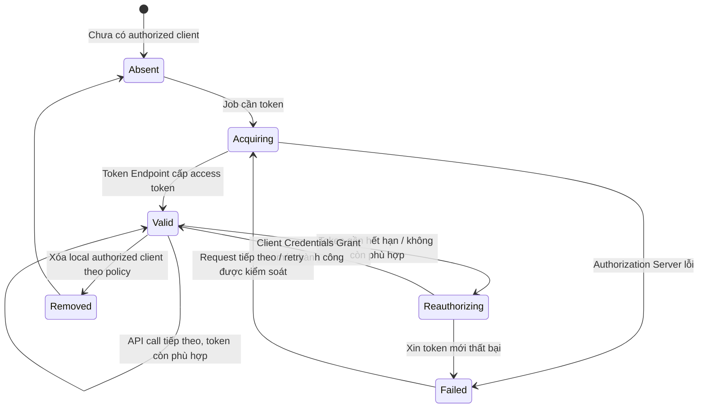
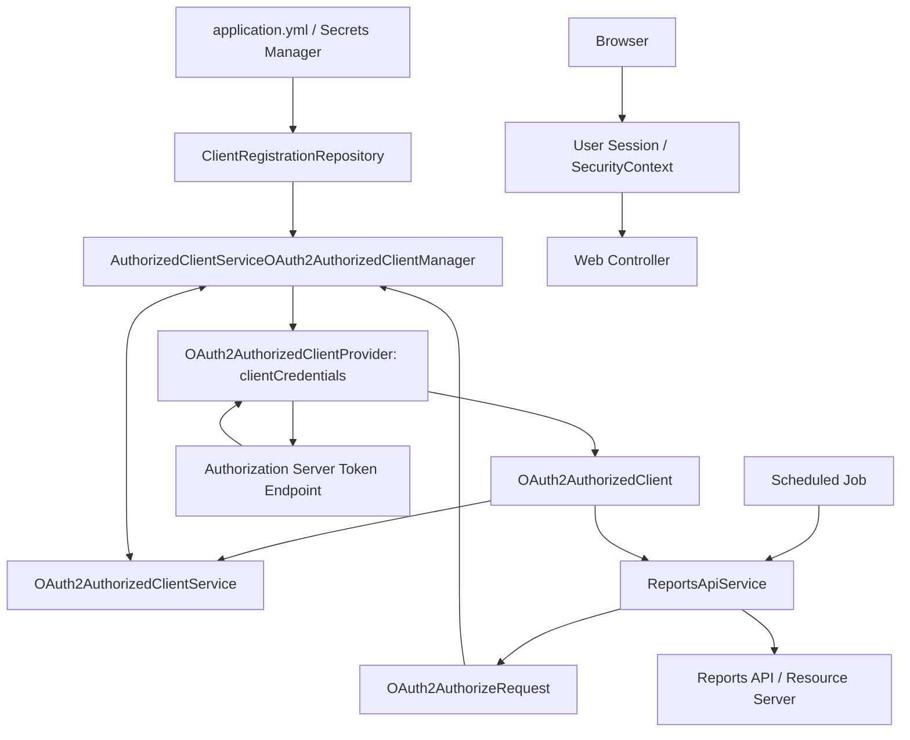
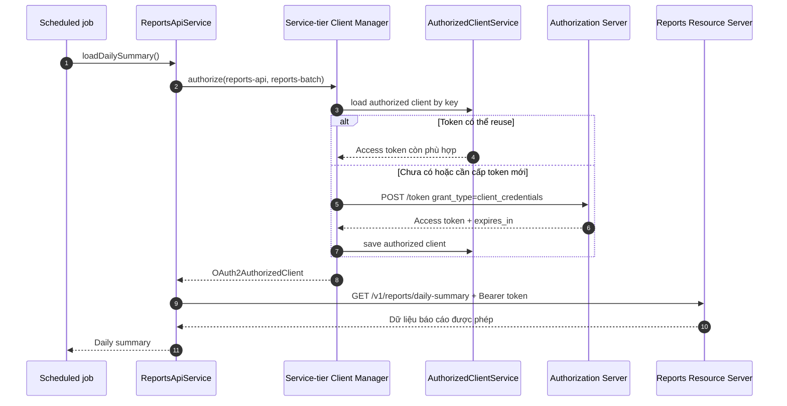
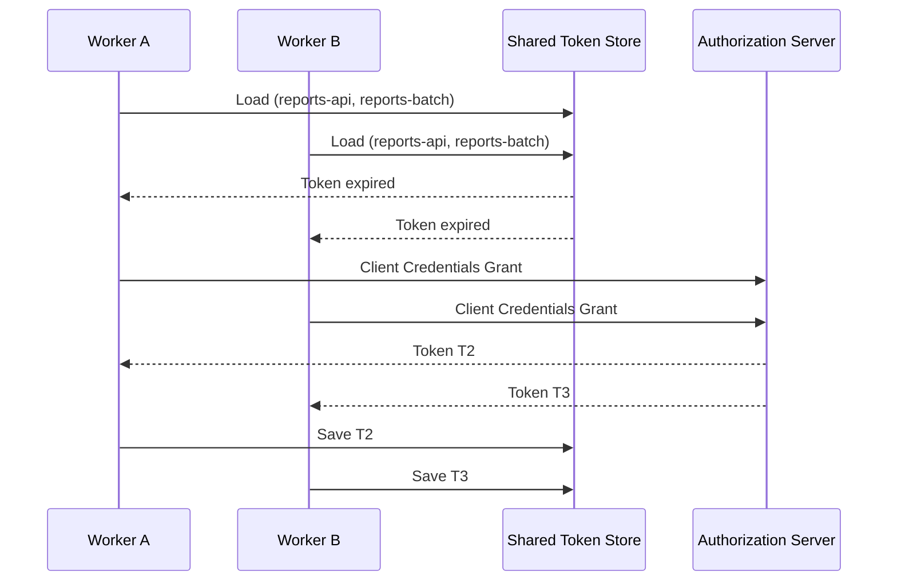
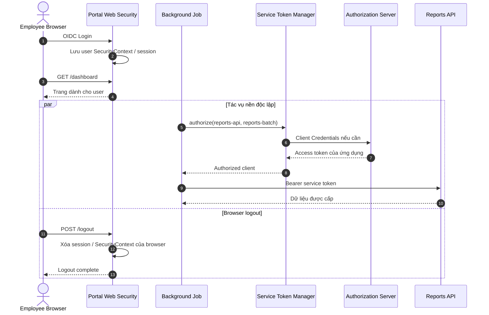

# 16.10. Tách vòng đời token của ứng dụng khỏi phiên người dùng

## 1. Bối cảnh: người dùng đăng xuất nhưng công việc backend vẫn phải chạy

Giả sử **Employee Portal** là một ứng dụng Spring Boot sử dụng **Spring Security OAuth 2.0 / OIDC Client**. Ứng dụng có hai nhu cầu hoàn toàn khác nhau:

1. Nhân viên đăng nhập bằng OpenID Connect (OIDC), xem báo cáo theo quyền cá nhân và đăng xuất sau khi làm việc.
2. Backend chạy một **scheduled job** mỗi 15 phút để đồng bộ dữ liệu từ **Reports API**, ngay cả ban đêm, khi không có ai đăng nhập.

Nếu lập trình viên lấy access token đã nhận khi nhân viên đăng nhập rồi dùng lại trong scheduled job, hệ thống sẽ gặp nhiều vấn đề:

- Nhân viên **logout** hoặc phiên hết hạn có thể khiến background job không còn token.
- Token đại diện cho **người dùng** bị sử dụng cho công việc **của ứng dụng**, sai ranh giới ủy quyền.
- Một nhân viên có quyền rộng có thể vô tình trở thành “tài khoản kỹ thuật” của toàn hệ thống.
- Job không biết dùng token của nhân viên nào khi có nhiều session cùng lúc.
- Việc nhân viên bị khóa tài khoản hoặc rời tổ chức làm gián đoạn công việc hệ thống.
- Audit của Resource Server ghi nhận hành động dưới danh tính user, trong khi thực tế hành động được lên lịch bởi backend.

Đối với tác vụ **machine-to-machine (M2M)** như vậy, OAuth 2.0 cung cấp **Client Credentials Grant**. Ứng dụng xác thực chính nó với Authorization Server để lấy access token đại diện cho **OAuth2 Client / service identity**, không cần authorization code, login browser, cookie hay HTTP session của người dùng.

> **Mục tiêu của bài:** Thiết kế và sử dụng token `client_credentials` có vòng đời **độc lập với phiên người dùng**, đồng thời giữ ranh giới phân quyền đúng: token ứng dụng không được tự động nâng quyền của người đang truy cập website.

Bài học thuộc chương **16. Client Credentials**, trong module **Spring Security OAuth 2.0 OIDC Client**. Ví dụ sử dụng **Spring Boot 3.x, Spring Security 6.x, Java 17+ và Servlet/MVC**, nhưng phần Client Credentials chạy ở service tier, không phụ thuộc HTTP Servlet request.

## 2. Hai mô hình token và hai vòng đời khác nhau

### 2.1. OIDC Login / Authorization Code đại diện cho user

Khi nhân viên đăng nhập:

```text
Browser
   |
   | GET /oauth2/authorization/company
   v
Employee Portal
   |
   | Redirect tới OP; user tương tác đăng nhập
   v
OpenID Provider
   |
   | Callback code + state
   v
Employee Portal
   |
   | Đổi code lấy token; xác minh ID Token
   v
Authentication / SecurityContext / HTTP Session
   |
   | Có thể lưu OAuth2AuthorizedClient của user
   v
User đăng nhập, gọi API theo quyền đã cấp
```

Những thành phần cần phân biệt:

- **`Authentication`** đại diện cho user đã xác thực trong Spring Security.
- **`SecurityContext`** chứa Authentication.
- **HTTP session / cookie** giúp browser duy trì trạng thái đăng nhập.
- **`OAuth2AuthorizedClient`** có thể chứa access token và refresh token được cấp cho client khi user hoàn thành authorization flow.
- **ID Token** cung cấp thông tin xác thực của user cho OIDC Client, không phải access token để gọi mọi API.

Khi người dùng logout, `SecurityContext`/session local thường bị xóa theo cấu hình. Tuy nhiên, **việc xóa session không tự đồng nghĩa mọi access/refresh token tại OP đã bị thu hồi**, và cũng không nên nhầm session với kho `OAuth2AuthorizedClient`.

### 2.2. Client Credentials đại diện cho ứng dụng

Với Client Credentials:

```text
Scheduled job / Queue consumer / Internal service
   |
   | Cần gọi Reports API
   v
OAuth2AuthorizedClientManager (service tier)
   |
   | Tìm token của registration "reports-api"
   | và principal kỹ thuật "reports-batch"
   |
   +-- Token còn phù hợp --> sử dụng
   |
   +-- Chưa có/hết hạn --> POST Token Endpoint
                              grant_type=client_credentials
                              client authentication
                                    |
                                    v
                            Authorization Server
                                    |
                                    v
                              Access token
                                    |
                                    v
                                Reports API
```

Flow này:

- Không có redirect tới trang đăng nhập.
- Không có `authorization_code`, callback `code` hoặc `state` của trình duyệt.
- Không cần ID Token để xác thực nhân viên.
- Không phụ thuộc `HttpServletRequest`, `HttpSession` hoặc `SecurityContextHolder` của browser.
- Thường chỉ có **access token**; Refresh Token **thông thường không được cấp** với Client Credentials theo OAuth 2.0.
- Access token mang quyền của **client** và phải được Resource Server kiểm tra đúng issuer, audience, expiry, scopes và chính sách liên quan.

### 2.3. Bảng so sánh

| Tiêu chí | User-bound Authorization Code / OIDC Login | App-bound Client Credentials |
| --- | --- | --- |
| Bên được đại diện | Người dùng đã xác thực/ủy quyền | Ứng dụng, service hoặc workload |
| Bắt đầu bằng | Browser authorization request | Backend gọi Token Endpoint |
| `grant_type` | `authorization_code` | `client_credentials` |
| Có user login? | Có | Không |
| Có browser callback? | Có | Không |
| Có ID Token? | Có trong OIDC Login | Không phải một phần của Client Credentials tiêu chuẩn |
| Có HTTP session? | Thường có trong ứng dụng Servlet web | Không cần |
| Principal cho token store | User/Authentication đã xác thực | Principal kỹ thuật ổn định |
| Access token dùng cho | API cho phép gọi nhân danh user | API cho phép gọi nhân danh client |
| Refresh token | Có thể có tùy provider/consent/policy | Thường **không** được cấp |
| Token mới sau khi hết hạn | Refresh hoặc authorization lại tùy flow | Thường thực hiện **Client Credentials Grant mới** |
| User logout ảnh hưởng trực tiếp? | Có thể ảnh hưởng khả năng dùng phiên/token theo policy | **Không**, nếu token M2M được quản lý đúng |
| Bảo mật cốt lõi | State, PKCE, nonce/ID Token validation và session | Client authentication, secret/key management, token scope/audience và workload authorization |

**Không được xem Client Credentials như một cách “đăng nhập hộ người dùng không cần mật khẩu”.** Grant này không truyền đạt sự đồng ý hoặc danh tính của một user cụ thể. Nếu cần thực hiện API thay mặt user, phải chọn kiến trúc delegated authorization hoặc token exchange được hỗ trợ và được thiết kế riêng.

## 3. “Tách vòng đời” thực chất là tách những gì?

Nói token ứng dụng độc lập với user session không chỉ là gọi một endpoint khác. Cần tách ít nhất **năm loại trạng thái**.

| Loại trạng thái | Thuộc về | Vòng đời điển hình |
| --- | --- | --- |
| **User HTTP session** | Browser/người dùng đang đăng nhập | Đăng nhập → hoạt động → hết hạn/logout |
| **User Authentication / SecurityContext** | Một phiên yêu cầu đã xác thực | Phục hồi theo session/request, mất khi logout |
| **User-bound OAuth2AuthorizedClient** | Registration + user principal | Được cấp sau consent/login, có thể refresh/revoke theo policy |
| **App-bound OAuth2AuthorizedClient** | Registration M2M + principal kỹ thuật | Cấp lần đầu khi backend cần; tái sử dụng; xin token mới khi hết hạn |
| **Client credentials** | Workload/application registration | Rotation theo vận hành, độc lập với từng access token và user session |

Vòng đời token ứng dụng thường là:



Đây là sơ đồ **vòng đời logic** của authorized client được yêu cầu qua manager. `OAuth2AuthorizedClientManager` không mặc định chạy một tiến trình tự động làm mới token theo lịch nền; thông thường nó kiểm tra và lấy token **khi ứng dụng gọi `authorize(...)`**.

### 3.1. Tách khỏi sự kiện logout

Giả sử người dùng A nhấn “Logout” lúc 17:00:

```text
17:00:00  User A logout
          -> local user SecurityContext/session bị xóa

17:00:05  Scheduled job chạy
          -> manager chọn reports-api + reports-batch
          -> token M2M còn hạn: dùng để gọi Reports API

17:15:00  Scheduled job chạy tiếp
          -> token M2M hết hạn: backend xin token mới
          -> không chuyển hướng browser, không phụ thuộc user A
```

Điều kiện tiên quyết là job **không dùng `Authentication` của user A**, không lưu token trong session user A và không dựa vào một user principal có thể biến mất.

### 3.2. Tách khỏi sự kiện restart hoặc scaling

- Nếu dùng **in-memory authorized client service**, cache token có thể mất khi process restart. Khi job tiếp tục, manager có thể xin token Client Credentials mới bằng client credentials còn hợp lệ. Điều đó thường chấp nhận được với M2M.
- Nếu dùng **JDBC/shared persistence**, token có thể được load lại giữa nhiều instance/restart, nhưng database tạo thêm yêu cầu bảo vệ credential, đồng bộ và vận hành.
- Dù lưu ở memory hay database, **user session không phải nguồn chân lý của token ứng dụng**.

**Tách vòng đời không đồng nghĩa token phải được lưu vĩnh viễn.** Access token nên sống ngắn theo chính sách OP, và app cần có cơ chế yêu cầu token mới khi cần.

## 4. Kiến trúc Spring Security dành cho token service-to-service

### 4.1. Các lớp cần biết

| Class / interface | Vai trò |
| --- | --- |
| `ClientRegistration` | Mô tả client ID/secret, grant type, scope và Token Endpoint |
| `ClientRegistrationRepository` | Tra cứu registration `reports-api` |
| `OAuth2AuthorizedClient` | Chứa access token được cấp, registration và principal name |
| `OAuth2AuthorizedClientService` | Lưu/đọc/xóa authorized client theo registration/principal |
| `InMemoryOAuth2AuthorizedClientService` | Implementation token store trong JVM |
| `JdbcOAuth2AuthorizedClientService` | Implementation token store qua JDBC, khi cần persistence |
| **`AuthorizedClientServiceOAuth2AuthorizedClientManager`** | Manager dành cho **service tier / background** |
| `OAuth2AuthorizedClientProvider` | Chọn và thực hiện grant phù hợp, ở đây `clientCredentials()` |
| `OAuth2AuthorizeRequest` | Yêu cầu manager authorize theo registration ID và principal |
| `OAuth2AccessTokenResponseClient` | Trao đổi token tại Token Endpoint khi provider cần |
| `RestClient` / `WebClient` | Gọi Resource Server bằng Bearer access token |

### 4.2. Sơ đồ bean và luồng dữ liệu



Nhánh browser/session **không cần nối** vào manager service tier của Client Credentials. Trong một sản phẩm có cả hai luồng, chúng có thể cùng tồn tại trong một Spring Boot process nhưng phải được quản lý bằng **registration, principal, manager và policy phù hợp**.

### 4.3. Vì sao không dùng `DefaultOAuth2AuthorizedClientManager` trong scheduler?

`DefaultOAuth2AuthorizedClientManager` dành cho ngữ cảnh Servlet HTTP request/response và sử dụng `OAuth2AuthorizedClientRepository`. Khi job chạy từ `@Scheduled` hoặc message listener không có `HttpServletRequest`, manager Servlet có thể thiếu request/response context cần thiết và hoạt động không phù hợp.

Với service tier, dùng:

```java
new AuthorizedClientServiceOAuth2AuthorizedClientManager(
        clientRegistrationRepository,
        oauth2AuthorizedClientService);
```

Manager này quản lý token qua **service**, không đòi mỗi lần gọi phải có cookie/session browser.

**Không tạo `MockHttpServletRequest` trong production để chạy scheduled job.** Giải pháp đúng là chọn một manager phù hợp với cách thực thi.

## 5. Cấu hình Spring Boot 3.x và Spring Security 6.x

### 5.1. Dependencies

Ví dụ Maven cho ứng dụng Servlet có web/API và background job:

```xml
<dependencies>
    <dependency>
        <groupId>org.springframework.boot</groupId>
        <artifactId>spring-boot-starter-web</artifactId>
    </dependency>
    <dependency>
        <groupId>org.springframework.boot</groupId>
        <artifactId>spring-boot-starter-security</artifactId>
    </dependency>
    <dependency>
        <groupId>org.springframework.boot</groupId>
        <artifactId>spring-boot-starter-oauth2-client</artifactId>
    </dependency>
</dependencies>
```

Tương đương Gradle Kotlin DSL:

```kotlin
dependencies {
    implementation("org.springframework.boot:spring-boot-starter-web")
    implementation("org.springframework.boot:spring-boot-starter-security")
    implementation("org.springframework.boot:spring-boot-starter-oauth2-client")
}
```

Một ứng dụng **chỉ là backend worker** không cần `spring-boot-starter-web` chỉ để chạy Client Credentials. Starter web trong ví dụ giúp trình bày hệ thống vừa có website vừa có scheduled job, không phải yêu cầu của grant.

### 5.2. Tách registration OIDC người dùng và Client Credentials

```yaml
spring:
  security:
    oauth2:
      client:
        registration:
          # Registration dành cho interactive OIDC login
          employee-login:
            provider: company-oidc
            client-id: ${OIDC_WEB_CLIENT_ID}
            client-secret: ${OIDC_WEB_CLIENT_SECRET}
            authorization-grant-type: authorization_code
            client-authentication-method: client_secret_basic
            redirect-uri: "{baseUrl}/login/oauth2/code/{registrationId}"
            scope:
              - openid
              - profile

          # Registration dành riêng cho workload backend
          reports-api:
            provider: reports-as
            client-id: ${REPORTS_SERVICE_CLIENT_ID}
            client-secret: ${REPORTS_SERVICE_CLIENT_SECRET}
            client-authentication-method: client_secret_basic
            authorization-grant-type: client_credentials
            scope:
              - reports.read

        provider:
          company-oidc:
            issuer-uri: https://id.example.com/realms/employees
          reports-as:
            token-uri: https://auth.example.com/oauth2/token

jobs:
  reports:
    delay-ms: 900000
```

Các URL/credentials chỉ là ví dụ, không phải endpoint có thể truy cập thực. Ở hệ thống thật:

- Authorization Server phải cấp client ID/secret hoặc một phương thức client authentication phù hợp riêng cho workload backend.
- Token URI phải dùng HTTPS và được cấu hình từ nguồn tin cậy.
- Registration `reports-api` phải có grant `client_credentials` được phép tại provider.
- Scope `reports.read` phải được provider và Resource Server công nhận.
- Client secret phải được inject từ secret manager hoặc biến môi trường của runtime, **không commit plaintext secret vào source**.

### 5.3. Vì sao nên có hai registration thay vì dùng chung?

| Thuộc tính | `employee-login` | `reports-api` |
| --- | --- | --- |
| Mục đích | Đăng nhập user | Backend job gọi Reports API |
| OAuth grant | `authorization_code` | `client_credentials` |
| Token chủ thể | User/delegated authorization | Service/client identity |
| Scope | `openid profile` và scope user cần thiết | `reports.read` |
| Có redirect URI | Có, callback OIDC | Không |
| Có browser | Có | Không |
| Principal lưu token | User đã authenticated | `reports-batch` |
| Sự kiện logout user | Xóa session user theo policy | Không được tự động hủy workload token |
| Chính sách secret | Client đăng nhập web | Credentials riêng cho workload |

Việc tách registration giúp dễ audit, giới hạn scopes, rotation secret và tránh tình trạng token M2M được dùng nhầm trong code giao diện người dùng.

**Cùng một Authorization Server có thể cấp cả hai loại token**, nhưng điều đó không có nghĩa nên dùng cùng client registration và principal cho cả hai mục đích.

## 6. Tạo Client Manager độc lập với HTTP session

### 6.1. Dùng `InMemoryOAuth2AuthorizedClientService` cho ví dụ local

```java
package com.example.portal.security;

import org.springframework.context.annotation.Bean;
import org.springframework.context.annotation.Configuration;
import org.springframework.security.oauth2.client.InMemoryOAuth2AuthorizedClientService;
import org.springframework.security.oauth2.client.OAuth2AuthorizedClientService;
import org.springframework.security.oauth2.client.registration.ClientRegistrationRepository;

@Configuration
public class ServiceTokenStorageConfig {

    @Bean("serviceTokenStore")
    OAuth2AuthorizedClientService serviceTokenStore(
            ClientRegistrationRepository registrations) {

        return new InMemoryOAuth2AuthorizedClientService(registrations);
    }
}
```

Đoạn code này tạo **một token store dành riêng cho workload M2M**. Nếu ứng dụng có cấu hình `oauth2Login`, nó có thể dùng service/repository khác cho token của user. Cần kiểm soát tên bean và việc inject bằng `@Qualifier` để tránh một bean tùy biến vô tình thay đổi hành vi OAuth2 Login của toàn ứng dụng.

Khi ứng dụng chỉ có M2M Client Credentials, một `OAuth2AuthorizedClientService` mặc định do Spring Boot/Spring Security cấu hình (nếu có trong phiên bản đang dùng) cũng có thể đủ. Ở đây tạo bean tường minh để người học nhìn rõ ranh giới token store.

### 6.2. Tạo `AuthorizedClientServiceOAuth2AuthorizedClientManager`

```java
package com.example.portal.security;

import java.time.Duration;

import org.springframework.beans.factory.annotation.Qualifier;
import org.springframework.context.annotation.Bean;
import org.springframework.context.annotation.Configuration;
import org.springframework.security.oauth2.client.AuthorizedClientServiceOAuth2AuthorizedClientManager;
import org.springframework.security.oauth2.client.OAuth2AuthorizedClientManager;
import org.springframework.security.oauth2.client.OAuth2AuthorizedClientProvider;
import org.springframework.security.oauth2.client.OAuth2AuthorizedClientProviderBuilder;
import org.springframework.security.oauth2.client.OAuth2AuthorizedClientService;
import org.springframework.security.oauth2.client.registration.ClientRegistrationRepository;

@Configuration
public class ServiceTokenManagerConfig {

    @Bean("serviceTokenManager")
    OAuth2AuthorizedClientManager serviceTokenManager(
            ClientRegistrationRepository registrations,
            @Qualifier("serviceTokenStore")
            OAuth2AuthorizedClientService serviceTokenStore) {

        OAuth2AuthorizedClientProvider provider =
                OAuth2AuthorizedClientProviderBuilder.builder()
                    .clientCredentials(configurer -> configurer
                            .clockSkew(Duration.ofSeconds(60)))
                    .build();

        var manager =
                new AuthorizedClientServiceOAuth2AuthorizedClientManager(
                        registrations,
                        serviceTokenStore);

        manager.setAuthorizedClientProvider(provider);

        return manager;
    }
}
```

Cách đọc cấu hình:

1. **`ClientRegistrationRepository`** tìm `reports-api`.
2. **`OAuth2AuthorizedClientService`** lưu/retrieve token theo cặp registration và principal.
3. **`clientCredentials()`** chỉ định provider xử lý grant `client_credentials`.
4. **`clockSkew(60s)`** là ví dụ chính sách chủ động coi token cần cấp lại trước lúc hết hạn để hạn chế race giữa lúc chuẩn bị gửi request và lúc API nhận được.
5. **`AuthorizedClientServiceOAuth2AuthorizedClientManager`** dùng được ở service/job không có HTTP session.
6. **`@Qualifier`** giúp không nhầm manager/token store của workload với các bean phục vụ interactive user login.

Không bắt buộc chỉ sử dụng `clientCredentials()` trong mọi ứng dụng. Nếu service-tier manager còn phục vụ các grant khác, cấu hình phải diễn tả rõ những grant được phép và ranh giới principal tương ứng.

### 6.3. Manager có tự chạy refresh theo lịch không?

**Không tự động theo nghĩa chạy một scheduler riêng.** Thông thường, mỗi lần ứng dụng gọi:

```java
OAuth2AuthorizedClient client = manager.authorize(authorizeRequest);
```

manager xem xét token đã lưu và provider có thể cấp mới nếu cần. Với Client Credentials, khi token cũ hết hạn/gần hết hạn, provider thường chạy **một Client Credentials Token Request mới** thay vì dùng refresh token.

Nếu muốn làm nóng cache token trước khi job chạy, có thể thiết kế prefetch/scheduling riêng, nhưng phải cân nhắc hiệu quả, số lần xin token, rate limiting và việc có thực sự cần token khi không có API call hay không.

## 7. Chọn registration ID và principal kỹ thuật ổn định

### 7.1. `OAuth2AuthorizeRequest` cho Client Credentials

```java
import org.springframework.security.oauth2.client.OAuth2AuthorizeRequest;
import org.springframework.security.oauth2.client.OAuth2AuthorizedClient;

OAuth2AuthorizeRequest request = OAuth2AuthorizeRequest
        .withClientRegistrationId("reports-api")
        .principal("reports-batch")
        .build();

OAuth2AuthorizedClient client =
        serviceTokenManager.authorize(request);
```

Ý nghĩa hai trường:

- **`reports-api`** là registration ID, **không phải client ID** bên Authorization Server.
- **`reports-batch`** là tên principal kỹ thuật ổn định, để authorized client store tra cứu token qua các lần gọi.
- `principal(String)` không tạo user browser session và không xác thực một người dùng.
- Mỗi lần gọi manager sẽ cố dùng/authorize client trong đúng ngữ cảnh này.

Với `OAuth2AuthorizedClientService`, khóa lưu trữ thường là:

```text
(clientRegistrationId, principalName)

(reports-api, reports-batch)
```

### 7.2. Tại sao không dùng principal của người đang đăng nhập?

Giả sử code dùng:

```java
OAuth2AuthorizeRequest.withClientRegistrationId("reports-api")
        .principal(authenticationOfCurrentUser)
        .build();
```

trong khi `reports-api` là Client Credentials.

Token được Authorization Server cấp vẫn đại diện cho **client identity**, không tự chuyển thành token user. Nhưng kho lưu trữ có thể tạo nhiều entry khác nhau theo mỗi user principal:

```text
(reports-api, employee-4821)
(reports-api, employee-9274)
(reports-api, employee-3928)
```

Hệ quả:

- Cùng một workload token có thể bị lưu lặp lại dưới nhiều khóa.
- Token lifecycle phụ thuộc ngữ cảnh user trong code ứng dụng một cách không cần thiết.
- Logout/session expiry của người dùng có thể khiến code không còn cách lấy principal như trước.
- Lượng token request và token store có thể tăng không cần thiết.
- Người đọc code có thể hiểu sai rằng token Client Credentials đại diện user.

Với một service identity thống nhất, nên dùng principal kỹ thuật ổn định. Nếu thật sự cần **token khác nhau theo tenant/workload**, phải thiết kế policy rõ ràng và bảo đảm Authorization Server cấp token phù hợp, không chỉ thay principal string.

### 7.3. Tại sao không sinh principal mới sau mỗi job run?

Không nên:

```java
// Phản mẫu: cùng workload nhưng mỗi lần lại dùng một principal mới.
String principal = "reports-batch-" + System.nanoTime();
```

Vì mỗi principal có thể tạo một authorized client key mới, khiến việc reuse token mất hiệu quả và store tăng dữ liệu. Dùng hằng số backend được quản trị:

```java
private static final String SERVICE_PRINCIPAL = "reports-batch";
```

Khi đổi tên principal hoặc registration ID, các row token cũ có thể không được tìm thấy bằng key mới. Đây là thay đổi về **storage key**, cần chính sách migration/cleanup nếu dùng persistence.

## 8. Một service lấy token không phụ thuộc browser

### 8.1. `ReportsApiService` có thể được gọi từ job hoặc workflow nội bộ

```java
package com.example.portal.reports;

import org.springframework.beans.factory.annotation.Qualifier;
import org.springframework.security.oauth2.client.OAuth2AuthorizeRequest;
import org.springframework.security.oauth2.client.OAuth2AuthorizedClient;
import org.springframework.security.oauth2.client.OAuth2AuthorizedClientManager;
import org.springframework.stereotype.Service;

@Service
public class ReportsAccessTokenService {

    private static final String REGISTRATION_ID = "reports-api";
    private static final String SERVICE_PRINCIPAL = "reports-batch";

    private final OAuth2AuthorizedClientManager manager;

    public ReportsAccessTokenService(
            @Qualifier("serviceTokenManager")
            OAuth2AuthorizedClientManager manager) {

        this.manager = manager;
    }

    public String getAccessTokenValue() {
        OAuth2AuthorizeRequest request = OAuth2AuthorizeRequest
                .withClientRegistrationId(REGISTRATION_ID)
                .principal(SERVICE_PRINCIPAL)
                .build();

        OAuth2AuthorizedClient client = manager.authorize(request);

        if (client == null) {
            throw new IllegalStateException(
                    "Cannot authorize OAuth2 Client Credentials");
        }

        return client.getAccessToken().getTokenValue();
    }
}
```

Đây là class hoàn chỉnh minh họa cách lấy token trong service tier. Trong ứng dụng thực tế, có thể trả `OAuth2AuthorizedClient` hoặc tích hợp manager trực tiếp với HTTP client thay vì để raw token String đi qua nhiều lớp không cần thiết. Phương thức trả String ở đây giúp học cơ chế; **không log, persist hoặc trả giá trị này về browser**.

### 8.2. HTTP client dùng token gọi Resource Server

`RestClient` có trong Spring Framework 6.1+ (tương thích với Spring Boot 3.2+), và có thể được dùng trong Servlet/service-tier mà không cần HTTP session:

```java
package com.example.portal.reports;

import org.springframework.context.annotation.Bean;
import org.springframework.context.annotation.Configuration;
import org.springframework.web.client.RestClient;

@Configuration
public class ReportsHttpClientConfig {

    @Bean
    RestClient reportsRestClient(RestClient.Builder builder) {
        return builder
                .baseUrl("https://reports-api.example.com")
                .build();
    }
}
```

Một service gọi API:

```java
package com.example.portal.reports;

import org.springframework.beans.factory.annotation.Qualifier;
import org.springframework.stereotype.Service;
import org.springframework.web.client.RestClient;

@Service
public class ReportsApiService {

    private final RestClient http;
    private final ReportsAccessTokenService tokens;

    public ReportsApiService(
            @Qualifier("reportsRestClient") RestClient http,
            ReportsAccessTokenService tokens) {

        this.http = http;
        this.tokens = tokens;
    }

    public String loadDailySummary() {
        String accessToken = tokens.getAccessTokenValue();

        return http.get()
                .uri("/v1/reports/daily-summary")
                .headers(headers -> headers.setBearerAuth(accessToken))
                .retrieve()
                .body(String.class);
    }
}
```

Điểm cần lưu ý:

- `reportsRestClient` chỉ trỏ đến một **API host do ứng dụng quản trị**.
- `getAccessTokenValue()` dùng manager service-tier, không cần `Authentication` hiện tại.
- Bearer token chỉ được gắn vào outbound request đi tới Resource Server phù hợp.
- Không nhận arbitrary URL từ browser để gọi với token service: làm vậy có thể khiến token bị gửi đến host do kẻ tấn công kiểm soát.
- Ví dụ bỏ qua phần parse DTO và HTTP error handling để tập trung vào vòng đời token.

**Không thiết kế một REST endpoint trả về access token ứng dụng cho browser.** Backend nên dùng token để thực hiện một thao tác được phép và trả **dữ liệu nghiệp vụ phù hợp** cho user, sau khi kiểm tra quyền user riêng.

### 8.3. Luồng không có user vẫn hoạt động



Không có browser/HTTP session trong sơ đồ. Việc một user khác vừa logout **không xuất hiện ở bất kỳ bước nào** và không phải điều kiện để manager M2M hoạt động.

## 9. Tạo scheduled job độc lập với `SecurityContext` của user

### 9.1. Kích hoạt scheduling

```java
package com.example.portal;

import org.springframework.boot.SpringApplication;
import org.springframework.boot.autoconfigure.SpringBootApplication;
import org.springframework.scheduling.annotation.EnableScheduling;

@SpringBootApplication
@EnableScheduling
public class EmployeePortalApplication {

    public static void main(String[] args) {
        SpringApplication.run(EmployeePortalApplication.class, args);
    }
}
```

### 9.2. Chạy job gọi API bằng service token

```java
package com.example.portal.reports;

import org.slf4j.Logger;
import org.slf4j.LoggerFactory;
import org.springframework.scheduling.annotation.Scheduled;
import org.springframework.stereotype.Component;

@Component
public class ReportsSyncJob {

    private static final Logger log =
            LoggerFactory.getLogger(ReportsSyncJob.class);

    private final ReportsApiService reports;

    public ReportsSyncJob(ReportsApiService reports) {
        this.reports = reports;
    }

    @Scheduled(fixedDelayString = "${jobs.reports.delay-ms:900000}")
    public void synchronize() {
        try {
            String summary = reports.loadDailySummary();

            // Minh họa: xử lý dữ liệu đã nhận từ Reports API.
            // Không log access token hoặc response nhạy cảm.
            processSummary(summary);

            log.info("Reports sync completed");
        } catch (Exception ex) {
            // Logging an toàn chỉ dùng loại exception; phân loại
            // chi tiết nên thực hiện ở exception mapping/metrics.
            log.warn("Reports sync failed; exceptionType={}",
                    ex.getClass().getSimpleName());
        }
    }

    private void processSummary(String summary) {
        // Thay bằng nghiệp vụ đồng bộ có idempotency phù hợp.
    }
}
```

Ví dụ minh họa cách một job dùng token M2M độc lập với login. Trong sản phẩm thực, **không nên nuốt mọi exception rồi coi job thành công**. Cần phân loại lỗi, metric/alert, retry budget và cách ghi nhận trạng thái thất bại phù hợp với scheduler/orchestrator. Đoạn code chỉ cho thấy không cần lấy `SecurityContextHolder.getContext().getAuthentication()` để cấp token.

### 9.3. Vì sao không lấy `SecurityContextHolder` trong job?

Một scheduled thread thường không có HTTP request của người dùng. `SecurityContextHolder` mặc định có thể không chứa Authentication hoặc chứa ngữ cảnh được gán không đúng nếu code tự truyền state giữa các thread.

Phản mẫu:

```java
// Sai hướng cho một Client Credentials background job:
Authentication user =
        SecurityContextHolder.getContext().getAuthentication();

OAuth2AuthorizeRequest request = OAuth2AuthorizeRequest
        .withClientRegistrationId("reports-api")
        .principal(user)
        .build();
```

Nếu `user` là null, code có thể thất bại. Ngay cả khi có user Authentication, việc dùng user identity để lưu token M2M gây nhầm vòng đời. Với client credentials nên dùng **principal kỹ thuật ổn định**.

### 9.4. Job có thể chạy khi không ai truy cập website

Hành vi mong đợi:

```text
00:00  Không có user nào đăng nhập.
00:15  ReportsSyncJob chạy, lấy service token khi cần, gọi API.
00:30  Job chạy, có thể reuse token còn phù hợp.
00:45  User A đăng nhập website, có session OIDC riêng.
01:00  User A logout, session của A kết thúc.
01:15  Job vẫn chạy, token M2M được quản lý độc lập.
01:30  Token M2M gần hết hạn, manager xin token mới.
```

Đây là ví dụ timeline khái niệm, không phải output đã chạy. Tách vòng đời đúng cho phép backend hoạt động như một **workload có identity riêng**, thay vì “mượn phiên user” để truy cập API.

## 10. Tách token không có nghĩa bỏ qua quyền của người dùng

### 10.1. Service token có thể mạnh hơn quyền của một user

Giả sử Reports API chấp nhận access token của service `reports-api` với scope `reports.read`. Trong Employee Portal, người dùng A chỉ có quyền xem báo cáo của phòng ban mình, còn người dùng B không có quyền xem báo cáo.

Nếu controller viết:

```java
@GetMapping("/api/reports/all")
public String allReports() {
    // Bất cứ ai vào được controller cũng kích hoạt quyền reports-api.
    return reportsApiService.loadDailySummary();
}
```

mà không bảo vệ endpoint, backend có thể dùng service token có quyền rộng để truy cập dữ liệu **thay cho một caller không được phép**. Đó là nguy cơ **confused deputy**: ứng dụng có đặc quyền M2M bị người dùng lợi dụng để thực hiện thao tác vượt quyền.

**Tách vòng đời token khỏi session không có nghĩa tách các API của website khỏi user authorization.**

### 10.2. Bảo vệ controller trước khi gọi API bằng service token

Ví dụ một `SecurityFilterChain` riêng cho website có OIDC login:

```java
package com.example.portal.security;

import org.springframework.context.annotation.Bean;
import org.springframework.context.annotation.Configuration;
import org.springframework.security.config.Customizer;
import org.springframework.security.config.annotation.web.builders.HttpSecurity;
import org.springframework.security.web.SecurityFilterChain;

@Configuration
public class WebUserSecurityConfig {

    @Bean
    SecurityFilterChain webSecurityFilterChain(HttpSecurity http)
            throws Exception {

        http.authorizeHttpRequests(authorize -> authorize
                .requestMatchers("/", "/css/**", "/error").permitAll()
                .requestMatchers("/api/reports/**")
                    .hasAuthority("ROLE_REPORT_VIEWER")
                .anyRequest().authenticated()
            )
            .oauth2Login(Customizer.withDefaults());

        return http.build();
    }
}
```

Ở đây:

- User phải được xác thực bằng OAuth2/OIDC Login để gọi API web.
- Request đến `/api/reports/**` phải có authority `ROLE_REPORT_VIEWER` theo chính sách ứng dụng.
- Sau khi user được phép, backend **mới dùng token Client Credentials của chính backend** để thực hiện tác vụ tương ứng trên Reports API.
- `ROLE_REPORT_VIEWER` là authority **minh họa**. Ứng dụng thật phải ánh xạ role/permission từ nguồn đáng tin cậy (OIDC claim đã xác minh, database quyền nội bộ...) và có thể cần kiểm tra quyền ở cấp bản ghi/dữ liệu.
- Client Credentials token của backend **không tự cung cấp ROLE_REPORT_VIEWER cho người dùng**.

Nếu `/api/reports/**` là API được gọi bằng Bearer access token thay vì browser session, cần một **Resource Server security chain** riêng, với rules JWT/opaque token phù hợp. Không tắt CSRF cho toàn bộ website chỉ vì backend bên trong cũng gọi Reports API.

### 10.3. Kiểm tra quyền trên dữ liệu trả về

Ngay cả khi controller có `ROLE_REPORT_VIEWER`, Reports API có thể trả dữ liệu rộng hơn phạm vi người dùng được phép xem. Khi đó, cần:

- Giới hạn query/filter theo tenant/phòng ban đã được xác minh.
- Thực hiện kiểm tra quyền cấp bản ghi nếu có dữ liệu đa người dùng.
- Tránh nhận `tenantId`/`accountId` từ query chưa được ủy quyền rồi dùng service token để truy vấn tùy ý.
- Không đưa raw access token cho user nhằm cho họ “tự gọi API”.
- Audit cả danh tính **caller của Employee Portal** và **workload action** khi nghiệp vụ yêu cầu.

**Service token đại diện backend trước Reports API; user authorization thuộc Employee Portal**. Hai quyết định có thể và thường phải được kiểm tra độc lập.

## 11. Xử lý token hết hạn mà không liên quan session expiry

### 11.1. Token được cấp theo thời hạn của Authorization Server

Phản hồi Token Endpoint cho Client Credentials có thể như sau:

```http
HTTP/1.1 200 OK
Content-Type: application/json
Cache-Control: no-store
Pragma: no-cache

{
  "access_token": "<opaque-or-jwt-access-token>",
  "token_type": "Bearer",
  "expires_in": 3600,
  "scope": "reports.read"
}
```

Ví dụ không có `refresh_token`. Access token có thể là JWT hoặc opaque; OAuth2 Client **không được mặc định cần parse JWT** để biết thời điểm hết hạn, vì token response thường có `expires_in` và Spring lưu thời điểm `expiresAt` trong `OAuth2AccessToken`.

Token có thể bị revoke/khóa bởi Authorization Server trước `expiresAt`; hết hạn theo thời gian không phải yếu tố duy nhất quyết định token được API chấp nhận.

### 11.2. Trình tự cấp lại token

```text
T0    Job gọi authorize(reports-api, reports-batch)
      -> store chưa có token
      -> Token Endpoint cấp token T1, expires_in=3600

T1    Job tiếp tục gọi authorize(...)
      -> T1 còn hạn và đạt chính sách clock skew
      -> reuse T1

T2    Token T1 gần hết hạn / hết hạn theo provider policy
      -> authorize(...) kích hoạt Client Credentials Grant mới
      -> nhận T2
      -> lưu/update authorized client

T3    User login/logout giữa các lần trên
      -> không ảnh hưởng khóa (reports-api, reports-batch)
      -> không thay đổi thời hạn T1/T2
```

Với Spring Security, provider Client Credentials xác định token có cần được cấp lại theo `expiresAt` và clock skew thích hợp. **Đừng viết một scheduler refresh định kỳ khác chỉ vì sợ token hết hạn**, nếu manager đã được gọi trước mỗi request và cơ chế hiện tại đáp ứng nhu cầu.

### 11.3. Vì sao thường không cần refresh token?

Theo OAuth 2.0, đối với **Client Credentials Grant**, Authorization Server **SHOULD NOT** cấp refresh token. Vì client vẫn có thể xác thực bằng credential của nó tại Token Endpoint, client thường xin access token mới bằng một `grant_type=client_credentials` khác.

Sơ đồ:

```text
Client Credentials T1 hết hạn
       |
       v
POST /token
  grant_type=client_credentials
  client authentication bằng credential đã đăng ký
       |
       v
Access token T2 mới
```

**Không cấu hình `refreshToken()` rồi giả định nó là điều kiện bắt buộc cho M2M**. Một số extension/provider có hành vi riêng, nhưng bài học này thiết kế theo Client Credentials tiêu chuẩn.

### 11.4. Clock skew và thời điểm API kiểm tra token

Giả sử token hết hạn ở 14:00:00. Ứng dụng chuẩn bị request lúc 13:59:59 nhưng mạng và API xử lý mất vài giây; API có thể coi token hết hạn khi nó nhận được.

Do đó provider có cơ chế `clockSkew` để chủ động cấp token mới trước expiry. Giá trị phải phù hợp:

- Độ trễ mạng và p95/p99 của API.
- Clock sync giữa hệ thống.
- Thời hạn access token do provider cấp.
- Nguy cơ xin token mới quá thường xuyên.

Không đặt clock skew lớn hơn gần toàn bộ token lifetime khiến mọi request đều cấp token mới; cũng không sử dụng token sát hạn quá mức khi Resource Server có chính sách nghiêm ngặt.

## 12. Khi Resource Server trả 401 hoặc 403

### 12.1. Phân biệt thất bại lấy token và thất bại dùng token

| Giai đoạn | Ví dụ lỗi | Nơi cần kiểm tra |
| --- | --- | --- |
| Token Endpoint | `invalid_client` | Client ID/secret/auth method, app registration |
| Token Endpoint | `unauthorized_client` | Grant `client_credentials` có được cho phép? |
| Token Endpoint | `invalid_scope` | Scope `reports.read` có được phép? |
| Token Endpoint | Timeout/429/5xx | Network, limit, Authorization Server |
| Reports API | `401 invalid_token` | Access token sai, hết hạn/revoked, audience/issuer không phù hợp |
| Reports API | `403 insufficient_scope` | Token hợp lệ nhưng không có quyền/scope |
| Employee Portal | 403 vì role user thiếu | Web authorization của **user** trước khi gọi API |

**`401` từ Reports API không có nghĩa phải đưa người dùng tới OIDC login**. Đây có thể là token M2M không còn hợp lệ; nên xử lý trong backend theo chính sách token của service.

### 12.2. Tại sao không retry vô hạn với cùng token?

Nếu Reports API trả `401 invalid_token`:

1. Xác nhận token đã gửi đúng audience/issuer/Resource Server.
2. Xác định có do token hết hạn hoặc bị revoke không.
3. Nếu chính sách cho phép, **invalidates/removes** authorized client local theo đúng khóa rồi xin token mới theo Client Credentials.
4. Giới hạn số lần retry. Không lặp vô hạn nếu client secret sai hoặc provider không cấp token.
5. Nếu request nghiệp vụ thay đổi dữ liệu, phải xem xét **idempotency** trước khi gửi lại request.

Với một request GET chỉ đọc dữ liệu, retry giới hạn sau khi có token mới có thể phù hợp. Với POST tạo tài nguyên/thanh toán, response bị mất hoặc token bị từ chối có thể tạo rủi ro thực hiện hai lần. Không dựa vào Client Manager như một bảo đảm exactly-once.

### 12.3. Xóa token local có khác revoke token ở OP không?

Có:

```java
serviceTokenStore.removeAuthorizedClient(
        "reports-api",
        "reports-batch");
```

Lệnh trên xóa bản ghi authorized client **tại ứng dụng**, không thu hồi token đã cấp tại Authorization Server. Khi cần revoke, dùng API/endpoint revocation được provider hỗ trợ theo chính sách.

Xóa local token khi 401 chỉ là một bước của **recovery strategy**, không phải biện pháp bảo mật thay cho revoke/credential rotation. Nếu API trả 403 vì scope thiếu, xóa token rồi xin cùng scope lại có thể vẫn nhận 403.

### 12.4. Đừng bắt user đăng nhập lại khi M2M token lỗi

Nếu API backend trả `invalid_client` cho `reports-api`, người dùng đăng nhập lại OIDC nhiều lần không làm thay đổi client secret của workload. Tình huống này cần:

- Kiểm tra service credentials và trạng thái app registration.
- Điều tra Token Endpoint và network.
- Hiển thị thông báo tác vụ tạm không khả dụng nếu người dùng đang chờ.
- Ghi lỗi vận hành/alert cho team chịu trách nhiệm.

Thất bại M2M **không tự suy ra user session hết hạn hoặc người dùng sai mật khẩu**.

## 13. Dùng in-memory hay JDBC cho token của ứng dụng?

### 13.1. In-memory thường là lựa chọn hợp lý cho M2M đơn giản

Với Client Credentials, ứng dụng có thể xin token mới khi cần. Một `InMemoryOAuth2AuthorizedClientService` giúp:

- Tránh phụ thuộc database chỉ để cache một token.
- Tránh lưu access token ở SQL không cần thiết.
- Tái sử dụng token giữa những request **trong cùng JVM instance**.
- Đơn giản hóa quản lý ở development hoặc workload ít instance.

Nhược điểm:

- Mỗi instance giữ cache riêng.
- Restart làm mất token cache, có thể cần xin token mới.
- Scale-out có thể tạo nhiều lần xin token ban đầu.
- Không có khả năng quản lý chung toàn cluster qua service này.

**Mất cache token khi restart không phải mất user session**, và với M2M thường là một trade-off chấp nhận được nếu Authorization Server chịu được tải.

### 13.2. JDBC/shared store khi nào có ích?

Có thể cân nhắc `JdbcOAuth2AuthorizedClientService` nếu:

- Token response có chi phí cao hoặc OP giới hạn cấp token chặt.
- Nhiều instance cần dùng chung authorized client theo một khóa.
- Có yêu cầu lưu trữ/khôi phục trạng thái token qua restart.
- Tổ chức đã có vận hành database, backup, encryption và incident response phù hợp.
- Các luồng OAuth khác cũng dùng `OAuth2AuthorizedClientService` và cần persistence có kiểm soát.

Ví dụ wiring ý tưởng:

```java
@Bean("serviceTokenStore")
OAuth2AuthorizedClientService serviceTokenStore(
        JdbcOperations jdbcOperations,
        ClientRegistrationRepository registrations) {

    return new JdbcOAuth2AuthorizedClientService(
            jdbcOperations,
            registrations);
}
```

Các import tương ứng: `JdbcOperations` của Spring JDBC và `JdbcOAuth2AuthorizedClientService` của Spring Security OAuth2 Client. Cần dependency Spring JDBC, DataSource và **schema `oauth2_authorized_client` đúng phiên bản/dialect**. Đây là lựa chọn **thay thế** bean InMemory ở mục 6.1, không phải tạo hai bean cùng tên.

### 13.3. JDBC vẫn không biến token thành user session

Dù token lưu ở DB chung:

- Browser login state vẫn phụ thuộc `SecurityContext`/session của website.
- M2M token dùng principal kỹ thuật ổn định.
- Không có yêu cầu browser đang logged-in để tải token.
- Job có thể chạy khi mọi browser session đều hết hạn.

**Token persistence và session persistence là hai vấn đề riêng**. Đừng bật Spring Session chỉ để “giữ Client Credentials token”; cũng đừng coi JDBC authorized client store thay thế hoàn toàn Spring Session nếu website còn cần session chia sẻ.

### 13.4. Refresh/cấp token đồng thời giữa các instance

Giả sử ba node cùng chạy job:



Với Client Credentials, việc cấp hai access token mới có thể vẫn hợp lệ ở OP, nhưng nó làm tăng request/token issuance và đôi khi gây lỗi nếu provider giới hạn token hoặc áp chính sách chỉ một token active.

**Shared storage không tự biến `authorize(...)` thành một thao tác cluster-wide single flight.** Nếu workload quy mô lớn, cân nhắc:

- Distributed lock theo `(registrationId, principalName)`.
- Double-check token sau khi có lock.
- Giới hạn số job có thể chạy đồng thời (leader election/scheduler coordination).
- Shared cache có TTL phù hợp.
- Rate-limit/backoff/jitter khi retry.
- Metrics theo grant/registration và số token request.

Không cố tạo một khóa distributed chung cho tất cả service nếu có nhiều registration độc lập; khóa nên phản ánh đúng phạm vi token cần bảo vệ.

## 14. Quản lý client secret và workload identity

### 14.1. Access token và client credentials có vòng đời khác nhau

Đối với M2M, ít nhất hai secret/credential cần quản lý:

| Credential | Vai trò | Vòng đời |
| --- | --- | --- |
| **Client secret / private key / mTLS credential** | Xác thực **OAuth2 Client** khi gọi Token Endpoint | Rotation theo chính sách triển khai, có thể dùng dài hơn access token |
| **Access token** | Gọi Resource Server theo scopes/audience và expiry | Thường ngắn hạn, được xin mới khi cần |

Khi access token hết hạn, backend có thể dùng client credentials còn hợp lệ để xin token mới. Khi **client secret đã bị thu hồi** hoặc bị cấu hình sai, khả năng xin token mới mất đi; một access token cũ có thể vẫn còn được API chấp nhận đến khi hết hạn hoặc bị revoke theo policy.

### 14.2. Rotation secret không đồng nghĩa user logout

Ví dụ vận hành:

```text
09:00  reports-api đang sử dụng client secret version S1.
09:30  Operator thêm secret S2 tại Authorization Server.
09:45  Deployment cập nhật runtime secret S2.
10:00  Token T1 hết hạn; manager xin token T2 bằng S2.
10:30  Operator vô hiệu hóa S1 sau khi xác nhận rollout.
```

Đây là kịch bản lý tưởng hóa; khả năng song song nhiều secrets phụ thuộc provider. Một số OP buộc rotation ngắt quãng hoặc dùng cơ chế private key với `kid` khác nhau.

Yêu cầu:

- Tách secret của `reports-api` với secret dùng cho OIDC web login.
- Dùng secret manager, quyền đọc tối thiểu và rotation theo chính sách.
- Không đưa secret vào log, URL, repo hoặc HTTP response.
- Có runbook khi Token Endpoint trả `invalid_client` sau rotation.
- Đảm bảo các node đã nhận cấu hình mới trước khi vô hiệu hóa secret cũ nếu provider hỗ trợ overlapping credentials.
- Nếu cần dùng `private_key_jwt` hoặc mTLS thay secret, cấu hình client authentication phù hợp với OP và Spring Security version.

### 14.3. Dùng workload identity thay shared static secret khi phù hợp

Trong một số môi trường hạ tầng, Authorization Server và client hỗ trợ:

- `private_key_jwt` với private key được bảo vệ bằng KMS/HSM.
- Mutual TLS client authentication.
- Workload identity federation hoặc cơ chế liên kết danh tính workload theo profile được hỗ trợ.

Những lựa chọn này có thể giảm phụ thuộc vào static client secret chia sẻ, nhưng **không thay đổi bản chất** Client Credentials: backend vẫn xin token theo **client identity**, không dùng user session.

Không tự đặt client authentication method thành `private_key_jwt` trong YAML nếu chưa có cơ chế tạo assertion/ký và đăng ký khóa tương ứng tại Authorization Server.

## 15. Token scope, audience và việc gửi token đúng Resource Server

### 15.1. Một registration cho một mục đích rõ ràng

Nếu Reports API chỉ cần `reports.read`, không xin `reports.admin` hoặc `write.all` theo nguyên tắc ít quyền nhất.

```yaml
spring:
  security:
    oauth2:
      client:
        registration:
          reports-api:
            authorization-grant-type: client_credentials
            scope:
              - reports.read
```

Với một số Authorization Server, client có thể cần tham số audience/resource ở Token Endpoint để xin token dành cho API đích. Đó là **provider-/profile-specific configuration** hoặc theo Resource Indicators, không phải trường mà mọi OP đều mặc định hỗ trợ.

`OAuth2AuthorizedClientManager` điều phối grant; **Resource Server** phải xác minh access token theo issuer, audience, expiry và scope/authority đúng với API. Một token có chữ ký hợp lệ nhưng dành cho API khác không nên được chấp nhận.

### 15.2. Không tái sử dụng cùng token cho mọi API

| API đích | Registration gợi ý | Scope |
| --- | --- | --- |
| Reports API | `reports-api` | `reports.read` |
| Billing API | `billing-api` | `billing.invoice.read` |
| Notifications API | `notify-api` | `notifications.send` |

Các tên/scope này là ví dụ thiết kế, cần phù hợp với Authorization Server thật. Nếu client cần gửi token cho API khác với scope/audience khác, cân nhắc **registration riêng** hoặc cơ chế tách token theo policy rõ ràng.

Cặp khóa `(registrationId, principalName)` trong service **không tự chứa audience/scope động** như một phần khóa. Nếu cùng registration/principal nhưng yêu cầu access token cho nhiều audience khác nhau và code lưu chồng một authorized client, có thể xảy ra **token mix-up**. Cần thiết kế token store/registration/provider phù hợp với từng tài nguyên, không chỉ thêm `scope` tùy ý vào attributes rồi giả định manager sẽ giữ nhiều token riêng.

### 15.3. Outbound URL phải được kiểm soát

Backend dùng Bearer token ứng dụng chỉ nên gọi endpoint đã được cho phép. Các rủi ro:

- Người dùng nhập một URL bất kỳ để backend gọi, token bị gửi tới server của kẻ tấn công.
- HTTP client tự follow redirect tới host không nằm trong allowlist và làm lộ header/token nếu behavior không được kiểm soát.
- Log proxy/HTTP client lưu raw `Authorization: Bearer ...`.
- Một configuration sai trỏ `reports-api` tới host staging hoặc environment khác.
- TLS verification bị tắt vì gặp lỗi certificate.

Để giảm rủi ro, sử dụng base URL cố định/allowlist, HTTPS, outbound proxy/egress policy phù hợp và hạn chế tự động forward credentials qua redirect không đáng tin cậy.

## 16. OAuth2 Client Credentials và giao diện người dùng: ranh giới kết hợp

### 16.1. Website và worker có thể cùng một codebase nhưng khác policy

Một ứng dụng Spring Boot có thể vừa có:

- `SecurityFilterChain` dành cho browser, xử lý OIDC Login, Authentication, CSRF và session.
- `AuthorizedClientServiceOAuth2AuthorizedClientManager` cho backend M2M jobs.
- API controller gọi service M2M **chỉ sau khi** kiểm tra user/tenant permission.
- Scheduled jobs gọi service M2M mà **không cần browser**.

Tách logic thành các service như:

```text
WebSecurityConfig
  -> quản lý user authentication/authorization

ServiceTokenManagerConfig
  -> quản lý reports-api client_credentials

ReportsAccessTokenService
  -> authorize theo service registration + technical principal

ReportsApiService
  -> gắn M2M Bearer token vào outbound HTTP call

ReportsSyncJob
  -> chạy định kỳ không cần user session

ReportsController
  -> bảo vệ quyền user trước khi gọi ReportsApiService
```

Đừng viết một singleton `lastLoggedInUserAccessToken` rồi để cả UI và worker dùng chung. Nó vừa dễ lộ token, vừa tạo phụ thuộc vào thời điểm login và sai ranh giới danh tính.

### 16.2. Ví dụ hai luồng độc lập trong cùng thời điểm



Hai luồng có thể chạy song song. **Browser logout không gửi một sự kiện mặc định để revoke token ứng dụng**, và **job lấy token M2M không tạo SecurityContext của browser**.

### 16.3. Không dùng token M2M làm credential để đăng nhập user

Một REST controller không nên viết:

```java
// Phản mẫu: KHÔNG dùng service token để chứng minh user identity.
String serviceToken = tokenService.getAccessTokenValue();
Authentication userAuthentication =
        createUserAuthenticationFromServiceToken(serviceToken);
```

Token Client Credentials xác thực **client/workload** ở API, không chứng minh một user cụ thể đã login. Nếu ứng dụng muốn xác thực user, sử dụng OIDC Login hoặc cơ chế user authentication phù hợp; nếu muốn API nhận machine identity, cấu hình Resource Server và authorization rules cho máy.

### 16.4. Chạy thay mặt người dùng là use case khác

Giả sử một nhân viên bấm “Xuất dữ liệu cá nhân”, nhưng backend cần chạy công việc lâu trong hàng đợi thay mặt đúng nhân viên đó. Có ít nhất hai thiết kế khác nhau:

1. **Backend hành động bằng quyền hệ thống**, đã xác minh user được phép yêu cầu tác vụ, ghi lại user và giới hạn dữ liệu cần xuất theo quyền user. M2M token chỉ là credential service; authorization dữ liệu vẫn do backend thực hiện.
2. **Backend thực sự cần delegated access token của user** tại Resource Server. Khi đó cần user-bound authorization/token phù hợp, refresh/delegation hoặc token exchange được hỗ trợ; không dùng Client Credentials để ngụy tạo danh tính user.

Việc chọn mô hình phụ thuộc hợp đồng API, quyền người dùng, yêu cầu audit và ranh giới an ninh. Đừng tráo hai cách mà không có thiết kế rõ ràng.

## 17. Job chạy nhiều node: rate limit, retry và tránh “token storm”

### 17.1. Token storm sau deployment/restart

Khi 50 worker khởi động cùng lúc, mỗi JVM có in-memory token store rỗng. Chúng có thể đồng thời gửi:

```text
50 x POST /oauth2/token (grant_type=client_credentials)
```

Mặc dù về mặt giao thức có thể hợp lệ, Authorization Server có thể gặp:

- `429 Too Many Requests`.
- Token issuance quota vượt giới hạn.
- Độ trễ tăng.
- Bùng nổ retry khiến sự cố nghiêm trọng hơn.

Biện pháp:

- Jitter/sắp xếp lịch job để tránh đồng loạt.
- Rate limit token acquisition theo workload/registration.
- Reuse authorized client trong mỗi instance.
- Dùng shared cache/token store khi có lợi ích rõ.
- Có startup policy không “warm up” mọi registration nếu chúng chưa được sử dụng.
- Quan sát số token request và tỷ lệ lỗi theo registration.

### 17.2. Retry lỗi cần phân biệt

| Lỗi | Có nên retry cùng thao tác? | Ghi chú |
| --- | --- | --- |
| Token Endpoint `invalid_client` | Không | Sai/revoked credential; cần sửa cấu hình/rotation |
| Token Endpoint `unauthorized_client` | Không | Grant chưa được phép |
| Token Endpoint `invalid_scope` | Không | Xin scope không hợp lệ |
| Token Endpoint HTTP 429 | Có thể, có giới hạn | Theo `Retry-After` và backoff |
| Token Endpoint 502/503/504 | Có thể, có giới hạn | Exponential backoff + jitter, timeout budget |
| Connection/read timeout | Có thể thận trọng | Xem idempotency và giới hạn tải |
| Reports API 401 | Không retry vô hạn với token cũ | Có thể làm mới/invalidate local token theo policy |
| Reports API 403 | Thường không | Scope/role/audience/policy không phù hợp |
| Reports API 5xx | Tùy HTTP method | Với POST/side effects cần idempotency key và đánh giá duplicate |
| Database token store lỗi | Không fallback vô điều kiện | Xác định continuity/security policy |

Với Client Credentials, một token request mới có thể dễ thực hiện hơn Authorization Code một lần dùng, nhưng **không có nghĩa được retry không giới hạn**. OP vẫn có rate limit và chính sách cấp token.

### 17.3. Timeout và circuit breaker

Mỗi HTTP leg cần timeout phù hợp:

```text
Background Job
   |
   +-- (A) Service Token Manager
   |       -> Token Endpoint HTTP timeout
   |
   +-- (B) ReportsApiService
           -> Reports API HTTP timeout
```

Hai timeout độc lập. Nếu Token Endpoint lỗi nhưng một token đã lưu còn phù hợp, manager có thể dùng token đó mà chưa cần gọi OP. Nếu API lỗi, không nhất thiết phải xin token mới.

Circuit breaker nên phân loại theo destination/capability. **Mở circuit của Reports API không đồng nghĩa Authorization Server cũng hỏng**, và ngược lại. Tránh gắn mọi exception vào một error code “expired login session”.

## 18. Khi credentials bị thu hồi hoặc workload ngừng hoạt động

### 18.1. User nghỉ việc không phải thao tác revoke service token

Nếu token M2M thuộc `reports-api`, việc user A rời tổ chức **không tự động thu hồi** client credentials của backend. Điều này vừa là lợi ích (job vẫn chạy) vừa là trách nhiệm an ninh (đảm bảo service không chạy ngoài mục đích).

Quyền quản lý service token thuộc **service owner/operator**, không phụ thuộc người dùng cuối đã khởi tạo một phiên login.

### 18.2. Các sự kiện làm thay đổi vòng đời app token

| Sự kiện | Tác động cần quản lý |
| --- | --- |
| Access token hết hạn | Xin access token mới khi cần |
| Client secret rotation | Cập nhật credential mà backend dùng tại Token Endpoint |
| Client bị vô hiệu hóa tại OP | Không thể lấy token mới; token cũ có thể bị revoke theo policy |
| Scope bị thu hẹp | Token mới có quyền hẹp hơn; API phải kiểm tra quyền thực tế |
| Resource Server đổi audience policy | Token cũ có thể không còn được chấp nhận |
| Thay registration ID | Khóa token store thay đổi; cleanup/migration nếu cần |
| Thay principal kỹ thuật | Khóa token store thay đổi |
| Workload bị ngừng vĩnh viễn | Thu hồi client registration/credential và xóa cache/token store theo policy |
| User logout | Chỉ tác động user session/token theo chính sách đăng nhập, **không tự động** tác động M2M token |
| Host/JVM restart | In-memory cache mất; backend xin token mới nếu cần |

### 18.3. Decommission đúng cách

Khi không còn cần Reports API integration:

1. Dừng job/worker và ngăn tiếp tục gọi API.
2. Revoke hoặc disable client registration/credential ở Authorization Server theo quy trình.
3. Xóa local authorized client và cache theo key tương ứng.
4. Loại bỏ secret khỏi runtime/secret manager khi không còn dùng, theo retention policy.
5. Xử lý backup/log/monitoring có chứa metadata hoặc credential theo chính sách.
6. Kiểm tra không còn workload phụ thuộc token cũ.

**Không coi việc xóa cookie logout của một user là cách vô hiệu hóa workload identity**.

## 19. Quan sát token M2M mà không làm lộ bí mật

### 19.1. Các metric hữu ích

| Metric minh họa | Ý nghĩa |
| --- | --- |
| `oauth2.m2m.authorize.requests` | Số lần service gọi manager |
| `oauth2.m2m.token.acquisitions` | Số lần thực sự xin token tại OP |
| `oauth2.m2m.token.acquisition.duration` | Độ trễ Token Endpoint |
| `oauth2.m2m.token.acquisition.errors` | Lỗi token endpoint theo registration/error |
| `oauth2.m2m.token.cache.hits` | Số lần reuse authorized client |
| `oauth2.m2m.token.near_expiry` | Token gần hết hạn khi được sử dụng |
| `oauth2.m2m.api.401` / `403` | Lỗi sử dụng token tại Resource Server |
| `jobs.reports.success` / `failure` | Tình trạng workload thực tế |
| `jobs.reports.duration` | Độ trễ toàn bộ job |

Tên metric trên là **đề xuất thiết kế**, không phải khẳng định Spring Security tự phát ra tất cả các tên như vậy. Việc instrument có thể dùng Micrometer, OpenTelemetry hoặc hệ thống observability hiện có.

### 19.2. Log an toàn

Có thể ghi:

```text
INFO  reports-sync completed
      registration_id=reports-api
      principal_type=service
      result=success

WARN  oauth2 client credentials request failed
      registration_id=reports-api
      oauth_error=invalid_client

WARN  reports-api rejected service token
      registration_id=reports-api
      http_status=401
```

Không ghi:

- `access_token` hoặc `refresh_token`.
- `client_secret`, private key, client assertion.
- Basic Authorization header.
- Full Token Endpoint request/response body.
- Token JWT claims có dữ liệu nhạy cảm nếu chưa có policy và masking phù hợp.
- User session cookie hoặc SecurityContext serialized.
- Exception message/stack trace thô trong log công khai nếu có thể chứa URL/token.

Nên dùng correlation ID riêng cho job/request và label ít cardinality như registration ID, grant type, result, error category. Không dùng token value làm correlation ID.

### 19.3. Quan sát login và M2M tách nhau

Bảng điều khiển nên phân biệt:

```text
Interactive OIDC Login:
   login_success_rate
   login_failure_rate
   session_active_count
   callback_latency

M2M Client Credentials:
   token_acquisition_success_rate
   token_request_rate
   service_api_401_rate
   reports_job_success_rate
```

Nếu Token Endpoint M2M trả `invalid_client`, metric user login thành công có thể vẫn bình thường. Ngược lại, khi user session store lỗi, background ReportsSyncJob vẫn có thể hoạt động. Đây là kết quả mong muốn của **tách vòng đời**.

## 20. Kịch bản thực hành để thấy sự độc lập

Những kịch bản sau dùng để **hiểu hành vi mong đợi**, không phải kết quả kiểm thử đã được thực thi trong một hệ thống thật.

### 20.1. Case A — Không có session nào, job vẫn lấy token

```text
Input:
  Không có user session.
  reports-api: grant_type=client_credentials
  principal: reports-batch

Action:
  Scheduled job gọi ReportsApiService.loadDailySummary().

Expected:
  Service-tier manager authorize bằng registration reports-api.
  Token Endpoint cấp access token khi cần.
  API call không đòi Authentication của browser.
```

Nếu code báo thiếu `HttpServletRequest`, rất có thể đã dùng nhầm Servlet manager hoặc một integration phụ thuộc session.

### 20.2. Case B — User A logout nhưng job không bị ảnh hưởng

```text
Before:
  User A đã đăng nhập OIDC qua employee-login.
  reports-api token còn hạn dưới (reports-api, reports-batch).

Action:
  User A logout.
  ReportsSyncJob chạy.

Expected:
  Session/SecurityContext user A kết thúc theo policy.
  Job tiếp tục lấy/reuse token reports-api.
  Không cần user A đăng nhập lại.
```

Nếu logout làm mất service token, cần kiểm tra liệu code đang giữ token M2M trong session user, hay logout hook đã xóa nhầm toàn bộ authorized clients thay vì theo chính sách.

### 20.3. Case C — Access token hết hạn

```text
Before:
  Store có access token T1 với expiresAt đã qua/ngắn hơn clock skew.

Action:
  Job gọi authorize(reports-api, reports-batch).

Expected:
  Client Credentials provider thực hiện grant mới.
  Store cập nhật authorized client T2.
  Reports API nhận T2.
```

Không cần làm mới user session hoặc gọi lại OIDC browser login.

### 20.4. Case D — Backend restart với in-memory store

```text
Before:
  reports-api token T1 chỉ nằm trong JVM memory.

Action:
  Restart ứng dụng.

Expected:
  Store rỗng.
  Job chạy tiếp, manager xin token T2 mới.
  Không cần có browser user.
```

Điều này bình thường nếu Authorization Server có đủ capacity và client credentials vẫn hợp lệ.

### 20.5. Case E — Token mới nhưng user thiếu quyền

```text
User:
  Authenticated với ROLE_EMPLOYEE, không có ROLE_REPORT_VIEWER.

Backend:
  Có token reports-api scope=reports.read.

Action:
  User gọi /api/reports/private.

Expected:
  Employee Portal từ chối theo web authorization policy.
  Token M2M không thay quyền của user.
```

### 20.6. Case F — Token Endpoint từ chối client secret

```text
Token Endpoint:
  401 / invalid_client

User:
  Một nhân viên vẫn đăng nhập OIDC bình thường.

Expected:
  ReportsSyncJob thất bại có kiểm soát.
  Không xóa user session vì lỗi client credentials.
  Operator kiểm tra secret rotation/client registration.
```

### 20.7. Case G — Hai node cùng xin token

```text
Node A/B:
  Đều không có token cache hoặc token gần hết hạn.

Action:
  Hai job chạy cùng lúc.

Expected:
  Có thể có hai token requests nếu chưa có coordination.
  Không coi JDBC/in-memory tự động là distributed lock.
  Điều chỉnh scheduling, rate limit và cache khi cần.
```

### 20.8. Case H — API trả 403 vì scope

```text
Token:
  scope=reports.read

Resource Server:
  endpoint yêu cầu reports.write

Expected:
  API trả 403/insufficient_scope theo policy.
  Không cho rằng user login lại sẽ sửa được.
  Cần review scope và quyền client của workload.
```

### 20.9. Case I — Worker chạy theo tenant

```text
Workload:
  Đồng bộ dữ liệu cho tenant north và south.

Requirement:
  Token phải được tách quyền theo tenant.

Expected:
  Chọn registration / principal / storage namespace nhất quán.
  Authorization Server cấp token đúng audience/scope/tenant.
  Không chỉ đổi principal string để giả định có tenant isolation.
```

## 21. Bảng troubleshooting nhanh

| Triệu chứng | Nguyên nhân thường gặp | Cách xử lý |
| --- | --- | --- |
| Scheduler chạy không có `Authentication` | Code lấy principal từ `SecurityContextHolder` | Dùng principal kỹ thuật và service-tier manager |
| Manager yêu cầu Servlet request | Dùng `DefaultOAuth2AuthorizedClientManager` trong background | Dùng `AuthorizedClientServiceOAuth2AuthorizedClientManager` |
| Token biến mất khi logout user | Lưu token M2M trong session/user store hoặc logout hook xóa nhầm | Tách store/principal và chính sách cleanup |
| Job vẫn không chạy khi không có user login | Có logic phụ thuộc OIDC callback/session | Loại bỏ phụ thuộc browser khỏi Client Credentials path |
| `authorize(...)` trả `null` | Provider chưa hỗ trợ grant hoặc không thể authorize ngữ cảnh | Kiểm tra `clientCredentials()` và registration |
| `invalid_client` | Client ID/secret/authentication method sai | Kiểm tra app registration và secret rotation |
| `unauthorized_client` | Client không được phép dùng Client Credentials | Bật grant theo chính sách của Authorization Server |
| `invalid_scope` | Scope không được cấp | Đối chiếu allowed scopes tại OP và Resource Server |
| `client_credentials` vẫn phải login browser | Registration chọn nhầm `authorization_code` | Dùng registration `reports-api` đúng grant |
| Có token nhưng Reports API 401 | Sai audience/issuer/expiry/revoke | Kiểm tra contract access token với API |
| Có token nhưng Reports API 403 | Scope/quyền không đủ | Đánh giá ít quyền nhất, không retry vô hạn |
| Mỗi request lại xin token | Principal không ổn định; clock skew quá lớn; token store không reuse | Kiểm tra cặp key và thời hạn |
| Restart làm token cache trống | Sử dụng in-memory store | Bình thường nếu M2M có thể xin token mới; cân nhắc persistence nếu cần |
| 50 worker cùng gặp 429 | Token storm/rate limiting | Jitter, bounded retry, shared cache/coordination |
| Token của tenant khác bị dùng nhầm | Registration, principal hoặc cache key không cách ly | Thiết kế lại tenant boundary/registration |
| Người dùng không có quyền vẫn xem báo cáo | Backend dùng service token bỏ qua web authorization | Kiểm tra quyền user trước khi gọi API |
| API request bị redirect sang host khác | HTTP client/URL chưa giới hạn | Allowlist destination và kiểm soát credential forwarding |
| Token vẫn dùng được sau khi xóa local row | Local removal không phải OP revocation | Dùng revoke/disable client theo policy |
| M2M token hết hạn khiến website login lỗi | Hai flow bị trộn manager/store/error handling | Tách cấu hình và failure boundary |

### 21.1. Sơ đồ tìm điểm nghẽn

```text
Scheduled job cần gọi Reports API
       |
       v
Có registration reports-api (client_credentials)?
       |
       +-- Không -> sửa ClientRegistration
       |
       v
Manager là service-tier, không phụ thuộc HTTP session?
       |
       +-- Không -> thay manager cho background flow
       |
       v
Principal có ổn định (reports-batch)?
       |
       +-- Không -> chỉnh key và lifecycle token store
       |
       v
Load authorized client theo key
       |
       +-- Token còn phù hợp -> gọi API
       |
       +-- Không có/hết hạn -> POST Token Endpoint
                                 |
                                 +-- invalid_client -> secret / client auth
                                 +-- invalid_scope -> scopes
                                 +-- 429/5xx -> rate limit / upstream
                                 |
                                 v
                            Access token mới
       |
       v
Resource Server kiểm tra token
       |
       +-- 401 -> expiry / issuer / audience / token validity
       |
       +-- 403 -> scope/authorization policy
       |
       v
Job thành công
```

Nếu request bắt đầu từ browser thay vì scheduled job, có **thêm bước kiểm tra quyền user** trước khi backend được phép sử dụng service token. Không bỏ bước này.

## 22. Những hiểu lầm thường gặp

### 22.1. Client Credentials có làm user được đăng nhập vào website không?

**Không.** Grant này cấp access token cho client/workload, không tạo user OIDC Authentication, không có ID Token login tiêu chuẩn hoặc browser session.

### 22.2. Dùng `principal("reports-batch")` có tạo user `reports-batch` trong Spring Security không?

Không. Giá trị đó là **ngữ cảnh định danh authorized client** cho manager/token store, không phải một user session đã xác thực và không cấp quyền vào controller của website.

### 22.3. Tại sao Client Manager vẫn cần principal nếu grant không có user?

Vì `OAuth2AuthorizedClientService` thường lưu/tra cứu token theo **registration ID + principal name**. Client Credentials vẫn cần một namespace ổn định cho authorized client, dù principal này là kỹ thuật chứ không phải người dùng.

### 22.4. Có phải khi user logout thì nên revoke mọi token trong ứng dụng?

Không. Phải phân biệt user token, app token, OIDC session và chính sách revocation. User logout không phải chỉ thị mặc định để thu hồi credential của scheduled job. Ngược lại, cũng không nên tự giả định user-bound token đã bị revoke chỉ vì session bị xóa.

### 22.5. App-bound access token có refresh token không?

Thông thường **không** theo Client Credentials tiêu chuẩn. Khi cần, backend xác thực client và thực hiện grant mới để lấy access token mới.

### 22.6. Có phải token M2M phải được cấp trước lúc application startup hoàn tất?

Không. Lấy token **on demand** khi có API call thường đơn giản và tránh token request không cần thiết. Prefetch có thể được thiết kế nếu workload yêu cầu readiness đặc biệt, nhưng cần tránh token storm và phụ thuộc Authorization Server khi khởi động.

### 22.7. Có phải JDBC token store luôn tốt hơn in-memory?

Không. Với Client Credentials, in-memory có thể đủ và an toàn hơn về vận hành nếu token dễ cấp lại. JDBC hữu ích khi persistence/sharing cần thiết, nhưng tăng yêu cầu DB security, schema, concurrency và recovery.

### 22.8. Nếu access token có scope admin, mọi user có thể gọi chức năng admin không?

Không. Access token M2M đại diện backend trước Resource Server, còn quyền user tại Employee Portal phải được kiểm tra riêng. Không cấp quyền dựa vào việc backend *có thể* làm một việc.

### 22.9. Có thể dùng Client Credentials để truy cập UserInfo Endpoint và nhận hồ sơ user không?

UserInfo trong OIDC thường cung cấp thông tin của **end-user** gắn với access token user authorization. Một access token Client Credentials không mặc định đại diện end-user hoặc có khả năng gọi UserInfo cho một user tùy ý. Nếu cần user profile, sử dụng flow/permission hợp lệ theo provider và chính sách riêng.

### 22.10. Có thể dùng cùng client ID cho Authorization Code và Client Credentials không?

Một số Authorization Server cho phép một client dùng nhiều grant. Tuy nhiên, với website và workload có trust boundaries khác nhau, **tách registration/credential/policy** thường rõ ràng và an toàn hơn. Nếu phải dùng chung, cần kiểm soát scopes, audience, lifecycle và rủi ro confused deputy.

### 22.11. Khi node A và B cùng xin token, token của node B có vô hiệu hóa token node A không?

Không thể khẳng định chung. Nhiều Authorization Server cho phép nhiều access token còn hiệu lực; một số provider áp chính sách riêng về token count/rotation/revocation. Cần kiểm tra hợp đồng OP, không giả định shared JDBC tự đồng bộ mọi token request.

### 22.12. Có cần tạo `SecurityFilterChain` chỉ để chạy Client Credentials job không?

**Không bắt buộc.** `SecurityFilterChain` bảo vệ HTTP request đến ứng dụng. Backend-only workload có thể dùng `ClientRegistrationRepository`, service-tier Client Manager và HTTP client để gọi API mà không có browser web security. Nếu ứng dụng đồng thời mở HTTP endpoint, vẫn phải bảo vệ endpoint đó theo nhu cầu.

## 23. Tổng kết

**Tách vòng đời token của ứng dụng khỏi phiên người dùng** là nguyên tắc thiết kế cốt lõi khi sử dụng OAuth 2.0 **Client Credentials Grant** trong Spring Security:

1. **Registration riêng:** tạo `ClientRegistration` dùng `authorization-grant-type: client_credentials`, với scope/audience đúng cho backend.
2. **Principal kỹ thuật:** dùng tên ổn định như `reports-batch`; không phụ thuộc `Authentication` của browser user.
3. **Manager phù hợp:** dùng **`AuthorizedClientServiceOAuth2AuthorizedClientManager`** với `OAuth2AuthorizedClientService` để hoạt động trong scheduled job, message consumer và service tier.
4. **Token lấy khi cần:** gọi `authorize(...)` trước outbound API call, reuse token còn phù hợp, cấp token mới khi hết hạn theo policy. Thông thường không cần refresh token cho Client Credentials.
5. **Store độc lập:** in-memory hoặc JDBC là lựa chọn lưu token ứng dụng; không đặt token M2M trong HTTP session user.
6. **Logout độc lập:** user login/logout chỉ ảnh hưởng session/user-bound token theo chính sách; không tự động điều khiển token workload.
7. **Quyền tách biệt:** trước khi backend dùng M2M token phục vụ một browser user, phải kiểm tra quyền user và giới hạn dữ liệu theo policy. Không lấy quyền service để nâng quyền người dùng.
8. **Vận hành đúng:** quản lý secret rotation, expiry, retry/backoff, token storm, concurrency, revocation, destination allowlist và logging không lộ credentials.

Mẫu code quan trọng nhất:

```java
OAuth2AuthorizeRequest request = OAuth2AuthorizeRequest
        .withClientRegistrationId("reports-api")
        .principal("reports-batch")
        .build();

OAuth2AuthorizedClient authorized = serviceTokenManager.authorize(request);

if (authorized == null) {
    throw new IllegalStateException("M2M authorization unavailable");
}

// Dùng authorized.getAccessToken() để gọi API đã được cho phép.
// Không trả token cho browser, không phụ thuộc SecurityContext user.
```

**Chốt lại:** Token Client Credentials là tài sản bảo mật của **workload**, được quản lý bởi vòng đời của ứng dụng và Authorization Server. Phiên OIDC Login là tài sản bảo mật của **người dùng/browser**. Chỉ khi tách rõ hai vòng đời, ứng dụng mới vừa vận hành background job ổn định, vừa tránh nhầm danh tính và cấp quyền quá mức.

### Tài liệu tham khảo

- [Spring Security — OAuth2 Client Authorization Grants (Servlet)](https://docs.spring.io/spring-security/reference/servlet/oauth2/client/authorization-grants.html)
- [Spring Security — Authorized Client Manager (Servlet)](https://docs.spring.io/spring-security/reference/servlet/oauth2/client/authorized-clients.html)
- [Spring Security — OAuth2 Client Core Interfaces and Classes](https://docs.spring.io/spring-security/reference/servlet/oauth2/client/core.html)
- [Spring Security API — AuthorizedClientServiceOAuth2AuthorizedClientManager](https://docs.spring.io/spring-security/reference/api/java/org/springframework/security/oauth2/client/AuthorizedClientServiceOAuth2AuthorizedClientManager.html)
- [Spring Security API — OAuth2AuthorizeRequest](https://docs.spring.io/spring-security/reference/api/java/org/springframework/security/oauth2/client/OAuth2AuthorizeRequest.html)
- [OAuth 2.0 RFC 6749 — Client Credentials Grant](https://www.rfc-editor.org/rfc/rfc6749#section-4.4)
- [OAuth 2.0 RFC 6749 — Client Credentials Access Token Request](https://www.rfc-editor.org/rfc/rfc6749#section-4.4.2)
- [OAuth 2.0 RFC 9700 — Security Best Current Practice](https://www.rfc-editor.org/rfc/rfc9700)
- [OAuth 2.0 RFC 8707 — Resource Indicators](https://www.rfc-editor.org/rfc/rfc8707)
- [OAuth 2.0 RFC 7009 — Token Revocation](https://www.rfc-editor.org/rfc/rfc7009)
