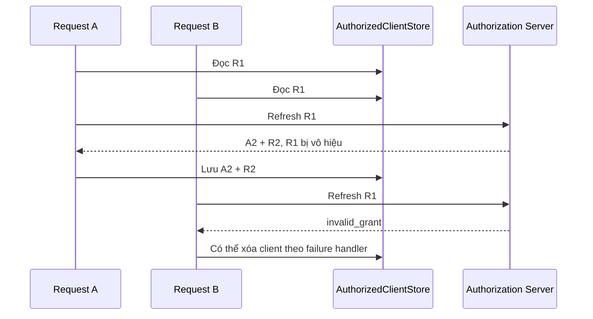

# 17.1. Điều kiện provider cấp refresh token và scope liên quan

Trong **Spring Security OAuth 2.0 / OIDC Client**, đăng nhập thành công thường đem lại một **access token** để ứng dụng truy cập tài nguyên. Nhưng access token có thời hạn; sau một khoảng thời gian, ứng dụng phải lấy token mới. Một cách thực hiện là sử dụng **refresh token** do Authorization Server hoặc OpenID Provider (OP) cấp trước đó.

Điều dễ hiểu sai là: **không phải mọi lần OAuth2/OIDC login đều nhận được refresh token**. Việc ứng dụng cấu hình `authorization_code`, bật `refreshToken()` trong Spring Security, thêm `openid` vào scope hoặc yêu cầu `offline_access` **không tự bảo đảm** token response sẽ có `refresh_token`. Quyết định cấp token nằm ở **Authorization Server/OP** và phụ thuộc vào grant, loại client, consent, scope, cấu hình provider và chính sách bảo mật.

Bài học tập trung vào ba câu hỏi:

1. **Provider dựa vào điều kiện nào để cấp refresh token?**
2. **`offline_access`, `openid` và các scope của từng provider có ý nghĩa gì?**
3. **Spring Security nhận, lưu, sử dụng và kiểm tra việc có refresh token như thế nào?**

> Phạm vi: OAuth 2.0 Authorization Code Flow, OIDC Login và OAuth2 Client trên **Spring Boot 3.x / Spring Security 6.x Servlet**. Các ví dụ provider và tên cấu hình mang tính minh họa; khi triển khai, luôn kiểm tra chính sách và tài liệu phiên bản hiện hành của Authorization Server đang dùng.

## 1. Phân biệt access token và refresh token

### 1.1. Access token dùng để làm gì?

**Access token** là credential mà OAuth2 Client trình cho **Resource Server** khi gọi API, thường qua HTTP header:

```http
GET /v1/reports HTTP/1.1
Host: api.example.test
Authorization: Bearer <access-token>
```

Resource Server quyết định token có hợp lệ cho API đó không dựa trên issuer, audience/resource, scope, thời hạn và policy thích hợp.

Access token thường có thời hạn ngắn hơn refresh token. Khi hết hạn hoặc bị thu hồi, client không được tự thay `expiresAt` để coi token cũ là hợp lệ.

### 1.2. Refresh token dùng để làm gì?

**Refresh token** là credential gửi **đến token endpoint của Authorization Server**, nhằm yêu cầu access token mới mà không cần đưa người dùng qua browser login tại mỗi lần access token hết hạn.

```http
POST /oauth2/token HTTP/1.1
Host: id.example.test
Content-Type: application/x-www-form-urlencoded

grant_type=refresh_token&refresh_token=<redacted>
```

Với confidential client, request còn phải sử dụng phương thức client authentication đã đăng ký (ví dụ HTTP Basic hoặc private_key_jwt tùy provider). Không đặt client secret thật vào ví dụ, URL hay log.

**Refresh token không phải token dùng để gọi Resource Server**, không phải ID Token và không phải dấu hiệu người dùng hiện vẫn đang có browser session tại OP.

### 1.3. So sánh nhanh

| Tiêu chí | Access token | Refresh token |
| --- | --- | --- |
| Nơi sử dụng | Resource Server/API | Authorization Server token endpoint |
| Mục đích | Truy cập tài nguyên với quyền được cấp | Xin access token mới |
| Thời hạn | Thường ngắn | Thường dài hơn, nhưng có thể bị giới hạn hoặc thu hồi |
| Có luôn xuất hiện? | Token response thành công theo OAuth thường có access token | **Không; cấp phát là tùy chọn theo provider** |
| Giới hạn quyền | Scope/audience/resource của API | Bị ràng buộc với client và quyền/phạm vi được cấp; không tự nâng scope |
| Mức độ nhạy cảm | Cao | Rất cao vì có thể tạo nhiều access token theo quyền còn hiệu lực |
| Có nên đưa vào browser UI/log? | Không trừ khi kiến trúc browser client được thiết kế riêng | Không trong web backend thông thường |

## 2. Cốt lõi chuẩn OAuth: refresh token là tùy chọn

RFC 6749 quy định Authorization Server **có quyền quyết định** có phát hành refresh token hay không. Trong response của token endpoint cho Authorization Code Flow, trường `refresh_token` là **optional**.

Ví dụ hai token response đều có thể là kết quả hợp lệ của một Authorization Code Flow, tùy chính sách server.

**Response có refresh token:**

```json
{
  "access_token": "REDACTED_ACCESS_TOKEN",
  "token_type": "Bearer",
  "expires_in": 3600,
  "refresh_token": "REDACTED_REFRESH_TOKEN",
  "scope": "openid profile reports.read",
  "id_token": "REDACTED_ID_TOKEN"
}
```

**Response không có refresh token:**

```json
{
  "access_token": "REDACTED_ACCESS_TOKEN",
  "token_type": "Bearer",
  "expires_in": 3600,
  "scope": "openid profile reports.read",
  "id_token": "REDACTED_ID_TOKEN"
}
```

Trong ví dụ OIDC, `id_token` có mặt vì đây là OIDC login; với OAuth2 thuần không có `openid`, token response không nhất thiết có ID Token.

**Không có `refresh_token` không mặc định có nghĩa request lỗi hoặc Spring Security đã đánh rơi token.** Đầu tiên phải xác định Authorization Server có thực sự phát hành credential đó hay không.

### 2.1. Những thứ OAuth không cam kết

OAuth 2.0 cơ bản **không cam kết**:

- Một authorization code sẽ luôn đổi được thành refresh token.
- Refresh token có thời hạn bất biến hoặc không bao giờ hết hạn.
- Một refresh token luôn được phép dùng nhiều lần.
- Mỗi lần refresh sẽ trả về refresh token mới.
- Refresh token còn hiệu lực nếu user logout hoặc bị gỡ quyền.
- Refresh grant có thể xin thêm scope mà user chưa cấp.
- Spring Security có thể tự tạo refresh token khi provider không trả về.

Mỗi điều kiện trên phải được đánh giá theo **chuẩn, cấu hình OP và token policy của client**.

## 3. Provider thường xét những điều kiện nào trước khi cấp refresh token?

Có thể chia các yếu tố quyết định thành bảy nhóm:

| Nhóm điều kiện | Câu hỏi cần kiểm tra | Nếu không đáp ứng |
| --- | --- | --- |
| **Grant / response type** | Client dùng Authorization Code Flow hoặc grant mà OP cho phép cấp refresh token? | OP có thể không phát hành refresh token |
| **Loại client** | Client là confidential web, public SPA/native hay service machine-to-machine? | OP có thể từ chối hoặc áp dụng chính sách chặt hơn |
| **Scope và tham số xin offline access** | Có `offline_access` hoặc tham số riêng như `access_type=offline` khi OP yêu cầu? | Server có thể chỉ cấp access token |
| **Consent** | User đã đồng ý cho truy cập dài hạn/offline, hoặc có điều kiện chấp thuận khác được OP công nhận? | OP có thể bỏ qua yêu cầu offline access |
| **Registration và provider policy** | Ứng dụng có được bật refresh tokens, offline access, rotation hoặc grant cần thiết? | Dù scope đúng, token response vẫn có thể không có refresh token |
| **Phiên, tài khoản và risk policy** | Account/client có bị chặn bởi MFA, tenant policy, session limit, risk scoring, admin policy? | OP có thể giảm lifetime, không cấp hoặc thu hồi refresh token |
| **Lịch sử authorization** | User đã cấp quyền cho client trước đây? Provider có chỉ trả token ở lần cấp đầu không? | Login lặp lại có thể không nhận `refresh_token` mới |

**Không có một tham số “bật refresh token” dùng chung cho mọi provider.** Ứng dụng phải hiểu hợp đồng tích hợp của OP cụ thể.

### 3.1. Client có thực sự cần token khi user không có mặt?

Một browser app chỉ cần gọi UserInfo khi người dùng đang đăng nhập có thể không cần refresh token dài hạn. Ngược lại, một background sync sau nhiều giờ hoặc nhiều ngày có thể cần offline access.

Nhưng **lý do nghiệp vụ cần token dài hạn không thay thế consent và provider policy**. Nếu OP quyết định không cấp refresh token, client cần chấp nhận và thiết kế lại UX hoặc phương thức authorization.

### 3.2. Confidential client và public client

**Confidential client** (ví dụ Spring Boot backend giữ client secret hoặc dùng private_key_jwt) có khả năng xác thực client tại token endpoint. Nó thường thích hợp cho server-side Authorization Code Flow, nhưng không có quyền tuyệt đối nhận refresh token.

**Public client** (SPA/native application) không thể giữ client secret an toàn. OP thường áp dụng thêm điều kiện khi phát hành refresh token, như rotation, giới hạn thời hạn và sender-constraining. Không nên sao chép client secret của backend vào JavaScript/mobile chỉ để vượt qua chính sách refresh.

RFC 9700 (OAuth 2.0 Security Best Current Practice) quy định refresh tokens cho public clients phải được **sender-constrained hoặc sử dụng refresh token rotation**. Authorization Server còn phải quyết định việc cấp refresh token dựa trên đánh giá rủi ro, và ràng buộc chúng với scope/resource đã được cấp.

## 4. Ảnh hưởng của grant type

Một số grant có quan hệ với refresh token khác nhau.

| Grant / flow | Có thể nhận refresh token không? | Ghi chú |
| --- | --- | --- |
| **Authorization Code** | Có thể | Phổ biến cho web backend và native/SPA hiện đại; provider vẫn quyết định |
| **Authorization Code + PKCE** | Có thể | PKCE bảo vệ authorization code; **không tự khiến refresh token được cấp** |
| **OIDC Authorization Code** | Có thể | Thường thêm `openid` và có thể `offline_access` theo OP |
| **Client Credentials** | Thông thường **không** | RFC 6749 nói refresh token **SHOULD NOT** được kèm; client có thể xin access token mới bằng chính credentials |
| **Implicit Grant** | Không theo luồng implicit truyền thống | Không nhận refresh token từ front-channel implicit token response; flow này không còn là lựa chọn mới được khuyến nghị |
| **Resource Owner Password Credentials** | Một số triển khai cũ có thể cấp | Không nên xây tích hợp mới theo password grant; OAuth 2.0 Security BCP không khuyến nghị sử dụng |
| **Extension / device flows** | Tùy spec và provider | Cần kiểm tra hợp đồng và cấu hình client cụ thể |

### 4.1. Vì sao Authorization Code phù hợp?

Trong Authorization Code Flow, browser nhận authorization code qua callback, còn backend đổi code lấy token qua kênh tới token endpoint. Refresh token (nếu được cấp) **chỉ xuất hiện trong token response**, không cần đưa qua redirect URL của browser.

```mermaid
sequenceDiagram
    autonumber
    actor User as Người dùng
    participant Browser as Browser
    participant Client as Spring Boot OAuth2/OIDC Client
    participant OP as Authorization Server / OP

    Browser->>Client: GET /oauth2/authorization/company
    Client-->>Browser: 302 đến authorization endpoint
    Browser->>OP: response_type=code, scope, state, PKCE nếu dùng
    OP->>User: Đăng nhập và consent theo chính sách
    OP-->>Browser: Redirect callback?code=...&state=...
    Browser->>Client: GET /login/oauth2/code/company
    Client->>OP: POST /token grant_type=authorization_code
    alt Provider cho phép refresh token
        OP-->>Client: access_token + id_token nếu OIDC + refresh_token
    else Provider không cho phép
        OP-->>Client: access_token + id_token nếu OIDC
    end
    Client->>Client: Xác thực; lưu OAuth2AuthorizedClient
    Client-->>Browser: Hoàn tất login
```

Từ sơ đồ, một điểm rất quan trọng: **refresh token là dữ liệu token endpoint cấp sau Authorization Code Flow; không phải URL callback có `refresh_token`**.

### 4.2. PKCE không đồng nghĩa offline access

**PKCE** dùng `code_verifier` và `code_challenge` để ngăn kẻ tấn công đổi authorization code đánh cắp được. Nó **không phải consent**, **không phải scope** và **không bảo đảm refresh token**.

Một provider có thể yêu cầu đồng thời:
- Authorization Code + PKCE;
- `offline_access` hoặc tham số riêng;
- Consent của user;
- Cấu hình client cho phép refresh token.

Thiếu một điều kiện nào đó vẫn có thể không có `refresh_token`.

## 5. Hiểu đúng `openid`, `profile`, `email` và `offline_access`

Trong OIDC, các scope thường gặp:

| Scope | Ý nghĩa | Có tự yêu cầu refresh token? |
| --- | --- | --- |
| **`openid`** | Yêu cầu một phiên xác thực OIDC / ID Token | **Không** |
| **`profile`** | Yêu cầu nhóm claim hồ sơ tiêu chuẩn | **Không** |
| **`email`** | Yêu cầu claim liên quan email | **Không** |
| **`address`** | Yêu cầu claim địa chỉ nếu OP hỗ trợ | **Không** |
| **`phone`** | Yêu cầu claim số điện thoại nếu OP hỗ trợ | **Không** |
| **`offline_access`** | Yêu cầu khả năng lấy access token khi End-User không có mặt | **Chỉ là yêu cầu; OP phải chấp thuận** |
| **Scope API riêng** (ví dụ `reports.read`) | Quyền đọc API được định nghĩa bởi Resource Server/AS | Không có ngữ nghĩa refresh token phổ quát |

**`openid` là dấu hiệu của OIDC Login, không phải nút bật refresh token.** Ngược lại, nếu scope chỉ có `openid profile email` mà OP vẫn cấp refresh token, đó cũng có thể là chính sách hợp lệ của nhà cung cấp.

### 5.1. `offline_access` trong OpenID Connect Core

OIDC Core định nghĩa scope **`offline_access`** để client **yêu cầu** Refresh Token có thể dùng lấy Access Token dù End-User không hiện diện/không còn đăng nhập ở OP.

Các quy tắc trọng tâm của phần *Offline Access*:

1. Khi yêu cầu offline access, `prompt=consent` là điều kiện thường cần, **trừ khi có điều kiện khác cho phép xử lý yêu cầu offline access**.
2. OP phải bảo đảm có consent cho việc cấp refresh token hỗ trợ offline access; consent đã có không phải lúc nào cũng đủ.
3. OP phải **bỏ qua `offline_access`** nếu `response_type` không dẫn tới việc trả authorization code.
4. Với web application, OP phải nhận consent rõ ràng hoặc có điều kiện phù hợp theo chuẩn.
5. Sử dụng refresh token **không chỉ giới hạn** ở `offline_access`; OP có thể cấp refresh token trong trường hợp online access theo chính sách riêng.

Vì vậy:

```text
scope=openid profile offline_access
```

là **yêu cầu** được xét cấp offline access, không phải bảo đảm token response có trường `refresh_token`.

### 5.2. `prompt=consent` không phải scope

`prompt` là **authorization request parameter**, không phải OAuth scope:

```text
scope=openid%20profile%20offline_access
prompt=consent
```

- `scope` mô tả quyền / yêu cầu OIDC.
- `prompt=consent` yêu cầu OP hiển thị hoặc xử lý consent theo hành vi OP hỗ trợ.

**Không viết `scope: openid, profile, prompt=consent`** trong `application.yml`. Chuỗi đó không tạo authorization parameter `prompt` đúng chỗ.

### 5.3. Không có nghĩa user sẽ “đăng nhập vĩnh viễn”

Offline access không đồng nghĩa một phiên không bao giờ kết thúc:

- OP có thể có absolute lifetime và idle lifetime cho refresh token.
- Refresh token có thể bị revoke bởi user/admin hoặc risk policy.
- Rotation có thể làm refresh token cũ mất hiệu lực.
- OP có thể yêu cầu re-authentication hoặc consent mới.
- Client có thể đã xóa token khỏi repository hoặc không còn phiên ứng dụng.

Refresh token là **khả năng tái cấp access token trong thời hạn và chính sách cho phép**, không phải bằng chứng người dùng đang trực tuyến.

## 6. Chính sách provider không thống nhất: ba ví dụ điển hình

### 6.1. Google OAuth2: `access_type=offline`

Theo tài liệu Google cho web server applications, để xin refresh token khi người dùng không hiện diện, authorization request dùng:

```text
access_type=offline
```

Đây là **authorization parameter riêng của Google**, **không phải một OAuth/OIDC scope tiêu chuẩn**.

Ví dụ authorize request minh họa:

```text
https://accounts.google.com/o/oauth2/v2/auth?
  response_type=code
  &client_id=<google-client-id>
  &redirect_uri=https%3A%2F%2Fapp.example.test%2Flogin%2Foauth2%2Fcode%2Fgoogle
  &scope=openid%20profile%20email
  &access_type=offline
  &state=<state>
  &code_challenge=<challenge>
  &code_challenge_method=S256
```

URL thật phải được Spring Security sinh và encode phù hợp; ví dụ xuống dòng chỉ để trình bày. Nếu provider đã cấp quyền trước đó, refresh token có thể chỉ được trả ở **lần cấp offline access ban đầu** hoặc theo điều kiện re-consent. Tài liệu Google cũng cho phép dùng `prompt=consent` khi cần yêu cầu người dùng chấp thuận lại; không nên ép consent ở mọi login nếu không có lý do.

**Đừng mặc định thêm `scope=offline_access` là đủ khi làm việc với Google**. Hãy dùng tham số mà Google tài liệu hóa cho flow cụ thể.

### 6.2. Microsoft identity platform / Entra ID: `offline_access`

Với Microsoft identity platform **v2.0 endpoint**, ứng dụng cần **request scope `offline_access` một cách tường minh** nếu muốn nhận refresh token trong Authorization Code Flow.

Ví dụ:

```text
scope=openid profile email offline_access User.Read
```

Khi dùng API cụ thể, namespace các delegated permissions phải tương ứng với API được cấp quyền và client registration; `User.Read` ở đây là ví dụ permission Microsoft Graph.

Những điểm cần phân biệt:

- Đồng ý quyền delegated không tự bảo đảm mọi grant đều trả refresh token.
- Authorization Code Flow mới là ngữ cảnh điển hình để nhận refresh token cho ứng dụng.
- Client type, token lifetime, SPA/browser policies và cấu hình tenant có thể ảnh hưởng kết quả.
- Refresh token vẫn có thể bị revoke/expire và phải được bảo vệ.

Dù `offline_access` xuất hiện trên màn hình consent, **không suy ra Implicit Flow cũng sẽ cấp refresh token**.

### 6.3. Keycloak: normal refresh token và offline token

Keycloak có khái niệm **offline token**. Khi client được cấp quyền offline, nó có thể xin token bằng:

```text
scope=openid offline_access
```

Nhưng **offline token của Keycloak có ngữ nghĩa riêng** so với refresh token gắn với online SSO session. Nó được dùng tại token endpoint theo refresh grant để lấy access token mới trong trường hợp user không còn online; vòng đời chịu các cấu hình offline session, idle/max, role mapping và chính sách rotation/revocation.

Trong Keycloak, cần xem:

- Realm/client có cho phép **offline access** không.
- User có quyền/role `offline_access` phù hợp không.
- Client có scope/role mapping tương ứng không.
- Consent và các client policies có cho phép không.
- Các tham số `Offline Session Idle`, `Offline Session Max` và `Revoke Refresh Token` được đặt thế nào.

**Đừng hiểu “offline token” nghĩa là “không thể hết hạn hay không thể thu hồi”**. Keycloak có các giới hạn idle/max, rotation và cơ chế admin/user revoke.

### 6.4. Bảng so sánh theo tài liệu công khai

| Provider / chuẩn | Cách thường yêu cầu | Cần lưu ý |
| --- | --- | --- |
| **OIDC Core** | `scope=offline_access`, thường cần `prompt=consent` theo điều kiện chuẩn | OP xét consent và chính sách; không bảo đảm cấp |
| **Google web server OAuth2** | `access_type=offline` (authorization parameter) | Refresh token có thể chỉ có ở lần authorize/offline consent thích hợp |
| **Microsoft v2** | `scope=offline_access` cùng permissions cần thiết | Phải request tường minh để nhận refresh token theo code flow; policy client có thể ảnh hưởng |
| **Keycloak** | `offline_access` để xin **offline token** | Role/client scope và offline-session policy quyết định; normal refresh token có thể tồn tại theo online-session rules |

Các chính sách sản phẩm thay đổi theo phiên bản, tenant, client type và thiết lập quản trị. Bảng chỉ là **hướng nhận diện**, không phải hợp đồng cấp token cho mọi môi trường.

## 7. Luồng cấp refresh token tại token endpoint

Một Authorization Code Flow có thể đi qua các bước:

1. Ứng dụng tạo authorization request gồm client ID, response type, scope, redirect URI, state và PKCE khi dùng.
2. OP xác thực user và xử lý consent, trong đó có offline access khi được yêu cầu.
3. OP chuyển browser về callback với `code` và `state`.
4. Backend dùng `authorization_code` để đổi code tại token endpoint.
5. OP đánh giá policy và trả access token, ID Token nếu OIDC, và **tùy chọn** refresh token.
6. Spring Security tạo `OAuth2AuthorizedClient` với refresh token khi trường đó có mặt.
7. Khi access token cần refresh, client dùng refresh token để yêu cầu token mới.

### 7.1. Ví dụ token request lần đầu

```http
POST /oauth2/token HTTP/1.1
Host: id.example.test
Content-Type: application/x-www-form-urlencoded
Authorization: Basic <redacted-client-authentication>

grant_type=authorization_code&
code=<redacted-code>&
redirect_uri=https%3A%2F%2Fapp.example.test%2Flogin%2Foauth2%2Fcode%2Fcompany&
code_verifier=<redacted-verifier>
```

Đây là request dành cho **confidential client có PKCE và Basic client authentication**. Với public client, client authentication khác; không sao chép Basic client secret vào SPA/mobile. OP phải hỗ trợ phương thức authentication/PKCE tương ứng.

### 7.2. Token response có refresh token

```http
HTTP/1.1 200 OK
Content-Type: application/json
Cache-Control: no-store
Pragma: no-cache

{
  "access_token": "REDACTED_ACCESS_TOKEN",
  "token_type": "Bearer",
  "expires_in": 3600,
  "refresh_token": "REDACTED_REFRESH_TOKEN",
  "scope": "openid profile offline_access"
}
```

Nếu là OIDC login chuẩn, token response còn có `id_token`; ví dụ HTTP ở trên chỉ tập trung các trường liên quan refresh. Không bao giờ ghi token thật vào tài liệu hoặc log.

### 7.3. Token response không có refresh token

```json
{
  "access_token": "REDACTED_ACCESS_TOKEN",
  "token_type": "Bearer",
  "expires_in": 3600,
  "scope": "openid profile"
}
```

Nếu Authorization Server không cấp refresh token, client vẫn có access token hợp lệ theo thời hạn được cấp. **Spring Security không tạo một refresh token từ `access_token`**.

## 8. Token refresh: `grant_type=refresh_token` và quyền được cấp

Khi có refresh token, ứng dụng có thể gọi token endpoint:

```http
POST /oauth2/token HTTP/1.1
Host: id.example.test
Content-Type: application/x-www-form-urlencoded
Authorization: Basic <redacted-client-authentication>

grant_type=refresh_token&refresh_token=<redacted-refresh-token>
```

Response thành công:

```json
{
  "access_token": "NEW_ACCESS_TOKEN_REDACTED",
  "token_type": "Bearer",
  "expires_in": 3600,
  "refresh_token": "NEW_REFRESH_TOKEN_IF_ROTATED"
}
```

**Trường `refresh_token` trong response refresh cũng có thể tùy chọn** theo chính sách provider và token rotation. Nếu server trả token mới, client phải lưu bản mới theo quy tắc rotation, không cố dùng lại refresh token đã bị thu hồi.

### 8.1. Có được tăng scope ở refresh grant không?

Không. Theo RFC 6749, tham số `scope` trong refresh token request là tùy chọn và **không được bao gồm scope chưa từng được cấp**. Nếu không chỉ định, nó được hiểu là scope đã cấp ban đầu theo quy tắc của chuẩn. Server có thể từ chối scope không hợp lệ hoặc trả scope bị giới hạn hơn.

Ví dụ:

```text
Đã được cấp: reports.read

Refresh hợp lệ theo chính sách:
  scope=reports.read

Không thể tự nâng cấp bằng:
  scope=reports.read reports.write
```

Muốn có `reports.write` mới, client phải thực hiện **authorization/consent bổ sung** theo flow và provider phù hợp, không sửa yêu cầu refresh token để vượt quyền.

### 8.2. Scope được xin và scope thực tế được cấp

Hai tập thông tin có thể khác nhau:

- **Requested scopes:** `ClientRegistration.getScopes()` và authorization request gửi đến OP.
- **Granted access token scopes:** `OAuth2AuthorizedClient.getAccessToken().getScopes()` khi provider có thông tin tương ứng.

Cần kiểm tra scope thực tế được cấp khi Resource Server từ chối request. Việc thêm `reports.write` vào `application.yml` không bảo đảm user đã chấp thuận hoặc OP có quyền cấp nó.

## 9. Cấu hình OIDC Client trong Spring Boot

Giả sử ứng dụng cần login qua `company` và muốn xin offline access theo OIDC Core.

### 9.1. Dependency Maven

```xml
<dependencies>
    <dependency>
        <groupId>org.springframework.boot</groupId>
        <artifactId>spring-boot-starter-web</artifactId>
    </dependency>
    <dependency>
        <groupId>org.springframework.boot</groupId>
        <artifactId>spring-boot-starter-security</artifactId>
    </dependency>
    <dependency>
        <groupId>org.springframework.boot</groupId>
        <artifactId>spring-boot-starter-oauth2-client</artifactId>
    </dependency>
</dependencies>
```

### 9.2. ClientRegistration có offline_access

```yaml
spring:
  security:
    oauth2:
      client:
        registration:
          company:
            provider: company
            client-id: ${OIDC_CLIENT_ID}
            client-secret: ${OIDC_CLIENT_SECRET}
            authorization-grant-type: authorization_code
            redirect-uri: "{baseUrl}/login/oauth2/code/{registrationId}"
            scope:
              - openid
              - profile
              - email
              - offline_access
              - reports.read

        provider:
          company:
            issuer-uri: https://id.example.test/realms/company
```

Đây là **registration minh họa**, giả định OP thực sự hỗ trợ `offline_access` và `reports.read`. Với Google hoặc provider có tham số riêng, cấu hình chỉ thêm scope chưa chắc đáp ứng chính sách cấp refresh token.

### 9.3. SecurityFilterChain

```java
import org.springframework.context.annotation.Bean;
import org.springframework.context.annotation.Configuration;
import org.springframework.security.config.Customizer;
import org.springframework.security.config.annotation.web.builders.HttpSecurity;
import org.springframework.security.web.SecurityFilterChain;

@Configuration
class SecurityConfig {

    @Bean
    SecurityFilterChain securityFilterChain(HttpSecurity http) throws Exception {
        return http
            .authorizeHttpRequests(auth -> auth
                .requestMatchers("/", "/error", "/public/**").permitAll()
                .anyRequest().authenticated())
            .oauth2Login(Customizer.withDefaults())
            .oauth2Client(Customizer.withDefaults())
            .build();
    }
}
```

Người dùng có thể bắt đầu OIDC Login tại:

```text
GET /oauth2/authorization/company
```

Spring Security sinh authorization request dựa vào registration. Sau callback và token exchange, provider có thể trả refresh token; Spring Security giữ nó trong `OAuth2AuthorizedClient` nếu có.

### 9.4. Chỉ thêm scope chưa chắc đủ

Với OIDC Core, nếu cần `prompt=consent`, bạn phải thêm nó vào **authorization request gửi OP**. Đây là parameter của request, không phải thuộc tính `scope`.

Ở Spring Security Servlet, có thể tùy chỉnh request thông qua **`DefaultOAuth2AuthorizationRequestResolver`**.

## 10. Thêm `prompt=consent` bằng authorization request resolver

Một cấu hình ví dụ dành cho một registration OIDC cần consent:

```java
import org.springframework.context.annotation.Bean;
import org.springframework.context.annotation.Configuration;
import org.springframework.security.config.annotation.web.builders.HttpSecurity;
import org.springframework.security.oauth2.client.registration.ClientRegistrationRepository;
import org.springframework.security.oauth2.client.web.DefaultOAuth2AuthorizationRequestResolver;
import org.springframework.security.oauth2.client.web.OAuth2AuthorizationRequestRedirectFilter;
import org.springframework.security.web.SecurityFilterChain;

@Configuration
class OfflineConsentConfig {

    @Bean
    SecurityFilterChain securityFilterChain(
            HttpSecurity http,
            ClientRegistrationRepository registrations) throws Exception {

        DefaultOAuth2AuthorizationRequestResolver resolver =
            new DefaultOAuth2AuthorizationRequestResolver(
                registrations,
                OAuth2AuthorizationRequestRedirectFilter
                    .DEFAULT_AUTHORIZATION_REQUEST_BASE_URI);

        resolver.setAuthorizationRequestCustomizer(builder ->
            builder.additionalParameters(params ->
                params.put("prompt", "consent")));

        return http
            .authorizeHttpRequests(auth -> auth
                .requestMatchers("/", "/error").permitAll()
                .anyRequest().authenticated())
            .oauth2Login(oauth2 -> oauth2
                .authorizationEndpoint(endpoint ->
                    endpoint.authorizationRequestResolver(resolver)))
            .build();
    }
}
```

Đây là cấu hình **cho mục đích minh họa**, và nó thêm `prompt=consent` vào mọi authorization request do resolver này xử lý. Với nhiều provider/registration, không nên ép provider nào cũng nhận cùng parameter. Cần triển khai resolver/delegate có điều kiện theo registration và hợp đồng tích hợp.

**Một điểm kỹ thuật:** customizer của resolver có thể liên quan đến các tùy biến khác như PKCE. Khi thay request customizer, cần giữ những bước tùy biến bắt buộc cho loại client và phiên bản Spring Security đang dùng; không ghi đè hoặc bỏ PKCE do vô ý.

### 10.1. Vì sao không thêm prompt vào scope?

Sai:

```yaml
scope: openid, profile, offline_access, prompt=consent
```

Đúng về mặt phân biệt:

```text
scope = "openid profile offline_access"
prompt = "consent"
```

`scope` là danh sách scope. `prompt` là một parameter riêng trên authorize URL, được Spring Security resolver bổ sung.

### 10.2. Khi nào không nên ép prompt=consent?

Không nên bắt user xem consent ở **mọi lần login** nếu:
- OP đã lưu consent hợp lệ và có cơ chế khác cho offline access.
- Không phải registration nào cũng hỗ trợ `prompt`.
- UX yêu cầu tránh popup consent lặp và admin policy cho phép tái sử dụng consent.
- Provider dùng tham số khác, ví dụ Google với `access_type=offline`.

Hãy kiểm tra yêu cầu của OP và chỉ bật re-consent tại những chỗ thực sự cần.

## 11. Ví dụ riêng cho Google: `access_type=offline`

Với Google OAuth2 Client, yêu cầu `access_type=offline` là tham số **khác** với scope `offline_access`. Khi ứng dụng dùng Spring Security, có thể bổ sung parameter bằng `DefaultOAuth2AuthorizationRequestResolver`.

```java
DefaultOAuth2AuthorizationRequestResolver googleResolver =
    new DefaultOAuth2AuthorizationRequestResolver(
        clientRegistrationRepository,
        OAuth2AuthorizationRequestRedirectFilter
            .DEFAULT_AUTHORIZATION_REQUEST_BASE_URI);

googleResolver.setAuthorizationRequestCustomizer(builder ->
    builder.additionalParameters(params ->
        params.put("access_type", "offline")));
```

Sau đó đăng ký resolver vào `oauth2Login().authorizationEndpoint().authorizationRequestResolver(googleResolver)` giống mục trước. Ví dụ này giả định resolver chỉ phục vụ Google; nếu áp dụng cho nhiều provider, phải có logic rẽ nhánh để không gửi tham số riêng của Google tới OP khác.

Trường hợp user đã authorize trước đây, không phải lúc nào token response sau login cũng có refresh token mới. Có thể cần một luồng consent lại theo điều kiện Google hỗ trợ, ví dụ thêm `prompt=consent` có chủ đích.

**Không làm mới toàn bộ consent vô hạn** để “ép” server cấp token; có thể vi phạm trải nghiệm người dùng, gây churn kết nối và bị giới hạn bởi chính sách provider.

## 12. Spring Security lấy refresh token ở đâu?

Với Servlet OAuth2/OIDC Login:

1. Browser hoàn tất authorization code callback.
2. Spring Security đổi code tại token endpoint.
3. Nếu response có `refresh_token`, hạ tầng OAuth2 Client biểu diễn nó bằng **`OAuth2RefreshToken`**.
4. **`OAuth2AuthorizedClient`** có thể giữ access token và refresh token.
5. Repository/service lưu authorized client tùy cấu hình.

Các class liên quan:

| Thành phần | Vai trò |
| --- | --- |
| **`ClientRegistration`** | Cấu hình client/provider/grant/scope |
| **`OAuth2AuthorizedClient`** | Access token và refresh token tùy chọn cho registration/principal |
| **`OAuth2RefreshToken`** | Credential refresh đã được cấp |
| **`OAuth2AuthorizedClientRepository`** | Lưu/tải authorized client gắn Servlet request/principal |
| **`OAuth2AuthorizedClientService`** | Lưu/tải authorized client theo registration ID + principal name |
| **`OAuth2AuthorizedClientManager`** | Điều phối authorization/re-authorization |
| **`RefreshTokenOAuth2AuthorizedClientProvider`** | Thực hiện refresh token grant khi có điều kiện |

**Không thể tạo refresh token bằng `@Bean OAuth2AuthorizedClientManager`** nếu Authorization Server không cấp nó. Manager chỉ dùng dữ liệu đã được cấp và những grant mà provider hỗ trợ.

## 13. Quan sát refresh token có tồn tại hay không

Một cách kiểm tra ở tầng application, không in token:

```java
import java.util.Map;

import org.springframework.security.oauth2.client.OAuth2AuthorizedClient;
import org.springframework.security.oauth2.client.annotation.RegisteredOAuth2AuthorizedClient;
import org.springframework.web.bind.annotation.GetMapping;
import org.springframework.web.bind.annotation.RestController;

@RestController
class OAuth2TokenStatusController {

    @GetMapping("/internal/oauth2/status")
    Map<String, Object> status(
            @RegisteredOAuth2AuthorizedClient("company")
            OAuth2AuthorizedClient authorizedClient) {

        return Map.of(
            "registrationId",
                authorizedClient.getClientRegistration().getRegistrationId(),
            "accessTokenPresent",
                authorizedClient.getAccessToken() != null,
            "refreshTokenPresent",
                authorizedClient.getRefreshToken() != null
        );
    }
}
```

Đây là **endpoint kỹ thuật minh họa**. Trong production, phải bảo vệ quyền truy cập và cân nhắc có cần phát lộ metadata token hay không. Không trả `getRefreshToken().getTokenValue()` hoặc nguyên `OAuth2AuthorizedClient` ra JSON.

### 13.1. Diễn giải kết quả

```json
{
  "registrationId": "company",
  "accessTokenPresent": true,
  "refreshTokenPresent": false
}
```

Điều này có nghĩa **authorized client hiện có không giữ refresh token**. Có ít nhất hai khả năng cần phân biệt:

- Provider chưa từng trả `refresh_token` trong token response.
- Provider đã trả nhưng token đã bị mất khi mapping, persistence, cache hoặc dữ liệu authorized client bị ghi đè sai.

Do vậy, để tìm nguyên nhân, đối chiếu **sự tồn tại của trường trong token response ở môi trường kiểm thử được bảo vệ** với dữ liệu tồn tại sau khi Spring Security lưu authorized client. Không log raw token để làm việc này; chỉ cần quan sát có/không và metadata đã lọc.

### 13.2. Nếu có refresh token thì chắc chắn còn dùng được?

Không. `authorizedClient.getRefreshToken() != null` chỉ chứng minh đã lưu một credential. Nó không xác nhận OP chưa revoke token, chưa hết idle/max lifetime hay chưa rotate. Điều này chỉ được biết khi dùng refresh grant hoặc qua cơ chế token status/revocation phù hợp.

## 14. Cấu hình RefreshTokenOAuth2AuthorizedClientProvider

Khi access token cần làm mới và authorized client có refresh token, **`RefreshTokenOAuth2AuthorizedClientProvider`** có thể thực hiện refresh token grant.

Ví dụ cấu hình manager:

```java
import org.springframework.context.annotation.Bean;
import org.springframework.context.annotation.Configuration;
import org.springframework.security.oauth2.client.OAuth2AuthorizedClientManager;
import org.springframework.security.oauth2.client.OAuth2AuthorizedClientProvider;
import org.springframework.security.oauth2.client.OAuth2AuthorizedClientProviderBuilder;
import org.springframework.security.oauth2.client.registration.ClientRegistrationRepository;
import org.springframework.security.oauth2.client.web.DefaultOAuth2AuthorizedClientManager;
import org.springframework.security.oauth2.client.web.OAuth2AuthorizedClientRepository;

@Configuration
class OAuth2ClientManagerConfig {

    @Bean
    OAuth2AuthorizedClientManager authorizedClientManager(
            ClientRegistrationRepository registrations,
            OAuth2AuthorizedClientRepository authorizedClients) {

        OAuth2AuthorizedClientProvider provider =
            OAuth2AuthorizedClientProviderBuilder.builder()
                .authorizationCode()
                .refreshToken()
                .build();

        DefaultOAuth2AuthorizedClientManager manager =
            new DefaultOAuth2AuthorizedClientManager(
                registrations, authorizedClients);

        manager.setAuthorizedClientProvider(provider);

        return manager;
    }
}
```

Điều kiện thực tế để refresh:

- Authorization client đã có `OAuth2AuthorizedClient` phù hợp registration/principal.
- `getRefreshToken()` không null.
- Access token đã hết hoặc gần hết hạn theo quy tắc clock skew/provider.
- Manager đã cấu hình `refreshToken()`.
- Authorization Server chấp nhận refresh grant và client authentication áp dụng.
- Refresh token còn hiệu lực theo lifetime, rotation và policy.

**`builder.refreshToken()` chỉ bật khả năng sử dụng refresh token được cấp**, không tự yêu cầu OP phát hành nó. Nếu thiếu token, provider không thể làm refresh grant.

### 14.1. Kết quả refresh thành công

Manager nhận access token mới và cập nhật `OAuth2AuthorizedClient`, bao gồm refresh token mới nếu OP rotate. Cần bảo đảm repository/service lưu phiên bản mới để lần gọi tiếp theo không dùng token cũ.

### 14.2. Lỗi `invalid_grant`

Nếu refresh token bị revoke/hết hạn/không còn hợp lệ, token endpoint thường trả:

```json
{
  "error": "invalid_grant",
  "error_description": "The refresh token is invalid"
}
```

Đây là tín hiệu **không nên lặp vô hạn cùng refresh token**. Spring Security có cơ chế authorization failure handling, bao gồm xóa authorized client lỗi trong các điều kiện phù hợp. Sau đó người dùng có thể cần thực hiện authorization mới.

## 15. Có thể dùng SSO session mà không có refresh token không?

**Có.** Một ứng dụng web có thể giữ phiên đăng nhập nội bộ hoặc OP còn giữ SSO browser session, rồi đưa user qua Authorization Code Flow mới để lấy access token khác khi cần.

Nhưng đây không phải **refresh token grant**:

```text
Không có refresh token:
  Browser -> authorization endpoint
          -> SSO cookie/consent theo OP
          -> authorization code mới
          -> token endpoint
          -> access token mới

Có refresh token:
  Backend -> token endpoint grant_type=refresh_token
          -> access token mới
```

Trong tình huống đầu, user có thể hoặc không phải nhập mật khẩu lại tùy OP session và risk policy; browser interaction vẫn có thể cần. Trong tình huống sau, client có thể xin token mới khi user không còn mở browser, miễn refresh token và client authorization còn hợp lệ.

**Đừng gọi việc redirect qua OP để lấy code mới là “refresh token”**. Hai flow có security boundary, UX và requirements khác nhau.

### 15.1. Một phiên web không cần refresh token dài hạn

Nếu ứng dụng chỉ cần token trong lúc người dùng đang thao tác và sẵn sàng bắt đầu authorization mới khi cần, bạn có thể chấp nhận token response không có refresh token. Đó là thiết kế hợp lệ theo chính sách sản phẩm.

### 15.2. Background sync thường cần cơ chế phù hợp khác

Nếu sản phẩm phải đồng bộ dữ liệu lúc user offline, lựa chọn là:

- Request offline access theo OP và nhận consent hợp lệ.
- Lưu refresh token an toàn và quản lý vòng đời/rotation.
- Sử dụng token exchange hoặc delegation phù hợp nếu OP/API hỗ trợ.
- Chuyển sang service identity trong trường hợp nghiệp vụ không cần hành động thay user, với grant `client_credentials` và permission riêng.

Không thể dùng **client_credentials token của ứng dụng** để giả làm quyền user khi API đòi hỏi delegated user consent.

## 16. Trạng thái `scope` trong các thời điểm khác nhau

Để chẩn đoán “tại sao không có refresh token”, cần biết scope nào được yêu cầu, scope nào được chấp thuận, scope nào được thể hiện trên token.

```text
ClientRegistration scopes
        |
        v
Authorization request scope
        |
        v
OP xử lý login + consent + policy
        |
        v
Authorization grant được cấp
        |
        v
Token response scope, access_token, optional refresh_token
        |
        v
OAuth2AuthorizedClient
```

### 16.1. Scope trong YAML chỉ là requested scope

```yaml
scope: openid, profile, offline_access, reports.read
```

Nó không phải là bằng chứng OP đã cấp offline access. Cần xem authorize request thực tế và token response/consent state.

### 16.2. Provider có thể giảm scope

RFC 6749 cho phép Authorization Server cấp access token với quyền **hẹp hơn** yêu cầu. Client không được giả định mọi scope xin trong YAML đã được nhận.

### 16.3. Không dùng refresh token để nâng scope

Giả sử user cấp `reports.read`, app về sau cần `reports.write`. Không giải quyết bằng cách thêm scope mới vào refresh request. Hãy dùng incremental authorization/consent theo provider và kiểm tra kết quả cấp quyền.

### 16.4. `offline_access` không thay thế scope API

`offline_access` có mục đích xin khả năng refresh lâu dài. Nó **không tự cấp quyền** đọc email, sửa lịch hoặc truy cập báo cáo. Client vẫn cần những API scopes thích hợp như `reports.read`.

## 17. Refresh token rotation và hạn sử dụng

Một refresh token được cấp không phải một credential bất biến.

### 17.1. Rotation

Một số OP trả token mới mỗi lần refresh và làm token cũ hết hiệu lực:

```text
Lần đầu:
  Access token A1
  Refresh token R1

Refresh R1:
  Access token A2
  Refresh token R2

Refresh R2:
  Access token A3
  Refresh token R3

R1 và R2 không còn được dùng sau khi rotate.
```

Nếu client chỉ lưu `access_token` mới mà quên refresh token mới, lần refresh sau có thể thất bại với `invalid_grant`.

### 17.2. Absolute và idle lifetime

Provider có thể giới hạn:

- **Absolute lifetime:** token/grant hết hiệu lực sau một mốc thời gian dù có refresh thường xuyên.
- **Idle lifetime:** token/grant hết hiệu lực nếu không sử dụng trong thời gian nhất định.
- **Session-linked lifetime:** refresh token phụ thuộc phiên SSO hoặc phiên offline của OP.
- **Policy-based revocation:** user/admin thu hồi consent hoặc tài khoản bị khóa.
- **Token reuse detection:** dùng lại token đã rotate bị coi là rủi ro và cả token family có thể bị thu hồi.

Không nên mô tả refresh token là “không bao giờ hết hạn” nếu chưa xem rõ cấu hình OP.

### 17.3. Đồng thời refresh ở nhiều instance

Khi hai request cùng dùng R1:



Nếu B xóa record mà A vừa cập nhật, ứng dụng có thể mất token mới dù refresh A thành công. Với hệ thống có rotation và tải lớn, nên thiết kế locking/single-flight, versioning, compare-and-delete và shared persistence theo đúng giới hạn hệ thống.

## 18. Refresh token cần bảo vệ như thế nào?

RFC 9700 khuyến nghị quản lý chặt việc cấp refresh token và yêu cầu phòng ngừa replay cho public clients. Với web backend, bảo vệ credential ở phía server và hạn chế quyền truy cập là ưu tiên hàng đầu.

Các nguyên tắc:

1. **Không gửi refresh token tới Resource Server** hoặc trong query URL của frontend.
2. **Không ghi refresh token vào log**, telemetry hoặc error report.
3. **Không lưu trong localStorage browser** của ứng dụng backend thông thường.
4. **Mã hóa/bảo vệ storage** theo chính sách, giới hạn quyền đọc của dịch vụ và nhân viên.
5. **Ràng buộc token với client và principal**; không dùng token user A cho user B.
6. **Tách môi trường** local/staging/production bằng client IDs và secrets khi phù hợp.
7. **Xử lý rotation và revocation**; lưu token mới, xóa token lỗi và ngừng retry khi `invalid_grant`.
8. **Xác minh HTTPS và token endpoint** trước khi gửi refresh token; không gửi tới host do user chỉ định.
9. **Chỉ xin offline access khi thật sự cần**, vì khả năng cấp lại token dài hạn làm tăng rủi ro nếu credential bị lộ.
10. **Thiết kế thông báo reconnect/re-consent** khi token không thể làm mới.

### 18.1. Refresh token không phải dữ liệu để hiển thị

Ví dụ sai:

```java
// KHÔNG LÀM: lộ credential ra HTTP response.
@GetMapping("/debug/tokens")
String debug(
        @RegisteredOAuth2AuthorizedClient("company")
        OAuth2AuthorizedClient client) {
    return client.getRefreshToken().getTokenValue();
}
```

Ngoài rò rỉ token, đoạn code còn có nguy cơ `NullPointerException` khi OP không cấp refresh token. Chỉ quan sát **có/không**, không trả credential.

### 18.2. Lỗi token cần giữ bí mật

`error_description` từ token endpoint có thể chứa dữ liệu chẩn đoán nhạy cảm hoặc nội dung bên ngoài. Không đưa nguyên description vào trang login hoặc metric labels. Dùng nhóm mã lỗi đã kiểm soát và trace ID nội bộ.

## 19. Phân biệt refresh token và quyền phiên của OP

Ba trạng thái có thể cùng tồn tại:

| Trạng thái | Nơi quản lý | Ý nghĩa |
| --- | --- | --- |
| HTTP session của ứng dụng | Spring Boot / session store | User đang đăng nhập vào ứng dụng web |
| SSO browser session | OP/Identity Provider | Browser còn được OP nhận diện cho authorization tương tác |
| Refresh token | Authorization Server và client token store | Client có credential xin access token mới theo policy |

**Logout khỏi Spring Boot không nhất thiết revoke refresh token tại OP.** Ngược lại, OP SSO session hết hạn không nhất thiết khiến mọi offline refresh token hết hiệu lực ngay, tùy token policy.

Nếu ứng dụng có yêu cầu “ngắt kết nối tài khoản”, nên cân nhắc:
- Xóa authorized client khỏi local repository/service.
- Gọi token revocation endpoint nếu OP hỗ trợ và chính sách yêu cầu.
- Xử lý logout OIDC/SSO như luồng riêng.
- Đảm bảo UI phản ánh kết nối còn/không còn hiệu lực.

Không nhầm `OAuth2AuthorizedClientRepository.removeAuthorizedClient(...)` với revocation thực hiện trên Authorization Server.

## 20. Vì sao cấu hình đúng mà vẫn không có refresh token?

Một quy trình chẩn đoán nên đi theo đúng thứ tự:

### Bước 1 — Kiểm tra grant type

```text
registration.authorization-grant-type = authorization_code
authorize request response_type = code
```

Nếu dùng `client_credentials` thì refresh token thường không được cấp; nếu dùng flow cũ không phù hợp, hãy thiết kế lại thay vì cố bật refresh.

### Bước 2 — Kiểm tra loại client và cấu hình OP

Xác nhận registration ở provider:
- Đúng client ID, client secret/authentication method.
- Grant type/response type được cho phép.
- Offline access hoặc refresh token policy được bật nếu OP yêu cầu.
- Redirect URI và PKCE phù hợp.
- Public/confidential client profile đúng với ứng dụng.

### Bước 3 — Kiểm tra scope/parameter đã thực sự gửi

Browser Network có thể cho biết authorize URL có:
- `scope=openid%20offline_access` (với OP dùng OIDC offline scope).
- `prompt=consent` nếu điều kiện OP yêu cầu.
- `access_type=offline` nếu là Google web server flow.
- `response_type=code` và registration ID đúng.

Chỉ kiểm tra **tên tham số và giá trị không nhạy cảm**; không chia sẻ `state`, `code`, `code_verifier` hoặc token.

### Bước 4 — Kiểm tra consent và authorization history

User đã cấp quyền lần trước hay chưa? Provider có trả refresh token chỉ khi cấp offline access lần đầu không? Admin có thu hồi consent hoặc giới hạn client không?

Đừng liên tục ép prompt consent để thử trong production; nên dùng client và tài khoản thử nghiệm được cho phép.

### Bước 5 — Xác định token response có `refresh_token` hay không

Trong môi trường test bảo mật, quan sát sự tồn tại của trường mà không ghi giá trị. Nếu provider không trả trường, cần điều tra cấu hình OP/consent/policy. Nếu có mà authorized client không lưu, xem pipeline Spring Security và repository/service.

### Bước 6 — Kiểm tra authorized client được gắn đúng principal/registration

Nếu app có `company-login` và `reports-api`, việc inspect nhầm authorized client có thể khiến tưởng token bị thiếu. Kiểm tra đúng `registrationId` và principal đã xác thực.

### Bước 7 — Kiểm tra persistence và lifecycle

Token có thể đã được cấp nhưng record biến mất sau restart, logout, session expiry hoặc khi failure handler xóa client bị lỗi. Với distributed deployment, bảo đảm các instance dùng store tương thích.

### Bước 8 — Khi đã có refresh token nhưng refresh thất bại

Tập trung vào error code:
- `invalid_grant`: refresh token hết hạn, revoke, rotate hoặc không hợp lệ.
- `invalid_client`: client authentication sai hoặc client configuration đổi.
- `invalid_scope`: yêu cầu scope refresh không hợp lệ.
- `temporarily_unavailable`/timeout: lỗi tạm thời của OP, không nhất thiết token bị revoke.

Không “chữa” tất cả bằng cách tăng timeout hoặc tự vô hiệu hóa token validation.

## 21. Bảng troubleshooting theo dấu hiệu

| Hiện tượng | Điều cần xác minh | Hướng khắc phục |
| --- | --- | --- |
| Login OIDC thành công nhưng `getRefreshToken()==null` | OP có trả `refresh_token` trong token response không? | Kiểm tra provider policy và scope/consent trước |
| Đã thêm `openid` nhưng không có refresh token | `openid` chỉ yêu cầu OIDC | Xin offline access theo tài liệu provider khi cần |
| Đã thêm `offline_access` nhưng OP vẫn không cấp | Consent, grant, loại client, policy OP | Đối chiếu OIDC rules; không coi scope là bảo đảm |
| Google không trả refresh token | Có `access_type=offline`? Có authorization trước đó? | Tùy chỉnh authorization parameter; kiểm tra chính sách re-consent |
| Microsoft v2 không có refresh token | Có request `offline_access` tường minh trong code flow? | Thêm scope và kiểm tra app registration/token policies |
| Keycloak không cấp offline token | Role mapping, optional client scope, offline session policy | Cấu hình offline access đúng kiểu Keycloak |
| `client_credentials` không có refresh token | Flow được thiết kế lấy access token bằng credentials | Xin token mới khi cần; không mong refresh token mặc định |
| Access token hết hạn, manager không refresh | Có refresh token? `refreshToken()` provider được bật? | Kiểm tra cả server token issuance và client manager |
| Refresh trả `invalid_grant` | Token hết hạn/revoked/rotation/reuse | Xóa authorized client hỏng, authorize lại khi được phép |
| Refresh chỉ thành công một lần | Provider rotate refresh token | Lưu refresh token mới sau mỗi lần refresh |
| Refresh lỗi sau khi chạy nhiều pod | Hai request dùng refresh token cũ đồng thời | Lock/version/CAS và shared token storage |
| Xin `reports.write` lúc refresh bị từ chối | Scope mới chưa được cấp | Authorization/consent bổ sung, không nâng scope bằng refresh grant |
| User logout vẫn refresh được | Offline token không phụ thuộc online SSO session theo provider | Thiết kế revocation/connection policy phù hợp |
| Restart app xong mất refresh token | Token store chỉ có session volatile | Dùng persistence bảo mật nếu nghiệp vụ cần dài hạn |
| Không có refresh token nhưng browser login lại không hỏi mật khẩu | OP SSO session còn hợp lệ | Phân biệt authorization code mới với refresh token grant |

## 22. Những sai lầm phổ biến

### Sai lầm 1 — “Có scope offline_access thì chắc chắn nhận refresh token”

Sai vì `offline_access` là **yêu cầu**, còn OP xét consent, grant và chính sách. Đối với một số provider, có thể cần tham số riêng hoặc client setting bổ sung.

### Sai lầm 2 — “Spring Security không bật refreshToken() nên OP không cấp”

Provider quyết định cấp token tại **token endpoint trong Authorization Code Flow**. Bật `refreshToken()` ở manager điều khiển **cách client sử dụng token đã có** để refresh về sau. Đó là hai giai đoạn khác nhau.

### Sai lầm 3 — “Client credentials cũng cần refresh token”

Không theo kỳ vọng OAuth2 thông thường. Client Credentials có thể xin access token mới bằng client authentication của chính ứng dụng. RFC 6749 nói refresh token **SHOULD NOT** được đưa vào response cho grant này.

### Sai lầm 4 — “Refresh token là ID Token lâu dài”

Sai. ID Token cung cấp claim xác thực người dùng; refresh token là credential được gửi token endpoint. Không gửi refresh token làm `Authorization: Bearer` tới UserInfo hoặc Resource Server.

### Sai lầm 5 — “Có refresh token thì không cần consent nữa”

Sai. OP có thể yêu cầu consent khi bắt đầu offline access, giới hạn lifetime hoặc thu hồi token. Refresh cũng không mở rộng scope ngoài quyền user đã cấp.

### Sai lầm 6 — “Không có refresh token là lỗi của Spring Boot”

Không có đủ cơ sở. Cần xác minh response từ provider trước khi kết luận lỗi mapping/persistence của framework.

### Sai lầm 7 — “Token đã lưu sẽ luôn hoạt động”

Sai. Refresh token có thể expire, rotate, revoke và bị phát hiện reuse. Client cần quản lý vòng đời và fallback reauthorization.

### Sai lầm 8 — “Tôi có thể đưa refresh token vào frontend vì nó chỉ là chuỗi”

Sai. Đây là credential giá trị cao. Với server-side app, giữ ở backend. Với public client, chỉ dùng thiết kế OAuth2 phù hợp và tuân thủ Security BCP của provider.

## 23. Bài thực hành tình huống

### Tình huống A — OIDC login có `openid profile email`

Ứng dụng dùng:

```yaml
scope: openid, profile, email
```

ID Token và access token được cấp, nhưng không có refresh token.

**Hỏi:** đây là lỗi chuẩn OAuth2/OIDC không?

> **Không.** Refresh token là optional. Những scope này dùng cho OIDC và hồ sơ; nếu cần offline access, phải kiểm tra cơ chế yêu cầu và policy cụ thể của provider.

### Tình huống B — Thêm `offline_access` nhưng chưa có consent

Ứng dụng gửi:

```text
response_type=code
scope=openid profile offline_access
```

OP không cấp refresh token.

**Hỏi:** điều gì cần xem tiếp?

> Theo OIDC Core, cần xác minh consent và `prompt=consent` hoặc điều kiện tương đương mà OP chấp nhận; đồng thời kiểm tra client type, registration và policy offline access.

### Tình huống C — Google OAuth2 web application

Ứng dụng đã thêm `offline_access` vào scope nhưng Google không trả refresh token.

**Hỏi:** còn thiếu gì?

> Theo tài liệu Google web server flow, cần request `access_type=offline`. Nếu user đã consent trước đó, việc nhận lại refresh token còn phụ thuộc lịch sử authorization và chính sách re-consent.

### Tình huống D — Microsoft identity platform v2

Ứng dụng dùng Authorization Code Flow nhưng scope chỉ có `openid profile User.Read`.

**Hỏi:** nên cân nhắc thêm gì để xin refresh token?

> Request `offline_access` một cách tường minh theo chính sách Microsoft v2, sau đó xác nhận client/app settings và token response. Scope không bảo đảm server luôn cấp.

### Tình huống E — Client Credentials cho một job

Job chạy `client_credentials`, nhận access token 1 giờ nhưng không có refresh token.

**Hỏi:** cách lấy token mới?

> Khi token hết hạn, client có thể dùng lại client credentials tại token endpoint, với secret/private-key authentication được quản lý an toàn. Không cần giả định phải có refresh token cho grant này.

### Tình huống F — Có refresh token nhưng request tiếp theo `invalid_grant`

Ứng dụng nhận R1 từ token endpoint; refresh bằng R1 thành công và server trả R2, nhưng cache vẫn lưu R1.

**Hỏi:** lỗi ở đâu?

> Có thể do **refresh token rotation**. Khi OP trả R2, ứng dụng phải lưu authorized client mới. Dùng lại R1 bị thu hồi sẽ dẫn tới `invalid_grant`.

### Tình huống G — Access token hiện tại chỉ có `reports.read`

Ứng dụng cần `reports.write` và định thêm vào refresh request.

**Hỏi:** cách đó hợp lệ không?

> Không. Refresh token grant không được xin quyền vượt scope user đã cấp. Cần làm Authorization Code Flow/incremental consent phù hợp.

### Tình huống H — Không thấy refresh token sau khi restart

Lần đăng nhập đầu có refresh token, nhưng sau restart `getRefreshToken()` null hoặc không còn authorized client.

**Hỏi:** điều gì khác với việc provider không cấp token?

> Provider có thể đã cấp token nhưng ứng dụng chỉ lưu trong HTTP session volatile hoặc một repository không được chia sẻ/persist đúng. Cần chẩn đoán persistence riêng, không chỉ scope và consent.

### Tình huống I — User đã logout khỏi OP nhưng background sync vẫn chạy

**Hỏi:** có bất thường không?

> Phụ thuộc policy. Với offline token được OP cấp hợp lệ, token có thể cho phép truy cập dù user không còn online cho đến khi token expire/revoke theo chính sách. Nếu sản phẩm muốn ngắt quyền khi logout, cần thiết kế revocation/connection lifecycle rõ ràng.

### Tình huống J — Browser client public có refresh token

**Hỏi:** có thể lưu cố định trong localStorage không?

> Không nên mặc định làm vậy. Public clients không giữ secret như confidential backend; OAuth 2.0 Security BCP yêu cầu sender-constrained refresh tokens hoặc rotation, và phải bảo vệ token theo kiến trúc browser-based client phù hợp. Nếu có thể, dùng backend-for-frontend hoặc server-side token storage để giảm bề mặt lộ credential.

## 24. Tóm tắt kiến thức cần nhớ

```text
Ứng dụng cần access token dài hạn?
           |
           v
Có thực sự cần user-delegated offline access?
           |
           +-- Không -> Access token ngắn hạn / reauthorization khi cần
           |
           +-- Có
               |
               v
       Chọn grant phù hợp (thường Authorization Code + PKCE)
               |
               v
       Kiểm tra chính sách và client type của provider
               |
               v
       Xin scope/parameter đúng theo OP
       - OIDC: offline_access, consent khi cần
       - Google: access_type=offline
       - Microsoft v2: offline_access tường minh
       - Keycloak: offline_access + policy offline token
               |
               v
       OP xác thực user / consent / áp dụng risk policy
               |
               v
       Token endpoint
               |
               +-- Có refresh_token
               |      |
               |      v
               |  Spring Security OAuth2AuthorizedClient
               |      |
               |      v
               |  RefreshTokenOAuth2AuthorizedClientProvider
               |      |
               |      v
               |  Lưu token mới khi rotate
               |
               +-- Không refresh_token
                      |
                      v
               Không thể refresh theo refresh_token grant
               Thiết kế authorization mới hoặc flow khác
```

**Bốn điều quan trọng nhất:**

- **Provider có quyền quyết định cấp refresh token.** Authorization Code Flow và PKCE là nền tảng phù hợp nhưng không bảo đảm token.
- **Scope/parameter phải đúng nhà cung cấp.** `offline_access` trong OIDC khác `access_type=offline` của Google; một số OP còn yêu cầu consent hoặc cấu hình offline riêng.
- **Spring Security chỉ sử dụng token đã được cấp.** `OAuth2AuthorizedClient.getRefreshToken()` có thể là null; `refreshToken()` ở manager không làm OP phát hành token.
- **Refresh token phải được quản lý như credential nhạy cảm**: không lộ qua browser/log, lưu an toàn, xử lý rotation, expiration, revocation và cấp lại quyền có kiểm soát.

### Tài liệu đối chiếu chính thức

- [RFC 6749 — OAuth 2.0, mục 1.5 Refresh Token](https://www.rfc-editor.org/rfc/rfc6749#section-1.5)
- [RFC 6749 — Refreshing an Access Token](https://www.rfc-editor.org/rfc/rfc6749#section-6)
- [RFC 9700 — OAuth 2.0 Security Best Current Practice](https://www.rfc-editor.org/rfc/rfc9700)
- [OpenID Connect Core 1.0 — Offline Access, mục 11](https://openid.net/specs/openid-connect-core-1_0.html#OfflineAccess)
- [Spring Security — OAuth 2.0 Client Authorization Grants](https://docs.spring.io/spring-security/reference/servlet/oauth2/client/authorization-grants.html)
- [Spring Security — OAuth 2.0 Client Core Interfaces and Classes](https://docs.spring.io/spring-security/reference/servlet/oauth2/client/core.html)
- [Google Developers — Using OAuth 2.0 for Web Server Applications](https://developers.google.com/identity/protocols/oauth2/web-server)
- [Microsoft Learn — Scopes and Permissions: offline_access](https://learn.microsoft.com/en-us/entra/identity-platform/scopes-oidc)
- [Keycloak — Server Administration Guide: Offline Access](https://www.keycloak.org/docs/latest/server_admin/#_offline-access)
