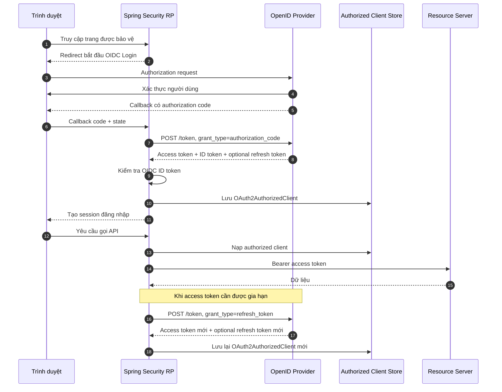
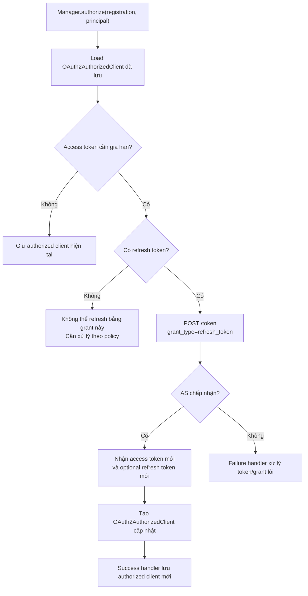
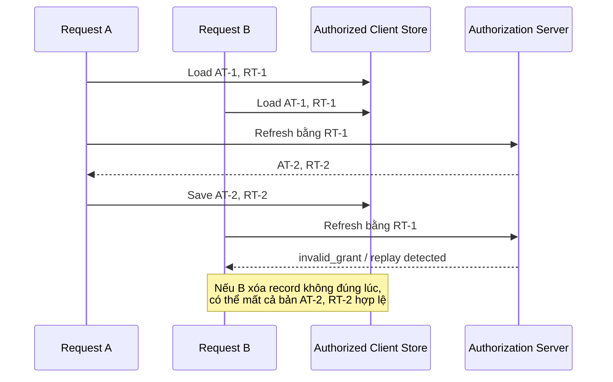
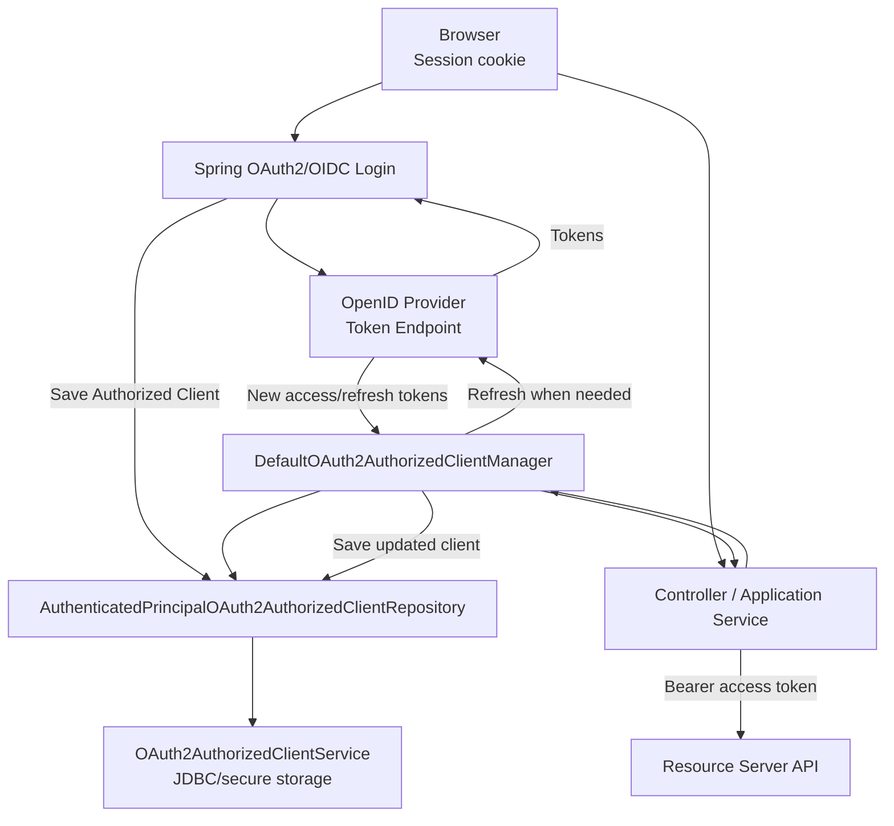

# 17.2. Lưu refresh token cùng authorized client

Trong ứng dụng **Spring Security OAuth 2.0/OIDC Client**, một người dùng có thể đăng nhập thành công, sử dụng chức năng trong nhiều phút hoặc nhiều giờ, rồi ứng dụng cần gọi API khi **access token cũ đã hết hạn**. Nếu Authorization Server (AS) đã cấp **refresh token**, OAuth client có thể yêu cầu một access token mới mà không nhất thiết đưa người dùng trở lại màn hình đăng nhập.

Câu hỏi thực tế không chỉ là “gửi refresh token như thế nào?”, mà còn là:

- Refresh token **được lưu ở đâu**, và gắn với **người dùng/client registration nào**?
- Khi access token được gia hạn, làm sao **lưu access token mới và refresh token mới nếu có**?
- Nếu refresh token bị thu hồi hoặc hết hạn, làm sao **không tiếp tục sử dụng bản cũ**?
- Khi triển khai **nhiều instance**, làm thế nào tránh hai request cùng dùng một refresh token đã được rotate?
- Cần bảo vệ token bằng những biện pháp nào trong HTTP session, database, log, sao lưu và lúc logout?

Trong Spring Security, đối tượng trọng tâm là **`OAuth2AuthorizedClient`**. Nó chứa `ClientRegistration`, `principalName`, access token và **refresh token tùy chọn**. Các abstraction `OAuth2AuthorizedClientRepository`, `OAuth2AuthorizedClientService` và `OAuth2AuthorizedClientManager` phối hợp để nạp, sử dụng, cập nhật và xóa authorized client.

**Nguyên tắc quan trọng:** Không lưu refresh token như một chuỗi tách rời, không có quan hệ với client, principal và access token tương ứng. Khi token response thay đổi, hãy cập nhật **authorized client nhất quán** theo hợp đồng Spring Security, đồng thời giữ refresh token trong vùng backend được bảo vệ.

## 1. Refresh token xuất hiện ở bước nào?

### 1.1. Luồng Authorization Code/OIDC Login

Một Spring MVC app có thể làm **OAuth client/Relying Party (RP)**, còn OP xử lý đăng nhập và cấp token.



Các điểm cần phân biệt:

1. **Authorization code** được sử dụng để đổi token ban đầu, không phải credential để dùng lặp đi lặp lại.
2. **ID token** (khi là OIDC) chứng minh kết quả xác thực với RP; không dùng thay refresh token.
3. **Access token** được dùng khi OAuth client gọi Resource Server.
4. **Refresh token** chỉ được gửi đến **Token Endpoint của AS** để xin token mới.
5. **HTTP session của RP** duy trì phiên đăng nhập; đây không đồng nghĩa refresh token lúc nào cũng được lưu trực tiếp trong session.

### 1.2. Refresh token không được cấp trong mọi trường hợp

Một token response có thể là:

```json
{
  "access_token": "<access-token>",
  "token_type": "Bearer",
  "expires_in": 3600,
  "refresh_token": "<refresh-token>",
  "scope": "openid profile orders.read",
  "id_token": "<id-token>"
}
```

Nhưng cũng có thể **không có `refresh_token`**:

```json
{
  "access_token": "<access-token>",
  "token_type": "Bearer",
  "expires_in": 3600,
  "scope": "openid profile orders.read",
  "id_token": "<id-token>"
}
```

Việc có refresh token phụ thuộc loại grant, client, scope, consent và chính sách AS/OP. Một đăng ký có scope `offline_access` **không bảo đảm** OP luôn cấp refresh token. Nếu không có refresh token, ứng dụng không được tự tạo giá trị giả hoặc mặc định có thể refresh.

## 2. OAuth2AuthorizedClient lưu những gì?

`OAuth2AuthorizedClient` là lớp quan trọng của Spring Security OAuth2 Client.

Về mặt cấu trúc:

```text
OAuth2AuthorizedClient
├── ClientRegistration
│   ├── registrationId
│   ├── clientId
│   ├── authorizationGrantType
│   └── ProviderDetails / tokenUri / ...
├── principalName
├── OAuth2AccessToken
│   ├── tokenValue
│   ├── issuedAt
│   ├── expiresAt
│   └── scopes
└── OAuth2RefreshToken  (có thể null)
    ├── tokenValue
    └── issuedAt
```

Cách đọc:

| Thành phần | Nguồn | Vai trò |
|---|---|---|
| `ClientRegistration` | Cấu hình Spring Boot/AS | OAuth client nào nhận token |
| `principalName` | Principal của authorization | Token thuộc ngữ cảnh ai |
| `accessToken` | Token response của AS | Credential gọi API |
| `refreshToken` | Token response của AS, nếu cấp | Credential xin access token mới |
| `registrationId` | Tên cục bộ Spring | Khóa tra client registration |

**Refresh token không nằm trong `ClientRegistration`.** Registration chứa **cấu hình client** và client authentication, còn authorized client chứa **kết quả ủy quyền cụ thể** và token đang được quản lý.

### 2.1. Ví dụ hai người dùng trên cùng một client registration

```text
registrationId = company

principalName = user-A
  -> accessToken-A
  -> refreshToken-A

principalName = user-B
  -> accessToken-B
  -> refreshToken-B
```

Cùng client ID/secret không khiến hai người dùng phải có cùng refresh token. Trộn authorized client của user A với request user B có thể dẫn đến **cross-user access**.

Trong nhiều triển khai, repository/service tra authorized client bằng cặp logic:

```text
(clientRegistrationId, principalName)
```

Repository dựa trên session còn có ngữ cảnh HTTP riêng. Không xây cache chỉ khóa theo `registrationId` nếu token gắn với một người dùng cụ thể.

### 2.2. Refresh token là nullable

`OAuth2AuthorizedClient#getRefreshToken()` có thể trả về `null`. Vì vậy:

```java
import org.springframework.security.oauth2.client.OAuth2AuthorizedClient;
import org.springframework.security.oauth2.core.OAuth2RefreshToken;

OAuth2RefreshToken refreshToken = authorizedClient.getRefreshToken();

if (refreshToken == null) {
    // AS chưa cấp refresh token cho authorized client này.
    // Không thể thực hiện refresh_token grant với một giá trị null.
}
```

Không viết:

```java
// Không an toàn trước trường hợp null.
String value = authorizedClient.getRefreshToken().getTokenValue();
```

rồi mặc định mọi OAuth2 Login đều có refresh token.

## 3. Ba abstraction lưu trữ liên quan

Spring Security tách **điều phối token** khỏi **cơ chế lưu token**.

### 3.1. ClientRegistrationRepository

`ClientRegistrationRepository` trả cấu hình của client theo registration ID, chẳng hạn `company`.

Đây **không phải** nơi lưu access token/refresh token của user.

### 3.2. OAuth2AuthorizedClientRepository — gắn với Servlet

`OAuth2AuthorizedClientRepository` hỗ trợ nạp/lưu/xóa authorized client trong ngữ cảnh:

- `Authentication` của principal.
- `HttpServletRequest`.
- `HttpServletResponse`.

Các thao tác thường gặp:

```java
OAuth2AuthorizedClient loadAuthorizedClient(
    String clientRegistrationId,
    Authentication principal,
    HttpServletRequest request
);

void saveAuthorizedClient(
    OAuth2AuthorizedClient authorizedClient,
    Authentication principal,
    HttpServletRequest request,
    HttpServletResponse response
);

void removeAuthorizedClient(
    String clientRegistrationId,
    Authentication principal,
    HttpServletRequest request,
    HttpServletResponse response
);
```

Điểm chính là repository có **ngữ cảnh HTTP**: nó có thể lưu trong session, chuyển cho một service, hoặc dùng chiến lược riêng.

### 3.3. OAuth2AuthorizedClientService — độc lập request

`OAuth2AuthorizedClientService` dùng cho cách lưu dựa trên registration/principal mà không cần Servlet request:

```java
OAuth2AuthorizedClient loadAuthorizedClient(
    String clientRegistrationId,
    String principalName
);

void saveAuthorizedClient(
    OAuth2AuthorizedClient authorizedClient,
    Authentication principal
);

void removeAuthorizedClient(
    String clientRegistrationId,
    String principalName
);
```

Một ứng dụng có thể có repository ủy quyền lưu dữ liệu cho authorized client service. Do đó:

- **Repository** và **service** không phải hai bản sao bắt buộc phải đồng bộ thủ công.
- Cần biết repository nào đang được `oauth2Login()` sử dụng để lưu token.
- Cần biết manager/controller nào nạp token từ repository/service tương ứng.
- Nếu hai bộ phận dùng storage khác nhau, application có thể đăng nhập thành công nhưng manager không tìm thấy authorized client.

## 4. Các lựa chọn lưu refresh token

| Cơ chế | Phù hợp | Ưu điểm | Điều cần bảo vệ |
|---|---|---|---|
| `HttpSessionOAuth2AuthorizedClientRepository` | Servlet app đơn giản, session-based | Liên kết token với phiên HTTP | Session hijacking, TTL, cluster, serialization |
| `InMemoryOAuth2AuthorizedClientService` | Demo/test, single instance nhỏ | Thiết lập đơn giản | Mất token khi restart, không chia sẻ nodes |
| `JdbcOAuth2AuthorizedClientService` | Dịch vụ cần persistence | DB lưu theo principal + registration | DB access control, encryption, backups, cleanup |
| Distributed/custom store | Nhiều nodes, lifecycle đặc thù | Chia sẻ trạng thái và TTL | Isolation, concurrency, network/TLS, rotation |
| Browser storage (localStorage/JS) | **Không phải lựa chọn mặc định cho confidential Spring backend** | — | XSS/token theft và mất ranh giới backend |

Không có một cách lưu nào phù hợp mọi sản phẩm. Chọn storage theo **thời gian sống phiên**, số instance, chính sách logout, yêu cầu refresh lâu dài và mức độ nhạy cảm của token.

**Khuyến nghị:** Với Spring MVC/BFF làm confidential OAuth client, giữ refresh token ở backend, không đưa nó vào JavaScript hoặc API response. Browser chỉ nên nhận cookie phiên được cấu hình bảo mật nếu kiến trúc dùng session.

## 5. Cấu hình OIDC Client có thể nhận refresh token

Ví dụ Spring Boot:

```yaml
spring:
  security:
    oauth2:
      client:
        registration:
          company:
            provider: company
            client-id: ${OIDC_CLIENT_ID}
            client-secret: ${OIDC_CLIENT_SECRET}
            client-authentication-method: client_secret_basic
            authorization-grant-type: authorization_code
            redirect-uri: "{baseUrl}/login/oauth2/code/{registrationId}"
            scope:
              - openid
              - profile
              - orders.read
              - offline_access
        provider:
          company:
            issuer-uri: ${OIDC_ISSUER_URI}
```

Giải thích:

- `registrationId=company` là tên cục bộ của registration.
- `client-id` và `client-secret` là credential của OAuth client, **khác refresh token của user**.
- `authorization-grant-type=authorization_code` mô tả login flow ban đầu.
- `openid` yêu cầu OIDC.
- `offline_access` là scope OIDC thường được dùng khi RP cần quyền truy cập offline, **nhưng phụ thuộc OP và điều kiện consent**.
- `issuer-uri` giúp Spring lấy metadata từ OP nếu hỗ trợ discovery.
- `redirect-uri` là callback từ OP về RP, **không phải Token Endpoint**.

Để AS thực sự cấp refresh token, có thể còn cần bật refresh token grant trong client registration của OP, cho phép loại client thích hợp, và đáp ứng consent/prompt hoặc policy của nhà cung cấp.

### 5.1. Kiểm tra sự khác biệt giữa requested và granted scopes

`scope` trong YAML là scope yêu cầu. Sau token exchange, hãy dựa trên token response/`OAuth2AccessToken#getScopes()` để biết granted scopes.

Đừng suy ra “đã cấu hình `offline_access` nên chắc chắn có refresh token”. Kiểm tra `authorizedClient.getRefreshToken() != null` trong vùng server là cách quan sát sự tồn tại của refresh token mà không làm lộ giá trị.

### 5.2. Confidential vs public clients

Spring Boot server-side app có thể bảo vệ client secret, nên thường là **confidential client**. SPA hoặc mobile app không thể giữ client secret theo cách tương tự; một số AS hỗ trợ refresh token cho public clients nhưng cần chính sách riêng như rotation, sender constraint và bảo vệ client-side.

Bài học tập trung vào **Spring Security OAuth2 Client phía backend**. Không sao chép hướng lưu refresh token từ HTTP session/DB backend sang localStorage của SPA.

## 6. Refresh token có được lưu tự động sau oauth2Login() không?

Trong luồng Spring Security `oauth2Login()`, sau khi token exchange thành công, framework có thể tạo `OAuth2AuthorizedClient` từ `ClientRegistration`, access token và refresh token nếu AS cấp; sau đó lưu authorized client qua cơ chế repository/service đã cấu hình.

Một cấu hình Servlet tối thiểu:

```java
import org.springframework.context.annotation.Bean;
import org.springframework.context.annotation.Configuration;
import org.springframework.security.config.Customizer;
import org.springframework.security.config.annotation.web.builders.HttpSecurity;
import org.springframework.security.web.SecurityFilterChain;

@Configuration
public class SecurityConfig {

    @Bean
    SecurityFilterChain webSecurity(HttpSecurity http) throws Exception {
        http
            .authorizeHttpRequests(auth -> auth
                .requestMatchers("/", "/error").permitAll()
                .anyRequest().authenticated())
            .oauth2Login(Customizer.withDefaults());

        return http.build();
    }
}
```

Ứng dụng không cần tự lấy `refresh_token` khỏi JSON response rồi ghi vào session attribute để được hưởng cơ chế lưu authorized client chuẩn.

**Tuy nhiên**, cần quan tâm:

1. AS có thực sự cấp refresh token không?
2. Flow đã sử dụng đúng `ClientRegistration` chưa?
3. Bean `OAuth2AuthorizedClientRepository` nào đang được sử dụng?
4. Authorized client có được lưu dưới đúng principal name không?
5. Manager dùng để refresh token có nạp từ **cùng storage logic** không?
6. Token có được giữ khi session hết hạn/restart theo yêu cầu sản phẩm không?

Câu trả lời phụ thuộc cấu hình ứng dụng, không thể suy ra chỉ từ việc `oauth2Login()` trả về thành công.

## 7. Đọc metadata refresh token an toàn

Để xác định authorized client có refresh token hay chưa, có thể dùng argument resolver của Spring MVC:

```java
import java.time.Instant;
import java.util.Set;

import org.springframework.security.oauth2.client.OAuth2AuthorizedClient;
import org.springframework.security.oauth2.client.annotation.RegisteredOAuth2AuthorizedClient;
import org.springframework.web.bind.annotation.GetMapping;
import org.springframework.web.bind.annotation.RestController;

@RestController
public class AuthorizedClientMetadataController {

    public record TokenMetadata(
        String registrationId,
        boolean refreshTokenPresent,
        Instant accessTokenExpiresAt,
        Set<String> grantedScopes
    ) {}

    @GetMapping("/internal/token-metadata")
    public TokenMetadata metadata(
            @RegisteredOAuth2AuthorizedClient("company")
            OAuth2AuthorizedClient authorizedClient) {

        return new TokenMetadata(
            authorizedClient.getClientRegistration().getRegistrationId(),
            authorizedClient.getRefreshToken() != null,
            authorizedClient.getAccessToken().getExpiresAt(),
            authorizedClient.getAccessToken().getScopes()
        );
    }
}
```

Điểm quan trọng:

- Không trả token value.
- Không gọi `getRefreshToken().getTokenValue()` để hiển thị trong HTML.
- Chỉ đưa ra Boolean `refreshTokenPresent`, expiry và scopes nếu phù hợp quyền quan sát của endpoint.
- Endpoint nên nằm trong vùng quản trị/debug được bảo vệ; thông tin cấu hình token cũng có thể nhạy cảm.
- `@RegisteredOAuth2AuthorizedClient` có thể đi qua cơ chế resolve/authorize tùy cấu hình và phiên bản; đoạn code giả định client phù hợp đang có thể resolve.

Nếu không có authorized client, cần xử lý việc thiếu/null theo application contract; đừng gắn việc lấy metadata vào một endpoint công khai rồi vô tình khởi tạo OAuth flow không mong muốn.

## 8. Nạp authorized client bằng OAuth2AuthorizedClientService

Một ứng dụng có thể nạp authorized client theo principal và registration, đặc biệt khi dùng service-based storage.

```java
import org.springframework.security.oauth2.client.OAuth2AuthorizedClient;
import org.springframework.security.oauth2.client.OAuth2AuthorizedClientService;

public final class AuthorizedClientInspector {

    private final OAuth2AuthorizedClientService clients;

    public AuthorizedClientInspector(OAuth2AuthorizedClientService clients) {
        this.clients = clients;
    }

    public boolean hasRefreshToken(
            String registrationId,
            String principalName) {

        OAuth2AuthorizedClient client =
            clients.loadAuthorizedClient(registrationId, principalName);

        return client != null && client.getRefreshToken() != null;
    }
}
```

**Giới hạn:** đoạn code này chỉ đúng nếu authorized client thực sự được lưu qua `OAuth2AuthorizedClientService` đó. Nếu ứng dụng chỉ dùng `HttpSessionOAuth2AuthorizedClientRepository`, gọi service có thể không thấy token.

Đừng thử lần lượt nhiều storage một cách không kiểm soát. Hãy xác định một **source of truth** cho authorized client theo kiến trúc, rồi bảo đảm các thành phần login, refresh và logout tương tác đúng nguồn đó.

## 9. Lưu refresh token trong HTTP session

### 9.1. HttpSessionOAuth2AuthorizedClientRepository

`HttpSessionOAuth2AuthorizedClientRepository` có thể lưu authorized client trong session của browser. Token nằm ở **server-side session state**, trong khi browser thường chỉ giữ session identifier qua cookie.

```text
Browser
  Cookie: JSESSIONID=<session-id>
          |
          v
Spring App / Session Store
  Session:
    SecurityContext
    OAuth2AuthorizedClient
      accessToken
      refreshToken (nếu có)
```

Từ góc nhìn browser, session cookie **không phải refresh token**. Không serialize toàn bộ authorized client vào cookie tự viết, vì điều đó có thể đưa token tới client-side storage không được bảo vệ như kỳ vọng.

### 9.2. Tình huống phù hợp

Session-based repository phù hợp khi:

- Refresh token chỉ cần tồn tại trong phiên ứng dụng.
- Logout hoặc session expiry có thể khiến user cần đăng nhập lại.
- Ứng dụng không cần gọi API thay user khi phiên đã kết thúc.
- Hệ thống quản lý được HTTP session lifecycle.

Nhưng cần đánh giá:

- Session storage nằm trong memory hay distributed store?
- Session attributes có được serialize xuống DB/cache không?
- Node nào sẽ xử lý request sau load balancer?
- Session timeout và refresh token TTL có tương thích không?
- Logout có xóa session và authorized client trong repository không?

### 9.3. Khi session được phân phối

Với Spring Session/Redis hoặc hệ thống tương tự, session có thể được lưu ngoài process. Khi đó refresh token không chỉ nằm trong JVM; nó có thể xuất hiện trong **Redis, backup, replica hoặc monitoring**. Cần mã hóa/kiểm soát truy cập mạng và lifecycle xóa token tương ứng.

Không dựa vào việc browser logout để khẳng định bản sao token trong backup hoặc session store đã biến mất ngay lập tức.

## 10. Lưu authorized client theo principal với AuthenticatedPrincipalOAuth2AuthorizedClientRepository

Một implementation thường gặp là `AuthenticatedPrincipalOAuth2AuthorizedClientRepository`. Với principal đã xác thực, nó có thể ủy quyền việc lưu authorized client cho một `OAuth2AuthorizedClientService`.

Ví dụ wiring minh họa:

```java
import org.springframework.context.annotation.Bean;
import org.springframework.context.annotation.Configuration;
import org.springframework.security.oauth2.client.OAuth2AuthorizedClientService;
import org.springframework.security.oauth2.client.web.AuthenticatedPrincipalOAuth2AuthorizedClientRepository;
import org.springframework.security.oauth2.client.web.OAuth2AuthorizedClientRepository;

@Configuration
public class AuthorizedClientRepositoryConfig {

    @Bean
    OAuth2AuthorizedClientRepository authorizedClientRepository(
            OAuth2AuthorizedClientService authorizedClientService) {

        return new AuthenticatedPrincipalOAuth2AuthorizedClientRepository(
            authorizedClientService
        );
    }
}
```

Đây là ví dụ cho thấy repository có thể dùng service làm storage backend. Không nhất thiết tạo bean này nếu Spring Boot đã auto-configure phù hợp. Hãy bảo đảm `oauth2Login()` và `OAuth2AuthorizedClientManager` cùng sử dụng repository/service mong muốn, tránh có hai nguồn token.

### 10.1. Vì sao principal name rất quan trọng?

Một repository/service có thể tra authorized client theo:

```text
(registrationId="company", principalName="user-725")
```

Nếu ứng dụng thay đổi `Authentication.getName()` từ `sub` sang email/nickname hoặc từ email sang một user ID nội bộ, những token lưu trước đó có thể không còn được tìm thấy bằng principal name mới.

Ngoài tình huống token “biến mất”, chính sách đổi username cũng có thể gây **trộn identity** nếu cùng một chuỗi principal name được tái sử dụng cho tài khoản khác.

Với OIDC, một external identity ổn định thường dựa trên **`(iss, sub)`**; việc chọn `principalName` để lưu authorized client phải nhất quán với identity mapping và đăng ký client. Đừng đổi principal key tùy tiện chỉ để hiển thị tên/email dễ đọc hơn.

## 11. InMemoryOAuth2AuthorizedClientService: dùng đúng phạm vi

Để học và thử nghiệm, Spring Security có `InMemoryOAuth2AuthorizedClientService`:

```java
import org.springframework.context.annotation.Bean;
import org.springframework.context.annotation.Configuration;
import org.springframework.security.oauth2.client.InMemoryOAuth2AuthorizedClientService;
import org.springframework.security.oauth2.client.OAuth2AuthorizedClientService;
import org.springframework.security.oauth2.client.registration.ClientRegistrationRepository;

@Configuration
public class AuthorizedClientServiceConfig {

    @Bean
    OAuth2AuthorizedClientService authorizedClientService(
            ClientRegistrationRepository registrations) {

        return new InMemoryOAuth2AuthorizedClientService(registrations);
    }
}
```

Nếu Spring Boot đã tạo service phù hợp, không cần thêm bean chỉ để sử dụng implementation này.

**Ưu điểm:**

- Dễ cấu hình.
- Hỗ trợ đọc/lưu authorized client theo principal và registration.
- Phù hợp demo, học tập hoặc một instance không cần persistence.

**Giới hạn:**

- Restart process có thể làm mất authorized clients.
- Mỗi instance có bộ nhớ riêng.
- Không tự giải quyết session/distributed storage.
- Không có các đặc tính mã hóa-at-rest, backup và retention của một storage production.
- Không tự giải quyết refresh token rotation race giữa nhiều threads/nodes.

Khi mất authorized client, app có thể cần cho người dùng thực hiện authorization/login lại. Không thể tái tạo refresh token đã mất chỉ bằng client ID/secret.

## 12. JdbcOAuth2AuthorizedClientService: lưu token trong database

Khi ứng dụng muốn giữ authorized client qua restart hoặc dùng một nguồn persistent store, có thể sử dụng `JdbcOAuth2AuthorizedClientService`, nếu phiên bản Spring Security và schema tương ứng được hỗ trợ.

Ví dụ wiring:

```java
import org.springframework.context.annotation.Bean;
import org.springframework.context.annotation.Configuration;
import org.springframework.jdbc.core.JdbcOperations;
import org.springframework.security.oauth2.client.JdbcOAuth2AuthorizedClientService;
import org.springframework.security.oauth2.client.OAuth2AuthorizedClientService;
import org.springframework.security.oauth2.client.registration.ClientRegistrationRepository;

@Configuration
public class PersistentAuthorizedClientConfig {

    @Bean
    OAuth2AuthorizedClientService authorizedClientService(
            JdbcOperations jdbcOperations,
            ClientRegistrationRepository registrations) {

        return new JdbcOAuth2AuthorizedClientService(
            jdbcOperations, registrations
        );
    }
}
```

Đoạn code trên giả định:

- Ứng dụng có `spring-jdbc`, DataSource và `JdbcOperations`.
- Database đã được tạo **schema OAuth2 authorized client tương thích** với class/phiên bản Spring Security.
- Bean service không bị trùng với implementation khác.
- Quyền đọc/ghi token được kiểm soát ở hạ tầng và ứng dụng.

**Quan trọng:** tạo `JdbcOAuth2AuthorizedClientService` không tự tạo bảng DB. Cần dùng migration schema được quản trị (Flyway/Liquibase hoặc tương đương), theo định nghĩa chính thức của phiên bản đang dùng.

### 12.1. Những dữ liệu cần được quản trị

Một authorized client record có thể bao gồm:

| Nhóm dữ liệu | Mục đích | Độ nhạy cảm |
|---|---|---|
| Client registration ID | Khóa tra cấu hình | Nội bộ |
| Principal name | Chủ thể gắn với token | Có thể là dữ liệu định danh |
| Access token value | Gọi API | **Credential nhạy cảm** |
| Access token expiry/issued at | Vòng đời token | Metadata |
| Granted scopes | Quyền token được cấp | Có thể nhạy cảm |
| Refresh token value | Gia hạn access token | **Credential nhạy cảm cao** |
| Refresh token issued at | Vòng đời/kiểm toán | Metadata |

Một refresh token bị lộ có thể cho phép kẻ tấn công xin access token mới khi đáp ứng được điều kiện client authentication hoặc ràng buộc token. Tác động tùy client type/AS, nhưng đây vẫn là credential cần bảo vệ nghiêm ngặt.

### 12.2. Mã hóa khi lưu trong DB

TLS khi kết nối DB và encryption-at-rest của disk là quan trọng nhưng có thể chưa đủ cho threat model của tổ chức. Nếu attacker có quyền `SELECT` trực tiếp lên bảng token, họ vẫn có thể thấy token ở dạng rõ nếu storage không mã hóa tại tầng ứng dụng.

Có thể cần:

1. Mã hóa token value trước khi persist, giải mã ở lớp storage được tin cậy.
2. Để encryption keys trong KMS/HSM/secret manager riêng, không nằm cùng DB.
3. Quản lý key rotation và re-encryption.
4. Giới hạn DB roles chỉ cho service cần thiết.
5. Cấm xuất bảng token sang analytics hoặc log.
6. Kiểm soát backup/snapshot và thời gian lưu.

`JdbcOAuth2AuthorizedClientService` mặc định không nên bị mặc nhiên coi là cung cấp đầy đủ mọi yêu cầu mã hóa custom của doanh nghiệp. Nếu cần application-level encryption, phải thiết kế wrapper/custom service có kiểm thử và chính sách rõ, không sửa bằng cách log token rồi mã hóa “sau”.

## 13. Manager điều phối việc lưu access token và refresh token

Sau login, Authorized Client Manager giúp application **lấy authorized client hiện có, kiểm tra có cần cấp lại, và lưu kết quả cập nhật**.

Với request Servlet, có thể dùng:

```java
import org.springframework.context.annotation.Bean;
import org.springframework.context.annotation.Configuration;
import org.springframework.security.oauth2.client.OAuth2AuthorizedClientManager;
import org.springframework.security.oauth2.client.OAuth2AuthorizedClientProvider;
import org.springframework.security.oauth2.client.OAuth2AuthorizedClientProviderBuilder;
import org.springframework.security.oauth2.client.registration.ClientRegistrationRepository;
import org.springframework.security.oauth2.client.web.DefaultOAuth2AuthorizedClientManager;
import org.springframework.security.oauth2.client.web.OAuth2AuthorizedClientRepository;

@Configuration
public class OAuth2AuthorizedClientManagerConfig {

    @Bean
    OAuth2AuthorizedClientManager authorizedClientManager(
            ClientRegistrationRepository registrations,
            OAuth2AuthorizedClientRepository authorizedClients) {

        OAuth2AuthorizedClientProvider provider =
            OAuth2AuthorizedClientProviderBuilder.builder()
                .authorizationCode()
                .refreshToken()
                .build();

        var manager = new DefaultOAuth2AuthorizedClientManager(
            registrations,
            authorizedClients
        );

        manager.setAuthorizedClientProvider(provider);
        return manager;
    }
}
```

Cách sử dụng:

```java
OAuth2AuthorizeRequest request =
    OAuth2AuthorizeRequest
        .withClientRegistrationId("company")
        .principal(authentication)
        .build();

OAuth2AuthorizedClient authorizedClient = manager.authorize(request);
```

Ví dụ giả định code chạy trong **Servlet request context có authentication hợp lệ**, các biến `authentication` và `manager` đã được cung cấp. Nếu chạy trong scheduled job mà không có HTTP request, nên dùng manager dựa trên `OAuth2AuthorizedClientService`, không phải Servlet manager.

**Không phải mỗi lần `authorize(...)` đều refresh.** Manager/provider xác định khi nào token còn dùng được, khi nào có thể dùng refresh token, và khi nào không thể cấp lại token theo điều kiện hiện tại.

## 14. Luồng refresh token và cách lưu bản cập nhật

Một lần refresh thành công thường có trình tự:



Điều quan trọng nhất là bước **lưu bản mới**, không chỉ lấy access token mới ra dùng cho một request.

### 14.1. Refresh token request

Request minh họa với confidential client:

```http
POST /oauth2/token HTTP/1.1
Host: login.example.org
Content-Type: application/x-www-form-urlencoded
Authorization: Basic <client-credentials>

grant_type=refresh_token&refresh_token=<existing-refresh-token>
```

AS xác minh refresh token và client authentication theo chính sách. `scope` có thể được chỉ định để thu hẹp phạm vi theo quy tắc được AS hỗ trợ; không phải cách tùy ý xin scope rộng hơn grant ban đầu.

### 14.2. Token response khi refresh

**Trường hợp AS chỉ cấp access token mới:**

```json
{
  "access_token": "<new-access-token>",
  "token_type": "Bearer",
  "expires_in": 3600,
  "scope": "orders.read"
}
```

**Trường hợp AS rotate refresh token:**

```json
{
  "access_token": "<new-access-token>",
  "token_type": "Bearer",
  "expires_in": 3600,
  "refresh_token": "<new-refresh-token>",
  "scope": "orders.read"
}
```

Theo OAuth 2.0, khi token response trả refresh token mới, client **phải thay refresh token cũ bằng token mới** và không tiếp tục sử dụng bản cũ. Nếu response không có refresh token mới, hành vi tiếp tục dùng refresh token trước đó phải phù hợp giao thức/chính sách AS và được token response client/provider xử lý.

Spring Security có abstraction cho refresh grant; thường nên để manager/provider tạo và lưu `OAuth2AuthorizedClient` cập nhật, thay vì tự thao tác trên JSON của AS.

### 14.3. Vì sao phải cập nhật authorized client như một đơn vị?

Giả sử sau refresh:

```text
Trước:
  accessToken = AT-1 (expired)
  refreshToken = RT-1

Sau:
  accessToken = AT-2 (new)
  refreshToken = RT-2 (rotated)
```

Nếu ứng dụng chỉ lưu `AT-2` nhưng vẫn giữ `RT-1`, request refresh tiếp theo có thể bị AS từ chối. Nếu chỉ lưu `RT-2` nhưng mất access token metadata, manager có thể đánh giá sai hiệu lực.

Vì vậy, hãy coi authorized client là một **record nhất quán của trạng thái authorization hiện tại**. Khi dùng persistence tùy biến, update nên có tính nguyên tử hoặc cơ chế đồng bộ phù hợp.

## 15. RefreshTokenOAuth2AuthorizedClientProvider trong thực tế

`OAuth2AuthorizedClientProviderBuilder` cung cấp khả năng cấu hình refresh token provider:

```java
import java.time.Duration;
import org.springframework.security.oauth2.client.OAuth2AuthorizedClientProviderBuilder;

var provider = OAuth2AuthorizedClientProviderBuilder.builder()
    .authorizationCode()
    .refreshToken(config -> config
        .clockSkew(Duration.ofSeconds(60)))
    .build();
```

Đoạn này minh họa cách đặt clock skew nếu API của phiên bản Spring Security đang dùng hỗ trợ. Clock skew giúp provider chủ động xem token gần hết hạn là cần gia hạn; không thay thế việc đồng bộ đồng hồ giữa AS, RP và Resource Server.

### 15.1. Có refresh token nhưng không nhất thiết được refresh ngay

Manager có thể trả authorized client cũ nếu access token vẫn còn thời hạn phù hợp. Điều này tránh gọi AS quá thường xuyên.

### 15.2. Token hết hạn nhưng không có refresh token

Khi access token hết hạn và `refreshToken == null`, refresh provider không có credential để thực hiện refresh grant. Tùy flow, người dùng có thể cần thực hiện authorization/login lại.

Đừng cố lấy `client_secret` làm “refresh token thay thế”. Client secret xác thực OAuth client, không cho phép bỏ qua grant/authorization của End-User.

### 15.3. Không cần refresh token cho mọi loại grant

Với `client_credentials`, backend thường xin **access token mới** bằng chính client credentials khi token hết hạn. Không nên dùng một user refresh-token storage để quản lý token của background workload nếu ứng dụng không cần quyền người dùng.

## 16. Refresh token rotation: nguy cơ khi nhiều request chạy đồng thời

### 16.1. Mô hình race condition

Giả sử hai request A và B đến cùng lúc, cùng nạp authorized client chứa `RT-1`.



Đây là rủi ro thực tế khi AS dùng refresh token rotation và có nhiều request/nodes chung một storage. **Default Authorized Client Manager không nên được mặc định coi là distributed lock** cho tất cả ứng dụng.

### 16.2. Cách giảm rủi ro

Tùy tải và chính sách, có thể cần:

- Đồng bộ việc refresh theo **(registrationId, principal identity)**.
- Dùng per-key lock khi chạy một JVM; với nhiều nodes cần coordination/distributed lock phù hợp.
- Dùng optimistic locking/version/CAS khi update authorized client, nếu storage hỗ trợ.
- Khi refresh bị từ chối, tải lại record mới nhất trước khi quyết định xóa hoặc login lại.
- Chỉ xóa authorized client nếu có đủ căn cứ record lỗi là record vẫn đang được lưu.
- Giới hạn retry; không lặp lại `RT-1` đã bị rotate.
- Đảm bảo thời gian sống lock và failure recovery không gây deadlock hoặc treo toàn bộ requests.

Không biến mỗi request API thành một lượt refresh token bằng cách đặt clock skew quá lớn hoặc mất cache giữa các request.

### 16.3. Vì sao failure handler cần được thiết kế cẩn thận?

Spring Security có `OAuth2AuthorizationFailureHandler` để xử lý lỗi authorization. Một hành vi hữu ích khi gặp `invalid_grant` là **loại bỏ authorized client không còn hợp lệ** để request sau không dùng lại refresh token cũ.

Tuy vậy, trong race condition, một request thất bại với RT cũ **không chứng minh** record mới nhất trong DB đã sai. Nếu đang xây custom service/failure handler cho multi-node và rotation nghiêm ngặt, cần cân nhắc compare-and-delete hoặc logic kiểm tra phiên bản trước khi xóa.

Với app nhỏ/single instance, cấu hình mặc định có thể đủ. Với hệ thống có yêu cầu tính sẵn sàng cao, token rotation và concurrency phải được thiết kế ở tầng persistence/lifecycle.

## 17. Xử lý invalid_grant và những lỗi refresh thường gặp

| Lỗi / biểu hiện | Nguyên nhân có thể | Cách xử lý định hướng |
|---|---|---|
| `invalid_grant` | Refresh token hết hạn, bị thu hồi, đã dùng/rotate hoặc sai ràng buộc | Loại bỏ token stale có kiểm soát, cho user authorization lại khi cần |
| `invalid_client` | Client ID/secret/auth method bị sai hoặc rotate | Kiểm tra cấu hình client backend, không quy lỗi cho user |
| `invalid_request` | Thiếu refresh token hoặc form data sai | Kiểm tra token response client/grant setup |
| `unauthorized_client` | Client không được dùng refresh token grant | Kiểm tra policy AS |
| HTTP 429/5xx | AS quá tải/lỗi tạm thời | Retry có giới hạn; không xóa token đang hợp lệ một cách mù quáng |
| Timeout/TLS error | Backend không kết nối Token Endpoint | Kiểm tra network, TLS, proxy |
| Refresh thành công nhưng lần sau vẫn dùng token cũ | Success handler không lưu hoặc lưu sai key | Kiểm tra repository/service, principal và transaction |
| Refresh token mới biến mất sau restart | In-memory session/store | Chọn persistence phù hợp |
| Chỉ lỗi ở một node | Storage không chia sẻ hoặc cache stale | Session cluster, DB, concurrency |
| Refresh token được trả nhưng `getRefreshToken()==null` | Token response không được parse/persist như kỳ vọng hoặc flow khác | Kiểm tra token response contract/wiring |
| Logout rồi vẫn có refresh token trong DB | Chưa xóa authorized client hoặc chưa revoke tại OP | Thiết kế logout/token revocation/retention |
| Không có refresh token từ OP | Chính sách scope, consent, client type | Kiểm tra AS settings, không tự tạo token |

### 17.1. Không dùng expired refresh token vô hạn

Khác access token, refresh token có thể có hoặc không có thông tin `expires_in` được cung cấp theo giao thức/extension của AS. `OAuth2RefreshToken` trong Spring có thể không biết đầy đủ thời hạn server-side của token.

Do đó, việc refresh token “còn tồn tại trong DB” **không chứng minh** AS sẽ tiếp tục chấp nhận nó. AS có thể có absolute lifetime, idle timeout, revocation, reuse detection hoặc ràng buộc phiên.

Ứng dụng phải xử lý lỗi grant đúng cách, không suy đoán hiệu lực chỉ từ `issuedAt`.

### 17.2. Không tự tạo retry loop

Ví dụ anti-pattern:

```java
while (true) {
    try {
        return tryRefresh();
    } catch (Exception ignored) {
        // Vòng lặp vô hạn, dễ gây tải AS và che lỗi credential.
    }
}
```

Với `invalid_grant`, retry cùng refresh token thường vô ích và có thể kích hoạt cơ chế phát hiện reuse. Với timeout/5xx, áp dụng backoff có giới hạn và circuit breaker theo nhu cầu, phân biệt lỗi tạm thời và lỗi credential.

## 18. Session timeout, logout và refresh token không đồng nghĩa

### 18.1. Ba vòng đời khác nhau

| Vòng đời | Ai quản lý? | Khi hết hạn/đóng |
|---|---|---|
| **RP HTTP session** | Ứng dụng Spring/Session Store | Browser mất phiên ứng dụng |
| **Access token** | AS/Resource Server | API không còn chấp nhận token |
| **Refresh token** | AS và OAuth client storage | Không thể xin access token mới bằng refresh grant đó |

Một RP session có thể hết hạn trước refresh token. Một refresh token có thể bị thu hồi trong khi browser vẫn còn session. Access token có thể còn hiệu lực sau logout nếu AS/RS chưa thu hồi nó.

Không dùng “session vẫn còn” để kết luận refresh token hợp lệ hoặc “logout khỏi RP” để khẳng định AS đã thu hồi token.

### 18.2. Logout khỏi RP

Ví dụ:

```java
http.logout(logout -> logout
    .logoutSuccessUrl("/")
);
```

Cấu hình trên chủ yếu điều khiển logout trong ứng dụng web. Nó **không mặc định** thực hiện tất cả bước sau:

- Xóa mọi authorized client stored trong DB.
- Gọi AS token revocation endpoint.
- Kết thúc SSO session tại OP.
- Thu hồi mọi access token đã cấp cho API.
- Xóa dữ liệu trong backup.

Nếu sản phẩm cần logout/token revocation chặt, phải có thiết kế riêng: xóa authorized client khỏi storage, cân nhắc `RFC 7009` khi AS hỗ trợ revocation, và liên kết với OIDC RP-Initiated Logout khi phù hợp.

### 18.3. OIDC Logout và refresh token persistence

**OIDC logout tại OP** và **refresh token storage của RP** là hai trách nhiệm khác nhau. Một OP có thể xóa SSO session nhưng chưa chắc đã thu hồi ngay refresh token của client nếu policy không quy định như vậy.

Đừng chỉ dựa vào redirect user sang OP logout endpoint để coi backend đã xóa mọi credential. Cần xác định contract của OP và chính sách local persistence.

## 19. Xóa authorized client trong service và repository

### 19.1. Xóa theo principal name trong OAuth2AuthorizedClientService

Ví dụ:

```java
import org.springframework.security.oauth2.client.OAuth2AuthorizedClientService;

public final class AuthorizedClientCleanup {

    private final OAuth2AuthorizedClientService service;

    public AuthorizedClientCleanup(OAuth2AuthorizedClientService service) {
        this.service = service;
    }

    public void removeCompanyAuthorization(String principalName) {
        service.removeAuthorizedClient("company", principalName);
    }
}
```

Thao tác này xóa record mà service quản lý, gồm access token/refresh token lưu trong đó. **Nó không tự gửi token revocation request đến AS**.

Phải bảo đảm `principalName` lấy từ danh tính đã xác thực và mapping đúng, không phải query parameter tùy ý cho phép một user xóa token của user khác.

### 19.2. Xóa theo request trong OAuth2AuthorizedClientRepository

Với Servlet repository:

```java
authorizedClientRepository.removeAuthorizedClient(
    "company",
    authentication,
    request,
    response
);
```

Biến `authentication` phải tương ứng principal sở hữu authorized client; `request`/`response` là ngữ cảnh Servlet. Không thay một API của service bằng repository API nếu không có HTTP context.

### 19.3. Xóa local không đồng nghĩa revoke tại OP

Nếu yêu cầu bảo mật cần thu hồi, trình tự thường là:

1. Xác định authorized client thuộc user/registration phù hợp.
2. Nếu OP/AS hỗ trợ `token revocation`, thực hiện request revocation theo contract và client authentication đúng.
3. Xóa authorized client tại local storage.
4. Dọn phiên và dữ liệu liên quan theo chính sách.
5. Xử lý trường hợp AS tạm thời không sẵn sàng và không để lại token trong log.

Quy trình chi tiết và lựa chọn retry phụ thuộc yêu cầu giao dịch; đừng hứa có atomic transaction xuyên RP DB và AS nếu không có cơ chế phối hợp riêng.

## 20. Mã hóa, phân quyền và quản trị refresh token

Refresh token là một credential thường có thời gian sử dụng tiềm năng dài hơn access token. Khi bị lộ, kẻ tấn công có thể cố xin token mới trong phạm vi AS cho phép. Những biện pháp quan trọng:

### 20.1. Secret handling

- Lưu refresh token phía backend; không đưa vào HTML, JavaScript, localStorage hoặc response JSON.
- Không đặt token vào URL query, path, browser history hoặc analytics.
- Không ghi HTTP `Authorization` header, refresh token request body hoặc token response raw vào log.
- Không in `OAuth2AuthorizedClient` thô trong exception/debugger nếu không kiểm soát serialization.
- Giới hạn quyền truy cập DB/Redis chứa token.
- Mã hóa-at-rest theo yêu cầu threat model; dùng TLS khi kết nối storage.

### 20.2. Token rotation và replay detection

Nếu AS dùng rotation, refresh token mới thay thế token cũ. Client cần:

- Lưu refresh token mới ngay sau response thành công.
- Không lưu thêm bản cũ như “fallback”.
- Xử lý lỗi reuse theo chính sách AS.
- Tránh concurrency tạo hai lần refresh cùng token.
- Không retry mù quáng với token cũ sau `invalid_grant`.

Rotation không thay thế việc bảo vệ storage. Nếu attacker đánh cắp token và chạy nhanh hơn client hợp lệ, vẫn có thể gây gián đoạn hoặc chiếm quyền trong một số tình huống; sender-constrained token hoặc chính sách AS có thể làm giảm rủi ro.

### 20.3. Access token và refresh token có giá trị rủi ro khác nhau

Access token thường dùng để gọi API và có thời hạn ngắn hơn. Refresh token có thể kéo dài khả năng xin access token mới. Điều đó làm việc lưu refresh token trong DB/backups trở thành một rủi ro đáng phân tích.

Tuy nhiên, không mặc định refresh token nào cũng “mạnh hơn” mọi access token: mức ảnh hưởng còn phụ thuộc scope, client binding, thời hạn, loại resource và cơ chế thu hồi. Cả hai đều phải được coi là secrets.

### 20.4. Chính sách retention

Storage nên có chính sách dọn record:

- User đã unlink provider.
- User bị vô hiệu hóa/khóa local account.
- Client registration bị xóa hoặc rotate.
- Token bị AS thu hồi hay liên tục báo `invalid_grant`.
- Authorized client không được sử dụng quá thời gian quy định.
- Session/consent bị thu hồi, theo contract OP.

Không giữ refresh token vô thời hạn trong DB chỉ vì application không có job cleanup. Mỗi quyết định retention cần phù hợp chính sách phiên và yêu cầu nghiệp vụ.

## 21. Multi-instance và database consistency

Khi triển khai nhiều Spring Boot instances cùng dùng DB authorized client:

```text
              +----------------------+
Browser ----> | Load Balancer        |
              +-----------+----------+
                          |
                   +------+------+
                   |             |
              Spring A       Spring B
                   |             |
                   +------+------+
                          |
                   Authorized Client DB
                          |
                   Refresh Token State
```

Hai lớp consistency cần chú ý:

1. **Session/Authentication context**: mỗi request phải biết đúng principal đã login.
2. **Authorized client state**: access/refresh tokens được lưu và cập nhật nhất quán.

Một DB chung không tự giải quyết race condition khi hai instance cùng refresh token. Có thể cần optimistic concurrency, lock theo principal/registration hoặc cơ chế khác tùy sản phẩm.

### 21.1. Session affinity không giải quyết mọi thứ

Sticky session có thể giảm việc request của cùng browser đến nhiều nodes, nhưng:

- Một user có thể mở nhiều tab.
- Có background tasks liên quan cùng user.
- Có failover/node restart.
- Có nhiều HTTP requests đồng thời.
- Token có thể được chia sẻ bởi repository/service khác.

Vì vậy, cần kiểm soát concurrency ở đúng tầng, không chỉ dựa vào load balancer.

### 21.2. Principal name phải thống nhất

Nếu Spring A dùng `authentication.getName() = user-725` và Spring B dùng email `user@example.org` làm principal key, cả hai có thể tra các authorized client khác nhau cho cùng user.

Giữ identity mapping và principal naming nhất quán giữa nodes/versions. Khi đổi chiến lược định danh, có migration và cleanup đúng, không để lại những refresh token không còn chủ sở hữu rõ ràng.

## 22. Trường hợp backend job dùng refresh token của người dùng

Một scheduled job chạy ngoài Servlet request có thể có nhu cầu dùng **authorization đã được user cấp** để gọi API trong một khoảng thời gian. Đây là mô hình nhạy cảm và khác `client_credentials`.

Nếu sản phẩm thật sự có offline delegated access:

- AS/OP phải cấp refresh token cho phép dùng trong bối cảnh đó.
- Ứng dụng phải có consent và mục đích xử lý phù hợp.
- Token phải được gắn với **đúng external identity** và client registration.
- Job phải biết principal name đáng tin cậy để nạp authorized client.
- Cần tôn trọng thu hồi consent, khóa account, tenant và quyền ở API.
- Cần bảo vệ persistent storage và chính sách cleanup.

Khi chạy ngoài request, `AuthorizedClientServiceOAuth2AuthorizedClientManager` có thể sử dụng service-based authorized client storage và provider `refreshToken()` để gia hạn **một authorized client đã tồn tại**.

Ví dụ wiring định hướng:

```java
import org.springframework.context.annotation.Bean;
import org.springframework.context.annotation.Configuration;
import org.springframework.security.oauth2.client.AuthorizedClientServiceOAuth2AuthorizedClientManager;
import org.springframework.security.oauth2.client.OAuth2AuthorizedClientManager;
import org.springframework.security.oauth2.client.OAuth2AuthorizedClientProviderBuilder;
import org.springframework.security.oauth2.client.OAuth2AuthorizedClientService;
import org.springframework.security.oauth2.client.registration.ClientRegistrationRepository;

@Configuration
public class OfflineAuthorizedClientConfig {

    @Bean
    OAuth2AuthorizedClientManager offlineAuthorizedClientManager(
            ClientRegistrationRepository registrations,
            OAuth2AuthorizedClientService clients) {

        var manager = new AuthorizedClientServiceOAuth2AuthorizedClientManager(
            registrations, clients
        );

        manager.setAuthorizedClientProvider(
            OAuth2AuthorizedClientProviderBuilder.builder()
                .refreshToken()
                .build()
        );

        return manager;
    }
}
```

**Giới hạn cốt lõi:** manager này không tự đi qua browser authorization-code flow để xin consent mới. Nó chỉ refresh được authorized client **đã được lưu** với refresh token phù hợp. Nếu token bị thu hồi hoặc không tồn tại, cần quy trình user authorization lại, không tự giả làm user.

Không tự gọi scheduled job bằng token của “user gần nhất đăng nhập”. Phải xác định đúng người đã ủy quyền job đó, mục đích sử dụng và quyền dữ liệu.

## 23. Những anti-pattern cần tránh

### 23.1. Lưu refresh token vào một biến string toàn cục

```java
// Không an toàn cho multi-user application.
static String refreshToken;
```

Vấn đề: mất liên kết với principal/registration, rò rỉ cross-user, mất khi restart, không có metadata và policy cleanup.

**Thay thế:** giữ token trong `OAuth2AuthorizedClient` và storage phù hợp.

### 23.2. Chỉ lưu access token sau refresh

```text
Refresh response:
  AT-2
  RT-2

App chỉ update AT-2, vẫn giữ RT-1
```

Điều này phá rotation. Cần lưu authorized client cập nhật, gồm refresh token mới nếu AS đã cấp.

### 23.3. Giữ refresh token cũ làm “dự phòng”

Với refresh token rotation, token cũ có thể bị vô hiệu hóa ngay và việc reuse có thể bị coi là hành vi đáng ngờ. Không giữ RT cũ để retry vô hạn.

### 23.4. Cache theo registrationId mà bỏ principal

```text
company -> refresh-token-of-user-A
```

Nếu user B cũng login bằng `company` và cache bị tái sử dụng, ứng dụng có thể gửi request thay user A.

**Thay thế:** lưu đúng khóa principal + registration hoặc repository/session isolation tương ứng.

### 23.5. Log raw refresh token khi debug

```java
// Không nên:
log.debug("refreshToken={}", client.getRefreshToken().getTokenValue());
```

Token có thể vào log aggregator, trace, backup và tài khoản vận hành. Hãy log Boolean có refresh token, registration ID và error code nếu cần.

### 23.6. Giả định logout đã revoke mọi token

Xóa session RP và chuyển browser tới OP logout endpoint không đồng nghĩa credential trong DB đã bị xóa/revoke.

### 23.7. Dùng refresh token để gọi API

```http
Authorization: Bearer <refresh-token>
```

Sai vai trò. Refresh token dành cho Token Endpoint; Resource Server cần **access token** được cấp đúng audience/scope.

### 23.8. Dùng client secret thay refresh token

Client secret xác thực confidential OAuth client; nó không thay thế một refresh token gắn với authorization grant của user.

### 23.9. Tự sửa thời gian hết hạn trong DB

Không đổi metadata `expiresAt` để “kéo dài” hiệu lực của access token hoặc refresh token tại AS. AS/Resource Server xác định token có hợp lệ; sửa DB nội bộ không khiến AS tiếp tục chấp nhận token.

### 23.10. Dùng cùng một principal cho mọi tenant

Nếu token được giới hạn theo tenant/user mà app dùng một principal kỹ thuật chung, authorized client có thể bị nạp nhầm. Phải thiết kế khóa storage theo đúng identity và client/tenant boundary.

## 24. Quy trình chẩn đoán khi refresh token không được lưu

Một tình huống phổ biến: login hoạt động, có access token, nhưng `getRefreshToken()` trả null hoặc token biến mất sau một khoảng thời gian.

### 24.1. Kiểm tra theo thứ tự

1. **OP có cấp refresh token không?** Kiểm tra token endpoint contract và cấu hình client bằng cách quan sát có kiểm soát, không log secret.
2. **Client có yêu cầu scope/chính sách phù hợp không?** `offline_access`, consent và OP policy là những yếu tố có thể liên quan.
3. **Flow có đúng registration không?** Tránh dùng registration khác với scope/grant khác.
4. **Login có lưu OAuth2AuthorizedClient không?** Kiểm tra repository/service wiring.
5. **Manager có nạp cùng nguồn không?** Repository session khác service DB có thể dẫn đến “mất” token.
6. **Principal name có đổi không?** Email/nickname/user ID thay đổi có thể làm storage lookup sai.
7. **Session đã hết hạn hoặc app restart chưa?** In-memory/session storage không mặc nhiên persistent.
8. **Có refresh token rotation không?** AS có cấp RT mới mà app chưa lưu không?
9. **Có nhiều request refresh đồng thời không?** Race có thể dẫn tới `invalid_grant`/xóa stale record.
10. **Có logout/cleanup/failure handler xóa record không?** Đừng chỉ nhìn token exchange mà bỏ lifecycle sau đó.
11. **Có lỗi DB/Redis transaction không?** Success handler có gọi save thành công không?
12. **Có custom token response converter làm mất refresh token field không?** Chỉ xảy ra khi có tùy biến phù hợp, cần kiểm tra contract.

### 24.2. Phân biệt các trường hợp

| Hiện tượng | Ý nghĩa có thể |
|---|---|
| Ngay sau login `refreshToken == null` | OP không cấp token hoặc converter/storage không mang theo |
| Ngay sau login có refresh, sau restart mất | Storage không persistent |
| Có refresh token, Token Endpoint trả `invalid_grant` | Token hết hạn/revoked/rotated hoặc grant mismatch |
| Refresh thành công, lần sau lại dùng RT cũ | Token rotation chưa được persist |
| Request A thành công, request B báo invalid_grant | Đồng thời dùng một refresh token cũ |
| Logout xong vẫn còn DB record | Cleanup không xóa authorized client |
| Load service trả null nhưng HTTP session có token | Hai nguồn authorized client khác nhau |
| API 403 dù refresh thành công | API scope/authorization riêng, không phải lỗi storage |

### 24.3. Logging metadata thay vì token values

```text
event=oauth2_authorized_client_refresh
registrationId=company
principalKey=<internal-id-or-hash>
refreshTokenPresent=true
accessTokenExpiresAt=<timestamp>
outcome=success
newRefreshTokenIssued=true
correlationId=<non-secret-id>
```

Không log:

```text
refresh_token=<value>
access_token=<value>
Authorization: Basic <credentials>
Authorization: Bearer <token>
id_token=<value>
```

Ngay cả metadata nhận diện user cũng cần bảo vệ theo chính sách dữ liệu của tổ chức.

## 25. Thiết kế hoàn chỉnh: web login, persistent store và refresh

Một kiến trúc điển hình cho Spring MVC/BFF:



Các giả định:

- OP hỗ trợ Authorization Code/OIDC và có thể cấp refresh token.
- Repository của login và manager được wiring tới cùng authorized client storage.
- Token của từng user có principal key ổn định.
- Khi AS rotate refresh token, storage cập nhật record đúng.
- API tự kiểm tra access token và quyền truy cập tài nguyên.
- Browser không nhận access/refresh token trực tiếp.

### 25.1. Thiết kế storage với chính sách phiên

Hai lựa chọn thường gặp:

**A. Token chỉ cần sống cùng session**

```text
HTTP session
  -> OAuth2AuthorizedClient
  -> access token + optional refresh token
```

Phù hợp khi không cần offline access sau session expiry. Có thể không cần persistent DB authorized client.

**B. Token cần tồn tại sau restart/giữa nhiều nodes**

```text
Persistent OAuth2AuthorizedClientService
  key: registrationId + principalName
  value: access token + optional refresh token + metadata
```

Cần chính sách consent/offline access, secret storage, cleanup, rotation concurrency và token revocation. Không giữ token lâu chỉ vì “JDBC có thể lưu được”.

### 25.2. Một quyết định phải chốt với sản phẩm

**Khi người dùng logout, ứng dụng có được tiếp tục dùng refresh token để gọi API thay họ không?**

- Nếu **không**, cần xóa/revoke authorized client theo policy khi logout và không có offline use.
- Nếu **có** (ví dụ job người dùng đã ủy quyền chạy offline), cần consent/phạm vi rõ, quản lý grant riêng, khả năng thu hồi quyền, retention và identity binding. Không tự coi logout browser là quyền vĩnh viễn tiếp tục dùng token.

Đây là quyết định **sản phẩm và bảo mật**, không chỉ là lựa chọn Java class.

## 26. Checklist khi triển khai refresh token persistence

Trước khi đưa Spring Security OAuth2 Client vào production, cần xác định rõ:

1. **AS có cấp refresh token cho flow này không?** Không giả định `offline_access` luôn đủ.
2. **Token thuộc registration/principal nào?** Lưu đúng cặp khóa và không trộn user/tenant.
3. **Storage đã được xác định chưa?** HTTP session, in-memory, JDBC hoặc distributed store.
4. **Login và manager dùng cùng repository/service chưa?** Tránh hai nguồn token rời rạc.
5. **Authorized client có được lưu sau token exchange không?** Lưu access token cùng optional refresh token.
6. **Có refresh provider phù hợp chưa?** `refreshToken()` cho grant cần refresh, có context và registration đúng.
7. **Refresh token rotation có được lưu nhất quán không?** Khi AS trả RT mới, bản cũ phải được thay thế.
8. **Concurrency được thiết kế chưa?** Multiple tabs, threads, nodes và race trên RT.
9. **Invalid-grant handling có an toàn không?** Không retry RT cũ vô hạn, tránh xóa nhầm record mới.
10. **Session/logout/revocation được xác định chưa?** Không nhầm các lifecycle.
11. **Token store có được bảo vệ không?** Secrets, encryption, DB ACL, backups và TTL.
12. **Token values có bị lộ qua controller/log/monitoring không?** Không xuất refresh token ra browser hoặc HTTP debug.
13. **API có tự xác minh access token không?** Issuer, audience, scope, expiry và resource-level policy.
14. **Có xử lý mất token sau restart hoặc cleanup không?** Yêu cầu đăng nhập/authorization lại khi cần.
15. **Có chính sách offline delegated access hay không?** Không dùng user refresh token ngoài phiên chỉ vì backend còn lưu nó.

**Ghi nhớ:** Trong Spring Security, refresh token **được lưu như thành phần tùy chọn của `OAuth2AuthorizedClient`**, cùng với access token, client registration và principal name. `OAuth2AuthorizedClientRepository` hoặc `OAuth2AuthorizedClientService` quyết định nơi lưu; `OAuth2AuthorizedClientManager` và provider `refreshToken()` phối hợp lấy token mới và cập nhật authorized client. Thiết kế đúng không chỉ giúp ứng dụng tự gia hạn access token mà còn giữ được ranh giới danh tính, bảo vệ credential và xử lý refresh token rotation an toàn.

## 27. Tài liệu tham khảo

- [RFC 6749 — The OAuth 2.0 Authorization Framework](https://www.rfc-editor.org/rfc/rfc6749): refresh token, token endpoint, refresh token request/response và client authentication.
- [RFC 7009 — OAuth 2.0 Token Revocation](https://www.rfc-editor.org/rfc/rfc7009): thu hồi token tại Authorization Server.
- [RFC 9700 — Best Current Practice for OAuth 2.0 Security](https://www.rfc-editor.org/rfc/rfc9700): refresh token rotation, replay protection và bảo mật OAuth.
- [OpenID Connect Core 1.0](https://openid.net/specs/openid-connect-core-1_0.html): OIDC token response và refresh token considerations.
- [Spring Security — OAuth 2.0 Client](https://docs.spring.io/spring-security/reference/servlet/oauth2/client/index.html): `OAuth2AuthorizedClient`, manager, repository/service và refresh token provider.
- [Spring Security — OAuth 2.0 Login](https://docs.spring.io/spring-security/reference/servlet/oauth2/login/index.html): luồng login trên Servlet và cách lưu authorized client.
- [Spring Security — OAuth 2.0 Client API: OAuth2AuthorizedClient](https://docs.spring.io/spring-security/site/docs/current/api/org/springframework/security/oauth2/client/OAuth2AuthorizedClient.html): cấu trúc authorized client và access/refresh token.
- [Spring Security — OAuth2AuthorizedClientService API](https://docs.spring.io/spring-security/site/docs/current/api/org/springframework/security/oauth2/client/OAuth2AuthorizedClientService.html): lưu, nạp và xóa authorized client theo principal/registration.
- [Spring Security — OAuth2AuthorizedClientRepository API](https://docs.spring.io/spring-security/site/docs/current/api/org/springframework/security/oauth2/client/web/OAuth2AuthorizedClientRepository.html): lưu trữ authorized client trong Servlet request.
