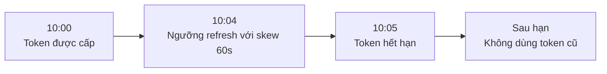
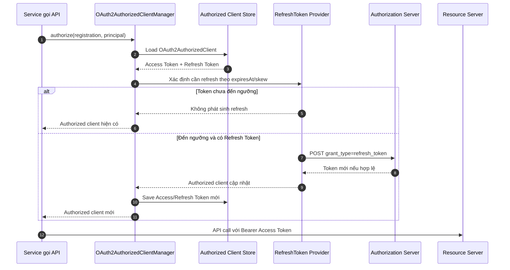

# 17.5. Xác định thời điểm refresh và cấu hình clock skew

Trong **Spring Security OAuth 2.0 / OpenID Connect (OIDC) Client**, Access Token thường có thời hạn ngắn. Khi ứng dụng gọi API bằng token do Authorization Server cấp, nó cần biết **khi nào nên dùng lại token, khi nào cần xin token mới, và thời điểm nào phải từ chối dùng token cũ**.

Nếu ứng dụng chờ đến đúng giây `expiresAt` mới bắt đầu refresh, Access Token có thể hết hạn trong thời gian request di chuyển qua mạng. Ngược lại, refresh quá sớm sẽ tăng số lần gọi token endpoint, lãng phí tài nguyên và có thể gây tranh chấp khi provider sử dụng **Refresh Token Rotation**.

Spring Security giải quyết một phần bài toán bằng thuộc tính **`clockSkew`** của các `OAuth2AuthorizedClientProvider`. Đây là khoảng đệm thời gian khiến client xem Access Token là **sắp hết hạn trước mốc hết hạn thật**. Nó không phải một scheduler tự chạy trong background.

Bài học tập trung vào **vòng đời token, cách tính ngưỡng refresh, cấu hình `clockSkew` trong Spring Security Servlet và background worker, thời điểm manager thật sự gọi token endpoint, các tình huống nhiều node, đồng hồ lệch, Refresh Token Rotation và cách xử lý lỗi an toàn**.

## 1. Bối cảnh: Access Token và Refresh Token có vai trò khác nhau

Giả sử người dùng đăng nhập OIDC với Authorization Code Flow. Sau khi Spring Boot gửi authorization code tới token endpoint, Authorization Server trả kết quả minh họa:

```json
{
  "access_token": "<access-token>",
  "token_type": "Bearer",
  "expires_in": 300,
  "refresh_token": "<refresh-token>",
  "scope": "openid profile orders.read"
}
```

`expires_in=300` biểu diễn thời gian hiệu lực Access Token khoảng 300 giây theo response của Authorization Server. Spring Security tạo một `OAuth2AccessToken` và lưu những metadata như `issuedAt`, `expiresAt`, scopes trong `OAuth2AuthorizedClient`.

Một authorized client có thể được hình dung:

```text
OAuth2AuthorizedClient
  ├── ClientRegistration
  │     └── registrationId = company
  ├── principalName = oidc-user-123
  ├── OAuth2AccessToken
  │     ├── tokenValue = <sensitive>
  │     ├── issuedAt   = 10:00:00
  │     ├── expiresAt  = 10:05:00
  │     └── scopes     = [openid, profile, orders.read]
  └── OAuth2RefreshToken
        ├── tokenValue = <sensitive>
        └── issuedAt   = 10:00:00
```

Đây là ví dụ khái niệm. Không phải mọi response đều chứa Refresh Token; provider có thể cấp thêm ID Token trong OIDC và các trường bổ sung khác.

| Thành phần | Vai trò | Vòng đời |
|---|---|---|
| **Access Token** | Gửi tới Resource Server, thường bằng `Authorization: Bearer ...`. | Thường ngắn hạn, có thể hết hạn hoặc bị revoke. |
| **Refresh Token** | Gửi tới token endpoint với `grant_type=refresh_token` để xin Access Token mới. | Có thể dài hơn nhưng vẫn có thể hết hạn, bị revoke hoặc xoay vòng. |
| **ID Token** | OIDC Client xác minh danh tính người dùng tại login. | Có `exp` và các điều kiện OIDC riêng. |
| **HTTP session** | Giúp browser khôi phục `SecurityContext` của ứng dụng. | Theo chính sách ứng dụng, không tự đồng nhất với thời hạn token. |

### 1.1. Refresh Token không được cấp trong mọi flow

- Authorization Code Flow có thể nhận Refresh Token theo chính sách của provider, grant, consent và client registration.
- Một số provider yêu cầu `offline_access` hoặc quyền riêng để cấp Refresh Token; không phải mọi provider đều dùng cùng quy tắc.
- Public client có yêu cầu bảo vệ Refresh Token riêng; không nhúng client secret vào JavaScript để «giữ» Refresh Token.
- **Client Credentials Grant thông thường không cấp Refresh Token**. Khi Access Token hết hạn, backend xin token mới bằng `client_credentials`.
- Provider có thể thu hồi Refresh Token khi logout, thay đổi mật khẩu, rút consent, tài khoản bị khóa hoặc phát hiện replay.

Vì vậy, lựa chọn thời điểm refresh phải dựa trên **Access Token còn hạn bao lâu và Refresh Token có thể được sử dụng không**, không phải chỉ dựa vào `scope=openid`.

## 2. `clockSkew` là gì?

`clockSkew` là **khoảng đệm thời gian** mà Spring Security dùng khi quyết định một Access Token còn đủ xa thời điểm hết hạn hay đã đến vùng cần làm mới.

Cách diễn giải phổ biến:

\[
\text{refreshThreshold} = \text{accessToken.expiresAt} - \text{clockSkew}
\]

Với:

```text
Access Token issuedAt = 10:00:00
Access Token expiresAt = 10:05:00
clockSkew             = 60 giây
```

thì:

```text
refreshThreshold = 10:05:00 - 00:01:00
                 = 10:04:00
```

Từ khoảng 10:04, token đã nằm trong vùng **sắp hết hạn**. Khi có một lời gọi authorize phù hợp và Refresh Token hợp lệ, provider có thể gửi refresh request.



**Quan trọng:** không có một timer tự phát sinh refresh đúng 10:04 chỉ vì đặt `clockSkew=60s`. Provider đánh giá mốc này khi được `OAuth2AuthorizedClientManager` kích hoạt.

### 2.1. Ví dụ theo thời gian

Cho `expiresAt=10:05:00`, `clockSkew=60s`:

| Thời điểm service cần token | Thời gian còn lại | Hành vi theo ngưỡng |
|---|---|---|
| 10:01:00 | 240 giây | Thông thường dùng lại Access Token. |
| 10:03:59 | 61 giây | Thông thường chưa cần refresh do expiry. |
| Khoảng 10:04:00 | 60 giây | Bắt đầu vùng xem token sắp hết hạn. |
| 10:04:20 | 40 giây | Nếu có Refresh Token và manager phù hợp, có thể refresh. |
| 10:05:10 | Token quá hạn 10 giây | Không tiếp tục xem token cũ còn hiệu lực. |

Ranh giới chính xác ở đúng một thời điểm bằng nhau phụ thuộc phép so sánh trong implementation, nhưng tư duy thiết kế là **dùng một khoảng đệm trước khi hết hạn**.

### 2.2. `clockSkew` không có nghĩa cho phép token sống thêm

Sai lầm phổ biến là nghĩ `clockSkew=60s` nghĩa là có thể gửi Access Token tới API thêm 60 giây sau khi `expiresAt`. Đó **không phải** cách sử dụng skew trong refresh provider.

- **OAuth2 Client clock skew:** chuyển ngưỡng phát hiện cần làm mới về **sớm hơn**.
- **JWT validation clock skew tại Resource Server:** có thể là một khoảng leeway khi kiểm tra `exp`/`nbf` của bearer token đi vào API.

Hai cài đặt nằm ở **hai vai trò khác nhau** và không tự đồng bộ. Không tăng thời gian chấp nhận token hết hạn của Resource Server chỉ để tránh phải sửa client refresh.

### 2.3. Tại sao cần khoảng đệm?

Một Access Token còn 5 giây có thể trở nên vô hiệu trước khi đến API do:

- Đồng hồ client và Resource Server lệch vài giây.
- Request chờ connection pool, proxy, gateway.
- DNS/TLS/network có độ trễ.
- Resource Server thực hiện xác thực ở thời điểm muộn hơn lúc client lấy token.
- Nhiều instance có đồng hồ hơi khác nhau.

Clock skew tạo biên an toàn cho những khác biệt này. Nhưng nó **không sửa được đồng hồ server sai hàng phút**, kết nối luôn chậm hoặc token endpoint bị lỗi.

## 3. Chọn skew bao nhiêu là hợp lý?

Giả sử Access Token sống 300 giây và `expiresAt=10:05`:

| Clock skew | Ngưỡng refresh | Thời gian tái sử dụng trước vùng refresh |
|---|---|---|
| 0s | 10:05:00 | Gần đủ 300s, rủi ro quá sát hạn. |
| 15s | 10:04:45 | Khoảng 285s. |
| 30s | 10:04:30 | Khoảng 270s. |
| 60s | 10:04:00 | Khoảng 240s. |
| 120s | 10:03:00 | Khoảng 180s. |
| 300s | 10:00:00 | Có thể bị xem là sắp hết hạn ngay sau cấp. |

### 3.1. Skew lớn hơn TTL là một vấn đề

Ví dụ:

```text
Token issuedAt = 12:00:00
Token expiresAt = 12:01:00
Clock skew = 90 giây

Ngưỡng refresh = 11:59:30
```

Ngay sau khi cấp token, thời gian hiện tại đã vượt ngưỡng. Nếu service tiếp tục gọi manager, nó có thể cố làm mới liên tục, tăng tải token endpoint và gây nguy cơ race khi Refresh Token được xoay vòng.

**Skew phải được lựa chọn tương quan với TTL**. Không sao chép một giá trị cố định từ một ứng dụng dùng token 30 phút sang provider cấp token 45 giây.

### 3.2. Không có một cấu hình cho mọi provider

Một hệ thống có thể tích hợp:

```text
Provider A: Access Token TTL = 60 phút
Provider B: Access Token TTL = 2 phút
Provider C: Access Token TTL = 30 giây
```

Áp cùng skew 60 giây cho cả ba có thể hợp lý với A, đáng cân nhắc với B nhưng không phù hợp với C.

Nên xét:

- TTL thực tế từ token response.
- Sai lệch đồng hồ đo được giữa các máy.
- Độ trễ mạng p95/p99 và thời gian request ở queue.
- Tần suất gọi API.
- Rate limit và Refresh Token Rotation của provider.
- SLA về latency và yêu cầu tránh 401.

Một cách suy luận (không phải công thức bắt buộc của framework):

\[
\text{skew} \approx \text{clockDriftAllowance}
+ \text{networkDelayAllowance}
+ \text{processingAllowance}
+ \text{safetyMargin}
\]

Ví dụ 30–60 giây có thể là điểm khởi đầu cho token sống nhiều phút trong môi trường bình thường, nhưng cần đo thực tế và không để skew tiệm cận hoặc vượt TTL.

## 4. Spring Security xử lý refresh ở những thành phần nào?

| Thành phần | Trách nhiệm |
|---|---|
| `OAuth2AuthorizedClient` | Giữ client registration, principal name, Access Token và Refresh Token nếu có. |
| `OAuth2AuthorizedClientManager` | Phối hợp tìm authorized client, authorize lại và lưu kết quả. |
| `OAuth2AuthorizedClientProvider` | Xử lý logic theo grant type được cấu hình. |
| `RefreshTokenOAuth2AuthorizedClientProvider` | Khi có Refresh Token, quyết định refresh theo expiry và `clockSkew`. |
| `ClientCredentialsOAuth2AuthorizedClientProvider` | Khi token của machine client sắp hết hạn, xin token mới bằng Client Credentials. |
| `OAuth2AuthorizedClientService` | Lưu authorized client độc lập HTTP request. |
| `OAuth2AuthorizedClientRepository` | Lưu authorized client trong ngữ cảnh HTTP Servlet. |
| `OAuth2AccessTokenResponseClient<OAuth2RefreshTokenGrantRequest>` | Thực hiện HTTP request refresh token tới token endpoint theo cấu hình. |

Một luồng sử dụng token có thể được mô tả:



Đây là sơ đồ khái niệm cho refresh thành công. Nếu không có Refresh Token hoặc provider không hỗ trợ grant, refresh provider có thể không xử lý. Nếu token endpoint trả lỗi, manager/failure handler xử lý theo thiết lập.

### 4.1. `manager.authorize(...)` không luôn gọi token endpoint

Một lần gọi manager:

```java
OAuth2AuthorizedClient authorizedClient = manager.authorize(request);
```

có thể:

1. Tìm thấy token còn đủ thời gian và trả kết quả cũ.
2. Tìm thấy token đã đến ngưỡng cùng Refresh Token và gửi refresh request.
3. Không tìm thấy token, dùng provider khác để authorize nếu grant phù hợp.
4. Không thể xử lý và trả `null` hoặc ném exception theo provider/context.

Vì vậy, không viết logic gọi token endpoint thủ công ở từng service chỉ để dự đoán hạn token. Dùng manager và provider chain đúng ngữ cảnh.

### 4.2. Clock skew không tạo scheduler

`RefreshTokenOAuth2AuthorizedClientProvider#setClockSkew` chỉ ảnh hưởng điều kiện kiểm tra token. Nó **không khởi tạo thread nền, cron job hay timer**.

Nếu token không được dùng trong nhiều giờ, ứng dụng có thể không gửi một refresh request nào trong thời gian đó. Lần gọi API kế tiếp mới có thể kích hoạt refresh.

## 5. Điều kiện thực hiện Refresh Token Grant

`RefreshTokenOAuth2AuthorizedClientProvider` chỉ có thể thực hiện Refresh Token Grant khi đáp ứng những điều kiện cần thiết:

1. Có một `OAuth2AuthorizedClient` tương ứng registration/principal.
2. Authorized client chứa **Refresh Token**.
3. Access Token nằm ở vùng cần refresh theo `expiresAt` và `clockSkew`.
4. Client registration có token endpoint và client authentication được hỗ trợ.
5. Authorization Server vẫn chấp nhận Refresh Token và chính sách client.

Nếu không có Refresh Token, không thể tự tạo một Refresh Token từ Access Token hoặc ID Token.

### 5.1. Refresh request thực tế

Với confidential client dùng HTTP Basic:

```http
POST /oauth2/token HTTP/1.1
Host: id.example.org
Authorization: Basic <encoded-client-credentials>
Content-Type: application/x-www-form-urlencoded

grant_type=refresh_token&
refresh_token=<sensitive-refresh-token>
```

Token endpoint có thể trả:

```json
{
  "access_token": "<new-access-token>",
  "token_type": "Bearer",
  "expires_in": 300,
  "refresh_token": "<rotated-refresh-token>",
  "scope": "orders.read"
}
```

Provider có thể không phát Refresh Token mới ở mỗi lần refresh hoặc có chính sách rotation riêng. Ứng dụng phải giữ trạng thái token mới nhất theo kết quả thực tế; không giả định Refresh Token luôn được thay hoặc luôn được giữ nguyên.

### 5.2. Token và scope có thể thay đổi

Authorization Server có thể thay đổi phạm vi được cấp hoặc từ chối refresh do account/consent policy. Refresh thành công không phải bằng chứng người dùng tiếp tục có mọi quyền nghiệp vụ mà trước đó ứng dụng cấp.

Resource Server vẫn phải xác minh token, audience, scope và authorization policy. OAuth2 Client phải sử dụng metadata của token mới, không tự gán lại những claim từ token cũ.

### 5.3. Refresh Token có thể bị revoke bất kỳ lúc nào

Ngay cả khi Refresh Token có timestamp hết hạn chưa đến, provider vẫn có thể thu hồi do logout, thay đổi mật khẩu, phát hiện reuse, tài khoản bị vô hiệu hóa hoặc quy tắc bảo mật.

Không coi `refreshToken.getExpiresAt()` là lời cam kết provider chắc chắn sẽ chấp nhận token ấy; một số provider thậm chí không công bố metadata thời hạn Refresh Token.

## 6. Cấu hình clock skew trực tiếp trên provider

Trong các phiên bản Spring Security hiện đại, `RefreshTokenOAuth2AuthorizedClientProvider` cung cấp setter:

```java
import java.time.Duration;
import org.springframework.security.oauth2.client.RefreshTokenOAuth2AuthorizedClientProvider;

RefreshTokenOAuth2AuthorizedClientProvider refresh =
    new RefreshTokenOAuth2AuthorizedClientProvider();

refresh.setClockSkew(Duration.ofSeconds(90));
```

Ý nghĩa:

- `90s` là khoảng đệm trước hạn Access Token.
- Skew lớn khiến refresh được xem xét sớm hơn.
- Skew nhỏ khiến token được tái sử dụng sát `expiresAt` hơn.
- Skew này chỉ điều khiển **instance refresh provider đang được dùng**, không tự thay đổi mọi manager hoặc JWT decoder khác trong ứng dụng.

Ở những phiên bản Spring Security phổ biến, default clock skew của refresh provider là **60 giây**; nếu kết quả phụ thuộc giá trị cụ thể, nên khai báo tường minh và đối chiếu Javadoc phiên bản đang sử dụng.

Đừng giả định Spring Boot có một property chung kiểu:

```properties
# Không coi đây là property chuẩn tự cấu hình refresh:
spring.security.oauth2.client.registration.company.clock-skew=90s
```

Cách cấu hình chắc chắn và rõ ràng là tạo/customize provider hoặc manager bằng Java theo API được hỗ trợ trong phiên bản dự án.

## 7. Ví dụ Spring Boot OIDC Servlet với Refresh Token

### 7.1. Khai báo client registration

```yaml
spring:
  security:
    oauth2:
      client:
        registration:
          company:
            provider: company-oidc
            client-id: ${OIDC_CLIENT_ID}
            client-secret: ${OIDC_CLIENT_SECRET}
            client-authentication-method: client_secret_basic
            authorization-grant-type: authorization_code
            redirect-uri: "{baseUrl}/login/oauth2/code/{registrationId}"
            scope:
              - openid
              - profile
              - orders.read
        provider:
          company-oidc:
            issuer-uri: https://id.example.org/realms/company
```

Registration này mô tả **Authorization Code Flow** cho ứng dụng Servlet. Việc OP có cấp Refresh Token hay không phụ thuộc chính sách provider, client registration và consent.

### 7.2. Cấu hình manager với refresh provider và skew 90 giây

```java
import java.time.Duration;

import org.springframework.context.annotation.Bean;
import org.springframework.context.annotation.Configuration;
import org.springframework.security.oauth2.client.AuthorizationCodeOAuth2AuthorizedClientProvider;
import org.springframework.security.oauth2.client.DefaultOAuth2AuthorizedClientManager;
import org.springframework.security.oauth2.client.DelegatingOAuth2AuthorizedClientProvider;
import org.springframework.security.oauth2.client.OAuth2AuthorizedClientManager;
import org.springframework.security.oauth2.client.OAuth2AuthorizedClientProvider;
import org.springframework.security.oauth2.client.RefreshTokenOAuth2AuthorizedClientProvider;
import org.springframework.security.oauth2.client.registration.ClientRegistrationRepository;
import org.springframework.security.oauth2.client.web.OAuth2AuthorizedClientRepository;

@Configuration
public class WebOAuth2ClientConfiguration {

    @Bean
    OAuth2AuthorizedClientManager authorizedClientManager(
            ClientRegistrationRepository registrations,
            OAuth2AuthorizedClientRepository authorizedClients) {

        RefreshTokenOAuth2AuthorizedClientProvider refresh =
            new RefreshTokenOAuth2AuthorizedClientProvider();
        refresh.setClockSkew(Duration.ofSeconds(90));

        OAuth2AuthorizedClientProvider provider =
            new DelegatingOAuth2AuthorizedClientProvider(
                new AuthorizationCodeOAuth2AuthorizedClientProvider(),
                refresh
            );

        DefaultOAuth2AuthorizedClientManager manager =
            new DefaultOAuth2AuthorizedClientManager(
                registrations,
                authorizedClients
            );
        manager.setAuthorizedClientProvider(provider);

        return manager;
    }
}
```

Đây là cấu hình cho manager hoạt động trong **ngữ cảnh HTTP Servlet**. Nó không tự thêm scheduler, không thay thế bộ lọc `oauth2Login()` và cũng không làm token refresh nếu các HTTP client thực tế không dùng manager này.

### 7.3. Bật OAuth2 Login và OAuth2 Client

```java
import org.springframework.context.annotation.Bean;
import org.springframework.context.annotation.Configuration;
import org.springframework.security.config.Customizer;
import org.springframework.security.config.annotation.web.builders.HttpSecurity;
import org.springframework.security.web.SecurityFilterChain;

@Configuration
public class SecurityConfiguration {

    @Bean
    SecurityFilterChain webSecurityFilterChain(HttpSecurity http)
            throws Exception {
        http
            .authorizeHttpRequests(auth -> auth
                .requestMatchers("/", "/public/**").permitAll()
                .anyRequest().authenticated()
            )
            .oauth2Login(Customizer.withDefaults())
            .oauth2Client(Customizer.withDefaults());

        return http.build();
    }
}
```

Hai cấu hình trong mục này có thể được dùng cùng nhau khi Bean wiring phù hợp. Kho authorized client được `oauth2Login()` dùng và kho mà manager tải phải nhất quán; nếu login lưu token ở một repository còn manager đọc repository khác, lỗi «không có authorized client» không thể sửa bằng cách tăng clock skew.

### 7.4. Sử dụng manager trước khi gọi API

```java
import org.springframework.security.core.Authentication;
import org.springframework.security.oauth2.client.OAuth2AuthorizeRequest;
import org.springframework.security.oauth2.client.OAuth2AuthorizedClient;
import org.springframework.security.oauth2.client.OAuth2AuthorizedClientManager;

public final class OrdersTokenService {

    private final OAuth2AuthorizedClientManager manager;

    public OrdersTokenService(OAuth2AuthorizedClientManager manager) {
        this.manager = manager;
    }

    public String accessTokenForCurrentUser(Authentication principal) {
        OAuth2AuthorizeRequest request =
            OAuth2AuthorizeRequest
                .withClientRegistrationId("company")
                .principal(principal)
                .build();

        OAuth2AuthorizedClient client = manager.authorize(request);

        if (client == null) {
            throw new IllegalStateException(
                "OAuth2 authorization is unavailable"
            );
        }

        return client.getAccessToken().getTokenValue();
    }
}
```

Giá trị token chỉ được trả **bên trong backend** để một HTTP client tin cậy gửi Bearer header tới API thích hợp. Không mở endpoint public trả raw Access Token hoặc log token.

Mỗi lần backend thực sự cần token, lời gọi `manager.authorize(...)` tạo cơ hội cho manager **dùng lại hoặc làm mới token** theo ngưỡng, thay vì lấy một token được cache thủ công từ thời điểm startup.

## 8. Cấu hình bằng `OAuth2AuthorizedClientProviderBuilder`

Spring Security còn có builder để ghép các provider:

```java
import java.time.Duration;
import org.springframework.security.oauth2.client.OAuth2AuthorizedClientProvider;
import org.springframework.security.oauth2.client.OAuth2AuthorizedClientProviderBuilder;

OAuth2AuthorizedClientProvider provider =
    OAuth2AuthorizedClientProviderBuilder.builder()
        .authorizationCode()
        .refreshToken(refresh -> refresh
            .clockSkew(Duration.ofSeconds(90))
        )
        .build();
```

Đây là ví dụ với API builder trong các phiên bản có hỗ trợ callback cấu hình cho refresh provider. Khi signature khác ở phiên bản thư viện của dự án, có thể dùng cách tạo provider trực tiếp với `setClockSkew`.

Một chain chứa nhiều grant types có thể khai báo:

```java
OAuth2AuthorizedClientProvider provider =
    OAuth2AuthorizedClientProviderBuilder.builder()
        .authorizationCode()
        .refreshToken(refresh -> refresh
            .clockSkew(Duration.ofSeconds(90))
        )
        .clientCredentials(client -> client
            .clockSkew(Duration.ofSeconds(30))
        )
        .build();
```

Ở đây có **hai khoảng đệm độc lập**:

- Refresh provider: dùng `grant_type=refresh_token` nếu có Refresh Token hợp lệ.
- Client Credentials provider: xin token mới bằng `grant_type=client_credentials` khi Access Token đến ngưỡng.

Đừng nghĩ `refreshToken(...)` sẽ xử lý mọi client registration. Một machine client thông thường không có Refresh Token và cần `clientCredentials()`.

## 9. Clock skew cho Client Credentials

Client Credentials không liên quan Authorization Code Flow hay login của browser:

```text
Chưa có token
  -> POST grant_type=client_credentials
  -> Access Token A
  -> Dùng lại A khi còn đủ thời gian
  -> Đến expiresAt - clockSkew
  -> Xin Access Token B theo client_credentials
```

Ví dụ manager cho background worker:

```java
import java.time.Duration;

import org.springframework.context.annotation.Bean;
import org.springframework.context.annotation.Configuration;
import org.springframework.security.oauth2.client.AuthorizedClientServiceOAuth2AuthorizedClientManager;
import org.springframework.security.oauth2.client.OAuth2AuthorizedClientManager;
import org.springframework.security.oauth2.client.OAuth2AuthorizedClientProvider;
import org.springframework.security.oauth2.client.OAuth2AuthorizedClientProviderBuilder;
import org.springframework.security.oauth2.client.OAuth2AuthorizedClientService;
import org.springframework.security.oauth2.client.registration.ClientRegistrationRepository;

@Configuration
public class MachineClientConfiguration {

    @Bean
    OAuth2AuthorizedClientManager machineClientManager(
            ClientRegistrationRepository registrations,
            OAuth2AuthorizedClientService authorizedClients) {

        OAuth2AuthorizedClientProvider provider =
            OAuth2AuthorizedClientProviderBuilder.builder()
                .clientCredentials(client -> client
                    .clockSkew(Duration.ofSeconds(45))
                )
                .build();

        AuthorizedClientServiceOAuth2AuthorizedClientManager manager =
            new AuthorizedClientServiceOAuth2AuthorizedClientManager(
                registrations,
                authorizedClients
            );
        manager.setAuthorizedClientProvider(provider);

        return manager;
    }
}
```

Ví dụ gọi manager:

```java
OAuth2AuthorizeRequest request = OAuth2AuthorizeRequest
    .withClientRegistrationId("inventory-api")
    .principal("service:inventory-sync")
    .build();

OAuth2AuthorizedClient client = machineClientManager.authorize(request);
```

Principal ở đây là **technical principal** dùng cho khóa lưu authorized client; nó không biến Access Token thành token của một người dùng. Cần client registration `inventory-api` với `authorization-grant-type=client_credentials` và thông tin token endpoint thích hợp.

| Tiêu chí | OIDC Authorization Code + Refresh | Client Credentials |
|---|---|---|
| Có người dùng đăng nhập browser? | Có. | Không. |
| Có Refresh Token? | Có thể, tùy provider. | Thông thường không. |
| Khi token đến ngưỡng | Gửi Refresh Token Grant nếu đủ điều kiện. | Xin token mới bằng Client Credentials. |
| Provider | `RefreshTokenOAuth2AuthorizedClientProvider`. | `ClientCredentialsOAuth2AuthorizedClientProvider`. |
| Principal storage | Thường gắn với user. | Thường tên service/workload ổn định. |
| Clock skew | Đặt trên refresh provider. | Đặt trên client credentials provider. |

## 10. `Instant`, đồng hồ hệ thống và đồng bộ thời gian

`OAuth2AccessToken.getExpiresAt()` trả về `Instant`, biểu diễn một mốc thời gian tuyệt đối. Không so sánh giờ địa phương bằng chuỗi hoặc bỏ time zone.

Ví dụ không phù hợp:

```java
// Không nên so thời gian ở dạng chuỗi:
if (formattedExpiresAt.compareTo(formattedNow) < 0) {
    // ...
}
```

Hãy để Spring Security provider xử lý hoặc sử dụng `Instant`/`Duration` trong logic riêng cần thiết.

Nếu node A có đồng hồ đúng, node B nhanh 40 giây và node C chậm 25 giây, cùng `clockSkew=60s` vẫn có thể khiến các node **đánh giá thời điểm refresh khác nhau**. Cần:

- Đồng bộ đồng hồ qua hạ tầng thời gian đáng tin cậy.
- Kiểm tra clock drift trên VM/container.
- Lưu timestamp/expiry trong kho dữ liệu với timezone và precision phù hợp.
- Không tăng skew hàng phút để che lỗi đồng hồ sai.
- Theo dõi clock drift và token age trong metrics.

### 10.1. Mô phỏng thời gian với `Clock`

Trong các phiên bản có hỗ trợ `setClock(Clock)` trên refresh provider, có thể inject clock cố định để hiểu ngưỡng thời gian:

```java
import java.time.Clock;
import java.time.Duration;
import java.time.Instant;
import java.time.ZoneOffset;
import org.springframework.security.oauth2.client.RefreshTokenOAuth2AuthorizedClientProvider;

Clock fixed = Clock.fixed(
    Instant.parse("2026-11-16T10:04:20Z"),
    ZoneOffset.UTC
);

RefreshTokenOAuth2AuthorizedClientProvider refresh =
    new RefreshTokenOAuth2AuthorizedClientProvider();

refresh.setClock(fixed);
refresh.setClockSkew(Duration.ofSeconds(60));
```

Với token hết hạn lúc `10:05:00Z`, clock cố định `10:04:20Z` nằm trong vùng 60 giây trước hạn. Việc phát request refresh còn đòi hỏi authorized client có Refresh Token và các component khác được cấu hình.

Đây là kỹ thuật mô phỏng, không dùng fixed clock trong production và không sửa đồng hồ hệ điều hành chỉ để kiểm tra ứng dụng.

## 11. Lazy refresh và proactive refresh

### 11.1. Lazy refresh

Thông thường:

```text
Có nhu cầu gọi API
    -> manager.authorize(...)
    -> Nếu token còn đủ hạn: dùng lại
    -> Nếu sắp hết hạn và có Refresh Token: refresh
    -> Gọi API với token thích hợp
```

**Ưu điểm:** chỉ refresh khi có sử dụng, dễ triển khai, không tạo hoạt động nền cho user không active.

**Nhược điểm:** request đầu tiên sau thời gian rảnh có thể phải chờ token endpoint; nếu nhiều request cùng đến, có thể phát sinh tranh chấp.

Đây là mô hình phù hợp cho nhiều ứng dụng Servlet/BFF gọi API khi người dùng thực sự thao tác.

### 11.2. Proactive refresh

Một hệ thống cần latency thấp hoặc có batch job với giờ chạy cố định có thể muốn làm mới token **trước khi request nghiệp vụ xuất hiện**. Điều này phải được thiết kế riêng, không chỉ bằng `clockSkew`.

Cần xác định:

1. Authorized clients nào thật sự cần tiếp tục hoạt động?
2. Có được phép giữ Refresh Token và dùng khi user không hoạt động không?
3. Khi nào cần refresh để tránh token endpoint bị dồn tải?
4. Giới hạn concurrency, retry và backoff như thế nào?
5. Khi provider rotate Refresh Token, lưu nguyên tử ra sao?
6. Nếu user logout hoặc revoke consent, scheduler ngừng dùng token khi nào?
7. Nếu token endpoint không sẵn sàng, ứng dụng phản ứng thế nào?

Không nên chạy cron mỗi phút để refresh **mọi** Refresh Token trong database mà không xét nhu cầu, consent và chính sách. Điều đó tăng tải và nguy cơ token reuse/race.

## 12. Refresh Token Rotation và concurrency

Một trường hợp nguy hiểm:

```text
Session/user = user-123
Access Token = A1 (sắp hết hạn)
Refresh Token = R1

Request X: đọc A1/R1, thấy cần refresh
Request Y: đọc A1/R1, cũng thấy cần refresh

X gửi R1 -> provider cấp A2/R2, R1 bị vô hiệu
Y gửi R1 -> provider có thể trả invalid_grant hoặc phát hiện reuse
```

Nếu provider áp dụng Refresh Token Rotation và reuse detection, request Y có thể gây hậu quả lớn hơn một lỗi đơn lẻ, ví dụ provider thu hồi token family.

### 12.1. Kho JDBC không tự serialize refresh

Ngay cả khi hai node cùng sử dụng `JdbcOAuth2AuthorizedClientService`, cả hai vẫn có thể tải cùng authorized client trước khi node nào kịp lưu token mới. Cần thiết kế:

- Single-flight theo authorized client key trong mỗi process.
- Distributed lock hoặc phương pháp coordination phù hợp khi nhiều instance.
- Optimistic locking/version khi ghi store.
- Sau khi lấy lock, **đọc lại bản ghi** để tránh refresh token đã được node khác thay.
- Lưu Access Token và Refresh Token mới trong một giao dịch nhất quán.
- Xử lý tình huống refresh tại provider thành công nhưng commit DB thất bại.
- Không giữ lock trên toàn bộ users hoặc tất cả registrations.

Skew lớn có thể khiến nhiều request rơi vào vùng refresh sớm hơn, nhưng **skew 0 cũng không bảo đảm hết race**. Đây là bài toán đồng thời của authorized client store/provider.

### 12.2. Principal và tenant phải được phân tách

Authorized client được lưu theo registration và principal/ngữ cảnh. Không bao giờ dùng Refresh Token của user A hoặc tenant A để khôi phục lỗi của B.

Khi thiết kế khóa lưu, cần bảo đảm người dùng, client registration, issuer và tenant không bị trộn lẫn. Nếu dùng principal name không ổn định, manager có thể không thấy Refresh Token và bắt đầu flow mới ngoài ý muốn.

### 12.3. Không log Refresh Token khi điều tra race

Chỉ ghi dữ liệu chẩn đoán như version, loại lỗi, số lần refresh, registration alias và thời điểm; không log raw Refresh Token, Access Token, HTTP Authorization header hoặc token request body.

## 13. Refresh thất bại với `invalid_grant`

Token endpoint có thể trả:

```json
{
  "error": "invalid_grant",
  "error_description": "Refresh token is invalid or expired"
}
```

`error_description` chỉ minh họa. Nguyên nhân thực tế có thể là:

- Refresh Token đã hết hạn hoặc bị revoke.
- Người dùng rút consent, account bị khóa hoặc provider đổi chính sách.
- Refresh Token đã được sử dụng và bị vô hiệu hóa do rotation.
- Hai node cùng dùng một Refresh Token cũ.
- Authorized client store ghi đè bằng phiên bản token lỗi thời.
- Client registration/issuer/token endpoint không còn phù hợp.

Clock skew **không làm Refresh Token đã vô hiệu trở nên hợp lệ**. Hướng xử lý:

1. Phân biệt lỗi token endpoint với 401/403 của API.
2. Không retry vô hạn cùng Refresh Token.
3. Xóa/đánh dấu authorized client không còn hợp lệ theo failure handler và policy.
4. Với browser OIDC, yêu cầu Authorization Code Flow mới khi phù hợp.
5. Với machine client, dùng grant được provider hỗ trợ để xin token mới.
6. Ghi mã lỗi được làm sạch, không ghi secret/token.

### 13.1. Authorization success/failure handler

Các authorized client manager có extension point để xử lý save/remove authorized client khi authorization thành công hoặc thất bại. Trong cấu hình thông dụng, manager có thể lưu token mới sau refresh và loại authorized client khi gặp `invalid_grant`; chi tiết phải được xác định theo phiên bản framework và customization hiện có.

Khi tự viết handler:

- Không làm mất Refresh Token mới được cấp.
- Không lưu token mới dưới sai `principalName`/registration.
- Không vô tình giữ lại bản ghi cũ đã bị revoke.
- Không bỏ kiểm soát concurrency của store.
- Không in raw `OAuth2AuthorizedClient` vào log.

Nếu không có token hợp lệ, xử lý thất bại có kiểm soát. Không fallback sang token của người dùng khác hoặc Access Token đã hết hạn.

## 14. Session OIDC và Refresh Token là hai vòng đời khác nhau

Một hiểu nhầm hay gặp:

> «Access Token refresh thành công, vậy phiên đăng nhập của user cũng được gia hạn.»

Không nhất thiết.

`OAuth2AuthorizedClient` và token refresh được quản lý bên OAuth2 Client. `SecurityContext`/HTTP session xác định user còn đăng nhập trong ứng dụng hay không. OP SSO session lại là một phiên khác.

Ví dụ:

```text
10:00  User login OIDC -> HTTP session + Access/Refresh Token
10:04  Backend refresh Access Token
10:20  HTTP session hết hạn theo policy ứng dụng
10:21  Browser phải đăng nhập lại theo cấu hình
```

Refresh thành công lúc 10:04 không bảo đảm HTTP session còn tồn tại lúc 10:21.

### 14.1. ID Token và principal có tự đổi sau refresh?

OIDC có những quy tắc riêng nếu refresh response chứa ID Token mới. Nhưng **refresh Access Token qua authorized client manager không đồng nghĩa tự động thay đổi OIDC principal, roles, authorities hoặc `SecurityContext` của browser session**.

Nếu ứng dụng cần đồng bộ account status/roles kịp thời, phải thiết kế nguồn quyền và session invalidation/authorization refresh riêng. Clock skew không giải quyết dữ liệu quyền cũ trong phiên.

### 14.2. Logout có đồng nghĩa revoke Refresh Token không?

Không tự động. Xóa HTTP session có thể không làm Access/Refresh Token bị revoke trên Authorization Server. Tùy sản phẩm, có thể cần xóa authorized client cục bộ, gọi revocation endpoint, xử lý OIDC logout và vô hiệu session theo chính sách.

Không cho một background task tiếp tục dùng Refresh Token của user đã logout nếu business policy yêu cầu dừng truy cập thay mặt người dùng.

## 15. HTTP latency và lỗi Resource Server

Nếu Resource Server trả:

```http
HTTP/1.1 401 Unauthorized
WWW-Authenticate: Bearer error="invalid_token"
```

không phải chắc chắn token vừa hết hạn. Nguyên nhân có thể là token bị revoke, sai issuer/audience, chữ ký không hợp lệ, introspection lỗi, gửi sai header hoặc Resource Server có clock drift.

Clock skew giúp giảm rủi ro dùng token quá sát hạn, **không sửa mọi nguyên nhân 401**.

### 15.1. Tại sao token còn 45 giây vẫn có thể gây 401?

Giả sử skew 30s, token còn 45s, nên manager có thể dùng lại token. Nhưng:

1. Request đợi connection pool 10s.
2. Proxy xếp hàng/retry 15s.
3. Resource Server xử lý authentication sau thêm 15s.
4. Chỉ còn vài giây hoặc token đã hết hạn.

Cần đo network/p95/p99 latency, đặt timeout phù hợp, giảm queue và chọn buffer hợp lý so với TTL. Không tăng skew tới mức luôn refresh.

### 15.2. Retry sau 401 phải có giới hạn

Có thể cân nhắc retry khi token đã bị từ chối và client có thể xin token mới hợp lệ. Nhưng:

- Không retry vô hạn.
- Không tự retry POST có side effect nếu không có idempotency policy.
- Không dùng token của principal khác.
- Không coi mọi 403 là lỗi expiry; 403 thường liên quan policy/permission.
- Không tự động chuyển token sang host khác qua redirect.

Một ứng dụng còn phải cấu hình timeout và TLS verification đúng cho HTTP token client; skew không khắc phục token endpoint bị treo.

## 16. Quan sát vận hành và cách chẩn đoán

Các nhóm thông tin nên theo dõi:

| Nhóm | Điều cần xác định |
|---|---|
| Registration/grant | `authorization_code` với Refresh Token hay `client_credentials`? |
| Token metadata | `issuedAt`, `expiresAt` và TTL có hợp lý không? |
| Clock | Các node có đồng bộ thời gian không? |
| Config | Skew bao nhiêu, provider/manager nào đang dùng thật? |
| Trigger | HTTP client/service có gọi `manager.authorize(...)` trước API không? |
| Storage | Authorized client có được load đúng principal/registration không? |
| Refresh Token | Có tồn tại và còn được provider chấp nhận không? |
| Token endpoint | Có request refresh? HTTP status và lỗi OAuth2 nào? |
| Persistence | Token mới được lưu đủ Access/Refresh Token chưa? Có ghi đè race? |
| Resource Server | 401 vì expiry, issuer/audience, hay 403 vì permission? |
| Session | User session còn tồn tại không? |

### 16.1. Các triệu chứng thường gặp

| Triệu chứng | Nguyên nhân có thể | Hướng xử lý |
|---|---|---|
| Token hết hạn rồi API trả 401. | Không gọi manager, skew quá nhỏ, clock drift hoặc API latency cao. | Tích hợp manager trước API và đo thời gian. |
| Refresh xảy ra trên mọi request. | Skew >= TTL, token response TTL rất ngắn, lỗi lưu token hoặc sai storage key. | Đối chiếu TTL/skew và save/load. |
| Không có refresh request dù đã đến ngưỡng. | Không gọi `authorize`, thiếu Refresh Token, sai provider chain hoặc manager khác đang chạy. | Kiểm tra trigger, provider và repository. |
| `invalid_grant` khi refresh. | Refresh Token expired, revoked, rotation/reuse. | Không retry vô hạn; cleanup và reauthorization. |
| Chỉ lỗi trong cluster. | Đồng hồ các node lệch, shared store/race. | Time sync, coordination và persistence. |
| Refresh thành công nhưng API trả 403. | Scope/role/tenant policy không đủ. | Điều tra Resource Server authorization. |
| Refresh thành công nhưng user bị yêu cầu login lại. | HTTP session hết hạn hoặc SecurityContext mất. | Điều tra session độc lập. |
| Token endpoint chậm khiến request API chậm. | Lazy refresh phải đợi mạng. | Timeout, backoff, giảm latency hoặc proactive refresh có kiểm soát. |
| DB vẫn chứa Refresh Token cũ. | Save handler không lưu token mới, race hoặc transaction lỗi. | Kiểm tra atomic persistence/version. |
| Client Credentials không có Refresh Token. | Hành vi bình thường của grant. | Dùng client credentials provider. |
| Đổi skew nhưng không có tác dụng. | Đang sử dụng manager/provider khác. | Xem Bean wiring và HTTP client sử dụng. |

### 16.2. Logging không được làm lộ credential

Nên ghi:

- Registration alias, grant type và tên provider.
- Giá trị clock skew đã cấu hình.
- Thời gian còn lại đến `expiresAt`, không phải token value.
- Kết quả reuse/refresh attempt/success/failure.
- HTTP status và OAuth2 error code đã làm sạch.
- Instance ID, diagnostic correlation ID, duration.

Không ghi:

- Raw Access Token/Refresh Token/ID Token.
- Client secret, private key hoặc client assertion.
- Header `Authorization`, cookie phiên, token request body chứa `refresh_token`.
- Toàn bộ `OAuth2AuthorizedClient` hoặc user profile nhạy cảm.
- Raw subject/email/token làm metric label.

Một metric như `oauth2.refresh.attempts{registration="company",result="failure"}` hữu ích hơn log nguyên token.

## 17. Các anti-pattern cần tránh

### 17.1. Tự so `expiresAt` ở mọi lớp

```java
// Không nên nhân bản logic kiểm tra expiry và refresh khắp dự án:
if (accessToken.getExpiresAt().isBefore(Instant.now())) {
    // tự gọi token endpoint...
}
```

Cách này dễ tạo nhiều giá trị skew, race condition và lệch trạng thái authorized client. Nên tập trung qua manager/provider.

### 17.2. Đặt skew lớn hơn TTL

```text
Access Token TTL = 60s
clockSkew        = 5m
```

Token có thể bị xem là sắp hết hạn ngay khi cấp. Hậu quả là refresh quá nhiều, tăng tải và dễ đụng Refresh Token Rotation.

### 17.3. Nghĩ skew là một cron job

`setClockSkew` chỉ thay đổi ngưỡng. Nếu không gọi manager hoặc không có scheduler riêng, không có background refresh tự động.

### 17.4. Dùng Access Token cũ khi refresh thất bại

Nếu token đã hết hạn hoặc provider revoke Refresh Token, cần xử lý fail closed/reauthorization. Không tự dùng token khác của user/tenant khác hoặc giữ token cũ vô hạn.

### 17.5. Nghĩ refresh đồng nghĩa người dùng còn session

Refresh Token và HTTP session là hai cơ chế độc lập. Một phiên ứng dụng có thể hết hạn dù API token vừa được refresh.

### 17.6. Bỏ qua concurrency

Nhiều node cùng dùng Refresh Token cũ có thể gặp `invalid_grant` hoặc token family revocation. Cần phối hợp refresh và lưu token mới nhất quán.

### 17.7. Cấu hình skew ở sai provider

Cấu hình refresh provider không tự điều chỉnh Client Credentials provider hoặc JWT Resource Server validator. Mỗi vai trò có chính sách thời gian riêng.

## 18. Kiến trúc tham chiếu

```text
                       Spring Boot Application
                                |
                                v
                         Business API Client
                                |
                                v
                   OAuth2AuthorizedClientManager
                  (được gọi khi cần sử dụng token)
                                |
                 +--------------+-------------+
                 |                            |
                 v                            v
          Authorized Client             Provider Chain
          Repository/Service            +-- Refresh Token
                 |                      |     clockSkew=90s
                 |                      +-- Client Credentials
                 |                            clockSkew=45s
                 v                            |
            Token Store                       |
          (memory/JDBC)                       v
                                    Token Endpoint nếu cần
                 |                            |
                 +-------------+--------------+
                               |
                               v
                         Access Token
                               |
                               v
                         Resource Server
                    kiểm tra issuer/audience/scope

Yếu tố vận hành:
  - Đồng bộ thời gian
  - HTTP timeout và TLS
  - Quản lý Refresh Token Rotation
  - Coordination cho nhiều instance
  - Session / account authorization riêng
  - Audit/metrics không chứa credential
```

## 19. Tóm tắt

- `expiresAt` là hạn Access Token. `clockSkew` tạo ngưỡng xem token là sắp hết hạn **trước** hạn đó.
- Ngưỡng khái niệm là **`expiresAt - clockSkew`**, không phải `expiresAt + clockSkew`.
- `RefreshTokenOAuth2AuthorizedClientProvider` thực hiện Refresh Token Grant khi có token cần làm mới và Refresh Token phù hợp.
- `ClientCredentialsOAuth2AuthorizedClientProvider` xin Access Token mới theo Client Credentials, thông thường không dùng Refresh Token.
- **`OAuth2AuthorizedClientManager` phải được kích hoạt**; chỉ cấu hình skew không tạo lịch refresh tự động.
- Skew cần hợp lý so với TTL, clock drift và network latency. Quá lớn gây refresh sớm quá mức; quá nhỏ dễ dùng token sát hạn.
- Trong cluster, Refresh Token Rotation đòi hỏi xử lý concurrency và lưu token mới nguyên tử.
- `invalid_grant`, token bị revoke và quyền bị thu hồi **không thể giải quyết chỉ bằng đổi skew**.
- Refresh Access Token không tự gia hạn HTTP session hay làm mới authorities của người dùng.
- Không log token/secret; quan sát thời hạn, tần suất refresh và mã lỗi theo registration.

### Tài liệu tham khảo

- [Spring Security Reference — OAuth2 Client Core](https://docs.spring.io/spring-security/reference/servlet/oauth2/client/core.html)
- [Spring Security Reference — Authorized Clients](https://docs.spring.io/spring-security/reference/servlet/oauth2/client/authorized-clients.html)
- [Spring Security API — RefreshTokenOAuth2AuthorizedClientProvider](https://docs.spring.io/spring-security/site/docs/current/api/org/springframework/security/oauth2/client/RefreshTokenOAuth2AuthorizedClientProvider.html)
- [Spring Security API — ClientCredentialsOAuth2AuthorizedClientProvider](https://docs.spring.io/spring-security/site/docs/current/api/org/springframework/security/oauth2/client/ClientCredentialsOAuth2AuthorizedClientProvider.html)
- [Spring Security API — OAuth2AuthorizedClientManager](https://docs.spring.io/spring-security/site/docs/current/api/org/springframework/security/oauth2/client/OAuth2AuthorizedClientManager.html)
- [Spring Security API — OAuth2AuthorizedClientProviderBuilder](https://docs.spring.io/spring-security/site/docs/current/api/org/springframework/security/oauth2/client/OAuth2AuthorizedClientProviderBuilder.html)
- [OAuth 2.0 RFC 6749 — Refreshing an Access Token](https://www.rfc-editor.org/rfc/rfc6749#section-6)
- [OAuth 2.0 RFC 6749 — Client Credentials Grant](https://www.rfc-editor.org/rfc/rfc6749#section-4.4)
- [OAuth 2.0 Security Best Current Practice — RFC 9700](https://www.rfc-editor.org/rfc/rfc9700)
- [OpenID Connect Core 1.0](https://openid.net/specs/openid-connect-core-1_0.html)

**Kết luận:** xác định đúng thời điểm refresh trong Spring Security OAuth2/OIDC Client đòi hỏi hiểu **`expiresAt`, `clockSkew`, grant type/provider đang dùng và khi nào `OAuth2AuthorizedClientManager.authorize(...)` thực sự chạy**. Dùng skew như một khoảng đệm được đo và cấu hình tường minh, không như scheduler hay cách gia hạn token bất chấp chính sách; kết hợp quản lý token, đồng hồ, concurrency, storage và Resource Server authorization để hệ thống sử dụng token mới đúng lúc mà không đánh đổi bảo mật.
