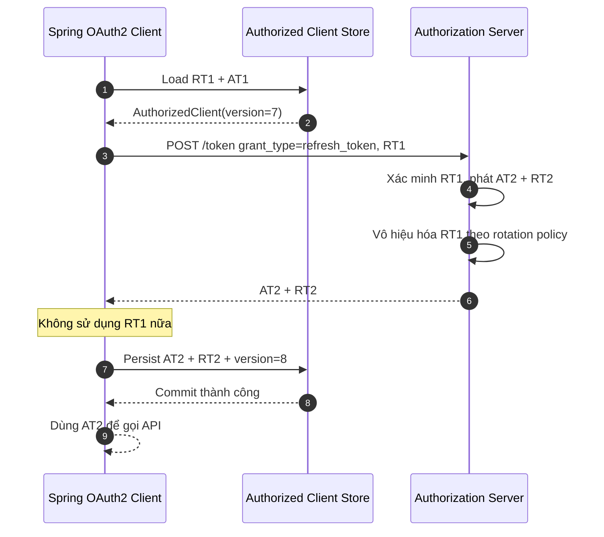
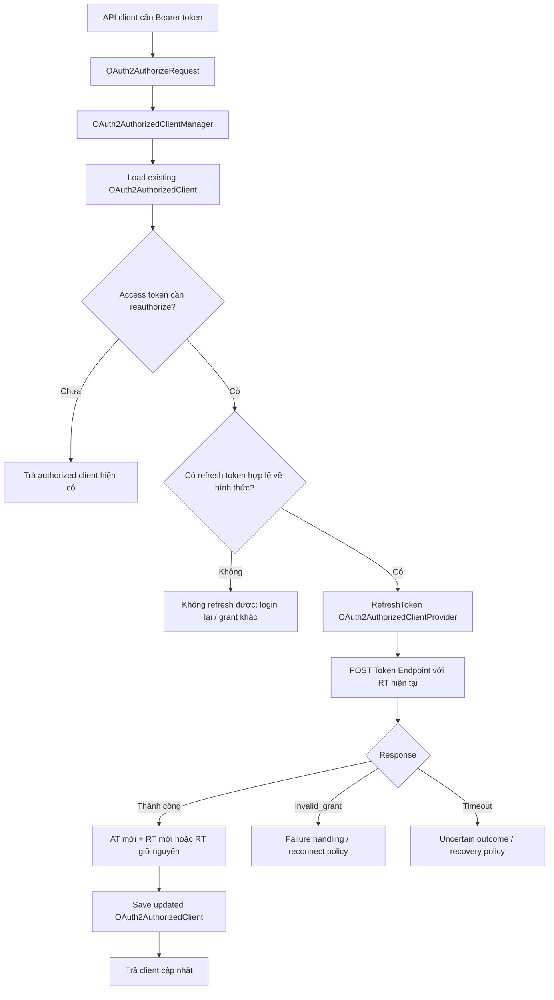
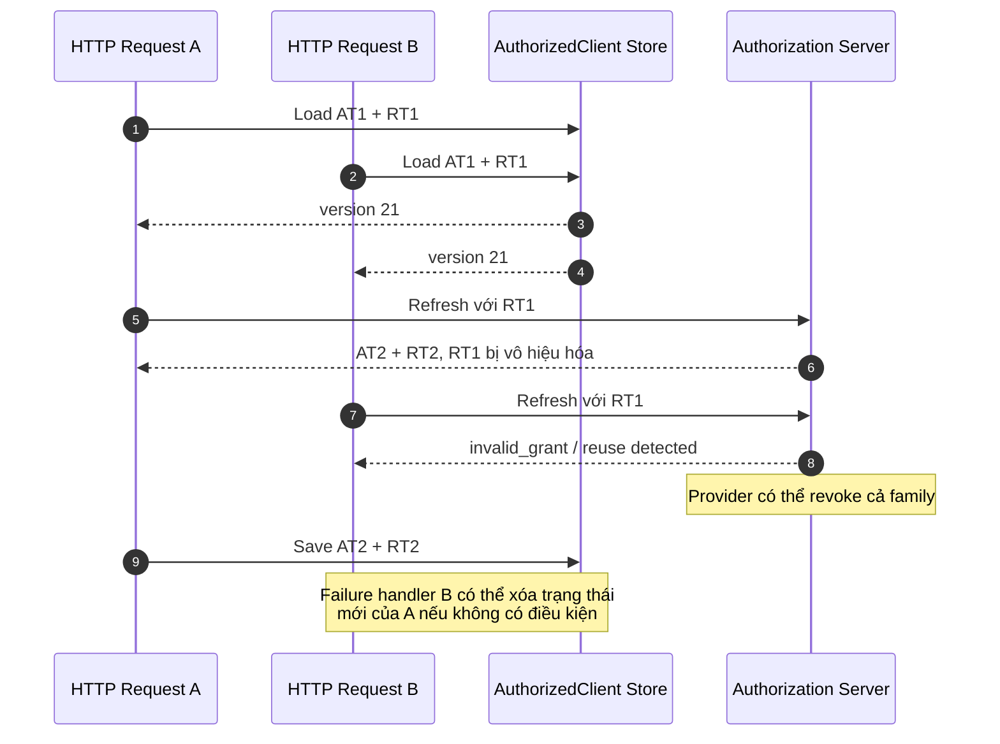
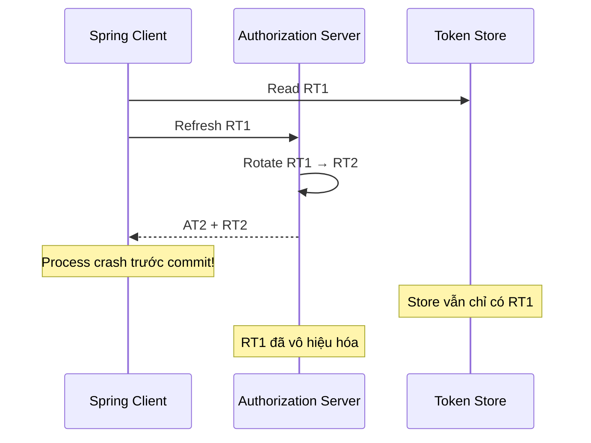

# 17.6. Refresh token rotation và cập nhật token mới an toàn

Trong **Spring Security OAuth 2.0 / OpenID Connect (OIDC) Client**, access token dùng để gọi API thường có thời gian sống ngắn. Khi người dùng đã đăng nhập và ủy quyền, ứng dụng có thể nhận **refresh token** để xin access token mới mà không buộc browser thực hiện lại toàn bộ luồng đăng nhập mỗi lần.

Với một số Authorization Server, việc refresh không chỉ cấp access token mới: server còn **phát refresh token mới và vô hiệu hóa refresh token cũ**. Cơ chế đó gọi là **refresh token rotation**. Nếu client không lưu token mới kịp thời, hai HTTP requests cùng refresh hoặc một background worker gửi lại refresh token cũ, người dùng có thể bị mất phiên ủy quyền hoặc — với chính sách phát hiện tái sử dụng của provider — cả một **token family** có thể bị thu hồi.

Bài học này giải thích cách quản lý rotation đúng trong **Spring Boot 3.x, Spring Security 6.x**, gồm `OAuth2AuthorizedClientManager`, `OAuth2AuthorizedClientProvider`, `OAuth2AuthorizedClientService` và `OAuth2AuthorizedClientRepository`; đồng thời phân biệt điều **framework hỗ trợ** với những bảo đảm về **đồng thời, giao dịch và lưu trữ phân tán** mà ứng dụng phải tự thiết kế.

Các giá trị token, issuer và hostname trong ví dụ đều giả lập. Tuyệt đối không chèn access/refresh token thực vào tài liệu, source code hoặc log.

## 1. Kết quả mong đợi sau bài học

Bạn có thể giải thích và áp dụng được:

1. **Refresh token rotation** là gì, khác gì với việc chỉ cấp access token mới.
2. **Refresh token reuse detection** có thể khiến Authorization Server thu hồi một token hoặc cả token family ra sao.
3. Khi token response chứa refresh token mới, client phải **thay thế bản cũ**, lưu access token và refresh token thành một trạng thái nhất quán.
4. Khi token response **không** chứa refresh token mới, phải hiểu contract của provider, không tự suy luận rằng server luôn rotate.
5. Cách Spring Security phối hợp `refreshToken()` provider và authorized client storage.
6. Vì sao hai requests hoặc hai instances cùng dùng một refresh token có thể gây race condition.
7. Cách tổ chức **single-flight refresh, per-key lock/lease, optimistic concurrency, versioning/fencing** mà không giả định có giao dịch phân tán với Authorization Server.
8. Cách ứng xử với `invalid_grant`, network timeout, refresh token bị thu hồi và cửa sổ crash sau khi server đã rotate.
9. Cách bảo vệ credential trong session, database, backup, metrics, tracing và quy trình logout/account disconnect.
10. Cách thiết kế kiểm thử có tình huống rotation, concurrent refresh và lỗi lưu trữ.

Một điểm cần ghi nhớ ngay từ đầu:

> **Rotation chỉ có ích khi client thay thế refresh token cũ một cách bền vững và không vô tình tái sử dụng nó.** Cơ chế tự động refresh của framework không đồng nghĩa với bảo đảm cập nhật nguyên tử trên nhiều máy chủ.

## 2. Refresh token là gì và nằm ở đâu?

Một OAuth2 token response ban đầu sau Authorization Code Flow có thể gồm:

```json
{
  "access_token": "ACCESS_TOKEN_A",
  "token_type": "Bearer",
  "expires_in": 3600,
  "refresh_token": "REFRESH_TOKEN_1",
  "scope": "calendar.read"
}
```

Các giá trị trên chỉ là ký hiệu. Thực tế `access_token` và `refresh_token` thường là chuỗi có giá trị bảo mật, có thể là opaque token hoặc định dạng do Authorization Server lựa chọn.

| Loại dữ liệu | Chức năng | Nơi sử dụng |
| --- | --- | --- |
| Access token | Cho phép client gọi API/resource server theo audience, scope và chính sách đã được cấp | `Authorization: Bearer ...` tới API được phép |
| Refresh token | Cho phép client xin access token mới tại Token Endpoint theo grant `refresh_token` | **Chỉ gửi đến Token Endpoint tin cậy** |
| ID Token | Bằng chứng xác thực người dùng theo OIDC | OIDC Client xác minh `iss`, `aud`, chữ ký, thời hạn, nonce… |
| HTTP session cookie | Duy trì phiên đăng nhập của website | Browser ↔ Spring web application |
| Client secret | Credential xác thực confidential client với Authorization Server | Backend/Token Endpoint, không đưa vào browser |

**Refresh token không phải access token.** Không gửi refresh token làm Bearer token tới Resource Server. Cũng không gửi refresh token cho browser trong ứng dụng server-side chỉ để frontend có thể tự refresh.

### 2.1. Có phải OIDC login nào cũng có refresh token?

Không. Việc cấp refresh token tùy thuộc loại client, grant, provider policy, scopes, consent và các yếu tố khác. `offline_access` thường liên quan khả năng cấp refresh token trong OIDC, nhưng không có một quy tắc đơn giản rằng thêm scope này sẽ luôn nhận token.

Với **Authorization Code Flow**, refresh token có thể được cấp. Với `client_credentials`, Authorization Server thông thường **không cấp refresh token**; client thường xin access token mới bằng chính `client_credentials` khi cần.

### 2.2. Access token expiry và session lifetime là hai vấn đề

Spring web session có thể còn hoạt động khi access token đã hết hạn, hoặc session đã hết khi token ở authorized client service vẫn còn giá trị. Việc refresh token không tự đăng nhập lại browser, không tái xác minh mọi chính sách OIDC và cũng không chứng minh quyền của người dùng chưa bị thu hồi.

Không suy ra “session còn sống” đồng nghĩa “refresh token còn hợp lệ”.

## 3. Rotation: diễn biến từ RT1 tới RT2

Một refresh request theo OAuth 2.0 thông thường gửi:

```http
POST /oauth2/token HTTP/1.1
Host: auth.example.com
Content-Type: application/x-www-form-urlencoded
Authorization: Basic <client-credential>

grant_type=refresh_token&refresh_token=REFRESH_TOKEN_1
```

Khi Authorization Server hỗ trợ **rotation**, token response có thể là:

```json
{
  "access_token": "ACCESS_TOKEN_B",
  "token_type": "Bearer",
  "expires_in": 3600,
  "refresh_token": "REFRESH_TOKEN_2",
  "scope": "calendar.read"
}
```

Server có thể vô hiệu hóa `REFRESH_TOKEN_1` ngay khi cấp `REFRESH_TOKEN_2`, theo chính sách của nó.



### 3.1. Rotation có thể lặp thành một token family

Một chuỗi cấp token điển hình:

```text
Lúc đăng nhập/consent: RT1
           |
           | refresh hợp lệ
           v
          RT2  (RT1 không còn được dùng)
           |
           | refresh hợp lệ
           v
          RT3  (RT2 không còn được dùng)
           |
           | refresh hợp lệ
           v
          RT4  (RT3 không còn được dùng)
```

Một số Authorization Server quản lý các token thuộc cùng một **token family/grant chain**. Nếu phát hiện một refresh token cũ bị gửi lại, server có thể hiểu đây là dấu hiệu token bị đánh cắp và thu hồi cả refresh token hiện tại trong family. Mức độ xử lý, ngưỡng/grace period và thông báo lỗi **phụ thuộc provider**; không mặc định mọi provider xử lý giống nhau.

### 3.2. Rotation khác reuse detection

- **Rotation:** mỗi lần refresh thành công có thể cấp một refresh token mới, thay thế token cũ.
- **Reuse detection:** server phát hiện refresh token đã bị sử dụng/vô hiệu hóa được trình bày lần nữa; hành động có thể là từ chối request, đánh dấu security incident hoặc revoke family.
- **Revocation:** server vô hiệu hóa một hoặc nhiều token vì user logout/disconnect, admin action, phát hiện rủi ro hoặc chính sách.
- **Expiration:** token hết hạn theo thời gian hoặc inactivity/absolute lifetime.

Rotation không tự bảo đảm reuse detection; reuse detection không chỉ xảy ra do tấn công thực sự — **client có race condition cũng có thể tạo lại cùng mẫu tái sử dụng token cũ**.

### 3.3. Sender-constrained refresh token là một hướng khác

Theo **OAuth 2.0 Security Best Current Practice (RFC 9700)**, với **public clients**, Authorization Server cần phát hiện replay bằng refresh-token rotation hoặc sử dụng **sender-constrained refresh tokens** (ví dụ ràng buộc khóa). Confidential clients có thể được ràng buộc bởi cơ chế client authentication/policy riêng.

Sender-constrained token giảm giá trị của token bị lộ nếu bên tấn công không sở hữu khóa ràng buộc. Tuy nhiên, nó **không làm biến mất** nhu cầu quản lý trạng thái token, hạn dùng, lưu trữ và đồng thời. Bài này tập trung vào rotation; không giả định mọi OP hỗ trợ DPoP hoặc mTLS-bound refresh tokens.

## 4. Token response có thể không cấp refresh token mới

Không phải mỗi phản hồi refresh đều có field `refresh_token`. Ví dụ:

```json
{
  "access_token": "ACCESS_TOKEN_B",
  "token_type": "Bearer",
  "expires_in": 3600,
  "scope": "calendar.read"
}
```

Với cơ chế **không rotate** và theo contract của provider, refresh token hiện tại có thể tiếp tục được sử dụng. Theo RFC 6749, Authorization Server **có thể** cấp refresh token mới; khi có token mới, client **phải loại bỏ bản cũ và thay bằng bản mới**.

Vì vậy:

| Token response | Hành vi cần hiểu |
| --- | --- |
| Có `access_token` mới và `refresh_token` mới | Lưu token mới, không dùng refresh token cũ nữa |
| Có `access_token` mới nhưng không có `refresh_token` | Theo RFC/provider semantics, thường giữ refresh token hiện có nếu vẫn được phép; không tự tạo token giả |
| Trả `invalid_grant` | Không có refresh thành công; có thể token cũ hết hạn, bị thu hồi, sai client hoặc đã rotate |
| HTTP/network timeout trước khi nhận response | **Không biết chắc** server đã xử lý request/rotate hay chưa |
| Body/format không hợp lệ | Không được lưu dữ liệu partial hoặc coi refresh thành công |

Với provider bắt buộc rotation nhưng lại không trả refresh token mới, đây là vấn đề hợp đồng/protocol cần điều tra; không thể sửa bằng việc client tự sinh một “RT2”.

### 4.1. Không ghi đè RT mới bằng null

Một anti-pattern:

```java
// MINH HỌA SAI: response không có refresh_token thì làm mất RT cũ
String refreshTokenToSave = tokenResponse.getRefreshToken();
store.updateAccessAndRefresh(accessToken, refreshTokenToSave);
```

Tùy API và cách biểu diễn, `getRefreshToken()` có thể là `null` nếu server không cấp refresh token mới. Việc lưu `null` bừa bãi có thể khiến client mất khả năng refresh tiếp.

Logic đúng **phải dựa trên contract đã xác minh**: nếu có refresh token mới, thay thế; nếu không có và refresh token cũ vẫn hợp lệ, giữ bản cũ. Khi dùng Spring Security provider chuẩn, ưu tiên để framework xây authorized client theo semantics tương ứng thay vì tự tái tạo response.

### 4.2. Không chỉ cập nhật access token

Một anti-pattern khác:

```text
Store trước:
  AT1 + RT1

Refresh response:
  AT2 + RT2

App chỉ lưu:
  AT2 + RT1  <-- SAI khi RT1 đã bị rotate
```

Kết quả là lần refresh tiếp theo vẫn dùng `RT1` đã vô hiệu hóa. Với reuse detection, server có thể coi việc dùng lại là dấu hiệu credential bị đánh cắp.

**Access token và refresh token cần được cập nhật như một trạng thái authorized client nhất quán**, thay vì lưu hai trường vào hai store không có cơ chế đồng bộ.

## 5. Spring Security lưu refresh token ở đâu?

Trong Spring OAuth2 Client, trạng thái thường được biểu diễn bởi:

```text
OAuth2AuthorizedClient
  |
  +-- ClientRegistration
  +-- principalName
  +-- OAuth2AccessToken
  |     +-- tokenValue
  |     +-- issuedAt, expiresAt, scopes
  |
  +-- OAuth2RefreshToken (có thể null)
        +-- tokenValue
        +-- issuedAt, expiresAt nếu có
```

Các API liên quan:

| API | Vai trò |
| --- | --- |
| `OAuth2AuthorizedClient` | Gom registration, principal và token được cấp |
| `OAuth2AuthorizedClientManager` | Điều phối authorization/reauthorization |
| `OAuth2AuthorizeRequest` | Xác định registration và principal cho lần authorize |
| `OAuth2AuthorizedClientProviderBuilder.refreshToken()` | Kích hoạt provider dùng refresh token khi đáp ứng điều kiện |
| `OAuth2AuthorizedClientRepository` | Lưu/tìm authorized client trong ngữ cảnh Servlet request |
| `OAuth2AuthorizedClientService` | Lưu/tìm authorized client độc lập HTTP request |
| `DefaultOAuth2AuthorizedClientManager` | Manager thường dùng khi có Servlet request |
| `AuthorizedClientServiceOAuth2AuthorizedClientManager` | Manager thường dùng cho job/backend không có Servlet request |
| `OAuth2AuthorizationSuccessHandler` | Xử lý lưu trạng thái khi authorization/reauthorization thành công |
| `OAuth2AuthorizationFailureHandler` | Xử lý lỗi và có thể loại bỏ trạng thái không còn hợp lệ theo chính sách |

**Nơi lưu token thực tế phụ thuộc implementation.** Có ứng dụng lưu authorized client liên quan session; có ứng dụng dùng in-memory service, JDBC hoặc custom store. Đừng suy đoán refresh token đã được lưu vào database chỉ vì website sử dụng Spring Session.

### 5.1. Các thành phần làm việc cùng nhau



Trên đường đi thông thường, Spring Security có thể giúp xử lý token response và lưu authorized client sau refresh. Tuy nhiên, **API manager không cam kết transactional CAS/distributed lock cho kho lưu mà ứng dụng tự chọn**.

## 6. Cấu hình OIDC Client có khả năng nhận refresh token

Giả sử ứng dụng Spring MVC gọi Calendar API sau khi user đăng nhập qua OIDC.

### 6.1. Dependencies

Với Spring Boot:

```xml
<dependency>
    <groupId>org.springframework.boot</groupId>
    <artifactId>spring-boot-starter-web</artifactId>
</dependency>
<dependency>
    <groupId>org.springframework.boot</groupId>
    <artifactId>spring-boot-starter-oauth2-client</artifactId>
</dependency>
```

Hoặc Gradle:

```groovy
dependencies {
    implementation 'org.springframework.boot:spring-boot-starter-web'
    implementation 'org.springframework.boot:spring-boot-starter-oauth2-client'
}
```

### 6.2. `application.yml`

```yaml
spring:
  security:
    oauth2:
      client:
        registration:
          calendar-user:
            provider: calendar-oidc
            client-id: ${CALENDAR_CLIENT_ID}
            client-secret: ${CALENDAR_CLIENT_SECRET}
            client-authentication-method: client_secret_basic
            authorization-grant-type: authorization_code
            scope:
              - openid
              - profile
              - calendar.read
              - offline_access
            redirect-uri: "{baseUrl}/login/oauth2/code/{registrationId}"
        provider:
          calendar-oidc:
            issuer-uri: ${CALENDAR_ISSUER_URI}
```

`calendar.read` là scope giả định, còn `offline_access` theo chuẩn OIDC thường dùng khi cần cấp khả năng truy cập lúc user không hiện diện. **Nó không bảo đảm OP sẽ luôn cấp refresh token hoặc luôn rotate**. Cần cấu hình client/consent và kiểm tra token response theo tài liệu OP thật.

Dữ liệu bí mật phải được cung cấp qua environment hoặc secret manager. Không commit `client-secret` thực tế vào Git.

### 6.3. `application.properties` tương đương

```properties
spring.security.oauth2.client.registration.calendar-user.provider=calendar-oidc
spring.security.oauth2.client.registration.calendar-user.client-id=${CALENDAR_CLIENT_ID}
spring.security.oauth2.client.registration.calendar-user.client-secret=${CALENDAR_CLIENT_SECRET}
spring.security.oauth2.client.registration.calendar-user.client-authentication-method=client_secret_basic
spring.security.oauth2.client.registration.calendar-user.authorization-grant-type=authorization_code
spring.security.oauth2.client.registration.calendar-user.scope=openid,profile,calendar.read,offline_access
spring.security.oauth2.client.registration.calendar-user.redirect-uri={baseUrl}/login/oauth2/code/{registrationId}
spring.security.oauth2.client.provider.calendar-oidc.issuer-uri=${CALENDAR_ISSUER_URI}
```

Chỉ cần dùng một định dạng cấu hình theo convention dự án. Không viết URI token endpoint thủ công nếu issuer discovery của OP đáng tin cậy đã cung cấp metadata đúng.

### 6.4. Không có property “bật rotation” chung ở Spring Client

Rotation là **chính sách phát hành và vô hiệu hóa refresh token phía Authorization Server**. Việc thêm `.refreshToken()` vào client manager giúp Spring **sử dụng refresh token đã được cấp**; nó **không ép Authorization Server rotate**.

Ví dụ các quyết định phía OP:

- Cấp refresh token hay không.
- Rotation mỗi lần refresh hay dùng lại token cũ.
- Có grace period/overlap giữa RT cũ và RT mới không.
- Có revoke cả family khi phát hiện reuse không.
- Absolute lifetime, inactivity timeout, phạm vi consent và revocation policy.

Client phải thực thi đúng contract và triển khai persistence đủ an toàn, thay vì đoán cấu hình server chỉ từ một token response.

## 7. Cấu hình `OAuth2AuthorizedClientManager` để refresh

### 7.1. Manager cho Servlet request

Ví dụ user đã đăng nhập bằng `oauth2Login()` và controller/service gọi API trong cùng Servlet request:

```java
import org.springframework.context.annotation.Bean;
import org.springframework.context.annotation.Configuration;
import org.springframework.security.oauth2.client.DefaultOAuth2AuthorizedClientManager;
import org.springframework.security.oauth2.client.OAuth2AuthorizedClientManager;
import org.springframework.security.oauth2.client.OAuth2AuthorizedClientProvider;
import org.springframework.security.oauth2.client.OAuth2AuthorizedClientProviderBuilder;
import org.springframework.security.oauth2.client.registration.ClientRegistrationRepository;
import org.springframework.security.oauth2.client.web.OAuth2AuthorizedClientRepository;

@Configuration
public class WebOAuth2ClientManagerConfig {

    @Bean
    OAuth2AuthorizedClientManager userAuthorizedClientManager(
            ClientRegistrationRepository registrations,
            OAuth2AuthorizedClientRepository authorizedClients) {

        OAuth2AuthorizedClientProvider provider =
                OAuth2AuthorizedClientProviderBuilder.builder()
                        .authorizationCode()
                        .refreshToken()
                        .build();

        DefaultOAuth2AuthorizedClientManager manager =
                new DefaultOAuth2AuthorizedClientManager(
                        registrations, authorizedClients);
        manager.setAuthorizedClientProvider(provider);
        return manager;
    }
}
```

`DefaultOAuth2AuthorizedClientManager` làm việc với `OAuth2AuthorizedClientRepository` và ngữ cảnh Servlet. Spring có thể tìm authorized client từ request/session/storage tương ứng, nhận biết nhu cầu refresh, gọi Token Endpoint và lưu trạng thái mới qua success handling.

**Lưu ý:** nếu refresh token không có hoặc đã bị thu hồi, manager không thể tự tạo một browser authorization code. User có thể cần chạy lại `/oauth2/authorization/calendar-user` hoặc luồng reconnect phù hợp.

### 7.2. Manager cho tác vụ nền có token user được lưu trong service

Nếu một background worker đã được thiết kế để sử dụng **delegated token của đúng user**, có thể dùng manager không phụ thuộc Servlet request:

```java
import org.springframework.context.annotation.Bean;
import org.springframework.context.annotation.Configuration;
import org.springframework.security.oauth2.client.AuthorizedClientServiceOAuth2AuthorizedClientManager;
import org.springframework.security.oauth2.client.OAuth2AuthorizedClientManager;
import org.springframework.security.oauth2.client.OAuth2AuthorizedClientProvider;
import org.springframework.security.oauth2.client.OAuth2AuthorizedClientProviderBuilder;
import org.springframework.security.oauth2.client.OAuth2AuthorizedClientService;
import org.springframework.security.oauth2.client.registration.ClientRegistrationRepository;

@Configuration
public class BackgroundRefreshManagerConfig {

    @Bean("delegatedBackgroundManager")
    OAuth2AuthorizedClientManager delegatedBackgroundManager(
            ClientRegistrationRepository registrations,
            OAuth2AuthorizedClientService authorizedClientService) {

        OAuth2AuthorizedClientProvider provider =
                OAuth2AuthorizedClientProviderBuilder.builder()
                        .refreshToken()
                        .build();

        AuthorizedClientServiceOAuth2AuthorizedClientManager manager =
                new AuthorizedClientServiceOAuth2AuthorizedClientManager(
                        registrations, authorizedClientService);
        manager.setAuthorizedClientProvider(provider);

        return manager;
    }
}
```

Với cấu hình chỉ có `refreshToken()`, manager **không thể khởi tạo Authorization Code Flow từ job**. Nó cần một `OAuth2AuthorizedClient` của user đã được cấp trước và được lưu trong **cùng authorized client service mà worker có thể truy cập**.

Đừng cho rằng `oauth2Login()` đã lưu token trong web session thì job có thể tìm thấy token đó qua service. Nếu muốn xử lý background delegated access, phải thiết kế rõ repository/service, khóa internal identity, consent, retention và quyền truy cập.

### 7.3. `client_credentials` không dùng rotation kiểu user refresh token

Một job app-only thường khai báo:

```java
OAuth2AuthorizedClientProviderBuilder.builder()
        .clientCredentials()
        .build();
```

Khi access token hết hạn, provider xin access token mới bằng client credentials. Trong grant này **thường không có refresh token** để rotate; đừng cố gắn `refreshToken()` chỉ để “bật bảo mật hơn”.

## 8. Cách gọi manager trong request của người dùng

Ví dụ controller nhận `Authentication` của user đã đăng nhập:

```java
import org.springframework.beans.factory.annotation.Qualifier;
import org.springframework.security.core.Authentication;
import org.springframework.security.oauth2.client.OAuth2AuthorizeRequest;
import org.springframework.security.oauth2.client.OAuth2AuthorizedClient;
import org.springframework.security.oauth2.client.OAuth2AuthorizedClientManager;
import org.springframework.stereotype.Service;

@Service
public class CalendarTokenProvider {

    private final OAuth2AuthorizedClientManager manager;

    public CalendarTokenProvider(
            @Qualifier("userAuthorizedClientManager")
            OAuth2AuthorizedClientManager manager) {
        this.manager = manager;
    }

    public OAuth2AuthorizedClient currentClient(Authentication user) {
        OAuth2AuthorizeRequest request =
                OAuth2AuthorizeRequest
                        .withClientRegistrationId("calendar-user")
                        .principal(user)
                        .build();

        OAuth2AuthorizedClient client = manager.authorize(request);
        if (client == null) {
            throw new IllegalStateException(
                    "Calendar authorization is missing; user must reconnect");
        }
        return client;
    }
}
```

Code gọi tầng API chỉ dùng access token:

```java
OAuth2AuthorizedClient client =
        calendarTokenProvider.currentClient(authentication);

String bearerToken = client.getAccessToken().getTokenValue();

// Chỉ chuyển bearerToken tới Calendar API được cấu hình và tin cậy.
// Không ghi log, không gửi token cho browser.
```

Ở thời điểm `manager.authorize(...)`, provider có thể phát hiện access token cần reauthorization và dùng refresh token phù hợp. **Không tự gọi refresh mỗi lần HTTP request** bằng một `POST /token` viết tay nếu manager đã hỗ trợ lifecycle cần thiết.

### 8.1. Quan sát thời hạn mà không lộ token

Bạn có thể đọc metadata:

```java
OAuth2AuthorizedClient client =
        calendarTokenProvider.currentClient(authentication);

System.out.println(
        "access token expires at: "
                + client.getAccessToken().getExpiresAt());

System.out.println(
        "has refresh token: "
                + (client.getRefreshToken() != null));
```

Với production, nên dùng structured logging và không log dữ liệu người dùng khi không cần. **Không in `getTokenValue()`** của access/refresh token.

### 8.2. Vì sao principal key quan trọng?

Trong persistence, authorized client thường được phân biệt bởi **client registration ID và principal name**. Nếu mọi user đều được truyền `.principal("shared-user")`, một storage cấu hình sai có thể trả token của người này cho người khác.

Dùng `Authentication` đáng tin cậy từ request và identity mapping nhất quán. Nếu ứng dụng đa issuer/tenant, cần tránh trùng principal name giữa các OP; không chỉ dùng email làm khóa toàn cục.

## 9. Cập nhật token mới: trạng thái phải nguyên khối

Giả sử storage đang có:

```text
key:
  registration = calendar-user
  principal    = internal-account-42

version = 12
access_token = AT12
refresh_token = RT12
```

Sau refresh thành công, OP trả:

```text
access_token = AT13
refresh_token = RT13
```

Ứng dụng cần commit một trạng thái mới:

```text
version = 13
access_token = AT13
refresh_token = RT13
```

**Không viết access token trước rồi refresh token sau** bằng hai giao dịch/đường lưu độc lập nếu giữa chừng có thể crash hoặc request khác đọc dữ liệu. Trạng thái sau commit phải cùng biểu diễn **một lần authorization/reauthorization nhất quán**.

### 9.1. Trạng thái không hợp lệ cần tránh

| Access token lưu | Refresh token lưu | Ý nghĩa |
| --- | --- | --- |
| AT12 | RT12 | Trạng thái cũ trước refresh |
| **AT13** | **RT13** | **Trạng thái mới đúng khi server rotate** |
| AT13 | RT12 | Sai sau rotation; lần refresh tiếp theo dùng RT cũ |
| AT12 | RT13 | Lệch thế hệ; có thể làm dữ liệu API/token lifetime khó kiểm soát |
| AT13 | null | Có thể mất đường refresh nếu response thực sự có RT13 nhưng client bỏ qua |
| AT13 | RT12 sau khi đã có RT13 | Stale writer ghi đè refresh token mới |

Nếu storage chỉ hỗ trợ lưu mỗi trường riêng, hãy bổ sung giao dịch/record versioning hoặc đổi mô hình persistence.

### 9.2. Update có điều kiện theo version

Một chiến lược database phổ biến là **optimistic concurrency control**:

```sql
-- Mô hình SQL minh họa, không phải schema Spring mặc định.
UPDATE oauth2_authorized_client_secure
SET
    encrypted_access_token  = :new_access_token_ciphertext,
    encrypted_refresh_token = :new_refresh_token_ciphertext,
    access_expires_at       = :new_access_expires_at,
    version                 = version + 1,
    updated_at              = CURRENT_TIMESTAMP
WHERE
    registration_id         = :registration_id
    AND principal_key       = :principal_key
    AND version             = :expected_version;
```

Chỉ khi cập nhật **đúng một hàng** thì được coi là commit thành công. Nếu kết quả là **0 rows updated**, nghĩa là trạng thái đã thay đổi hoặc không còn tồn tại: **đọc lại storage**, xác định trạng thái mới, không ghi đè vô điều kiện bằng token response từ một request đã chậm hơn.

Cần đảm bảo các trường token được cập nhật trong một transaction và ở trạng thái mã hóa an toàn. Ví dụ dùng `encrypted_*` để nhấn mạnh yêu cầu bảo vệ token; triển khai encryption/key management thực tế phụ thuộc kiến trúc.

### 9.3. Version/CAS không tự ngăn token reuse

CAS sau Token Endpoint giúp tránh stale write, nhưng **không ngăn hai requests đã gửi cùng RT12 lên OP** trước đó.

```text
Request A tải RT12, version 12
Request B tải RT12, version 12

A gửi RT12 -> OP phát RT13, vô hiệu hóa RT12
B gửi RT12 -> OP phát hiện reuse hoặc trả invalid_grant

A CAS version 12 -> 13 thành công
B không có RT mới hoặc cố cập nhật thất bại
```

Nếu OP có reuse detection thu hồi token family khi B dùng RT12, RT13 của A cũng có thể bị thu hồi. **Vì vậy chỉ có optimistic locking sau refresh là chưa đủ** nếu muốn ngăn replay từ chính các worker của ứng dụng.

Cần cân nhắc **điều phối trước khi gọi Token Endpoint**.

## 10. Race condition khi hai HTTP requests cùng refresh

Một tình huống rất thực tế: browser mở hai tab, access token sắp hết hạn, cả hai tab gọi API của Spring gần như đồng thời.



Có hai lỗi độc lập:

1. **Reuse trên OP:** B đã gửi RT1 không còn hợp lệ.
2. **Race ở storage:** B xử lý `invalid_grant` và xóa authorized client mà A vừa lưu, hoặc một stale update khác ghi đè RT2.

Bảo vệ cần có ở **cả hai** chặng:

- Điều phối để giảm/ngăn nhiều refresh dùng cùng RT.
- Versioned/conditional write và conditional delete để không làm hỏng state mới.

### 10.1. Một lock trong một JVM giải quyết được gì?

Nếu ứng dụng chỉ có một instance và **mọi đường refresh của cùng authorized client đều đi qua cùng lock**, per-key lock có thể tránh hai luồng cùng refresh:

```text
Lock key = (registrationId, principalKey)
Request A lấy lock:
   - đọc lại authorized client
   - refresh nếu cần
   - lưu bản mới
   - nhả lock
Request B đợi:
   - lấy lock
   - đọc lại bản đã lưu
   - dùng token mới; không gọi RT cũ
```

Nhưng `synchronized(this)` hoặc `ReentrantLock` trong một JVM **không bảo vệ** khi có 2–10 application replicas hoặc background workers riêng. Một lock toàn cục cho mọi users cũng gây nghẽn không cần thiết; lock nên **phân vùng theo authorized client key**.

### 10.2. Chú ý “đọc lại sau khi lấy lock”

Nếu B đã tải RT1 **trước khi đợi lock**, việc có lock không giúp nếu B tiếp tục dùng object RT1 cũ khi đến lượt. Quy tắc:

> **Sau khi có quyền thực hiện refresh, phải lấy lại trạng thái authorized client mới nhất từ store**, không dùng snapshot được tải trước khi chờ.

Lần đọc này quyết định liệu access token mới có còn cần refresh hay không, và refresh token hiện tại là token nào.

## 11. Single-flight refresh cho nhiều requests

Một chiến lược gọi là **single-flight**: nhiều callers cần cùng token đang hết hạn chỉ có một quá trình refresh được thực hiện; những callers khác đợi kết quả hoặc đọc lại token mới.

```text
Call A: authorize(reg=calendar-user, user=42)
        |
        +--> trở thành leader refresh

Call B: authorize(reg=calendar-user, user=42)
        |
        +--> đợi leader hoặc đọc lại sau refresh

Call C: authorize(reg=calendar-user, user=99)
        |
        +--> khóa khác, không bị A chặn

Leader:
  - re-read store RT_current
  - refresh
  - persist AT_new + RT_new
  - hoàn tất

Followers:
  - re-read store
  - lấy token đã được lưu
```

Mô hình này cần được tích hợp **trước đoạn mã manager/provider thực sự gửi refresh request**, không chỉ khóa phần ghi database.

### 11.1. Một lớp orchestrator có thể bao quanh manager

Pseudo-Java dưới đây nhấn mạnh vị trí của lock:

```java
// PSEUDOCODE: ScopedTokenRefreshCoordinator và vớiKeyLock(...)
// là contract cần triển khai bằng lock/store thích hợp.
OAuth2AuthorizedClient authorizeSafely(
        String registrationId,
        Authentication user) {

    String principalKey = verifiedInternalUserKey(user);
    String lockKey = registrationId + ":" + principalKey;

    return coordinator.withKeyLock(lockKey, () -> {

        // Quan trọng: manager/load phải đọc lại trạng thái trong lock.
        OAuth2AuthorizeRequest request =
                OAuth2AuthorizeRequest
                        .withClientRegistrationId(registrationId)
                        .principal(user)
                        .build();

        OAuth2AuthorizedClient result = manager.authorize(request);

        if (result == null) {
            throw new AuthorizationRequiredException();
        }

        return result;
    });
}
```

Đây là **pseudocode kiến trúc**, không phải đoạn copy vào project rồi chạy được: `ScopedTokenRefreshCoordinator` và `verifiedInternalUserKey` phải được thiết kế theo identity/storage thật, quản lý exception, lock lifetime và request context. `manager.authorize` cần dùng **cùng kho lưu** mà coordinator kiểm soát.

Trong môi trường nhiều instance, per-key lock phải là distributed coordination hoặc một storage algorithm có bảo đảm tương đương. Với workload có nhiều người dùng và nhiều registrations, key không được va chạm giữa users/tenants.

### 11.2. Không giữ database transaction quá lâu qua network call nếu có thể tránh

Một cách thô sơ là giữ transaction/row lock trong lúc gọi Token Endpoint. Điều đó có thể gây:

- Giữ connection và khóa lâu khi mạng chậm.
- Deadlock/contention với requests khác.
- Giảm throughput khi OP gặp sự cố.
- Khó recovery nếu process chết giữa request và commit.

Thiết kế nâng cao có thể dùng **lease có hạn + fencing token/version + CAS** thay vì giữ database transaction mở suốt HTTP call. Tuy vậy, nó phức tạp hơn và phải được kiểm thử đúng các trường hợp lease hết hạn hoặc worker bị pause.

Không có lựa chọn “luôn tốt nhất” cho mọi hệ thống; tính nhất quán, quy mô và chính sách OP quyết định mức cơ chế cần triển khai.

## 12. Distributed lock, lease và fencing khi chạy nhiều instance

Giả sử hai replicas cùng phục vụ một user:

```text
Instance A                        Instance B
   |                                  |
   | -- acquire lock(user42) -->      |
   |                                  | waiting
   | -- call OP with RT1 -->          |
   | <-- AT2 + RT2 --                 |
   | -- commit state -->              |
   | -- release lock -->              |
   |                                  | acquire lock
   |                                  | re-read AT2 + RT2
   |                                  | no duplicate RT1
```

### 12.1. Lock key phải đủ cụ thể

Một key khái niệm:

```text
oauth2-refresh-lock:{tenantOrNamespace}:{registrationId}:{principalKey}
```

`principalKey` nên là định danh nội bộ ổn định không bị user tùy ý điều khiển. Nếu storage multi-issuer/multi-tenant, key phải phân vùng đúng **ngữ cảnh tin cậy**.

Tránh ghi raw refresh token vào lock key, log hoặc Redis key name. Không dùng email làm key nếu không cần vì đó là dữ liệu cá nhân dễ lộ.

### 12.2. Lease có thể hết hạn giữa lúc OP xử lý

Trong hệ thống phân tán, worker A lấy lease 10 giây nhưng network call mất 15 giây. Worker B thấy lease hết hạn và lấy lock mới, rồi có thể dùng cùng RT1 nếu store chưa cập nhật.

```text
A lấy lease generation=101, gọi OP
  | ... A bị tạm dừng / mạng chậm ...
B lấy lease generation=102, đọc RT1, gọi OP
  | ... có thể xảy ra reuse ...
A tỉnh lại, định ghi RT2
```

**Fencing token** giúp storage từ chối write của holder quá cũ (`generation=101`), nhưng nó **không thể thu hồi refresh request mà A/B đã gửi đến OP**. Vì thế lease timeout/retry policy phải đủ thận trọng; nếu không chắc kết quả token request trước, không được “thử ngay với RT cũ” chỉ vì lease vừa hết hạn.

### 12.3. Một mô hình trạng thái có thể dùng

```text
ACTIVE(version=10, RT10)
   |
   | claim refresh ownership (leaseId, fencing generation)
   v
REFRESHING(version=10, owner=A, deadline=...)
   |
   | OP trả RT11
   v
ACTIVE(version=11, RT11, AT11)
```

Nếu process chết khi đang `REFRESHING`, recovery phải phân biệt **“chưa gửi request”** và **“không biết OP đã rotate hay chưa”**. Không thể luôn khôi phục an toàn chỉ bằng việc gửi lại RT10; cần provider-specific grace/recovery hoặc yêu cầu reauthorization.

Các trạng thái/lease trên là **một phương án thiết kế tùy chỉnh**, không phải schema được Spring Security tạo sẵn.

## 13. Cửa sổ crash không thể giải quyết bằng transaction local

Trường hợp khó nhất:

1. Client gửi refresh token RT1 tới OP.
2. OP chấp nhận, vô hiệu hóa RT1, phát RT2.
3. Client nhận RT2 trong bộ nhớ.
4. Process chết **trước khi lưu RT2**.
5. Storage chỉ còn RT1.



Không có một **ACID transaction xuyên qua database của ứng dụng và Authorization Server** trong OAuth2 refresh request thông thường. Việc mở transaction ở database trước HTTP call không tạo ra distributed atomic commit với OP.

### 13.1. Phương án giảm thiểu

Tùy khả năng OP và mức rủi ro:

- **Lưu token response ngay** sau khi nhận, giảm khoảng trễ giữa receive và durable commit.
- Sử dụng storage có độ bền và cơ chế cập nhật nguyên khối.
- **Không xử lý thêm nghiệp vụ phụ** trước khi commit RT mới.
- Theo dõi lỗi save và đưa authorized client vào trạng thái cần phục hồi/reconnect thay vì tiếp tục dùng RT cũ.
- Hỏi OP về **rotation grace period/overlap** hoặc khả năng phục hồi theo protocol riêng.
- Khi không thể phục hồi, yêu cầu người dùng **reauthorize/consent lại**.
- Đối với workload app-only, ưu tiên `client_credentials` nếu phù hợp để không phụ thuộc refresh token user.

**Không thể bảo đảm “không bao giờ mất refresh token” chỉ bằng một đoạn Java** khi OP đã rotate nhưng client chưa kịp lưu kết quả. Đây là giới hạn phân tán thực sự cần đưa vào thiết kế vận hành.

### 13.2. Network timeout tạo “uncertain outcome”

Một timeout không chứng minh request refresh đã thất bại tại OP. Server có thể đã nhận RT1, phát RT2 và response bị mất trên đường về.

Vì vậy **không retry mù ngay lập tức với RT1** sau timeout. Với OP có reuse detection nghiêm ngặt, lần retry có thể làm family bị revoke. Cần chính sách recovery cụ thể: đọc lại token store, kiểm tra có refresh khác đã thành công hay không, chờ nếu có worker/lease còn đang xử lý, hoặc chuyển sang reconnect khi không có cách khôi phục.

## 14. Lưu refresh token an toàn trong repository/service

### 14.1. Session storage có gì cần cân nhắc?

Với `oauth2Login()`, `DefaultOAuth2AuthorizedClientManager` hoạt động trên `OAuth2AuthorizedClientRepository` trong Servlet request. Tùy cấu hình, authorized client có thể được giữ ở session hoặc qua một service bên dưới.

Nếu refresh token chỉ sống trong session:

- Browser logout hoặc session timeout có thể làm mất token.
- Các tab chia sẻ session có thể cùng refresh.
- Session replication có thể gây update races nếu hai nodes cập nhật một session attribute.
- Background job không tự đọc được token nếu không có HTTP request.
- Backup/session store có thể chứa token nhạy cảm.

Không tự thêm một session attribute `"refresh_token"` để “dễ lấy hơn” bên cạnh authorized client repository.

### 14.2. Database token store cần những trường gì?

Một schema khái niệm:

```text
OAuth2AuthorizedClientRecord
  - registration_id
  - principal_key          (khóa account/service đáng tin cậy)
  - tenant_key             (nếu ứng dụng đa tenant)
  - encrypted_access_token
  - encrypted_refresh_token
  - access_expires_at
  - refresh_expires_at     (nếu provider công bố/biết)
  - version
  - status                 (ACTIVE/REFRESHING/RECONNECT_REQUIRED)
  - updated_at
```

Không nhất thiết phải dùng schema này; nó là mô hình để bàn về **trạng thái, độ bền, phân quyền và concurrency**. Nếu dùng Spring Security JDBC implementation chuẩn, cần xem schema/API thực tế thay vì giả định nó đã có `version`, lease/fencing hoặc encryption.

### 14.3. Bảo vệ dữ liệu token ở storage

Các yêu cầu thực tế:

1. Mã hóa dữ liệu token khi lưu theo chính sách tổ chức; khóa mã hóa được bảo vệ riêng.
2. TLS cho kết nối application ↔ database/session store.
3. Giới hạn quyền đọc token theo service account, tenant và vận hành.
4. Không dùng raw token làm primary key, lock key hoặc correlation ID.
5. Bảo vệ backups, replicas, snapshots, tracing và hỗ trợ kỹ thuật.
6. TTL/retention phù hợp với consent, inactivity và absolute lifetime.
7. Dọn authorized client khi user disconnect hoặc authorization bị thu hồi.
8. Quản lý key rotation của mã hóa dữ liệu và quy trình incident response.
9. Không trả token dưới dạng JSON response/exception message.
10. Kiểm tra đường đi dữ liệu khi migrate từ session sang database.

Một refresh token còn hiệu lực có thể cho phép xin **nhiều access tokens**; vì thế giá trị bảo mật của nó thường cao hơn một access token ngắn hạn.

## 15. Lưu hai token bằng một bản ghi `OAuth2AuthorizedClient`

Trong Spring Security, khi provider hoàn tất refresh, kết quả được biểu diễn thành `OAuth2AuthorizedClient` tương ứng. Khi tự triển khai persistence, nên lưu **toàn bộ trạng thái được cấp lại** thay vì phân tách việc update access/refresh token không đồng bộ.

Một ví dụ chỉ để quan sát API:

```java
import org.springframework.security.oauth2.client.OAuth2AuthorizedClient;
import org.springframework.security.oauth2.core.OAuth2AccessToken;
import org.springframework.security.oauth2.core.OAuth2RefreshToken;

void inspectTokenMetadata(OAuth2AuthorizedClient client) {
    OAuth2AccessToken accessToken = client.getAccessToken();
    OAuth2RefreshToken refreshToken = client.getRefreshToken();

    System.out.println(
            "accessExpiresAt=" + accessToken.getExpiresAt());
    System.out.println(
            "hasRefreshToken=" + (refreshToken != null));

    // KHÔNG gọi getTokenValue() để ghi log!
}
```

Các class `OAuth2AccessToken` và `OAuth2RefreshToken` mang dữ liệu token; việc tự tạo một `OAuth2AuthorizedClient` mới chỉ để “đổi access token” cần bảo đảm giữ đúng registration, principal, scopes và refresh token tương ứng.

### 15.1. Vì sao một `saveAuthorizedClient(...)` có thể chưa đủ?

API:

```java
authorizedClientService.saveAuthorizedClient(
        authorizedClient,
        authentication);
```

hoặc repository tương ứng giúp lưu authorized client. Nhưng contract thông thường **không nói rằng** implementation của bạn phải làm compare-and-swap dựa trên token generation, lock phân tán hoặc conditional delete khi gặp `invalid_grant`.

Nếu implementation là map trong bộ nhớ, bản ghi database không có version hoặc session attribute bị last-write-wins, hai requests vẫn có thể ghi đè lẫn nhau. Vì thế cần đánh giá **tính nguyên tử và concurrency semantics của storage thực tế**.

## 16. Bảo vệ thao tác xóa khi refresh thất bại

Spring Security managers có thể dùng **`OAuth2AuthorizationFailureHandler`** để xử lý authorization failure; trong một số cấu hình mặc định, lỗi nhất định như `invalid_grant` có thể khiến authorized client cũ bị xóa để tránh sử dụng token không còn hợp lệ.

Nhưng trong race:

```text
Request A: refresh RT1 → RT2, commit version=2
Request B: refresh RT1 → invalid_grant
Request B: failure handler removeAuthorizedClient(reg, principal)
```

Nếu xóa không có điều kiện version, B có thể **xóa authorized client mới** mà A vừa lưu.

### 16.1. Conditional delete

Một chiến lược:

```sql
-- Chỉ xóa/trạng thái hóa nếu bản ghi vẫn là version
-- mà request thất bại đã sử dụng.
UPDATE oauth2_authorized_client_secure
SET
    status = 'RECONNECT_REQUIRED',
    version = version + 1,
    updated_at = CURRENT_TIMESTAMP
WHERE
    registration_id = :registration_id
    AND principal_key = :principal_key
    AND version = :version_read_before_refresh;
```

Nếu kết quả là **0 rows updated**, có một writer khác đã đổi state: phải **đọc lại** để biết có token mới hoặc một sự kiện quản trị đã thay đổi authorization. Đừng xóa vô điều kiện bằng chỉ registration/principal.

### 16.2. Không coi mọi `invalid_grant` là tấn công

Lỗi `invalid_grant` có thể xảy ra do:

- Refresh token hết hạn.
- Refresh token bị thu hồi sau logout/consent revocation.
- Refresh token thuộc client khác hoặc không hợp lệ.
- Authorization Server bật reuse detection.
- Hai requests của chính ứng dụng dùng cùng token cũ.
- Sai lệch thời gian/chính sách provider hoặc sự cố trong data flow.

Không suy ra “đã có kẻ tấn công” chỉ từ `invalid_grant`. Cũng không **tự tiếp tục dùng refresh token cũ** sau khi server từ chối; cần phân loại lỗi, bảo vệ storage và lựa chọn reconnect hoặc incident handling thích hợp.

### 16.3. Tránh retry vô hạn

Thao tác refresh **không có bảo đảm idempotent** chung. Với một token đã rotate, việc retry cùng RT có thể bị coi là reuse.

Chính sách lỗi nên phân biệt:

- **Tạm thời** (ví dụ OP unavailable): đánh giá retry có backoff nhưng không được dùng lại RT nếu kết quả lần trước có thể đã thành công.
- **Không còn authorization** (`invalid_grant` đã xác nhận): dừng refresh lặp, có thể yêu cầu re-login/re-consent.
- **Token state bị cạnh tranh**: đọc lại storage/đợi điều phối trước khi quyết định.
- **Sai client configuration** (`invalid_client`, sai issuer): sửa cấu hình, không tự đổi sang token khác của user.

## 17. Phân biệt lỗi refresh với lỗi gọi Resource Server

Một ứng dụng có thể có hai HTTP calls:

```text
Client -> Authorization Server /token   (refresh token)
Client -> Calendar API /events          (access token)
```

Chúng có những lỗi khác nhau:

| Chặng | Lỗi phổ biến | Ý nghĩa |
| --- | --- | --- |
| Token Endpoint | `invalid_grant` | Refresh token/grant không được chấp nhận |
| Token Endpoint | `invalid_client` | Client authentication lỗi |
| Token Endpoint | `temporarily_unavailable` | OP/AS tạm thời không phục vụ |
| Token Endpoint | Network timeout | Có thể không biết request đã được OP xử lý chưa |
| Resource Server | `401 invalid_token` | Access token không được chấp nhận |
| Resource Server | `403 insufficient_scope` | Token thiếu scope/quyền với API |
| Resource Server | `429` | Rate limit |
| Resource Server | `5xx` | API hoặc hạ tầng lỗi |

**API `401` không chứng minh refresh token cần rotate**. Có thể access token sai audience, issuer hoặc bị revoke. `403` cũng không tự được sửa bằng refresh nếu token mới vẫn có cùng scope.

Nếu tích hợp HTTP client với OAuth2 failure handling, cần bảo đảm invalid-token response được xử lý có kiểm soát; không tự xóa authorized client khi gặp bất kỳ API error nào.

### 17.1. Refresh không tự thay đổi OAuth scopes

Một refresh token grant không được phép cấp quyền rộng hơn chính authorization grant ban đầu theo chính sách OAuth2. Không thêm một string `calendar.write` vào HTTP body rồi mặc định user đã đồng ý cấp quyền mới. Khi cần scope mở rộng hoặc consent mới, có thể phải bắt đầu authorization flow thích hợp.

### 17.2. Refresh không tự đảm bảo quyền user còn hợp lệ

Access token mới có thể được OP cấp theo grant, nhưng ứng dụng vẫn phải áp dụng authorization hiện tại của website và Resource Server vẫn kiểm tra quyền. Nếu user bị disable, thu hồi consent hoặc account bị khóa, provider có thể từ chối refresh; không cố “chữa” bằng service token có quyền cao hơn.

## 18. Logout, account disconnect và rotation

### 18.1. Logout khỏi Spring web session

Logout có thể xóa `SecurityContext` và invalidate HTTP session. Nhưng:

- Refresh token trong một `OAuth2AuthorizedClientService` lưu database có thể vẫn tồn tại.
- Logout khỏi ứng dụng không nhất thiết thu hồi token ở OP.
- Logout tại OP là cơ chế riêng khi OP hỗ trợ.
- Browser session còn hay hết không quyết định absolute lifetime của refresh token.

**Nếu nghiệp vụ định nghĩa logout phải ngừng mọi background delegated access**, cần chính sách dọn/revoke authorized client và hủy công việc, không chỉ xóa `JSESSIONID`.

### 18.2. Account disconnect

Khi user bấm “Ngắt kết nối Calendar”, ứng dụng nên:

1. Xác thực user hiện tại và quyền disconnect chính tài khoản của họ.
2. Dừng/hủy queued jobs cần token đó theo chính sách.
3. Revoke refresh/access token tại OP nếu endpoint hỗ trợ.
4. Xóa authorized client bằng khóa registration/principal chính xác và có kiểm soát đồng thời.
5. Xóa caches/bản sao không còn mục đích, theo retention policy.
6. Ghi audit metadata tối thiểu, không ghi raw token.

Thao tác disconnect có thể race với refresh đang xử lý. Cần đánh dấu **revoked/disconnected generation** sao cho một refresh response đến muộn **không thể ghi lại token vào một authorization đã bị user chấm dứt**.

### 18.3. Revocation phải thắng refresh response đến muộn

Một sự cố có thể xảy ra:

```text
T1: Worker A bắt đầu refresh RT5.
T2: User bấm Disconnect.
T3: Storage xóa authorized client.
T4: Worker A nhận RT6 và lưu lại.
```

Nếu storage chỉ là last-write-wins, token RT6 có thể được “hồi sinh” sau khi user disconnect. Thiết kế production nên dùng **version/tombstone/revoked status** để từ chối stale refresh write khi authorization đã bị chấm dứt.

Tương tự, không cho refresh tự động khởi động lại một grant mà admin đã thu hồi vì sự cố an ninh.

## 19. Multi-tab và nhiều provider

### 19.1. Hai tab cùng một user

Hai tab trong cùng browser profile thường chia sẻ session cookie. Khi cả hai tab gọi API cần refresh gần cùng lúc, chúng có thể dùng chung `OAuth2AuthorizedClient`.

Cần phối hợp refresh theo **(client registration, principal)**, không theo tab ID. Nếu mỗi tab tự gọi Token Endpoint với cùng refresh token, rotation dễ gây race.

### 19.2. Hai provider khác nhau

Ví dụ:

```text
registrationId = corporate-calendar
issuer = https://sso.corp.example.com

registrationId = partner-calendar
issuer = https://login.partner.example.com
```

Mỗi registration có token endpoint, client credentials, audience/scopes và refresh token độc lập. Đừng dùng chung refresh token giữa providers chỉ vì cùng email hoặc cùng tên người dùng.

Một key an toàn trong application storage thường dựa trên **registration đã được phê duyệt + internal principal identity** có phân vùng tenant/issuer nếu cần. Không chọn token endpoint/issuer dựa trên query parameter chưa được xác thực.

### 19.3. Nhiều user cùng share principal key là lỗi bảo mật

Anti-pattern:

```java
// SAI khi mọi user đều dùng một storage key:
OAuth2AuthorizeRequest.withClientRegistrationId("calendar-user")
        .principal("default-user")
        .build();
```

Authorized client của user A có thể bị trả cho B. Phải lấy principal đáng tin cậy từ `Authentication` hoặc ánh xạ tới internal account identity, bảo vệ đúng tenancy.

## 20. Khác biệt giữa request user và background worker

| Tiêu chí | Servlet user request | Background delegated worker |
| --- | --- | --- |
| HTTP request | Có | Không |
| Principal | `Authentication` từ `SecurityContext` | Internal user/service identity đã xác minh từ job |
| Manager thường dùng | `DefaultOAuth2AuthorizedClientManager` | `AuthorizedClientServiceOAuth2AuthorizedClientManager` |
| Authorized client storage | `OAuth2AuthorizedClientRepository` hoặc service được tích hợp | `OAuth2AuthorizedClientService` có độ bền phù hợp |
| Refresh token | Có thể có tùy OIDC grant | Có thể dùng token user đã được lưu và còn consent |
| Cách lấy token đầu tiên | Browser Authorization Code/consent | Phải có delegated token từ trước; không tự mở browser login |
| Concurrent refresh | Nhiều tabs/HTTP requests | Nhiều workers/instances |
| Khi thiếu quyền | Yêu cầu user authorize/consent lại | Chuyển job sang trạng thái cần user reauthorize |
| Logout/disconnect | Session/authorized client policy | Cần biết user có thu hồi delegated authorization không |

Một background worker dùng user refresh token phải chịu các quy tắc **giới hạn quyền, consent và retention**, không được coi đây là một client credentials grant chỉ vì không có browser request.

## 21. Quan sát và logging không làm lộ credential

### 21.1. Nên ghi gì?

Thông tin hữu ích cho incident analysis:

```text
operation=oauth2_refresh
registrationId=calendar-user
authorizationKey=opaque-internal-reference
oldVersion=14
newVersion=15
outcome=success
durationMs=215
source=WebRequest
correlationId=non-sensitive-id
```

Không nhất thiết log version/key nếu tổ chức phân loại chúng là dữ liệu nhạy cảm; có thể dùng metric theo registration và outcome đã chuẩn hóa.

**Không ghi**:

- Raw refresh token/access token hoặc JWT payload đầy đủ.
- Authorization header của Token Endpoint.
- Client secret hoặc `client_assertion`.
- `Cookie: JSESSIONID`.
- HTTP request/response body của token refresh.
- URL callback có code/state.
- Raw user identifiers, email, phone nếu không cần.

### 21.2. Metrics nên theo dõi

Một số metrics hữu ích:

| Metric | Mục đích |
| --- | --- |
| Refresh attempts/success/failure theo registration | Phát hiện thay đổi hành vi OP |
| `invalid_grant` count | Cảnh báo token bị thu hồi, race hoặc policy |
| Lock wait duration / lease expiry | Phát hiện contention/concurrency |
| CAS conflicts / stale writes prevented | Đánh giá tính nhất quán storage |
| Refresh response duration | Nhận biết Token Endpoint chậm |
| Reconnect-required count | Đo ảnh hưởng tới người dùng |
| Duplicate token requests per authorized client | Phát hiện single-flight chưa hoạt động |
| Refresh-token family revocations (nếu OP cung cấp event) | Phân tích security incidents |

Tránh metric labels có độ cardinality cao hoặc chứa token/user identifiers. Nếu cần correlate sự kiện, dùng audit ID nội bộ có bảo vệ và retention phù hợp.

### 21.3. Không bật HTTP body logging bừa bãi

Đặc biệt với `client_secret_post`, form body có thể chứa cả `client_secret` lẫn `refresh_token`. Với `client_secret_basic`, header Authorization có secret Base64, còn refresh token vẫn nằm trong body. Cả hai đều cần redaction tại:

- Application HTTP client interceptors.
- Reverse proxy/API gateway.
- Distributed tracing/APM.
- Debug logging.
- Support bundle và crash reports.

Base64 của Basic **không phải mã hóa bảo mật**.

## 22. Kiểm thử rotation và persistence

Cần kiểm thử qua một Token Endpoint test double hoặc OP test thực sự hỗ trợ rotation. Đừng dùng token production; hãy dùng fixture do hệ thống test tạo.

### 22.1. Bộ kịch bản cơ bản

| Kịch bản | Response / hành vi OP | Kết quả mong đợi tại client |
| --- | --- | --- |
| T1: First refresh | RT1 → AT2 + RT2 | Lưu AT2/RT2, không dùng RT1 lần nữa |
| T2: No new refresh token | RT1 → AT2, response không có field RT | Giữ RT1 nếu contract OP cho phép, cập nhật AT2 |
| T3: Refresh token revoked | `invalid_grant` | Không retry vô hạn, chuyển reconnect/failure policy |
| T4: Access token còn hạn | Không cần token endpoint request | Manager có thể trả authorized client hiện có |
| T5: Hai requests cùng key | Hai requests gần đồng thời | Không gửi cùng RT1 hai lần khi thiết kế single-flight yêu cầu |
| T6: Hai users khác nhau | Hai principal keys | Refresh độc lập, không dùng token của nhau |
| T7: Hai registrations khác nhau | Hai provider/clients | Không lẫn RT, issuer và token endpoints |
| T8: Stale write | Writer cũ update sau version mới | CAS từ chối, bản mới không bị ghi đè |
| T9: Stale failure deletion | Request B `invalid_grant` sau khi A commit RT2 | Failure handler không xóa RT2 mới |
| T10: Crash trước lưu RT2 | OP rotate rồi client chết | Recovery/reconnect policy được kích hoạt |
| T11: HTTP timeout ambiguous | OP có thể đã rotate | Không blind retry RT cũ khi chưa xác minh trạng thái |
| T12: Disconnect trong lúc refresh | User revoke authorization trước response | Response đến muộn không hồi sinh token |
| T13: Refresh token secret bị log | HTTP instrumentation bật | Test xác minh redaction, không lộ raw credential |
| T14: Multi-instance | Hai nodes cùng key | Lease/atomic store bảo vệ rotation theo chính sách |
| T15: Provider grace period | OP cho phép RT cũ tạm thời | Client vẫn ưu tiên cập nhật RT mới, không phụ thuộc grace vô hạn |

### 22.2. Test optimistic concurrency bằng fixture

Ví dụ một test service-level:

```text
Given:
  key = (calendar-user, account-42)
  stored version = 5
  access = AT5
  refresh = RT5

When:
  Worker A updates with expectedVersion=5
  Worker B also updates with expectedVersion=5

Then:
  Exactly one update succeeds
  Stored version is 6
  Both access + refresh belong to the winning generation
  Loser re-reads the record and does not overwrite it
```

Test này chưa chứng minh không có **duplicate refresh request** lên OP, nên cần thêm integration test cho cơ chế single-flight/lease trước Token Endpoint.

### 22.3. Test race khi reuse detection bật

Mô phỏng OP:

```text
POST refresh_token=RT1 (request đầu):
   -> 200 OK, AT2 + RT2; RT1 bị vô hiệu hóa

POST refresh_token=RT1 (request lặp):
   -> 400 invalid_grant; có thể revoke token family
```

Với hệ thống đã triển khai single-flight, điều mong đợi là **chỉ một request đến OP với RT1** cho cùng authorized client đang cần refresh, trong điều kiện test không có crash/failure bất định. Sau khi leader lưu RT2, followers đọc trạng thái mới.

Nếu provider có grace period, **không coi việc request thứ hai tạm được chấp nhận là bằng chứng thiết kế concurrency đúng**. Mục tiêu vẫn là không lặp RT cũ ngoài chủ đích.

### 22.4. Các integration tests với Spring Security

Có thể tổ chức test theo những lớp:

1. **Token provider test:** kiểm tra response có/không có refresh token mới, thời gian sống, lỗi OAuth2.
2. **Manager test:** kiểm tra `authorize()` và success/failure persistence.
3. **Repository/service test:** kiểm tra bản ghi token nguyên khối, CAS/version và conditional removal.
4. **Concurrent test:** nhiều callers cùng principal/registration.
5. **Fault injection:** network timeout, node crash simulation, database commit failure.
6. **Security test:** no token leakage/logging; logout/disconnect không hồi sinh authorization.
7. **Web integration test:** user OIDC login, gọi API, refresh khi phù hợp, không lẫn session/tab/tenant.

Đây là các bài thực hành đề xuất cho người học và chiến lược verification triển khai, **không phải kết quả kiểm thử của ứng dụng hiện tại**.

## 23. Khắc phục sự cố theo triệu chứng

| Triệu chứng | Nguyên nhân có thể | Hướng điều tra |
| --- | --- | --- |
| Refresh lần đầu thành công, lần sau `invalid_grant` | Không lưu RT mới, dùng lại RT cũ | So token response behavior và state persistence bằng fixture/metadata đã che token |
| Hai tabs login xong thì thỉnh thoảng mất Calendar authorization | Refresh race hoặc failure handler stale delete | Kiểm tra per-key coordination, conditional deletion |
| Sau deployment scale nhiều nodes, invalid_grant tăng mạnh | Không có distributed single-flight / storage bất nhất | Kiểm tra lock/lease, shared store, session replication |
| Token response không có `refresh_token` | OP không rotate hoặc policy khác | Không lưu null bừa; đối chiếu provider contract |
| Token store còn RT cũ dù OP báo rotate | Update chỉ access token hoặc commit fail | Lưu atomic authorized client; giám sát save failures |
| Network timeout, retry tiếp nhận invalid_grant | OP đã rotate trước timeout | Xử lý ambiguous outcome; tránh blind retry |
| Access token chưa hết hạn nhưng refresh liên tục | Clock skew cấu hình quá lớn, đồng hồ lệch, expiry sai | Kiểm tra time sync, provider settings, token metadata |
| Refresh token có nhưng manager trả null | Provider/manager/storage không phù hợp | Kiểm tra `refreshToken()`, principal/registration và authorized client hiện có |
| `@Scheduled` không refresh được | Dùng manager cần Servlet request | Dùng `AuthorizedClientServiceOAuth2AuthorizedClientManager` |
| Web login có RT nhưng background job không thấy | Session repository khác authorized client service | Thiết kế storage chia sẻ được phân quyền |
| User disconnect nhưng job vẫn chạy được | Token còn trong service ngoài session | Revoke/cleanup và job cancellation policy |
| Sau disconnect, token xuất hiện lại | Response refresh đến muộn ghi đè tombstone | Fencing/versioned writes |
| Token family bị revoke sau lỗi lặp | Reuse detection của OP | Ngừng retry RT cũ, reauthorize, điều tra concurrency/compromise |
| Refresh được nhưng API trả 403 | Scope/permission của API, không nhất thiết token lỗi | Không retry rotation; xem chính sách cấp quyền |
| API trả 401 dù manager đã có AT mới | Issuer/audience/expiry hoặc token bị revoke | Điều tra resource server contract |
| Storage có token plaintext/backup log | Bảo vệ dữ liệu chưa đủ | Encryption, access control, redaction, retention |

### 23.1. Quy trình điều tra an toàn

1. Xác định lỗi ở **Token Endpoint** hay **Resource Server**.
2. Kiểm tra registration ID, principal key, grant, token endpoint và issuer theo cấu hình tin cậy.
3. Xem OP có bật rotation/reuse detection, grace period, absolute expiry hay không.
4. Xác định access token có thật sự cần reauthorization không.
5. Kiểm tra request của cùng key có chạy đồng thời không.
6. Xác định authorized client storage và có version/atomic write hay không.
7. Xem failure handler có thể xóa authorized client mới do request khác lưu không.
8. Kiểm tra có timeout/crash xảy ra giữa OP response và durable save không.
9. Khi không thể khôi phục refresh token hợp lệ, dùng reconnect/reauthorization flow.
10. Đánh giá khả năng rò token nếu reuse không giải thích được bằng concurrency.

Không giải quyết bằng cách ghi nguyên Token Endpoint request/response vào log; refresh token là credential cần bảo vệ.

## 24. Những sai lầm thường gặp

### 24.1. Chỉ thay access token sau refresh

**Sai:** AT2 được lưu nhưng RT1 còn nguyên dù OP đã phát RT2.  
**Đúng:** cập nhật nguyên khối trạng thái authorized client theo response.

### 24.2. Retry mọi `invalid_grant` với RT cũ

**Sai:** dùng lại refresh token có thể đã bị rotate, gây reuse detection.  
**Đúng:** dừng retry mù, đọc lại store, xác định có writer khác đã refresh và áp dụng reconnect/incident policy khi cần.

### 24.3. Dùng lock nội bộ JVM để bảo vệ nhiều instance

**Sai:** `synchronized` không đồng bộ giữa replicas.  
**Đúng:** coordination/distributed locking hoặc storage semantics tương đương có xét crash/lease/fencing.

### 24.4. Chỉ thêm optimistic locking sau khi OP trả response

**Chưa đủ:** CAS chặn stale write nhưng không chặn duplicate RT1 calls trước khi ghi.  
**Cần:** điều phối trước HTTP refresh + kiểm soát ghi/xóa state.

### 24.5. Tin rằng Spring Security manager là distributed transaction

**Sai:** manager không điều khiển transaction của Authorization Server và database ứng dụng.  
**Đúng:** xác định giới hạn consistency/recovery, nhất là crash sau rotation trước save.

### 24.6. Mất token vì response không có refresh token mới

**Sai:** ghi `null` vào trường RT bất chấp provider contract.  
**Đúng:** giữ RT cũ khi response không có RT mới và OP cho phép tiếp tục dùng.

### 24.7. Dùng refresh token user ở client-side JavaScript

**Sai:** làm tăng nguy cơ lộ credential và sai trust boundary với server-side OIDC Client.  
**Đúng:** quản lý qua backend storage bảo mật; nếu app là public client, tuân theo mô hình OAuth2 cho public clients và biện pháp chống replay phù hợp.

### 24.8. Lưu refresh token trong logs để debug

**Sai:** bất kỳ người đọc log nào có thể dùng credential để xin token.  
**Đúng:** chỉ log metadata, mã lỗi, registration, thời gian và version không nhạy cảm.

### 24.9. Giả định logout xóa mọi refresh token

**Sai:** logout session không tự revoke token ở OP hoặc xóa token trong database service.  
**Đúng:** thiết kế revocation, disconnect và retention riêng.

### 24.10. Cho worker cũ lưu token sau khi user revoke

**Sai:** stale response có thể hồi sinh grant đã bị thu hồi.  
**Đúng:** tombstone/version/fencing và conditional write.

## 25. Bài tập tư duy

**Bài 1 — Rotation cơ bản.** Store có AT1 + RT1. OP trả AT2 + RT2. Lần refresh kế tiếp nên sử dụng token nào?

> RT2. RT1 phải được thay thế nếu OP phát RT2 và rotation policy khiến RT1 không còn được sử dụng.

**Bài 2 — Response không có refresh token.** OP trả AT2 nhưng không có trường `refresh_token`. Có tự đặt RT=null không?

> Không tự động. Phải hiểu contract OP; theo OAuth2, nếu không phát token mới và RT hiện tại vẫn có giá trị, có thể tiếp tục giữ RT cũ. Đừng làm mất token chỉ do parser trả null.

**Bài 3 — Hai requests.** A và B cùng tải RT1; A refresh thành công, B nhận `invalid_grant`. Lỗi B có chứng minh token bị đánh cắp không?

> Không. Chính ứng dụng có thể gây replay do concurrency. Tuy vậy cũng phải điều tra khả năng compromise và cơ chế family revocation của provider.

**Bài 4 — CAS.** A và B đều dùng expectedVersion=5. CAS cho phép một writer. Điều đó có ngăn B gửi RT cũ lên OP không?

> Không. CAS hậu refresh chỉ ngăn stale persistence. Cần single-flight/coordination trước Token Endpoint.

**Bài 5 — Crash.** OP đã phát RT2 nhưng process chết trước khi lưu. DB còn RT1. Có thể phục hồi chắc chắn bằng cách retry RT1 không?

> Không. RT1 có thể đã bị vô hiệu hóa; retry có thể bị coi là reuse. Cần recovery/grace policy của OP hoặc reauthorization.

**Bài 6 — Lease.** Worker A còn gọi OP khi lease hết hạn; worker B nhận lease mới. Fencing có bảo đảm không có reuse ở OP không?

> Không. Fencing giúp bảo vệ store khỏi stale writes nhưng không thu hồi HTTP refresh request đã gửi. Cần thiết kế lease, uncertain outcome và retry cẩn thận.

**Bài 7 — Conditional delete.** B nhận `invalid_grant` nhưng A vừa commit RT2/version=9. B có nên xóa toàn bộ authorized client theo registration/principal không?

> Không. B phải xác định version mà nó đã sử dụng; không được xóa trạng thái mới của A một cách vô điều kiện.

**Bài 8 — Background job.** Một job cần gọi Calendar API thay mặt user sau 8 giờ. Có nên dùng `client_credentials` để bỏ qua refresh token user?

> Không nếu API yêu cầu user delegation. Cần authorized client user được lưu an toàn, consent và lifecycle rõ; hoặc cơ chế on-behalf-of/token exchange được Authorization Server hỗ trợ.

**Bài 9 — Logout.** User bấm Disconnect khi refresh đang chạy, token mới quay về sau. Làm sao không hồi sinh authorization?

> Dùng trạng thái revoked/tombstone và conditional writes/versioning sao cho refresh response cũ không thể ghi đè quyết định disconnect.

**Bài 10 — API 403.** Calendar API trả 403 do thiếu `calendar.write`. Có nên refresh lại 10 lần?

> Không. Refresh không tự cấp quyền mới ngoài authorization grant; phải xem scopes/consent và API policy.

**Bài 11 — Lỗi của OP.** `invalid_grant` có thể do expiry, revoke hoặc reuse. App có nên gửi một thông báo “tài khoản bị hack” tới mọi user nhận lỗi không?

> Không. Cần phân loại và đối chiếu nguồn bằng chứng. Race condition và revocation bình thường cũng có thể tạo lỗi này; xử lý incident theo quy trình phù hợp.

**Bài 12 — Nhiều instance.** Hai replicas dùng cùng token store nhưng không lock trước refresh. Vì sao việc chia sẻ Redis/JDBC chưa đủ?

> Các replicas vẫn có thể cùng đọc RT1 và gọi OP trước khi bản ghi được cập nhật. Cần điều phối acquisition/refresh và quản lý stale write/delete.

## 26. Tổng kết

```text
Có OAuth2AuthorizedClient (AT_old, RT_old)
               |
               v
Access token cần reauthorize?
               |
         +-----+------+
         |            |
       Không          Có
         |            |
         v            v
     Dùng AT      Acquire refresh ownership
                      |
                      v
                Re-read latest record
                      |
                      v
                Còn cần refresh?
                      |
                +-----+------+
                |            |
              Không          Có
                |            |
                v            v
              Dùng AT      POST /token với RT_current
                               |
                       +-------+-------+
                       |               |
                   Thành công        Lỗi/timeout
                       |               |
                       v               v
                  AT_new +         Phân biệt
                  RT_new?          failure / uncertain
                       |               |
                       v               v
                  Atomic, versioned   Re-read state,
                  persistence         reconnect/recovery
                       |
                       v
                  Trả authorized client mới
```

Những điểm cần ghi nhớ:

1. **Refresh token rotation** thay RT cũ bằng RT mới; **reuse detection** có thể từ chối hoặc revoke token family nếu RT cũ bị trình bày lại.
2. **Khi OP cấp RT mới, client phải thay RT cũ.** Khi OP không cấp RT mới, xử lý theo contract thay vì ghi null hoặc tự giả định rotation.
3. **`OAuth2AuthorizedClientManager` + `refreshToken()` provider** hỗ trợ reauthorization; kho authorized client thực tế quyết định dữ liệu được lưu an toàn ra sao.
4. **Lưu AT và RT cùng một thế hệ**, không tách thành những cập nhật dễ tạo trạng thái không nhất quán.
5. **CAS/versioning sau refresh chưa đủ**: còn phải hạn chế nhiều callers cùng gửi RT cũ tại Token Endpoint.
6. **Single-flight/per-key coordination, re-read sau lock, conditional save/delete** là các cơ chế quan trọng trong hệ thống đồng thời.
7. **Distributed lease/fencing không thể tạo atomic transaction với OP**. Crash sau khi OP rotate trước khi client save là một giới hạn thật.
8. **`invalid_grant` không tự chứng minh compromise**; có thể do expiry, revoke hoặc race. Đừng retry mù với RT cũ.
9. **Refresh token là credential nhạy cảm**: lưu có bảo vệ, không gửi ra browser/log, kiểm soát backup, retention và revocation.
10. **Logout, disconnect, user authorization và background delegation** có lifecycle riêng; stale refresh response không được hồi sinh quyền đã thu hồi.

### Tài liệu tham khảo

- [RFC 6749 — OAuth 2.0, Section 6: Refreshing an Access Token](https://www.rfc-editor.org/rfc/rfc6749#section-6).
- [RFC 6749 — OAuth 2.0, Section 10.4: Refresh Tokens](https://www.rfc-editor.org/rfc/rfc6749#section-10.4).
- [RFC 9700 — Best Current Practice for OAuth 2.0 Security](https://www.rfc-editor.org/rfc/rfc9700).
- [RFC 7009 — OAuth 2.0 Token Revocation](https://www.rfc-editor.org/rfc/rfc7009).
- [RFC 8693 — OAuth 2.0 Token Exchange](https://www.rfc-editor.org/rfc/rfc8693).
- [OpenID Connect Core 1.0 — Refresh Token and Offline Access](https://openid.net/specs/openid-connect-core-1_0.html#OfflineAccess).
- [Spring Security Reference — OAuth 2.0 Client](https://docs.spring.io/spring-security/reference/servlet/oauth2/client/index.html).
- [Spring Security Reference — OAuth 2.0 Client Core Interfaces](https://docs.spring.io/spring-security/reference/servlet/oauth2/client/core.html).
- [Spring Security Reference — Authorized Clients](https://docs.spring.io/spring-security/reference/servlet/oauth2/client/authorized-clients.html).
- [Spring Security API — OAuth2AuthorizedClientManager](https://docs.spring.io/spring-security/site/docs/current/api/org/springframework/security/oauth2/client/OAuth2AuthorizedClientManager.html).
- [Spring Security API — OAuth2AuthorizedClientProviderBuilder](https://docs.spring.io/spring-security/site/docs/current/api/org/springframework/security/oauth2/client/OAuth2AuthorizedClientProviderBuilder.html).
- [Spring Security API — OAuth2AuthorizedClientService](https://docs.spring.io/spring-security/site/docs/current/api/org/springframework/security/oauth2/client/OAuth2AuthorizedClientService.html).
- [OWASP OAuth 2.0 Cheat Sheet](https://cheatsheetseries.owasp.org/cheatsheets/OAuth2_Cheat_Sheet.html).
