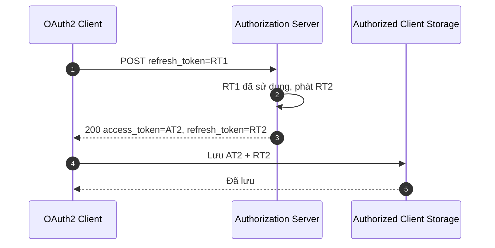
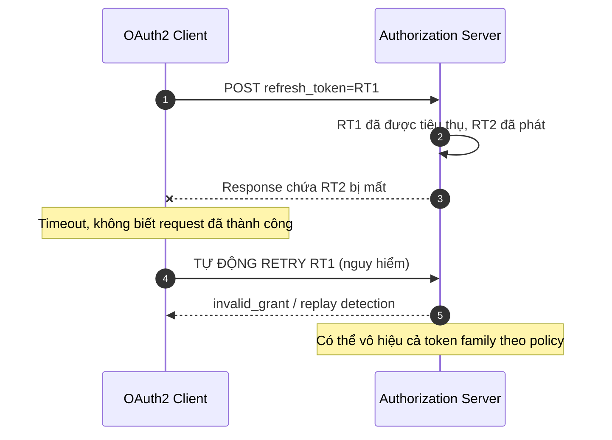
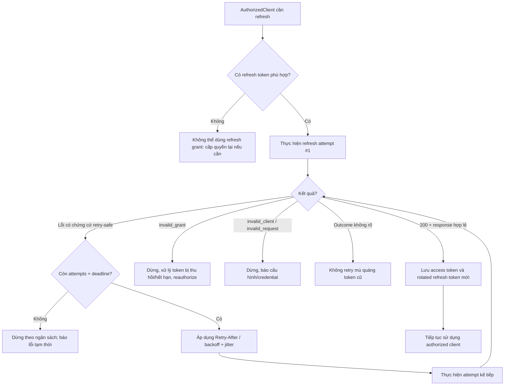
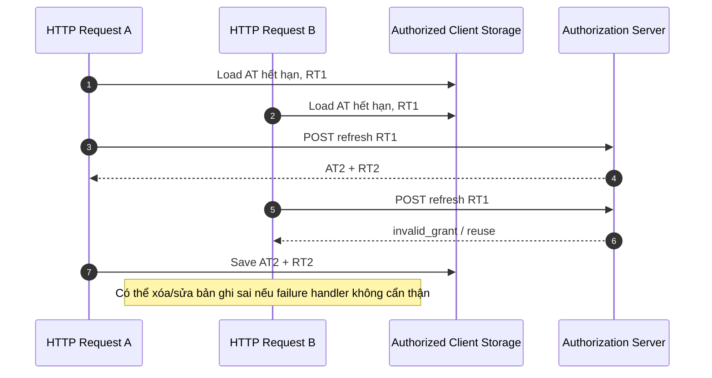

# 17.11. Định nghĩa retry, backoff và giới hạn số lần thử

Trong **Spring Security OAuth 2.0 / OpenID Connect (OIDC) Client**, một ứng dụng có thể nhận **refresh token** sau Authorization Code Flow để xin access token mới khi access token hiện tại sắp hết hạn. Quá trình này diễn ra bằng một HTTP POST đến **token endpoint**. Nếu Authorization Server trả lỗi hoặc kết nối gặp sự cố, câu hỏi không chỉ là “có retry hay không” mà còn là **retry có an toàn không, cần chờ bao lâu, được thử tối đa bao nhiêu lần, và lúc nào phải dừng để người dùng đăng nhập lại**.

Vấn đề đặc biệt quan trọng khi Authorization Server dùng **refresh token rotation**: mỗi lần refresh thành công có thể tiêu thụ refresh token cũ và trả refresh token mới. Nếu request đầu đã được xử lý nhưng response thất lạc, gửi lại refresh token cũ có thể bị coi là **reuse/replay**, dẫn tới `invalid_grant` hoặc làm vô hiệu cả token family theo chính sách provider.

Mục tiêu của bài học:

1. Phân biệt **refresh token failure**, **lỗi tạm thời**, **lỗi vĩnh viễn** và **trạng thái kết quả không xác định**.
2. Thiết kế retry có **giới hạn số lần thử**, **exponential backoff**, **jitter**, **Retry-After** và **deadline**.
3. Hiểu vì sao **không được tự động retry mọi lỗi HTTP POST** trong refresh-token grant.
4. Tích hợp chính sách retry với `OAuth2AuthorizedClientManager`, `OAuth2AuthorizedClientProvider` và token response client của Spring Security theo đúng ranh giới.
5. Xử lý cạnh tranh refresh, refresh token rotation, thu hồi quyền, quan sát vận hành và kiểm thử các ca lỗi.

## 1. Refresh token vận hành như thế nào?

Trong Authorization Code Flow, ứng dụng Spring Security đã được cấp một `OAuth2AuthorizedClient` gồm access token và có thể có refresh token. Khi access token không còn phù hợp để sử dụng, client có thể gửi refresh-token grant đến token endpoint:

```http
POST /oauth2/token HTTP/1.1
Host: idp.example.org
Content-Type: application/x-www-form-urlencoded
Authorization: Basic <CLIENT_CREDENTIALS_REDACTED>

grant_type=refresh_token&refresh_token=<REFRESH_TOKEN_REDACTED>
```

Với `client_secret_basic`, client credentials được gửi qua HTTP Basic trên TLS. Phương thức xác thực thực tế tùy client registration và provider. Một public client có thể không gửi client secret; các profile bảo mật cũng có thể yêu cầu sender-constrained tokens, mTLS hoặc phương thức xác thực khác.

Response thành công minh họa:

```http
HTTP/1.1 200 OK
Content-Type: application/json
Cache-Control: no-store

{
  "access_token": "<NEW_ACCESS_TOKEN>",
  "token_type": "Bearer",
  "expires_in": 3600,
  "refresh_token": "<ROTATED_REFRESH_TOKEN>",
  "scope": "openid profile reports.read"
}
```

`refresh_token` mới có thể được trả về khi provider xoay vòng token; không phải mọi provider đều rotation theo cùng cách. Nếu token response không có refresh token mới, client vẫn phải tuân theo semantics của provider và implementation token response client; không tự suy luận rằng mọi provider bắt buộc cấp một refresh token mới.

### 1.1. Access token khác refresh token

| Thuộc tính | Access token | Refresh token |
|---|---|---|
| Mục đích | Được gửi tới Resource Server để truy cập API | Được gửi tới token endpoint để xin access token mới |
| Bên nhận | API/Resource Server phù hợp với audience | Authorization Server |
| Có thể dùng để đăng nhập OIDC? | Không thay thế ID Token hoặc OIDC authentication | Không phải ID Token |
| Thời hạn | Thường ngắn | Theo chính sách provider, có thể dài hơn nhưng bị thu hồi/xoay vòng |
| Khi thất lạc/lộ | Rủi ro truy cập tài nguyên được token cho phép | Rủi ro duy trì quyền cấp token, thường nghiêm trọng hơn |
| Có thể retry giống GET? | Không phải một HTTP operation | Refresh-token POST có side effect; cần chính sách đặc biệt |

**Không dùng refresh token làm Bearer token gửi tới API**, cũng không đưa refresh token ra JavaScript của browser chỉ để “tự làm mới” trong một ứng dụng Spring MVC/BFF giữ token phía server.

### 1.2. Vai trò của Spring Security

Trong Servlet OAuth2 Client, các thành phần thường gặp:

- `OAuth2AuthorizedClientManager`: điều phối tìm authorized client và tái ủy quyền khi cần.
- `OAuth2AuthorizedClientProvider`: quyết định cách thực hiện grant; provider cho refresh token là `RefreshTokenOAuth2AuthorizedClientProvider`.
- `OAuth2AccessTokenResponseClient<OAuth2RefreshTokenGrantRequest>`: gửi token request, nhận và phân tích response.
- `OAuth2AuthorizedClientService` hoặc `OAuth2AuthorizedClientRepository`: lưu authorized client và token theo ngữ cảnh.
- `ClientRegistration`: xác định client ID, client authentication method, token URI và các cấu hình liên quan.

Khi refresh thành công, manager/provider có thể tạo authorized client chứa access token mới và refresh token mới (nếu có), rồi lưu lại qua cơ chế tương ứng.

**Spring Security quản lý vòng đời OAuth2; nó không tự bảo đảm một chính sách retry phù hợp với mọi provider, mọi cơ chế refresh token rotation và mọi hệ thống phân tán.** Trước khi thêm HTTP retry, phải quyết định khi nào request thật sự được phép gửi lại.

## 2. Retry, backoff, jitter và deadline là bốn khái niệm khác nhau

| Khái niệm | Định nghĩa | Ví dụ |
|---|---|---|
| **Retry** | Thực hiện lại một thao tác sau lỗi | Thử gửi refresh-token request lần thứ hai sau lỗi được phân loại an toàn |
| **Backoff** | Khoảng chờ giữa các lần thử | Chờ 250 ms, 500 ms, 1.000 ms thay vì gửi liên tục |
| **Jitter** | Thành phần ngẫu nhiên hóa thời gian chờ | Hai instance không đồng loạt thử lại vào cùng một mili-giây |
| **Max attempts** | Tổng số lần thực thi tối đa, thường gồm **lần đầu tiên** | `maxAttempts=3` nghĩa là 1 lần đầu + tối đa 2 retry |
| **Deadline/timeout budget** | Tổng thời gian được phép dành cho toàn thao tác, gồm timeout và backoff | Hoàn tất hoặc dừng trước ngân sách 3 giây |
| **Circuit breaker** | Tạm ngừng gọi hệ thống đang lỗi liên tục để giảm tải | Mở circuit sau nhiều failure, cho probe có giới hạn |

Số lần thử và ngân sách thời gian phải được thiết kế cùng nhau. `maxAttempts=5` không hữu ích nếu mỗi network timeout 10 giây trong một HTTP request chỉ được phép kéo dài 3 giây.

### 2.1. Retry khác reauthentication

Khi refresh token không còn hợp lệ, tiếp tục gửi nó thường vô ích. Hệ thống có thể cần:

1. Đánh dấu authorized client hiện tại không thể refresh.
2. Xóa hoặc cập nhật trạng thái token đã lưu phù hợp policy.
3. Với user interactive login, **khởi động lại authorization/login flow** nếu người dùng cần tiếp tục.
4. Với background service, dùng grant phù hợp của service như `client_credentials` hoặc báo lỗi để người vận hành xử lý.

Không gọi “retry” cho việc cho người dùng đăng nhập lại: đó là một vòng cấp quyền mới, với các điều kiện xác thực khác.

## 3. Phân loại lỗi trước khi quyết định retry

Không nên viết một interceptor “cứ khác 200 là retry”. Token endpoint có thể từ chối vì lỗi cấu hình vĩnh viễn, token bị thu hồi hoặc đã bị rotation.

| Lỗi/kết quả | Ý nghĩa thường gặp | Chính sách mặc định nên cân nhắc |
|---|---|---|
| **`invalid_grant`** | Refresh token hết hạn, bị thu hồi, bị dùng lại hoặc không hợp lệ với client | **Không retry cùng refresh token**; xử lý lại ủy quyền và xóa/đánh dấu client theo policy |
| **`invalid_client`** | Client authentication thất bại: secret sai, credential rotate hoặc client bị disable | **Không retry tức thì**; sửa credential/config hoặc báo vận hành |
| **`unauthorized_client`** | Client không được dùng grant tương ứng | Không retry; kiểm tra quyền grant ở provider |
| **`invalid_scope`** | Scope không được phép hoặc request yêu cầu sai | Không retry cùng request; sửa cấu hình/flow |
| **`invalid_request`** | Request thiếu hoặc sai tham số | Không retry nguyên request lỗi |
| **HTTP 429** | Rate limit | Chỉ retry có giới hạn theo `Retry-After`/provider policy, khi có cơ sở request **đã bị từ chối trước khi token bị tiêu thụ** |
| **HTTP 503/502/504** | Provider/gateway gặp lỗi tạm thời | Có thể cần backoff, nhưng **kết quả refresh có thể không xác định**; không tự retry khi token rotation khiến replay nguy hiểm |
| **Connection refused trước khi gửi request** | Không kết nối được, nếu có bằng chứng request chưa gửi | Có thể retry theo giới hạn và policy nếu chắc chắn token chưa được gửi/tiêu thụ |
| **Timeout sau khi request đã gửi** | Không biết provider đã xử lý token hay chưa | **Không retry mù quáng**; xử lý trạng thái không xác định |
| **Response 200 hợp lệ** | Token mới đã được cấp | Lưu response (gồm refresh token mới nếu có) và kết thúc retry |
| **Response 200 nhưng body không hợp lệ** | Không xác định token có được phát hành hoặc xoay vòng hay không | Không gửi lại mù quáng; chẩn đoán contract và trạng thái |

Đây là **chính sách khuyến nghị theo rủi ro**, không phải một bảng quy định rằng cứ 429 hoặc 503 là phải retry. Hợp đồng của từng Authorization Server có thể hỗ trợ deduplication/idempotency, grace period cho rotating refresh token hoặc mã lỗi chi tiết hơn. Khi có hợp đồng đáng tin, chính sách mới có thể cho phép retry ở các tình huống bổ sung.

### 3.1. `invalid_grant` không đồng nghĩa lỗi mạng tạm thời

Response:

```http
HTTP/1.1 400 Bad Request
Content-Type: application/json

{
  "error": "invalid_grant",
  "error_description": "Refresh token is invalid or expired"
}
```

Lỗi có thể do refresh token hết hạn, user revoke consent, token bị dùng lại hoặc token không thuộc client. Thử thêm 5 lần với cùng refresh token thường không thể làm nó hợp lệ. Nếu provider dùng replay detection, các lần thử còn có thể làm hỏng trạng thái token family.

Ứng dụng nên phân loại đúng mã lỗi `invalid_grant`, không chỉ nhìn `HTTP 400`. Một lỗi ở token endpoint và một lỗi 400 do proxy trả HTML là hai tình huống chẩn đoán khác nhau.

### 3.2. `invalid_client` thường cần hành động vận hành

Nếu một service mất hiệu lực client secret, mọi lần refresh có thể bị `invalid_client`. Backoff có thể làm giảm tải nhưng **không sửa được nguyên nhân**. Cần kiểm tra client ID, secret/key, client authentication method, tenant/realm và trạng thái client tại provider.

Đừng để mỗi user request tự retry 10 lần khi secret đã sai: điều đó khuếch đại lỗi thành hàng nghìn POST tới IdP.

### 3.3. HTTP 401 của API không phải lỗi refresh token mặc định

Khi downstream API trả 401, nguyên nhân có thể là:

- Access token đã hết hạn.
- Token sai audience/resource.
- Token bị thu hồi, bị từ chối theo policy API.
- Client gửi nhầm ID Token hoặc token của registration khác.

Chỉ khi chính sách cho phép, client mới thử **lấy hoặc refresh access token** rồi gửi lại API request phù hợp. Không kết luận rằng cứ API 401 là refresh token phải bị retry. Đặc biệt, không tự động **replay một API POST nghiệp vụ không idempotent** chỉ vì đã có token mới: hành động nghiệp vụ ban đầu có thể đã được thực hiện.

## 4. Tại sao refresh token rotation làm retry trở nên nguy hiểm?

**Refresh token rotation** thường vận hành như sau:

1. Client có refresh token `RT1`.
2. Client gửi `RT1` tới token endpoint.
3. Authorization Server chấp nhận, vô hiệu `RT1` và phát access token mới cùng refresh token `RT2`.
4. Client phải lưu `RT2` và sử dụng nó ở lần refresh tiếp theo.

Sơ đồ thành công:



Tình huống mất response:



**Điểm mấu chốt:** token endpoint không phải một HTTP GET chỉ đọc dữ liệu. Request refresh có thể gây side effect quan trọng, ngay cả khi client chưa nhận được HTTP 200. Nhiều thư viện HTTP không thể bảo đảm đã có hay chưa có side effect chỉ từ một `SocketTimeoutException`.

### 4.1. Phân biệt “không gửi được” và “không nhận được response”

| Tình huống | Có biết provider đã tiêu thụ refresh token không? |
|---|---|
| Cấu hình token URI không hợp lệ, validation chặn trước network | Có cơ sở rằng request chưa gửi; đây thường là lỗi cấu hình, không nên retry nguyên trạng |
| DNS không phân giải được, kết nối bị từ chối **trước khi gửi byte HTTP** | Có thể biết request chưa tới provider, tùy lớp network/adapter |
| Kết nối đóng trong lúc ghi body | **Không chắc** provider đã nhận đủ request |
| Read timeout sau khi gửi body | **Không chắc**, provider có thể đã phát RT mới |
| HTTP 502/504 qua proxy | **Không chắc**, upstream có thể đã xử lý |
| HTTP 429 với hợp đồng provider nói request bị từ chối trước xử lý | Có thể retry theo `Retry-After`, giới hạn và hợp đồng đó |
| HTTP 400 `invalid_grant` | Provider đã từ chối grant; không retry cùng refresh token |

Mặc định an toàn khi không chứng minh được outcome là **dừng retry của cùng refresh token**, ghi nhận trạng thái cần xác minh/reauthorize, và tránh phá vỡ token family.

### 4.2. Có thể retry an toàn nếu provider hỗ trợ?

Có, nhưng phải dựa trên **hợp đồng rõ ràng**. Một số provider có thể công bố grace window, idempotency token, replay-tolerant rotation hoặc cơ chế phục hồi. Khi đó:

- Chỉ sử dụng cơ chế mà provider hỗ trợ chính thức.
- Phải biết idempotency key đặt ở đâu và provider bảo đảm điều gì.
- Giới hạn attempts và deadline như các thao tác mạng khác.
- Không tự sáng tạo một header `Idempotency-Key` rồi giả định token endpoint sẽ xử lý.
- Kiểm tra kỹ việc lưu refresh token mới và xử lý đồng thời.

Nếu không có tài liệu về idempotency/grace window, không nên suy luận `POST /token` là idempotent.

## 5. Xây chính sách retry theo nhóm lỗi

Một ví dụ policy dành cho ứng dụng Spring MVC/BFF có rotating refresh token, **chưa có hợp đồng idempotent refresh**:

| Nhóm | `maxAttempts` | Có backoff? | Hành động sau cùng |
|---|---:|---|---|
| Thành công | 1 | Không | Lưu token mới |
| `invalid_grant`, `invalid_client`, lỗi cấu hình | 1 | Không | Dừng và xử lý theo loại lỗi |
| Timeout/read error **sau khi đã gửi** | 1 | Không | Đánh dấu outcome chưa rõ, tránh replay RT cũ |
| HTTP 5xx/504 mà không biết provider đã tiêu thụ token | 1 | Không | Dừng, đo lường, giải quyết theo hợp đồng provider |
| Connection refused **chắc chắn trước khi gửi** | Tối đa 3 | Exponential backoff + jitter | Dừng khi hết attempts/deadline |
| HTTP 429 mà provider bảo đảm refresh chưa được xử lý | Tối đa 3 | `Retry-After` hoặc exponential backoff + jitter | Dừng khi hết attempts/deadline; không flood |
| Tình huống có idempotency contract rõ | Theo hợp đồng, ví dụ 3 | Backoff/jitter có hạn | Dừng đúng ngưỡng; bảo toàn RT rotation |

Các con số trong bảng là **giá trị ví dụ để thảo luận chính sách**, không phải mặc định của Spring Security hoặc quy định của RFC. Với provider có chính sách khác, phải điều chỉnh dựa trên evidence và yêu cầu độ trễ.

### 5.1. “Ba lần thử” chính xác là bao nhiêu?

Đặt:

```text
maxAttempts = 3
attempt = 1  -> gửi lần đầu
attempt = 2  -> retry thứ nhất, chỉ khi đủ điều kiện
attempt = 3  -> retry thứ hai, chỉ khi đủ điều kiện
attempt = 4  -> KHÔNG GỬI
```

Ghi rõ tên trong tài liệu/API để tránh hiểu nhầm:

- `maxAttempts` = tổng số lần gọi, bao gồm lần đầu.
- `maxRetries` = số lần gọi **thêm** sau lần đầu.

Vậy `maxAttempts=3` tương đương tối đa `maxRetries=2`.

### 5.2. Ba loại ngân sách cùng tồn tại

Một policy nên giới hạn:

1. **Số lần thử tối đa**: tránh loop vô hạn.
2. **Thời gian tối đa**: không giữ user request quá lâu.
3. **Tốc độ/tải tổng hợp**: tránh mỗi instance tự retry và làm IdP bị quá tải.

Ví dụ:

```text
maxAttempts         = 3
connectTimeout      = 500 ms
responseTimeout     = 1000 ms
totalDeadline       = 3000 ms
maxBackoff          = 1000 ms
perRegistrationQPS  = theo capacity và provider quota
```

Đây là **giá trị minh họa**, cần điều chỉnh theo SLO, mạng, độ trễ IdP và số lượng instance. Dù còn attempts, nếu deadline không đủ để gửi request kế tiếp và chờ response, phải dừng.

## 6. Exponential backoff và jitter

Nếu được phép retry, chiến lược chờ phổ biến là **exponential backoff**:

\[
d_n = \min(d_{\max},\ d_{\text{base}}\times 2^{n-1})
\]

Trong đó:

- `n` là thứ tự **retry**, bắt đầu từ 1.
- `d_base` là thời gian chờ cơ sở, ví dụ 250 ms.
- `d_max` là trần backoff, ví dụ 2.000 ms.

Ví dụ chưa có jitter:

| Retry thứ | Delay từ công thức |
|---|---:|
| 1 | 250 ms |
| 2 | 500 ms |
| 3 | 1.000 ms |
| 4 | 2.000 ms |
| 5 | 2.000 ms (đã chạm trần) |

Đây là lịch chờ **khi retry được phép**, không có nghĩa sẽ có năm retry. `maxAttempts` và deadline có thể dừng sớm hơn.

### 6.1. Vì sao cần jitter?

Nếu hàng trăm instance cùng phát hiện token hết hạn hoặc IdP trả 503, chúng có thể cùng retry sau chính xác 250 ms, rồi lại cùng retry sau 500 ms. Hiện tượng đồng bộ đó tạo **thundering herd**.

**Full jitter** chọn ngẫu nhiên một delay trong khoảng từ 0 đến trần exponential hiện tại:

\[
\text{delay}_n\sim U(0,d_n)
\]

Ví dụ với trần 500 ms, một worker có thể chờ 91 ms, worker khác 327 ms và worker thứ ba 450 ms. Nhờ vậy tải được trải theo thời gian. Có nhiều biến thể jitter khác (equal/decorrelated), nhưng nguyên tắc chính là có **trần chờ** và tránh lịch retry đồng loạt.

### 6.2. Java minh họa tính full-jitter delay

```java
import java.time.Duration;
import java.util.concurrent.ThreadLocalRandom;

final class BackoffPolicy {

    private static final long BASE_MS = 250;
    private static final long MAX_MS = 2_000;

    private BackoffPolicy() {}

    // retryNumber bắt đầu từ 1; chỉ được gọi sau khi policy cho phép retry.
    static Duration fullJitter(int retryNumber) {
        if (retryNumber < 1) {
            throw new IllegalArgumentException("retryNumber must be >= 1");
        }

        long ceiling = BASE_MS;
        for (int i = 1; i < retryNumber && ceiling < MAX_MS; i++) {
            ceiling = Math.min(MAX_MS, ceiling * 2);
        }

        long delayMs = ThreadLocalRandom.current().nextLong(ceiling + 1);
        return Duration.ofMillis(delayMs);
    }
}
```

Đây chỉ là **hàm tính delay**, không thực hiện lại HTTP POST. Không tự gọi nó cho `invalid_grant` hoặc read timeout có trạng thái rotation không xác định.

Trong ứng dụng Reactive WebFlux, không dùng `Thread.sleep(...)` trên event loop; hãy sử dụng scheduler/operator phi blocking theo chính sách retry đã phân loại. Trong Servlet worker, việc block một thread trong thời gian backoff cũng cần được cân nhắc với pool size, SLO và cancellation.

## 7. Sử dụng Retry-After khi provider trả rate limit

Nếu Authorization Server trả HTTP 429 hoặc 503 cùng header `Retry-After`, nó có thể cung cấp thời điểm đề nghị client gửi lại. HTTP cho phép hai dạng chính:

```http
HTTP/1.1 429 Too Many Requests
Retry-After: 4
```

Giá trị `4` là số giây chờ. Một dạng khác là HTTP-date:

```http
Retry-After: Wed, 18 Nov 2026 10:00:00 GMT
```

Khi xử lý:

1. Chỉ đọc `Retry-After` từ **response của endpoint tin cậy** và khi retry thực sự an toàn theo grant semantics.
2. Parse đúng dạng seconds hoặc HTTP-date; không giả định mọi giá trị là số.
3. Nếu giá trị không hợp lệ, dùng fallback backoff policy.
4. Áp dụng trần thời gian, deadline và số attempts; không chờ vô hạn.
5. Nếu server yêu cầu chờ dài hơn deadline của current request, **dừng** và để tầng điều phối lên lịch một lần thử mới khi thích hợp, thay vì giữ request web sống mãi.
6. Không dùng header `Retry-After` để bỏ qua rủi ro rotation: một POST có outcome không rõ vẫn cần policy an toàn trước khi gửi lại.

### 7.1. Không coi 429 là bảo đảm idempotency

Thông thường 429 thể hiện giới hạn tần suất, nhưng behavior xử lý request phụ thuộc provider/proxy. Nếu không có cơ sở rằng refresh token chưa được tiêu thụ, đừng tự động gửi lại token đang nghi đã rotation chỉ vì response là 429.

Trong một hệ thống chạy nhiều instance, ngoài header `Retry-After` còn cần **rate limiter dùng chung hoặc quota thích hợp** để tránh tổng lưu lượng vượt mức cho phép của provider.

## 8. Deadline và cancellation: dừng đúng lúc

Giả sử web request tới BFF có timeout 3 giây:

```text
T = 0 ms      Bắt đầu refresh
T = 700 ms    Network attempt #1 gặp lỗi tạm thời được xác nhận retry-safe
T = 900 ms    Kết thúc backoff
T = 1750 ms   Attempt #2 thất bại
T = 2300 ms   Kết thúc backoff thứ hai
T = 3000 ms   Hết deadline
```

Ngay cả khi `maxAttempts=3`, không nên bắt đầu attempt #3 nếu không còn đủ thời gian cho một network call có kiểm soát. Phần thời gian chờ phải bao gồm:

- Thời gian kết nối TCP/TLS và gửi request.
- Thời gian Authorization Server xử lý.
- Thời gian nhận response.
- Backoff giữa các lần thử.
- Khoảng dự phòng trả response cho caller.

Nếu người dùng đóng kết nối hoặc request đã bị hủy, tầng ứng dụng có thể muốn cancel operation; tuy nhiên, **hủy chờ local không chứng minh provider chưa xử lý token**. Không biến cancellation thành tín hiệu cho phép retry lại refresh token cũ.

### 8.1. Đừng che lỗi bằng fallback token hết hạn

Khi refresh thất bại, dùng lại access token đã hết hạn thường chỉ tạo thêm 401 ở downstream API. Nếu client có bằng chứng access token cũ **vẫn còn hạn** và không có chính sách nào yêu cầu thay mới ngay, có thể cân nhắc tiếp tục dùng token đó theo contract của manager và Resource Server. Nhưng không “gia hạn” thời hạn token bằng cách sửa metadata local.

**Không tự thay `expiresAt`** để vượt qua lỗi hoặc lờ đi token revocation. Resource Server có thể từ chối token độc lập với thông tin local.

## 9. Mô hình trạng thái cho refresh có retry an toàn



Tính chất mong muốn của state machine:

1. **Mọi vòng lặp đều bị chặn** bởi attempts và deadline.
2. Có nhánh riêng cho **outcome unknown**, không coi đó là lỗi mạng retryable mặc định.
3. `invalid_grant` không quay lại cùng refresh token.
4. Sau response thành công, **lưu refresh token mới trước khi cho các luồng khác dùng phiên bản cũ**.
5. Nếu làm việc nhiều instance, xử lý cạnh tranh trên cùng authorized client.
6. Tầng authorization nghiệp vụ và API vẫn kiểm tra quyền độc lập với trạng thái refresh.

## 10. Tích hợp với Spring Security: giữ đúng điểm mở rộng

Spring Security có các thành phần sẵn để refresh; thông thường ứng dụng không cần tự tạo controller `POST /refresh-token` hoặc tự gọi token endpoint ở mỗi service.

### 10.1. ClientRegistration cho Authorization Code/OIDC

Ví dụ `application.yml`:

```yaml
spring:
  security:
    oauth2:
      client:
        registration:
          company-login:
            provider: company
            client-id: "${OIDC_CLIENT_ID}"
            client-secret: "${OIDC_CLIENT_SECRET}"
            client-authentication-method: client_secret_basic
            authorization-grant-type: authorization_code
            redirect-uri: "{baseUrl}/login/oauth2/code/{registrationId}"
            scope:
              - openid
              - profile
              - offline_access
        provider:
          company:
            issuer-uri: "https://idp.example.org/realms/company"
```

`offline_access` có thể được một số OpenID Provider dùng để cấp refresh token cho truy cập offline, nhưng việc nó có được hỗ trợ hoặc cần consent riêng còn tùy provider. **Không được mặc định cứ có scope này là response chắc chắn có refresh token**.

Trong ứng dụng Servlet có `oauth2Login()`, Spring Security có thể sử dụng authorized client để refresh access token khi phù hợp với luồng gọi API. Client registration được quản lý ở backend và secret phải đến từ secret manager/environment, không commit vào Git.

### 10.2. Provider refresh token có clock skew

Một ví dụ service-tier manager dùng authorized client đã có:

```java
import java.time.Duration;
import org.springframework.context.annotation.Bean;
import org.springframework.context.annotation.Configuration;
import org.springframework.security.oauth2.client.AuthorizedClientServiceOAuth2AuthorizedClientManager;
import org.springframework.security.oauth2.client.OAuth2AuthorizedClientManager;
import org.springframework.security.oauth2.client.OAuth2AuthorizedClientProvider;
import org.springframework.security.oauth2.client.OAuth2AuthorizedClientProviderBuilder;
import org.springframework.security.oauth2.client.OAuth2AuthorizedClientService;
import org.springframework.security.oauth2.client.registration.ClientRegistrationRepository;

@Configuration
class RefreshClientManagerConfig {

    @Bean
    OAuth2AuthorizedClientManager refreshClientManager(
            ClientRegistrationRepository registrations,
            OAuth2AuthorizedClientService authorizedClientService) {

        OAuth2AuthorizedClientProvider provider =
                OAuth2AuthorizedClientProviderBuilder.builder()
                        .refreshToken(configurer -> configurer
                                .clockSkew(Duration.ofSeconds(60)))
                        .build();

        var manager = new AuthorizedClientServiceOAuth2AuthorizedClientManager(
                registrations, authorizedClientService);
        manager.setAuthorizedClientProvider(provider);
        return manager;
    }
}
```

Đoạn code này minh họa **một manager chỉ có provider refresh token**, dành cho authorized client vốn đã được cấp quyền. Nó **không khởi động Authorization Code Flow mới** và không tạo refresh token nếu chưa từng được cấp. Trong một web request, `DefaultOAuth2AuthorizedClientManager` thường dùng `OAuth2AuthorizedClientRepository`; cần chọn đúng manager/storage thực tế của ứng dụng.

`clockSkew` giúp refresh trước khi thời điểm hết hạn trở nên quá sát, nhưng **không phải retry policy**. Nó không giải quyết các request đồng thời hoặc tác động của token rotation.

### 10.3. RestClientRefreshTokenTokenResponseClient và chỗ đặt policy

Trong những phiên bản Spring Security có `RestClientRefreshTokenTokenResponseClient`, đây là token response client chuyên gửi refresh-token request. Một số phiên bản cũ có implementation khác; khi thiết kế retry phải đối chiếu đúng API của phiên bản.

Có thể tạo wrapper **quan sát lỗi và phân loại**, nhưng không cần tự retry ngay bên trong wrapper:

```java
import org.springframework.security.oauth2.client.endpoint.OAuth2AccessTokenResponseClient;
import org.springframework.security.oauth2.client.endpoint.OAuth2RefreshTokenGrantRequest;
import org.springframework.security.oauth2.core.OAuth2AccessTokenResponse;
import org.springframework.security.oauth2.core.OAuth2AuthorizationException;

final class ObservedRefreshTokenClient
        implements OAuth2AccessTokenResponseClient<OAuth2RefreshTokenGrantRequest> {

    private final OAuth2AccessTokenResponseClient<OAuth2RefreshTokenGrantRequest>
            delegate;

    ObservedRefreshTokenClient(
            OAuth2AccessTokenResponseClient<OAuth2RefreshTokenGrantRequest>
                    delegate) {
        this.delegate = delegate;
    }

    @Override
    public OAuth2AccessTokenResponse getTokenResponse(
            OAuth2RefreshTokenGrantRequest request) {
        try {
            return delegate.getTokenResponse(request);
        } catch (OAuth2AuthorizationException ex) {
            // Chỉ ghi mã lỗi đã cho phép, KHÔNG ghi refresh token.
            String errorCode = ex.getError().getErrorCode();
            recordSafeErrorCode(errorCode);
            throw ex;
        }
    }

    private void recordSafeErrorCode(String errorCode) {
        // Tích hợp metrics/logging đã lọc dữ liệu nhạy cảm.
    }
}
```

Wrapper nhận delegate do ứng dụng cấu hình, ví dụ implementation mặc định của Spring Security. Đây là **ví dụ về observability và bảo toàn exception**, không tự động bật retry. Nếu muốn thay token response client trong `RefreshTokenOAuth2AuthorizedClientProvider`, sử dụng setter/DSL được phiên bản Spring Security của ứng dụng hỗ trợ.

**Không thêm `retryWhen(...)` hoặc HTTP retry tổng quát lên tất cả POST token endpoint** nếu chưa phân loại rotating refresh token và trạng thái gửi request. Một interceptor đặt quá thấp trong HTTP stack có thể che mất ngữ cảnh OAuth2 và tự replay refresh token.

### 10.4. Failure handler và invalid_grant

Các manager của Spring Security có cơ chế success/failure handlers, bao gồm logic lưu hoặc xóa authorized client tùy lỗi và phiên bản. Với `invalid_grant`, nhiều cấu hình manager mặc định sẽ loại authorized client khỏi storage để tránh liên tục dùng refresh token đã bị từ chối.

Khi tự thay failure handler, cần xét:

- Có xóa bản ghi khi `invalid_grant` được xác nhận hay không?
- Có giữ bản ghi hiện có nếu lỗi mạng tạm thời mà token cũ vẫn dùng được hay không?
- Có tránh xóa mất **refresh token mới** do một request khác vừa lưu khi gặp lỗi với token cũ hay không?
- Có phân biệt user login session với authorized client storage hay không?
- Có đưa người dùng quay lại authorization flow theo chính sách hay chỉ trả một thông báo lỗi?

**Không thay toàn bộ failure handler chỉ để gắn metrics rồi vô tình tắt cleanup an toàn.** Khi có yêu cầu tùy chỉnh, cần preserve các semantics mà manager/provider đang dùng.

## 11. Ví dụ mã hóa retry policy tách khỏi thao tác HTTP

Một thiết kế dễ kiểm soát là tách **quyết định có retry hay không** khỏi **hàm gửi refresh-token request**.

### 11.1. Phân loại kết quả ở ranh giới HTTP/OAuth2

```java
enum RefreshFailureKind {
    INVALID_GRANT,
    INVALID_CLIENT,
    INVALID_REQUEST,
    UNAUTHORIZED_CLIENT,
    INVALID_SCOPE,
    PROVIDER_RATE_LIMIT_REJECTED,
    NETWORK_PROVEN_NOT_SENT,
    PROVIDER_TEMPORARY_BUT_OUTCOME_UNKNOWN,
    NETWORK_OUTCOME_UNKNOWN,
    RESPONSE_UNUSABLE
}
```

Các giá trị này là **enum của ứng dụng minh họa**, không phải enum có sẵn trong Spring Security. Một adapter có thể đọc OAuth2 `error_code`, HTTP status và thông tin network để phân loại. Điểm quan trọng là adapter **không được tự gắn nhãn `NETWORK_PROVEN_NOT_SENT` cho mọi IOException**.

### 11.2. Quyết định có retry

```java
import java.time.Duration;

record RetryDecision(boolean retry, Duration delay, String reason) {
    static RetryDecision stop(String reason) {
        return new RetryDecision(false, Duration.ZERO, reason);
    }

    static RetryDecision again(Duration delay) {
        return new RetryDecision(true, delay, "safe-transient-failure");
    }
}

final class RefreshRetryPolicy {
    private static final int MAX_ATTEMPTS = 3;

    RetryDecision afterFailure(
            RefreshFailureKind failure,
            int attemptsAlreadyMade,
            Duration timeRemaining) {

        if (attemptsAlreadyMade >= MAX_ATTEMPTS) {
            return RetryDecision.stop("max-attempts");
        }

        boolean provenSafe =
                failure == RefreshFailureKind.NETWORK_PROVEN_NOT_SENT
                || failure == RefreshFailureKind.PROVIDER_RATE_LIMIT_REJECTED;

        if (!provenSafe) {
            return RetryDecision.stop("unsafe-or-permanent");
        }

        Duration delay = BackoffPolicy.fullJitter(attemptsAlreadyMade);

        // Giữ tối thiểu 500 ms cho một network attempt kế tiếp,
        // giá trị thực tế cần lấy từ timeout budget của ứng dụng.
        if (timeRemaining.minus(delay).compareTo(
                Duration.ofMillis(500)) < 0) {
            return RetryDecision.stop("deadline");
        }

        return RetryDecision.again(delay);
    }
}
```

`BackoffPolicy.fullJitter(...)` là hàm ở mục 6.2. `PROVIDER_RATE_LIMIT_REJECTED` **chỉ được gán khi adapter có bằng chứng request bị từ chối trước khi refresh token bị tiêu thụ** theo hợp đồng provider. Nếu không có bảo đảm đó, hãy phân loại là outcome unknown và dừng.

Code này mới thể hiện **policy**, chưa gọi token endpoint. Trong production cần thêm `Retry-After`, cancellation, timeout config và xử lý provider-specific errors; không dùng ví dụ làm công cụ replay request trực tiếp.

### 11.3. Vòng lặp retry dạng giả mã

```text
attempt = 0
deadline = now + totalBudget

while attempt < maxAttempts and now < deadline:
    attempt = attempt + 1
    try:
        response = refreshOnce(existingRefreshToken)
        atomicallySave(response.accessToken, response.rotatedRefreshToken)
        return success
    catch failure:
        kind = classify(failure, providerContract, requestDeliveryEvidence)
        decision = retryPolicy(kind, attempt, deadline - now)
        if not decision.retry:
            return failSafely(kind)
        await delayWithCancellation(decision.delay)

return deadlineOrAttemptsExceeded
```

**Giả mã này chỉ minh họa luồng điều phối**, không thể tự xác định việc request đã tới provider hay chưa. Nếu phân loại sai timeout thành retry-safe, vòng lặp vẫn có thể làm hỏng refresh token family dù có backoff đẹp và attempts giới hạn.

### 11.4. Retry-After và backoff cần được kết hợp ra sao?

Nếu provider đưa `Retry-After` hợp lệ và request retry-safe, một policy có thể lấy delay theo hướng tôn trọng yêu cầu server, sau đó áp giới hạn:

```text
candidateDelay = max(fullJitterBackoff, retryAfterDelay)
if candidateDelay > allowedWaitBudget:
    STOP / schedule later if safe
else:
    WAIT candidateDelay
```

Không đơn giản `min(retryAfterDelay, backoffDelay)`, vì có thể thử **sớm hơn** thời điểm provider yêu cầu. Nếu `Retry-After` quá dài so với user request, dừng hoặc chuyển sang job có scheduler phù hợp, không giữ thread web đợi hàng phút.

## 12. Chống refresh đồng thời trên cùng authorized client

Ngay cả khi **không có retry**, hai request đồng thời có thể sử dụng cùng refresh token.

Ví dụ:



Đây là vấn đề **single-flight refresh**, không chỉ là vấn đề retry HTTP. Khi request B nhận `invalid_grant`, nguyên nhân có thể là request A đã rotation thành công, chứ không phải người dùng chủ động thu hồi quyền.

### 12.1. Khóa theo (`registrationId`, `principalName`)

Một chiến lược trong cùng process:

1. Xác định khóa authorized client từ `registrationId` và `principalName`.
2. Chỉ cho phép một refresh đang chạy trên mỗi khóa.
3. Những caller còn lại chờ với deadline có giới hạn.
4. Sau khi refresh hoàn tất, caller đọc lại authorized client mới từ storage.
5. Nếu vẫn thiếu token hoặc provider từ chối, xử lý đúng failure thay vì lập tức replay refresh token cũ.

```text
(company-login, employee-42)
      |
      +-- caller A: giữ lock, refresh RT1 -> RT2, save
      +-- caller B: chờ, read lại RT2/AT2 sau khi A xong
      +-- caller C: read lại token mới, không POST RT1
```

Đây là cách giảm race trong một instance. Với nhiều instance, local `synchronized` hoặc `ConcurrentHashMap` chỉ bảo vệ **một JVM**, không đủ để đồng bộ toàn hệ thống.

### 12.2. Multi-instance cần thêm gì?

Có thể xem xét:

- Shared storage với concurrency controls.
- Distributed lock/single-flight có timeout và xử lý lock expiry.
- Optimistic compare-and-set khi cập nhật authorized client nếu store hỗ trợ version.
- Kiểm tra bản ghi hiện tại **trước khi xóa** sau một lỗi `invalid_grant` của request cũ.
- Mỗi instance đọc lại token mới sau khi một instance khác refresh.
- Bảo vệ khi instance giữ lock bị crash giữa chừng.

Không nên thêm retry cho request B để “vượt qua” `invalid_grant`. Nếu A đã lưu RT2 thì B nên **tải lại authorized client hiện tại một cách có kiểm soát**, không tiếp tục gửi RT1. Việc read lại storage và thực hiện request refresh mới là hai thao tác khác nhau.

### 12.3. Rotation thành công nhưng lưu storage thất bại

Một tình huống khó:

```text
Provider: RT1 -> RT2, HTTP 200
Application: nhận AT2 + RT2
Database: save thất bại
```

Từ góc nhìn provider, RT1 có thể đã vô hiệu; từ góc nhìn database, bản ghi vẫn là RT1. **Retry token endpoint với RT1 không sửa được database.**

Ứng dụng cần có chính sách persistence/reconciliation rõ ràng, tránh phát tán RT2 vào log, và nếu không thể lưu an toàn thì buộc tái ủy quyền theo policy. Với môi trường nhiều instance, xem xét tính nguyên tử cập nhật phiên bản token và cách xử lý failure handler.

## 13. Tách các tầng retry: đừng retry chồng nhau

Trong một ứng dụng, retry có thể nằm ở nhiều nơi:

```text
Business service
    |
    +-- Retry của gọi Reports API
    |
    v
OAuth2AuthorizedClientManager
    |
    +-- Retry của refresh orchestration (nếu có)
    |
    v
HTTP token response client
    |
    +-- Retry của RestClient/WebClient/HTTP library (nếu bật)
    |
    v
Proxy / service mesh
    |
    +-- Retry tự động tới Authorization Server (nếu cấu hình)
```

Nếu mỗi tầng tự thử 3 lần, một lần lỗi có thể tạo ra tới `3 × 3 × 3 = 27` lượt gọi, chưa tính proxy. Điều này vừa tăng tải IdP vừa tăng nguy cơ replay refresh token.

**Chỉ định một tầng sở hữu retry policy**, có quan sát rõ attempts và deadline. Với refresh rotation, cân nhắc tắt generic POST retry ở HTTP library/proxy, để tầng OAuth2-aware quyết định khi nào thực sự an toàn.

### 13.1. Phân biệt retry refresh với retry API nghiệp vụ

Hai hoạt động khác nhau:

| Hoạt động | Có side effect? | Điều cần kiểm tra trước retry |
|---|---|---|
| `POST /token` với refresh token | Có thể xoay vòng/tiêu thụ refresh token | Token rotation, outcome, contract retry |
| `GET /reports` | Thường là thao tác đọc | HTTP semantics, rate limit, deadline, authentication |
| `POST /payments` | Có thể tạo giao dịch tài chính | Idempotency key/hợp đồng API, không replay mù quáng |

Việc refresh thành công **không làm một POST nghiệp vụ đã thất bại trở thành an toàn để gửi lại**. Cần thiết kế retry riêng cho request downstream.

## 14. Rate limit, circuit breaker và khôi phục dịch vụ

Backoff của từng request chưa đủ nếu IdP gặp sự cố trên toàn hệ thống. Một ứng dụng có 50 instance, mỗi instance có 500 active sessions, có thể tạo rất nhiều refresh request trong một thời điểm.

Các cơ chế bổ sung:

1. **Rate limiter** theo provider/client/registration để giới hạn tổng lưu lượng.
2. **Circuit breaker** để ngừng gọi token endpoint đang lỗi liên tục trong một khoảng thời gian phù hợp.
3. **Bulkhead/concurrency limit** để số thread/connection đang chờ IdP không làm nghẽn ứng dụng.
4. **Jitter và scheduling** để trải tải theo thời gian.
5. **Deadline** để request đang chờ không giữ tài nguyên vô hạn.
6. **Graceful degradation** cho tính năng không quan trọng khi chưa có token mới; không giả mạo quyền hoặc vượt qua kiểm tra bảo mật.

### 14.1. Circuit breaker không làm refresh token hợp lệ trở lại

Circuit mở nghĩa là client chủ động **chưa gửi** request mới, không phải provider đã phục hồi. Khi circuit cho phép probe trở lại, cần sử dụng trạng thái authorized client **mới nhất**, không lấy refresh token cũ từ một queue đã tạo nhiều phút trước.

Nếu token bị `invalid_grant`, circuit breaker không nên tự hẹn giờ rồi thử lại cùng token đó. Đây là lỗi liên quan trạng thái grant, không phải lỗi hạ tầng có thể hết sau 30 giây.

### 14.2. Không để retry trở thành vòng lặp gây đăng nhập liên tục

Nếu refresh thất bại, ứng dụng OIDC BFF có thể yêu cầu người dùng đăng nhập lại. Nhưng cần tránh vòng lặp:

```text
API 401 -> refresh invalid_grant
       -> redirect login
       -> login callback
       -> API 401
       -> redirect login
       -> ...
```

Phải giới hạn số vòng reauthentication trong một phiên, phân loại lỗi và xử lý cấu hình sai ở phía server. Nếu client không có scope/audience cần thiết, yêu cầu login lại vô hạn sẽ không giải quyết vấn đề.

## 15. Observability: đo đúng và không lộ token

Mỗi lần refresh nên có dữ liệu vận hành đủ để trả lời:

- Provider/registration nào đang gặp lỗi?
- Lỗi là `invalid_grant`, `invalid_client`, rate limit, network hay kết quả không rõ?
- Có bao nhiêu attempts được thực hiện và vì sao dừng?
- Tổng thời gian và backoff delay là bao nhiêu?
- Có thành công nhưng lưu token mới thất bại không?
- Có nhiều request cùng refresh một khóa không?
- Tỷ lệ user phải reauthorize và tỷ lệ refresh thất bại là bao nhiêu?

Một số tên metric minh họa:

```text
oauth2_refresh_attempt_total{registration="company-login", outcome="success"}
oauth2_refresh_attempt_total{registration="company-login", outcome="invalid_grant"}
oauth2_refresh_retry_total{registration="company-login", reason="rate_limit"}
oauth2_refresh_unknown_outcome_total{registration="company-login"}
oauth2_refresh_duration_seconds{registration="company-login"}
oauth2_refresh_singleflight_wait_seconds{registration="company-login"}
oauth2_refresh_storage_failure_total{registration="company-login"}
```

Tên metric không phải một API Spring Security mặc định; đó là ví dụ mô hình quan sát. Tránh gắn label có cardinality cao như `principalName`, `sub`, refresh token ID hoặc correlation ID vào time series metric.

### 15.1. Dữ liệu tuyệt đối không nên log

- Access token, refresh token, ID Token nguyên văn.
- `client_secret`, private key, client assertion JWT.
- Authorization code, PKCE `code_verifier`, session cookie.
- Toàn bộ HTTP form body của token endpoint.
- Header `Authorization` của client authentication.
- Toàn bộ JWT claims hoặc thông tin người dùng không cần cho chẩn đoán.

Một log có thể ghi:

```text
phase=refresh
registration=company-login
attempt=1
result=invalid_grant
next_action=reauthorize
correlation=server-generated-id
```

Không trả `error_description` nguyên văn từ provider cho browser: thông tin có thể chứa chi tiết nội bộ hoặc dữ liệu không được kiểm soát. Người dùng thường chỉ cần một thông báo ngắn rằng phiên kết nối cần xác thực lại.

## 16. Ma trận kiểm thử retry policy

Để xác nhận thiết kế, có thể giả lập token endpoint và storage thay vì dùng refresh token production.

| Tình huống test | Kỳ vọng |
|---|---|
| HTTP 200 trả AT2 + RT2 | Lưu token mới đúng một lần, không retry |
| `invalid_grant` ngay lần đầu | 1 attempt, không retry RT1, xử lý reauthorize |
| `invalid_client` | 1 attempt, phát tín hiệu cấu hình/credential |
| HTTP 429 có hợp đồng xác nhận chưa consume RT | Retry có giới hạn, tôn trọng `Retry-After` và deadline |
| HTTP 429 outcome không chắc chắn | Không retry cùng RT chỉ vì mã 429 |
| Connection refused trước khi request gửi | Có thể retry tối đa theo policy và giới hạn thời gian |
| Read timeout sau khi gửi refresh request | Không retry mù quáng, trạng thái unknown |
| HTTP 502/504 sau khi upstream có thể xử lý | Không giả định request thất bại nguyên tử; tránh replay |
| Response 200 nhưng save RT2 vào DB thất bại | Không quay lại retry RT1; xử lý persistence/reconciliation |
| Hai request cùng đọc RT1 | Chỉ một refresh trên mỗi key nếu đã triển khai single-flight |
| Hai instance refresh cùng key | Cơ chế đồng bộ/so sánh phiên bản tránh xóa nhầm token mới |
| `Retry-After` vượt deadline | Dừng/schedule theo contract, không đợi vô hạn |
| HTTP client/proxy có retry tự động | Không tạo số request ngoài mức retry policy |
| Không có refresh token | Không cố gửi refresh grant; xử lý cấp quyền mới khi phù hợp |
| Access token còn hạn | Manager có thể dùng token hiện có; không refresh không cần thiết |

### 16.1. Kiểm thử giới hạn attempts

Với `maxAttempts=3`, test một lỗi **retry-safe** liên tục:

```text
attempt #1 -> retry-safe transient failure
backoff #1
attempt #2 -> retry-safe transient failure
backoff #2
attempt #3 -> retry-safe transient failure
STOP (maxAttempts)
```

Test một lỗi không được retry:

```text
attempt #1 -> invalid_grant
STOP (không có backoff hoặc attempt #2)
```

Trong kiểm thử, cần đếm số lần HTTP client thực sự gửi tới fake token endpoint, không chỉ đếm số lần gọi public service; HTTP library/proxy có thể có retry tầng thấp.

### 16.2. Kiểm thử refresh rotation

Fake Authorization Server có thể mô phỏng:

```text
RT1 lần đầu: trả AT2 + RT2 nhưng client bị timeout trước khi đọc response
RT1 lần hai: invalid_grant / replay detected
RT2 lần đầu: hợp lệ
```

Mục đích của test là **chứng minh client không tự gửi RT1 lần hai** khi outcome của lần đầu không chắc chắn; không phải khuyến khích thực hiện replay.

Một test khác cho hai luồng đồng thời cần chứng minh request B đọc lại AT2/RT2 sau khi A lưu thành công, thay vì tiếp tục gửi RT1.

## 17. Tình huống nghiệp vụ: Reports Portal và nhiều request đồng thời

Giả sử người dùng đang mở trang dashboard của công ty. Portal dùng OAuth2 Login để được cấp access token/refresh token từ Corporate OP. Dashboard tải ba phần:

```text
GET /api/dashboard/summary
GET /api/dashboard/reports
GET /api/dashboard/notifications
```

Khi access token sắp hết hạn, cả ba HTTP request có thể đến backend gần như đồng thời. Nếu mỗi request tự đọc cùng refresh token `RT1` rồi gửi POST token endpoint:

- Request đầu nhận AT2 + RT2.
- Request sau có thể bị `invalid_grant` do RT1 đã rotation.
- Failure handler không kiểm tra phiên bản có thể vô tình xóa bản ghi AT2/RT2 mới.
- UI có thể liên tục nhận 401 hoặc bị chuyển về login dù thực tế một refresh đã thành công.

Giải pháp kiến trúc:

1. Các đường gọi API cùng dựa vào authorized client manager/repository đã cấu hình thống nhất.
2. Có cơ chế single-flight hoặc đồng bộ refresh theo (`registrationId`, `principalName`) khi provider rotation chặt chẽ.
3. Sau khi một request lưu RT2, những request còn lại **đọc lại authorized client** và dùng AT2.
4. Nếu mạng mất response sau khi provider đã phát RT2, **không retry RT1 mù quáng**; giải quyết theo hợp đồng provider và chính sách reauthorization.
5. Chỉ retry khi đã phân loại là an toàn và đáp ứng `maxAttempts`, backoff/jitter, deadline.
6. Không cấp token đã hết hạn hoặc giả định HTTP 200 từ token endpoint đồng nghĩa Reports API cho phép mọi báo cáo; Resource Server vẫn kiểm tra scope/audience và quyền nghiệp vụ.

### 17.1. Checklist quyết định policy trước production

| Câu hỏi | Vì sao quan trọng? |
|---|---|
| Provider có refresh token rotation không? | Quyết định khả năng replay cùng refresh token |
| Provider có grace window/idempotency contract không? | Xác định lỗi nào có thể retry |
| HTTP client/proxy có automatic retry POST không? | Tránh retry ngoài ý muốn |
| `maxAttempts` gồm hay không gồm lần đầu? | Tránh hiểu sai ngân sách |
| Connect/read timeout và tổng deadline là bao nhiêu? | Không giữ user request hoặc worker vô hạn |
| Có hỗ trợ `Retry-After` không? | Tránh đè tải lên IdP khi rate limit |
| Backoff có jitter và trần không? | Giảm thundering herd |
| Authorized client được lưu ở session, JDBC hay custom store? | Xác định nơi cập nhật refresh token mới |
| Có nhiều instance cùng refresh một key không? | Tránh reuse RT cũ và ghi đè |
| `invalid_grant` sẽ xóa/đánh dấu client ra sao? | Tránh loop và xóa nhầm token mới |
| User có cần login lại hay chỉ retry ở job nền? | Tránh áp chính sách UX không phù hợp |
| Metric/logging có làm lộ token hay dữ liệu cá nhân không? | Bảo vệ credential và vận hành |

## 18. Những sai lầm thường gặp

1. **Retry mọi HTTP 5xx/timeout** của token endpoint mà không xét rotating refresh token.
2. **Thử lại `invalid_grant`** với cùng refresh token, làm tăng nguy cơ replay detection.
3. **Chỉ có backoff mà không có max attempts**, tạo loop vô hạn.
4. **Chỉ có max attempts mà không có deadline**, làm request web treo quá lâu.
5. **Không có jitter**, khiến mọi instance cùng gửi lại ở một thời điểm.
6. **Bỏ qua `Retry-After`** hoặc hiểu sai đơn vị seconds/HTTP-date.
7. **Cho mọi tầng cùng retry**, làm số HTTP POST thực tế nhân lên.
8. **Lưu RT2 thất bại rồi retry RT1**, không giải quyết được lỗi storage.
9. **Để nhiều request đồng thời dùng cùng RT1**, gây reuse/race ngay cả khi không có network retry.
10. **Xem 401 của API là lý do retry refresh vô hạn**, không kiểm tra audience/scope.
11. **Cho rằng xóa authorized client là đã revoke token tại IdP**.
12. **Log toàn bộ token response**, làm lộ access token/refresh token.
13. **Dùng refresh token để gửi API** hoặc gửi token ra browser trong ứng dụng BFF.
14. **Quên rằng user session và authorized client khác nhau**: refresh thất bại không nhất thiết tự logout web session.
15. **Không kiểm tra hành vi của phiên bản Spring Security đang dùng** trước khi thay token response client hoặc failure handler.

## 19. Câu hỏi ôn tập

1. Vì sao refresh-token grant không thể được xem như HTTP GET idempotent?
2. `maxAttempts=3` tương đương bao nhiêu lượt retry sau lần thử đầu?
3. Exponential backoff và full jitter giải quyết những vấn đề khác nhau thế nào?
4. Vì sao read timeout sau khi gửi POST refresh là trường hợp outcome unknown?
5. Trong refresh token rotation, RT1 và RT2 liên quan với nhau ra sao?
6. `invalid_grant`, `invalid_client`, HTTP 429 và HTTP 503 cần được phân loại khác nhau vì sao?
7. Khi nào `Retry-After` thực sự hữu ích, và khi nào nó vẫn không đủ để cho phép retry?
8. Vì sao phải có total deadline dù đã giới hạn số attempts?
9. `RefreshTokenOAuth2AuthorizedClientProvider` và token response client có trách nhiệm khác nhau thế nào?
10. Tại sao chỉ thêm retry cho `RestClient` có thể phá vỡ logic rotation?
11. Hai request cùng refresh với RT1 có thể gây ra lỗi gì và single-flight giúp ra sao?
12. Sau khi nhận RT2 nhưng lưu DB thất bại, vì sao không nên gửi RT1 thêm lần nữa?
13. Khi manager nhận `invalid_grant`, tại sao cần xem xét failure handler và trạng thái token vừa được instance khác lưu?
14. Một API POST nghiệp vụ có thể được retry tự động sau khi access token được làm mới không? Điều kiện nào mới khiến việc replay hợp lệ?
15. Những metric nào giúp phân biệt lỗi provider, lỗi cấu hình, concurrency và retry storm mà không lộ token?

## Tài liệu tham khảo

- [RFC 6749 — Refreshing an Access Token](https://datatracker.ietf.org/doc/html/rfc6749#section-6)
- [RFC 6749 — OAuth2 Token Endpoint Error Response](https://datatracker.ietf.org/doc/html/rfc6749#section-5.2)
- [RFC 6749 — Refresh Tokens](https://datatracker.ietf.org/doc/html/rfc6749#section-1.5)
- [RFC 9700 — OAuth 2.0 Security Best Current Practice](https://www.rfc-editor.org/rfc/rfc9700.html)
- [RFC 6585 — 429 Too Many Requests](https://www.rfc-editor.org/rfc/rfc6585#section-4)
- [RFC 9110 — Retry-After](https://www.rfc-editor.org/rfc/rfc9110#section-10.2.3)
- [Spring Security Reference — OAuth2 Client (Servlet)](https://docs.spring.io/spring-security/reference/servlet/oauth2/client/index.html)
- [Spring Security Reference — OAuth2 Client Core Model](https://docs.spring.io/spring-security/reference/servlet/oauth2/client/core.html)
- [Spring Security Reference — OAuth2 Client (Reactive)](https://docs.spring.io/spring-security/reference/reactive/oauth2/client/index.html)
- [Spring Security API — OAuth2AuthorizedClientManager](https://docs.spring.io/spring-security/reference/api/java/org/springframework/security/oauth2/client/OAuth2AuthorizedClientManager.html)
- [Spring Security API — RefreshTokenOAuth2AuthorizedClientProvider](https://docs.spring.io/spring-security/reference/api/java/org/springframework/security/oauth2/client/RefreshTokenOAuth2AuthorizedClientProvider.html)
- [Spring Security API — OAuth2AccessTokenResponseClient](https://docs.spring.io/spring-security/reference/api/java/org/springframework/security/oauth2/client/endpoint/OAuth2AccessTokenResponseClient.html)
- [Spring Security API — OAuth2AuthorizedClientService](https://docs.spring.io/spring-security/reference/api/java/org/springframework/security/oauth2/client/OAuth2AuthorizedClientService.html)
