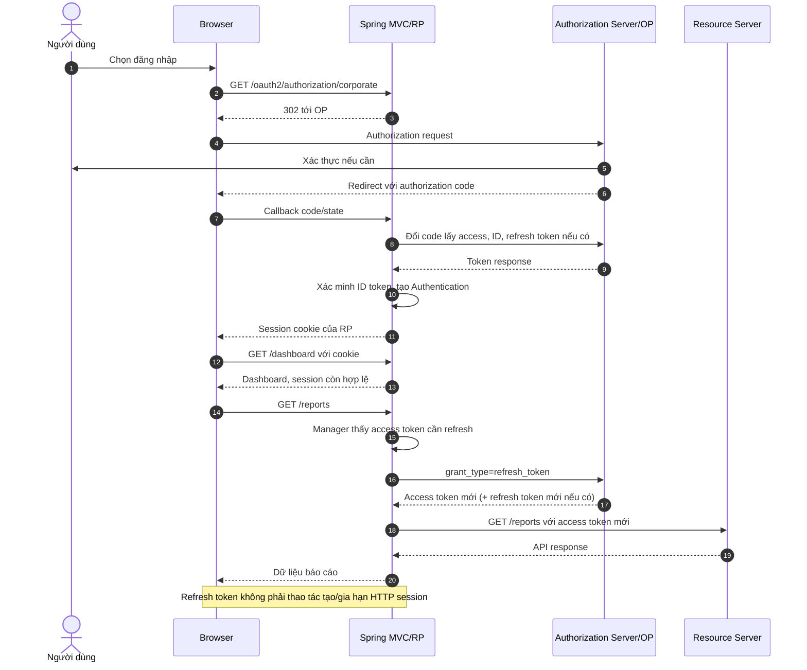

# 17.12. Phân biệt refresh token với gia hạn phiên đăng nhập

> **Module:** Spring Security OAuth 2.0 OIDC Client  
> **Chương:** 17. Refresh Token  
> **Đối tượng:** Lập trình viên xây dựng ứng dụng Spring Boot/Spring Security OAuth 2.0/OIDC Client trên Servlet stack, nhất là ứng dụng đăng nhập bằng `oauth2Login()` và sau đó gọi API bằng access token.

Một người dùng đăng nhập vào ứng dụng web bằng OpenID Connect (OIDC), nhìn thấy trang dashboard và tiếp tục thao tác. Sau khoảng một giờ, access token dùng để gọi API hết hạn. Ứng dụng sử dụng refresh token để xin access token mới và request API lại thành công. Vậy có phải người dùng **được gia hạn phiên đăng nhập** thêm một giờ?

**Không.** Đây là hai cơ chế khác nhau. Refresh token thuộc hệ thống **OAuth 2.0 token authorization**; còn phiên đăng nhập vào ứng dụng thường được duy trì bởi **HTTP session, SecurityContext và cookie phiên** của ứng dụng. Bên cạnh đó, OpenID Provider (OP) còn có một **SSO session** riêng trên miền của nó.

Một lần refresh token thành công có thể làm ứng dụng tiếp tục gọi API, nhưng tự nó **không chứng minh người dùng vẫn đang hiện diện**, **không tạo lại phiên web đã hết hạn**, **không xác thực lại người dùng tại OP**, và **không kéo dài thời gian xác thực thể hiện bởi `auth_time`**.

Ngược lại, một HTTP session vẫn còn hiệu lực không bảo đảm access token còn hạn; hoặc access token/refresh token vẫn hợp lệ nhưng session đăng nhập web đã bị hủy.

Bài học đặt các khái niệm này cạnh nhau, mô tả luồng Spring Security và hướng dẫn triển khai để không nhầm việc duy trì kết nối API với việc duy trì quyền sử dụng tài khoản của người dùng.

---

## 1. Mục tiêu học tập

Sau bài học, bạn có thể:

1. Phân biệt **access token expiration**, **refresh token validity**, **ID token expiration**, **HTTP session timeout** và **SSO session**.
2. Giải thích mục đích của `grant_type=refresh_token` tại Token Endpoint.
3. Mô tả vì sao refresh access token **không tương đương** với xác thực lại người dùng hoặc gia hạn HTTP session.
4. Phân biệt `OAuth2AuthorizedClient` và `OAuth2AuthenticationToken` trong Spring Security.
5. Hiểu khi nào `OAuth2AuthorizedClientManager` sử dụng refresh token và khi nào nó không được gọi.
6. Biết cách cấu hình session timeout riêng với token lifecycle.
7. Hiểu vì sao phản hồi refresh OIDC **có thể không có ID token mới**, và vì sao `auth_time` không tự trở thành thời điểm refresh.
8. Phân tích ảnh hưởng của logout ứng dụng, logout OP, revoke token và thay đổi quyền tài khoản.
9. Xác định khi nào cần đăng nhập lại hoặc yêu cầu step-up authentication thay vì chỉ refresh.
10. Phân biệt lỗi `invalid_grant` của refresh token với phiên web đã hết hạn hoặc API từ chối access token.
11. Chọn chiến lược lưu token/session cho ứng dụng web, BFF và background worker.
12. Thiết kế test có chủ đích cho các mốc thời gian và ranh giới bảo mật khác nhau.

## 2. Năm “đồng hồ” thường bị nhầm thành một

Khi người dùng làm việc với ứng dụng OIDC Client, có thể có ít nhất năm mốc/lifetime độc lập.

| Đồng hồ | Thành phần | Bản chất | Hết hạn thì điều gì xảy ra? |
|---|---|---|---|
| **Access token** | Authorization Server/Resource Server | Credential gọi API, thường ngắn hạn | API có thể từ chối token; Client có thể refresh/reauthorize nếu đủ điều kiện |
| **Refresh token** | Authorization Server | Credential để xin token mới mà không lặp lại toàn bộ grant ban đầu | Client không thể dùng refresh token đó để tiếp tục lấy access token nếu AS không chấp nhận |
| **ID token** | OpenID Provider/Client | Khẳng định danh tính tại thời điểm phát hành, có `exp`/`iat`/các claim OIDC | Bản ID token đã quá hạn; điều này không tự xóa HTTP session đã xác thực hợp lệ trước đó |
| **HTTP session của RP** | Ứng dụng Spring MVC | Trạng thái đăng nhập web và SecurityContext phía ứng dụng | Request mới không còn trạng thái đăng nhập tương ứng; thường phải đi qua cơ chế authentication lại |
| **SSO session của OP** | OpenID Provider | Phiên xác thực ở OP dùng cho SSO liên ứng dụng | OP có thể yêu cầu xác thực lại khi có authorization request mới; token refresh phụ thuộc riêng chính sách AS |

**RP** (*Relying Party*) là ứng dụng web tin kết quả xác thực của OP.

Ví dụ minh họa:

```text
09:00  User đăng nhập thành công vào web app
09:00  ID token được phát; access token hết hạn lúc 10:00
09:00  Refresh token được cấp theo chính sách AS
09:00  HTTP session của ứng dụng được tạo
09:30  Có request web hợp lệ, session có thể được duy trì theo idle timeout
10:05  App gọi API; access token cũ hết hạn
10:05  Client refresh access token nếu AS cho phép
10:05  Web session có thể vẫn còn hoặc đã hết hạn: HAI VIỆC RIÊNG
12:00  Refresh token có thể vẫn còn hạn theo policy
12:00  HTTP session cũng có thể đã hết hạn vì không hoạt động
```

Mốc thời gian, expiration và cơ chế sliding timeout là ví dụ. Không có quy tắc OAuth2/OIDC chung buộc HTTP session timeout phải bằng access token lifetime hoặc refresh token lifetime.

### 2.1. Tại sao cần tách chúng?

Nếu ứng dụng buộc HTTP session tồn tại chỉ vì refresh token còn dùng được, một user đã rời máy hoặc đã logout có thể bị duy trì trạng thái đăng nhập ngoài chính sách.

Nếu ứng dụng xóa HTTP session ngay khi access token hết hạn, người dùng có thể phải đăng nhập lại mỗi 10–60 phút dù refresh token hợp lệ và chính sách phiên web cho phép tiếp tục. Điều này không cần thiết đối với mọi sản phẩm.

Đúng hơn, đặt chính sách riêng:

- **Session**: người dùng còn được phép sử dụng ứng dụng web trong phiên này không?
- **Token**: Client hiện có credential hợp lệ để gọi API mục tiêu không?
- **Authentication freshness**: lần xác thực người dùng tại OP có đủ mới/mức bảo đảm cho thao tác nhạy cảm không?
- **Authorization**: người dùng/tác vụ hiện có quyền thực hiện hành động này không?

## 3. Refresh token là gì?

Refresh token là credential do Authorization Server có thể phát cho Client để xin **access token mới** khi cần. Trong RFC 6749, refresh grant sử dụng Token Endpoint, ví dụ:

```http
POST /oauth2/token HTTP/1.1
Host: login.example.test
Authorization: Basic <redacted-client-credentials>
Content-Type: application/x-www-form-urlencoded

grant_type=refresh_token&refresh_token=<redacted>
```

Với confidential client, Client phải xác thực theo phương thức đã đăng ký. Với public client, chính sách bảo vệ và kiểm tra refresh token khác theo loại Client/AS; `none` không có nghĩa bỏ kiểm tra refresh token.

AS kiểm tra refresh token có thuộc Client, còn hợp lệ, chưa bị thu hồi, bị replay hoặc vi phạm chính sách hay không. Khi thành công, AS trả access token mới và **có thể** trả refresh token mới.

```json
{
  "access_token": "<new-redacted-access-token>",
  "token_type": "Bearer",
  "expires_in": 3600,
  "scope": "reports.read",
  "refresh_token": "<possibly-rotated-refresh-token>"
}
```

Các trường tùy chọn như `refresh_token` hoặc `scope` phụ thuộc response và chính sách AS; ví dụ trên minh họa một lần rotation.

### 3.1. Refresh grant không làm việc gì?

Một token request `grant_type=refresh_token` thông thường:

- Không chuyển browser đến OP để người dùng nhập mật khẩu.
- Không hỏi người dùng chọn tài khoản.
- Không tự thực hiện MFA hoặc đăng nhập lại.
- Không tạo `HttpSession` mới trong Spring Boot.
- Không tự đổi `SecurityContextHolder` thành một Authentication mới.
- Không tự xác nhận người dùng vẫn đang ngồi trước màn hình.
- Không gia hạn SSO cookie của OP theo một quy tắc OAuth2 chung.
- Không tự kéo dài thời gian xác thực `auth_time`.

**Refresh thành công** chỉ chứng minh rằng Client đã đáp ứng chính sách của AS để đổi **refresh token** lấy token mới trong phạm vi authorization hiện còn được chấp nhận.

### 3.2. Refresh token không bắt buộc được cấp

Authorization Code flow có thể có refresh token, nhưng việc cấp phụ thuộc AS, client type, consent, scope, tenant và provider policy. Không phải cứ thêm `openid`, `offline_access` hoặc `prompt=consent` thì chắc chắn nhận refresh token.

Đối với `client_credentials`, thường không có refresh token; khi access token hết hạn, Client thực hiện grant `client_credentials` mới. Không nhầm việc “xin token mới” trong manager với “refresh token grant” ở mọi loại Client.

## 4. Session đăng nhập của ứng dụng Servlet là gì?

Ứng dụng Spring MVC dùng `oauth2Login()` thường nhận callback OIDC, xác minh token/claims và tạo `Authentication` biểu diễn người dùng. Spring Security lưu và phục hồi SecurityContext qua cơ chế cấu hình, phổ biến là gắn với `HttpSession`.

Ở request sau, browser gửi session cookie tới RP:

```http
GET /dashboard HTTP/1.1
Host: app.example.test
Cookie: JSESSIONID=<opaque-session-id>
```

Ứng dụng dùng session ID để tìm trạng thái phiên; nếu có SecurityContext hợp lệ thì request có Authentication tương ứng.

**Cookie này không phải refresh token.** Session ID thuộc hệ thống phiên của web app; refresh token thuộc OAuth2 token grant và phải được Client lưu/kiểm soát ở phía thích hợp.

### 4.1. HTTP session timeout

Ví dụ Spring Boot:

```yaml
server:
  servlet:
    session:
      timeout: 30m
      cookie:
        http-only: true
        secure: true
        same-site: lax
```

Cấu hình `timeout: 30m` thường áp dụng **max inactive interval** của session do Servlet container/Spring Session quản lý theo cấu hình. Phiên có thể tiếp tục sống nếu có activity được tính hợp lệ; kết thúc khi không hoạt động đủ lâu. Tổ chức có thể áp thêm **absolute session lifetime** độc lập nếu chính sách yêu cầu.

`http-only`, `secure`, `same-site` giúp bảo vệ cookie trong các ngữ cảnh phù hợp. Với local HTTP testing, cờ `secure: true` có thể khiến cookie không hoạt động như trên HTTPS; hãy phân biệt cấu hình lab với production TLS.

### 4.2. “Gia hạn phiên” có ít nhất ba nghĩa

Khi sản phẩm nói “extend login”, cần xác định:

1. **Sliding idle timeout:** có activity thì thời điểm hết hạn vì không hoạt động được dời.
2. **Explicit reauthentication/session renewal:** người dùng xác thực lại, ứng dụng tạo/làm mới session theo policy.
3. **Persistent login/remember-me:** ứng dụng có cơ chế riêng để tạo lại Authentication sau khi session cũ hết, nếu được phép.

Ba hành vi này đều **không mặc nhiên được thực hiện** khi OAuth2 access token được refresh.

Một UI có nút “Keep me signed in” cần quy định rõ cơ chế và mức bảo đảm; không được ngầm dùng refresh token làm “remember-me cookie” nếu chưa thiết kế bảo mật đầy đủ.

## 5. Phiên SSO tại OpenID Provider là một lớp thứ ba

OP có thể giữ một session cookie riêng trên domain của nó, ví dụ:

```text
Ứng dụng RP: https://app.example.test       -> cookie phiên của ứng dụng
OpenID Provider: https://login.example.test -> cookie SSO của OP
```

Khi RP cần bắt đầu authorization request mới, browser có thể gửi cookie SSO tới OP. Nếu phiên ở OP còn hợp lệ và chính sách cho phép, đăng nhập có thể diễn ra mà người dùng không phải nhập thông tin lần nữa.

Điều này **khác hoàn toàn** với refresh token grant:

- Refresh token request được Client gửi tới Token Endpoint, thường server-to-server.
- SSO session được dùng khi browser tham gia một OIDC authentication/authorization request mới.
- OP có thể giữ SSO session khi RP đã logout.
- RP có thể giữ HTTP session dù SSO session tại OP đã hết hạn.
- AS có thể từ chối refresh token dù OP SSO session còn tồn tại, hoặc ngược lại, tùy policy.

### 5.1. Vì sao “đăng nhập lại” có thể trông như không đăng nhập lại?

Nếu HTTP session của RP hết hạn nhưng OP SSO session vẫn còn, RP chuyển browser sang `/oauth2/authorization/corporate`. OP dùng phiên của nó để hoàn tất authorization mà không hiện login form.

Người dùng có cảm giác “session tự kéo dài”, nhưng thực tế có thể đã xảy ra **một giao dịch OIDC Login mới**. Không suy ra nguyên nhân từ UX; cần xem Network/authorization callback và session lifecycle của RP.

### 5.2. SSO session không phải refresh token

Kể cả khi OP hỗ trợ silent SSO, nó không tạo ra cơ chế đảm bảo Client đã nhận refresh token. Ngược lại, Client có refresh token vẫn có thể refresh khi browser không còn SSO cookie nếu AS cho phép.

Các trình duyệt hiện đại còn có chính sách third-party cookies, ảnh hưởng một số kỹ thuật silent login; không thiết kế lifetime session chỉ dựa trên iframe SSO.

## 6. Bốn thành phần độc lập trong Spring Security

Trong ứng dụng Servlet, cần phân biệt:

| Thành phần | Dữ liệu chính | Vòng đời điển hình |
|---|---|---|
| `OAuth2AuthenticationToken` | Principal/authorities và registration ID của lần login | Trong SecurityContext/session sau OAuth2 Login |
| `SecurityContextRepository` | Cơ chế lưu/khôi phục Authentication | Gắn với request/session và cấu hình security |
| `OAuth2AuthorizedClient` | ClientRegistration, access token, refresh token nếu có | Theo storage/authorized-client lifecycle |
| `OAuth2AuthorizedClientRepository` hoặc `OAuth2AuthorizedClientService` | Lưu/truy xuất authorized client | Có thể theo session, service in-memory, JDBC... |

Không dùng một object thay object khác.

### 6.1. OAuth2AuthenticationToken không chứa refresh token trực tiếp

Ví dụ:

```java
OAuth2AuthenticationToken loginAuthentication = ...;

String registrationId =
    loginAuthentication.getAuthorizedClientRegistrationId();

String principalName = loginAuthentication.getName();
```

Các giá trị trên xác định login principal và registration, nhưng không có phương thức `getRefreshToken()` của `OAuth2AuthenticationToken`.

Muốn tìm token, dùng authorized-client storage hoặc manager:

```java
OAuth2AuthorizedClient client = ...;

OAuth2AccessToken accessToken = client.getAccessToken();
OAuth2RefreshToken refreshToken = client.getRefreshToken();
```

Các token này vẫn cần được quản lý an toàn. Không serialize `OAuth2AuthorizedClient` ra JSON trả browser, vì có thể làm lộ credentials.

### 6.2. Authorized client có thể sống lâu hơn session

Nếu authorized client lưu trong JDBC service theo principal, record có thể vẫn tồn tại sau khi browser session đã hết hạn. Ngược lại, khi dùng `HttpSessionOAuth2AuthorizedClientRepository`, record có thể mất khi session bị hủy.

Vì vậy, không khẳng định tuyệt đối:

- “Logout luôn xóa refresh token khỏi database.”
- “Session hết hạn thì refresh token không còn.”
- “Refresh token còn hạn thì session vẫn còn.”

Tất cả phụ thuộc các **storage và chính sách lifecycle độc lập**.

## 7. Luồng OIDC Login và refresh token trong một sơ đồ



Trong sơ đồ, request `/reports` được thực hiện **khi session web vẫn còn hợp lệ**. Nếu session đã hết hạn, browser cần vượt qua chính sách authentication của RP trước khi được vào controller. Sự tồn tại của refresh token phía backend không tự phục hồi phiên của browser.

## 8. Một bảng tình huống dễ ghi nhớ

| HTTP session RP | Access token | Refresh token | Hành vi đúng |
|---|---|---|---|
| Còn hợp lệ | Còn hạn | Có hoặc không | User dùng web; gọi API bằng token hiện có nếu đúng audience/scope |
| Còn hợp lệ | Hết hạn | Còn hợp lệ | Manager có thể refresh để gọi API; **không cần kéo dài session do refresh** |
| Còn hợp lệ | Hết hạn | Không có hoặc bị từ chối | Có thể phải reauthorize/đăng nhập lại để gọi API; xử lý UX và policy |
| Hết hạn | Access token còn hạn | Có | Browser không còn Authentication phiên web; không cho truy cập chỉ vì token backend còn |
| Hết hạn | Hết hạn | Còn hợp lệ trong JDBC | Token có thể còn tồn tại cho tích hợp đã ủy quyền; user web vẫn cần đăng nhập lại theo policy |
| Còn hợp lệ | Còn hạn | Bị thu hồi | Request API có thể còn hoạt động tới khi access token không được chấp nhận; refresh sau này thất bại |
| Còn hợp lệ | Token hợp lệ | Có | Nếu yêu cầu xác thực lại/MFA cho thao tác nhạy cảm, vẫn cần step-up, không chỉ kiểm tra token |

**Kết luận của bảng:** lifetime của token và lifetime của phiên là các quyết định khác nhau. Không lấy `expires_in` của access token để đặt HTTP session timeout theo một công thức chung.

## 9. OIDC: ID token mới sau refresh có bắt buộc không?

Theo OpenID Connect Core, khi refresh token thành công, phản hồi token **có thể không chứa `id_token`**.

Ví dụ response hợp lệ:

```json
{
  "access_token": "<redacted>",
  "token_type": "Bearer",
  "expires_in": 1800
}
```

Nó có thể bao gồm refresh token mới, nhưng không cần có ID token mới trong mọi refresh response.

Nếu AS trả ID token mới, OIDC định nghĩa các ràng buộc liên quan đến token của lần xác thực gốc, ví dụ:

- `iss` và `sub` phải tương ứng với ID token ban đầu.
- `aud` phải tương ứng với audience gốc theo quy tắc OIDC.
- `iat` biểu diễn **thời điểm ID token mới được phát hành**.
- Nếu có `auth_time` thì đó là thời điểm **xác thực người dùng ban đầu**, không phải thời điểm refresh.
- Các điều kiện OIDC khác, gồm kiểm tra chữ ký, thời hạn và semantics của claim, vẫn áp dụng.

### 9.1. ID token iat mới không chứng minh reauthentication

Giả sử:

```text
09:00  Người dùng xác thực tại OP
09:00  auth_time = 09:00
11:00  Client refresh token
11:00  OP có thể phát ID token mới với iat = 11:00
11:00  auth_time vẫn phản ánh lần xác thực 09:00 nếu claim có mặt
```

Do đó:

- `iat` mới **không chứng minh** người dùng vừa nhập mật khẩu/passkey hay MFA.
- Refresh token grant **không phải** reauthentication.
- Nếu nghiệp vụ cần “người dùng vừa xác thực trong 5 phút gần đây”, phải đánh giá `auth_time` và các yêu cầu OIDC thích hợp.

### 9.2. Principal trong Spring Security không mặc nhiên được thay

Sau một OIDC Login, principal `OidcUser` được đưa vào `OAuth2AuthenticationToken` và lưu trong SecurityContext. Một lần refresh access token thông qua authorized client manager không đồng nghĩa Spring Security đã:

- Thay `Authentication` hiện tại;
- Tạo `OidcUser` mới;
- Đọc lại roles/groups và ánh xạ authorities;
- Kích hoạt session authentication strategy;
- Yêu cầu user xác thực lại.

Dù provider trả ID token trong refresh response, ứng dụng/framework cần có logic rõ ràng nếu muốn dùng bất kỳ thay đổi nào để cập nhật principal; không mặc định refresh sẽ làm mới danh tính hay authorities.

Đặc biệt, **refresh token không phải cơ chế cập nhật role và quyền nội bộ**. Khi quyền người dùng bị thu hồi, ứng dụng phải có chính sách authorization, revalidation và session invalidation phù hợp, không chỉ chờ refresh token.

## 10. “Gia hạn phiên” thường diễn ra bằng hoạt động HTTP

Một Servlet session thường có **max inactive interval**. Khi trình duyệt gửi request hợp lệ được ứng dụng ghi nhận là hoạt động, container/session store có thể cập nhật thời gian truy cập cuối.

Ví dụ:

```text
Session idle timeout = 30 phút
09:00 Login, session tồn tại
09:20 User mở trang; request đến server
09:45 User mở trang khác; tiếp tục request
10:10 User gọi API ứng dụng; session vẫn còn nếu mọi mốc phù hợp
10:45 Không có hoạt động hơn 30 phút -> session có thể hết hạn
```

Refresh token có thể xảy ra ở 09:30 hoặc 10:05, nhưng **không nên thiết kế sự kiện refresh như một “heartbeat” để giữ phiên web sống**.

### 10.1. Background refresh không phải hoạt động của người dùng

Nếu backend dùng scheduler làm mới token mỗi 5 phút, event đó không chứng minh user đang sử dụng trình duyệt. Nếu nó vô tình cập nhật HTTP session hoặc đánh dấu user active, có thể khiến một phiên không bao giờ hết hạn.

Đây là tình huống cần tránh:

```text
Job refresh token mỗi 5 phút
        ↓
Ứng dụng tự cập nhật lastUserActivity
        ↓
Web session không hết hạn dù user đã rời máy
```

Chỉ hoạt động được chính sách phiên công nhận mới nên ảnh hưởng đến idle timeout. Một số sản phẩm còn phân biệt request giao diện từ người dùng với background polling để kiểm soát inactivity tốt hơn.

### 10.2. Session cookie và session server-side khác nhau

Thời hạn cookie trong browser (session cookie hay persistent cookie) và thời hạn record phiên server-side không nhất thiết trùng nhau. Một cookie còn trong browser nhưng session store đã xóa record sẽ không làm người dùng tự nhiên được xác thực.

Tương tự, một session record còn ở server nhưng browser đã mất cookie thường không được truy cập lại bằng session cũ. Chính sách remember-me hoặc login SSO có thể tạo luồng khác, nhưng đó không phải OAuth refresh token.

## 11. Cấu hình Spring Boot Servlet: OIDC login và session riêng biệt

Ví dụ `application.yml`:

```yaml
server:
  port: 8080
  servlet:
    session:
      timeout: 30m
      cookie:
        http-only: true
        secure: true
        same-site: lax

spring:
  security:
    oauth2:
      client:
        registration:
          corporate:
            provider: corporate-op
            client-id: employee-web
            client-secret: ${OIDC_CLIENT_SECRET}
            client-authentication-method: client_secret_basic
            authorization-grant-type: authorization_code
            redirect-uri: "{baseUrl}/login/oauth2/code/{registrationId}"
            scope:
              - openid
              - profile
              - email
        provider:
          corporate-op:
            issuer-uri: https://login.example.test/realms/employees
```

**Hai nhóm cấu hình độc lập:**

- `server.servlet.session.timeout` quyết định thời gian bất hoạt của HTTP session theo Servlet container/session store.
- `spring.security.oauth2.client.registration.*` mô tả OAuth2 Client, không cấu hình “session TTL bằng refresh token TTL”.

AS vẫn tự quyết định access token TTL, refresh token TTL/rotation, consent và chính sách revoke. Client **không thể** ép AS cấp refresh token sống 30 ngày chỉ bằng một property ở Spring Boot.

### 11.1. SecurityFilterChain

```java
import org.springframework.context.annotation.Bean;
import org.springframework.context.annotation.Configuration;
import org.springframework.security.config.Customizer;
import org.springframework.security.config.annotation.web.builders.HttpSecurity;
import org.springframework.security.web.SecurityFilterChain;

@Configuration
class SecurityConfiguration {

    @Bean
    SecurityFilterChain securityFilterChain(HttpSecurity http)
            throws Exception {
        return http
            .authorizeHttpRequests(auth -> auth
                .requestMatchers("/", "/error").permitAll()
                .anyRequest().authenticated()
            )
            .oauth2Login(Customizer.withDefaults())
            .oauth2Client(Customizer.withDefaults())
            .build();
    }
}
```

Đây là cấu hình minh họa cho ứng dụng vừa dùng login vừa dùng OAuth2 Client gọi API. Nó **không có** dòng “mỗi lần access token refresh thì gia hạn session” — vì hai quy trình không được ràng buộc như vậy.

## 12. Spring Security làm mới access token khi nào?

Spring Security OAuth2 Client có `OAuth2AuthorizedClientManager`. Manager làm việc với một hoặc nhiều `OAuth2AuthorizedClientProvider` như `authorizationCode()`, `refreshToken()` hoặc `clientCredentials()`.

Trong Servlet request, `DefaultOAuth2AuthorizedClientManager` là một implementation phổ biến. Nó dùng `ClientRegistrationRepository` và `OAuth2AuthorizedClientRepository`, nhờ vậy biết Client registration, authorized client và request context cần thiết.

Ví dụ tạo manager với refresh provider:

```java
import org.springframework.context.annotation.Bean;
import org.springframework.context.annotation.Configuration;
import org.springframework.security.oauth2.client.OAuth2AuthorizedClientManager;
import org.springframework.security.oauth2.client.OAuth2AuthorizedClientProvider;
import org.springframework.security.oauth2.client.OAuth2AuthorizedClientProviderBuilder;
import org.springframework.security.oauth2.client.registration.ClientRegistrationRepository;
import org.springframework.security.oauth2.client.web.DefaultOAuth2AuthorizedClientManager;
import org.springframework.security.oauth2.client.web.OAuth2AuthorizedClientRepository;

@Configuration
class AuthorizedClientConfiguration {

    @Bean
    OAuth2AuthorizedClientManager authorizedClientManager(
            ClientRegistrationRepository registrations,
            OAuth2AuthorizedClientRepository authorizedClients) {

        OAuth2AuthorizedClientProvider provider =
            OAuth2AuthorizedClientProviderBuilder.builder()
                .authorizationCode()
                .refreshToken()
                .build();

        DefaultOAuth2AuthorizedClientManager manager =
            new DefaultOAuth2AuthorizedClientManager(
                registrations,
                authorizedClients
            );

        manager.setAuthorizedClientProvider(provider);
        return manager;
    }
}
```

Điều kiện để refresh có ý nghĩa:

1. Đã có authorized client phù hợp được lưu (thường từ lần Authorization Code grant thành công).
2. Có refresh token được AS phát hành.
3. Access token cần refresh theo logic provider, thường dựa trên expiration và clock skew.
4. Manager có provider hỗ trợ `refreshToken()`.
5. Token Endpoint chấp nhận refresh token và Client authentication.
6. Storage/repository lưu token được cập nhật đúng.

**Không phải mọi HTTP request của user đều tự động gọi Token Endpoint để refresh.** Manager thường được kích hoạt khi ứng dụng hoặc OAuth2-aware HTTP client cần một authorized client/token cho API call.

### 12.1. loadAuthorizedClient() không tự refresh

Nếu code chỉ gọi:

```java
OAuth2AuthorizedClient stored =
    authorizedClientService.loadAuthorizedClient(
        "corporate",
        authentication.getName()
    );
```

nó đang **đọc storage**, không tự xin token mới. `stored.getAccessToken()` có thể là token đã hết hạn.

Hãy dùng authorized client manager với grant providers tương ứng khi cần cơ chế refresh/reauthorize. Không dùng refresh token thủ công tùy tiện nếu thư viện đã cung cấp token response client và lifecycle management.

### 12.2. Manager không tự cấp mới refresh token

`OAuth2AuthorizedClientProviderBuilder.builder().refreshToken()` chỉ bật khả năng **sử dụng refresh token đã có**. Nó không buộc AS phát refresh token nếu lần đăng nhập chưa được cấp.

Các scope/consent như `offline_access` tùy OP. Muốn background access dài hạn cần phân tích hợp đồng của AS, yêu cầu consent và loại Client, không chỉ thêm một dòng builder.

## 13. Ví dụ gọi manager trong request web

Một service cần gọi API có thể lấy authorized client của người dùng hiện tại:

```java
import org.springframework.security.core.Authentication;
import org.springframework.security.oauth2.client.OAuth2AuthorizeRequest;
import org.springframework.security.oauth2.client.OAuth2AuthorizedClient;
import org.springframework.security.oauth2.client.OAuth2AuthorizedClientManager;
import org.springframework.stereotype.Service;

@Service
public class CorporateAuthorizedClientProvider {

    private final OAuth2AuthorizedClientManager manager;

    public CorporateAuthorizedClientProvider(
            OAuth2AuthorizedClientManager manager) {
        this.manager = manager;
    }

    public OAuth2AuthorizedClient current(Authentication authentication) {
        OAuth2AuthorizeRequest request =
            OAuth2AuthorizeRequest
                .withClientRegistrationId("corporate")
                .principal(authentication)
                .build();

        OAuth2AuthorizedClient authorizedClient =
            manager.authorize(request);

        if (authorizedClient == null) {
            throw new IllegalStateException(
                "No authorized client available for corporate"
            );
        }

        return authorizedClient;
    }
}
```

Ví dụ giả định được gọi **trong Servlet request** với `Authentication` đã được Spring Security xác minh và manager/repository đã cấu hình phù hợp. Để dùng ngoài HTTP request, cần service-based manager riêng như mục 16.

Nếu access token cần refresh, manager/provider có thể thực hiện refresh và trả authorized client mới. **Nó không đồng thời đổi session idle timeout, tạo Authentication mới hoặc cập nhật `OidcUser` theo mặc định.**

### 13.1. Không nên dùng manager để “tự gia hạn login” vô hạn

Tránh thiết kế:

```java
// Phản ví dụ về mặt thiết kế:
// Cứ refresh access token thành công thì cho rằng user vẫn đăng nhập.
if (canRefreshAccessToken()) {
    markUserSessionAsActiveForever();
    skipReauthenticationChecks();
}
```

Thao tác trên trộn bằng chứng quyền API với bằng chứng sự hiện diện/xác thực của người dùng. User session phải chịu policy độc lập.

### 13.2. Không lấy registration ID từ input tự do

Đừng cho một HTTP endpoint công khai nhận `registrationId` và `principalName` tùy ý rồi dùng service/manager lấy token người khác. Registration và principal phải được suy ra từ Authentication đã xác minh và chính sách ứng dụng.

## 14. OAuth2-aware HTTP client có thể trigger refresh

Khi ứng dụng sử dụng các tích hợp như `OAuth2ClientHttpRequestInterceptor` cho `RestClient` (với Spring Security version hỗ trợ) hoặc Servlet OAuth2 WebClient filter, HTTP client có thể nhờ `OAuth2AuthorizedClientManager` lấy/tái sử dụng access token phù hợp trước khi gọi Resource Server.

Tổng quan:

```text
Controller/Service cần gọi API
          |
          v
OAuth2-aware HTTP client
          |
          v
OAuth2AuthorizedClientManager
          |
          +--> Token còn dùng được -> sử dụng access token hiện có
          |
          +--> Token cần refresh và có refresh token -> gọi Token Endpoint
          |
          +--> Không thể authorize -> xử lý lỗi/re-authentication policy
          |
          v
Resource Server nhận Bearer access token
```

**Không có mũi tên ngầm** từ “Token Endpoint refresh success” sang “Spring MVC session mới”. Request hiện tại có thể ảnh hưởng session idle timeout do bản thân nó là một HTTP request, nhưng đó là **tác động của HTTP session activity**, không phải hệ quả bắt buộc của token refresh grant.

### 14.1. Cảnh giác với default authorized client

Một số HTTP client integration có tùy chọn chọn authorized client hiện tại làm mặc định cho outbound requests. Không bật rộng rãi nếu HTTP client có thể gọi nhiều API khác nhau: token có thể bị gửi tới đích không đúng audience.

Chọn registration/client phù hợp cho mỗi Resource Server, kiểm soát token leakage và scopes. Refresh token không sửa được lỗi token gửi sai API.

## 15. Refresh token thất bại thì web session có buộc logout không?

**Không có quy tắc chung** buộc một HTTP session phải bị hủy ngay khi Token Endpoint trả lỗi refresh.

Ví dụ API call thất bại vì:

```json
{
  "error": "invalid_grant"
}
```

Đây có thể do refresh token hết hạn, bị revoke, rotation conflict hoặc grant không còn hợp lệ. Nhưng HTTP session của RP có thể vẫn đang chứa Authentication của user.

Ứng dụng cần một **chính sách sản phẩm/bảo mật rõ ràng**:

- Nếu API không còn quyền truy cập, hiển thị “Kết nối đã hết hạn” hoặc yêu cầu authorize lại.
- Nếu app không thể hoạt động an toàn thiếu API authorization đó, có thể buộc login/reauthorization mới.
- Nếu security event nghiêm trọng (ví dụ tài khoản đã bị thu hồi/quyền bị khóa), ứng dụng có thể cần invalidating session theo chính sách nhận tín hiệu từ IdP.
- Không tự động hủy mọi session chỉ vì một API phụ bị từ chối tạm thời.
- Không tự động **giữ** mọi session khi nguồn danh tính đã bị thu hồi; cần session revocation/authorization policy.

### 15.1. Khi nào xóa authorized client?

Một số manager/failure handler có thể xóa authorized client khi refresh thất bại với một số OAuth errors phù hợp. Điều đó chỉ ảnh hưởng **token storage**, không trực tiếp xóa HTTP session trong mọi cấu hình.

Đường hồi phục thường là bắt đầu một **Authorization Code/OIDC Login flow mới**, tùy OP SSO state. Nếu user vẫn có SSO session, họ có thể không cần nhập credential; nếu AS yêu cầu consent mới, UI của OP có thể xuất hiện.

### 15.2. Nếu refresh token rotation bị lỗi

Nếu AS dùng refresh token rotation, refresh thành công có thể trả refresh token mới và làm token cũ không còn hợp lệ. Một job khác sử dụng token cũ có thể nhận `invalid_grant`.

Trong ứng dụng nhiều instances, cần cân nhắc:

- Đồng bộ refresh theo authorized client key;
- Storage shared và update an toàn;
- Hạn chế retry cùng refresh token cũ;
- Xử lý nghi ngờ replay/compromise theo chính sách AS.

Không xử lý bằng cách liên tục xin lại token cùng refresh token đã bị từ chối.

## 16. Background worker: refresh được nhưng không đăng nhập browser thay user

Một `AuthorizedClientServiceOAuth2AuthorizedClientManager` có thể dùng `OAuth2AuthorizedClientService` ngoài HTTP request.

Ví dụ cấu hình chỉ dành cho refresh token của authorized client **đã có**:

```java
import org.springframework.context.annotation.Bean;
import org.springframework.context.annotation.Configuration;
import org.springframework.security.oauth2.client.AuthorizedClientServiceOAuth2AuthorizedClientManager;
import org.springframework.security.oauth2.client.OAuth2AuthorizedClientManager;
import org.springframework.security.oauth2.client.OAuth2AuthorizedClientProvider;
import org.springframework.security.oauth2.client.OAuth2AuthorizedClientProviderBuilder;
import org.springframework.security.oauth2.client.OAuth2AuthorizedClientService;
import org.springframework.security.oauth2.client.registration.ClientRegistrationRepository;

@Configuration
class BackgroundRefreshConfiguration {

    @Bean("backgroundRefreshManager")
    OAuth2AuthorizedClientManager backgroundRefreshManager(
            ClientRegistrationRepository registrations,
            OAuth2AuthorizedClientService authorizedClientService) {

        OAuth2AuthorizedClientProvider provider =
            OAuth2AuthorizedClientProviderBuilder.builder()
                .refreshToken()
                .build();

        AuthorizedClientServiceOAuth2AuthorizedClientManager manager =
            new AuthorizedClientServiceOAuth2AuthorizedClientManager(
                registrations,
                authorizedClientService
            );
        manager.setAuthorizedClientProvider(provider);
        return manager;
    }
}
```

Điều kiện là service phải **đã lưu authorized client có refresh token** theo cùng registration/principal name mà background worker đang dùng.

Nếu web login dùng `HttpSessionOAuth2AuthorizedClientRepository` còn job dùng một `JdbcOAuth2AuthorizedClientService` riêng, job có thể không thấy bản ghi. Phải thiết kế storage bridge theo nhu cầu thật, không giả định chúng tự chia sẻ token.

### 16.1. Điều kiện bảo mật khi background access thay mặt người dùng

Worker không được chọn tùy ý:

```java
OAuth2AuthorizeRequest.withClientRegistrationId("calendar-api")
    .principal(requestBody.getUsername())
    .build();
```

nếu `requestBody.getUsername()` là dữ liệu chưa được kiểm chứng. Đây có thể là con đường truy cập authorized client của người khác.

Thay vào đó, xác minh quyền của job, tenant, đối tượng dữ liệu và consent đã lưu. Refresh token tồn tại lâu hơn session web không làm nó trở thành giấy phép vĩnh viễn để làm mọi việc thay user.

### 16.2. Refresh token có thể tiếp tục sau khi user đóng browser

Đóng tab/browser không nhất thiết xóa authorized client ở server. Nếu backend được người dùng cấp quyền offline và AS còn cho phép refresh, worker có thể tiếp tục gọi API theo chính sách consent đã cấp.

Nhưng ứng dụng phải làm rõ **chính sách liên tục truy cập** khi user logout hoặc vô hiệu hóa tài khoản. Cần nút disconnect, revocation và retention phù hợp, không ẩn việc truy cập offline dưới một thiết lập “gia hạn phiên”.

## 17. Logout: phân biệt bốn sự kiện

Logout có thể mang nhiều ý nghĩa:

1. **Local application logout:** hủy/không tiếp tục sử dụng HTTP session/SecurityContext của RP.
2. **OIDC RP-Initiated Logout:** điều hướng tới OP end-session endpoint theo cơ chế hỗ trợ để kết thúc phiên SSO liên quan.
3. **Xóa authorized client local:** xóa token record khỏi repository/service.
4. **Token revocation:** yêu cầu AS thu hồi access/refresh token hoặc authorization theo giao thức/hợp đồng của provider.

Những sự kiện này **không mặc nhiên kéo theo nhau**.

| Thao tác | Có trực tiếp xóa HTTP session RP? | Có trực tiếp xóa record token ở JDBC? | Có bảo đảm revoke token ở AS? |
|---|---|---|---|
| Spring Security local logout | Có theo cấu hình | Không mặc định trong mọi cấu hình | Không |
| OP end-session | Không tự xử lý mọi record RP nếu chưa có flow/policy | Không | Không phải mặc định |
| `removeAuthorizedClient(...)` | Không | Có ở đúng service key | Không |
| RFC 7009 revocation | Không | Không tự động | AS xử lý theo protocol/policy |
| Refresh token thành công | Không | Có thể cập nhật authorized client | Không |

### 17.1. Vì sao logout không nên bị refresh token “vô hiệu hóa”?

Giả sử người dùng bấm Logout rồi API refresh token ở một background service vẫn thành công. Nếu ứng dụng dùng sự kiện đó để tự tạo lại HTTP session của người dùng mà không yêu cầu authentication thích hợp, logout gần như mất tác dụng.

**Không dùng refresh token để tái tạo Authentication web** chỉ vì có token stored trong JDBC. Nếu muốn hỗ trợ login liên tục, cần cơ chế login/remember-me/SSO được thiết kế riêng, với consent, expiry, revocation và đánh giá rủi ro phù hợp.

### 17.2. Logout và token storage phải đồng bộ theo policy

Nếu sản phẩm tuyên bố “Logout khỏi mọi thiết bị”, cần chính sách xử lý sessions, active tokens, OP session và thiết bị/ủy quyền liên quan. Chỉ gọi `SecurityContextLogoutHandler` tại một web node không đủ để khẳng định toàn bộ authorization đã bị thu hồi trên mọi hệ thống.

Với yêu cầu nhạy cảm, cân nhắc OIDC Back-Channel Logout, session revocation, token revocation và cơ chế truyền sự kiện đến RP theo khả năng OP/ứng dụng. Không giả định mọi OP đều hỗ trợ mọi chuẩn logout.

## 18. Gia hạn phiên với remember-me có liên quan refresh token không?

Spring Security có các cơ chế authentication khác như remember-me. Chúng có thể tạo lại Authentication từ một credential được thiết kế cho tính năng nhớ đăng nhập khi session cũ không còn.

Tuy nhiên:

- Remember-me token/cookie không phải OAuth2 refresh token.
- Một OIDC Login mặc định không đồng nghĩa remember-me đã được cấu hình.
- Credential nhớ đăng nhập có policy, storage, theft protection và revocation riêng.
- Việc RP có thể thiết lập lại session cần dựa trên cơ chế authentication được phép, không tự chuyển refresh token thành một “vé đăng nhập” tùy tiện.
- Với ứng dụng nhạy cảm, remember-me có thể không thỏa authentication assurance hoặc freshness cần thiết.

**Thực hành thiết kế:** nếu yêu cầu sản phẩm là “giữ user đăng nhập trong 30 ngày”, hãy xác định đó là local persistent login, OP SSO session, refresh token cho API, hay sự kết hợp được quản lý rõ. Không chỉ sửa `refresh_token_ttl` ở AS rồi tuyên bố đã giải quyết login session 30 ngày.

## 19. Step-up authentication và hành động nhạy cảm

Giả sử người dùng đã đăng nhập từ sáng, tới chiều muốn chuyển tiền hoặc thay đổi thông tin bảo mật.

Ứng dụng có thể có:

- HTTP session vẫn còn;
- access token còn hạn hoặc vừa được refresh;
- refresh token vẫn hợp lệ;
- nhưng thời điểm người dùng xác thực tại OP đã quá cũ.

Một thao tác nhạy cảm có thể yêu cầu **reauthentication gần đây** hoặc MFA thích hợp. Các cơ chế OIDC liên quan:

- `prompt=login`: yêu cầu OP xác thực lại người dùng.
- `max_age=300`: giới hạn tối đa độ tuổi xác thực, tính bằng giây, theo OIDC.
- `max_age=0`: yêu cầu OP chủ động xác thực lại.
- `auth_time`: thời điểm xác thực tại OP, cần kiểm tra khi yêu cầu max_age.
- `acr`/`amr`: bằng chứng về authentication context/method khi OP công bố và ứng dụng có policy tương ứng.

**Refresh token không đáp ứng thay các điều kiện này.**

### 19.1. Ví dụ về sự khác nhau giữa iat và auth_time

```text
09:00 Người dùng đăng nhập tại OP
09:00 auth_time = 09:00
14:00 Client refresh access token
14:00 iat của một ID token mới (nếu có) = 14:00
14:00 auth_time vẫn là 09:00 theo quy tắc OIDC refresh
14:00 App yêu cầu giao dịch nhạy cảm: cần xác thực mới trong 5 phút
14:00 Điều kiện freshness không đạt chỉ vì refresh lúc 14:00
```

Khi yêu cầu `max_age` trong OIDC Authentication Request, OP phải trả `auth_time`. Ứng dụng cần xác định rõ phần validation/policy kiểm tra freshness theo phiên bản thư viện. Không suy từ `iat`/access token expiry rằng reauthentication đã xảy ra.

### 19.2. Session được giữ nhưng quyền có thể thay đổi

Token refresh không tự cập nhật `Authentication.getAuthorities()` trong SecurityContext. Nếu tổ chức thu hồi role admin của người dùng, một session cũ có thể vẫn chứa authorities được tính ở thời điểm login.

Cần một chiến lược:

- Kiểm tra authorization vào thời điểm sử dụng theo mức rủi ro.
- Có cơ chế invalidate sessions/authorized clients khi account bị khóa hoặc quyền thay đổi.
- Cập nhật/ánh xạ authorities từ nguồn tin cậy khi cần.
- Thiết kế step-up/reauthentication cho thao tác quan trọng.

Đừng xem refresh token là cơ chế đồng bộ roles hay tenant membership.

## 20. Sự cố thực tế: vì sao refresh thành công nhưng người dùng vẫn bị đưa về login?

Một số nguyên nhân:

1. HTTP session đã hết hạn do không hoạt động.
2. Session cookie đã mất hoặc không được browser gửi.
3. Load balancer/session store không chia sẻ session giữa các instances như thiết kế.
4. SecurityContext không được lưu đúng khi sử dụng custom authentication handler/filter.
5. Ứng dụng có absolute session lifetime hoặc chính sách forced reauthentication.
6. User logout ở tab khác hoặc session bị invalidate bởi bảo mật.
7. Authentication tại RP được thay đổi do deployment, session serialization hoặc session policy.
8. Access token refresh diễn ra ở background nhưng web request mới không có session.

Không “sửa” bằng cách dùng refresh token để tạo Authentication lại từ dữ liệu chưa được xác minh. Hãy điều tra **session lifecycle**, không chỉ Token Endpoint.

### 20.1. Ngược lại: session còn nhưng API trả 401

Có thể do:

- Access token hết hạn và code chỉ `loadAuthorizedClient`, không dùng manager để refresh.
- Authorized client không có refresh token hoặc manager thiếu `refreshToken()` provider.
- AS thu hồi token sau khi người dùng logout ở OP.
- Audience hoặc scope không đúng API.
- Resource Server không tin issuer hoặc keys đúng.
- Token bị thay đổi/không hợp lệ.

Session web còn không làm access token tự hợp lệ. Cần xử lý phần token/authorization riêng.

## 21. Bảng chẩn đoán nhanh

| Triệu chứng | Lớp liên quan | Điều cần làm |
|---|---|---|
| User mất login sau 30 phút | HTTP session/SecurityContext | Xem idle timeout, cookie và session store |
| Browser chuyển qua OP rồi quay lại mà không nhập mật khẩu | OP SSO | SSO session có thể còn; kiểm tra authentication request mới |
| Access token hết hạn nhưng API vẫn gọi được sau đó | OAuth2 refresh hoặc cấp lại token | Kiểm tra manager và token lifecycle, không đồng nhất với session |
| Refresh thành công nhưng `OidcUser`/roles không đổi | Authentication đã lưu | Đây có thể là behavior bình thường; cập nhật principal cần policy riêng |
| `invalid_grant` ở Token Endpoint | Refresh token/grant | Kiểm tra expiry, revocation, rotation, Client binding |
| `invalid_client` ở Token Endpoint | Client authentication | Kiểm tra secret/method/registration |
| API 401 | Access token/validation | Kiểm tra expiry, issuer, audience, signature, revocation |
| API 403 | Authorization tại Resource Server | Kiểm tra scope, role, tenant, permissions |
| Logout web nhưng job vẫn refresh được | Authorized client storage và AS policy | Xem JDBC/token retention và logout/revocation policy |
| Refresh token hết hạn nhưng UI vẫn đăng nhập | Session web độc lập | Quyết định khi nào cần reauthorize API |
| `/me` trả user cũ dù token refresh vừa xong | Principal trong SecurityContext | Không tự kỳ vọng refresh cập nhật Authentication |
| Nhiều nodes cùng refresh gây `invalid_grant` | Refresh token rotation/concurrency | Đồng bộ refresh và xử lý storage consistency |
| Token còn hạn nhưng transaction nhạy cảm bị chặn | Authentication freshness/authorization | Kiểm tra `auth_time`/MFA policy; step-up |
| User logout tại OP nhưng RP chưa logout | SSO logout integration | Xem RP-initiated/back-channel logout và session invalidation |

## 22. Thực hành A — Session còn sống, access token hết hạn

**Mục tiêu:** nhìn rõ refresh token không phải gia hạn phiên.

**Chuẩn bị:** Spring MVC app với OIDC Login; một AS test có access token lifetime ngắn và refresh token được cấp theo chính sách; API test; session timeout dài hơn access token lifetime.

**Các bước:**

1. Cấu hình session idle timeout, ví dụ 30 phút.
2. Trên test AS, đặt access token lifetime ngắn, ví dụ 2 phút.
3. Đăng nhập OIDC qua browser.
4. Xác nhận endpoint web yêu cầu Authentication vẫn truy cập được.
5. Chờ token hết hạn nhưng giữ web session trong điều kiện thích hợp.
6. Gọi một API qua `OAuth2AuthorizedClientManager` có `refreshToken()` provider.
7. Quan sát manager xin access token mới và API thành công.
8. Ghi metadata: session còn, access token cũ hết hạn, refresh đã xảy ra; không ghi raw tokens.

**Kết quả mong đợi:** web session không buộc phải kết thúc khi access token hết hạn. Manager có thể refresh khi cần nhưng không tạo/gia hạn HTTP session như một bước OAuth2 protocol.

**Câu hỏi:** nếu không có API call, có nhất thiết Spring Security tự refresh access token đúng lúc hết hạn không?

## 23. Thực hành B — Session hết hạn nhưng refresh token vẫn tồn tại

**Mục tiêu:** không biến token storage thành chứng cứ đăng nhập browser.

**Chuẩn bị:** authorized client JDBC hoặc test service độc lập với HTTP session; session timeout ngắn; refresh token test chưa bị AS thu hồi.

**Các bước:**

1. Đăng nhập và lưu authorized client vào service được thiết kế cho bài lab.
2. Xác nhận web session đang hoạt động.
3. Không gửi browser request đủ lâu để session hết hạn, hoặc invalidate session trong lab.
4. Gọi endpoint được bảo vệ từ browser; quan sát phải đi qua authentication flow theo chính sách.
5. Kiểm tra authorized client trong JDBC/service vẫn có thể tồn tại.
6. Nếu được phép, chạy background task dùng stored authorized client để gọi API; nó không tạo session browser.
7. Thử login lại và quan sát tương tác với OP SSO session, nếu còn.
8. Không dùng refresh token stored để tự đánh dấu browser là authenticated.

**Kết quả mong đợi:** storage token và login session có thể khác vòng đời; tồn tại refresh token không có nghĩa browser đã đăng nhập.

## 24. Thực hành C — OP SSO còn nhưng RP session hết

**Mục tiêu:** phân biệt trải nghiệm “login tự động” với refresh token.

**Các bước:**

1. Đăng nhập vào RP và OP trong test environment.
2. Hết hạn/invalidate RP session nhưng vẫn giữ OP SSO session nếu policy cho phép.
3. Mở một trang RP yêu cầu authentication.
4. Quan sát browser được chuyển đến OP rồi quay về RP qua authorization callback mới.
5. Ghi nhận session RP mới được tạo khi login thành công.
6. So sánh với token refresh: refresh grant không có browser redirect/authorization code.

**Kết quả mong đợi:** đăng nhập lại có thể diễn ra nhanh nhờ OP SSO, nhưng đó vẫn là **authentication flow mới**, không phải gia hạn RP session do refresh token.

## 25. Thực hành D — Refresh fail nhưng session chưa hết hạn

**Mục tiêu:** xây policy xử lý lỗi Token Endpoint mà không nhầm với local logout.

**Chuẩn bị:** AS test cho phép revoke refresh token, web session vẫn còn, API phụ được gọi từ ứng dụng.

**Các bước:**

1. Đăng nhập và xác nhận web session.
2. Trong test AS, thu hồi refresh token của Client.
3. Để access token cần refresh.
4. Gọi API qua manager và quan sát `invalid_grant`/authorization failure.
5. Kiểm tra session RP vẫn có Authentication hay bị xử lý theo policy được cấu hình.
6. Hiển thị thông báo reauthorize/connection expired phù hợp thay vì raw exception.
7. Nếu API là điều kiện bắt buộc cho hoạt động, thực hiện đường login/reauthorization mới được thiết kế.
8. Không tự lặp refresh token cũ liên tục.

**Kết quả mong đợi:** refresh failure và HTTP session expiration là hai loại lỗi khác nhau. Ứng dụng chủ động quyết định có buộc user đăng nhập lại hay không.

## 26. Thực hành E — Logout không bằng revoke

**Mục tiêu:** thấy các hành vi local session, token storage và OP độc lập.

**Các bước:**

1. Đăng nhập với OIDC, xác nhận session và stored authorized client.
2. Logout local bằng Spring Security.
3. Kiểm tra browser bị chặn khỏi endpoint yêu cầu Authentication.
4. Kiểm tra authorized client JDBC/service có còn không, tùy cấu hình.
5. Nếu test AS cho phép, kiểm tra token chưa bị thu hồi có thể còn dùng được ở Resource Server.
6. Thử thêm RP-initiated logout với OP nếu hệ thống hỗ trợ và so sánh.
7. Thử Token Revocation Endpoint trong lab và so sánh hiệu quả với local removal.
8. Viết policy mong muốn: logout có xóa records/revoke token hay không và vì sao.

**Kết quả mong đợi:** logout web, logout SSO, xóa local record và revoke token có các tác động khác nhau, cần phối hợp theo chính sách sản phẩm.

## 27. Thực hành F — auth_time không đổi vì refresh

**Mục tiêu:** chứng minh token refresh không đáp ứng yêu cầu xác thực mới cho thao tác nhạy cảm.

**Chuẩn bị:** OP test có claim `auth_time`, luồng OIDC hỗ trợ `max_age`, dữ liệu test không nhạy cảm.

**Các bước:**

1. Đăng nhập tại OP và ghi mốc `auth_time` đã được xác minh.
2. Trong lab, dùng refresh token để xin access token mới; OP có thể trả hoặc không trả ID token mới.
3. Nếu có ID token mới, quan sát `iat` và `auth_time` sau validation.
4. Xác nhận refresh không làm `auth_time` thành thời điểm refresh.
5. Tạo authorization request mới với `max_age=0` hoặc policy yêu cầu tương ứng.
6. Hoàn thành xác thực lại tại OP.
7. So sánh `auth_time` sau reauthentication với mốc trước đó.
8. Không chấp nhận token chỉ vì `iat` mới nếu chính sách đòi authentication freshness.

**Kết quả mong đợi:** chỉ một reauthentication hợp lệ tại OP mới cung cấp bằng chứng độ mới phù hợp, không phải token refresh.

## 28. Thực hành G — Không refresh liên tục chỉ để giữ session

**Mục tiêu:** tránh biến refresh token thành cơ chế activity giả.

**Các bước:**

1. Cấu hình RP session timeout và Token Endpoint có thể refresh.
2. Tạo scheduled job refresh token định kỳ trong test.
3. Đóng browser/không gửi request tương tác với RP.
4. Kiểm tra HTTP session của user có hết hạn theo policy hay không.
5. Nếu job làm session không bao giờ timeout, xác định nơi code đang cập nhật HTTP session/user activity sai mục đích.
6. Tách đường refresh token (authorization lifecycle) khỏi session activity handling.
7. Thử lại và xác nhận chính sách inactivity được tuân thủ.

**Kết quả mong đợi:** background refresh token có thể chạy theo nhu cầu tích hợp, nhưng không tự gia hạn session đăng nhập của người dùng đã vắng mặt.

## 29. Kiểm thử tự động theo các trường hợp tách biệt

Các bài kiểm thử nên đi theo **ranh giới hệ thống**, không chỉ theo một trường `expiresAt`.

| Test | Giả lập | Kỳ vọng |
|---|---|---|
| Access token expired, session valid | Token cũ hết hạn, session user hợp lệ, refresh token có | Manager refresh khi gọi API; Authentication web không bị tự thay |
| Session expired, refresh token valid | Hủy session, authorized client lưu ngoài session | Browser cần authentication theo policy; không “hồi sinh” session từ token |
| Refresh token revoked, session valid | AS trả `invalid_grant` | API authorization thất bại; session policy độc lập |
| OP SSO expired, RP session valid | OP hết SSO, RP chưa hết | User có thể tiếp tục dùng RP theo policy; khi reauth có thể cần nhập credential |
| RP session expired, OP SSO valid | RP không còn context | Authorization Code/OIDC Login mới có thể diễn ra nhanh nhờ OP SSO |
| ID token expired, RP session valid | Original ID token đã quá hạn | Không tự khẳng định RP session bị xóa; policy có thể yêu cầu reauth riêng |
| Fresh token, stale auth_time | Refresh thành công, xác thực từ lâu | Không cho qua step-up chỉ vì token `iat` mới |
| Logout local, JDBC token persists | Logout không xóa authorized client JDBC | Không cho browser vào protected endpoint; đánh giá background token policy |
| Refresh rotation concurrency | Hai workers dùng refresh token cũ | Xử lý failure/serialization; không retry vô hạn |
| User role revoked | Token/session có claims cũ | Quyết định authorization theo policy cập nhật; không dựa vào refresh làm mới role |

### 29.1. Mô phỏng thời gian thay vì chờ lâu

Có thể dùng mock clock, token fixtures, API test và cấu hình session timeout ngắn trong test. Không cần chờ access token thật hết hạn trong production. Với integration test cần xác minh đầy đủ Token Endpoint và SecurityContext/session, dùng test OP/AS và môi trường riêng.

### 29.2. MockMvc không thay thế kiểm thử token refresh thật

Spring Security Test có thể tạo `oauth2Login()`/`oidcLogin()` mock Authentication cho controller tests. Nhưng điều đó **không** thực hiện đầy đủ authorization code, token exchange, refresh rotation hoặc SSO logout với OP thật.

Nên tách:

- Controller/unit tests: session access rules và xử lý trạng thái.
- Manager/provider tests: token refresh khi cần và failure handling.
- Integration tests: AS test, authorization flow, refresh, logout và session persistence.

## 30. Các hiểu lầm phổ biến

| Hiểu lầm | Cách hiểu đúng |
|---|---|
| “Refresh token giúp người dùng luôn đăng nhập.” | Nó giúp Client xin access token mới; login session có chính sách riêng. |
| “Refresh thành công thì phải gọi `session.setMaxInactiveInterval(...)`.” | Không có quy tắc OAuth2 như vậy; không kéo dài phiên chỉ vì token refresh. |
| “Access token hết hạn thì Spring Security luôn bắt đăng nhập lại.” | Manager có thể refresh nếu có refresh token hợp lệ và policy phù hợp. |
| “HTTP session còn thì access token chắc chắn dùng được.” | Token có thể hết hạn, revoke hoặc sai audience/scope. |
| “Session hết hạn nghĩa refresh token bị revoke.” | Không nhất thiết; lifecycle của storage/AS độc lập. |
| “OIDC refresh luôn trả ID token mới.” | Refresh response có thể không chứa ID token. |
| “ID token mới có `iat` mới chứng minh MFA vừa xảy ra.” | `iat` là thời gian phát token; cần `auth_time` và assurance evidence. |
| “Refresh tự làm mới `OidcUser` và các roles trong session.” | Không mặc định; cập nhật principal/authorities là quy trình khác. |
| “Logout local chắc chắn thu hồi mọi token tại OP.” | Không; token revocation và SSO logout là các cơ chế riêng. |
| “Xóa authorized client JDBC là logout browser.” | Không; token storage không phải SecurityContext/session. |
| “Session có thể được tạo lại từ refresh token như một login ticket.” | Không nên coi refresh token là bằng chứng xác thực browser theo cơ chế ứng dụng tùy tiện. |
| “Background job refresh thành công nghĩa user vừa hoạt động.” | Refresh không chứng minh sự hiện diện của user. |
| “OP SSO session hết thì mọi RP session hết ngay.” | Không mặc định; cần logout/session coordination nếu có yêu cầu. |
| “Một refresh token có thể retry mãi dù AS trả `invalid_grant`.” | Token có thể hết hạn, thu hồi hoặc rotate; cần failure policy rõ ràng. |
| “Thời hạn refresh token = `server.servlet.session.timeout`.” | Hai thời hạn được quản lý bởi hai hệ thống khác nhau. |

## 31. Câu hỏi tự kiểm tra

**Câu 1.** User đang đăng nhập web, access token hết hạn nhưng refresh token còn hợp lệ. Có nhất thiết logout không?

*Gợi ý:* không; manager có thể refresh để gọi API, session vẫn theo policy riêng.

**Câu 2.** Khi refresh token thành công, Spring Security có tự đặt lại `HttpSession.maxInactiveInterval` không?

*Gợi ý:* không có cơ chế mặc định đồng nhất refresh với gia hạn session.

**Câu 3.** Browser session hết hạn nhưng backend còn authorized client trong JDBC. Có nên cho browser vào `/admin` mà không authentication lại không?

*Gợi ý:* không; token authorization storage không tự chứng minh user đang đăng nhập.

**Câu 4.** `OAuth2AuthenticationToken` và `OAuth2AuthorizedClient` khác nhau ở đâu?

*Gợi ý:* Authentication/principal/session so với Client registration và access/refresh token.

**Câu 5.** Refresh response OIDC có bắt buộc luôn chứa `id_token` không?

*Gợi ý:* không.

**Câu 6.** Nếu ID token được phát lại lúc 15:00 nhờ refresh, `auth_time` có thể được thay thành 15:00 dù user xác thực lúc 09:00 không?

*Gợi ý:* theo quy tắc OIDC refresh, `auth_time` nếu có vẫn phản ánh lần xác thực gốc.

**Câu 7.** HTTP session của RP và SSO session của OP do cùng server quản lý không?

*Gợi ý:* không; có thể hai miền/hệ thống khác nhau.

**Câu 8.** Người dùng bấm Logout, token vẫn còn trong database. Có chắc OP đã revoke token không?

*Gợi ý:* không; cần thiết kế token revocation riêng.

**Câu 9.** Khi API trả 403, refresh token có chắc giúp sửa quyền truy cập không?

*Gợi ý:* không; đó có thể là thiếu role/scope/permission.

**Câu 10.** Để bảo đảm user xác thực trong vòng 5 phút, kiểm tra access token expiry hay `auth_time`?

*Gợi ý:* `auth_time` và chính sách OIDC authentication freshness.

**Câu 11.** Khi browser không hoạt động nhưng background job refresh token mỗi vài phút, có nên xem user vẫn active không?

*Gợi ý:* không; activity của job không phải activity người dùng.

**Câu 12.** Vì sao `loadAuthorizedClient(...)` không tự refresh token?

*Gợi ý:* đó là storage abstraction; manager/provider mới thực hiện reauthorization.

## 32. Khuyến nghị thiết kế theo mục tiêu sản phẩm

| Yêu cầu sản phẩm | Cơ chế phù hợp cần xem | Không dùng thay thế |
|---|---|---|
| Giữ phiên web trong một khoảng bất hoạt | Servlet/Spring Session timeout, SecurityContext persistence | Refresh token TTL |
| Giữ login lâu dài có chủ đích | Remember-me/SSO/re-auth policy được đánh giá | Tự tạo session từ refresh token |
| Gọi API sau khi access token hết hạn | OAuth2AuthorizedClientManager + refresh token grant nếu có | Gia hạn HTTP session |
| Gọi API offline sau khi user consent | Authorized client service, refresh token, retention và consent policy | Phiên browser phải luôn mở |
| Bắt login lại trước thao tác nhạy cảm | OIDC reauthentication, `max_age`, `auth_time`, MFA/assurance | Access token vừa refresh |
| Thu hồi kết nối API | Local token cleanup + revocation khi AS hỗ trợ | Chỉ logout browser |
| Đăng xuất khỏi OP | RP-Initiated Logout hoặc flow được OP hỗ trợ | Chỉ xóa access token |
| Cập nhật quyền người dùng | Authorization service/policy, session invalidation hoặc claims mapping | Chờ refresh token cập nhật roles |
| Giảm lộ token trong browser | BFF/server-side storage, cookie security | Đưa refresh token vào cookie tùy ý |

Một cách tổ chức trách nhiệm rõ ràng:

```text
Web authentication / session
  -> SecurityFilterChain + oauth2Login()
  -> SecurityContextRepository / HttpSession / Spring Session
  -> timeout, reauthentication, logout policy

OAuth2 token lifecycle
  -> OAuth2AuthorizedClientManager
  -> OAuth2AuthorizedClientRepository / OAuth2AuthorizedClientService
  -> access token / refresh token / grant errors

Identity provider / SSO
  -> OP login session
  -> OIDC authentication request, max_age, auth_time, acr/amr
  -> RP-initiated/back-channel logout nếu hỗ trợ

Authorization nghiệp vụ
  -> tài khoản, vai trò, tenant, điều kiện step-up
  -> không mặc định dùng lifetime token làm quyết định quyền
```

Mỗi lớp có thể tương tác với lớp khác theo chính sách đã thiết kế, nhưng **không tự đồng nhất lifetime và sự kiện của nhau**.

## 33. Tài liệu tham khảo

- [RFC 6749 — OAuth 2.0 Authorization Framework, Refreshing an Access Token](https://www.rfc-editor.org/rfc/rfc6749#section-6): Token Endpoint refresh grant, scopes và token response.
- [RFC 9700 — OAuth 2.0 Security Best Current Practice](https://www.rfc-editor.org/rfc/rfc9700): refresh token rotation, sender-constrained refresh token, chống replay và bảo mật OAuth2 hiện đại.
- [RFC 7009 — OAuth 2.0 Token Revocation](https://www.rfc-editor.org/rfc/rfc7009): phân biệt xóa local token với yêu cầu AS revoke.
- [OpenID Connect Core 1.0 — Using Refresh Tokens](https://openid.net/specs/openid-connect-core-1_0.html#RefreshTokens): refresh request, optional ID token và ràng buộc `auth_time`.
- [OpenID Connect Core 1.0 — Authentication Request](https://openid.net/specs/openid-connect-core-1_0.html#AuthRequest): `prompt`, `max_age` và xác thực lại.
- [OpenID Connect RP-Initiated Logout 1.0](https://openid.net/specs/openid-connect-rpinitiated-1_0.html): logout RP/OP.
- [OpenID Connect Back-Channel Logout 1.0](https://openid.net/specs/openid-connect-backchannel-1_0.html): thông báo logout giữa OP và RP khi được hỗ trợ.
- [Spring Security Reference — OAuth 2.0 Client](https://docs.spring.io/spring-security/reference/servlet/oauth2/client/index.html): ClientRegistration, authorized client và refresh token support.
- [Spring Security Reference — Authorized Clients](https://docs.spring.io/spring-security/reference/servlet/oauth2/client/authorized-clients.html): manager và HTTP client dùng token, bao gồm refresh/reauthorize.
- [Spring Security Reference — Session Management](https://docs.spring.io/spring-security/reference/servlet/authentication/session-management.html): session persistence, timeout, fixation và các security strategies.
- [Spring Security Reference — OAuth 2.0 Login](https://docs.spring.io/spring-security/reference/servlet/oauth2/login/index.html): login callback và Authentication của người dùng.
- [Spring Security API — DefaultOAuth2AuthorizedClientManager](https://docs.spring.io/spring-security/reference/api/java/org/springframework/security/oauth2/client/web/DefaultOAuth2AuthorizedClientManager.html): manager trong Servlet request.
- [Spring Security API — AuthorizedClientServiceOAuth2AuthorizedClientManager](https://docs.spring.io/spring-security/reference/api/java/org/springframework/security/oauth2/client/AuthorizedClientServiceOAuth2AuthorizedClientManager.html): token manager ngoài HTTP request.
- [Spring Security API — OAuth2AuthorizedClientService](https://docs.spring.io/spring-security/reference/api/java/org/springframework/security/oauth2/client/OAuth2AuthorizedClientService.html): load/save/remove authorized clients.

**Điểm cần nhớ:** **Refresh token gia hạn khả năng lấy access token cho Client theo chính sách Authorization Server; nó không tự gia hạn HTTP session, không duy trì phiên SSO và không xác thực lại người dùng.** Trong Spring Security Servlet, hãy quản lý session/SecurityContext, authorized client/token storage và OP SSO như ba vòng đời riêng biệt. Khi cần API access thì dùng authorized client manager; khi cần tiếp tục phiên web thì áp dụng session policy; khi cần bằng chứng người dùng vừa xác thực thì thực hiện OIDC reauthentication/step-up theo `max_age` và `auth_time` thay vì dựa vào token refresh.
