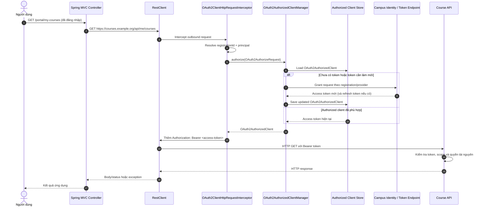
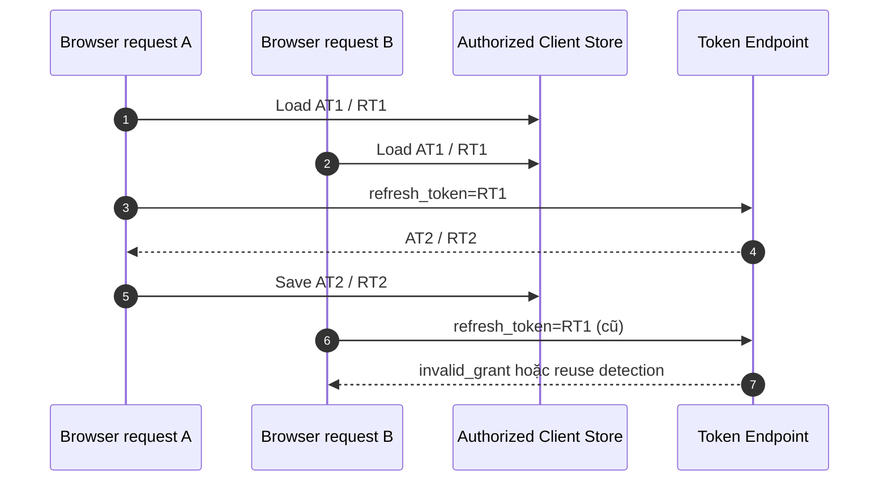

# 18.1. Tích hợp OAuth2 với RestClient và OAuth2ClientHttpRequestInterceptor

## Mục tiêu bài học

Sau bài học này, bạn có thể:

- Giải thích vai trò của **`RestClient`** và **`OAuth2ClientHttpRequestInterceptor`** khi ứng dụng **Spring Security OAuth2/OIDC Client trên Servlet stack** gọi API được bảo vệ.
- Hiểu cách interceptor sử dụng **`OAuth2AuthorizedClientManager`** để tìm, cấp hoặc cấp lại access token và tự gắn header `Authorization: Bearer ...` vào outbound HTTP request.
- Cấu hình `RestClient` bằng `RestClient.Builder`, `OAuth2AuthorizedClientManager`, `ClientRegistration` và một `ClientHttpRequestInterceptor`.
- Chọn đúng `clientRegistrationId` thông qua `RequestAttributeClientRegistrationIdResolver.clientRegistrationId(...)`, hoặc dùng `ClientRegistrationIdResolver` tùy biến khi cần.
- Phân biệt **principal của người dùng Servlet** với **principal kỹ thuật của service**; sử dụng `SecurityContextHolderPrincipalResolver` và `RequestAttributePrincipalResolver` đúng bối cảnh.
- Cấu hình **`OAuth2AuthorizationFailureHandler`** để xử lý access token bị Resource Server từ chối, đồng thời hiểu giới hạn của cơ chế xóa authorized client.
- Thiết kế cách gọi API thay mặt người dùng sau OIDC Login và cách gọi API machine-to-machine bằng Client Credentials mà không làm rò rỉ token.
- Chẩn đoán các lỗi thường gặp: thiếu registration ID, sai principal, token hết hạn, `401`, `403`, sai audience/scope, thiếu Servlet request context và token bị gửi nhầm host.

## 1. Bối cảnh: Spring Boot cần gọi một REST API bằng OAuth2 access token

Giả sử hệ thống **Learning Portal** gồm ba thành phần:

- **Learning Portal**: ứng dụng Spring Boot MVC, người dùng đăng nhập qua OIDC, đóng vai trò **OAuth2/OIDC Client**.
- **Campus Identity**: Authorization Server/OpenID Provider (OP), xác thực người dùng và cấp token cho Client.
- **Course API**: Resource Server nhận và kiểm tra access token để cung cấp khóa học, điểm và tiến độ học tập.

Người dùng đăng nhập vào Learning Portal qua browser. Sau khi hoàn tất Authorization Code Flow, backend muốn gọi:

```http
GET /api/me/courses HTTP/1.1
Host: courses.example.org
Authorization: Bearer <user-access-token>
```

Vấn đề là controller không nên phải tự lặp lại những bước sau mỗi lần gọi API:

```text
1. Tìm authorized client của user hiện tại
2. Lấy access token còn hiệu lực
3. Nếu cần và được phép, refresh token
4. Ghép header Authorization
5. Gửi request tới Resource Server
6. Xử lý các lỗi token do Resource Server trả về
```

Spring Framework cung cấp **`RestClient`** cho HTTP client đồng bộ. Spring Security cung cấp **`OAuth2ClientHttpRequestInterceptor`** để gắn logic OAuth2 Client vào outbound request.

> **Ý tưởng trung tâm:** `RestClient` gửi HTTP request; `OAuth2ClientHttpRequestInterceptor` lấy đúng **OAuth2 access token** thông qua `OAuth2AuthorizedClientManager` và gắn vào header Bearer. Interceptor **không phải Authorization Server**, không tự đăng nhập End-User và không quyết định quyền nghiệp vụ tại Resource Server.

### 1.1. Luồng tổng quan



Interceptor nằm ở bước **outbound HTTP**; nó không thay thế các filter nhận request của Spring Security, và cũng không tự chuyển ID Token thành access token.

## 2. Phân biệt các thành phần trước khi viết code

| Thành phần | Vai trò | Trong ví dụ |
| --- | --- | --- |
| `RestClient` | HTTP client **đồng bộ** của Spring Framework | Gửi GET đến Course API |
| `ClientHttpRequestInterceptor` | Hook xử lý outbound HTTP request/response | Chèn logic trước/sau request |
| `OAuth2ClientHttpRequestInterceptor` | Interceptor OAuth2 của Spring Security | Resolve authorized client, gắn Bearer token |
| `ClientRegistration` | Cấu hình OAuth Client với provider | Client ID, grant type, scopes, Token Endpoint |
| `ClientRegistrationRepository` | Tra cứu registration theo `registrationId` | Chọn `campus` hoặc `course-sync` |
| `OAuth2AuthorizedClient` | Trạng thái client đã được ủy quyền cho principal | Access token, optional refresh token |
| `OAuth2AuthorizedClientManager` | Điều phối cấp/cấp lại authorized client | `authorize(...)` |
| `OAuth2AuthorizedClientRepository` | Kho state trong Servlet request context | Session hoặc service delegate |
| `OAuth2AuthorizedClientService` | Kho state theo registration/principal name | JDBC/in-memory/custom |
| `OAuth2AuthorizedClientProvider` | Xử lý một hoặc nhiều grant | Authorization Code, Refresh Token, Client Credentials |
| Resource Server | Kiểm tra Bearer token và quyền API | Course API |

**Phân biệt trọng tâm:**

- **`RestClient`** không tự biết OAuth2 grant và token store.
- **Interceptor** không tự lưu token vào database; nó nhờ **manager**.
- **Manager** không tự gọi Course API; nó cấp hoặc tìm authorized client.
- **Resource Server** mới là nơi quyết định access token có hợp lệ và được thực hiện nghiệp vụ hay không.

### 2.1. `RestClient` khác `RestTemplate` và `WebClient` thế nào?

- `RestTemplate`: HTTP client synchronous đời trước của Spring, vẫn được sử dụng trong nhiều ứng dụng cũ.
- `RestClient`: Fluent synchronous API của Spring Framework 6.1+, thích hợp cho ứng dụng Servlet hoặc backend đồng bộ.
- `WebClient`: reactive/non-blocking HTTP API, có thể dùng trong nhiều môi trường, nhưng cách tích hợp OAuth2 ở Servlet có filter function riêng.
- `OAuth2ClientHttpRequestInterceptor`: dành cho **`RestClient`** và mô hình `ClientHttpRequestInterceptor`, được Spring Security giới thiệu ở **6.4**.

Không lấy ví dụ `ServletOAuth2AuthorizedClientExchangeFilterFunction` dành cho WebClient rồi gắn trực tiếp vào `RestClient`; đó là hai cơ chế intercept khác nhau.

### 2.2. Phân biệt hai loại RestClient liên quan OAuth2

Trong một ứng dụng có thể đồng thời tồn tại:

1. **RestClient gọi Resource Server:** sử dụng `OAuth2ClientHttpRequestInterceptor` để gắn Bearer token.
2. **HTTP client gọi Token Endpoint:** được Spring Security dùng bên trong `OAuth2AccessTokenResponseClient` để đổi code, refresh token hoặc xin Client Credentials token.

Chúng có **đích HTTP và nhiệm vụ khác nhau**.

```text
Outbound RestClient -> Course API
    Authorization: Bearer <access-token>

Token Endpoint client -> Campus Identity
    grant_type=refresh_token / client_credentials / authorization_code
    client authentication theo registration
```

Không gắn chính OAuth2 bearer interceptor của Course API vào HTTP client nội bộ gọi Token Endpoint một cách tùy tiện; dễ tạo vòng phụ thuộc hoặc gửi token sai endpoint.

## 3. Luồng được triển khai như thế nào?

Khi ứng dụng gọi:

```java
restClient.get()
    .uri("https://courses.example.org/api/me/courses")
    .attributes(clientRegistrationId("campus"))
    .retrieve()
    .body(String.class);
```

Các bước quan trọng:

1. `RestClient` xây outbound `HttpRequest`.
2. Interceptor xác định **registration ID** từ request attributes hoặc resolver tùy biến.
3. Interceptor xác định **principal** từ `SecurityContextHolder` hoặc resolver tùy biến.
4. Interceptor tạo OAuth2 authorize request rồi gọi `OAuth2AuthorizedClientManager`.
5. Manager dùng repository/service và provider chain để tìm hoặc cấp lại authorized client.
6. Nếu có access token phù hợp, interceptor bổ sung header:

   ```http
   Authorization: Bearer <access-token>
   ```

7. `RestClient` gửi request tới URL của Course API.
8. Resource Server xác thực Bearer token, kiểm tra scope, audience và quyền dữ liệu.
9. Nếu có OAuth2 authorization failure từ Resource Server, handler được cấu hình có thể xử lý/xóa authorized client không còn hợp lệ.

Các bước trên giả định manager có registration, principal, grant và trạng thái phù hợp. Một request thiếu registration ID hoặc không thể authorize sẽ **không tự biến thành một request hợp lệ chỉ vì đã cài interceptor**.

### 3.1. Chọn registration khác với chọn principal

Trong ví dụ:

```text
clientRegistrationId = campus
principal            = student-9b71
```

- `campus` chọn **cấu hình Client** mà Portal dùng với Campus Identity.
- `student-9b71` đại diện cho **danh tính đang sử dụng authorized client**.
- Hai giá trị kết hợp với repository/service để tải đúng token.
- Client ID thực tế gửi Token Endpoint nằm trong `ClientRegistration`, không nhất thiết trùng `campus`.

Một ứng dụng đa provider có thể dùng:

```text
Principal A + registration campus  -> token A/campus
Principal A + registration partner -> token A/partner
Principal B + registration campus  -> token B/campus
```

Trộn principal hoặc registration có thể làm **gửi token sai tài khoản**, dù HTTP request vẫn thành công về cú pháp.

## 4. Phụ thuộc phiên bản và Maven

`RestClient` thuộc Spring Framework từ **6.1**. `OAuth2ClientHttpRequestInterceptor` xuất hiện trong **Spring Security 6.4**. Vì vậy nếu project dùng Spring Boot/Spring Security cũ hơn, việc copy nguyên code có thể lỗi import vì class chưa tồn tại.

Với Spring Boot có BOM quản lý phiên bản, dependency thường gặp:

```xml
<dependencies>
    <dependency>
        <groupId>org.springframework.boot</groupId>
        <artifactId>spring-boot-starter-web</artifactId>
    </dependency>

    <dependency>
        <groupId>org.springframework.boot</groupId>
        <artifactId>spring-boot-starter-oauth2-client</artifactId>
    </dependency>

    <dependency>
        <groupId>org.springframework.boot</groupId>
        <artifactId>spring-boot-starter-security</artifactId>
    </dependency>
</dependencies>
```

Nếu đã có transitive dependency đáp ứng nhu cầu, không nhất thiết thêm trùng; cần đối chiếu dependency graph thật. Các version Spring Framework, Spring Security và Boot phải được quản lý **tương thích**, không ép nâng một JAR độc lập khiến API không khớp.

Một nhóm import Java quan trọng:

```java
import org.springframework.web.client.RestClient;
import org.springframework.security.oauth2.client.OAuth2AuthorizedClientManager;
import org.springframework.security.oauth2.client.web.client.OAuth2ClientHttpRequestInterceptor;
```

Và helper lấy registration ID:

```java
import static org.springframework.security.oauth2.client.web.client
    .RequestAttributeClientRegistrationIdResolver.clientRegistrationId;
```

Trong source Java thật, static import phải được viết trên **một dòng liên tục**; ví dụ xuống dòng phía trên chỉ để minh họa tên đầy đủ. Có thể viết nguyên dòng:

```java
import static org.springframework.security.oauth2.client.web.client.RequestAttributeClientRegistrationIdResolver.clientRegistrationId;
```

## 5. Cấu hình tối thiểu `RestClient` có OAuth2 interceptor

Giả sử Spring Boot đã có bean `OAuth2AuthorizedClientManager` phù hợp với flow đang dùng. Một cách cấu hình:

```java
@Configuration
class CourseApiRestClientConfig {

    @Bean
    RestClient courseApiRestClient(
            OAuth2AuthorizedClientManager authorizedClientManager) {

        OAuth2ClientHttpRequestInterceptor interceptor =
            new OAuth2ClientHttpRequestInterceptor(
                authorizedClientManager
            );

        return RestClient.builder()
            .baseUrl("https://courses.example.org")
            .requestInterceptor(interceptor)
            .build();
    }
}
```

Ở đây:

- `RestClient.builder()` tạo client gửi HTTP.
- `baseUrl(...)` cố định origin mặc định để hạn chế việc gửi token nhầm host.
- `.requestInterceptor(interceptor)` gắn OAuth2 vào outbound request.
- `OAuth2AuthorizedClientManager` quyết định lấy token bằng cách nào.

**Chỉ thêm interceptor không đủ để xác định registration nào phải dùng.** Theo cấu hình mặc định, `RequestAttributeClientRegistrationIdResolver` sẽ tìm giá trị từ `HttpRequest.attributes()` của outbound request.

### 5.1. Controller sử dụng RestClient

```java
import static org.springframework.security.oauth2.client.web.client
    .RequestAttributeClientRegistrationIdResolver.clientRegistrationId;

@RestController
class MyCoursesController {

    private final RestClient courseApiRestClient;

    MyCoursesController(RestClient courseApiRestClient) {
        this.courseApiRestClient = courseApiRestClient;
    }

    @GetMapping("/api/me/courses")
    CourseSummary[] courses() {
        CourseSummary[] result = courseApiRestClient.get()
            .uri("/api/me/courses")
            .attributes(clientRegistrationId("campus"))
            .retrieve()
            .body(CourseSummary[].class);

        return result == null ? new CourseSummary[0] : result;
    }
}
```

Ví dụ `CourseSummary` là DTO riêng của ứng dụng. Phải bổ sung import thực tế, xử lý lỗi API, timeout và quyền truy cập đúng với sản phẩm. Controller giả định endpoint được bảo vệ bằng Spring Security và request hiện tại có **OIDC authenticated principal**.

Cú pháp chính cần ghi nhớ:

```java
.attributes(clientRegistrationId("campus"))
```

`clientRegistrationId(...)` là static method thuộc:

```text
RequestAttributeClientRegistrationIdResolver
```

Nó **không phải** method cùng tên của WebClient filter function.

### 5.2. Quy tắc tránh nhầm tên method

Với RestClient:

```java
import static org.springframework.security.oauth2.client.web.client.RequestAttributeClientRegistrationIdResolver.clientRegistrationId;
```

Với WebClient trong Servlet environment, một tài liệu khác có thể dùng static helper:

```text
ServletOAuth2AuthorizedClientExchangeFilterFunction.clientRegistrationId
```

Hai helper thuộc hai loại outbound HTTP client khác nhau. Khi thấy lỗi compiler “method không phù hợp Consumer<Map<String,Object>>” hoặc không resolve được static import, kiểm tra trước **đúng package và API**.

### 5.3. Tại sao không tự tạo header Bearer thủ công trong controller?

Một cách viết tay:

```java
String token = authorizedClient.getAccessToken().getTokenValue();

restClient.get()
    .uri("/api/me/courses")
    .headers(headers -> headers.setBearerAuth(token))
    .retrieve()
    .body(String.class);
```

vẫn có thể hoạt động nếu token được lấy đúng, nhưng dễ dẫn đến:

- Lặp code resolve authorized client ở nhiều controller.
- Quên xử lý token hết hạn/refresh.
- Nhầm token của user này với user khác.
- Gắn header vào sai host.
- Lỗi khi custom cache/refresh token rotation.

Interceptor tập trung phần **bearer token injection**, còn manager tập trung **vòng đời authorized client**.

Không có nghĩa interceptor thực thi tất cả chính sách bảo mật thay backend. Cần kiểm soát URL gọi đi, scope, principal và Resource Server authorization.

## 6. Cấu hình `ClientRegistration` trong Spring Boot

Ví dụ Learning Portal là confidential OIDC Client:

```yaml
spring:
  security:
    oauth2:
      client:
        registration:
          campus:
            provider: campus
            client-id: ${CAMPUS_CLIENT_ID}
            client-secret: ${CAMPUS_CLIENT_SECRET}
            client-authentication-method: client_secret_basic
            authorization-grant-type: authorization_code
            redirect-uri: "{baseUrl}/login/oauth2/code/{registrationId}"
            scope:
              - openid
              - profile
              - courses.read
        provider:
          campus:
            issuer-uri: https://login.example.org/realms/campus
```

Các giá trị chỉ minh họa; cần đăng ký client và redirect URI đúng tại Authorization Server, cấu hình secret an toàn và xác nhận Course API chấp nhận token được OP phát hành.

Lưu ý:

- `campus` là **registration ID nội bộ**.
- `${CAMPUS_CLIENT_ID}` là OAuth Client ID thực.
- `authorization_code` cho browser-based login.
- `scope: openid` cho OIDC login; `courses.read` cho quyền yêu cầu API, nếu OP và API thống nhất.
- `issuer-uri` giúp client khám phá OP metadata/endpoint khi provider hỗ trợ.

Khi gọi:

```java
.attributes(clientRegistrationId("campus"))
```

interceptor dùng registration `campus` và principal hiện tại để hỏi manager. Nếu user đã đăng nhập OIDC bằng registration này, authorized client thường đã được lưu sau token exchange.

### 6.1. SecurityFilterChain cho Portal

```java
@Configuration
class WebSecurityConfiguration {

    @Bean
    SecurityFilterChain webSecurity(HttpSecurity http)
            throws Exception {

        http
            .authorizeHttpRequests(auth -> auth
                .requestMatchers("/", "/error", "/assets/**")
                    .permitAll()
                .requestMatchers("/api/me/**")
                    .authenticated()
                .anyRequest()
                    .authenticated()
            )
            .oauth2Login(Customizer.withDefaults())
            .oauth2Client(Customizer.withDefaults());

        return http.build();
    }
}
```

Đoạn code trên bật OIDC/OAuth2 login cùng OAuth2 Client integration trong ứng dụng Servlet. Đây là phần **inbound security** để người dùng có Authentication; outbound RestClient được cấu hình riêng.

**Không nhầm:** `.oauth2Client()` và `.oauth2Login()` không tự động có nghĩa mọi `RestClient` trong ứng dụng sẽ gắn Bearer token. Bạn phải gắn interceptor vào đúng `RestClient` (hoặc dùng tích hợp HTTP client phù hợp khác).

## 7. Cấu hình `OAuth2AuthorizedClientManager` cho Servlet

`OAuth2ClientHttpRequestInterceptor` trực tiếp sử dụng:

```java
OAuth2AuthorizedClientManager
```

Một implementation phổ biến trong HTTP Servlet request là:

```java
DefaultOAuth2AuthorizedClientManager
```

Nó dùng `ClientRegistrationRepository` và `OAuth2AuthorizedClientRepository`:

```java
@Configuration
class AuthorizedClientManagerConfiguration {

    @Bean
    OAuth2AuthorizedClientManager webAuthorizedClientManager(
            ClientRegistrationRepository registrations,
            OAuth2AuthorizedClientRepository authorizedClients) {

        OAuth2AuthorizedClientProvider provider =
            OAuth2AuthorizedClientProviderBuilder.builder()
                .authorizationCode()
                .refreshToken()
                .build();

        DefaultOAuth2AuthorizedClientManager manager =
            new DefaultOAuth2AuthorizedClientManager(
                registrations,
                authorizedClients
            );

        manager.setAuthorizedClientProvider(provider);

        return manager;
    }
}
```

Manager:

1. Xác định ClientRegistration theo registration ID.
2. Tải authorized client đã lưu của principal/request.
3. Chọn provider phù hợp để authorize hoặc re-authorize.
4. Có thể refresh token nếu access token sắp/hết hạn và có refresh token hợp lệ.
5. Lưu authorized client mới qua success handler/repository theo cấu hình.
6. Trả authorized client cho interceptor.

`DefaultOAuth2AuthorizedClientManager` được thiết kế cho **Servlet request context**. Với code trong MVC controller, request/response thông thường sẵn có. Với scheduled job hoặc message consumer không có request, nên cân nhắc **manager dựa trên authorized client service**, không tạo request giả.

### 7.1. Khi nào không cần tự viết bean manager?

Spring Boot/Spring Security có thể auto-configure `OAuth2AuthorizedClientManager` trong các cấu hình phù hợp. Nếu có bean đã đáp ứng nhu cầu, không cần khai báo lại chỉ để dùng interceptor.

Khi có nhiều manager beans, cần đảm bảo injection đúng manager:

```java
@Bean
RestClient courseApiRestClient(
        @Qualifier("webAuthorizedClientManager")
        OAuth2AuthorizedClientManager manager) {

    return RestClient.builder()
        .baseUrl("https://courses.example.org")
        .requestInterceptor(
            new OAuth2ClientHttpRequestInterceptor(manager)
        )
        .build();
}
```

Nếu gắn manager M2M vào RestClient dành cho user delegated flow, hoặc manager Servlet vào background job, token context dễ sai.

### 7.2. `authorizationCode()` không tự tạo authorization code

Đăng nhập OIDC thường đã cấp authorized client sau OAuth2 Login. Nếu user chưa có authorized client cho registration đó, manager/authorization code flow **không tự xin token thay người dùng hoàn toàn ở backend**.

Authorization Code Grant cần browser authorization step với `state`, redirect URI, PKCE theo trường hợp và callback. Nếu request cần authorization mới, Spring Security có thể kích hoạt hướng điều phối tương tác thích hợp; xử lý cụ thể phụ thuộc provider, request context và cách cấu hình OAuth2 Client.

Không coi `RestClient` gọi Course API là nơi thích hợp để tự “login hộ” một user chưa đăng nhập.

## 8. Chọn Client Registration ID qua request attributes

Theo cơ chế mặc định, interceptor sử dụng `RequestAttributeClientRegistrationIdResolver` để đọc registration ID từ outbound `HttpRequest.attributes()`.

Ví dụ service nhận một RestClient dành cho hai API:

```java
@Service
class MultiProviderCourseService {

    private final RestClient restClient;

    MultiProviderCourseService(RestClient restClient) {
        this.restClient = restClient;
    }

    String fetchCampusCourse() {
        return restClient.get()
            .uri("https://courses.example.org/api/me/courses")
            .attributes(clientRegistrationId("campus"))
            .retrieve()
            .body(String.class);
    }

    String fetchPartnerCourse() {
        return restClient.get()
            .uri("https://partner-courses.example.net/api/me/courses")
            .attributes(clientRegistrationId("partner"))
            .retrieve()
            .body(String.class);
    }
}
```

Đây chỉ là ví dụ cú pháp; trong hệ thống thật, mỗi host/registration phải được ràng buộc với nhau bởi chính sách backend. Cùng một RestClient được phép gọi nhiều host có thể làm tăng rủi ro gửi token nhầm nơi khi lập trình sai.

**Thiết kế thường an toàn hơn:** tạo một `RestClient` theo API hoặc service integration, cố định `baseUrl`, kiểm soát redirect và xác định registration ID tường minh.

### 8.1. Vì sao nên chọn registration tường minh?

Nếu backend có hai registration:

```text
campus -> Campus Identity
partner -> Partner Identity
```

mà code chỉ hỏi interceptor “hãy dùng token hiện tại”, nó có thể khó quyết định registration nào phù hợp. Việc chỉ rõ:

```java
.attributes(clientRegistrationId("campus"))
```

giúp code review nhìn thấy quan hệ OAuth Client với API. Tuy nhiên, **chọn registration không tự bảo đảm access token có audience của host đang gọi**; điều đó phải được kiểm tra theo hợp đồng AS/Resource Server.

### 8.2. Không lấy registration ID tùy ý từ query parameter

Ví dụ đáng tránh:

```java
@GetMapping("/proxy")
String proxy(@RequestParam String registrationId,
             @RequestParam String url) {
    return restClient.get()
        .uri(url)
        .attributes(clientRegistrationId(registrationId))
        .retrieve()
        .body(String.class);
}
```

Nếu người dùng có thể điều khiển đồng thời registration và URL, backend có nguy cơ bị biến thành token forwarding proxy, đưa access token tới endpoint không đáng tin hoặc gọi vào mạng nội bộ.

Hãy áp dụng:

- Registration ID **allowlist** theo nghiệp vụ.
- Host/base URL cố định hoặc allowlist ở server.
- Kiểm tra quyền người dùng được gọi API tương ứng.
- Chặn SSRF, open redirects và redirect forwarding làm lộ token.
- Không dùng user input để chọn secret hay token manager tùy ý.

## 9. Tùy biến `ClientRegistrationIdResolver`

Khi không muốn gắn `.attributes(clientRegistrationId(...))` ở từng request, interceptor cho phép thay cách xác định registration.

Ví dụ dùng registration của OAuth2 Login hiện tại:

```java
@Bean
RestClient courseApiRestClient(
        OAuth2AuthorizedClientManager manager) {

    OAuth2ClientHttpRequestInterceptor interceptor =
        new OAuth2ClientHttpRequestInterceptor(manager);

    interceptor.setClientRegistrationIdResolver(request -> {
        Authentication authentication =
            SecurityContextHolder.getContext()
                .getAuthentication();

        if (authentication instanceof OAuth2AuthenticationToken oauth) {
            return oauth.getAuthorizedClientRegistrationId();
        }

        return null;
    });

    return RestClient.builder()
        .baseUrl("https://courses.example.org")
        .requestInterceptor(interceptor)
        .build();
}
```

Ở đây:

```text
ClientRegistrationIdResolver
  -> đọc SecurityContext
  -> nếu Authentication là OAuth2AuthenticationToken
  -> lấy authorizedClientRegistrationId
```

Cách này thuận tiện cho ứng dụng chỉ cho người dùng đăng nhập qua một provider và token của provider đó được phép gọi API cố định.

### 9.1. Rủi ro nếu tự động dùng “registration đã đăng nhập”

Giả sử user đăng nhập qua `partner`, nhưng Course API chỉ chấp nhận token từ `campus`. Resolver trên có thể chọn `partner` và gửi token không phù hợp, dẫn đến `401`/`403` hoặc lộ token đến host không nên nhận nó.

Không nên dùng một resolver lấy “registration bất kỳ của current user” cho RestClient gọi nhiều Resource Server nếu không có chính sách mapping rõ ràng giữa:

```text
API endpoint -> allowed client registration -> issuer/audience/scope
```

Một thiết kế an toàn có thể chỉ cho phép:

```text
Course API         -> campus
Partner Catalog API -> partner
```

và từ chối mọi kết hợp khác.

### 9.2. Resolver không phải công cụ đánh giá quyền API

Việc resolver trả `"campus"` chỉ giúp manager chọn client. Nó không chứng minh user là giảng viên, được xem điểm sinh viên khác hay đủ quyền ghi dữ liệu. Resource Server và tầng nghiệp vụ vẫn phải kiểm tra scopes, authorities và ownership.

## 10. Principal mặc định được resolve thế nào?

`OAuth2ClientHttpRequestInterceptor` sử dụng một **`PrincipalResolver`** để quyết định principal name gắn với authorized client.

Mặc định, nó dùng:

```text
SecurityContextHolderPrincipalResolver
```

để lấy principal hiện tại từ `SecurityContextHolder`.

Điều này phù hợp trong web request đã được Spring Security xác thực:

```text
Browser session
  -> SecurityFilterChain
  -> SecurityContext(Authentication của student A)
  -> MVC controller
  -> RestClient
  -> Interceptor dùng principal A
  -> Manager tìm token của A
```

Nếu user B gọi cùng endpoint, principal B phải được sử dụng để lấy authorized client B. Đây là ranh giới quan trọng ngăn token bị lẫn giữa người dùng.

### 10.1. Principal không phải access token

Một `Authentication` mô tả danh tính và authorities; `OAuth2AuthorizedClient` mô tả token của một registration đã được ủy quyền cho principal đó.

```text
Authentication.getName() -> sinh viên A
OAuth2AuthorizedClient.getAccessToken() -> AT-A
```

Interceptor cần biết cả registration và principal để manager tìm token đúng. Không dùng `@AuthenticationPrincipal OidcUser` như một cách tự động lấy access token từ ID Token.

### 10.2. Nếu request không có Authentication?

Trong background job hoặc request chưa đăng nhập, `SecurityContextHolder` có thể không có authenticated user phù hợp. Interceptor không thể tự suy ra service principal hoặc người dùng nào cần sử dụng.

Một lựa chọn là:

- Dùng `RequestAttributePrincipalResolver` với principal kỹ thuật **cố định, tin cậy** cho M2M.
- Dùng manager service-based khi không có Servlet request.
- Không cho phép request anonymous “mượn” token của user cuối cùng.

## 11. `RequestAttributePrincipalResolver`: đặt principal theo outbound request

Spring Security cung cấp:

```java
RequestAttributePrincipalResolver
```

để resolver lấy principal name từ `HttpRequest.attributes()` thay vì từ `SecurityContextHolder`.

Một cấu hình:

```java
@Bean
RestClient machineToMachineRestClient(
        @Qualifier("serviceClientManager")
        OAuth2AuthorizedClientManager manager) {

    OAuth2ClientHttpRequestInterceptor interceptor =
        new OAuth2ClientHttpRequestInterceptor(manager);

    interceptor.setPrincipalResolver(
        new RequestAttributePrincipalResolver()
    );

    return RestClient.builder()
        .baseUrl("https://catalog.example.org")
        .requestInterceptor(interceptor)
        .build();
}
```

Lời gọi:

```java
import static org.springframework.security.oauth2.client.web.client.RequestAttributeClientRegistrationIdResolver.clientRegistrationId;
import static org.springframework.security.oauth2.client.web.client.RequestAttributePrincipalResolver.principal;

String result = machineToMachineRestClient.get()
    .uri("/api/catalog")
    .attributes(clientRegistrationId("catalog-sync"))
    .attributes(principal("catalog-sync-service"))
    .retrieve()
    .body(String.class);
```

Trong ví dụ:

```text
registrationId = catalog-sync
principalName  = catalog-sync-service
```

Tên `catalog-sync-service` là **khóa logic** giúp authorized client store nhận diện token service, không phải một End-User đăng nhập.

### 11.1. Vì sao nên giữ principal name ổn định ở M2M?

Một service store thường khóa authorized client bằng:

```text
(registrationId, principalName)
```

Nếu mỗi lần gọi bạn tạo principal ngẫu nhiên:

```java
.attributes(principal(UUID.randomUUID().toString()))
```

manager có thể coi đây là một chủ thể lưu khác mỗi lần, không tái sử dụng authorized client như dự kiến và liên tục xin token mới tại AS.

Dùng định danh ổn định theo service/workload và phân tách tenant khi cần.

### 11.2. Không dùng principal service cho token delegated user

Nếu trong controller của sinh viên A bạn cố tình đặt:

```java
.attributes(principal("shared-service-principal"))
```

đối với một registration chứa user-delegated tokens, nhiều người có thể chia sẻ cùng khóa authorized client nếu store không được phân tách thêm. Điều này tạo nguy cơ **token A dùng cho request B**.

Hãy phân biệt:

| Bài toán | Principal hợp lý |
| --- | --- |
| OIDC Login rồi gọi API thay user | Authentication của **user hiện tại** |
| Job client credentials | Principal service cố định |
| Multi-tenant M2M | Principal/service key gắn tenant có kiểm soát |
| Tác vụ tùy chọn đăng nhập dưới user khác | Không được tự đổi principal từ input request không tin cậy |

## 12. Ví dụ hoàn chỉnh: gọi Course API sau OIDC Login

### 12.1. `application.yml`

```yaml
spring:
  security:
    oauth2:
      client:
        registration:
          campus:
            provider: campus
            client-id: ${CAMPUS_CLIENT_ID}
            client-secret: ${CAMPUS_CLIENT_SECRET}
            client-authentication-method: client_secret_basic
            authorization-grant-type: authorization_code
            redirect-uri: "{baseUrl}/login/oauth2/code/{registrationId}"
            scope:
              - openid
              - profile
              - courses.read
        provider:
          campus:
            issuer-uri: https://login.example.org/realms/campus
```

### 12.2. Manager và RestClient

```java
@Configuration
class CourseApiConfiguration {

    @Bean
    OAuth2AuthorizedClientManager webClientManager(
            ClientRegistrationRepository registrations,
            OAuth2AuthorizedClientRepository repository) {

        OAuth2AuthorizedClientProvider provider =
            OAuth2AuthorizedClientProviderBuilder.builder()
                .authorizationCode()
                .refreshToken()
                .build();

        DefaultOAuth2AuthorizedClientManager manager =
            new DefaultOAuth2AuthorizedClientManager(
                registrations,
                repository
            );

        manager.setAuthorizedClientProvider(provider);
        return manager;
    }

    @Bean
    RestClient courseApiRestClient(
            @Qualifier("webClientManager")
            OAuth2AuthorizedClientManager manager) {

        OAuth2ClientHttpRequestInterceptor interceptor =
            new OAuth2ClientHttpRequestInterceptor(manager);

        return RestClient.builder()
            .baseUrl("https://courses.example.org")
            .requestInterceptor(interceptor)
            .build();
    }
}
```

Giả định dependency, import và các bean repository được cấu hình phù hợp. Nếu dự án đã auto-configure manager, có thể dùng bean sẵn có thay vì định nghĩa trùng.

### 12.3. Controller gọi API

```java
import static org.springframework.security.oauth2.client.web.client.RequestAttributeClientRegistrationIdResolver.clientRegistrationId;

@RestController
class StudentCourseController {

    private final RestClient courseApiRestClient;

    StudentCourseController(
            @Qualifier("courseApiRestClient")
            RestClient courseApiRestClient) {
        this.courseApiRestClient = courseApiRestClient;
    }

    @GetMapping("/api/my-courses")
    List<CourseDto> myCourses() {
        CourseDto[] courses = courseApiRestClient.get()
            .uri("/api/me/courses")
            .attributes(clientRegistrationId("campus"))
            .retrieve()
            .body(CourseDto[].class);

        return courses == null ? List.of() : Arrays.asList(courses);
    }
}
```

Đường dẫn `/api/my-courses` của Portal phải được bảo vệ bằng authenticated requirement. `CourseDto` là DTO ứng dụng định nghĩa. Course API có trách nhiệm xác thực token, quyền `courses.read` và ownership của kết quả trả về.

### 12.4. Kết quả về mặt logic

```text
Browser GET /api/my-courses
  ->
Spring Security xác định user A
  ->
RestClient GET /api/me/courses với registration campus
  ->
OAuth2 interceptor resolve user A và campus
  ->
manager tìm authorized client A/campus
  ->
access token AT-A được gắn vào Bearer header
  ->
Course API kiểm tra AT-A và trả các khóa học của A
```

Nếu access token cần refresh và có refresh token phù hợp, manager/provider có thể xin token mới rồi lưu lại. Controller không cần tự ghép HTTP request đến Token Endpoint.

### 12.5. Không có access token nhưng đã đăng nhập thì sao?

Một vài nguyên nhân:

- Người dùng đăng nhập qua registration khác.
- Authorized-client store không chia sẻ với flow OIDC login.
- HTTP session hoặc state token đã hết hiệu lực.
- Registration ID trong RestClient sai.
- Provider không thể thực hiện authorization/refresh với grant hiện tại.

Ứng dụng cần nhận diện lỗi và đưa người dùng qua authorization phù hợp. Không dùng token của một service account chung để “chữa” việc user token không có.

## 13. Ví dụ Client Credentials: RestClient gọi API theo quyền ứng dụng

Một hệ thống có job nền `catalog-sync` cần gọi Course Catalog API theo client credentials.

### 13.1. Cấu hình registration

```yaml
spring:
  security:
    oauth2:
      client:
        registration:
          catalog-sync:
            provider: catalog-auth
            client-id: ${CATALOG_SYNC_CLIENT_ID}
            client-secret: ${CATALOG_SYNC_CLIENT_SECRET}
            client-authentication-method: client_secret_basic
            authorization-grant-type: client_credentials
            scope:
              - catalog.read

        provider:
          catalog-auth:
            token-uri: https://identity.example.org/oauth2/token
```

Không có browser callback và OIDC user. Token biểu diễn quyền ứng dụng `catalog-sync`.

### 13.2. Service-based authorized client manager

```java
@Configuration
class CatalogSyncConfiguration {

    @Bean("serviceClientManager")
    OAuth2AuthorizedClientManager serviceClientManager(
            ClientRegistrationRepository registrations,
            OAuth2AuthorizedClientService service) {

        OAuth2AuthorizedClientProvider provider =
            OAuth2AuthorizedClientProviderBuilder.builder()
                .clientCredentials()
                .build();

        AuthorizedClientServiceOAuth2AuthorizedClientManager manager =
            new AuthorizedClientServiceOAuth2AuthorizedClientManager(
                registrations,
                service
            );

        manager.setAuthorizedClientProvider(provider);
        return manager;
    }

    @Bean
    RestClient catalogSyncRestClient(
            @Qualifier("serviceClientManager")
            OAuth2AuthorizedClientManager manager) {

        OAuth2ClientHttpRequestInterceptor interceptor =
            new OAuth2ClientHttpRequestInterceptor(manager);

        interceptor.setPrincipalResolver(
            new RequestAttributePrincipalResolver()
        );

        return RestClient.builder()
            .baseUrl("https://catalog.example.org")
            .requestInterceptor(interceptor)
            .build();
    }
}
```

Điểm khác với user delegated flow:

- **`AuthorizedClientServiceOAuth2AuthorizedClientManager`** không đòi `HttpServletRequest`/`HttpServletResponse` từ một browser.
- Provider dùng `clientCredentials()`.
- `RequestAttributePrincipalResolver` xác định principal của **ứng dụng**, không phải user.
- RestClient sẽ gắn Bearer access token mà manager đã xin tại Token Endpoint.

### 13.3. Scheduled job

```java
@Component
class CatalogSyncJob {

    private final RestClient catalogSyncRestClient;

    CatalogSyncJob(
            @Qualifier("catalogSyncRestClient")
            RestClient catalogSyncRestClient) {
        this.catalogSyncRestClient = catalogSyncRestClient;
    }

    @Scheduled(fixedDelayString = "${catalog.sync.delay-ms:600000}")
    void run() {
        String catalogJson = catalogSyncRestClient.get()
            .uri("/api/catalog")
            .attributes(clientRegistrationId("catalog-sync"))
            .attributes(principal("catalog-sync-service"))
            .retrieve()
            .body(String.class);

        // Chuyển dữ liệu sang DTO và xử lý đồng bộ.
        // Không log raw token hoặc client secret.
    }
}
```

Trong project thật cần bật scheduling, bổ sung import/static import, retry và timeout phù hợp, phân quyền dữ liệu ở API, và tránh ghi payload cá nhân không cần thiết vào log.

### 13.4. Có cần Refresh Token không?

Client Credentials Grant thông dụng không cấp refresh token. Khi access token hết hạn, provider dùng lại `grant_type=client_credentials` để xin access token mới qua Client Authentication.

Không thêm `refresh_token` grant vào một registration M2M chỉ vì “mọi OAuth2 Client đều phải refresh”. Chọn provider theo grant và chính sách AS.

## 14. Xử lý failure của Resource Server: 401, 403 và handler

Có hai nhóm lỗi khác nhau:

1. **Lỗi cấp/cấp lại token tại Authorization Server:** `invalid_client`, `invalid_grant`, `invalid_scope`, network error Token Endpoint.
2. **Lỗi sử dụng token tại Resource Server:** API trả `401 Unauthorized`, `403 Forbidden`, có thể kèm `WWW-Authenticate` Bearer error.

`OAuth2ClientHttpRequestInterceptor` có khả năng chuyển một số lỗi authentication/authorization từ Resource Server đến **`OAuth2AuthorizationFailureHandler`** để xử lý trạng thái authorized client không còn dùng được.

### 14.1. Tại sao cần xóa authorized client đã lưu?

Giả sử manager thấy access token AT1 chưa hết hạn theo `expiresAt`, nhưng Resource Server đã thu hồi AT1. Nếu vẫn giữ AT1 trong store, request kế tiếp sẽ tiếp tục gửi token bị từ chối.

Một failure handler có thể xóa authorized client tương ứng để request sau buộc manager xin hoặc cấp lại token nếu grant cho phép.

**Không mặc định mọi HTTP 403 đều do token hết hạn.** 403 có thể đơn thuần là thiếu scope, role hoặc quyền đối với tài nguyên; việc xin token mới cùng scope sẽ không sửa được policy.

### 14.2. Handler với `OAuth2AuthorizedClientRepository`

Dành cho Servlet request và manager dùng repository:

```java
@Bean
RestClient courseApiRestClient(
        OAuth2AuthorizedClientManager manager,
        OAuth2AuthorizedClientRepository repository) {

    OAuth2ClientHttpRequestInterceptor interceptor =
        new OAuth2ClientHttpRequestInterceptor(manager);

    OAuth2AuthorizationFailureHandler failureHandler =
        OAuth2ClientHttpRequestInterceptor
            .authorizationFailureHandler(repository);

    interceptor.setAuthorizationFailureHandler(failureHandler);

    return RestClient.builder()
        .baseUrl("https://courses.example.org")
        .requestInterceptor(interceptor)
        .build();
}
```

Helper static `authorizationFailureHandler(repository)` tạo failure handler phù hợp để **có thể xóa authorized client** sau những OAuth2 error từ Resource Server được nhận diện. Việc xóa tùy thuộc loại OAuth2 error, không phải cứ 401/403 là xóa không điều kiện.

### 14.3. Handler với `OAuth2AuthorizedClientService`

Khi dùng manager M2M/service:

```java
@Bean
RestClient catalogSyncRestClient(
        @Qualifier("serviceClientManager")
        OAuth2AuthorizedClientManager manager,
        OAuth2AuthorizedClientService authorizedClientService) {

    OAuth2ClientHttpRequestInterceptor interceptor =
        new OAuth2ClientHttpRequestInterceptor(manager);

    interceptor.setPrincipalResolver(
        new RequestAttributePrincipalResolver()
    );

    OAuth2AuthorizationFailureHandler failureHandler =
        OAuth2ClientHttpRequestInterceptor
            .authorizationFailureHandler(authorizedClientService);

    interceptor.setAuthorizationFailureHandler(failureHandler);

    return RestClient.builder()
        .baseUrl("https://catalog.example.org")
        .requestInterceptor(interceptor)
        .build();
}
```

Dùng handler với **cùng kiểu store** mà manager sử dụng để tránh xóa ở kho không đúng.

### 14.4. Phân biệt `invalid_token` và `insufficient_scope`

Một Resource Server tuân theo Bearer Token Usage thường có thể phản hồi:

```http
HTTP/1.1 401 Unauthorized
WWW-Authenticate: Bearer error="invalid_token"
```

hoặc:

```http
HTTP/1.1 403 Forbidden
WWW-Authenticate: Bearer error="insufficient_scope"
```

Ý nghĩa:

- `invalid_token`: access token không còn hợp lệ, đã hết hạn/bị thu hồi, không phù hợp với API hoặc sai định dạng; có thể cần xóa/re-authorize tùy nguyên nhân.
- `insufficient_scope`: client không có quyền cần thiết; xin token mới với **cùng scope** chưa chắc giúp ích.
- `403` không có OAuth2 Bearer challenge: có thể là authorization policy nghiệp vụ; phải chẩn đoán theo hợp đồng API.

Interceptor/handler chỉ có thể nhận diện đúng những lỗi theo thông tin response và cấu hình. Không nên tự suy luận tất cả status code giống nhau.

### 14.5. Handler có tự gửi lại HTTP request ngay không?

**Không nên giả định tự động retry cùng request ngay lập tức.** Cơ chế failure handler chủ yếu giúp loại authorized client không dùng được khỏi store để **những request về sau** có thể lấy token mới.

Một HTTP POST tạo đơn hàng có thể đã được Resource Server thực hiện nhưng response bị lỗi giữa đường. Retry tự động một request không idempotent có thể gây tạo dữ liệu trùng. Hãy thiết kế retry theo HTTP method, idempotency key, loại lỗi và chính sách hệ thống.

## 15. Kiểm soát lỗi HTTP qua `RestClient`

`RestClient` là synchronous HTTP client và có API `retrieve()` xử lý response. Với các mã HTTP lỗi, ứng dụng cần xử lý bằng exception mapping hoặc status handlers tùy phiên bản và hành vi được cấu hình.

Ví dụ đơn giản:

```java
try {
    CourseDto[] courses = restClient.get()
        .uri("/api/me/courses")
        .attributes(clientRegistrationId("campus"))
        .retrieve()
        .body(CourseDto[].class);

    return courses == null ? List.of() : Arrays.asList(courses);
} catch (RestClientResponseException ex) {
    // Xử lý status và thông tin lỗi đã được làm sạch.
    // Không ghi Authorization header hoặc token value vào logs.
    throw new CourseApiUnavailableException(
        "Course API returned HTTP " + ex.getStatusCode().value(),
        ex
    );
}
```

`CourseApiUnavailableException` là exception do ứng dụng định nghĩa. Trong sản phẩm thật cần phân biệt:

| Nhóm lỗi | Hướng xử lý |
| --- | --- |
| Token Endpoint `invalid_client` | Kiểm tra client ID/secret hoặc JWT client authentication method |
| Token Endpoint `invalid_grant` | Grant/refresh token hết hiệu lực; cần re-authorization |
| Không resolve được registration | Sửa `registrationId` hoặc bean configuration |
| Không có authenticated principal phù hợp | Yêu cầu login hoặc chọn M2M principal được kiểm soát |
| Resource Server 401 invalid token | Kiểm tra issuer/audience/expiry; failure handler có thể xóa state |
| Resource Server 403 insufficient scope | Kiểm tra quyền được cấp và chính sách API |
| Resource Server 404 | Endpoint/path sai hoặc policy che giấu tài nguyên |
| Resource Server 429 | Rate limiting; retry/backoff có giới hạn |
| Resource Server 5xx/timeout | Lỗi hạ tầng; không mặc định xoá authorized client |
| SSL/TLS hostname mismatch | Sửa truststore/certificate/URL, không tắt hostname verification |

Không dùng `catch (Exception)` rồi chuyển mọi lỗi thành redirect login: network outage, quyền không đủ và token không hợp lệ là các vấn đề khác nhau.

## 16. Các lỗi dễ nhầm về grant và principal

### 16.1. Interceptor không tự đăng nhập người dùng

Nếu controller gọi API mà người dùng chưa OIDC Login, Spring không thể tạo access token user-delegated chỉ bằng client secret. Nếu flow cần người dùng, phải có authorization redirect và consent/xác thực tại OP.

### 16.2. Interceptor không luôn biết registration nên dùng

Cấu hình mặc định dùng `RequestAttributeClientRegistrationIdResolver`. Nếu không truyền:

```java
.attributes(clientRegistrationId("campus"))
```

và không cung cấp resolver khác, interceptor có thể không xác định được registration phù hợp. Đừng mong nó tự đoán từ hostname Resource Server.

### 16.3. Principal mặc định của M2M không phải user hiện tại

Nếu scheduled job không có SecurityContext, mặc định `SecurityContextHolderPrincipalResolver` không cung cấp service principal như bạn mong đợi. Hãy dùng `RequestAttributePrincipalResolver` với `principal("catalog-sync-service")` hoặc chiến lược custom đáng tin cậy.

### 16.4. `client_credentials` không phải OIDC login

Một access token xin bằng `client_credentials` không tạo `OidcUser` và không có browser session. Dùng `RestClient` để gọi API hệ thống, không tạo session giả để giả danh một sinh viên.

### 16.5. Không dùng cùng một principal kỹ thuật cho tất cả user delegated tokens

Một store khóa theo principal và registration cần phân tách đúng user. Nếu dùng chung `"system"` cho tất cả delegated users, có nguy cơ cross-user token leakage.

## 17. Bảo mật outbound HTTP client

### 17.1. Cố định đích đến

Vì interceptor tự gắn Bearer token, mọi request đi qua RestClient đó cần được kiểm soát đích.

**Ví dụ an toàn hơn:**

```java
RestClient.builder()
    .baseUrl("https://courses.example.org")
    .requestInterceptor(oauth2Interceptor)
    .build();
```

Gọi path do server quyết định:

```java
restClient.get()
    .uri("/api/me/courses")
    .attributes(clientRegistrationId("campus"))
    .retrieve()
    .body(String.class);
```

**Ví dụ có rủi ro:**

```java
String url = request.getParameter("url");

restClient.get()
    .uri(url)
    .attributes(clientRegistrationId("campus"))
    .retrieve()
    .body(String.class);
```

Nếu URL do user điều khiển, có thể xảy ra SSRF hoặc gửi token đến domain giả mạo. Việc đặt `baseUrl` chưa đủ để ngăn việc caller truyền absolute URL khác hoặc HTTP redirect đến endpoint ngoài danh sách cho phép. Cần kiểm soát đường dẫn, scheme, host, redirect policy và proxy.

### 17.2. Không log Authorization header

Cần tránh log:

```text
Authorization: Bearer eyJ...
Authorization: Basic ...
client_secret=...
refresh_token=...
```

Ở các interceptor tự viết để metrics/tracing, hãy redact header `Authorization` và token body. Một HTTP logger toàn cục có thể vô tình in dữ liệu do OAuth2 interceptor thêm vào, kể cả khi controller không xử lý token trực tiếp.

### 17.3. Scope và audience phải đúng API

Ví dụ access token có:

```text
scope = courses.read
audience = course-api
```

Không dùng token đó gửi cho Reporting API nếu không được cấp quyền. `clientRegistrationId("campus")` chỉ chọn **OAuth Client**, không chứng minh mọi token của client đó có quyền cho mọi API.

Resource Server cần kiểm tra Bearer token theo issuer, audience, thời hạn, scopes và quyền tài nguyên.

### 17.4. Kiểm tra ownership trong Resource Server

Nếu user A đăng nhập và có token scope `courses.read`, không đồng nghĩa user A được xem tiến độ của user B.

```text
GET /api/students/B/grades
```

Course API phải xác minh token và kiểm tra caller có quyền truy cập bản ghi B. Interceptor không có trách nhiệm phân quyền nghiệp vụ đó.

### 17.5. Quản lý cookie/session khi OAuth2 Login

Khi Portal dùng browser session:

- Cookie phiên cần `Secure`, `HttpOnly`, `SameSite` phù hợp.
- Request thay đổi trạng thái cần CSRF protection theo mô hình.
- Session cần chống fixation và có expiry phù hợp.
- Authorized-client store phải tách trạng thái token theo user/session.
- Logout khỏi Portal và token revocation tại OP là hai vòng đời khác nhau.

Không xóa CSRF hoặc đưa token ra JavaScript chỉ vì backend đã dùng OAuth2 interceptor.

## 18. Tích hợp trong hệ thống nhiều instance và refresh token rotation

Một ứng dụng nhiều instance có thể lưu authorized client qua:

- `HttpSessionOAuth2AuthorizedClientRepository` và shared/distributed session.
- `AuthenticatedPrincipalOAuth2AuthorizedClientRepository` kết hợp `OAuth2AuthorizedClientService`.
- `JdbcOAuth2AuthorizedClientService` hoặc custom shared store.

Với web OIDC login, lựa chọn repository phải thống nhất giữa OAuth2 Login, manager và outbound RestClient.

### 18.1. Vấn đề token store không thống nhất

Giả sử:

```text
OAuth2 Login lưu authorized client ở session A
RestClient manager lại dùng service store B
```

Manager có thể không tìm thấy token của người dùng, dù login thành công. Đây không phải do `RestClient` tự làm mất access token; hai thành phần đang dùng kho lưu không nhất quán.

### 18.2. Hai request cùng refresh token



Nếu AS bật refresh-token rotation, request B có thể thất bại hoặc gây thu hồi token family. `OAuth2ClientHttpRequestInterceptor` và manager **không tự bảo đảm distributed lock** giữa nhiều JVM.

Cần cân nhắc:

- Single-flight refresh theo registration/principal.
- Optimistic versioning hoặc lock khi cập nhật token.
- Shared store an toàn.
- Không retry vô hạn với refresh token cũ.
- Xử lý `invalid_grant` có phân biệt race với grant hết hiệu lực.
- Giữ principal key ổn định nhưng phân tách tenant.

### 18.3. Client Credentials và access token cache

M2M client dùng service manager có thể tái sử dụng token đang còn hạn. Nếu nhiều pod dùng in-memory service store riêng, chúng có thể xin token song song. Điều này có thể chấp nhận hoặc cần rate limiting/cache chia sẻ tùy môi trường.

Không nên tạo một static field:

```java
private static String lastAccessToken;
```

cho toàn ứng dụng nếu có nhiều registration, principal hoặc tenant; vừa mất thông tin TTL, vừa tăng nguy cơ gửi token sai.

## 19. Kiểm thử tích hợp OAuth2 RestClient

Có ba lớp cần kiểm thử.

### 19.1. Unit test: interceptor gắn Bearer token

Ở mức unit test, có thể:

1. Mock `OAuth2AuthorizedClientManager` để trả `OAuth2AuthorizedClient` với access token giả.
2. Dùng mock HTTP request factory/server để ghi nhận request outbound.
3. Gọi RestClient với `.attributes(clientRegistrationId("campus"))`.
4. Kiểm tra có header Bearer đúng **token giả**.
5. Xác định manager nhận đúng registration/principal theo bối cảnh.

Pseudo-code:

```text
when(manager.authorize(request for campus))
    -> OAuth2AuthorizedClient(token="test-token")

RestClient GET /api/me/courses
  attributes(clientRegistrationId("campus"))

assert HTTP request contains:
  Authorization: Bearer test-token

assert test never logs real token
```

Ví dụ cố ý trình bày như test design thay vì giả lập mọi dependency Java trong một đoạn không thuộc project.

### 19.2. Mock HTTP response lỗi

Kiểm thử:

- `200 OK` với JSON hợp lệ.
- `401` và `WWW-Authenticate: Bearer error="invalid_token"`.
- `403` với `insufficient_scope`.
- `429` rate limit.
- `500` và timeout.
- Phản hồi redirect đến domain không được phép.
- Lỗi `invalid_grant` khi manager cần refresh.

Nếu đã cấu hình failure handler để remove authorized client, có thể kiểm tra store **chỉ thay đổi theo chính sách lỗi**, không xóa vì mọi HTTP exception.

### 19.3. Integration test với Authorization Server giả hoặc môi trường thử nghiệm

Một integration test đầy đủ:

```text
ClientRegistration -> Token Endpoint giả
       |
       v
OAuth2AuthorizedClientManager -> access token
       |
       v
OAuth2ClientHttpRequestInterceptor -> Bearer header
       |
       v
Mock Course API -> xác nhận request
```

Với user delegated OIDC Login, còn cần kiểm tra authorization request/callback và SecurityContext được tạo đúng. Với Client Credentials, test không cần browser login.

Không dùng production client secret hay live access token để ghi vào snapshot test.

### 19.4. Phân biệt MockMvc và outbound RestClient test

`MockMvc` giúp test inbound Spring MVC controller và SecurityFilterChain. Nó **không tự chứng minh** interceptor đã thực sự gửi HTTP outbound đúng header.

Cần bổ sung mock `RestClient`/HTTP server phù hợp để xác minh outbound request và token resolution. Một số tình huống cần cả hai lớp test kết hợp.

### 19.5. Kiểm tra principal trong test

Nếu controller mong OIDC principal, `@WithMockUser` thường tạo UserDetails/mock Authentication, không phải `OidcUser`. Dùng `oidcLogin()` của Spring Security Test khi cần mô phỏng OIDC Authentication ở MVC request.

Khi kiểm thử M2M, có thể trực tiếp dùng `principal("catalog-sync-service")` request attribute; không giả lập OIDC user cho scheduled job.

## 20. Chẩn đoán lỗi thường gặp

| Biểu hiện | Nguyên nhân khả dĩ | Hướng xử lý |
| --- | --- | --- |
| `OAuth2ClientHttpRequestInterceptor` không import được | Spring Security cũ hơn 6.4 hoặc dependency thiếu | Kiểm tra dependency/version |
| `RestClient` không tồn tại | Spring Framework cũ hơn 6.1 | Nâng phiên bản theo BOM tương thích |
| Request không có Bearer token | Thiếu registration ID, principal hoặc manager không cấp được client | Kiểm tra `.attributes(clientRegistrationId(...))` và resolver |
| Manager không tìm thấy authorized client sau login | Repository/service không thống nhất hoặc principal/registration khác | Kiểm tra bean wiring và state store |
| Lỗi thiếu Servlet request context | Dùng `DefaultOAuth2AuthorizedClientManager` ở job nền | Dùng service-based manager |
| `clientRegistrationId("campus")` không resolve | Import nhầm helper hoặc registration chưa cấu hình | Dùng helper của `RequestAttributeClientRegistrationIdResolver` |
| Token của người A dùng cho B | Principal resolver hoặc token store phân vùng sai | Không dùng principal kỹ thuật chung cho user delegated flow |
| M2M liên tục xin token mới | Principal thay đổi mỗi request hoặc store không giữ state | Dùng principal service ổn định |
| Token Endpoint trả `invalid_client` | Client ID/secret/JWT client authentication sai | Kiểm tra registration và secret/khóa |
| Token Endpoint trả `invalid_grant` | Code/refresh token không còn hợp lệ hoặc bị rotate | Re-authorization, xử lý concurrency |
| API trả `401 invalid_token` | Token hết hạn, bị thu hồi, sai issuer/audience | Kiểm tra token, failure handler, API validation |
| API trả `403 insufficient_scope` | Token không có scope cần thiết | Sửa grant/scope/consent/authorization policy |
| API trả 403 nhưng scope đúng | Resource ownership hoặc role nghiệp vụ không đủ | Kiểm tra service-level authorization |
| REST call bị timeout | API hoặc mạng lỗi, không nhất thiết token sai | Timeout/retry/circuit breaker phù hợp |
| Authorization header xuất hiện trong log | HTTP logger/interceptor ghi dữ liệu nhạy cảm | Redact header và request body có secret |
| Token bị gửi sang domain không mong muốn | Caller dùng URL động hoặc redirect vượt host | Fixed baseUrl, host allowlist, redirect policy |
| Request sau khi login thất bại ngẫu nhiên giữa pod | Session/authorized client store không được chia sẻ | Shared persistence/session và principal consistency |
| JWT của OP gọi API bị từ chối | ID Token được dùng nhầm hoặc audience/scope không đúng | Dùng access token đúng Resource Server |
| Failure handler không làm token mới xuất hiện | Handler chỉ xóa state, flow không thể reauthorize | Kiểm tra grant/provider và xử lý login mới nếu cần |

### 20.1. Cách chẩn đoán theo từng bước

Khi outbound RestClient call thất bại:

1. **Kiểm tra dependency**: `RestClient` và interceptor có sẵn đúng version không?
2. **Kiểm tra destination**: URI đang gọi là Course API hợp lệ hay bị override thành host khác?
3. **Kiểm tra registration resolver**: outbound request có client registration ID đúng không?
4. **Kiểm tra principal resolver**: đang dùng Authentication của user hay service principal?
5. **Kiểm tra manager**: web Servlet manager hay background service manager? Provider nào được bật?
6. **Kiểm tra store**: authorized client đã được lưu cho principal/registration chưa?
7. **Kiểm tra Token Endpoint**: có lỗi grant/client authentication không?
8. **Kiểm tra API response**: `401`, `403`, scope, audience, resource policy?
9. **Kiểm tra failure handler**: có xóa authorized client bị từ chối không và liệu token mới có thể cấp?
10. **Kiểm tra logs**: mọi quan sát phải được redact, tuyệt đối không in token/secret.

Không chữa lỗi bằng cách tắt Bearer validation ở API hoặc truyền access token của một account khác.

## 21. Một số tình huống ứng dụng

### Tình huống A — Controller gọi API thay user đã đăng nhập

Sinh viên A đăng nhập OIDC qua Campus Identity. Controller gọi Course API bằng `RestClient` với `clientRegistrationId("campus")`. Interceptor lấy principal A từ SecurityContext, manager tải authorized client A/campus, gắn Bearer AT-A.

**Ý nghĩa:** controller không tự quản lý token. Course API vẫn cần kiểm tra A có quyền đọc những khóa học được yêu cầu.

### Tình huống B — Token vừa bị thu hồi

AT-A chưa đến `expiresAt` nhưng AS đã revoke. Course API trả 401 với Bearer `invalid_token`. Failure handler được cấu hình có thể xóa authorized client đã lưu, để request **sau đó** thử re-authorize phù hợp.

**Không suy đoán:** interceptor sẽ tự động chạy lại cùng HTTP POST ngay sau khi xóa state.

### Tình huống C — Job M2M không có Servlet request

Một scheduled job cần Catalog API. Nó dùng `AuthorizedClientServiceOAuth2AuthorizedClientManager`, interceptor với `RequestAttributePrincipalResolver`, `clientRegistrationId("catalog-sync")` và principal `"catalog-sync-service"`.

**Kết quả:** service tự xin token theo `client_credentials` mà không có End-User hoặc session browser.

### Tình huống D — Hai Resource Server, một RestClient dùng URL động

Portal có Course API và Finance API. Developer dùng RestClient gắn interceptor rồi cho URL đến từ query parameter.

**Rủi ro:** user có thể gây gọi sang một domain không được phép hoặc khiến token Course API bị gửi nhầm nơi. Nên tách RestClient theo API, fixed base URL, whitelist URL và registration mapping.

### Tình huống E — OAuth2 login thành công, outbound call báo `null` authorized client

Login dùng repository session, nhưng bean manager mới dùng service store chưa đồng bộ. Token đã cấp tồn tại ở chỗ khác với nơi interceptor hỏi.

**Khắc phục:** thống nhất authorized-client storage và principal mapping giữa OAuth2 Login và manager.

### Tình huống F — API trả 403 dù token hợp lệ

Token scope `courses.read` nhưng user muốn sửa điểm. Course API yêu cầu `grades.write` cùng permission của giáo viên. Interceptor không có lỗi và manager vẫn trả access token hợp lệ.

**Khắc phục:** kiểm tra scope/grant/roles và authorization policy; không refresh token vô hạn.

### Tình huống G — Hệ thống có nhiều tab, refresh token rotation

Hai request cùng thấy RT1 và cố refresh. Request thứ nhất nhận RT2, request còn lại bị `invalid_grant`. Interceptor không cung cấp distributed lock.

**Khắc phục:** kiểm soát concurrency trong token store, token rotation và failure handling; không đánh dấu mọi lỗi refresh thành “user hết quyền” trước khi phân tích race.

## 22. Bài tập thực hành

### Bài tập 1 — Cấu hình Interceptor

**Yêu cầu:** tạo `RestClient` gọi `https://courses.example.org` và tự gắn access token bằng `OAuth2AuthorizedClientManager`.

**Gợi ý:**

```java
@Bean
RestClient coursesRestClient(OAuth2AuthorizedClientManager manager) {
    return RestClient.builder()
        .baseUrl("https://courses.example.org")
        .requestInterceptor(
            new OAuth2ClientHttpRequestInterceptor(manager)
        )
        .build();
}
```

Khi gọi, nhớ chọn registration qua `.attributes(clientRegistrationId("campus"))`.

### Bài tập 2 — Vì sao outbound request không gắn Bearer token?

RestClient được cấu hình interceptor nhưng code gọi:

```java
restClient.get()
    .uri("/api/me/courses")
    .retrieve()
    .body(String.class);
```

**Câu hỏi:** Có gì thiếu?

**Đáp án:** nếu dùng resolver mặc định, request cần `.attributes(clientRegistrationId("campus"))`; manager cũng cần principal và registration hợp lệ.

### Bài tập 3 — User delegated hoặc M2M?

Một endpoint `/api/me/courses` phải dùng token của người vừa đăng nhập; một job đọc catalog dùng token của service.

**Đáp án:**

```text
User API:
  DefaultOAuth2AuthorizedClientManager (Servlet context)
  SecurityContextHolderPrincipalResolver mặc định
  registrationId = campus

Background job:
  AuthorizedClientServiceOAuth2AuthorizedClientManager
  RequestAttributePrincipalResolver
  principal = catalog-sync-service
  registrationId = catalog-sync
```

### Bài tập 4 — Xử lý `401 invalid_token`

Course API trả:

```http
HTTP/1.1 401 Unauthorized
WWW-Authenticate: Bearer error="invalid_token"
```

**Câu hỏi:** Handler giúp ích thế nào?

**Đáp án:** handler có thể loại authorized client chứa token không còn hợp lệ khỏi store, khiến request sau cấp/cấp lại token. Cần xác minh grant hỗ trợ re-authorization và tránh retry non-idempotent không an toàn.

### Bài tập 5 — `403 insufficient_scope`

API trả 403 vì token thiếu `grades.write`.

**Câu hỏi:** Có nên cấu hình xóa token rồi retry liên tục không?

**Đáp án:** Không. Phải xử lý scope/consent và permission. Token mới với cùng phạm vi chưa được cấp vẫn không có quyền ghi.

### Bài tập 6 — Principal service cố định

Job có:

```java
.attributes(principal(UUID.randomUUID().toString()))
```

**Câu hỏi:** Vấn đề là gì?

**Đáp án:** principal name thay đổi làm manager/service store khó tái sử dụng authorized client theo cùng khóa, có thể xin token liên tục. Dùng định danh kỹ thuật ổn định với phân tách tenant nếu cần.

### Bài tập 7 — SSRF và token forwarding

Một controller cho caller nhập `https://example.net/collect` rồi dùng RestClient đã gắn Bearer token gọi URL đó.

**Câu hỏi:** Nguy cơ?

**Đáp án:** token có thể bị chuyển đến host không được phép, cùng nguy cơ SSRF. Dùng fixed base URL/allowlist và không cho user tùy ý chọn host hoặc registration.

### Bài tập 8 — Kiểm tra scope khác xác thực OIDC

Một user có `OidcUser` hợp lệ nhưng Course API từ chối 403.

**Đáp án:** OIDC Login xác thực user với Portal; Resource Server còn phải kiểm tra access token, scope, role và quyền tài nguyên. Có `OidcUser` không tự đảm bảo quyền API.

### Bài tập 9 — Lựa chọn static import

Dự án viết:

```java
.attributes(clientRegistrationId("campus"))
```

nhưng import helper từ `ServletOAuth2AuthorizedClientExchangeFilterFunction`.

**Câu hỏi:** Nên sửa?

**Đáp án:** với `RestClient`, import `RequestAttributeClientRegistrationIdResolver.clientRegistrationId`. WebClient filter function có helper riêng và không phải hook của RestClient interceptor.

## 23. Câu hỏi tự kiểm tra

**1. `OAuth2ClientHttpRequestInterceptor` dùng để làm gì?**

> Resolve OAuth2 authorized client từ manager và gắn access token vào header `Authorization: Bearer ...` của outbound RestClient request.

**2. Interceptor có tự lưu/access-token cache độc lập không?**

> Không. Vòng đời authorized client do `OAuth2AuthorizedClientManager` phối hợp repository/service và provider đảm nhiệm.

**3. Làm sao chỉ định registration ID cho RestClient request theo cấu hình mặc định?**

> Dùng `.attributes(clientRegistrationId("campus"))` với helper static của `RequestAttributeClientRegistrationIdResolver`.

**4. Principal mặc định đến từ đâu?**

> Từ `SecurityContextHolderPrincipalResolver`, thường đọc Authentication hiện tại trong SecurityContext.

**5. Khi nào nên dùng `RequestAttributePrincipalResolver`?**

> Khi cần đặt principal theo outbound request một cách có kiểm soát, chẳng hạn service principal cố định trong M2M flow.

**6. Manager nào phù hợp với MVC request của user?**

> `DefaultOAuth2AuthorizedClientManager` với `OAuth2AuthorizedClientRepository` có Servlet request context.

**7. Manager nào phù hợp scheduled job không có HTTP request?**

> `AuthorizedClientServiceOAuth2AuthorizedClientManager` với `OAuth2AuthorizedClientService`.

**8. Failure handler có thể giải quyết vấn đề gì?**

> Có thể xóa authorized client không còn hợp lệ sau lỗi OAuth2 Bearer từ Resource Server để request sau xin token phù hợp, tùy error code.

**9. Gặp 403 có luôn cần refresh token không?**

> Không. 403 thường liên quan quyền/scope/ownership; refresh token không tự tăng quyền.

**10. Có thể truyền ID Token vào Bearer header thay access token không?**

> Không. ID Token phục vụ xác thực End-User với OIDC Client; access token mới dành cho Resource Server.

**11. Có interceptor rồi có cần kiểm tra host khi gọi API không?**

> Có. Interceptor gắn token vào outbound request; nếu URL bị điều khiển, token có thể bị gửi nhầm host hoặc gây SSRF.

**12. `RestClient` có phải reactive client không?**

> Không. Nó là synchronous fluent HTTP client; `WebClient` là reactive HTTP API với cơ chế OAuth2 filter khác.

**13. Interceptor tự tạo session OIDC cho background job không?**

> Không. Job M2M cần grant `client_credentials`, service manager và principal kỹ thuật.

**14. Access token có hợp lệ thì mọi dữ liệu API đều được xem không?**

> Không. Resource Server vẫn phải kiểm tra scope, audience, role và quyền truy cập tài nguyên.

---

## Ghi nhớ

**`OAuth2ClientHttpRequestInterceptor`** là cách tích hợp **Spring Security OAuth2 Client với `RestClient`** trong ứng dụng Servlet: trước khi gửi request, interceptor chọn **`clientRegistrationId`** và **principal**, dùng **`OAuth2AuthorizedClientManager`** để lấy hoặc cấp lại `OAuth2AuthorizedClient`, rồi gắn `Authorization: Bearer <access-token>`. Với OIDC Login, thường sử dụng `DefaultOAuth2AuthorizedClientManager` và principal hiện tại trong `SecurityContextHolder`; với M2M không có Servlet request, sử dụng `AuthorizedClientServiceOAuth2AuthorizedClientManager` và `RequestAttributePrincipalResolver`. Hãy chọn registration tường minh, giữ token ở backend, cấu hình `OAuth2AuthorizationFailureHandler` phù hợp, bảo vệ token store và URL đích, đồng thời để Resource Server kiểm tra độc lập phạm vi và quyền nghiệp vụ.

## Tài liệu tham khảo

- [Spring Security — Authorized Client Features: RestClient Integration](https://docs.spring.io/spring-security/reference/servlet/oauth2/client/authorized-clients.html): interceptor, registration ID, principal resolver và failure handler.
- [Spring Security — OAuth2 Client Servlet](https://docs.spring.io/spring-security/reference/servlet/oauth2/client/index.html): cấu hình OAuth2 Client, grant và authorized client manager.
- [Spring Security API — OAuth2ClientHttpRequestInterceptor](https://docs.spring.io/spring-security/reference/api/java/org/springframework/security/oauth2/client/web/client/OAuth2ClientHttpRequestInterceptor.html): constructor, resolver và failure handler.
- [Spring Framework — RestClient](https://docs.spring.io/spring-framework/reference/integration/rest-clients.html): HTTP synchronous client và fluent API.
- [Spring Blog — RestClient Support for OAuth2 in Spring Security 6.4](https://spring.io/blog/2024/10/28/restclient-support-for-oauth2-in-spring-security-6-4/): bối cảnh phiên bản và mô hình tích hợp.
- [RFC 6749 — OAuth 2.0 Authorization Framework](https://www.rfc-editor.org/rfc/rfc6749): các grant, client authentication và access token.
- [RFC 6750 — OAuth 2.0 Bearer Token Usage](https://www.rfc-editor.org/rfc/rfc6750): Bearer header, các lỗi `invalid_token` và `insufficient_scope`.
