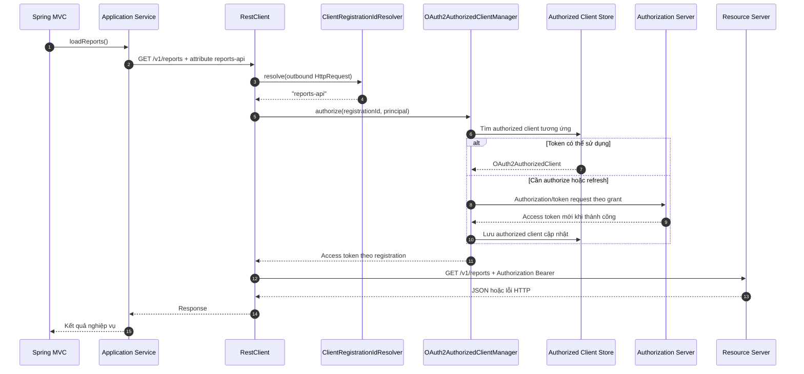
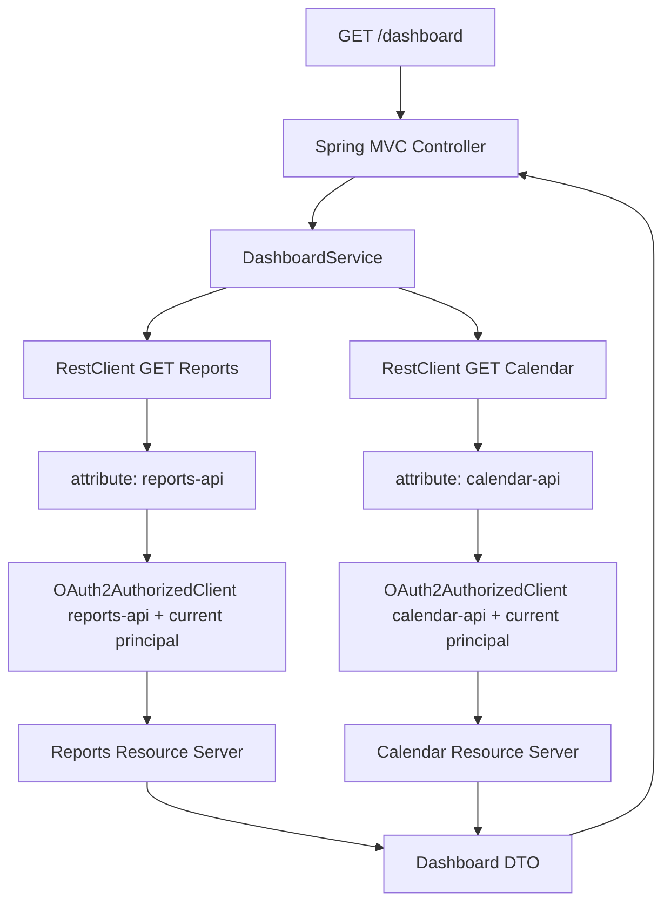

# 18.3. Chọn client registration theo từng request

Một ứng dụng **Spring Security OAuth 2.0 / OIDC Client** có thể đăng nhập người dùng bằng một nhà cung cấp danh tính và đồng thời gọi nhiều API được bảo vệ bởi OAuth 2.0. Mỗi API có thể yêu cầu **client ID, scope, audience, token endpoint hoặc cơ chế ủy quyền khác nhau**. Vì vậy, khi ứng dụng thực hiện một HTTP request ra ngoài, câu hỏi đầu tiên là: **request này phải dùng `ClientRegistration` nào?**

Ví dụ, cùng một Spring Boot portal có thể cần:

- `company-login` để xác thực người dùng qua OpenID Connect;
- `reports-api` để đọc báo cáo bằng access token có scope `reports.read`;
- `calendar-api` để truy cập lịch mà người dùng đã đồng ý cấp quyền;
- `billing-service` để gọi service nội bộ bằng `client_credentials`.

Trên **Servlet stack**, Spring Security cung cấp `OAuth2ClientHttpRequestInterceptor` để tích hợp OAuth2 với **Spring Framework `RestClient`**. Interceptor có thể lấy `clientRegistrationId` **ngay từ attributes của từng outbound request**:

```java
import static org.springframework.security.oauth2.client.web.client
    .RequestAttributeClientRegistrationIdResolver.clientRegistrationId;

// Trong Java, static import trên phải được viết trên một dòng.
String json = restClient.get()
    .uri("/v1/reports")
    .attributes(clientRegistrationId("reports-api"))
    .retrieve()
    .body(String.class);
```

Dòng `.attributes(clientRegistrationId("reports-api"))` là trọng tâm: nó chọn registration để Spring Security tìm hoặc cấp một `OAuth2AuthorizedClient` tương ứng, lấy access token và gắn `Authorization: Bearer ...` cho HTTP request.

Bài học giải thích **cách chọn registration cho từng request**, phân biệt với **principal** được sử dụng, các cách tùy chỉnh resolver, hành vi khi authorized client chưa tồn tại hoặc đã hết hạn, và cách tránh dùng token sai API/người dùng.

> Phạm vi: **Spring Boot 3.x, Spring Security 6.4+ / 6.5, Spring MVC Servlet**. `RestClient` có từ Spring Framework 6.1; `OAuth2ClientHttpRequestInterceptor` và các request-attribute resolver được giới thiệu từ Spring Security 6.4. Nếu dự án dùng Spring Security cũ hơn, cần đối chiếu API tương ứng thay vì sao chép code này nguyên trạng.

## 1. Vì sao phải chọn registration ở cấp từng request?

Giả sử portal gọi ba API:

```text
GET  https://reports.example.test/v1/reports
GET  https://calendar.example.test/v1/events
POST https://billing.example.test/v1/invoices
```

Những API này không nhất thiết chấp nhận cùng một access token. Token dùng cho Reports API có thể có audience riêng và scope `reports.read`, trong khi Calendar API yêu cầu `calendar.read`. Billing API có thể chỉ chấp nhận machine-to-machine token.

| Outbound request | Registration được chọn | Grant điển hình | Ngữ cảnh quyền |
| --- | --- | --- | --- |
| Đọc báo cáo | `reports-api` | `authorization_code` | Quyền người dùng đối với Reports API |
| Đọc lịch | `calendar-api` | `authorization_code` | Quyền người dùng đối với Calendar API |
| Gửi hóa đơn | `billing-service` | `client_credentials` | Quyền service, không phải quyền người dùng |
| Đăng nhập portal | `company-login` | OIDC `authorization_code` | Xác thực danh tính vào portal |

Nếu luôn dùng token từ `company-login` cho mọi API, bạn có thể gặp:

1. **`invalid_token`** vì audience của token không đúng Resource Server.
2. **`insufficient_scope`** vì token không được cấp scope cần thiết.
3. **Token leakage** nếu Bearer token bị gửi tới endpoint không thuộc quyền quản lý.
4. **Nhầm danh tính** nếu token của service hoặc user khác được sử dụng.
5. **Gián đoạn luồng cấp quyền** vì registration đúng chưa được authorize nhưng code lại lấy nhầm một authorized client khác.

Chọn registration đúng giúp Spring Security bắt đầu từ **cấu hình client hợp lệ**, nhưng **không tự bảo đảm downstream API sẽ cho phép request**; Resource Server vẫn kiểm tra audience, scope và chính sách của nó.

### 1.1. Registration ID khác client ID và provider ID

Trong:

```yaml
spring:
  security:
    oauth2:
      client:
        registration:
          reports-api:
            client-id: portal-reports-prod-123
            provider: company
```

có ba giá trị dễ nhầm:

- `reports-api` là **`registrationId`** nội bộ Spring Security.
- `portal-reports-prod-123` là **`client_id`** mà Authorization Server biết.
- `company` là **provider key** dùng chung metadata OP.

Với `clientRegistrationId("reports-api")`, phải truyền **registration ID**, không phải `client-id` hoặc `provider`.

## 2. Các thành phần trong Spring Security Servlet

Trước khi viết code, cần phân biệt bốn đối tượng:

| Thành phần | Vai trò |
| --- | --- |
| **`ClientRegistration`** | Mô tả client đã đăng ký: ID, secret/phương thức authentication, grant, scopes, issuer/token endpoint |
| **`OAuth2AuthorizedClient`** | Client đã được cấp access token và có thể có refresh token, gắn với một principal |
| **`OAuth2AuthorizedClientManager`** | Tìm, authorize hoặc re-authorize client theo registration và principal |
| **`OAuth2ClientHttpRequestInterceptor`** | Tích hợp manager vào `RestClient`; gắn Bearer token cho outbound HTTP request |

Một authorized client có thể hình dung:

```text
OAuth2AuthorizedClient
  clientRegistration.registrationId = reports-api
  principalName                      = alice
  accessToken                        = <redacted>
  refreshToken                       = <optional>
```

Điểm đáng nhớ: **registration ID chọn *client OAuth2*; principal chọn *ngữ cảnh chủ thể* của authorized client**.

Khi một user đăng nhập qua Company SSO và gọi Calendar API, có thể có:

```text
Authentication hiện tại:       alice (đăng nhập bằng company-login)

Authorized client cần dùng:    calendar-api + alice
                                |
                                +-- access token của Calendar API
```

Tên registration của login và tên registration để gọi API **không nhất thiết giống nhau**.

## 3. Cơ chế mặc định: RequestAttributeClientRegistrationIdResolver

Trong Spring Security 6.4+, `OAuth2ClientHttpRequestInterceptor` sử dụng **`ClientRegistrationIdResolver`** để tìm registration ID cho outbound request.

Theo cấu hình mặc định, implementation là:

**`RequestAttributeClientRegistrationIdResolver`**.

Nó đọc giá trị được đặt trong **`HttpRequest` attributes**, thông qua helper:

```java
RequestAttributeClientRegistrationIdResolver
    .clientRegistrationId("reports-api")
```

Trên `RestClient`, cú pháp sử dụng là:

```java
.attributes(clientRegistrationId("reports-api"))
```

Những attributes này là **metadata nội bộ trên outbound request của Spring Framework**, không phải query string, cookie hay HTTP header mà client gửi tới Resource Server.

### 3.1. Trình tự xử lý



Đây là luồng trách nhiệm logic, không có nghĩa mọi request đều gọi token endpoint. Nếu token còn hợp lệ và đã lưu, manager thường sử dụng lại token; khi sắp hết hạn, provider có thể refresh/renew theo cấu hình.

Nếu authorization code cần tương tác người dùng nhưng chưa có grant, request controller có thể bị chuyển sang một luồng cấp quyền hoặc thất bại tùy SecurityFilterChain và manager. **Đừng giả định manager luôn cấp token ngay lập tức**.

### 3.2. Điều gì xảy ra nếu không đặt attribute?

Khi dùng resolver mặc định mà không đặt `clientRegistrationId(...)`, resolver không có một registration ID được chỉ định bởi request attribute. Không nên giả định nó luôn tự chọn client đang đăng nhập hoặc client đầu tiên trong cấu hình.

Đối với API gọi một provider cụ thể, hãy **chỉ rõ registration trên từng request** để tránh phụ thuộc vào hành vi fallback không được thiết kế.

## 4. Thiết lập Spring Boot cho nhiều registration

Giả sử ứng dụng có một OIDC login và hai OAuth2 clients dành cho API. Ví dụ:

```yaml
spring:
  security:
    oauth2:
      client:
        registration:
          company-login:
            provider: company
            client-id: ${LOGIN_CLIENT_ID}
            client-secret: ${LOGIN_CLIENT_SECRET}
            authorization-grant-type: authorization_code
            redirect-uri: "{baseUrl}/login/oauth2/code/{registrationId}"
            scope:
              - openid
              - profile
              - email

          reports-api:
            provider: company
            client-id: ${REPORTS_CLIENT_ID}
            client-secret: ${REPORTS_CLIENT_SECRET}
            authorization-grant-type: authorization_code
            redirect-uri: "{baseUrl}/login/oauth2/code/{registrationId}"
            scope:
              - reports.read

          calendar-api:
            provider: partner
            client-id: ${CALENDAR_CLIENT_ID}
            client-secret: ${CALENDAR_CLIENT_SECRET}
            authorization-grant-type: authorization_code
            redirect-uri: "{baseUrl}/login/oauth2/code/{registrationId}"
            scope:
              - calendar.read

          billing-service:
            provider: company
            client-id: ${BILLING_CLIENT_ID}
            client-secret: ${BILLING_CLIENT_SECRET}
            authorization-grant-type: client_credentials
            scope:
              - billing.write

        provider:
          company:
            issuer-uri: https://id.example.test/realms/company
          partner:
            issuer-uri: https://login.partner.example.test/tenant
```

**Các scopes như `reports.read`, `calendar.read` và `billing.write` là ví dụ**, chỉ có hiệu lực nếu Authorization Server/Resource Server tương ứng đã định nghĩa và cấp quyền.

Với `billing-service`, Authorization Server được chọn từ provider `company`, nhưng grant là `client_credentials`; nó không sử dụng phiên đăng nhập của người dùng để cấp delegated token.

### 4.1. Phụ thuộc Maven

```xml
<dependencies>
    <dependency>
        <groupId>org.springframework.boot</groupId>
        <artifactId>spring-boot-starter-web</artifactId>
    </dependency>
    <dependency>
        <groupId>org.springframework.boot</groupId>
        <artifactId>spring-boot-starter-security</artifactId>
    </dependency>
    <dependency>
        <groupId>org.springframework.boot</groupId>
        <artifactId>spring-boot-starter-oauth2-client</artifactId>
    </dependency>
</dependencies>
```

Ví dụ dựa trên Spring Boot BOM quản lý phiên bản Spring Framework/Spring Security tương thích. Nếu dùng Spring Security dưới 6.4, `OAuth2ClientHttpRequestInterceptor` có thể chưa tồn tại; cần nâng cấp hoặc dùng tích hợp client khác phù hợp.

### 4.2. SecurityFilterChain

```java
import org.springframework.context.annotation.Bean;
import org.springframework.context.annotation.Configuration;
import org.springframework.security.config.Customizer;
import org.springframework.security.config.annotation.web.builders.HttpSecurity;
import org.springframework.security.web.SecurityFilterChain;

@Configuration
class SecurityConfig {

    @Bean
    SecurityFilterChain filterChain(HttpSecurity http) throws Exception {
        return http
            .authorizeHttpRequests(auth -> auth
                .requestMatchers("/", "/error", "/public/**").permitAll()
                .anyRequest().authenticated())
            .oauth2Login(Customizer.withDefaults())
            .oauth2Client(Customizer.withDefaults())
            .build();
    }
}
```

`oauth2Login()` phục vụ browser login; `oauth2Client()` cung cấp khả năng OAuth2 Client trong SecurityFilterChain. Việc phân bổ grant và client credentials cụ thể còn phụ thuộc `OAuth2AuthorizedClientManager` và cấu hình registration.

## 5. Cấu hình RestClient với OAuth2ClientHttpRequestInterceptor

Cách điển hình là tạo một bean `RestClient`, gắn interceptor có sử dụng `OAuth2AuthorizedClientManager`:

```java
import org.springframework.context.annotation.Bean;
import org.springframework.context.annotation.Configuration;
import org.springframework.security.oauth2.client.OAuth2AuthorizedClientManager;
import org.springframework.security.oauth2.client.web.client.OAuth2ClientHttpRequestInterceptor;
import org.springframework.web.client.RestClient;

@Configuration
class OAuth2RestClientConfig {

    @Bean
    RestClient oauth2RestClient(
            RestClient.Builder builder,
            OAuth2AuthorizedClientManager authorizedClientManager) {

        OAuth2ClientHttpRequestInterceptor interceptor =
            new OAuth2ClientHttpRequestInterceptor(authorizedClientManager);

        return builder
            .requestInterceptor(interceptor)
            .build();
    }
}
```

Theo mặc định, interceptor dùng `RequestAttributeClientRegistrationIdResolver` để tìm registration ID. Vì vậy, **không cần tự gọi `setClientRegistrationIdResolver(...)`** chỉ để hỗ trợ cú pháp `.attributes(clientRegistrationId("..."))`.

Cần lưu ý bean trên tạo một RestClient có thể được ứng dụng dùng gọi nhiều host. Đây là cách minh họa cơ chế; với production, nên **hạn chế các đích HTTP được phép** và cân nhắc chia các `RestClient` theo API để tránh gắn token nhầm host.

### 5.1. Token được gắn vào outbound request như thế nào?

Khi interceptor đã resolve được authorized client:

```http
GET /v1/reports HTTP/1.1
Host: reports.example.test
Authorization: Bearer <access-token-for-reports-api>
```

Spring Security đặt Bearer access token vào header, không phải ID Token. Nếu API cần token audience khác, việc chọn đúng registration chỉ là bước đầu; provider phải phát hành token phù hợp với chính Resource Server đó.

### 5.2. Không chuyển nguyên authorized client thành JSON

Đối tượng `OAuth2AuthorizedClient` có thể chứa access token và refresh token. Không return đối tượng này từ MVC controller, không log toàn bộ object, và không đưa token vào URL.

## 6. Chọn registration theo từng request: cách cơ bản nhất

Trong file Java, static import phải là **một dòng**:

```java
import static org.springframework.security.oauth2.client.web.client.RequestAttributeClientRegistrationIdResolver.clientRegistrationId;
```

Ví dụ service sử dụng chung `RestClient`, nhưng chọn registration khác nhau ở hai request:

```java
import static org.springframework.security.oauth2.client.web.client.RequestAttributeClientRegistrationIdResolver.clientRegistrationId;

import org.springframework.stereotype.Service;
import org.springframework.web.client.RestClient;

@Service
class DashboardAggregator {

    private final RestClient oauth2RestClient;

    DashboardAggregator(RestClient oauth2RestClient) {
        this.oauth2RestClient = oauth2RestClient;
    }

    String readReports() {
        return oauth2RestClient.get()
            .uri("https://reports.example.test/v1/reports")
            .attributes(clientRegistrationId("reports-api"))
            .retrieve()
            .body(String.class);
    }

    String readCalendar() {
        return oauth2RestClient.get()
            .uri("https://calendar.example.test/v1/events")
            .attributes(clientRegistrationId("calendar-api"))
            .retrieve()
            .body(String.class);
    }
}
```

Dù cùng một RestClient bean, hai request mang attributes khác nhau và interceptor tìm authorized client theo `registrationId` tương ứng.

**Quan trọng:** URL API nên đến từ cấu hình tin cậy. Trong ví dụ, URL được hardcode để minh họa; không thay bằng `userInputUrl` tùy ý rồi gắn Bearer token.

### 6.1. Tính chất request-scoped của attributes

```text
Outbound request A
  URI: https://reports.example.test/v1/reports
  attributes: clientRegistrationId = reports-api

Outbound request B
  URI: https://calendar.example.test/v1/events
  attributes: clientRegistrationId = calendar-api
```

Đây là **metadata cho từng HTTP request**, không phải thay đổi cấu hình global của interceptor. Hai request đồng thời không cần tranh nhau đặt một `defaultRegistrationId` toàn cục.

### 6.2. Không sử dụng biến mutable global để chọn client

Anti-pattern:

```java
// Sai: trạng thái lựa chọn client dùng chung cho nhiều request.
static String CURRENT_REGISTRATION = "reports-api";

// Một thread đổi sang calendar-api;
// thread khác vẫn muốn dùng reports-api.
```

Mẫu này gây race condition và có thể làm lộ token sang API không phù hợp. **Chỉ định registration trong attributes của từng request** là cách tách ngữ cảnh rõ ràng hơn.

## 7. Tách RestClient theo từng API để giảm rủi ro token leakage

Nếu hệ thống gọi nhiều Resource Server có trust boundary khác nhau, cách tổ chức mạnh hơn là tạo **một RestClient với base URL cố định cho từng API**, nhưng vẫn đặt registration ID ở mỗi request:

```java
import org.springframework.beans.factory.annotation.Qualifier;
import org.springframework.context.annotation.Bean;
import org.springframework.context.annotation.Configuration;
import org.springframework.security.oauth2.client.OAuth2AuthorizedClientManager;
import org.springframework.security.oauth2.client.web.client.OAuth2ClientHttpRequestInterceptor;
import org.springframework.web.client.RestClient;

@Configuration
class DownstreamClientConfig {

    @Bean
    RestClient reportsRestClient(
            RestClient.Builder builder,
            OAuth2AuthorizedClientManager manager) {

        return builder.clone()
            .baseUrl("https://reports.example.test")
            .requestInterceptor(
                new OAuth2ClientHttpRequestInterceptor(manager))
            .build();
    }

    @Bean
    RestClient calendarRestClient(
            RestClient.Builder builder,
            OAuth2AuthorizedClientManager manager) {

        return builder.clone()
            .baseUrl("https://calendar.example.test")
            .requestInterceptor(
                new OAuth2ClientHttpRequestInterceptor(manager))
            .build();
    }
}
```

Sử dụng `@Qualifier` khi inject:

```java
import static org.springframework.security.oauth2.client.web.client.RequestAttributeClientRegistrationIdResolver.clientRegistrationId;

import org.springframework.beans.factory.annotation.Qualifier;
import org.springframework.stereotype.Service;
import org.springframework.web.client.RestClient;

@Service
class ReportsApiClient {

    private final RestClient restClient;

    ReportsApiClient(@Qualifier("reportsRestClient") RestClient restClient) {
        this.restClient = restClient;
    }

    String mine() {
        return restClient.get()
            .uri("/v1/reports/mine")
            .attributes(clientRegistrationId("reports-api"))
            .retrieve()
            .body(String.class);
    }
}
```

`baseUrl` giúp gom cấu hình endpoint cho từng API, nhưng **không tự bảo đảm chống token leakage** nếu service vẫn cho phép URI tuyệt đối tùy ý, redirect không kiểm soát hoặc `RestClient` bị tái sử dụng sai. Hãy áp dụng allowlist destination và policy outbound network khi cần.

### 7.1. Vì sao vẫn cần attribute nếu chỉ có một API?

Vì registration là một phụ thuộc bảo mật quan trọng. Code:

```java
.attributes(clientRegistrationId("reports-api"))
```

cho người đọc biết request cần OAuth2 client nào. Nó tránh trường hợp REST client bị đổi default, có thêm registration mới hoặc dùng lại trong một service khác mà vô tình dùng token sai.

## 8. Chọn client registration dựa vào nghiệp vụ bằng allowlist

Có ứng dụng nhận một tham số nghiệp vụ như `dataSource=REPORTS` hoặc `dataSource=CALENDAR`. Bạn có thể ánh xạ nó sang **tập registration ID đã được phép**, không đưa trực tiếp giá trị từ HTTP request vào `clientRegistrationId(...)`.

Định nghĩa enum:

```java
enum DataSource {
    REPORTS,
    CALENDAR
}
```

Ánh xạ tường minh:

```java
final class OAuth2ClientSelection {

    private OAuth2ClientSelection() {
    }

    static String registrationFor(DataSource source) {
        return switch (source) {
            case REPORTS -> "reports-api";
            case CALENDAR -> "calendar-api";
        };
    }
}
```

Dùng trong service:

```java
String registrationId = OAuth2ClientSelection.registrationFor(source);

String result = restClient.get()
    .uri(trustedUriFor(source))
    .attributes(clientRegistrationId(registrationId))
    .retrieve()
    .body(String.class);
```

`trustedUriFor(source)` là một hàm **do ứng dụng triển khai**, ánh xạ enum sang endpoint cố định/tin cậy. Không để user tự gửi một URL bất kỳ rồi chọn registration tương ứng bằng so khớp chuỗi chứa hostname.

### 8.1. Vì sao không lấy registration ID trực tiếp từ query parameter?

Sai:

```java
@GetMapping("/proxy")
String proxy(
        @RequestParam String registrationId,
        @RequestParam String url) {

    return restClient.get()
        .uri(url)
        .attributes(clientRegistrationId(registrationId))
        .retrieve()
        .body(String.class);
}
```

Đây là ví dụ **không an toàn**. Caller có thể thử tên client registrations nội bộ và chỉ định URL nhận Bearer token. Nó tạo rủi ro token exfiltration, SSRF và client authorization ngoài ý định.

Thiết kế phù hợp:

- User chỉ được chọn những **chức năng nghiệp vụ** có quyền.
- Backend ánh xạ chức năng sang **registration và destination đã allowlist**.
- Backend vẫn kiểm tra Authentication/role/tenant/resource authorization.
- Token chỉ được gửi tới Resource Server được phép dùng token đó.

### 8.2. Không đồng nhất chọn registration với cấp quyền người dùng

Việc `dataSource=CALENDAR` map thành `calendar-api` không chứng minh user có quyền đọc lịch. Trước khi gọi API, ứng dụng cần xác nhận request thuộc quyền của user, và downstream API tự kiểm tra token scopes/audience.

## 9. Tùy chỉnh ClientRegistrationIdResolver

Mặc định chọn registration qua attributes là cách khuyến nghị cho phần lớn hệ thống. Tuy nhiên, có trường hợp muốn tạo **`ClientRegistrationIdResolver` tùy chỉnh**; ví dụ nhiều call sites cùng nói chuyện với một dịch vụ và quy tắc chọn registration được tập trung theo endpoint nội bộ.

API có dạng:

```java
OAuth2ClientHttpRequestInterceptor.ClientRegistrationIdResolver
```

Hợp đồng chức năng logic:

```java
String resolve(HttpRequest request);
```

Bạn có thể cấu hình:

```java
interceptor.setClientRegistrationIdResolver(customResolver);
```

### 9.1. Ví dụ resolver từ danh sách host tin cậy

```java
import org.springframework.context.annotation.Bean;
import org.springframework.context.annotation.Configuration;
import org.springframework.security.oauth2.client.OAuth2AuthorizedClientManager;
import org.springframework.security.oauth2.client.web.client.OAuth2ClientHttpRequestInterceptor;
import org.springframework.security.oauth2.client.web.client.OAuth2ClientHttpRequestInterceptor.ClientRegistrationIdResolver;
import org.springframework.web.client.RestClient;

@Configuration
class HostMappedRestClientConfig {

    @Bean
    RestClient hostMappedRestClient(
            OAuth2AuthorizedClientManager manager) {

        ClientRegistrationIdResolver resolver = request -> {
            String scheme = request.getURI().getScheme();
            String host = request.getURI().getHost();

            if (!"https".equalsIgnoreCase(scheme)) {
                return null;
            }

            if ("reports.example.test".equalsIgnoreCase(host)) {
                return "reports-api";
            }
            if ("calendar.example.test".equalsIgnoreCase(host)) {
                return "calendar-api";
            }
            return null;
        };

        OAuth2ClientHttpRequestInterceptor interceptor =
            new OAuth2ClientHttpRequestInterceptor(manager);

        interceptor.setClientRegistrationIdResolver(resolver);

        return RestClient.builder()
            .requestInterceptor(interceptor)
            .build();
    }
}
```

Ví dụ cho thấy cách dùng extension point; **chỉ so khớp host không đủ làm toàn bộ chính sách bảo mật outbound**. Trong production cần kiểm tra cả scheme, port, redirect behavior, DNS/network policy, endpoint path và việc request destination có bị ảnh hưởng bởi user input hay không.

Nếu resolver trả `null`, không nên giả định HTTP client vẫn sẽ tự lấy một token khác. Với request yêu cầu OAuth2, ứng dụng nên xử lý rõ trường hợp không có registration phù hợp hoặc loại bỏ khả năng gửi request không có token đến API nhạy cảm.

### 9.2. Có nên tùy chỉnh resolver để đọc login registration hiện tại?

Spring Security có ví dụ resolver đọc `OAuth2AuthenticationToken`:

```java
import org.springframework.security.core.Authentication;
import org.springframework.security.core.context.SecurityContextHolder;
import org.springframework.security.oauth2.client.authentication.OAuth2AuthenticationToken;
import org.springframework.security.oauth2.client.web.client.OAuth2ClientHttpRequestInterceptor.ClientRegistrationIdResolver;

ClientRegistrationIdResolver resolver = request -> {
    Authentication authentication =
        SecurityContextHolder.getContext().getAuthentication();

    return (authentication instanceof OAuth2AuthenticationToken oauth2)
        ? oauth2.getAuthorizedClientRegistrationId()
        : null;
};
```

Đây là lựa chọn hợp lý **chỉ khi API thực sự cần token của provider đã dùng để đăng nhập**. Nếu bạn đăng nhập bằng `company-login` nhưng phải gọi `reports-api`, resolver này có thể chọn sai client dù session vẫn hợp lệ.

Vì vậy, nên ưu tiên **explicit registration ID tại mỗi outbound request** đối với ứng dụng nhiều API hoặc nhiều provider.

### 9.3. Khi thay resolver, attributes mặc định có còn hoạt động không?

Không nên mặc định. Khi gọi `setClientRegistrationIdResolver(customResolver)`, bạn thay chiến lược tìm ID. Nếu custom resolver chỉ nhìn host và không đọc attributes, thì:

```java
.attributes(clientRegistrationId("reports-api"))
```

có thể **không còn là nguồn quyết định** của interceptor đó.

Nếu cần kết hợp hai chiến lược, hãy viết rõ thứ tự ưu tiên. Ví dụ:

```java
import org.springframework.security.oauth2.client.web.client.RequestAttributeClientRegistrationIdResolver;

RequestAttributeClientRegistrationIdResolver fromAttribute =
    new RequestAttributeClientRegistrationIdResolver();

ClientRegistrationIdResolver resolver = request -> {
    String explicit = fromAttribute.resolve(request);

    if (explicit != null) {
        return explicit;
    }

    // Chỉ fallback khi request nằm trong một nhóm endpoint được tin cậy.
    return null;
};
```

Ở đây `ClientRegistrationIdResolver` là nested interface đã import từ `OAuth2ClientHttpRequestInterceptor`. Một hệ thống thật có thể thay `return null` bằng một fallback đã allowlist; không fallback tùy tiện sang client đăng nhập hoặc client quyền cao.

## 10. Registration và principal là hai chiều lựa chọn khác nhau

Một trong những lỗi nghiêm trọng khi tích hợp nhiều REST API là chỉ quan tâm `clientRegistrationId` mà quên **principal**.

Spring Security thường xác định authorized client theo **registration ID + principal name**. Ví dụ:

```text
(reports-api, alice) -> access token của Alice
(reports-api, bob)   -> access token của Bob

(billing-service, billing-worker) -> access token của service
```

Không thể lấy token của Alice để gọi API thay Bob chỉ vì cả hai dùng `reports-api`.

### 10.1. PrincipalResolver mặc định

Trong Servlet request, `OAuth2ClientHttpRequestInterceptor` mặc định dùng:

**`SecurityContextHolderPrincipalResolver`**.

Nó lấy `Authentication` hiện tại từ `SecurityContextHolder`. Với login session, đó thường là Authentication của user đang gửi request.

Khi bạn viết:

```java
restClient.get()
    .uri("/v1/reports")
    .attributes(clientRegistrationId("reports-api"))
    .retrieve()
    .body(String.class);
```

và code chạy trong request của Alice, authorized client thường được tìm theo ngữ cảnh **`reports-api + Alice`**.

### 10.2. Service-level principal cho client_credentials

Với `billing-service` dùng `client_credentials`, token là danh tính của **ứng dụng**, không phải Alice. Tùy cách quản lý authorized client, bạn có thể muốn gắn một principal kỹ thuật ổn định như `billing-worker`.

Spring Security hỗ trợ:

```java
interceptor.setPrincipalResolver(new RequestAttributePrincipalResolver());
```

và trong outbound request:

```java
import static org.springframework.security.oauth2.client.web.client.RequestAttributeClientRegistrationIdResolver.clientRegistrationId;
import static org.springframework.security.oauth2.client.web.client.RequestAttributePrincipalResolver.principal;

String result = restClient.get()
    .uri("/v1/billing/status")
    .attributes(clientRegistrationId("billing-service"))
    .attributes(principal("billing-worker"))
    .retrieve()
    .body(String.class);
```

**Chỉ dùng ví dụ này với RestClient/interceptor thực sự đã cấu hình `RequestAttributePrincipalResolver`**. Nếu vẫn dùng `SecurityContextHolderPrincipalResolver` mặc định, bạn không được mặc định `principal("billing-worker")` sẽ được sử dụng.

### 10.3. Tại sao không cho HTTP caller truyền principal tùy ý?

Sai:

```java
// KHÔNG LÀM:
String principal = request.getParameter("principalName");
restClient.get()
    .attributes(clientRegistrationId("reports-api"))
    .attributes(principal(principal))
    .retrieve()
    .body(String.class);
```

Kẻ tấn công có thể thử đọc authorized client được lưu cho một principal khác nếu storage và kiểm soát bổ sung yếu.

**Principal phải xuất phát từ Authentication tin cậy hoặc một tên service cố định do backend quản lý**, không phải raw user input.

## 11. Cấu hình RestClient riêng cho machine-to-machine

Để tránh nhầm principal, bạn có thể tạo một RestClient chuyên dùng cho `client_credentials`:

```java
import org.springframework.context.annotation.Bean;
import org.springframework.context.annotation.Configuration;
import org.springframework.security.oauth2.client.OAuth2AuthorizedClientManager;
import org.springframework.security.oauth2.client.web.client.OAuth2ClientHttpRequestInterceptor;
import org.springframework.security.oauth2.client.web.client.RequestAttributePrincipalResolver;
import org.springframework.web.client.RestClient;

@Configuration
class BillingClientConfig {

    @Bean
    RestClient billingRestClient(
            OAuth2AuthorizedClientManager serviceManager) {

        OAuth2ClientHttpRequestInterceptor interceptor =
            new OAuth2ClientHttpRequestInterceptor(serviceManager);

        interceptor.setPrincipalResolver(
            new RequestAttributePrincipalResolver());

        return RestClient.builder()
            .baseUrl("https://billing.example.test")
            .requestInterceptor(interceptor)
            .build();
    }
}
```

Service gọi API:

```java
import static org.springframework.security.oauth2.client.web.client.RequestAttributeClientRegistrationIdResolver.clientRegistrationId;
import static org.springframework.security.oauth2.client.web.client.RequestAttributePrincipalResolver.principal;

import org.springframework.stereotype.Service;
import org.springframework.web.client.RestClient;

@Service
class BillingGateway {

    private final RestClient billingRestClient;

    BillingGateway(RestClient billingRestClient) {
        this.billingRestClient = billingRestClient;
    }

    String getStatus() {
        return billingRestClient.get()
            .uri("/v1/status")
            .attributes(clientRegistrationId("billing-service"))
            .attributes(principal("billing-worker"))
            .retrieve()
            .body(String.class);
    }
}
```

`serviceManager` ở đây phải là `OAuth2AuthorizedClientManager` được cấu hình cho client credentials và storage thích hợp. Nếu có nhiều manager bean, dùng `@Qualifier` để inject đúng bean. Ví dụ không tự động định nghĩa manager đó.

**Không dùng `HttpServletRequest` của user như điều kiện bắt buộc cho machine-to-machine token**. Với background job, cách phù hợp là `AuthorizedClientServiceOAuth2AuthorizedClientManager` và `OAuth2AuthorizedClientService`.

## 12. Chọn manager phù hợp với Servlet và background

Trong hệ sinh thái Spring Security có hai manager thường gặp:

| Manager | Ngữ cảnh phù hợp | Authorized-client storage |
| --- | --- | --- |
| **`DefaultOAuth2AuthorizedClientManager`** | Servlet request/response | `OAuth2AuthorizedClientRepository` |
| **`AuthorizedClientServiceOAuth2AuthorizedClientManager`** | Service/background, không phụ thuộc request Servlet | `OAuth2AuthorizedClientService` |

Nếu controller đang xử lý request browser, thường dùng Servlet manager. Nếu một job chạy mỗi giờ không có Authentication của browser và dùng `client_credentials`, service-level manager thường phù hợp hơn.

### 12.1. Cấu hình Servlet manager

```java
import org.springframework.context.annotation.Bean;
import org.springframework.context.annotation.Configuration;
import org.springframework.security.oauth2.client.OAuth2AuthorizedClientManager;
import org.springframework.security.oauth2.client.OAuth2AuthorizedClientProvider;
import org.springframework.security.oauth2.client.OAuth2AuthorizedClientProviderBuilder;
import org.springframework.security.oauth2.client.registration.ClientRegistrationRepository;
import org.springframework.security.oauth2.client.web.DefaultOAuth2AuthorizedClientManager;
import org.springframework.security.oauth2.client.web.OAuth2AuthorizedClientRepository;

@Configuration
class ServletManagerConfig {

    @Bean
    OAuth2AuthorizedClientManager servletClientManager(
            ClientRegistrationRepository registrations,
            OAuth2AuthorizedClientRepository authorizedClients) {

        OAuth2AuthorizedClientProvider provider =
            OAuth2AuthorizedClientProviderBuilder.builder()
                .authorizationCode()
                .refreshToken()
                .build();

        DefaultOAuth2AuthorizedClientManager manager =
            new DefaultOAuth2AuthorizedClientManager(
                registrations, authorizedClients);

        manager.setAuthorizedClientProvider(provider);
        return manager;
    }
}
```

Không nên tạo bean manager tùy chỉnh chỉ vì muốn dùng `clientRegistrationId(...)`. Trong một ứng dụng Spring Boot thông thường, framework có thể cấu hình manager phù hợp tự động; ví dụ này dùng khi bạn muốn kiểm soát grant và storage.

### 12.2. Cấu hình service manager cho client_credentials

```java
import org.springframework.context.annotation.Bean;
import org.springframework.context.annotation.Configuration;
import org.springframework.security.oauth2.client.AuthorizedClientServiceOAuth2AuthorizedClientManager;
import org.springframework.security.oauth2.client.OAuth2AuthorizedClientManager;
import org.springframework.security.oauth2.client.OAuth2AuthorizedClientProviderBuilder;
import org.springframework.security.oauth2.client.OAuth2AuthorizedClientService;
import org.springframework.security.oauth2.client.registration.ClientRegistrationRepository;

@Configuration
class MachineManagerConfig {

    @Bean
    OAuth2AuthorizedClientManager machineClientManager(
            ClientRegistrationRepository registrations,
            OAuth2AuthorizedClientService storage) {

        AuthorizedClientServiceOAuth2AuthorizedClientManager manager =
            new AuthorizedClientServiceOAuth2AuthorizedClientManager(
                registrations, storage);

        manager.setAuthorizedClientProvider(
            OAuth2AuthorizedClientProviderBuilder.builder()
                .clientCredentials()
                .build());

        return manager;
    }
}
```

Trong dự án thật, hai manager thường có tên/qualifier riêng. Không để các RestClient user-delegated vô tình dùng service principal và ngược lại.

## 13. Chọn registration động nhưng vẫn giữ type safety

Nếu ứng dụng lớn có nhiều integration, lặp chuỗi `"reports-api"` khắp code dễ gây sai chính tả. Có thể tạo một lớp chính sách chọn client riêng:

```java
enum Downstream {
    REPORTS("reports-api", "https://reports.example.test"),
    CALENDAR("calendar-api", "https://calendar.example.test");

    private final String registrationId;
    private final String baseUrl;

    Downstream(String registrationId, String baseUrl) {
        this.registrationId = registrationId;
        this.baseUrl = baseUrl;
    }

    String registrationId() {
        return registrationId;
    }

    String baseUrl() {
        return baseUrl;
    }
}
```

Một integration service có thể nhận `Downstream` từ nghiệp vụ đã được xác thực và ánh xạ registration:

```java
String registrationId = downstream.registrationId();

String body = restClient.get()
    .uri(downstream.baseUrl() + "/v1/summary")
    .attributes(clientRegistrationId(registrationId))
    .retrieve()
    .body(String.class);
```

**Cách này chỉ an toàn khi `Downstream` là enum/allowlist từ backend và caller đã được kiểm tra quyền phù hợp.** Nếu người dùng nhập được URL đầy đủ và backend tạo enum tùy ý theo hostname, rủi ro cũ vẫn còn.

### 13.1. Phân biệt routing và authorization

Có ba câu hỏi riêng:

1. **Routing:** request đi đến host/path nào?
2. **OAuth2 client selection:** access token từ registration nào?
3. **Authorization:** user/service có quyền gọi API cho tenant/tài nguyên cụ thể không?

Giải quyết câu hỏi thứ hai không tự giải quyết câu hỏi thứ nhất hoặc thứ ba.

## 14. Authorization Code Flow và đăng nhập không tự đồng nghĩa với quyền API

Giả sử browser đã đăng nhập portal bằng `company-login`. Controller gọi:

```java
restClient.get()
    .uri("https://calendar.example.test/v1/events")
    .attributes(clientRegistrationId("calendar-api"))
    .retrieve()
    .body(String.class);
```

Nếu user **chưa authorize `calendar-api`**, manager có thể cần khởi động Authorization Code Flow cho client này. Trong ngữ cảnh Servlet, việc chuyển sang OP có thể xảy ra qua cơ chế authorization redirect; request hiện tại chưa thể nhận response API cho đến khi flow hoàn tất.

**Không nên âm thầm fallback sang token `company-login`** nếu `calendar-api` chưa có token. Token login có thể không được phép truy cập Calendar API.

### 14.1. Thiết kế UX cho integration chưa kết nối

Ví dụ:

```text
Portal dashboard
    |
    v
User mở mục Calendar
    |
    v
Đã có OAuth2AuthorizedClient(calendar-api, user)?
    |
    +-- Có --> gọi Calendar API
    |
    +-- Chưa --> nút "Kết nối Calendar"
                    |
                    v
                Authorization Code Flow
                    |
                    v
                Consent theo provider
                    |
                    v
                Authorized client được lưu
                    |
                    v
                Gọi Calendar API
```

UX có thể cần một bước kết nối riêng thay vì để mọi request dashboard tự khởi động luồng 302 đến OP. Nếu user từ chối consent, nên hiển thị trạng thái chưa kết nối và tránh redirect loop.

### 14.2. Chọn đúng registration không đảm bảo scope được cấp

Trong YAML, có thể request `scope=calendar.read`. Nhưng OP phải thực sự cho phép và cấp quyền này. Khi API trả `insufficient_scope`, việc đổi sang registration khác không phải giải pháp mặc định; cần xem consent, client permission và resource policy.

## 15. Token hết hạn, refresh và reauthorization theo registration

Mỗi `OAuth2AuthorizedClient` có thể giữ:

```text
ClientRegistration
Principal name
Access token
Optional refresh token
```

Khi gọi outbound API, manager/provider có thể:

- Dùng access token còn hiệu lực;
- Refresh access token nếu có refresh token hợp lệ và provider hỗ trợ;
- Lấy token mới bằng `client_credentials` khi thích hợp;
- Khởi động authorization code flow khi cần user interaction;
- Báo lỗi nếu client/grant/policy không cho phép hoàn tất.

### 15.1. Refresh chỉ áp dụng đúng authorized client

```text
(reports-api, alice)   -> A1 / R1
(calendar-api, alice)  -> A2 / R2
```

Refresh token R1 của Reports API **không được dùng để làm mới Calendar API**. Manager cần lấy đúng registration và principal.

### 15.2. Khi refresh thất bại với invalid_grant

Nếu Authorization Server trả `invalid_grant`, refresh token có thể đã expire, bị revoke, rotate hoặc không còn hợp lệ. Authorized client cũ có thể cần được loại khỏi repository/service và user được hướng dẫn authorize lại.

Không tự retry vô hạn cùng refresh token. Cần phân biệt lỗi refresh token với lỗi API trả 401 do audience sai hoặc token thuộc registration khác.

### 15.3. Đồng thời refresh nhiều request

Nếu hai request của cùng principal/registration đồng thời refresh một refresh token có rotation, có thể xảy ra race condition. Với hệ thống nhiều instance, cần lưu authorized client đúng phiên bản, xem xét locking/CAS và tránh request lỗi xóa bản token mới vừa lưu.

Việc đặt registration trên từng request không tự giải quyết concurrency của token storage; đó là trách nhiệm bổ sung của manager/store configuration.

## 16. Xử lý Resource Server failure đúng cách

Spring Security cho phép cấu hình `OAuth2AuthorizationFailureHandler` trên `OAuth2ClientHttpRequestInterceptor`.

Ví dụ nếu dùng Servlet repository:

```java
import org.springframework.context.annotation.Bean;
import org.springframework.context.annotation.Configuration;
import org.springframework.security.oauth2.client.OAuth2AuthorizationFailureHandler;
import org.springframework.security.oauth2.client.OAuth2AuthorizedClientManager;
import org.springframework.security.oauth2.client.web.OAuth2AuthorizedClientRepository;
import org.springframework.security.oauth2.client.web.client.OAuth2ClientHttpRequestInterceptor;
import org.springframework.web.client.RestClient;

@Configuration
class RestClientFailureConfig {

    @Bean
    RestClient reportsRestClient(
            OAuth2AuthorizedClientManager manager,
            OAuth2AuthorizedClientRepository repository) {

        OAuth2ClientHttpRequestInterceptor interceptor =
            new OAuth2ClientHttpRequestInterceptor(manager);

        OAuth2AuthorizationFailureHandler failureHandler =
            OAuth2ClientHttpRequestInterceptor
                .authorizationFailureHandler(repository);

        interceptor.setAuthorizationFailureHandler(failureHandler);

        return RestClient.builder()
            .baseUrl("https://reports.example.test")
            .requestInterceptor(interceptor)
            .build();
    }
}
```

Nếu client/token được lưu trong `OAuth2AuthorizedClientService`, Spring Security cũng có factory method nhận service để tạo handler tương ứng. **Failure handler phải xóa đúng nơi mà manager dùng để lưu authorized client**.

### 16.1. 401 invalid_token khác 403 insufficient_scope

| Response | Ý nghĩa thường gặp | Hành động cần cân nhắc |
| --- | --- | --- |
| 401 + Bearer `invalid_token` | Access token bị từ chối | Loại authorized client bị lỗi nếu handler áp dụng; xin token mới khi được phép |
| 403 + Bearer `insufficient_scope` | Token có thể hợp lệ nhưng thiếu quyền | Kiểm tra scope/consent; không tự xóa rồi retry vô hạn |
| 401 không có OAuth2 challenge rõ | Có thể là API gateway hoặc authentication khác | Xác định nơi phát sinh lỗi, không mặc định token revoke |
| 429, 503, timeout | Hạ tầng/rate limit | Retry có giới hạn và policy phù hợp, không tự thay registration |
| `invalid_grant` khi refresh | Token endpoint từ chối refresh token | Dừng dùng refresh token cũ; cleanup và reauthorize khi cần |

Không dùng lỗi `invalid_token` như lý do tự động thử **tất cả registration** để tìm một token được API chấp nhận. Điều đó có thể gửi credential không đúng audience đến nơi không được tin cậy.

## 17. Giới hạn destination để không rò access token

**Đây là rủi ro quan trọng nhất khi dùng RestClient chung với nhiều registrations.**

Một outbound request gồm hai quyết định:

```text
destination URL           = https://reports.example.test/v1/reports
registration ID           = reports-api
                                 |
                                 v
                   Authorization: Bearer <reports-access-token>
```

Nếu destination có thể được người dùng thay đổi thành `https://untrusted.example.test/collect` nhưng registration vẫn là `reports-api`, token có thể bị tiết lộ.

### 17.1. Không gửi Bearer token đến URL tùy ý

Sai:

```java
// Nguy hiểm: caller quyết định cả đích và client.
String target = request.getParameter("target");
String registration = request.getParameter("client");

String data = restClient.get()
    .uri(target)
    .attributes(clientRegistrationId(registration))
    .retrieve()
    .body(String.class);
```

Rủi ro gồm **SSRF**, token exfiltration, truy cập mạng nội bộ không mong muốn và chọn client có nhiều quyền hơn dự kiến.

### 17.2. Destination allowlist

Thiết kế bảo mật cần có:

1. Host, scheme và port được cho phép theo từng integration.
2. API paths thuộc chức năng và chính sách nghiệp vụ được kiểm soát.
3. Registration ID chỉ do backend map từ integration đã chọn.
4. Không chuyển header Authorization qua redirect không tin cậy.
5. TLS và DNS/network egress policy thích hợp.
6. Không dùng cùng token cho API có audience khác.
7. Không để caller chọn `principalName` hoặc service identity tùy ý.

**Base URL cố định không tự vô hiệu hóa mọi URI tuyệt đối** mà caller có thể truyền. Nếu cần bảo đảm mạnh, kiểm soát ở tầng service adapter và network, không chỉ ở một builder configuration.

### 17.3. Tránh tự động fallback sang client quyền cao hơn

Sai:

```text
reports-api thất bại
    -> thử calendar-api
    -> thử billing-service
    -> thử company-admin
    -> lấy token đầu tiên gọi được
```

Cách này phá mô hình least privilege và có thể gửi token sai audience. Hãy coi lựa chọn registration là **quyết định cấu hình/ủy quyền**, không phải thuật toán retry.

## 18. Đa tenant và mapping registration

Trong hệ thống nhiều tenant, có thể mỗi tenant có một OAuth2 ClientRegistration riêng hoặc dùng chung registration theo mô hình của Authorization Server.

Ví dụ:

```text
tenant-west -> reports-west
tenant-east -> reports-east
```

Không nên làm:

```java
String registrationId = "reports-" + request.getParameter("tenant");
```

vì HTTP caller có thể đoán registration tenant khác.

Thay bằng:

1. Xác thực user và xác định tenant membership từ nguồn nội bộ tin cậy.
2. Chọn `tenantId` sau kiểm tra authorization.
3. Tra mapping tường minh **`tenantId -> registrationId`** đã được cấu hình.
4. Chọn API destination tương ứng tenant.
5. Dùng principal/token storage key phù hợp để tránh trộn authorized clients giữa tenants.

### 18.1. Cùng registration có nghĩa được dùng chung mọi user?

Không. Một registration có thể được nhiều user authorize với token khác nhau:

```text
(reports-west, alice) -> Alice's token
(reports-west, bob)   -> Bob's token
```

Ngay cả khi `registrationId` giống, manager phải giữ đúng principal. Với app-only `client_credentials`, principal kỹ thuật có thể được chia sẻ theo chính sách service nhưng không được biến thành token đại diện user khi API yêu cầu delegated authorization.

### 18.2. Khi registration thay đổi theo tenant

Nếu một user chuyển tenant đang hoạt động, cần chọn registration/destination theo tenant **được backend xác minh tại request đó**, không theo giá trị client gửi mà chưa kiểm tra. Việc user có quyền tenant A không tự cấp quyền tenant B.

## 19. So sánh ba cách chọn client trong Spring Security

| Cách chọn | Cơ chế | Khi phù hợp | Rủi ro nếu lạm dụng |
| --- | --- | --- | --- |
| **Per-request attributes** | `.attributes(clientRegistrationId("reports-api"))` | Đa số RestClient tích hợp nhiều API, muốn hiển thị rõ client tại call site | Truyền registration từ input chưa kiểm soát |
| **Custom ClientRegistrationIdResolver** | `interceptor.setClientRegistrationIdResolver(...)` | Một policy thống nhất cho các outbound requests đã biết | Resolver đọc URL chưa tin cậy hoặc fallback sai |
| **Login registration từ Authentication** | `OAuth2AuthenticationToken.getAuthorizedClientRegistrationId()` | API dùng đúng authorized client của OP login | Token login bị gửi nhầm sang API registration khác |

Mặc định request attributes thường là **sự lựa chọn dễ bảo trì nhất** nếu request URL và registration đều do backend quyết định.

### 19.1. @RegisteredOAuth2AuthorizedClient có giống attributes không?

**Không hoàn toàn**:

```java
@GetMapping("/my-reports")
String myReports(
    @RegisteredOAuth2AuthorizedClient("reports-api")
    OAuth2AuthorizedClient authorizedClient) {
    // ...
}
```

`@RegisteredOAuth2AuthorizedClient` giải quyết một **MVC method argument** thành authorized client. Nó phù hợp khi controller cần object/token cụ thể.

Trong khi đó:

```java
restClient.get()
    .uri("/v1/reports")
    .attributes(clientRegistrationId("reports-api"))
    .retrieve()
    .body(String.class);
```

là **outbound RestClient request attribute**. Nó chỉ định registration để interceptor/manager tự xử lý token.

Cả hai đều dựa trên OAuth2 Client infrastructure, nhưng nằm ở **hai điểm tích hợp khác nhau**. Đừng cố gắn `@RegisteredOAuth2AuthorizedClient` vào một phương thức service bình thường rồi mong Spring tự inject method parameter đó.

### 19.2. WebClient trong Servlet khác RestClient

`ServletOAuth2AuthorizedClientExchangeFilterFunction` hỗ trợ `WebClient` trong môi trường Servlet, nhưng dùng **API helper và filter function riêng**. Không sao chép static import của WebClient sang `OAuth2ClientHttpRequestInterceptor`.

Trong bài này, helper đúng là:

```java
org.springframework.security.oauth2.client.web.client
    .RequestAttributeClientRegistrationIdResolver.clientRegistrationId
```

Tại Java source thật, toàn bộ package/class phải được viết liền trên một dòng như các ví dụ đã nêu.

## 20. Tình huống thực tế: một request tổng hợp dữ liệu từ hai API

Một trang dashboard cần dữ liệu từ Reports và Calendar. Backend nên gọi từng API với registration riêng, sau đó tổng hợp dữ liệu.



Một service minh họa:

```java
import static org.springframework.security.oauth2.client.web.client.RequestAttributeClientRegistrationIdResolver.clientRegistrationId;

import org.springframework.beans.factory.annotation.Qualifier;
import org.springframework.stereotype.Service;
import org.springframework.web.client.RestClient;

record DashboardData(String reportsJson, String calendarJson) {
}

@Service
class DashboardService {

    private final RestClient reportsRestClient;
    private final RestClient calendarRestClient;

    DashboardService(
            @Qualifier("reportsRestClient") RestClient reportsRestClient,
            @Qualifier("calendarRestClient") RestClient calendarRestClient) {
        this.reportsRestClient = reportsRestClient;
        this.calendarRestClient = calendarRestClient;
    }

    DashboardData load() {
        String reports = reportsRestClient.get()
            .uri("/v1/reports/mine")
            .attributes(clientRegistrationId("reports-api"))
            .retrieve()
            .body(String.class);

        String calendar = calendarRestClient.get()
            .uri("/v1/events/mine")
            .attributes(clientRegistrationId("calendar-api"))
            .retrieve()
            .body(String.class);

        return new DashboardData(reports, calendar);
    }
}
```

Trong production, thay JSON string bằng DTO được định nghĩa rõ, có error handling và các quy tắc resource authorization tương ứng.

**Tình huống cần chú ý:** user đã authorize reports-api nhưng chưa authorize calendar-api. Request thứ hai có thể cần reauthorization; dashboard nên xử lý phần Calendar là “chưa kết nối” thay vì chuyển toàn bộ màn hình vào redirect loop.

## 21. Thiết kế chính sách retry và reconnect

Một service gọi API cần phân biệt:

```text
Chưa có authorized client
    -> cần authorization/consent mới

Access token đã expire, có refresh token
    -> manager thử refresh

Refresh token invalid_grant
    -> cleanup authorized client lỗi, yêu cầu authorize lại

Resource Server 401 invalid_token
    -> token không hợp lệ / sai audience / revoked

Resource Server 403 insufficient_scope
    -> thiếu scope/permission, không thử client khác

Network timeout / 503
    -> lỗi hạ tầng, retry có giới hạn khi an toàn
```

**Không replay POST/PUT nhạy cảm** chỉ vì token vừa được refresh. Có thể giao dịch đã thành công một phần tại API; cần idempotency key/transaction design trước khi retry.

### 21.1. Kết nối lại chỉ cho đúng registration

Nếu calendar-api bị revoke, nút `Kết nối lại lịch` phải bắt đầu flow phù hợp cho `calendar-api`, không nhất thiết logout người dùng khỏi Company SSO hoặc xóa mọi authorized client khác.

### 21.2. Xóa authorized client không đồng nghĩa revoke token tại OP

`OAuth2AuthorizedClientRepository.removeAuthorizedClient(...)` hoặc service tương ứng chủ yếu loại trạng thái local. Revocation ở Authorization Server và OIDC logout là những luồng riêng.

## 22. Những lỗi cấu hình thường gặp

| Triệu chứng | Nguyên nhân thường gặp | Hướng xử lý |
| --- | --- | --- |
| Không gửi Bearer token | Không gắn interceptor hoặc không có registration attribute | Cấu hình `OAuth2ClientHttpRequestInterceptor` và `clientRegistrationId(...)` |
| Chọn `client-id` thay vì `registrationId` | Nhầm key cấu hình | Dùng đúng key `registration.<id>` |
| reports-api nhận token calendar-api | Resolver chọn sai registration hoặc fallback mơ hồ | Xác định registration tường minh theo API |
| API trả 401 invalid_token | Sai audience, issuer, revoked/expired token | Kiểm tra AS/RS policy và đúng registration |
| API trả 403 insufficient_scope | Token không đủ quyền | Xem scopes/consent; không dùng token khác để né |
| API login yêu cầu user consent lại liên tục | Authorized client không được lưu hoặc handler xóa rộng | Kiểm tra repository/service, callback và failure policy |
| Không có principal trong background job | Dùng `SecurityContextHolderPrincipalResolver` ngoài Servlet | Dùng service-level manager và principal kỹ thuật |
| User A gọi API bằng token user B | Cache key principal sai hoặc truyền principal từ input | Gắn token với Authentication đáng tin cậy |
| Tạo custom resolver xong attributes không có tác dụng | Resolver mới bỏ qua `RequestAttributeClientRegistrationIdResolver` | Dùng delegate hoặc chọn một chiến lược nhất quán |
| Dùng một RestClient cho URL do user nhập | SSRF hoặc token leakage | Fixed/allowlisted destinations và egress controls |
| 401 từ API không loại token hỏng | Chưa cấu hình interceptor failure handler | Dùng `setAuthorizationFailureHandler(...)` với đúng store |
| Calendar token mất sau khi login Reports | Repository/session không độc lập hoặc code overwrite | Kiểm tra key registration + principal |
| Multi-instance login chập chờn | Session/token repository không được chia sẻ | Session persistence hoặc storage chung có bảo vệ |
| `@RegisteredOAuth2AuthorizedClient` không dùng trong service | Annotation chỉ giải quyết MVC handler argument | Dùng RestClient attributes/manager trong service |
| Client credentials call tự dùng session user | Principal resolver chưa tách app identity | Configure service-level manager và kỹ thuật principal |
| HTTPS API redirect sang host ngoài | Redirect/egress không được kiểm soát | Không forward Bearer credentials sang origin không tin cậy |

### 22.1. Sai static import

```java
// Sai: helper dành cho WebClient hoặc tự viết trùng tên.
import static some.other.package.clientRegistrationId;
```

Đúng với Spring Security RestClient:

```java
import static org.springframework.security.oauth2.client.web.client.RequestAttributeClientRegistrationIdResolver.clientRegistrationId;
```

### 22.2. Sai nơi chọn registration

```java
// Sai mục tiêu: cài một default toàn cục, mọi API dùng cùng token.
String currentClient = "company-login";
```

Trong ứng dụng có hai API:

```java
reportsRestClient.get()
    .uri("/v1/reports")
    .attributes(clientRegistrationId("reports-api"))
    .retrieve();

calendarRestClient.get()
    .uri("/v1/events")
    .attributes(clientRegistrationId("calendar-api"))
    .retrieve();
```

Hai request phải dùng registration được thiết kế cho mỗi Resource Server.

## 23. Cách quan sát mà không làm lộ token

Một log event hợp lý có thể là:

```json
{
  "event": "oauth2_outbound_request",
  "api": "reports",
  "registration_id": "reports-api",
  "result": "success",
  "environment": "staging",
  "trace_id": "internal-request-id"
}
```

Đây là **schema do ứng dụng thiết kế**, không phải log tự động của Spring Security.

Được phép ghi có kiểm soát:
- Tên API logic được allowlist.
- Registration ID từ cấu hình tin cậy.
- Nhóm HTTP status/error code.
- Trace ID nội bộ và thời gian xử lý.

Không ghi:
- Access token, refresh token, ID Token, `Authorization` header;
- Authorization code, `code_verifier`, state và client secret;
- Raw callback URL hoặc query có dữ liệu nhạy cảm;
- JWT payload hoặc UserInfo chứa thông tin cá nhân;
- Raw destination URL do user nhập nếu có thông tin bí mật.

Khi debug, có thể bật log mức DEBUG có giới hạn cho Spring Security OAuth2 Client, nhưng cần kiểm tra logging interceptor không in token headers. Không bật TRACE request/response body rộng trong production.

## 24. Bài thực hành và câu hỏi tự kiểm tra

### Câu 1. Một ứng dụng có registration `reports-api` với `client-id=reports-prod-123`. Cần truyền giá trị nào cho helper?

> Dùng `clientRegistrationId("reports-api")` vì helper cần `registrationId` nội bộ Spring Security, không phải `client-id`.

### Câu 2. Cùng RestClient bean gọi hai APIs khác nhau. Có cần tạo hai interceptor cho từng call không?

> Không nhất thiết. Interceptor mặc định có thể chọn registration từ **attributes của từng outbound request**, ví dụ `reports-api` và `calendar-api`. Tuy nhiên, tách RestClient theo endpoint là cách tổ chức giảm nhầm destination trong hệ thống lớn.

### Câu 3. Người dùng đăng nhập bằng `company-login`, nhưng API cần token của `calendar-api`. Có nên dùng resolver từ `OAuth2AuthenticationToken.getAuthorizedClientRegistrationId()`?

> Không nếu API thực sự đòi token `calendar-api`. Resolver theo login sẽ chọn `company-login`. Hãy chỉ định `clientRegistrationId("calendar-api")` và thực hiện authorization riêng khi cần.

### Câu 4. Nếu user chưa cấp quyền cho `calendar-api` thì helper có tạo access token ngay không?

> Không được bảo đảm. `OAuth2AuthorizedClientManager` phải tuân theo grant và provider policy; Authorization Code Flow có thể cần browser redirect và consent.

### Câu 5. Vì sao không nên chuyển `registrationId` trực tiếp từ query parameter HTTP vào outbound request?

> Vì caller có thể chọn client registration không được phép, thậm chí kèm một URL không tin cậy để khiến token bị gửi ra ngoài. Backend nên mapping từ chức năng nghiệp vụ đã kiểm tra quyền sang registration và destination đã allowlist.

### Câu 6. `clientRegistrationId` và `principal` có thể chọn độc lập không?

> Có. Registration xác định client/provider; principal xác định ngữ cảnh authorized client/token. Với delegated token dùng Authentication hiện tại; với app-only token dùng principal kỹ thuật theo cấu hình thích hợp.

### Câu 7. Muốn set principal bằng `.attributes(principal("billing-worker"))`, cần điều kiện nào?

> Interceptor phải được cấu hình `setPrincipalResolver(new RequestAttributePrincipalResolver())`. Nếu vẫn dùng resolver mặc định từ SecurityContext, không nên giả định request attribute này sẽ được đọc.

### Câu 8. API trả 403 `insufficient_scope`. Có nên đổi sang registration `admin-api` để thử không?

> Không. Cần kiểm tra scope/consent và quyền API thực tế. Thử một client quyền cao hơn một cách tự động là vi phạm nguyên tắc least privilege.

### Câu 9. Bạn tạo custom `ClientRegistrationIdResolver` chỉ đọc hostname. Sau đó `.attributes(clientRegistrationId(...))` không còn tác dụng. Vì sao?

> `setClientRegistrationIdResolver(...)` thay chiến lược mặc định. Nếu muốn ưu tiên attributes, hãy delegate tới `RequestAttributeClientRegistrationIdResolver` trong resolver tùy chỉnh.

### Câu 10. Một request dùng registration `reports-api` nhưng Bearer token lại thuộc user khác. Nguồn lỗi ở đâu?

> Có thể ở cách giải quyết principal, token cache, storage key hoặc custom code truyền principal tùy ý. Phải giữ tương quan registration + principal; không lưu token trong biến static chung cho mọi user.

### Câu 11. Một scheduled job không có SecurityContext phải gọi API bằng client_credentials. Có thể dùng RestClient per-request attributes không?

> Có thể nếu RestClient tích hợp `OAuth2AuthorizedClientManager` service-level và principal resolver phù hợp, ví dụ `billing-worker`. Không phụ thuộc vào Servlet request/session để lấy token app-only.

### Câu 12. Vì sao chọn đúng registration mà API vẫn trả 401?

> Registration đúng là điều kiện cần nhưng chưa đủ. Access token còn phải có issuer, audience, scope, lifetime và policy phù hợp với Resource Server. Có thể token bị revoke hoặc API đang kiểm tra audience khác.

### Câu 13. Có nên gửi access token trong `RestClient.uri(...)` hoặc query string?

> Không. Bearer token nên được interceptor gửi qua `Authorization` header đến endpoint HTTPS đã được tin cậy. Tránh URL logs và không nhúng token trong query parameters.

### Câu 14. User thuộc tenant A có thể chỉ định `reports-B` để truy cập tenant B không?

> Không. Backend phải xác minh tenant membership rồi chọn đúng registration/destination. Tên registration dựa trên input chưa xác thực không phải cơ chế phân quyền.

### Câu 15. Sự khác nhau giữa `@RegisteredOAuth2AuthorizedClient` và `.attributes(clientRegistrationId(...))`?

> Annotation giải quyết tham số MVC controller thành `OAuth2AuthorizedClient`. Attribute là metadata của outbound RestClient request để interceptor chọn registration cho token propagation.

## 25. Ghi nhớ kiến trúc

```text
Incoming Servlet Request
  |
  v
Spring Security Authentication hiện tại
  |
  v
Business Service chọn API theo chính sách
  |
  +-- Reports API
  |      URI: https://reports.example.test/v1/...
  |      attribute: clientRegistrationId("reports-api")
  |
  +-- Calendar API
  |      URI: https://calendar.example.test/v1/...
  |      attribute: clientRegistrationId("calendar-api")
  |
  +-- Billing API
         URI: https://billing.example.test/v1/...
         attribute: clientRegistrationId("billing-service")
         principal: "billing-worker" (app-only khi được cấu hình)
  |
  v
OAuth2ClientHttpRequestInterceptor
  |
  +-- ClientRegistrationIdResolver (mặc định đọc request attributes)
  +-- PrincipalResolver (mặc định đọc SecurityContextHolder)
  |
  v
OAuth2AuthorizedClientManager
  |
  +-- ClientRegistrationRepository
  +-- OAuth2AuthorizedClientRepository / Service
  +-- OAuth2AuthorizedClientProvider
  |
  v
Access token phù hợp registration + principal
  |
  v
Authorization: Bearer <access token>
  |
  v
Resource Server đã được allowlist
```

Các nguyên tắc quan trọng:

- **Chọn registration cho từng outbound request** bằng `.attributes(clientRegistrationId("..."))` là cách rõ ràng khi một Spring MVC/Servlet ứng dụng gọi nhiều OAuth2 APIs.
- **`RequestAttributeClientRegistrationIdResolver` là chiến lược mặc định** của `OAuth2ClientHttpRequestInterceptor`; custom resolver chỉ cần khi có chính sách khác.
- **`registrationId` khác `client-id`**; login registration không nhất thiết là API registration.
- **Principal vẫn phải đúng**: user-delegated token gắn với user hiện tại; app-only token dùng service identity phù hợp.
- **Không chọn registration hay destination từ input không tin cậy**. Mapping phải thuộc allowlist và authorization policy của backend.
- **Manager xử lý token lifecycle**, nhưng không thay việc kiểm tra scope/audience và policy của Resource Server.
- **Lỗi 401, 403, invalid_grant và network outage không giống nhau**; không thử mọi client hoặc retry vô hạn.
- **Không để token vào log, URL hoặc browser** nếu kiến trúc không yêu cầu và chưa có kiểm soát phù hợp.

### Tài liệu chính thức

- [Spring Security 6.5 — Authorized Client Features (RestClient Integration)](https://docs.spring.io/spring-security/reference/6.5/servlet/oauth2/client/authorized-clients.html)
- [Spring Security API — OAuth2ClientHttpRequestInterceptor](https://docs.spring.io/spring-security/reference/6.5/api/java/org/springframework/security/oauth2/client/web/client/OAuth2ClientHttpRequestInterceptor.html)
- [Spring Security API — RequestAttributeClientRegistrationIdResolver](https://docs.spring.io/spring-security/reference/6.5/api/java/org/springframework/security/oauth2/client/web/client/RequestAttributeClientRegistrationIdResolver.html)
- [Spring Security API — RequestAttributePrincipalResolver](https://docs.spring.io/spring-security/reference/6.5/api/java/org/springframework/security/oauth2/client/web/client/RequestAttributePrincipalResolver.html)
- [Spring Security — OAuth2 Client Core Interfaces and Classes](https://docs.spring.io/spring-security/reference/6.5/servlet/oauth2/client/core.html)
- [RFC 6749 — OAuth 2.0 Authorization Framework](https://www.rfc-editor.org/rfc/rfc6749)
- [RFC 6750 — OAuth 2.0 Bearer Token Usage](https://www.rfc-editor.org/rfc/rfc6750)
