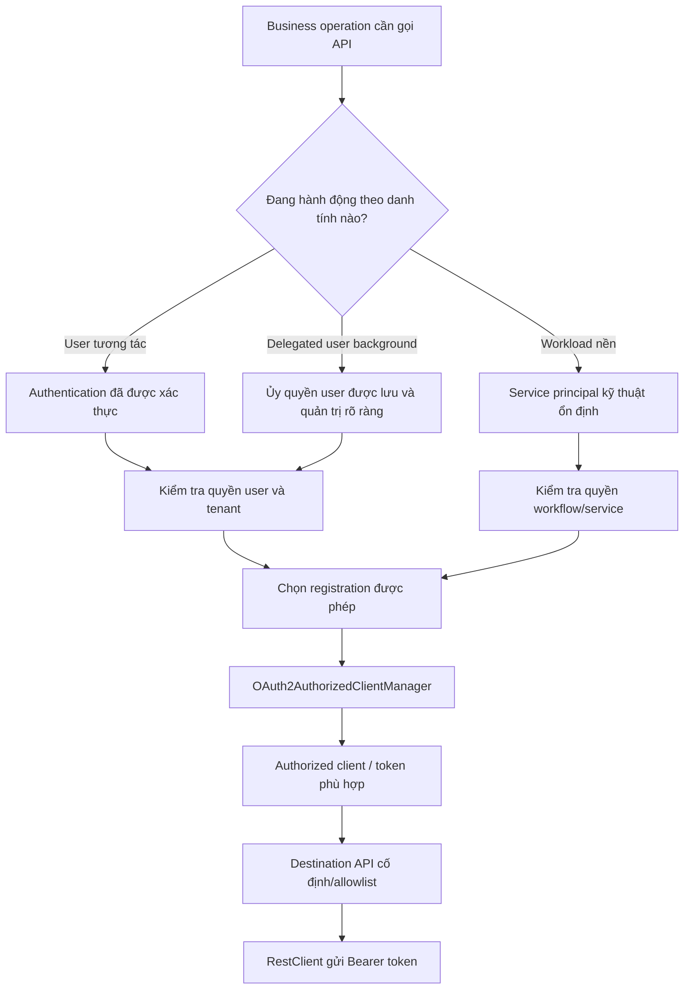
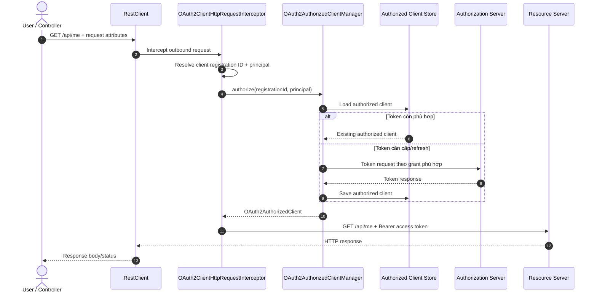
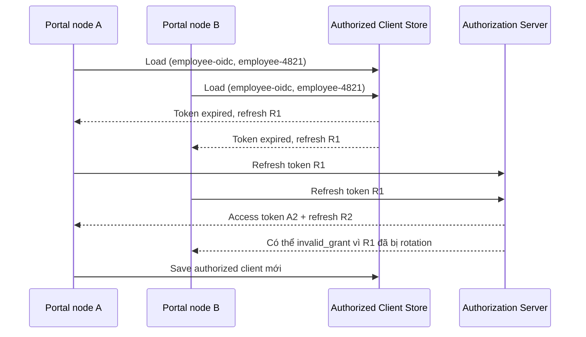

# 18.4. Chọn principal và authorized client theo ngữ cảnh gọi

## 1. Bối cảnh: cùng một `RestClient`, nhưng token nào mới đúng?

Trong ứng dụng **Spring Security OAuth 2.0/OIDC Client** chạy trên **Servlet/MVC**, backend thường dùng `RestClient` để gọi một HTTP API khác. Nếu API yêu cầu OAuth 2.0 Bearer token, ứng dụng phải lấy **đúng access token** cho yêu cầu đang thực hiện.

Giả sử **Employee Portal** tích hợp ba dịch vụ:

1. **Employee API** trả hồ sơ/quyền của **người dùng hiện đang đăng nhập**; token phải gắn với một user đã hoàn thành OIDC Authorization Code Flow.
2. **Reports API** phục vụ scheduled job chạy định kỳ; token thuộc **ứng dụng** theo Client Credentials Grant, không thuộc phiên đăng nhập của ai.
3. **Partner API** phục vụ một số tenant được chỉ định; backend phải chọn đúng client registration, principal và nguồn token của tenant được phép.

Cả ba API đều có thể được gọi qua `RestClient`, nhưng **chọn sai OAuth2 authorized client** có thể dẫn đến lỗi `401/403`, mất khả năng refresh token, hoặc nghiêm trọng hơn là gửi token của user/tenant khác tới một Resource Server không phù hợp.

Ở phần tích hợp REST client, điểm quan trọng không chỉ là “gắn header `Authorization: Bearer ...`”, mà là **xác định danh tính và registration được phép trước khi gắn token**.

> **Mấu chốt:** `registrationId` quyết định **OAuth2 Client configuration** nào được sử dụng; `principal` xác định **authorized client thuộc ngữ cảnh danh tính nào**; còn **API destination và quyền nghiệp vụ** quyết định có được dùng token đó để thực hiện HTTP call hay không.

Bài học này sẽ giúp bạn:

- Phân biệt `ClientRegistration`, `OAuth2AuthorizedClient`, `Authentication` và `OAuth2AuthorizedClientManager` trong lúc `RestClient` gọi API.
- Chọn authorized client cho **user đã login**, **service/workload**, hoặc **nhiều registration/tenant**.
- Dùng `OAuth2ClientHttpRequestInterceptor` với `RestClient` ở **Spring Security Servlet**.
- Sử dụng request attributes `clientRegistrationId(...)` và `principal(...)` khi phù hợp.
- Biết khi nào phải dùng `DefaultOAuth2AuthorizedClientManager`, khi nào dùng `AuthorizedClientServiceOAuth2AuthorizedClientManager`.
- Tránh rò token qua outbound URL, redirect, token store hoặc lựa chọn principal không đáng tin cậy.
- Xử lý thiếu authorized client, token hết hạn, refresh thất bại và API trả `401/403`.

Các ví dụ Java bên dưới tập trung vào **Spring Boot 3.2+ / Spring Security 6.4+**, nơi có `RestClient` và `OAuth2ClientHttpRequestInterceptor`. Nếu dùng phiên bản cũ hơn, cần đối chiếu API/library của bản tương ứng; không giả định mọi API RestClient OAuth2 đều tồn tại từ Spring Security 5 hoặc 6.0. Ví dụ dùng Java 17+ và Servlet stack; không trộn `ReactiveOAuth2AuthorizedClientManager` vào code MVC.

## 2. Các đối tượng liên quan và ranh giới trách nhiệm

| Thành phần | Vai trò | Không phải |
| --- | --- | --- |
| **`ClientRegistration`** | Cấu hình client ID, grant, provider, token endpoint, scopes | Không phải access token của user |
| **`ClientRegistrationRepository`** | Tra cứu registration theo ID như `employee-oidc`, `reports-api` | Không quyết định user hiện tại có quyền gì |
| **`Authentication`** | Principal/authorities đã được xác thực trong ứng dụng | Không tự bảo đảm API đích chấp nhận access token |
| **`SecurityContext`** | Chứa Authentication cho request/user session | Không phải token store dùng chung cho mọi OAuth2 Client |
| **`OAuth2AuthorizedClient`** | Registration đã được cấp quyền, principal name, access token và có thể refresh token | Không tự tạo HTTP request tới API |
| **`OAuth2AuthorizedClientRepository`** | Lưu/load authorized client trong ngữ cảnh Servlet HTTP request | Không thay thế user authentication |
| **`OAuth2AuthorizedClientService`** | Lưu/load authorized client theo registration/principal, không phụ thuộc request | Không tự refresh token khi gọi `loadAuthorizedClient` |
| **`OAuth2AuthorizedClientManager`** | Điều phối load, authorize, refresh và save theo các grant được hỗ trợ | Không được mặc định coi là cơ chế phân quyền nghiệp vụ |
| **`OAuth2ClientHttpRequestInterceptor`** | Tích hợp OAuth2 Client Manager với outbound `RestClient`, thêm Bearer token | Không chứng minh caller được quyền sử dụng mọi token |
| **`RestClient`** | Gửi HTTP request tới Resource Server | Không phải một OIDC login filter |

**`OAuth2AuthorizedClient`** chứa các thông tin để ứng dụng dùng token một cách phù hợp:

```text
OAuth2AuthorizedClient
  ├─ ClientRegistration
  │    └─ registrationId = "employee-oidc"
  ├─ principalName = "employee-4821"
  ├─ OAuth2AccessToken
  │    ├─ tokenValue  [NHẠY CẢM]
  │    ├─ issuedAt
  │    ├─ expiresAt
  │    └─ scopes
  └─ OAuth2RefreshToken (có thể null)
```

Một authorized client thường được lưu/tra cứu bằng cặp:

```text
(clientRegistrationId, principalName)
```

Ví dụ:

| Registration ID | Principal name | Mục đích |
| --- | --- | --- |
| `employee-oidc` | `employee-4821` | Token user 4821 sau OIDC Login |
| `employee-oidc` | `employee-9274` | Token user 9274 |
| `partner-api` | `partner-user-14` | Token dành cho user/partner flow tương ứng |
| `reports-api` | `reports-batch` | Client Credentials token của backend job |

Nếu code yêu cầu `(employee-oidc, employee-9274)` trong khi HTTP request do employee-4821 gửi, đó là **sai ngữ cảnh**, dù token trong database còn hợp lệ.

## 3. Ba câu hỏi bắt buộc trước một outbound OAuth2 HTTP call

Trước khi chọn token, cần trả lời:

1. **Đang thực hiện hành động của ai?** Người dùng đang đăng nhập, một tenant đã được ủy quyền hay chính backend/service?
2. **API nào sẽ nhận token?** Token phải được cấp phù hợp issuer, audience, scope và trust boundary của Resource Server.
3. **Token cần lấy theo khóa nào?** Registration ID và principal name phải thống nhất với flow đã cấp quyền và kho token đang sử dụng.

Sơ đồ quyết định:



Đừng đảo ngược thứ tự thành “lấy token bất kỳ trước, rồi mới xem nó thuộc về ai”. Một token hợp lệ **không tự chứng minh user/tenant đang gọi được phép dùng token đó**.

## 4. Cấu hình hai ClientRegistration theo hai ngữ cảnh

### 4.1. Dependencies Spring Boot

Ví dụ Maven:

```xml
<dependencies>
    <dependency>
        <groupId>org.springframework.boot</groupId>
        <artifactId>spring-boot-starter-web</artifactId>
    </dependency>
    <dependency>
        <groupId>org.springframework.boot</groupId>
        <artifactId>spring-boot-starter-security</artifactId>
    </dependency>
    <dependency>
        <groupId>org.springframework.boot</groupId>
        <artifactId>spring-boot-starter-oauth2-client</artifactId>
    </dependency>
</dependencies>
```

`RestClient` thuộc Spring Framework 6.1+. `OAuth2ClientHttpRequestInterceptor` thuộc tích hợp RestClient của Spring Security 6.4+. Spring Boot 3.4+ thường cung cấp cả hai khi dùng starter và BOM tương thích. Nếu dùng Spring Boot 3.2/3.3 với Spring Security 6.2/6.3, `RestClient` tồn tại nhưng **interceptor OAuth2 này có thể chưa tồn tại**; ví dụ manual token manager vẫn là một hướng tích hợp thay thế.

Gradle Kotlin DSL:

```kotlin
dependencies {
    implementation("org.springframework.boot:spring-boot-starter-web")
    implementation("org.springframework.boot:spring-boot-starter-security")
    implementation("org.springframework.boot:spring-boot-starter-oauth2-client")
}
```

### 4.2. `application.yml`

```yaml
spring:
  security:
    oauth2:
      client:
        registration:
          employee-oidc:
            provider: company-oidc
            client-id: ${EMPLOYEE_WEB_CLIENT_ID}
            client-secret: ${EMPLOYEE_WEB_CLIENT_SECRET}
            client-authentication-method: client_secret_basic
            authorization-grant-type: authorization_code
            redirect-uri: "{baseUrl}/login/oauth2/code/{registrationId}"
            scope:
              - openid
              - profile
              - employee.read

          reports-api:
            provider: reports-as
            client-id: ${REPORTS_SERVICE_CLIENT_ID}
            client-secret: ${REPORTS_SERVICE_CLIENT_SECRET}
            client-authentication-method: client_secret_basic
            authorization-grant-type: client_credentials
            scope:
              - reports.read

        provider:
          company-oidc:
            issuer-uri: https://identity.example.com/realms/employees
          reports-as:
            token-uri: https://auth.example.com/oauth2/token
```

Những URI và credentials chỉ minh họa; phải dùng đúng Authorization Server/issuer và policy của dự án. Không commit client secret vào repository. Cấu hình registration thể hiện:

| Thuộc tính | `employee-oidc` | `reports-api` |
| --- | --- | --- |
| `registrationId` | `employee-oidc` | `reports-api` |
| `grant_type` | `authorization_code` | `client_credentials` |
| Chủ thể token | User đã login và cấp quyền | Backend client/service |
| Cần browser callback? | Có | Không |
| Principal dùng trong authorized client store | Authentication user | `reports-batch` |
| Token mới khi hết hạn | Refresh hoặc user authorization lại | Client Credentials Grant mới |
| Có ID Token? | Có khi OIDC Login | Không phải thành phần của Client Credentials tiêu chuẩn |
| Có thể gọi ngoài HTTP request? | Phải thiết kế ủy quyền đã lưu và manager phù hợp | Có, service-tier manager |
| Scope ví dụ | `employee.read` | `reports.read` |

**Không dùng `employee-oidc` cho Reports API chỉ vì browser đang có token**, cũng không dùng `reports-api` để xác thực danh tính nhân viên. Client Credentials access token là quyền của ứng dụng, không phải user session.

## 5. Dùng OAuth2 Client Manager đúng ngữ cảnh

### 5.1. Servlet manager cho token của người dùng

`DefaultOAuth2AuthorizedClientManager` làm việc với `OAuth2AuthorizedClientRepository` và ngữ cảnh HTTP Servlet.

```java
package com.example.portal.security;

import org.springframework.context.annotation.Bean;
import org.springframework.context.annotation.Configuration;
import org.springframework.security.oauth2.client.DefaultOAuth2AuthorizedClientManager;
import org.springframework.security.oauth2.client.OAuth2AuthorizedClientManager;
import org.springframework.security.oauth2.client.OAuth2AuthorizedClientProvider;
import org.springframework.security.oauth2.client.OAuth2AuthorizedClientProviderBuilder;
import org.springframework.security.oauth2.client.registration.ClientRegistrationRepository;
import org.springframework.security.oauth2.client.web.OAuth2AuthorizedClientRepository;

@Configuration
public class UserAuthorizedClientManagerConfig {

    @Bean("userAuthorizedClientManager")
    OAuth2AuthorizedClientManager userAuthorizedClientManager(
            ClientRegistrationRepository registrations,
            OAuth2AuthorizedClientRepository repository) {

        OAuth2AuthorizedClientProvider provider =
                OAuth2AuthorizedClientProviderBuilder.builder()
                    .authorizationCode()
                    .refreshToken()
                    .build();

        var manager = new DefaultOAuth2AuthorizedClientManager(
                registrations, repository);

        manager.setAuthorizedClientProvider(provider);
        return manager;
    }
}
```

Khi user đăng nhập qua `oauth2Login`, authorized client có thể được repository lưu theo principal đã authenticated. Trong request tiếp theo, manager dùng chính ngữ cảnh user để load/refresh token. Nếu token chưa từng được cấp cho registration cần dùng, flow `authorization_code` có thể cần browser authorization/consent; không thể tự biến request backend thành token của user bất kỳ.

### 5.2. Service-tier manager cho token ứng dụng

`AuthorizedClientServiceOAuth2AuthorizedClientManager` hoạt động với `OAuth2AuthorizedClientService` mà không cần `HttpServletRequest`.

```java
package com.example.portal.security;

import org.springframework.context.annotation.Bean;
import org.springframework.context.annotation.Configuration;
import org.springframework.security.oauth2.client.AuthorizedClientServiceOAuth2AuthorizedClientManager;
import org.springframework.security.oauth2.client.OAuth2AuthorizedClientManager;
import org.springframework.security.oauth2.client.OAuth2AuthorizedClientProvider;
import org.springframework.security.oauth2.client.OAuth2AuthorizedClientProviderBuilder;
import org.springframework.security.oauth2.client.OAuth2AuthorizedClientService;
import org.springframework.security.oauth2.client.registration.ClientRegistrationRepository;

@Configuration
public class ServiceAuthorizedClientManagerConfig {

    @Bean("serviceAuthorizedClientManager")
    OAuth2AuthorizedClientManager serviceAuthorizedClientManager(
            ClientRegistrationRepository registrations,
            OAuth2AuthorizedClientService authorizedClients) {

        OAuth2AuthorizedClientProvider provider =
                OAuth2AuthorizedClientProviderBuilder.builder()
                    .clientCredentials()
                    .build();

        var manager = new AuthorizedClientServiceOAuth2AuthorizedClientManager(
                registrations, authorizedClients);

        manager.setAuthorizedClientProvider(provider);
        return manager;
    }
}
```

Đoạn cấu hình này dành cho những worker/scheduler cần token `client_credentials`. Nếu ứng dụng dùng đồng thời interactive login, cần bảo đảm bean service/repository của hai đường tích hợp được quản lý thống nhất hoặc tách theo thiết kế; `@Qualifier` ở call site giúp tránh inject nhầm manager.

### 5.3. Vì sao manager cần biết principal?

Manager/service thường tra cứu authorized client theo:

```text
(client_registration_id, principal_name)
```

Với user token:

```text
(employee-oidc, employee-4821)
```

Với service token:

```text
(reports-api, reports-batch)
```

**String principal không phải một cơ chế authentication.** Nếu bạn truyền `principal("employee-9274")` từ một HTTP request của employee-4821, code vẫn có thể yêu cầu tra cứu token của employee-9274 khi store có dữ liệu tương ứng. Kiểm soát quyền trước khi chọn principal là trách nhiệm bắt buộc của ứng dụng.

## 6. Tích hợp `RestClient` với `OAuth2ClientHttpRequestInterceptor`

### 6.1. Interceptor hoạt động như thế nào?

`OAuth2ClientHttpRequestInterceptor` tích hợp `RestClient` với một `OAuth2AuthorizedClientManager`:

1. Xác định **registration ID** từ request attributes hoặc resolver được cấu hình.
2. Xác định **principal** từ SecurityContext hoặc resolver đã chọn.
3. Tạo yêu cầu authorize và gọi manager.
4. Khi nhận authorized client hợp lệ, thêm `Authorization: Bearer <access-token>` vào outbound HTTP request.
5. Resource Server xử lý access token và authorization policy của chính nó.



Các bước thực tế có thể khác tùy manager/provider và thời hạn token. Interceptor **không tự kiểm tra quyền nghiệp vụ** của user trước khi dùng token, không tự biến `client_credentials` thành delegated user token và không chứng minh một URL outbound do browser cung cấp là đáng tin.

### 6.2. Những request attributes cần biết

Trong Spring Security RestClient integration:

- **`RequestAttributeClientRegistrationIdResolver.clientRegistrationId(String)`** tạo request attribute chọn một `ClientRegistration`.
- **`RequestAttributePrincipalResolver.principal(String)`** có thể đưa principal name theo ngữ cảnh của request, khi interceptor được cấu hình sử dụng `RequestAttributePrincipalResolver`.
- Khi dùng principal user hiện tại trong HTTP Servlet request, thường nên để interceptor dùng **SecurityContext principal resolver** và không cho client tự chọn một principal khác.

Các import static ở ví dụ:

```java
import static org.springframework.security.oauth2.client.web.client
        .RequestAttributeClientRegistrationIdResolver.clientRegistrationId;

import static org.springframework.security.oauth2.client.web.client
        .RequestAttributePrincipalResolver.principal;
```

Cần nhớ **request attributes của `RestClient` không giống HTTP request query parameters**. Chúng là metadata mà ứng dụng đặt khi xây outbound request, không được tự coi là đã có authorization chỉ vì code của browser có một tham số cùng tên.

### 6.3. Cách chọn mặc định khác với chọn tường minh

Một client được dùng ở nhiều ngữ cảnh không nên tự gắn token của “bất kỳ user đang login” tới mọi request. An toàn hơn là:

- Xác định một API destination cố định/allowlist.
- Chọn `clientRegistrationId(...)` tại call site.
- Sử dụng principal đúng nguồn (SecurityContext của user hoặc service principal đã cố định).
- Không bật cơ chế default/auto-token quá rộng trên một `RestClient` dùng chung cho URL tùy ý.
- Với multi-tenant, xác thực tenant trước khi chọn registration/token store key.

## 7. Ví dụ A — `RestClient` gọi Employee API theo user đang đăng nhập

### 7.1. Tạo RestClient với Servlet manager

```java
package com.example.portal.api;

import org.springframework.beans.factory.annotation.Qualifier;
import org.springframework.context.annotation.Bean;
import org.springframework.context.annotation.Configuration;
import org.springframework.security.oauth2.client.OAuth2AuthorizedClientManager;
import org.springframework.security.oauth2.client.web.client.OAuth2ClientHttpRequestInterceptor;
import org.springframework.web.client.RestClient;

@Configuration
public class EmployeeApiHttpConfig {

    @Bean("employeeApiRestClient")
    RestClient employeeApiRestClient(
            RestClient.Builder builder,
            @Qualifier("userAuthorizedClientManager")
            OAuth2AuthorizedClientManager manager) {

        var oauth2Interceptor =
                new OAuth2ClientHttpRequestInterceptor(manager);

        // Dùng principal trong SecurityContext của Servlet request
        // theo resolver mặc định, không cho browser tự chọn principal.
        return builder.clone()
                .baseUrl("https://employee-api.example.com")
                .requestInterceptor(oauth2Interceptor)
                .build();
    }
}
```

Ở đây, constructor của interceptor nhận **manager Servlet**; ví dụ sử dụng cơ chế principal mặc định gắn với SecurityContext. `RestClient.Builder.clone()` giúp tránh vô tình thay đổi shared builder khi tạo nhiều RestClient khác nhau. Với một builder riêng, có thể bỏ `clone()`.

Cấu hình `employee-oidc` được cấp token thông qua flow user login; không cấu hình trên client này một principal kỹ thuật kiểu `"reports-batch"`.

### 7.2. Service chọn registration tại outbound request

```java
package com.example.portal.api;

import static org.springframework.security.oauth2.client.web.client
        .RequestAttributeClientRegistrationIdResolver.clientRegistrationId;

import org.springframework.beans.factory.annotation.Qualifier;
import org.springframework.stereotype.Service;
import org.springframework.web.client.RestClient;

@Service
public class EmployeeDirectoryClient {

    private final RestClient employeeApi;

    public EmployeeDirectoryClient(
            @Qualifier("employeeApiRestClient")
            RestClient employeeApi) {
        this.employeeApi = employeeApi;
    }

    public String currentEmployeeProfile() {
        return employeeApi.get()
                .uri("/v1/employees/me")
                .attributes(clientRegistrationId("employee-oidc"))
                .retrieve()
                .body(String.class);
    }
}
```

Khi chạy **trong Servlet HTTP request đã authenticated**, RestClient interceptor dùng đúng registration và principal từ SecurityContext, manager tải authorized client được cấp cho user đó.

**Điểm đáng chú ý:** Call site không cần truyền raw access token. Interceptor nhận trách nhiệm đính kèm Bearer token sau khi manager authorize. Backend vẫn phải biết scope/audience của access token `employee-oidc` có phù hợp `employee-api.example.com` hay không; OIDC Login thành công không bảo đảm mọi API chấp nhận token đó.

### 7.3. Bảo vệ endpoint trước khi gọi API

```java
package com.example.portal.web;

import com.example.portal.api.EmployeeDirectoryClient;
import org.springframework.security.core.Authentication;
import org.springframework.web.bind.annotation.GetMapping;
import org.springframework.web.bind.annotation.RestController;

@RestController
public class EmployeeProfileController {

    private final EmployeeDirectoryClient directory;

    public EmployeeProfileController(EmployeeDirectoryClient directory) {
        this.directory = directory;
    }

    @GetMapping("/employee/profile")
    public String profile(Authentication authentication) {
        // Authentication được Spring MVC/Security cung cấp.
        // HTTP security rules phải đảm bảo endpoint này yêu cầu login.
        return directory.currentEmployeeProfile();
    }
}
```

Và `SecurityFilterChain` minh họa:

```java
package com.example.portal.security;

import org.springframework.context.annotation.Bean;
import org.springframework.context.annotation.Configuration;
import org.springframework.security.config.Customizer;
import org.springframework.security.config.annotation.web.builders.HttpSecurity;
import org.springframework.security.web.SecurityFilterChain;

@Configuration
public class WebSecurityConfig {

    @Bean
    SecurityFilterChain securityFilterChain(HttpSecurity http) throws Exception {
        http.authorizeHttpRequests(authorize -> authorize
                .requestMatchers("/", "/error", "/css/**").permitAll()
                .requestMatchers("/employee/**").authenticated()
                .anyRequest().authenticated()
            )
            .oauth2Login(Customizer.withDefaults());

        return http.build();
    }
}
```

Đây là web chain **thay thế/độc lập** với các bean cấu hình manager bên trên, không tạo thêm một chain toàn cục khác cùng matcher nếu chưa có mục tiêu multi-chain cụ thể.

**Không tự gọi `SecurityContextHolder` ngoài request** rồi kỳ vọng nhận đúng user sau khi chuyển sang một background thread. Ví dụ này được thiết kế cho đường đi đồng bộ trong request Servlet.

### 7.4. Hai người dùng khác nhau, cùng RestClient instance

`RestClient` thường được khai báo thành **singleton bean**, nhưng **principal được chọn theo request**:

```text
Request 1:
    Authentication = employee-4821
    RestClient + employee-oidc
    Authorized client = (employee-oidc, employee-4821)

Request 2:
    Authentication = employee-9274
    RestClient + employee-oidc
    Authorized client = (employee-oidc, employee-9274)
```

Không lưu một `OAuth2AuthorizedClient`, access token hoặc `Authentication` từ request 1 vào **field mutable singleton** rồi tái sử dụng ở request 2. Một bean RestClient dùng chung không phải vấn đề; **token cache tùy tiện trong field dùng chung** mới có thể dẫn tới rò quyền giữa user.

## 8. Ví dụ B — RestClient cho background Client Credentials

### 8.1. Dùng service-tier manager

Job chạy qua `@Scheduled` hoặc queue consumer không có browser session. Vì vậy phải dùng manager **`AuthorizedClientServiceOAuth2AuthorizedClientManager`** (đã cấu hình tại mục 5.2) thay cho manager Servlet HTTP.

Ta tạo RestClient riêng cho Reports API:

```java
package com.example.portal.reports;

import org.springframework.beans.factory.annotation.Qualifier;
import org.springframework.context.annotation.Bean;
import org.springframework.context.annotation.Configuration;
import org.springframework.security.oauth2.client.OAuth2AuthorizedClientManager;
import org.springframework.security.oauth2.client.web.client.OAuth2ClientHttpRequestInterceptor;
import org.springframework.security.oauth2.client.web.client.RequestAttributePrincipalResolver;
import org.springframework.web.client.RestClient;

@Configuration
public class ReportsApiHttpConfig {

    @Bean("reportsApiRestClient")
    RestClient reportsApiRestClient(
            RestClient.Builder builder,
            @Qualifier("serviceAuthorizedClientManager")
            OAuth2AuthorizedClientManager manager) {

        var oauth2Interceptor =
                new OAuth2ClientHttpRequestInterceptor(manager);

        // Cho phép lấy principal name từ RestClient request attributes.
        oauth2Interceptor.setPrincipalResolver(
                new RequestAttributePrincipalResolver());

        return builder.clone()
                .baseUrl("https://reports-api.example.com")
                .requestInterceptor(oauth2Interceptor)
                .build();
    }
}
```

Cấu hình này phù hợp với việc **chủ động đưa principal kỹ thuật** vào request attributes. Không nên gắn cùng kiểu principal resolver này lên RestClient user-bound mà lại để các call site truyền tên user từ một chuỗi không tin cậy.

### 8.2. Chọn cả registration ID và principal kỹ thuật

```java
package com.example.portal.reports;

import static org.springframework.security.oauth2.client.web.client
        .RequestAttributeClientRegistrationIdResolver.clientRegistrationId;
import static org.springframework.security.oauth2.client.web.client
        .RequestAttributePrincipalResolver.principal;

import org.springframework.beans.factory.annotation.Qualifier;
import org.springframework.stereotype.Service;
import org.springframework.web.client.RestClient;

@Service
public class ReportsClient {

    private static final String SERVICE_PRINCIPAL = "reports-batch";

    private final RestClient reportsApi;

    public ReportsClient(
            @Qualifier("reportsApiRestClient") RestClient reportsApi) {
        this.reportsApi = reportsApi;
    }

    public String dailySummary() {
        return reportsApi.get()
                .uri("/v1/reports/daily-summary")
                .attributes(clientRegistrationId("reports-api"))
                .attributes(principal(SERVICE_PRINCIPAL))
                .retrieve()
                .body(String.class);
    }
}
```

Ở đây:

- `clientRegistrationId("reports-api")` chọn client ID/secret, token endpoint, scope và grant `client_credentials`.
- `principal("reports-batch")` tạo khóa principal kỹ thuật ổn định trong authorized client store.
- Manager service-tier hoạt động không cần `HttpServletRequest` hoặc browser Authentication.
- Interceptor xin token/đính kèm Bearer token theo ngữ cảnh đó.
- Scheduled job có thể gọi `dailySummary()` ngay cả khi toàn bộ nhân viên đã logout.

### 8.3. Scheduled job không phụ thuộc login user

```java
package com.example.portal.reports;

import org.springframework.scheduling.annotation.Scheduled;
import org.springframework.stereotype.Component;

@Component
public class ReportsSyncJob {

    private final ReportsClient reportsClient;

    public ReportsSyncJob(ReportsClient reportsClient) {
        this.reportsClient = reportsClient;
    }

    @Scheduled(fixedDelayString = "${jobs.reports.delay-ms:900000}")
    public void synchronize() {
        String summary = reportsClient.dailySummary();

        // Đồng bộ dữ liệu với chính sách idempotency và error handling
        // của nghiệp vụ; không log token hoặc dữ liệu nhạy cảm.
        process(summary);
    }

    private void process(String summary) {
        // Ví dụ rút gọn: xử lý dữ liệu được phép lấy từ API.
    }
}
```

Ứng dụng cần bật `@EnableScheduling` trong một lớp `@Configuration`/`@SpringBootApplication`, và có thể cấu hình `jobs.reports.delay-ms` trong `application.yml`.

**Không dùng `SecurityContextHolder.getContext().getAuthentication()` để xác định principal cho scheduled job.** Không có HTTP request, SecurityContext có thể rỗng hoặc không đại diện cho user nào. Service principal phải do backend quản trị.

### 8.4. Principal name ổn định có ý nghĩa gì?

Nếu các lần job dùng:

```text
(reports-api, reports-batch)
```

thì authorized client service có thể reuse access token còn hợp lệ theo policy. Nếu mỗi lần chạy dùng `reports-batch-{timestamp}`, manager thường coi đây là một principal mới, có thể xin token mới không cần thiết và làm store tăng nhiều entry.

**Principal kỹ thuật không làm token thay đổi scopes/audience**. Nếu hai workload cần quyền tách biệt, cân nhắc client registrations riêng hoặc cơ chế authorization thật sự tạo ra token khác phạm vi, không chỉ đổi tên principal.

## 9. Khi đã có `OAuth2AuthorizedClient`: dùng object đã được giải quyết an toàn

### 9.1. Không phải lúc nào cũng phải tra cứu registration lần nữa

Trong một số controller, Spring MVC có thể cung cấp `OAuth2AuthorizedClient` tương ứng với registration đã được cấp quyền. Ví dụ khi đã bật OAuth2 Client integration:

```java
package com.example.portal.web;

import org.springframework.security.oauth2.client.OAuth2AuthorizedClient;
import org.springframework.security.oauth2.client.annotation.RegisteredOAuth2AuthorizedClient;
import org.springframework.web.bind.annotation.GetMapping;
import org.springframework.web.bind.annotation.RestController;

@RestController
public class AuthorizedClientStatusController {

    @GetMapping("/employee/authorized-client")
    public String status(
            @RegisteredOAuth2AuthorizedClient("employee-oidc")
            OAuth2AuthorizedClient authorizedClient) {

        return "registration="
                + authorizedClient.getClientRegistration().getRegistrationId();
    }
}
```

Đoạn này cố ý **chỉ trả metadata**; không trả `getAccessToken().getTokenValue()` hoặc `getRefreshToken()` cho browser. Tùy cấu hình resolver, manager và việc registration đã được ủy quyền, argument resolution có thể dùng authorized client đã lưu hoặc cần thực hiện quy trình authorization phù hợp.

Khi code đã có authorized client từ một nguồn đáng tin cậy (ví dụ argument resolver hoặc service/repository kiểm tra đúng Authentication), có thể sử dụng token đó khi gửi request:

```java
public String fetchProfile(
        RestClient api,
        OAuth2AuthorizedClient authorizedClient) {

    String accessToken = authorizedClient.getAccessToken().getTokenValue();

    return api.get()
            .uri("/v1/employees/me")
            .headers(headers -> headers.setBearerAuth(accessToken))
            .retrieve()
            .body(String.class);
}
```

Đây là **tùy chọn gắn token tường minh bằng RestClient**, không dùng interceptor. Điểm mạnh là người đọc code thấy rõ authorized client nào đang được sử dụng. Điểm hạn chế là nếu bạn giữ object lâu, token có thể hết hạn và **không tự được refresh bởi dòng `setBearerAuth(...)`**. Khi token lifecycle phức tạp, nên gọi authorized client manager hoặc dùng OAuth2 interceptor cho mỗi outbound call.

### 9.2. `OAuth2AuthorizeRequest.withAuthorizedClient(...)`

Một lựa chọn khác là đưa authorized client đã có trở lại manager, để manager có cơ hội xử lý expiry và provider tương ứng:

```java
OAuth2AuthorizeRequest request = OAuth2AuthorizeRequest
        .withAuthorizedClient(existingAuthorizedClient)
        .principal(authentication)
        .build();

OAuth2AuthorizedClient current = manager.authorize(request);

if (current == null) {
    throw new IllegalStateException(
            "Cannot authorize current user for the requested API");
}
```

Những điều kiện bắt buộc:

- `existingAuthorizedClient` phải được lấy từ nguồn tin cậy cho **đúng user/tenant và registration**.
- `authentication` phải đại diện cho principal đã được xác thực và được quyền dùng client đó.
- Manager/provider phải hỗ trợ grant/lifecycle tương ứng; không phải mọi trường hợp đều tự refresh thành công.
- Nếu kết quả được dùng để gọi API, vẫn phải kiểm tra destination/audience/scope, và không phát token cho browser.

**`withAuthorizedClient(...)` không phải cách “nhận token từ caller rồi tin luôn”.** Việc object do ứng dụng quản lý không đồng nghĩa nó phù hợp mọi principal. Không deserialize một authorized client từ JSON request tùy ý rồi đưa thẳng vào manager.

### 9.3. So sánh ba cách đưa token vào RestClient

| Cách | Khi nào phù hợp? | Chọn client/principal | Token lifecycle |
| --- | --- | --- | --- |
| **OAuth2 interceptor + request attributes** | Nhiều HTTP calls, muốn manager điều phối tự động | `clientRegistrationId(...)` và resolver principal | Manager có thể load/cấp/refresh tùy provider |
| **Manager trực tiếp + `setBearerAuth`** | Cần kiểm soát rõ logic authorize và API call, service code độc lập interceptor | `OAuth2AuthorizeRequest` đầy đủ | Chỉ có lifecycle nếu gọi manager đúng lúc |
| **`OAuth2AuthorizedClient` đã resolve + `setBearerAuth`** | Token đã được cung cấp an toàn trong cùng request | Authorized client object đã có | Dùng snapshot hiện tại; có thể hết hạn sau đó |

Không nhất thiết phải áp dụng một cách duy nhất cho toàn bộ project. Điều quan trọng là **không dùng lẫn các cơ chế có chính sách principal khác nhau** trên một HTTP client theo cách khiến token bị gắn sai.

## 10. Ví dụ C — Chọn token tường minh bằng manager khi không dùng interceptor

Khi hệ thống có yêu cầu kiểm soát đặc biệt, developer có thể gọi `OAuth2AuthorizedClientManager` trước, sau đó tự gắn Bearer header vào một `RestClient` chuyên dụng.

### 10.1. Service-tier method độc lập với SecurityContext

```java
package com.example.portal.reports;

import org.springframework.beans.factory.annotation.Qualifier;
import org.springframework.security.oauth2.client.OAuth2AuthorizeRequest;
import org.springframework.security.oauth2.client.OAuth2AuthorizedClient;
import org.springframework.security.oauth2.client.OAuth2AuthorizedClientManager;
import org.springframework.stereotype.Service;
import org.springframework.web.client.RestClient;

@Service
public class ReportsClientWithoutInterceptor {

    private final OAuth2AuthorizedClientManager manager;
    private final RestClient http;

    public ReportsClientWithoutInterceptor(
            @Qualifier("serviceAuthorizedClientManager")
            OAuth2AuthorizedClientManager manager,
            RestClient.Builder builder) {

        this.manager = manager;
        this.http = builder.clone()
                .baseUrl("https://reports-api.example.com")
                .build();
    }

    public String dailySummary() {
        OAuth2AuthorizeRequest request = OAuth2AuthorizeRequest
                .withClientRegistrationId("reports-api")
                .principal("reports-batch")
                .build();

        OAuth2AuthorizedClient authorized = manager.authorize(request);

        if (authorized == null) {
            throw new IllegalStateException(
                    "The reports client cannot be authorized");
        }

        String token = authorized.getAccessToken().getTokenValue();

        return http.get()
                .uri("/v1/reports/daily-summary")
                .headers(headers -> headers.setBearerAuth(token))
                .retrieve()
                .body(String.class);
    }
}
```

Trong phương án này:

- Manager được gọi **trước mỗi HTTP call** theo nhu cầu.
- Registration/principal được chọn ở một vị trí rõ ràng.
- `RestClient` không tự có logic OAuth2; method chịu trách nhiệm gắn token.
- Token không được lưu trong field của service singleton, không đưa vào log.
- Nếu API trả `401` vì token bị revoke, cần chính sách xử lý invalidation/reacquisition riêng; `setBearerAuth(...)` không tự xóa authorized client.
- Nếu API trả `403` do thiếu scope, việc xin lại token với cùng configuration thường không làm quyền tăng lên.

Đây cũng là phương án hữu ích khi phiên bản Spring Security chưa có `OAuth2ClientHttpRequestInterceptor` nhưng đã có `OAuth2AuthorizedClientManager` và Spring Framework `RestClient`.

### 10.2. Không trộn manual header với interceptor tùy tiện

Nếu một `RestClient` vừa có OAuth2 interceptor vừa được call site tự đặt `Authorization: Bearer ...`, có thể phát sinh hai nguồn quyết định token. Interceptor và header thủ công có thể ghi đè hoặc gây hành vi khó dự đoán theo thứ tự xử lý.

Nên chọn **một chủ sở hữu rõ ràng** cho Bearer header của mỗi client/request. Nếu cần API cho phép token tường minh, thiết kế wrapper riêng có kiểm soát thay vì lẫn lộn token của user và service.

## 11. Đa tenant: chọn đúng principal vẫn chưa đủ

### 11.1. Một user có thể thuộc nhiều tenant

Giả sử Employee Portal hỗ trợ hai tenant:

```text
north -> Registration "north-oidc"
south -> Registration "south-oidc"
```

User A có quyền truy cập `north` nhưng không có quyền ở `south`. Nếu browser gọi:

```http
GET /tenant/south/profile
```

ứng dụng không được tự chọn `south-oidc` và dùng một authorized client có sẵn chỉ vì caller biết tên tenant.

Thứ tự an toàn:

1. Lấy `Authentication` đã xác thực từ Spring Security.
2. Kiểm tra user có quyền truy cập tenant yêu cầu không.
3. Ánh xạ tenant sang registration theo allowlist/config tin cậy.
4. Kiểm tra authorized client thuộc đúng user/tenant/registration.
5. Chỉ gắn access token vào API endpoint của tenant đã được phép.

### 11.2. Mapping tenant → registration không phải authorization

Ví dụ service mapping:

```java
package com.example.portal.tenants;

import org.springframework.stereotype.Component;

@Component
public class TenantRegistrationResolver {

    public String resolveAuthorizedRegistration(String tenantId) {
        return switch (tenantId) {
            case "north" -> "north-oidc";
            case "south" -> "south-oidc";
            default -> throw new IllegalArgumentException(
                    "Unsupported tenant");
        };
    }
}
```

Hàm trên **chỉ ánh xạ ID**. Một tầng khác phải xác minh user được phép truy cập tenant; chỉ khi kiểm tra đó thành công mới gọi resolver và RestClient.

Không cho phép caller truyền trực tiếp:

```text
?token_uri=https://untrusted.example/token
?client_registration_id=any
?principal_name=other-user
```

rồi dùng làm cấu hình OAuth2 Client. Đó có thể dẫn đến **SSRF, chọn token sai user hoặc lộ client credentials**.

### 11.3. Cặp khóa authorized client có thể bị collision giữa issuer

Trong một số cấu hình, principalName lấy từ `sub` của OIDC, và `sub` chỉ duy nhất trong phạm vi issuer. Nếu dùng một registration/authorized client store chung mà hai issuer khác nhau cho cùng `sub`, có nguy cơ trùng key:

```text
(oidc-dynamic, subject-123)
(oidc-dynamic, subject-123)
```

Hệ thống multi-issuer cần namespace định danh thích hợp, chẳng hạn phân tách registration theo issuer hoặc tạo một principal key ổn định được quản lý theo `(issuer, subject)`. Cần bảo đảm **login, load, refresh, remove** đều dùng cùng quy tắc, không tự thêm prefix trong một controller nhưng repo vẫn lưu theo quy tắc khác.

**Không chỉ thay principal string để tin rằng hai tenant đã được tách quyền.** Audience, scopes, issuer và policy token ở Authorization Server vẫn phải được phân vùng phù hợp.

### 11.4. Khi background job gọi API thay mặt user

Một job chạy sau khi user đóng browser có thể vẫn cần delegated access token của user. Đây không phải Client Credentials đơn giản:

- Token đã được cấp sau user authorization/consent.
- Có thể cần refresh token được lưu an toàn.
- Service-tier manager phải được cấu hình cho grant phù hợp với authorized client đã có.
- Job phải có quyền nghiệp vụ để thực hiện công việc thay user.
- User có thể thu hồi sự đồng ý; token hết hạn hoặc refresh bị từ chối.
- Phải giải quyết retention, logout policy và quyền riêng tư.

**`principal("employee-4821")` không tự chứng minh backend được hành động thay employee-4821**. Nó chỉ là chìa khóa tra cứu trong token store; quyền thực hiện background job phải được lưu và kiểm tra theo workflow của hệ thống.

## 12. Chọn principal từ đâu: Authentication, String, hay Object đã có?

### 12.1. User-bound HTTP request

Nguồn phù hợp là **`Authentication` do Spring Security xác thực**, thường được nạp từ `SecurityContext`. `RestClient` chạy đồng bộ trong Servlet request có thể dùng principal resolver đọc SecurityContext hiện tại.

**Không lấy tên user từ HTTP query/body** để thay thế principal:

```java
// Phản mẫu: browser tự chọn tên principal của authorized client.
String principalName = request.getParameter("principal");

OAuth2AuthorizeRequest authorizeRequest = OAuth2AuthorizeRequest
        .withClientRegistrationId("employee-oidc")
        .principal(principalName)
        .build();
```

Trong hệ thống lưu token theo principal, kẻ tấn công có thể thử lấy hoặc dùng token thuộc user khác. `principal(String)` của builder là API để **đưa ngữ cảnh danh tính**, không phải API xác thực user.

### 12.2. Service-bound workload

Nguồn phù hợp là tên kỹ thuật từ cấu hình/hằng số nội bộ:

```java
private static final String SERVICE_PRINCIPAL = "reports-batch";
```

Có thể dùng cùng một principal cho cùng workload nếu chia sẻ token là chính sách chủ đích. Nếu workflow khác nhau về scopes, audience hoặc client identity, nên có registrations/namespace tương ứng, thay vì dùng principal tùy tiện.

### 12.3. Request đã có authorized client

Nếu authorized client được resolve từ repository trong **đúng authentication request**, nó đã có:

```java
authorizedClient.getPrincipalName();
authorizedClient.getClientRegistration().getRegistrationId();
```

Nhưng trước khi sử dụng với một request khác, cần xác định lại:

- Principal còn được phép gọi API không?
- Token thuộc đúng issuer/registration không?
- Token còn hạn và scope phù hợp không?
- Có cần refresh qua manager không?
- API destination đã được giới hạn chưa?

**Không sử dụng một authorized client lưu trong session user A để phục vụ user B** chỉ vì cùng registration ID.

### 12.4. Khi mất SecurityContext vì async execution

Với `@Async`, `CompletableFuture`, custom executor hoặc message consumer, `SecurityContextHolder` thường không còn giữ Authentication của HTTP request theo cách bạn mong đợi.

Các phương án hợp lệ:

- Nếu thực sự cần thực hiện **thay mặt user**, truyền ngữ cảnh ủy quyền được kiểm soát qua executor/queue và dùng authorized client store phù hợp; kiểm tra quyền và retention.
- Nếu đó là công việc **của ứng dụng**, dùng service-tier manager và principal kỹ thuật.
- Chỉ dùng `DelegatingSecurityContext*` khi mục tiêu là bảo toàn SecurityContext có chủ đích trong luồng xử lý tương ứng, không dùng nó để “giả lập” user login cho mọi background job.
- Không đặt một `Authentication` của user vào biến static/global để tiện tái sử dụng.

## 13. Sử dụng một RestClient bean hay nhiều RestClient bean?

### 13.1. Phân biệt khả năng tái sử dụng và ranh giới an ninh

`RestClient` là một HTTP client có thể tái sử dụng qua nhiều request, nhưng một **RestClient dành riêng cho một API** thường dễ kiểm soát hơn:

```text
employeeApiRestClient
  -> baseUrl https://employee-api.example.com
  -> userAuthorizedClientManager
  -> principal từ SecurityContext
  -> registration employee-oidc

reportsApiRestClient
  -> baseUrl https://reports-api.example.com
  -> serviceAuthorizedClientManager
  -> principal từ request attribute (reports-batch)
  -> registration reports-api
```

Lợi ích:

- Dễ giới hạn destination nhận Bearer token.
- Không có tình trạng client M2M vô tình lấy token từ SecurityContext của user.
- Dễ áp timeout/proxy/error handler riêng cho từng Resource Server.
- Dễ đo metrics theo registration/destination.
- Dễ cấu hình authorized-client failure handling đúng store.

### 13.2. Có thể tạo một client đa registration không?

Về kỹ thuật, OAuth2 interceptor có thể chọn registration theo request attributes. Nhưng an toàn phụ thuộc vào:

- Tập registrations cho phép theo nghiệp vụ.
- Mối liên hệ principal/registration với người dùng hoặc service.
- Tập API destinations được phép nhận từng token.
- Quản lý HTTP redirects để tránh gửi credentials sang host khác.
- Sự nhất quán của authorized client manager và token store.

Nếu ứng dụng cung cấp `RestClient` đa năng để gọi URL tùy ý, **không nên gắn OAuth2 interceptor mặc định cho mọi request** mà không có cơ chế ràng buộc destination và scope.

### 13.3. Không lưu access token ở field của singleton service

Phản mẫu:

```java
@Service
class BadTokenCache {
    private String lastAccessToken; // Có thể là token của bất kỳ user nào.

    void updateForUser(String token) {
        this.lastAccessToken = token;
    }

    String current() {
        return this.lastAccessToken;
    }
}
```

Nếu user A cập nhật token rồi user B gọi API qua singleton này, token có thể bị dùng sai. Thay vào đó, để `OAuth2AuthorizedClientManager`/repository xử lý theo đúng registration và principal trong mỗi request.

## 14. Response `401/403`: ai chịu trách nhiệm khôi phục authorized client?

### 14.1. Hai nhóm lỗi khác nhau

Trong tích hợp RestClient, có hai thời điểm có thể lỗi:

1. **Lấy token**: manager/Token Endpoint không authorize được.
2. **Dùng token**: Resource Server đã nhận Bearer token nhưng trả `401/403`.

| Giai đoạn | Ví dụ | Cách hiểu |
| --- | --- | --- |
| Token Endpoint | `invalid_client` | Client credentials hoặc client authentication sai |
| Token Endpoint | `invalid_grant` | Code/refresh token không hợp lệ, hết hạn hoặc bị dùng lại |
| Token Endpoint | `unauthorized_client` | Client không được phép dùng grant |
| Token Endpoint | `invalid_scope` | Scope chưa được provider cấp |
| Resource Server | `401 invalid_token` | Access token bị từ chối, có thể hết hạn, bị revoke hoặc sai audience/issuer |
| Resource Server | `403 insufficient_scope` | Token có thể hợp lệ nhưng thiếu scope/quyền |
| Website Servlet | `403` trước khi gọi API | User không có quyền nghiệp vụ tại Employee Portal |

**Đừng đăng xuất browser user chỉ vì Client Credentials token của backend lỗi**. Ngược lại, nếu Token Endpoint báo `invalid_grant` của refresh token user, cần xử lý ủy quyền lại theo user-flow, không gửi token M2M thay thế.

### 14.2. Authorization failure handler của RestClient interceptor

Spring Security `OAuth2ClientHttpRequestInterceptor` có điểm mở rộng **`setAuthorizationFailureHandler(...)`**. Với một số phản hồi lỗi Bearer token từ Resource Server, failure handler có thể loại bỏ authorized client không còn hợp lệ khỏi store, giúp lần authorize sau không sử dụng mãi access token bị từ chối.

Ví dụ với **service-tier manager + `OAuth2AuthorizedClientService`**:

```java
import org.springframework.security.oauth2.client.OAuth2AuthorizedClientService;
import org.springframework.security.oauth2.client.web.client.OAuth2ClientHttpRequestInterceptor;

// Trong bean factory đã có manager và service:
var oauth2 = new OAuth2ClientHttpRequestInterceptor(manager);

oauth2.setAuthorizationFailureHandler(
        OAuth2ClientHttpRequestInterceptor
                .authorizationFailureHandler(authorizedClientService));
```

Đoạn này là **fragment cấu hình**, không phải class độc lập. Cần dùng cùng authorized client service đã được manager sử dụng. Với Servlet repository, helper tương ứng có thể được tạo từ `OAuth2AuthorizedClientRepository` theo phiên bản Spring Security.

Cần hiểu đúng giới hạn:

- Failure handler chỉ tác động với lỗi/điều kiện mà implementation nhận diện; **không nên khẳng định mọi 401/403 đều xóa token**.
- Loại bỏ local authorized client không tự revoke token ở Authorization Server.
- Xóa token có thể giúp cấp lại token trong lần gọi **sau**, nhưng không bảo đảm tự động retry cùng HTTP request ngay lập tức.
- Nếu 403 do scope thiếu, cấp lại token với scope cũ thường **không thay đổi quyền**.
- Nếu token bị từ chối vì **sai registration/tenant**, cần sửa cách chọn token thay vì liên tục xóa và xin lại.

### 14.3. Retry cần lưu ý idempotency

Với HTTP GET đọc dữ liệu, thử lại có giới hạn sau khi xử lý token lỗi có thể phù hợp. Với POST/PUT/PATCH/DELETE, phải đánh giá một request đã được Resource Server thực hiện chưa trước khi retry.

Ví dụ:

```text
POST /payments
   -> network timeout sau khi API đã xử lý thành công
   -> client retry tự động
   -> có thể tạo payment lần thứ hai nếu API không idempotent
```

Không triển khai cơ chế “401/timeout thì retry vô hạn” bên trong một interceptor dùng chung. Đặt retry policy theo loại lỗi, HTTP method, idempotency key và tiêu chuẩn của API.

### 14.4. OAuth2 interceptor không thay thế HTTP error handling

`RestClient.retrieve()` theo cấu hình mặc định có thể ném exception khi HTTP 4xx/5xx. Một lớp nghiệp vụ nên phân loại:

- Lỗi authorization của manager/Token Endpoint.
- Lỗi Bearer token từ Resource Server.
- HTTP 404 do tài nguyên không tồn tại.
- HTTP 429/503 do upstream quá tải.
- Lỗi DNS/TLS/timeout của outbound connection.

Không trả exception message thô chứa URL, token hay response body nhạy cảm cho browser. Thông điệp nghiệp vụ phải được chuẩn hóa và không phơi chi tiết credentials.

## 15. Authorized client có thể chưa tồn tại: manager xử lý thế nào?

### 15.1. Authorization Code user đã login

Giả sử user đang đăng nhập OIDC qua `employee-oidc`, authorized client có thể đã được lưu khi callback thành công. Nhưng nếu controller đòi một registration khác (`partner-api`) chưa được user cấp quyền, manager **không thể tự tạo delegated user token chỉ từ Authentication hiện có**.

Cần có quy trình user authorization/consent tương ứng, ví dụ bắt đầu browser flow qua `/oauth2/authorization/{registrationId}` theo cấu hình. Không lấy `client_credentials` token để che giấu việc user chưa cấp quyền.

### 15.2. Client Credentials chưa có token

Nếu `reports-api` dùng Client Credentials, manager service-tier có thể gọi Token Endpoint với client credentials để lấy token mới mà không có browser.

Sự khác nhau:

```text
User OAuth2 token (authorization_code):
    User không từng cấp quyền cho registration X
       -> cần authorization flow / consent hợp lệ

App OAuth2 token (client_credentials):
    Chưa có token cho registration Y
       -> backend có thể xin token mới bằng client credentials
```

### 15.3. `authorize(...)` trả null hoặc exception

Khi gọi manager trực tiếp:

```java
OAuth2AuthorizedClient client = manager.authorize(request);

if (client == null) {
    // Không thể authorize theo provider/context hiện tại.
    // Không tự lấy token từ user khác làm fallback.
    throw new IllegalStateException("Authorization is unavailable");
}
```

`null` không luôn đồng nghĩa Authorization Server bị down: có thể provider chain không hỗ trợ grant hoặc không có đủ context. HTTP/token errors thường có exception phù hợp.

Khi dùng interceptor, loại lỗi có thể được truyền lên qua HTTP client pipeline. Cần quan sát theo **giai đoạn** trước khi quyết định retry hoặc redirect.

## 16. Token hết hạn và consistency giữa nhiều request

### 16.1. Không dùng snapshot token lâu dài cho user

Giả sử bạn lưu một `OAuth2AuthorizedClient` vào field của singleton service sau khi user login. Sau một giờ:

- Access token có thể hết hạn.
- Refresh token có thể rotation.
- User có thể logout/revoke quyền.
- Một thread khác có thể đã refresh token và save authorized client mới.

Vì vậy, **sử dụng manager/repository tại thời điểm cần API call** giúp giảm việc dùng token stale. Nếu bạn sử dụng manual `setBearerAuth(...)`, nên gọi manager trước outbound request thay vì giữ raw token String vô thời hạn.

### 16.2. Refresh token và principal key phải nhất quán

Ví dụ token user ban đầu lưu dưới:

```text
(employee-oidc, employee-4821)
```

Nếu request sau gọi manager với principal `employee-4821@example.com`, manager có thể không tìm thấy cùng authorized client. Dù đó là cùng người dùng về mặt nghiệp vụ, **storage key đã thay đổi**.

Tương tự, nếu đổi registration ID từ `employee-oidc` sang `employee-web`, những row cũ sẽ không được tìm thấy bằng key mới. Cần migration hoặc reauthorization theo chính sách.

### 16.3. Cluster và concurrent refresh

Hai Servlet requests của cùng user trên hai node có thể cùng thấy access token sắp hết hạn. Nếu chúng cùng dùng một refresh token có rotation:



Shared JDBC service không tự bảo đảm **single refresh** trên nhiều node. Cần xem xét locking, re-read, optimistic concurrency và chính sách retry phù hợp với OP. **Không retry refresh token đã bị rotation vô điều kiện**.

### 16.4. Client Credentials trên nhiều node

Với `reports-api`, hai nodes có thể đồng thời xin hai access token mới khi cache rỗng. Điều này thường khác với race refresh token, vì Client Credentials không dùng refresh token tiêu chuẩn, nhưng có thể gây **token storm**, rate limiting hoặc token count quota.

Biện pháp tùy tải: stable principal, shared persistence khi cần, jitter, rate limiting, bounded retry và metrics. Không cần dùng cùng chính sách locking với user refresh nếu hai bài toán có tính chất khác nhau.

## 17. RestClient có nhiều ngữ cảnh: thiết kế an toàn theo use case

### 17.1. Website hiển thị thông tin user từ Employee API

```text
Inbound:
  GET /employee/profile
  Authenticated principal: employee-4821

Outbound:
  GET https://employee-api.example.com/v1/employees/me
  registrationId: employee-oidc
  principal: SecurityContext user
  token: user-bound access token
```

Ứng dụng cần xác minh user Authentication và quyền truy cập endpoint; API đích phải kiểm tra token theo audience/scope.

### 17.2. Scheduled job lấy báo cáo toàn cục

```text
Trigger:
  @Scheduled, không có HTTP request

Outbound:
  GET https://reports-api.example.com/v1/reports/daily-summary
  registrationId: reports-api
  principal: reports-batch
  token: client_credentials token
```

Không dùng SecurityContext của user, không cần browser login.

### 17.3. Controller dùng service token sau khi kiểm tra quyền user

```text
Inbound:
  GET /admin/reports
  Authenticated user: employee-4821
  Required authority: ROLE_REPORT_ADMIN

Authorization:
  Kiểm tra ROLE_REPORT_ADMIN trong Employee Portal.

Outbound:
  GET Reports API
  registrationId: reports-api
  principal: reports-batch
  token: M2M service token
```

Trong luồng này, backend **cố ý dùng service token** để truy cập Reports API, nhưng vẫn phải kiểm tra **quyền user trước**. Không lấy quyền của service token để cho phép user vượt qua policy.

### 17.4. Async job thực hiện theo delegated user

```text
Trigger:
  Một yêu cầu đã được user chấp thuận, đưa vào queue

Job context:
  User authorization record đã được lưu và còn hợp lệ

Outbound:
  API cần delegated user token
  registrationId: user-approved client registration
  principal: user identity đã được xác minh và phân vùng đúng
  manager: service-tier và token store phù hợp

Security:
  Kiểm tra user consent, policy, expiry/revocation, tenant và audit
```

**Không dùng principal từ queue message chưa kiểm tra** làm bằng chứng có quyền truy cập token của user đó. Một job background chỉ thực hiện delegated flow khi có cơ chế xác thực/ủy quyền được thiết kế cho use case ấy.

## 18. Các tình huống lỗi trong lựa chọn principal

| Hiện tượng | Nguyên nhân có thể | Hướng xử lý |
| --- | --- | --- |
| Employee API nhận token của user khác | Singleton cache giữ token user trước, principal chọn sai | Dùng SecurityContext request + manager; không cache token global |
| API nhận token của service thay vì user | Chọn `reports-api` khi cần `employee-oidc` | Tách RestClient/registration theo use case |
| Job background yêu cầu HttpServletRequest | Dùng `DefaultOAuth2AuthorizedClientManager` ngoài Servlet request | Dùng service-tier manager |
| Manager không tìm thấy authorized client của user | Registration/principal khác khóa lúc login save | Đồng bộ repository, principal name, registration ID |
| Mỗi job xin token mới | Principal thay đổi hoặc cache bị reset, clock skew quá lớn | Dùng principal kỹ thuật ổn định và xem expiry |
| User logout rồi API call vẫn dùng token của user | Token được giữ ở singleton hoặc authorized client persistence độc lập session | Kiểm tra quyền mỗi request và logout/token revocation policy |
| Browser chọn được `principalName` của user khác | Lấy principal từ query/body chưa được xác thực | Chặn input và dùng Authentication tin cậy |
| Token dùng nhầm tenant | Tenant mapping thiếu kiểm tra membership, key collision | Authorization trước khi chọn registration/principal |
| 401 từ Employee API | Token expired/revoked, issuer/audience không phù hợp | Kiểm tra token policy, manager/refresh, destination |
| 403 từ Reports API | Service token không đủ scope | Đối chiếu registration scope và Resource Server policy |
| OAuth2 interceptor không tìm được principal | Không có SecurityContext hoặc chưa cấu hình request-attribute principal resolver | Chọn resolver phù hợp; tránh servlet manager trong scheduler |
| Request attribute `principal(...)` không có tác dụng | Interceptor đang dùng resolver lấy SecurityContext | Cấu hình `RequestAttributePrincipalResolver` cho M2M client khi cần |
| `clientRegistrationId(...)` không tìm thấy | Sai tên registration ID, nhầm client ID | Đối chiếu `spring.security.oauth2.client.registration` |
| RestClient gửi token tới host lạ | Cho phép URL động hoặc redirect không kiểm soát | Dedicated RestClient + destination allowlist |
| UnauthorizedClient không được lưu | Manager/repository/store khác nhau | Đồng bộ wiring OAuth2 Login, manager và token store |
| Token expired dù store có row | Mới load snapshot; provider không refresh hoặc thiếu refresh token | Dùng manager khi cần, cấu hình provider hợp lệ |
| 401 lặp sau khi xóa local token | Sai audience/issuer/registration hoặc provider cấp lại token cùng scope | Sửa cấu hình và API contract |
| Concurrent refresh token lỗi `invalid_grant` | Nhiều request dùng cùng refresh token rotation | Coordination/locking/re-read theo key |

## 19. Bảo vệ outbound Bearer token

### 19.1. API destination phải được quản lý

OAuth2 interceptor có thể gắn access token vào request do `RestClient` thực hiện. Nếu RestClient cho phép caller chọn arbitrary URI, Bearer token có thể vô tình đi tới host không đáng tin.

Phản mẫu:

```java
// Không dùng khi URL do browser cung cấp mà chưa được kiểm soát.
String url = request.getParameter("targetUrl");

restClient.get()
        .uri(url)
        .attributes(clientRegistrationId("employee-oidc"))
        .retrieve()
        .body(String.class);
```

Phương án phù hợp:

- Base URL cố định cho từng Resource Server.
- Validate path/query do browser đưa vào, không cho đổi scheme/host.
- Kiểm soát redirect policy và forwarding Authorization header.
- Bật TLS certificate/hostname validation chuẩn.
- Không gửi token qua URL query parameters.
- Không log token hoặc client secret dưới dạng HTTP headers/body.

### 19.2. Token scope và audience quan trọng hơn việc chỉ có token

Một access token có `scope=employee.read` không tự nhiên được chấp nhận ở Reports API. Resource Server phải kiểm tra:

- Issuer/signature hoặc introspection theo định dạng token.
- Audience dự kiến nếu policy yêu cầu.
- Expiry/not-before.
- Scope/authorities phù hợp endpoint.
- Revoke/tenant constraints nếu có.

Ứng dụng client nên **chọn đúng registration** ngay từ đầu. Không xử lý 401 bằng cách “lấy một token khác có quyền admin” mà bỏ qua policy.

### 19.3. Authorization user và OAuth authorization là hai lớp

Ví dụ Employee Portal dùng Reports API thông qua M2M. Server có thể có quyền `reports.read`, nhưng chỉ user có `ROLE_REPORT_VIEWER` mới được yêu cầu xem báo cáo.

Sơ đồ:

```text
Inbound user request
   |
   v
Spring Security kiểm tra Authentication + user authority
   |
   +-- Không có quyền -> 403, KHÔNG gọi Reports API
   |
   v
Business service kiểm tra tenant/dữ liệu được phép
   |
   v
RestClient + OAuth2 M2M token gọi Reports API
   |
   v
Chỉ trả dữ liệu mà user được phép xem
```

Không để một M2M token với quyền rộng làm lý do bỏ kiểm tra quyền user. Đây là khác biệt giữa **permission mà backend có với API** và **permission mà browser user có với ứng dụng**.

## 20. Quan sát theo registration, principal type và destination

### 20.1. Metrics hữu ích

| Metric gợi ý | Mục đích |
| --- | --- |
| `oauth2.authorize.calls` | Số lần gọi manager theo registration |
| `oauth2.authorize.existing` | Số lần reuse authorized client |
| `oauth2.token.exchange` | Số lần xin/refresh access token |
| `oauth2.authorized_client.load.duration` | Độ trễ token store |
| `outbound.http.duration` | Độ trễ RestClient theo API destination |
| `outbound.http.401` | Lỗi token không hợp lệ tại Resource Server |
| `outbound.http.403` | Lỗi quyền/scope tại Resource Server |
| `oauth2.authorized_client.failures` | Lỗi token acquisition/refresh |
| `oauth2.principal_context.mismatch` | Sự kiện lựa chọn principal/key bất thường do ứng dụng phát hiện |
| `oauth2.token.invalidation` | Số lần xóa local authorized client theo policy |

Đây là **tên metrics minh họa**, không phải khẳng định Spring Security tự tạo sẵn tất cả. Có thể dùng Micrometer/OpenTelemetry hoặc APM phù hợp, nhưng không đưa raw token vào metric labels.

### 20.2. Log nào an toàn hơn?

Ví dụ:

```text
INFO  outbound.oauth2.call
      registration_id=employee-oidc
      principal_type=interactive_user
      destination=employee-api
      result=success

WARN  outbound.oauth2.call
      registration_id=reports-api
      principal_type=service
      destination=reports-api
      result=failure
      http_status=401

WARN  oauth2.authorized_client.failed
      registration_id=employee-oidc
      stage=refresh
      oauth_error=invalid_grant
```

Tránh:

- `Authorization: Bearer <token>` hoặc `Authorization: Basic <credentials>`.
- `getAccessToken().getTokenValue()` / raw refresh token / raw ID Token.
- Client secret, client assertion, PKCE code verifier hoặc authorization code.
- Entire OAuth2AuthorizedClient serializations hoặc HTTP request/response logs chứa token.
- Principal name/email/`sub` riêng lẻ trong label có cardinality cao hoặc không được phép bởi privacy policy.
- Full callback URL có `code`/`state` hoặc outbound URL chứa secret.

`principal_type` và `registration_id` thường là các tag ít nhạy cảm hơn, nhưng vẫn phải tuân thủ chính sách log của tổ chức. Khi cần truy vết, dùng correlation ID riêng thay vì token value.

## 21. Các tình huống thực hành

Các tình huống sau mô tả **hành vi mong đợi** ở một project có Spring Security và Authorization Server cấu hình đúng. Đây không phải báo cáo kiểm thử đã thực thi.

### 21.1. Case A — Hai users cùng gọi Employee API

```text
User A:
  Authentication.getName() = employee-4821
  registrationId = employee-oidc
  token store key = (employee-oidc, employee-4821)

User B:
  Authentication.getName() = employee-9274
  registrationId = employee-oidc
  token store key = (employee-oidc, employee-9274)

Expected:
  Cả hai có thể dùng cùng RestClient bean.
  Manager/interceptor lấy token theo đúng Authentication của từng request.
  Không chia sẻ token A với B.
```

### 21.2. Case B — Scheduled job không có SecurityContext

```text
Context:
  @Scheduled thread, không có HTTP Servlet request.

Client:
  reportsApiRestClient dùng service-tier manager.
  principal resolver = RequestAttributePrincipalResolver.

Outbound:
  clientRegistrationId("reports-api")
  principal("reports-batch")

Expected:
  Lấy/reuse token Client Credentials mà không cần user login.
```

### 21.3. Case C — Logout user rồi gọi reports job

```text
User A:
  Logout, SecurityContext/session xóa theo chính sách.

Job:
  Tiếp tục gọi Reports API.

Expected:
  Không cần Authentication của A.
  Dùng key (reports-api, reports-batch).
  Không xóa token service chỉ vì user logout.
```

### 21.4. Case D — Đổi `principal` từ user subject sang email

```text
Before:
  Authorized client lưu dưới employee-4821.

After:
  App lấy principalName employee@example.com.

Expected:
  Lookup có thể không tìm được token cũ.
  Cần migration hoặc reauthorization policy.
```

### 21.5. Case E — User yêu cầu tenant chưa được phép

```text
Current user:
  Có quyền tenant north, không có quyền tenant south.

Request:
  GET /tenant/south/profile

Expected:
  Spring/business authorization từ chối.
  Không chọn south-oidc hay tải token tenant south.
```

### 21.6. Case F — API trả 401 sau khi token bị revoke

```text
Manager:
  Store vẫn có access token theo expiresAt.

Resource Server:
  Token đã revoke, trả 401 invalid_token.

Expected:
  Failure policy có thể xóa local authorized client.
  Lần authorize sau cần token mới/re-auth tùy grant.
  Không retry vô hạn hoặc tự lấy token của principal khác.
```

### 21.7. Case G — API trả 403 dù token hợp lệ

```text
Access token:
  scope = reports.read

Endpoint:
  yêu cầu reports.admin

Expected:
  Không tự nâng scope bằng cách đổi principal.
  Kiểm tra registration và Authorization Server consent/policy.
```

### 21.8. Case H — Có authorized client, nhưng code giữ token quá lâu

```text
Time T1:
  Token expiresAt = 12:00, object được load lúc 11:00.

Time T2:
  13:00, singleton service vẫn dùng raw token cũ.

Expected:
  Resource Server có thể từ chối.
  Dùng manager/interceptor trước request, không cache token String vô thời hạn.
```

### 21.9. Case I — Background job dùng registration của user

```text
Job:
  Dùng employee-oidc registration (authorization_code).
  principal("reports-batch").

Expected:
  Không tự lấy được Client Credentials token.
  Nếu grant yêu cầu user consent/callback thì không có flow tương ứng.
  Cần reports-api registration kiểu client_credentials.
```

### 21.10. Case J — Bearer token bị gửi đến URL ngoài allowlist

```text
User input:
  ?target=https://attacker.example/collect

Code:
  RestClient có OAuth2 interceptor gọi trực tiếp target.

Expected:
  Thiết kế phải từ chối URL này trước outbound request.
  Không để Bearer token gắn vào host do caller chọn.
```

## 22. Tổng hợp các lỗi và hướng giải quyết

| Dấu hiệu | Giai đoạn | Cần kiểm tra |
| --- | --- | --- |
| Không có `ClientRegistration` | Trước token acquisition | ID registration thực tế trong configuration |
| `principal(...)` không được dùng | Request attribute resolution | `RequestAttributePrincipalResolver` có được cấu hình không |
| User RestClient lấy token theo user sai | Principal resolution | SecurityContext/current user, không dùng shared mutable Authentication |
| Job báo thiếu HTTP request | Manager context | Service-tier vs Servlet manager |
| Không tìm thấy authorized client | Token store | Registration ID + principal name + repository |
| `invalid_client` tại Token Endpoint | Token acquisition | Client ID/secret/auth method/rotation |
| `invalid_grant` khi refresh | Token acquisition | Refresh token expiry/reuse/concurrency |
| `invalid_scope` | Token acquisition | Registration scopes/allowed grants |
| Resource Server 401 | API authentication | Issuer/audience/expiry/revocation/registration |
| Resource Server 403 | API authorization | Scope/role/tenant/policy |
| Token xuất hiện trong log | HTTP observability | Masking Authorization header và HTTP body |
| 401 lặp sau token invalidation | Client/provider configuration | Sai audience/issuer/scope hoặc API contract |
| API timeout | HTTP transport | Connection/read timeout, DNS/TLS/network |
| User logout nhưng job không chạy | Vòng đời bị trộn | Tách M2M principal/manager/token store |
| Token còn hợp lệ nhưng user không có quyền | Application authorization | Kiểm tra user trước khi dùng M2M credential |
| Token sai tenant | Routing/persistence | Mapping issuer, registration, principal, destination |
| Race refresh ở nhiều node | Authorized client lifecycle | Re-read/lock/optimistic concurrency theo key |

### 22.1. Đường kiểm tra theo thứ tự

```text
Ứng dụng chuẩn bị outbound HTTP call
       |
       v
Xác định nghiệp vụ: user-bound hay service-bound?
       |
       +-- user -> Authentication hợp lệ, kiểm tra quyền/tenant
       |
       +-- service -> service principal kỹ thuật ổn định
       |
       v
Chọn registration ID từ cấu hình tin cậy
       |
       +-- Không tìm thấy? -> sửa ClientRegistration
       |
       v
Chọn manager theo ngữ cảnh
       |
       +-- Servlet HTTP -> DefaultOAuth2AuthorizedClientManager
       |
       +-- Background -> AuthorizedClientServiceOAuth2AuthorizedClientManager
       |
       v
Interceptor/direct manager authorize(registration, principal)
       |
       +-- Không có authorized client? -> grant/consent/token request
       +-- Token hết hạn? -> refresh/new grant theo provider
       +-- Token Endpoint lỗi? -> xử lý OAuth2 authorization exception
       |
       v
RestClient gắn Bearer token vào API host được phép
       |
       +-- 401 -> issuer/audience/expiry/revocation/failure handler
       +-- 403 -> scopes/authorization policy
       +-- 429/5xx -> upstream/load/backoff
       |
       v
Trả dữ liệu nghiệp vụ đúng quyền cho caller
```

## 23. Câu hỏi thường gặp

### 23.1. Dùng `RestClient` có tự biết user nào đang đăng nhập không?

**Không phải tự thân RestClient.** Khi tích hợp với `OAuth2ClientHttpRequestInterceptor` và principal resolver phù hợp trong Servlet request, nó có thể dùng SecurityContext để chọn principal. Khi gọi từ background thread không có SecurityContext, phải cung cấp ngữ cảnh thích hợp hoặc dùng service-tier manager.

### 23.2. `clientRegistrationId(...)` là client ID do Authorization Server cấp?

**Không.** Đó là khóa `registration.*` của Spring Security. Client ID do Authorization Server cấp được lưu trong `ClientRegistration.clientId`.

### 23.3. `principal("reports-batch")` có tạo user đăng nhập?

Không. Đây là principal name kỹ thuật cho authorized client manager/token store, không tạo HTTP session, không xác thực user và không trao quyền truy cập controller.

### 23.4. Khi nào dùng `RequestAttributePrincipalResolver`?

Khi ứng dụng muốn **đưa principal name qua RestClient request attributes một cách tường minh**, điển hình với Client Credentials service-tier. Cần cấu hình interceptor dùng resolver này. Không dùng nó để cho browser chọn tên user tùy ý.

### 23.5. Khi nào giữ principal từ SecurityContext?

Trong user-bound Servlet request, khi token thuộc user đã login. Nên dùng Authentication của request hiện tại, tránh lấy principal từ input và tránh lưu token của một user vào field singleton.

### 23.6. Nếu không có token được lưu thì interceptor tự đăng nhập user được không?

Không tự động theo nghĩa xác thực user bất kỳ. Với Authorization Code, có thể cần browser authorization/callback. Với Client Credentials, manager service-tier có thể xin token backend-to-backend bằng client credentials.

### 23.7. Có thể dùng Client Credentials token để gọi API thay mặt user không?

Chỉ khi **hợp đồng nghiệp vụ** cho phép backend hành động bằng service identity và backend kiểm tra quyền user riêng. M2M token không chứa sự đồng ý hoặc xác thực của một user cụ thể theo OAuth2 Client Credentials tiêu chuẩn.

### 23.8. Nếu API trả 401, interceptor có tự sửa toàn bộ không?

Không. Tùy cấu hình, authorization failure handler có thể remove authorized client bị từ chối. Nhưng không có bảo đảm mọi 401 đều được tự động retry/refresh/thành công. Cần phân loại issuer, audience, expiry, revocation và grant.

### 23.9. Vì sao cùng registration nhưng hai users có token khác nhau?

Vì token store thường dùng **`registrationId + principalName`**. Client registration giống nhau nhưng OAuth authorization được cấp theo user khác nhau, nên authorized clients được tách riêng.

### 23.10. Có nên dùng một `RestClient` cho mọi API của ứng dụng không?

Có thể về kỹ thuật, nhưng dễ gây gửi Bearer token sai destination khi registration/principal được chọn ngầm. Với API có trust boundary khác nhau, nên tạo RestClient riêng hoặc một routing layer có allowlist/kiểm soát rõ ràng.

### 23.11. Đang ở Servlet, có thể dùng WebClient thay RestClient không?

Có thể, nhưng tích hợp OAuth2 sẽ dùng adapter khác, chẳng hạn `ServletOAuth2AuthorizedClientExchangeFilterFunction`. Không lẫn request attributes/resolvers của WebClient với `OAuth2ClientHttpRequestInterceptor` dành cho RestClient.

### 23.12. `OAuth2AuthorizedClient` có thể được dùng sau khi logout?

Token local có thể còn tồn tại ở repository/service tùy chính sách logout và revocation. **Không suy ra request mới vẫn được phép dùng nó**. User-bound API cần Authentication/authorization hợp lệ; service-tier M2M có chính sách vòng đời riêng.

## 24. Tổng kết

Khi `RestClient` trong Spring Security Servlet gọi API cần OAuth2 Bearer token, phải chọn đúng **registration, principal và authorized client theo ngữ cảnh**:

1. **User-bound call:** dùng `employee-oidc` và principal của **Authentication đã được xác thực** trong Servlet request; sử dụng manager/repository nhất quán với `oauth2Login`.
2. **Service-bound call:** dùng `reports-api` với grant `client_credentials`, service-tier manager và principal kỹ thuật ổn định như `reports-batch`; không phụ thuộc HTTP session của browser.
3. **Đã có authorized client:** dùng object từ nguồn tin cậy đúng principal/registration, hoặc đưa nó qua `OAuth2AuthorizeRequest.withAuthorizedClient(...)` khi cần manager xử lý vòng đời.
4. **Tích hợp RestClient:** `OAuth2ClientHttpRequestInterceptor` có thể chọn registration từ `clientRegistrationId(...)` và principal từ SecurityContext hoặc `RequestAttributePrincipalResolver`.
5. **Chọn token không phải kiểm tra quyền:** backend vẫn cần xác thực caller, kiểm tra tenant/role và giới hạn Resource Server destination.
6. **Token lifecycle:** xử lý expiry/refresh, 401/403, authorized client invalidation và concurrent refresh theo từng grant. Không dùng raw token cache dùng chung giữa nhiều user.
7. **An toàn vận hành:** không ghi token/secret vào log, không gửi Bearer token tới arbitrary URL, và không dùng principal string từ browser như quyền truy cập token của người khác.

Mẫu quan trọng nhất cho **user-bound Servlet RestClient**:

```java
restClient.get()
        .uri("/v1/employees/me")
        .attributes(clientRegistrationId("employee-oidc"))
        .retrieve()
        .body(String.class);
```

Ở request Servlet đã authenticated, principal được lấy theo SecurityContext và manager cấu hình đúng.

Mẫu cho **service-bound background RestClient**:

```java
restClient.get()
        .uri("/v1/reports/daily-summary")
        .attributes(clientRegistrationId("reports-api"))
        .attributes(principal("reports-batch"))
        .retrieve()
        .body(String.class);
```

Ở mẫu này interceptor phải được cấu hình `RequestAttributePrincipalResolver` và dùng **service-tier manager**. Hai đoạn code nhìn gần giống nhau nhưng mang **hai chủ thể, hai kho token/ngữ cảnh và hai ranh giới quyền hoàn toàn khác**.

### Tài liệu tham khảo

- [Spring Security — OAuth2 Client Authorized Clients (Servlet)](https://docs.spring.io/spring-security/reference/servlet/oauth2/client/authorized-clients.html)
- [Spring Security — OAuth2 Client Core Interfaces (Servlet)](https://docs.spring.io/spring-security/reference/servlet/oauth2/client/core.html)
- [Spring Security — OAuth2 Client Authorization Grants (Servlet)](https://docs.spring.io/spring-security/reference/servlet/oauth2/client/authorization-grants.html)
- [Spring Security — OAuth2 Client with RestClient](https://docs.spring.io/spring-security/reference/servlet/oauth2/client/authorized-clients.html#oauth2-client-rest-client)
- [Spring Security API — OAuth2ClientHttpRequestInterceptor](https://docs.spring.io/spring-security/reference/api/java/org/springframework/security/oauth2/client/web/client/OAuth2ClientHttpRequestInterceptor.html)
- [Spring Security API — RequestAttributeClientRegistrationIdResolver](https://docs.spring.io/spring-security/reference/api/java/org/springframework/security/oauth2/client/web/client/RequestAttributeClientRegistrationIdResolver.html)
- [Spring Security API — RequestAttributePrincipalResolver](https://docs.spring.io/spring-security/reference/api/java/org/springframework/security/oauth2/client/web/client/RequestAttributePrincipalResolver.html)
- [Spring Security API — OAuth2AuthorizeRequest](https://docs.spring.io/spring-security/reference/api/java/org/springframework/security/oauth2/client/OAuth2AuthorizeRequest.html)
- [Spring Framework — RestClient](https://docs.spring.io/spring-framework/reference/integration/rest-clients.html#rest-restclient)
- [OAuth 2.0 — RFC 6749](https://www.rfc-editor.org/rfc/rfc6749)
- [OAuth 2.0 Bearer Token Usage — RFC 6750](https://www.rfc-editor.org/rfc/rfc6750)
- [OAuth 2.0 Security Best Current Practice — RFC 9700](https://www.rfc-editor.org/rfc/rfc9700)
