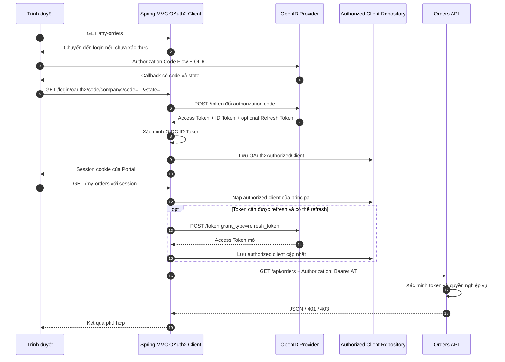
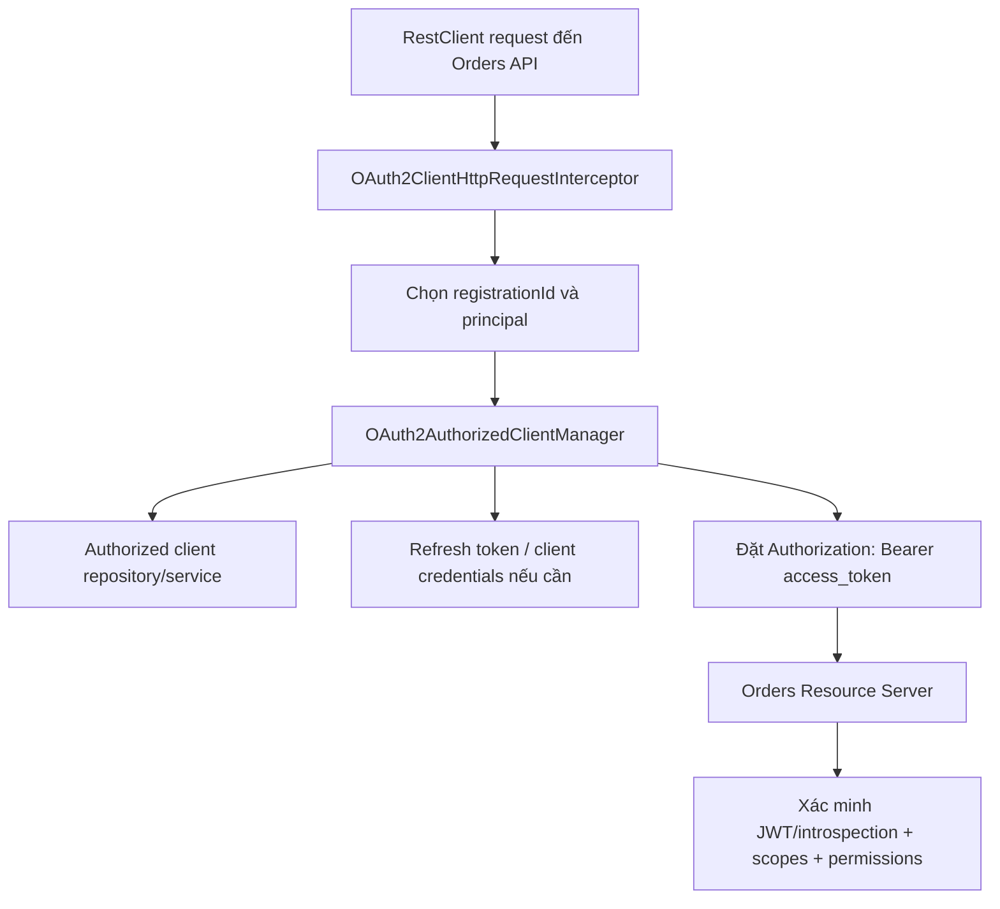
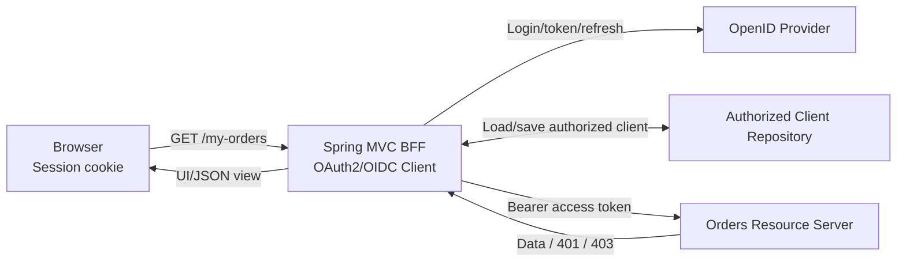

# 18.5. Đính kèm Bearer access token vào request

Trong ứng dụng **Spring Security OAuth 2.0/OIDC Client** chạy trên **Servlet stack**, việc đăng nhập thành công thường chỉ là điểm bắt đầu. Một Spring MVC portal hoặc Backend for Frontend (BFF) có thể phải gọi tiếp một **Resource Server API**, chẳng hạn Orders API, Billing API hoặc Profile API, để lấy dữ liệu và thực hiện nghiệp vụ.

Để truy cập API được bảo vệ bằng **OAuth 2.0 Bearer Token**, client gửi access token trong HTTP request:

```http
GET /api/orders HTTP/1.1
Host: orders-api.example.org
Accept: application/json
Authorization: Bearer <access-token>
```

Dòng header này đơn giản nhưng cần đáp ứng đồng thời nhiều điều kiện:

- **Đúng loại token:** sử dụng **access token**, không dùng ID token hay refresh token.
- **Đúng client registration:** lấy token của OAuth client được phép gọi API đó.
- **Đúng principal:** với delegated access, token phải thuộc người dùng thực sự đang thao tác.
- **Đúng đích:** không gửi Bearer token đến hostname/URL do nguồn không tin cậy kiểm soát.
- **Đúng thời điểm:** token còn hiệu lực; khi cần, dùng `OAuth2AuthorizedClientManager` để lấy token mới.
- **Đúng giới hạn quyền:** Resource Server vẫn kiểm tra issuer, audience, scope, tenant và tài nguyên cụ thể.
- **Không rò rỉ:** token không xuất hiện trong URL, log, frontend JavaScript hoặc HTTP redirect sang host ngoài.

Bài học đi từ cách gắn header **thủ công với `RestClient`**, đến `@RegisteredOAuth2AuthorizedClient`, `OAuth2AuthorizedClientManager` và **`OAuth2ClientHttpRequestInterceptor`**, rồi trình bày các tình huống multi-provider, Client Credentials, lỗi 401/403 và yêu cầu bảo mật.

## 1. Bearer token được sử dụng ở đâu trong luồng OAuth 2.0/OIDC?

### 1.1. Bốn vai trò chính

| Vai trò | Ví dụ | Trách nhiệm |
|---|---|---|
| End-User | Người dùng mở Portal | Đăng nhập và yêu cầu nghiệp vụ |
| OAuth Client / Relying Party | `https://portal.example.org` | Thực hiện OIDC Login, giữ authorized client và gọi API |
| Authorization Server / OpenID Provider | `https://login.example.org` | Xác thực/cấp tokens |
| Resource Server | `https://orders-api.example.org` | Nhận và xác minh access token, áp dụng quyền |

Trong Authorization Code/OIDC Login:



**Điểm đính kèm Bearer token nằm ở request từ Spring backend sang API**, không phải ở redirect mà browser gửi tới OP.

### 1.2. Ba loại token không được dùng thay nhau

| Token | Ai nhận/sử dụng? | Mục đích |
|---|---|---|
| **ID Token** | Relying Party trong OIDC | Xác minh kết quả xác thực End-User, issuer/audience/nonce... |
| **Access Token** | Resource Server | Cấp khả năng yêu cầu tài nguyên trong phạm vi AS đã ủy quyền |
| **Refresh Token** | OAuth Client gửi tới Token Endpoint | Xin access token mới theo grant và chính sách AS |

Không viết:

```http
Authorization: Bearer <id-token>
```

để gọi Orders API chỉ vì ID token cũng là một JWT có chữ ký. ID token thường có audience là **client ID của Portal**, trong khi access token cần phù hợp với audience của Orders API.

## 2. Cú pháp HTTP Authorization: Bearer

### 2.1. Bearer authentication scheme

Theo RFC 6750, cách thông dụng để gửi access token là:

```http
Authorization: Bearer <token-value>
```

Trong ví dụ, `<token-value>` chỉ là placeholder. Request thực tế phải chứa token string nguyên vẹn, không có dấu ngoặc nhọn của ví dụ.

Token có thể là:

- **Opaque token:** một chuỗi không có cấu trúc JWT mà Resource Server có thể phải introspect.
- **JWT access token:** token có cấu trúc JWT, Resource Server xác minh chữ ký và các claim theo profile.

**OAuth client không cần tự giải mã access token để đưa nó vào header.** Nó chỉ sử dụng `getTokenValue()` của token đã nhận từ Authorization Server. Resource Server mới là bên quyết định token hợp lệ hay không.

### 2.2. Vì sao ưu tiên header hơn URL?

Không dùng:

```text
https://orders-api.example.org/api/orders?access_token=<token>
```

vì URL có thể bị ghi vào logs, browser history, proxy metrics, APM hoặc các hệ thống quan sát. HTTP header vẫn nhạy cảm và cần redaction, nhưng `Authorization` là cơ chế chuẩn của Bearer authentication.

### 2.3. Phân biệt Basic với Bearer

Trong **token request**, confidential client có thể gửi:

```http
POST /oauth2/token HTTP/1.1
Authorization: Basic <base64-client-id-and-client-secret>
Content-Type: application/x-www-form-urlencoded

grant_type=authorization_code&code=...
```

Trong **API request**:

```http
GET /api/orders HTTP/1.1
Authorization: Bearer <access-token>
```

`Basic` có thể dùng để xác thực OAuth client tại Token Endpoint. `Bearer` dùng để trình bày access token tại Resource Server. Đừng gửi client secret đến API bằng Basic trừ khi API có một cơ chế khác được thiết kế và thỏa thuận rõ ràng.

## 3. OAuth2AuthorizedClient: nguồn access token trong Spring Security

Sau khi cấp token, Spring Security biểu diễn kết quả bằng `OAuth2AuthorizedClient`:

```text
OAuth2AuthorizedClient
├── ClientRegistration
│   ├── registrationId: company
│   ├── clientId: portal-web-prod
│   └── providerDetails
├── principalName: user-725
├── OAuth2AccessToken
│   ├── tokenValue
│   ├── issuedAt
│   ├── expiresAt
│   └── scopes
└── OAuth2RefreshToken (có thể null)
```

Lấy token:

```java
import org.springframework.security.oauth2.client.OAuth2AuthorizedClient;
import org.springframework.security.oauth2.core.OAuth2AccessToken;

OAuth2AuthorizedClient authorizedClient = /* từ Spring Security */;

OAuth2AccessToken accessToken = authorizedClient.getAccessToken();

String tokenValue = accessToken.getTokenValue();
```

Không nên tự giữ riêng `String tokenValue` trong một global/static field lâu dài vì nó có thể hết hạn hoặc thuộc nhầm principal.

### 3.1. ClientRegistration khác OAuth2AuthorizedClient

`ClientRegistration` chứa **cấu hình client** (client ID, secret, grant, scopes yêu cầu, Token Endpoint...).

`OAuth2AuthorizedClient` chứa **kết quả authorization của client trong ngữ cảnh một principal** (access token, refresh token nếu có, scopes thực cấp...).

Vì thế, chỉ có `ClientRegistrationRepository` **không** đồng nghĩa đã có access token để gửi API.

### 3.2. Principal binding không thể bỏ qua

Ví dụ:

```text
(company, user-725) -> access-token-for-user-725
(company, user-813) -> access-token-for-user-813
```

Nếu bạn cache token theo duy nhất registration `company`, request của user 813 có thể dùng token user 725 và truy cập sai dữ liệu.

Với user-delegated access, cần dùng đúng principal đã được xác thực, repository và authorized client manager tương ứng. Với Client Credentials Grant, principal có thể là một định danh workload ổn định, không phải End-User.

## 4. Chuẩn bị một ứng dụng Spring Boot Servlet

Giả sử Portal đăng nhập OIDC qua provider `company`, rồi gọi Orders API.

### 4.1. Dependencies

Gradle Groovy DSL:

```groovy
dependencies {
    implementation 'org.springframework.boot:spring-boot-starter-web'
    implementation 'org.springframework.boot:spring-boot-starter-security'
    implementation 'org.springframework.boot:spring-boot-starter-oauth2-client'
}
```

`RestClient` xuất hiện trong Spring Framework 6.1+, thường tương ứng Spring Boot 3.2+ trong những dự án Boot 3.x.

**`OAuth2ClientHttpRequestInterceptor`** là một integration API của dòng Spring Security mới (6.4+). Với phiên bản cũ không có interceptor này, dùng cách gắn header thủ công hoặc API HTTP client khác có hỗ trợ phù hợp.

### 4.2. ClientRegistration trong application.yml

```yaml
spring:
  security:
    oauth2:
      client:
        registration:
          company:
            provider: company
            client-id: ${OIDC_CLIENT_ID}
            client-secret: ${OIDC_CLIENT_SECRET}
            client-authentication-method: client_secret_basic
            authorization-grant-type: authorization_code
            redirect-uri: "{baseUrl}/login/oauth2/code/{registrationId}"
            scope:
              - openid
              - profile
              - orders.read
        provider:
          company:
            issuer-uri: ${OIDC_ISSUER_URI}
```

Trong YAML:

- `company` là `registrationId` dùng trong code.
- `client-id` là định danh RP tại OP, khác tên registration.
- `scope` là **scope yêu cầu**; scope được cấp có thể khác.
- `issuer-uri` cho phép dùng OIDC discovery nếu OP hỗ trợ.
- `client-secret` chỉ được giữ ở backend.

### 4.3. SecurityFilterChain cho login browser

```java
import org.springframework.context.annotation.Bean;
import org.springframework.context.annotation.Configuration;
import org.springframework.security.config.Customizer;
import org.springframework.security.config.annotation.web.builders.HttpSecurity;
import org.springframework.security.web.SecurityFilterChain;

@Configuration
public class WebSecurityConfig {

    @Bean
    SecurityFilterChain webSecurity(HttpSecurity http) throws Exception {
        http
            .authorizeHttpRequests(auth -> auth
                .requestMatchers("/", "/error").permitAll()
                .anyRequest().authenticated())
            .oauth2Login(Customizer.withDefaults());

        return http.build();
    }
}
```

`oauth2Login()` xử lý authorization code callback và tạo principal/session. Nó không tự động gắn access token vào **mọi request** bạn tạo qua `RestClient`. Việc đó thuộc caller hoặc một HTTP interceptor được cấu hình rõ ràng.

## 5. Cách 1 — Gắn Bearer header thủ công bằng RestClient

Đây là lựa chọn đơn giản và tường minh khi muốn hiểu chính xác token được đưa vào đâu.

### 5.1. Ví dụ tối thiểu

```java
import org.springframework.security.oauth2.client.OAuth2AuthorizedClient;
import org.springframework.web.client.RestClient;

public final class OrdersApiClient {

    private final RestClient restClient = RestClient.builder()
        .baseUrl("https://orders-api.example.org")
        .build();

    public String listOrders(OAuth2AuthorizedClient client) {

        String tokenValue = client.getAccessToken().getTokenValue();

        return restClient.get()
            .uri("/api/orders")
            .headers(headers -> headers.setBearerAuth(tokenValue))
            .retrieve()
            .body(String.class);
    }
}
```

Phương thức `setBearerAuth(tokenValue)` tạo:

```http
Authorization: Bearer <tokenValue>
```

**Chỉ truyền token value.** Không đưa sẵn chuỗi `Bearer ` vào `setBearerAuth`.

### 5.2. Lỗi thường gặp: Bearer bị nhân đôi

Ví dụ sai:

```java
headers.setBearerAuth("Bearer " + tokenValue);
```

Header thành:

```http
Authorization: Bearer Bearer <tokenValue>
```

và API có thể trả 401.

Đúng:

```java
headers.setBearerAuth(tokenValue);
```

Nếu cần tự xây header:

```java
headers.set("Authorization", "Bearer " + tokenValue);
```

nhưng nên ưu tiên `setBearerAuth` vì diễn đạt mục đích rõ và tránh lặp tiền tố.

### 5.3. Không đặt token user vào defaultHeader của singleton

Ví dụ cần tránh:

```java
// Anti-pattern cho ứng dụng multi-user.
RestClient client = RestClient.builder()
    .defaultHeader("Authorization", "Bearer " + firstUserToken)
    .build();
```

`RestClient` có thể là một singleton dùng chung nhiều HTTP requests. Nếu token được chốt ở bean creation, các request sau có nguy cơ gửi **token của user khác**, hoặc token cũ đã hết hạn.

Thay vào đó, gắn header **cho từng request** hoặc dùng OAuth interceptor xác định authorized client đúng theo ngữ cảnh hiện tại.

## 6. Lấy authorized client bằng @RegisteredOAuth2AuthorizedClient

Spring MVC cung cấp một argument resolver để lấy authorized client trong controller.

### 6.1. Controller gắn token trực tiếp

```java
import org.springframework.security.oauth2.client.OAuth2AuthorizedClient;
import org.springframework.security.oauth2.client.annotation.RegisteredOAuth2AuthorizedClient;
import org.springframework.web.bind.annotation.GetMapping;
import org.springframework.web.bind.annotation.RestController;
import org.springframework.web.client.RestClient;

@RestController
public class MyOrdersController {

    private final RestClient ordersApi = RestClient.builder()
        .baseUrl("https://orders-api.example.org")
        .build();

    @GetMapping("/my-orders")
    public String list(
            @RegisteredOAuth2AuthorizedClient("company")
            OAuth2AuthorizedClient authorizedClient) {

        String tokenValue =
            authorizedClient.getAccessToken().getTokenValue();

        return ordersApi.get()
            .uri("/api/orders")
            .headers(h -> h.setBearerAuth(tokenValue))
            .retrieve()
            .body(String.class);
    }
}
```

Khi user đã đăng nhập và registration `company` có authorized client, Spring có thể resolve authorized client để controller dùng.

Tùy configuration/version, việc resolve có thể đi qua `OAuth2AuthorizedClientManager`. Không giả định annotation luôn trả non-null ở mọi context; khi người dùng chưa authorization hoặc không thể gia hạn token, cần error handling phù hợp.

### 6.2. Đánh giá cách này

**Ưu điểm:**

- Ngắn gọn và dễ hiểu.
- Registration được chỉ định rõ.
- Không phải tự lấy token từ HTTP session hoặc token response JSON.

**Giới hạn:**

- Controller biết chi tiết OAuth và URL API nếu không tách service.
- Khó tái sử dụng ngoài MVC.
- Nếu cần nhiều registrations hoặc chính sách refresh phức tạp, manager/service chuyên biệt thường rõ hơn.
- API vẫn kiểm tra audience/scope/tenant độc lập.

Không trả nguyên `OAuth2AuthorizedClient` qua controller response vì nó chứa token nhạy cảm.

## 7. Tách REST gateway khỏi controller

Trong dự án thực tế, nên để HTTP client nằm trong service/gateway.

### 7.1. Cấu hình RestClient bean theo API

```java
import org.springframework.context.annotation.Bean;
import org.springframework.context.annotation.Configuration;
import org.springframework.web.client.RestClient;

@Configuration
public class DownstreamClientConfig {

    @Bean
    RestClient ordersRestClient(RestClient.Builder builder) {
        return builder
            .baseUrl("https://orders-api.example.org")
            .build();
    }
}
```

Nếu ứng dụng có nhiều `RestClient` beans, inject bằng tên bean hoặc `@Qualifier("ordersRestClient")`.

### 7.2. Gateway gắn Bearer token

```java
import org.springframework.beans.factory.annotation.Qualifier;
import org.springframework.security.oauth2.client.OAuth2AuthorizedClient;
import org.springframework.stereotype.Service;
import org.springframework.web.client.RestClient;

@Service
public class OrdersGateway {

    private final RestClient restClient;

    public OrdersGateway(
            @Qualifier("ordersRestClient") RestClient restClient) {
        this.restClient = restClient;
    }

    public String listOrders(OAuth2AuthorizedClient client) {
        return restClient.get()
            .uri("/api/orders")
            .headers(h -> h.setBearerAuth(
                client.getAccessToken().getTokenValue()))
            .retrieve()
            .body(String.class);
    }
}
```

### 7.3. Controller chỉ điều phối

```java
import org.springframework.security.oauth2.client.OAuth2AuthorizedClient;
import org.springframework.security.oauth2.client.annotation.RegisteredOAuth2AuthorizedClient;
import org.springframework.web.bind.annotation.GetMapping;
import org.springframework.web.bind.annotation.RestController;

@RestController
public class OrdersController {

    private final OrdersGateway orders;

    public OrdersController(OrdersGateway orders) {
        this.orders = orders;
    }

    @GetMapping("/my-orders")
    public String myOrders(
            @RegisteredOAuth2AuthorizedClient("company")
            OAuth2AuthorizedClient authorizedClient) {
        return orders.listOrders(authorizedClient);
    }
}
```

Ưu điểm của cấu trúc này:

- **Controller:** tiếp nhận request của người dùng.
- **Authorized client:** cung cấp token của đúng registration/principal.
- **Gateway:** quyết định API host, method, path, body và error mapping.
- **Resource Server:** xác minh token và nghiệp vụ.

## 8. Cách 2 — OAuth2AuthorizedClientManager quản lý token trước khi gọi API

`OAuth2AuthorizedClientManager` là abstraction được Spring Security cung cấp để **lấy authorized client hiện có và cấp/cấp lại khi cần**.

### 8.1. Hai implementation cần phân biệt

| Manager | Dùng khi nào? | Kho lưu |
|---|---|---|
| `DefaultOAuth2AuthorizedClientManager` | Đang xử lý Servlet HTTP request, thường với logged-in user | `OAuth2AuthorizedClientRepository` |
| `AuthorizedClientServiceOAuth2AuthorizedClientManager` | Scheduled worker, backend job không có request | `OAuth2AuthorizedClientService` |

Với Spring MVC/BFF, ta thường dùng **`DefaultOAuth2AuthorizedClientManager`**.

### 8.2. Khai báo manager cho Servlet

```java
import org.springframework.context.annotation.Bean;
import org.springframework.context.annotation.Configuration;
import org.springframework.security.oauth2.client.OAuth2AuthorizedClientManager;
import org.springframework.security.oauth2.client.OAuth2AuthorizedClientProvider;
import org.springframework.security.oauth2.client.OAuth2AuthorizedClientProviderBuilder;
import org.springframework.security.oauth2.client.registration.ClientRegistrationRepository;
import org.springframework.security.oauth2.client.web.DefaultOAuth2AuthorizedClientManager;
import org.springframework.security.oauth2.client.web.OAuth2AuthorizedClientRepository;

@Configuration
public class AuthorizedClientManagerConfig {

    @Bean
    OAuth2AuthorizedClientManager authorizedClientManager(
            ClientRegistrationRepository registrations,
            OAuth2AuthorizedClientRepository authorizedClients) {

        OAuth2AuthorizedClientProvider provider =
            OAuth2AuthorizedClientProviderBuilder.builder()
                .authorizationCode()
                .refreshToken()
                .build();

        var manager = new DefaultOAuth2AuthorizedClientManager(
            registrations, authorizedClients);

        manager.setAuthorizedClientProvider(provider);
        return manager;
    }
}
```

`refreshToken()` chỉ hoạt động nếu có refresh token và điều kiện grant phù hợp. Không phải mỗi lần `authorize(...)` đều gửi HTTP request tới Token Endpoint; manager có thể trả authorized client đang còn hiệu lực.

Một số phiên bản/configuration Spring Boot đã cung cấp manager bean thích hợp, nên không cần tạo bean thủ công khi không có nhu cầu tùy chỉnh.

### 8.3. Tạo OAuth2AuthorizeRequest

Trong Servlet controller/service:

```java
import jakarta.servlet.http.HttpServletRequest;
import jakarta.servlet.http.HttpServletResponse;
import org.springframework.security.core.Authentication;
import org.springframework.security.oauth2.client.OAuth2AuthorizeRequest;

OAuth2AuthorizeRequest request = OAuth2AuthorizeRequest
    .withClientRegistrationId("company")
    .principal(authentication)
    .attribute(HttpServletRequest.class.getName(), servletRequest)
    .attribute(HttpServletResponse.class.getName(), servletResponse)
    .build();
```

Các biến `authentication`, `servletRequest`, `servletResponse` đến từ một request MVC đã được xác thực. Không chọn principal từ query parameter `?userId=...`.

### 8.4. Dùng manager.authorize()

```java
import org.springframework.security.oauth2.client.OAuth2AuthorizedClient;

OAuth2AuthorizedClient client = manager.authorize(request);

if (client == null) {
    throw new IllegalStateException(
        "No authorized client for company registration");
}

String tokenValue = client.getAccessToken().getTokenValue();

String response = ordersRestClient.get()
    .uri("/api/orders")
    .headers(h -> h.setBearerAuth(tokenValue))
    .retrieve()
    .body(String.class);
```

`manager` và `ordersRestClient` là dependencies đã được inject. Trong ứng dụng thực tế, cần xử lý riêng các trường hợp:

- Authorized client chưa được cấp.
- Token không thể refresh hoặc Token Endpoint lỗi.
- Access token không có scope API yêu cầu.
- Downstream API trả 401/403 hoặc gặp network timeout.

Không bắt mọi lỗi rồi tự tạo một token rỗng để tiếp tục.

## 9. Cách 3 — OAuth2ClientHttpRequestInterceptor cho RestClient

Với các dòng Spring Security hỗ trợ **`OAuth2ClientHttpRequestInterceptor`** (6.4+), có thể dùng interceptor để **gắn token tự động** theo `OAuth2AuthorizedClientManager`.

### 9.1. Sơ đồ



Interceptor không phải Authorization Server: nó dùng manager để lấy authorized client rồi đặt credential vào outgoing HTTP request.

### 9.2. Tạo RestClient có interceptor

```java
import org.springframework.context.annotation.Bean;
import org.springframework.context.annotation.Configuration;
import org.springframework.security.oauth2.client.OAuth2AuthorizedClientManager;
import org.springframework.security.oauth2.client.web.client.OAuth2ClientHttpRequestInterceptor;
import org.springframework.web.client.RestClient;

@Configuration
public class OAuthRestClientConfig {

    @Bean
    RestClient oauthOrdersRestClient(
            OAuth2AuthorizedClientManager manager) {

        var interceptor =
            new OAuth2ClientHttpRequestInterceptor(manager);

        return RestClient.builder()
            .baseUrl("https://orders-api.example.org")
            .requestInterceptor(interceptor)
            .build();
    }
}
```

**Chỉ thêm interceptor chưa đủ** nếu hệ thống không biết dùng registration/principal nào. Caller hoặc resolver cần cung cấp ngữ cảnh authorization phù hợp.

### 9.3. Chỉ định registration ID tại từng request

Ví dụ với request attributes API tương ứng:

```java
import static org.springframework.security.oauth2.client.web.client.RequestAttributeClientRegistrationIdResolver.clientRegistrationId;

String orders = oauthOrdersRestClient.get()
    .uri("/api/orders")
    .attributes(clientRegistrationId("company"))
    .retrieve()
    .body(String.class);
```

`clientRegistrationId("company")` giúp resolver xác định OAuth client registration được sử dụng. Interceptor có thể phối hợp manager để nạp/refresh authorized client trước khi gửi request.

Trong ứng dụng có nhiều registrations, **đừng cho browser tự chọn một registration được quyền cao**. Lựa chọn registration phải gắn với operation/service policy đáng tin.

### 9.4. Principal resolver cũng quan trọng

Với Servlet request đã login, principal thường đến từ Authentication trong ngữ cảnh đang xử lý. Trong một số integration, có thể cấu hình principal resolver để có nguồn principal tường minh.

Không dùng `SecurityContextHolder` của một thread khác hoặc cached Authentication của user trước đó để thay đổi principal của outgoing request.

Với background workloads, dùng một service-based manager và principal kỹ thuật ổn định thay vì mặc định yêu cầu browser user.

### 9.5. Khi nào chọn interceptor?

**Phù hợp khi:**

- Có nhiều methods gọi cùng API với cùng chính sách OAuth.
- Muốn giảm mã lặp khi gắn Bearer header.
- Muốn manager xử lý token selection/refresh tập trung.
- Có thể xác định chính xác registration, principal và permitted origin.

**Cần thận trọng khi:**

- RestClient chung được dùng cho nhiều hosts.
- Caller chấp nhận URI tuyệt đối hoặc redirect động.
- Một request có thể đến API không cần authentication.
- Có nhiều providers với scopes/audiences khác nhau.
- Có nhiều interceptors cùng sửa `Authorization` header.

Nếu chỉ vài requests, cách `setBearerAuth(...)` trong API gateway riêng vẫn hoàn toàn hợp lý.

## 10. Không gửi Bearer token đến host tùy ý

Bearer token là credential: **ai sở hữu token có thể trình bày token với Resource Server chấp nhận nó**. Nếu ứng dụng gửi token tới host attacker kiểm soát, credential có thể bị đánh cắp.

### 10.1. Anti-pattern: generic proxy nhận URL từ browser

```java
// KHÔNG sử dụng: URL do browser chọn, server gắn token.
@GetMapping("/proxy")
public String proxy(
        @RequestParam String url,
        @RegisteredOAuth2AuthorizedClient("company")
        OAuth2AuthorizedClient client) {

    return RestClient.create().get()
        .uri(url)
        .headers(h -> h.setBearerAuth(
            client.getAccessToken().getTokenValue()))
        .retrieve()
        .body(String.class);
}
```

Một URL như `https://attacker.example/collect` có thể khiến backend gửi access token ra ngoài. Ngoài credential exfiltration, endpoint cũng có thể tạo nguy cơ **SSRF** vào mạng nội bộ.

### 10.2. Thiết kế thay thế: route do server quản lý

Không nhận URL tùy ý; nhận một operation ID có allowlist:

```text
operation=listOrders   -> GET /api/orders tại orders-api.example.org
operation=myProfile    -> GET /api/me tại profile-api.example.org
```

Server chọn đúng RestClient và registration đã định nghĩa. Không chỉ kiểm tra `url.startsWith("https://orders-api.example.org")` vì prefix string có thể bị giả bằng hostname như `orders-api.example.org.attacker.test`.

### 10.3. Base URL không phải cơ chế allowlist tuyệt đối

`RestClient.builder().baseUrl(...)` giúp đặt host mặc định cho relative paths, nhưng các API HTTP client có thể cho phép caller truyền **absolute URI** thay thế base URL.

Vì vậy, dù đã cấu hình base URL, cần bảo đảm gateway không nhận absolute URI bất kỳ từ input không tin cậy. Có thể tạo REST client riêng theo từng Resource Server và chỉ cho phép path nghiệp vụ cụ thể.

## 11. HTTP redirects và nguy cơ rò rỉ Authorization header

Giả sử Orders API trả:

```http
HTTP/1.1 302 Found
Location: https://other.example.net/collect
```

Một số HTTP clients có thể tự đi theo redirect. Không nên suy đoán mọi version/library sẽ luôn xóa `Authorization` header khi đổi host, hoặc tự copy credential sang request mới.

**Cách phòng vệ:**

1. Tránh redirect trong API calls mang Bearer token nếu không cần.
2. Cấu hình HTTP client theo chính sách permitted origins.
3. Không tự chuyển `Authorization` header sang host mới.
4. Chỉ dùng HTTPS và xác minh chứng thư/hostname.
5. Không để destination redirect được điều khiển bởi query từ browser.
6. Khi cần follow redirect, kiểm tra rõ **host, scheme, port** và behavior thực tế của request factory.

Cùng một OAuth client token không nên được gửi đến nhiều resource servers chỉ vì chúng cùng nằm dưới một tổ chức.

## 12. Token expiration và refresh trước khi gọi API

### 12.1. Access token có thời hạn

`OAuth2AccessToken` có metadata:

```java
client.getAccessToken().getIssuedAt();
client.getAccessToken().getExpiresAt();
client.getAccessToken().getScopes();
```

Nếu ứng dụng cứ dùng token value được lưu sẵn trong field, token có thể hết hạn. Manager/provider của Spring có cơ chế kiểm tra expiry và gia hạn khi điều kiện phù hợp.

### 12.2. Refresh token grant

Với OIDC Authorization Code Flow, token response ban đầu có thể chứa refresh token:

```json
{
  "access_token": "<AT-1>",
  "token_type": "Bearer",
  "expires_in": 3600,
  "refresh_token": "<RT-1>",
  "id_token": "<ID-Token>"
}
```

Khi cần refresh, OAuth client gửi refresh token tới Token Endpoint:

```http
POST /oauth2/token HTTP/1.1
Host: login.example.org
Content-Type: application/x-www-form-urlencoded
Authorization: Basic <client-credentials>

grant_type=refresh_token&refresh_token=<RT-1>
```

AS có thể trả `AT-2` và một `RT-2` mới. Khi có refresh token rotation, authorized client storage cần lưu cả token mới và refresh token mới nhất quán.

**Refresh token không được gửi đến Orders API**. API chỉ nhận access token.

### 12.3. Khi không có refresh token

AS không bắt buộc cấp refresh token cho mọi OAuth2 Login. Nếu access token hết hạn và không có refresh token, người dùng có thể cần thực hiện authorization/login lại. Không dùng client secret để giả lập một refresh token của user.

### 12.4. Request đồng thời và refresh token rotation

Nếu hai requests cùng refresh với RT cũ, AS có thể từ chối request thứ hai. Manager không mặc nhiên cung cấp distributed lock cho nhiều nodes. Khi app có concurrency cao, cần tính đến token storage consistency và retry policy.

Không đặt retry vô hạn cho `invalid_grant`, vì có thể làm nghiêm trọng hóa cơ chế phát hiện token reuse.

## 13. Requested scopes, granted scopes và API authorization

### 13.1. Scopes trong YAML không chứng minh token đã được cấp

Registration có thể xin:

```yaml
scope:
  - openid
  - profile
  - orders.read
```

Nhưng token response có thể chỉ cấp một tập con theo chính sách AS. Nếu muốn kiểm tra ở client:

```java
boolean canAskForOrders =
    client.getAccessToken().getScopes().contains("orders.read");
```

Đây là một **precondition cho phía caller**, không thay thế authorization của API.

### 13.2. Scope không phải user role

`orders.read` của access token cho biết token được cấp phạm vi thao tác liên quan tới Orders API. Nó không khẳng định user có quyền đọc **mọi đơn hàng của mọi tenant**.

Một API có thể yêu cầu:

```text
access token valid for orders-api
AND scope contains orders.read
AND user canRead(order=742)
AND order belongs to allowed tenant
```

Tất cả đều phải được kiểm tra bởi Resource Server hoặc domain authorization service tương ứng.

### 13.3. Audience phải phù hợp API

Access token cho `reports-api` không đương nhiên hợp lệ với `orders-api` dù chúng dùng cùng AS và một số scope giống nhau.

Resource Server phải xác minh audience hoặc resource binding. Bên client nên dùng registration/token phù hợp cho từng API; không bỏ audience validation để chấp nhận token sai đích.

## 14. Resource Server xử lý Bearer token ở phía nhận

Một Spring Security Resource Server có thể cấu hình:

```yaml
spring:
  security:
    oauth2:
      resourceserver:
        jwt:
          issuer-uri: https://login.example.org
```

SecurityFilterChain minh họa:

```java
import org.springframework.context.annotation.Bean;
import org.springframework.context.annotation.Configuration;
import org.springframework.http.HttpMethod;
import org.springframework.security.config.Customizer;
import org.springframework.security.config.annotation.web.builders.HttpSecurity;
import org.springframework.security.web.SecurityFilterChain;

@Configuration
public class ApiSecurityConfig {

    @Bean
    SecurityFilterChain apiSecurity(HttpSecurity http) throws Exception {
        http
            .authorizeHttpRequests(auth -> auth
                .requestMatchers(HttpMethod.GET, "/api/orders/**")
                    .hasAuthority("SCOPE_orders.read")
                .requestMatchers(HttpMethod.POST, "/api/orders/**")
                    .hasAuthority("SCOPE_orders.write")
                .anyRequest().authenticated())
            .oauth2ResourceServer(oauth2 -> oauth2
                .jwt(Customizer.withDefaults()));

        return http.build();
    }
}
```

`JwtGrantedAuthoritiesConverter` mặc định thường chuyển `scope`/`scp` thành authorities dạng `SCOPE_orders.read`. Nếu AS dùng claim format khác, Resource Server cần converter tương ứng.

**Cấu hình issuer chưa chắc đủ để giới hạn audience đúng API.** API cần cấu hình audience validation theo Spring Security version và contract AS. Ví dụ trên chỉ minh họa phần route/scope checks.

Không đưa ID token của web RP vào Resource Server để làm Access Token chỉ vì nó có claim `sub` hợp lệ.

## 15. Các mã lỗi 401 và 403

### 15.1. 401 Unauthorized

Ví dụ:

```http
HTTP/1.1 401 Unauthorized
WWW-Authenticate: Bearer error="invalid_token"
```

Nguyên nhân thường gặp:

- Không có Bearer header.
- Token sai hoặc đã bị cắt.
- Token hết hạn/bị thu hồi.
- Audience/issuer sai.
- API không thể xác minh chữ ký hoặc introspection.
- Client gửi ID token thay access token.
- Một proxy đã loại bỏ `Authorization` header.

### 15.2. 403 Forbidden

Ví dụ:

```http
HTTP/1.1 403 Forbidden
WWW-Authenticate: Bearer error="insufficient_scope"
```

Nguyên nhân thường gặp:

- Token hợp lệ nhưng thiếu `orders.write`.
- User thiếu role hoặc quyền với object.
- Tenant policy từ chối.
- Client/workload không được thực hiện operation.

Không suy ra mọi 403 đều do thiếu scope; authorization có thể bao gồm nhiều lớp nghiệp vụ.

### 15.3. Bảng chẩn đoán

| Biểu hiện | Khả năng | Tầng cần xem |
|---|---|---|
| API không nhận Bearer header | RestClient chưa đặt header/interceptor không được gắn | HTTP client wiring |
| `Bearer Bearer ...` | Đưa sẵn scheme vào `setBearerAuth` | Request header generation |
| API nhận token user khác | Shared token/static field/cache sai key | Principal/authorized client storage |
| 401 vì token expired | Không refresh/không lấy authorized client mới | Manager, refresh provider |
| `invalid_grant` từ Token Endpoint | Refresh token expired/rotated/revoked | Authorization Server/token lifecycle |
| `invalid_client` từ Token Endpoint | Client secret/auth method sai | ClientRegistration và AS |
| 401 dù token vừa được cấp | Audience/issuer/API contract không khớp | Resource Server validation |
| 403, token thiếu scope | AS không cấp scope yêu cầu | Granted vs requested scopes |
| 403, token có scope | Resource/tenant/user permissions | Domain authorization |
| Chỉ một registration bị lỗi | Token được chọn sai provider | registrationId resolver |
| Chỉ lỗi trên một instance | Session/store/manager config khác nhau | Cluster và persistence |
| BFF login tốt nhưng API trả 401 | ID token/access token nhầm hoặc token sai audience | Token type và API contract |

## 16. Xử lý lỗi HTTP bằng RestClient

### 16.1. Trạng thái 4xx/5xx

Với:

```java
String body = restClient.get()
    .uri("/api/orders")
    .headers(h -> h.setBearerAuth(tokenValue))
    .retrieve()
    .body(String.class);
```

`retrieve()` mặc định có cơ chế xử lý 4xx/5xx và thường ném exception khi response lỗi.

Có thể tùy chỉnh cách chuyển 403 sang exception nghiệp vụ:

```java
String body = restClient.get()
    .uri("/api/orders")
    .headers(h -> h.setBearerAuth(tokenValue))
    .retrieve()
    .onStatus(
        status -> status.value() == 403,
        (request, response) -> {
            throw new IllegalStateException(
                "Orders API denied access");
        }
    )
    .body(String.class);
```

Đây là ví dụ xử lý đơn giản. Production nên dùng exception cụ thể và mã lỗi phù hợp; không trả stack trace hoặc raw downstream response chứa dữ liệu nhạy cảm cho browser.

### 16.2. Retry 401 có giới hạn

Không tự động retry vô hạn mọi 401. Một 401 có thể do token hết hạn, nhưng cũng có thể do issuer hoặc audience hoàn toàn sai.

Quy trình gợi ý:

1. Xác định nguyên nhân từ `WWW-Authenticate` và thông tin không nhạy cảm.
2. Nếu authorized client stale, để manager/failure handler xử lý theo contract.
3. Nếu có thể, xin token mới và **giới hạn retry**.
4. Tránh retry tự động các POST/PATCH không idempotent khi không biết API đã xử lý request chưa.
5. Nếu vấn đề tiếp diễn, trả lỗi rõ hoặc yêu cầu authorization lại.

Một số OAuth2 HTTP interceptors có extension point cho **authorization failure handler** để quản lý token bị API từ chối. Chỉ cấu hình khi hiểu đúng repository/service và version; không xóa token của user khác hoặc xóa mọi registrations khi một API trả 401.

### 16.3. Refresh không tự sửa được 403

Nếu API trả `insufficient_scope`, refresh token không tự nâng cấp quyền vượt authorization grant. User/client có thể cần flow consent/authorization mới, hoặc domain permission phải được cấp theo quy trình nghiệp vụ.

## 17. REST Client Servlet trong mô hình BFF

`Backend for Frontend` giữ token phía server, browser chỉ dùng session cookie để làm việc với portal.



**Hai trust boundaries khác nhau:**

| Chặng | Credential | Vai trò |
|---|---|---|
| Browser → BFF | `JSESSIONID` hoặc session cookie được bảo vệ | Nhận diện browser session |
| BFF → API | `Authorization: Bearer access_token` | Resource Server access |

Không copy `Cookie: JSESSIONID=...` thành `Authorization` header của API. Cũng không gửi access token lại cho frontend JavaScript nếu kiến trúc đã chọn BFF server-side.

### 17.1. CSRF vẫn quan trọng với session cookie

Một BFF dùng cookie phiên có thể gặp CSRF vì browser gửi cookie tự động. Việc backend gọi API bằng Bearer token không tự loại bỏ CSRF ở endpoint BFF nhận các hành động thay đổi trạng thái.

Không tắt CSRF toàn ứng dụng chỉ vì có OAuth2 Client.

### 17.2. Không coi ẩn nút UI là authorization

UI có thể ẩn nút “Sửa đơn hàng” khi user không có role. Nhưng API vẫn phải tự xác minh scope và quyền theo object. Bearer token chỉ là một thành phần của authorization.

## 18. Nhiều ClientRegistration và nhiều Resource Servers

Một ứng dụng có thể có hai registrations:

```yaml
spring:
  security:
    oauth2:
      client:
        registration:
          company:
            provider: company
            client-id: ${COMPANY_CLIENT_ID}
            client-secret: ${COMPANY_CLIENT_SECRET}
            authorization-grant-type: authorization_code
            redirect-uri: "{baseUrl}/login/oauth2/code/{registrationId}"
            scope:
              - openid
              - profile
              - orders.read

          partner:
            provider: partner
            client-id: ${PARTNER_CLIENT_ID}
            client-secret: ${PARTNER_CLIENT_SECRET}
            authorization-grant-type: authorization_code
            redirect-uri: "{baseUrl}/login/oauth2/code/{registrationId}"
            scope:
              - openid
              - profile
              - partner.read

        provider:
          company:
            issuer-uri: ${COMPANY_ISSUER}
          partner:
            issuer-uri: ${PARTNER_ISSUER}
```

Khi gọi API bằng interceptor:

```java
.attributes(clientRegistrationId("company"))
```

khác hoàn toàn:

```java
.attributes(clientRegistrationId("partner"))
```

Registration ID là **tên nội bộ của Spring**, không phải tên hostname. Backend phải xác định rõ mapping:

```text
operation=listOrders
  -> REST client Orders API
  -> registration company
  -> bearer token có audience/scopes phù hợp
```

Nếu request input có `registrationId=admin`, không cho browser dùng nó để chọn một token có quyền cao hơn. Hạn chế registration theo operation được server cho phép.

### 18.1. Không dùng token của Reports API cho Orders API

Ngay cả khi cùng issuer, access token có `aud=reports-api` có thể bị Orders API từ chối. Nếu sản phẩm gọi nhiều APIs, cần token phù hợp với từng resource, có thể bằng registrations, resource indicators hoặc AS-specific audience policies.

Đừng bỏ audience validation chỉ vì scope string trông giống nhau.

## 19. Client Credentials: Bearer token cho backend không có End-User

Một scheduled worker không nên dùng access token của người cuối cùng đã đăng nhập vào Portal. Nó thường cần **Client Credentials Grant**.

### 19.1. Registration cho workload

```yaml
spring:
  security:
    oauth2:
      client:
        registration:
          inventory-worker:
            provider: internal-as
            client-id: ${WORKER_CLIENT_ID}
            client-secret: ${WORKER_CLIENT_SECRET}
            client-authentication-method: client_secret_basic
            authorization-grant-type: client_credentials
            scope:
              - inventory.read
        provider:
          internal-as:
            token-uri: https://auth.example.org/oauth2/token
```

### 19.2. Service-based manager

```java
import org.springframework.context.annotation.Bean;
import org.springframework.context.annotation.Configuration;
import org.springframework.security.oauth2.client.AuthorizedClientServiceOAuth2AuthorizedClientManager;
import org.springframework.security.oauth2.client.OAuth2AuthorizedClientManager;
import org.springframework.security.oauth2.client.OAuth2AuthorizedClientProviderBuilder;
import org.springframework.security.oauth2.client.OAuth2AuthorizedClientService;
import org.springframework.security.oauth2.client.registration.ClientRegistrationRepository;

@Configuration
public class WorkloadOAuthConfig {

    @Bean
    OAuth2AuthorizedClientManager workloadManager(
            ClientRegistrationRepository registrations,
            OAuth2AuthorizedClientService authorizedClients) {

        var manager = new AuthorizedClientServiceOAuth2AuthorizedClientManager(
            registrations, authorizedClients);

        manager.setAuthorizedClientProvider(
            OAuth2AuthorizedClientProviderBuilder.builder()
                .clientCredentials()
                .build()
        );

        return manager;
    }
}
```

### 19.3. Lấy token và gọi API

```java
import org.springframework.security.oauth2.client.OAuth2AuthorizeRequest;
import org.springframework.security.oauth2.client.OAuth2AuthorizedClient;

OAuth2AuthorizeRequest authorizeRequest = OAuth2AuthorizeRequest
    .withClientRegistrationId("inventory-worker")
    .principal("inventory-sync-service")
    .build();

OAuth2AuthorizedClient client = workloadManager.authorize(authorizeRequest);

if (client == null) {
    throw new IllegalStateException("Workload authorization failed");
}

String products = inventoryRestClient.get()
    .uri("/api/products")
    .headers(h -> h.setBearerAuth(
        client.getAccessToken().getTokenValue()))
    .retrieve()
    .body(String.class);
```

`principal("inventory-sync-service")` là **khóa kỹ thuật cho authorized client storage**, không phải người dùng đã đăng nhập OIDC. Với Client Credentials, AS cấp token cho client/workload; Resource Server áp dụng workload authorization.

Scheduled jobs không có Servlet HTTP request; dùng `AuthorizedClientServiceOAuth2AuthorizedClientManager`, không cố dựng request giả cho `DefaultOAuth2AuthorizedClientManager`.

## 20. RestTemplate và WebClient trên Servlet stack

Ngoài RestClient, những codebase cũ hoặc đặc thù có thể dùng RestTemplate hoặc WebClient.

### 20.1. RestTemplate

```java
import org.springframework.http.HttpEntity;
import org.springframework.http.HttpHeaders;
import org.springframework.http.HttpMethod;
import org.springframework.http.ResponseEntity;
import org.springframework.web.client.RestTemplate;

HttpHeaders headers = new HttpHeaders();
headers.setBearerAuth(accessToken);

HttpEntity<Void> entity = new HttpEntity<>(headers);

ResponseEntity<String> response = new RestTemplate().exchange(
    "https://orders-api.example.org/api/orders",
    HttpMethod.GET,
    entity,
    String.class
);
```

`accessToken` ở đây là token value lấy đúng từ authorized client. Code này không tự làm mới token; cần manager/resolver riêng nếu muốn refresh.

### 20.2. WebClient trên Servlet

```java
import org.springframework.web.reactive.function.client.WebClient;

WebClient ordersApi = WebClient.builder()
    .baseUrl("https://orders-api.example.org")
    .build();

String body = ordersApi.get()
    .uri("/api/orders")
    .headers(h -> h.setBearerAuth(accessToken))
    .retrieve()
    .bodyToMono(String.class)
    .block();
```

`WebClient` thuộc `spring-webflux`. Đoạn `block()` chỉ minh họa synchronous caller trên Servlet stack; không block trong reactive event-loop. Spring Security có `ServletOAuth2AuthorizedClientExchangeFilterFunction` cho WebClient trong Servlet context, khác `ServerOAuth2AuthorizedClientExchangeFilterFunction` dùng trên Reactive/WebFlux stack.

### 20.3. Khi nào đổi HTTP client?

- **RestClient:** fluent synchronous HTTP API trên Spring mới.
- **RestTemplate:** hệ thống cũ cần tích hợp tương thích.
- **WebClient:** HTTP client reactive có thể dùng cùng Servlet app, nhưng cần hiểu thread/resource model.

Dù dùng client nào, nguyên tắc không đổi: **lấy access token đúng principal/registration, gắn Bearer header và giữ token khỏi bị lộ**.

## 21. Request GET và POST với Bearer token

Bearer token không phụ thuộc HTTP method. Nhưng method ảnh hưởng retry và quyền nghiệp vụ.

### 21.1. GET một tài nguyên

```java
String orderJson = restClient.get()
    .uri("/api/orders/{id}", "742")
    .headers(h -> h.setBearerAuth(tokenValue))
    .retrieve()
    .body(String.class);
```

API cần scope đọc và kiểm tra user/tenant có quyền với đơn hàng `742`.

### 21.2. POST tạo dữ liệu

```java
String result = restClient.post()
    .uri("/api/orders")
    .headers(h -> h.setBearerAuth(tokenValue))
    .body(new CreateOrderRequest("sku-12", 3))
    .retrieve()
    .body(String.class);
```

`CreateOrderRequest` là DTO nghiệp vụ minh họa.

Không retry vô hạn các POST/PATCH khi bị timeout vì API có thể đã thực hiện side effect. Nếu cần retry an toàn, thiết kế idempotency key và contract rõ giữa client/API.

### 21.3. Content-Type khác Authorization

`Content-Type: application/json` mô tả body request; `Authorization: Bearer ...` mô tả credential. Đặt header này không tự làm HTTP body thành JSON hoặc cấp scope cho thao tác POST. Cần cấu hình serialization/content type theo API contract riêng.

## 22. Log và observability an toàn

Khi chẩn đoán một REST call không thành công, **không cần log token value**.

Có thể log metadata:

```text
event=outbound_api_call
registrationId=company
resource=orders-api
method=GET
route=/api/orders
tokenAttached=true
requiredScope=orders.read
httpStatus=403
durationMs=<duration>
correlationId=<non-secret-id>
```

Không log:

```text
Authorization: Bearer <access-token>
Authorization: Basic <client-secret>
refresh_token=<refresh-token>
access_token=<access-token>
id_token=<id-token>
Cookie: JSESSIONID=<session-id>
```

Ngay cả khi Java code không ghi log, HTTP logging của proxy/service mesh/APM có thể thu headers. Cần redaction ở **mọi tầng**.

Correlation ID nên là giá trị riêng, không dùng token value hoặc một đoạn token làm ID cho tracing.

## 23. Các tình huống thường gặp và cách xử lý

### Tình huống A — Login thành công, API lại trả 401

Có thể client đã gửi ID token thay access token, token hết hạn hoặc audience không thuộc API. Kiểm tra:

- `OAuth2AuthorizedClient.getAccessToken()` có được dùng không?
- Manager có lấy lại token sau expiry không?
- API tin issuer/token profile không?
- Audience của access token có đúng Orders API không?
- Header có bị mất ở gateway không?

### Tình huống B — RestClient gửi token người khác

Nguyên nhân thường do token đặt trong bean singleton, cache chỉ khóa theo `registrationId` hoặc principal context lấy sai. Sửa ở **identity binding và request-scoped token selection**, không chỉ đổi tên header.

### Tình huống C — API 403 dù YAML có orders.write

YAML chỉ thể hiện scope được **yêu cầu**. AS có thể không cấp scope, hoặc user không được sửa object. Kiểm tra `authorizedClient.getAccessToken().getScopes()` và policy tại API.

### Tình huống D — Interceptor không thêm Authorization header

Kiểm tra RestClient bean thực sự có `OAuth2ClientHttpRequestInterceptor`, registration ID đã được truyền theo resolver, principal có trong context, manager có authorized client và grant provider phù hợp.

### Tình huống E — Sau refresh, lần sau vẫn dùng token cũ

Có thể application giữ `tokenValue` ở field, custom success handler không lưu authorized client cập nhật, hoặc token storage khác giữa login và manager. Dùng authorized client lifecycle chuẩn và xác định một source of truth.

### Tình huống F — Scheduled job không có Servlet request

Dùng service-based manager, client credentials và principal kỹ thuật ổn định. Không cố dùng session của một user ngẫu nhiên để làm authorization cho workload.

### Tình huống G — API chuyển hướng sang host ngoài

Kiểm soát redirect và allowed origins. Không để HTTP client tự sao chép Bearer header sang host không tin cậy.

### Tình huống H — Token thiếu audience mục tiêu

Không bỏ qua kiểm tra audience ở Resource Server. Cần cấp token dành cho đúng API theo registration/resource indicator/policy của AS.

## 24. Bảng lựa chọn kỹ thuật

| Nhu cầu | Giải pháp thích hợp |
|---|---|
| Một MVC controller gọi API sau login | `@RegisteredOAuth2AuthorizedClient` + `RestClient.setBearerAuth` |
| Nhiều gateway methods cùng chính sách OAuth | `OAuth2ClientHttpRequestInterceptor` + manager |
| Cần chủ động xử lý token lifecycle trong Servlet request | `DefaultOAuth2AuthorizedClientManager.authorize(...)` |
| Background job không có HTTP request | `AuthorizedClientServiceOAuth2AuthorizedClientManager` |
| User-delegated token | Registration và principal của user đã xác thực |
| M2M workload token | `client_credentials`, service principal ổn định |
| Nhiều APIs/audiences | API-specific RestClient/registration policy |
| Dự án Spring cũ | RestTemplate hoặc manual header phù hợp version |
| API trả 401 | Xem credential validity, expiry, issuer/audience và retry có giới hạn |
| API trả 403 | Xem granted scopes và domain permissions |
| Tránh lộ token | Cố định trusted origins, không log token/không dùng URL query |

## 25. Checklist trước khi sử dụng trong hệ thống thật

1. **Đã phân biệt access token, ID token và refresh token chưa?** API nhận access token.
2. **Authorized client có thuộc đúng registration không?** Không gửi token của IdP/registration khác.
3. **Principal có đúng request hiện tại không?** Không chia token user khác bằng static/global cache.
4. **RestClient có dùng trusted API origin không?** Không nhận arbitrary URL từ browser/message.
5. **Header được đặt đúng chưa?** `headers(h -> h.setBearerAuth(tokenValue))`, không thêm `Bearer ` hai lần.
6. **Khi dùng interceptor, resolver có đủ ngữ cảnh không?** Registration ID và principal phải đúng.
7. **Manager có xử lý refresh/token expiry theo grant không?** Tránh stale token.
8. **Token có granted scopes phù hợp không?** Phân biệt scope yêu cầu trong YAML với scope được cấp.
9. **Resource Server đã xác minh issuer, audience, expiry, scope chưa?** Client-side check không thay thế API validation.
10. **API có object/tenant authorization không?** Không tự cho rằng scope nghĩa là quyền mọi dữ liệu.
11. **Đã có chính sách HTTP redirect không?** Không chuyển credential sang origin khác.
12. **Đã giới hạn retry cho 401, timeout, POST chưa?** Không gây side effects lặp lại.
13. **Có phân biệt user-delegated và client credentials không?** Không giả làm user bằng workload token.
14. **Logs, proxies và APM đã redaction chưa?** Không lộ bearer token.
15. **BFF có giữ CSRF/session security không?** Bearer downstream không thay cookie/CSRF boundary.

**Ghi nhớ:** Trong Spring Security OAuth2/OIDC Client trên Servlet, việc “đính kèm Bearer access token” nên được hiểu là **sử dụng một `OAuth2AuthorizedClient` đã được xác định và quản lý đúng ngữ cảnh**, rồi gửi `Authorization: Bearer <access-token>` qua HTTPS đến đúng Resource Server. `RestClient` hỗ trợ `setBearerAuth` trực tiếp, còn `OAuth2ClientHttpRequestInterceptor` giúp tự động hóa cùng `OAuth2AuthorizedClientManager`. Tuy nhiên, một HTTP header đúng cú pháp chỉ là điểm đầu: token còn phải đúng client, đúng principal, đúng audience/scope và không được rò rỉ trong vòng đời request.

## 26. Tài liệu tham khảo

- [RFC 6750 — OAuth 2.0 Bearer Token Usage](https://www.rfc-editor.org/rfc/rfc6750): `Authorization: Bearer`, token transport, lỗi và rủi ro.
- [RFC 6749 — The OAuth 2.0 Authorization Framework](https://www.rfc-editor.org/rfc/rfc6749): client, access token, authorization grants và scopes.
- [RFC 9700 — Best Current Practice for OAuth 2.0 Security](https://www.rfc-editor.org/rfc/rfc9700): bảo vệ access token và OAuth security.
- [RFC 9068 — JWT Profile for OAuth 2.0 Access Tokens](https://www.rfc-editor.org/rfc/rfc9068): cấu trúc và validation JWT access token.
- [RFC 8707 — Resource Indicators for OAuth 2.0](https://www.rfc-editor.org/rfc/rfc8707): ràng buộc token với resource/audience.
- [OpenID Connect Core 1.0](https://openid.net/specs/openid-connect-core-1_0.html): phân biệt ID token với OAuth access token.
- [Spring Security — OAuth 2.0 Client](https://docs.spring.io/spring-security/reference/servlet/oauth2/client/index.html): authorized client manager và REST client integration.
- [Spring Security — OAuth 2.0 Login](https://docs.spring.io/spring-security/reference/servlet/oauth2/login/index.html): browser login, principal và authorized client.
- [Spring Security — OAuth 2.0 Resource Server](https://docs.spring.io/spring-security/reference/servlet/oauth2/resource-server/index.html): bảo vệ API bằng Bearer access token.
- [Spring Framework — REST Clients](https://docs.spring.io/spring-framework/reference/integration/rest-clients.html): `RestClient`, headers, request/response và errors.
