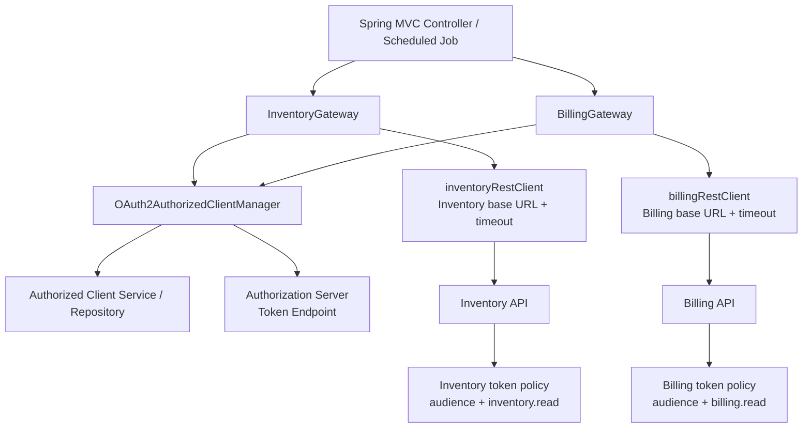

# 18.6. Cấu hình một HTTP client riêng cho từng downstream

## 1. Bài toán: một ứng dụng gọi nhiều API nhưng không được trộn cấu hình

Một ứng dụng Spring Boot dùng **Spring Security OAuth 2.0/OIDC Client** thường vừa phục vụ HTTP requests từ browser vừa gọi nhiều API bên ngoài (*downstream services*). Chẳng hạn:

- **Inventory API** để tra cứu tồn kho.
- **Billing API** để xem hóa đơn và trạng thái thanh toán.
- **Reporting API** để lấy báo cáo thay mặt người dùng đã đăng nhập OIDC.
- **Partner API** có proxy, CA nội bộ và chính sách timeout riêng.

Một sai lầm thiết kế phổ biến là tạo **một `RestClient` chung cho mọi đích**, gắn một access token mặc định, rồi để các lớp business tự thay URL:

```java
// Không nên: endpoint đích tùy ý + header Authorization toàn cục.
RestClient client = RestClient.builder()
    .defaultHeader("Authorization", "Bearer " + someAccessToken)
    .build();

// API A hôm nay:
client.get().uri("https://inventory-api.example.com/items").retrieve();

// API B ngày mai:
client.get().uri("https://billing-api.example.com/invoices").retrieve();
```

Nếu `someAccessToken` dành cho Inventory API, việc gửi nó đến Billing API là lỗi **rò credential qua ranh giới tin cậy**. Ngoài ra, hai API có thể khác nhau về timeout, TLS trust, HTTP proxy, connection policy, retry, schema lỗi và phạm vi dữ liệu.

Giải pháp của bài học là **mỗi downstream có một HTTP client được cấu hình riêng**, ví dụ:

```text
inventoryRestClient  → chỉ gọi Inventory API
billingRestClient    → chỉ gọi Billing API
reportsRestClient    → chỉ gọi Reporting API
```

Mỗi client có **base URL, transport, timeout, cách gắn token, metric và error policy** tương ứng. Cấu hình OAuth2 registration phải ràng buộc với đúng API, nhưng **`RestClient` không tự trở thành OAuth2 Client chỉ vì đã cấu hình `spring.security.oauth2.client.registration.*`**: cần dùng `OAuth2AuthorizedClientManager` hoặc tích hợp OAuth2 HTTP interceptor phù hợp.

**Phạm vi:** ứng dụng **Servlet** (Spring MVC/Spring Security Servlet), sử dụng `RestClient` đồng bộ của Spring Framework 6.1+ và cơ chế OAuth2 Client. Các thành phần WebFlux được nêu để phân biệt, không phải trọng tâm.

### 1.1. Mục tiêu kỹ thuật

Một cấu hình hoàn chỉnh nên bảo đảm:

1. Inventory request chỉ gửi token dành cho Inventory.
2. Billing request chỉ gửi token dành cho Billing.
3. Mỗi downstream có **base URL cố định**, không lấy tùy tiện từ input của user.
4. Mỗi HTTP client có timeout, redirect/proxy/TLS policy phù hợp.
5. Việc xin token mới sử dụng đúng **client registration** và đúng principal.
6. Lỗi `401`, `403`, `429`, timeout, TLS và lỗi nghiệp vụ được xử lý ở tầng thích hợp.
7. Không log hoặc truyền access token, refresh token, client secret sang sai hệ thống.
8. Các lớp business được inject bằng **`@Qualifier` hoặc kiểu wrapper rõ nghĩa**, tránh nhầm client.

## 2. Bốn ranh giới cần tách biệt

Có bốn khái niệm thường bị gộp nhầm:

| Ranh giới | Đối tượng Spring Security/Spring HTTP | Chứa hoặc quyết định gì? |
| --- | --- | --- |
| **OAuth2 registration** | `ClientRegistration` | Client ID, grant, scopes, authentication method, Token Endpoint |
| **Token lifecycle** | `OAuth2AuthorizedClientManager`, authorized-client service/repository | Lấy, lưu, dùng lại, cấp lại access token |
| **HTTP client tới API** | `RestClient` và `ClientHttpRequestFactory` | Base URL, request headers, timeout, proxy, TLS, HTTP connection |
| **Resource Server đích** | Inventory/Billing/Reports API | Kiểm tra access token, audience, scope và quyền nghiệp vụ |

Những ranh giới trên liên quan nhau nhưng **không thay thế nhau**.

Ví dụ:

```text
registrationId = inventory-m2m
  ├── tokenUri     = https://login.example.com/oauth2/token
  ├── clientId     = inventory-worker
  ├── scope        = inventory.read
  └── grant        = client_credentials

inventoryRestClient
  ├── baseUrl      = https://inventory-api.example.com
  ├── timeout      = 3s connect / 8s read
  ├── redirect     = disabled
  └── bearer token = authorized client của inventory-m2m
```

`tokenUri` và `baseUrl` là **hai endpoint khác nhau**. `tokenUri` thuộc **Authorization Server**, còn `baseUrl` thuộc **Resource Server**. Đặt thời gian chờ trên `inventoryRestClient` không nhất thiết điều chỉnh thời gian chờ của HTTP client mà Spring Security dùng để gọi Token Endpoint.

### 2.1. Sơ đồ tổng quan



Nếu cùng một Authorization Server cấp token cho cả Inventory và Billing, ứng dụng vẫn có thể cần **hai registrations** và hai token theo audience/scope khác nhau. Không suy ra “cùng issuer” có nghĩa hai APIs được phép dùng chung access token.

## 3. Chọn mô hình OAuth2: machine-to-machine hay thay mặt user?

Trước khi tạo HTTP client, cần xác định **API đích kỳ vọng danh tính nào**.

| API/giao dịch | Grant thường dùng | Principal cho authorized client | Ý nghĩa token |
| --- | --- | --- | --- |
| Batch Inventory Sync | `client_credentials` | Tên service ổn định, ví dụ `inventory-worker` | Quyền của ứng dụng/service |
| Billing Reconciliation Job | `client_credentials` | `billing-worker` | Quyền của service, giới hạn scope |
| User xem báo cáo cá nhân | `authorization_code` + có thể `refresh_token` | Principal của user đang đăng nhập | Quyền được cấp trong ngữ cảnh user |
| Backend API bảo vệ bằng bearer token đi vào | **Resource Server**, không phải outbound grant | JWT/opaque authentication của caller | Kiểm tra token đến từ client bên ngoài |

Hai trường hợp đầu không cần browser OIDC Login. Trường hợp thứ ba có thể dùng `OidcUser` ở portal, nhưng backend gửi **access token** của authorized client đến Reporting API chứ không gửi ID Token OIDC.

Trong phạm vi bài, ví dụ chính dùng **hai registrations `client_credentials`** để làm rõ cấu hình HTTP client riêng. Phần sau sẽ đề cập một downstream dùng token theo user.

## 4. Cấu hình Spring Boot cho hai downstream

### 4.1. Dependencies

Ví dụ một ứng dụng Spring MVC sử dụng Spring Boot và `RestClient` (Spring Framework 6.1+):

```gradle
dependencies {
    implementation 'org.springframework.boot:spring-boot-starter-web'
    implementation 'org.springframework.boot:spring-boot-starter-security'
    implementation 'org.springframework.boot:spring-boot-starter-oauth2-client'
}
```

Có thể dùng `RestClient` cùng Spring Security ở nhiều phiên bản, nhưng API interceptor/factory có thể khác nhau. Các đoạn mã trong bài nhấn mạnh những API phổ biến trong Spring Framework 6.1+/Spring Security 6.x trở lên; khi triển khai cần dùng dependencies tương thích với ứng dụng.

### 4.2. `application.yml`: client registrations và downstream URLs

```yaml
spring:
  security:
    oauth2:
      client:
        registration:
          inventory-m2m:
            provider: company-auth
            client-id: ${INVENTORY_CLIENT_ID}
            client-secret: ${INVENTORY_CLIENT_SECRET}
            authorization-grant-type: client_credentials
            client-authentication-method: client_secret_basic
            scope:
              - inventory.read

          billing-m2m:
            provider: company-auth
            client-id: ${BILLING_CLIENT_ID}
            client-secret: ${BILLING_CLIENT_SECRET}
            authorization-grant-type: client_credentials
            client-authentication-method: client_secret_basic
            scope:
              - billing.read

        provider:
          company-auth:
            token-uri: https://login.example.com/oauth2/token

downstreams:
  inventory:
    base-url: https://inventory-api.example.com
  billing:
    base-url: https://billing-api.example.com
```

Các cấu hình trên phục vụ hai công việc khác nhau:

- **`spring.security.oauth2.client.*`** được Spring Boot/Spring Security bind thành `ClientRegistration` và provider metadata.
- **`downstreams.*.base-url`** là **properties ứng dụng tự đặt**; phải đọc chúng qua `@Value` hoặc `@ConfigurationProperties` khi tạo `RestClient`. Spring Security **không tự hiểu** chúng là API đích hay tự kiểm tra audience.

Với provider cấp token có audience khác nhau, có thể cần **resource indicator**, `audience` extension hoặc đăng ký riêng cho từng Resource Server theo hợp đồng Authorization Server. Một số providers yêu cầu thêm form parameter trong Token Request; **không tự cho rằng chỉ khai báo scopes là đủ**.

### 4.3. Vì sao hai registrations dù chung Token Endpoint?

Hai registrations cho phép tách:

- Client ID và secret; rotation của Billing không phải ảnh hưởng credential Inventory.
- Allowed scopes; Inventory không cần `billing.read`.
- Authorized-client storage key `(registrationId, principalName)`.
- Audit, rate limits, policy và quyền của từng client.
- Cách xử lý lỗi, revoke hoặc khóa một client riêng.

Một Authorization Server có thể yêu cầu registration/tài nguyên/audience khác với ví dụ. Khi chỉ có một client được phép sử dụng nhiều APIs, cần bảo đảm access token được phát hành **đúng audience và quyền từng API**; vẫn tách HTTP clients và logic gắn token để tránh dùng sai.

## 5. Tạo một `RestClient` cho mỗi downstream

`RestClient` là HTTP client đồng bộ của Spring Framework. Nó phù hợp với Spring MVC/Servlet khi request handling hoặc background worker đang chạy trên thread có thể chờ I/O. Với WebFlux event loop, ưu tiên `WebClient` reactive thay vì gọi blocking `RestClient` trực tiếp.

### 5.1. Hai named beans với base URL riêng

Ví dụ cấu hình:

```java
@Configuration(proxyBeanMethods = false)
class DownstreamHttpClientConfiguration {

    @Bean("inventoryRestClient")
    RestClient inventoryRestClient(
            RestClient.Builder builder,
            @Value("${downstreams.inventory.base-url}") String baseUrl) {

        return builder.clone()
            .baseUrl(baseUrl)
            .defaultHeader(HttpHeaders.ACCEPT,
                MediaType.APPLICATION_JSON_VALUE)
            .build();
    }

    @Bean("billingRestClient")
    RestClient billingRestClient(
            RestClient.Builder builder,
            @Value("${downstreams.billing.base-url}") String baseUrl) {

        return builder.clone()
            .baseUrl(baseUrl)
            .defaultHeader(HttpHeaders.ACCEPT,
                MediaType.APPLICATION_JSON_VALUE)
            .build();
    }
}
```

**Vì sao `builder.clone()`?**

- Spring Boot có thể cung cấp `RestClient.Builder` đã qua customizer chung.
- Mỗi bản clone tạo **builder độc lập về cấu hình** để thêm base URL/header/transport riêng.
- Không nên mutate cùng một builder tuần tự rồi vô tình để Billing kế thừa base URL/interceptor chỉ dành cho Inventory.

Tuy nhiên, clone builder có thể **giữ các customizations chung** đã được Boot/ứng dụng áp dụng. Nếu đã có một **global interceptor tự gắn bearer token**, việc clone sẽ không tự xóa chính sách nguy hiểm đó. Cần kiểm tra interceptor toàn cục và chỉ áp dụng OAuth2 interceptor **theo downstream**, không ở mọi outbound HTTP request.

### 5.2. Vì sao không tạo một bean tên `restClient` duy nhất?

Ví dụ cấu hình một bean chung:

```java
@Bean
RestClient restClient(RestClient.Builder builder) {
    return builder.build();
}
```

Không hẳn sai nếu ứng dụng chỉ dùng một downstream, nhưng khi có nhiều APIs sẽ dễ gặp:

- Business code truyền URL tùy ý, mất kiểm soát host.
- Header/token được áp dụng nhầm cho domain khác.
- Timeout dùng chung: API nhanh phải chờ theo timeout của API chậm.
- Interceptors dùng chung nhưng policy/observability khác nhau.
- Khó test hoặc thay đổi cấu hình của một API mà không ảnh hưởng API còn lại.

Dùng named beans hoặc **wrapper gateway riêng** giúp các luồng rõ ràng hơn:

```text
InventoryGateway -> @Qualifier("inventoryRestClient")
BillingGateway   -> @Qualifier("billingRestClient")
```

**Cần lưu ý:** `RestClient` được cấu hình với `baseUrl` vẫn có thể nhận một URI tuyệt đối ở chỗ gọi. `baseUrl` **không phải bộ lọc bảo mật cấm mọi host khác**. Chính gateway phải dùng relative paths cố định hoặc kiểm tra origin đích theo allowlist nếu có URL động.

## 6. Cấu hình transport riêng: timeout, redirect và kết nối

Hai REST APIs có thể có yêu cầu khác nhau:

| Chính sách | Inventory API | Billing API |
| --- | --- | --- |
| Connect timeout minh họa | 2 giây | 5 giây |
| Read timeout minh họa | 5 giây | 15 giây |
| HTTP redirect | Không tự follow | Không tự follow |
| Proxy | Direct hoặc proxy inventory | Proxy billing theo hạ tầng |
| TLS trust | CA public hoặc CA nội bộ đã kiểm chứng | Trust material riêng nếu policy yêu cầu |
| Retry | Có thể retry GET đọc tồn kho | Cẩn trọng với POST tạo thanh toán |
| Metrics | `downstream=inventory` | `downstream=billing` |

**Các con số chỉ là ví dụ thiết kế**, không phải cấu hình tối ưu hoặc default bắt buộc.

### 6.1. Dùng JDK HttpClient và JdkClientHttpRequestFactory

Ví dụ `ClientHttpRequestFactory` cho một downstream:

```java
static ClientHttpRequestFactory requestFactory(
        Duration connectTimeout,
        Duration readTimeout) {

    HttpClient jdkHttpClient = HttpClient.newBuilder()
        .connectTimeout(connectTimeout)
        .followRedirects(HttpClient.Redirect.NEVER)
        .build();

    JdkClientHttpRequestFactory factory =
        new JdkClientHttpRequestFactory(jdkHttpClient);

    factory.setReadTimeout(readTimeout);
    return factory;
}
```

Các kiểu chính:

```java
java.net.http.HttpClient
java.time.Duration
org.springframework.http.client.ClientHttpRequestFactory
org.springframework.http.client.JdkClientHttpRequestFactory
```

Sau đó gắn **hai request factories khác nhau**:

```java
@Bean("inventoryRestClient")
RestClient inventoryRestClient(
        RestClient.Builder builder,
        @Value("${downstreams.inventory.base-url}") String baseUrl) {

    return builder.clone()
        .baseUrl(baseUrl)
        .requestFactory(requestFactory(
            Duration.ofSeconds(2),
            Duration.ofSeconds(5)))
        .build();
}

@Bean("billingRestClient")
RestClient billingRestClient(
        RestClient.Builder builder,
        @Value("${downstreams.billing.base-url}") String baseUrl) {

    return builder.clone()
        .baseUrl(baseUrl)
        .requestFactory(requestFactory(
            Duration.ofSeconds(5),
            Duration.ofSeconds(15)))
        .build();
}
```

Đây là cách trình bày thay thế cho ví dụ đơn giản ở phần 5: trong một ứng dụng thật, **chỉ cần một định nghĩa bean cho mỗi tên**, dùng bản có `requestFactory` nếu cần cấu hình transport.

**Không tự động follow redirects** là một phòng vệ hợp lý khi request mang bearer token: không muốn HTTP client tiếp tục chuyển request sang một host khác rồi gửi credential. Nếu downstream trả `302`, nên xử lý có chủ đích theo chính sách dịch vụ, không để tầng HTTP âm thầm đổi đích.

Cấu hình `HttpClient.Redirect.NEVER` áp dụng cho **JDK HttpClient của downstream**. HTTP client gửi refresh/token request tới Authorization Server có thể là một đối tượng khác, nên timeout/proxy của nó **không tự nhận** từ các beans trên.

### 6.2. Mỗi client có connection resources riêng

Khi tạo hai `HttpClient` instances tách biệt, chúng có connection resources/chính sách riêng theo cách triển khai của JDK HTTP Client. Điều này có thể hỗ trợ cô lập và đo đạc theo downstream.

Nếu cần **giới hạn connection pool và per-route concurrency** chính xác, có thể dùng Apache HttpComponents/connection manager phù hợp với Spring Framework phiên bản đang chạy; cần quản lý lifecycle (`close`), idle connections và backpressure.

**Không suy ra mỗi `RestClient` bean mặc định có connection pool riêng.** Nếu hai RestClients chia sẻ cùng `ClientHttpRequestFactory` hoặc cùng underlying HTTP client, chúng có thể chia sẻ connection resources. Ngược lại, tạo quá nhiều HTTP client instances cũng có chi phí tài nguyên. Phải thiết kế reuse theo **downstream policy**, không khởi tạo mới client cho mỗi HTTP request.

### 6.3. Read timeout, connect timeout và tổng thời gian

- **Connect timeout:** giới hạn thời gian thiết lập kết nối tới remote peer/proxy.
- **Read timeout:** giới hạn thời gian chờ dữ liệu theo semantics của HTTP client/factory.
- **Overall deadline:** giới hạn tổng thời gian xử lý cả token acquisition, HTTP request và retry, nếu hệ thống yêu cầu.

Chỉ cấu hình 2 giây connect + 5 giây read không đảm bảo toàn bộ nghiệp vụ hoàn tất trong 7 giây nếu còn bước lấy OAuth token, DNS, proxy, retries hoặc các tác vụ khác. Với SLO nghiêm ngặt, cần end-to-end deadline và budget cho từng chặng.

## 7. Cấu hình manager cho client_credentials (Servlet/non-reactive)

Trong ví dụ Inventory và Billing, cả hai dùng `client_credentials` và không có người dùng tương tác. Một manager dùng service-based storage phù hợp:

```java
@Configuration(proxyBeanMethods = false)
class OutboundOAuth2ManagerConfiguration {

    @Bean("machineAuthorizedClientManager")
    OAuth2AuthorizedClientManager machineAuthorizedClientManager(
            ClientRegistrationRepository registrations,
            OAuth2AuthorizedClientService authorizedClients) {

        OAuth2AuthorizedClientProvider provider =
            OAuth2AuthorizedClientProviderBuilder.builder()
                .clientCredentials()
                .build();

        var manager =
            new AuthorizedClientServiceOAuth2AuthorizedClientManager(
                registrations,
                authorizedClients);

        manager.setAuthorizedClientProvider(provider);
        return manager;
    }
}
```

Khi Spring Boot đã tạo `OAuth2AuthorizedClientService` (thường là in-memory trong trường hợp đơn giản), manager sử dụng service đó để lưu/tải authorized clients. Nếu cần bền vững qua nhiều pods, cần thay service bằng JDBC hoặc implementation chia sẻ phù hợp.

**Tại sao không dùng `DefaultOAuth2AuthorizedClientManager` cho scheduled job?** Manager mặc định này hướng tới bối cảnh `HttpServletRequest`/`HttpServletResponse` và `OAuth2AuthorizedClientRepository`. Service-based manager được dùng cho các tác vụ **ngoài HTTP Servlet request**.

### 7.1. Cách manager tìm token

Ví dụ Inventory:

```java
OAuth2AuthorizeRequest request =
    OAuth2AuthorizeRequest
        .withClientRegistrationId("inventory-m2m")
        .principal("inventory-worker")
        .build();

OAuth2AuthorizedClient authorized =
    machineAuthorizedClientManager.authorize(request);
```

- `inventory-m2m` là **registration ID** từ YAML.
- `inventory-worker` là **principal name ổn định để lưu token service**, không phải user tương tác.
- `authorize(...)` có thể dùng lại authorized client đã lưu hoặc xin token mới khi cần, tùy grant provider và policy.
- Khi không thể authorize, có thể không nhận được authorized client; ứng dụng cần xử lý thay vì dereference `null`.
- Với `client_credentials`, manager có thể xin token mới bằng client credentials khi token hết hạn; refresh token thường không được cấp.

**Không dùng `.principal(UUID.randomUUID().toString())` mỗi lần**: khi principal name thay đổi, storage key thay đổi và token không được reuse hiệu quả.

### 7.2. Có nên dùng một manager cho hai downstream không?

Có thể. Manager là **điều phối viên**, không đồng nghĩa một token. Nó chọn authorized client bằng **registration ID và principal name**.

```text
(inventory-m2m, inventory-worker) -> Inventory access token
(billing-m2m, billing-worker)     -> Billing access token
```

Hai registrations cùng dùng một manager/service **vẫn có entries riêng**. Điều không được làm là hard-code manager để luôn chọn `inventory-m2m` cho cả hai gateways.

Ở hệ thống rất nhạy cảm, có thể dùng **manager/service riêng** nếu cần tách storage, secret lifecycle, egress path hoặc policy. Nhưng điều đó không bắt buộc chỉ để phân biệt token; hai registration IDs đúng cùng boundaries rõ ràng đã là nền tảng.

## 8. Gateway riêng, registration ID cố định: ví dụ đầy đủ

Một nguyên tắc thiết kế dễ kiểm soát: **Gateway biết rõ nó đang gọi API nào và luôn chọn registration tương ứng**. Controller/business service không được truyền một registration ID hoặc URL không kiểm chứng để tự quyết định token.

### 8.1. InventoryGateway

```java
@Service
public class InventoryGateway {

    private final RestClient inventoryClient;
    private final OAuth2AuthorizedClientManager authorizedClientManager;

    public InventoryGateway(
            @Qualifier("inventoryRestClient") RestClient inventoryClient,
            @Qualifier("machineAuthorizedClientManager")
            OAuth2AuthorizedClientManager authorizedClientManager) {

        this.inventoryClient = inventoryClient;
        this.authorizedClientManager = authorizedClientManager;
    }

    public InventoryItem findItem(String itemId) {
        OAuth2AuthorizeRequest request = OAuth2AuthorizeRequest
            .withClientRegistrationId("inventory-m2m")
            .principal("inventory-worker")
            .build();

        OAuth2AuthorizedClient authorized =
            authorizedClientManager.authorize(request);

        if (authorized == null) {
            throw new IllegalStateException(
                "Cannot obtain Inventory API access token");
        }

        return inventoryClient.get()
            .uri(uriBuilder -> uriBuilder
                .path("/api/items/{itemId}")
                .build(itemId))
            .headers(headers -> headers.setBearerAuth(
                authorized.getAccessToken().getTokenValue()))
            .retrieve()
            .body(InventoryItem.class);
    }
}

record InventoryItem(String id, String sku, int availableQuantity) {}
```

Đoạn code chủ động cố định:

- Bean `inventoryRestClient`, với Inventory base URL.
- Registration `inventory-m2m`.
- Principal name `inventory-worker`.
- Relative API path `/api/items/{itemId}`.

Dùng URI template thay vì nối raw string từ `itemId` giảm rủi ro encoding/URL injection do thao tác chuỗi thủ công. Cũng cần kiểm tra business-level input validation phù hợp.

**Không dùng `inventoryClient.get().uri(userSuppliedAbsoluteUrl)`** vì URI tuyệt đối có thể bỏ qua base URL và đưa bearer token sang host khác.

### 8.2. BillingGateway

```java
@Service
public class BillingGateway {

    private final RestClient billingClient;
    private final OAuth2AuthorizedClientManager authorizedClientManager;

    public BillingGateway(
            @Qualifier("billingRestClient") RestClient billingClient,
            @Qualifier("machineAuthorizedClientManager")
            OAuth2AuthorizedClientManager authorizedClientManager) {

        this.billingClient = billingClient;
        this.authorizedClientManager = authorizedClientManager;
    }

    public InvoiceStatus findInvoice(String invoiceId) {
        OAuth2AuthorizeRequest request = OAuth2AuthorizeRequest
            .withClientRegistrationId("billing-m2m")
            .principal("billing-worker")
            .build();

        OAuth2AuthorizedClient authorized =
            authorizedClientManager.authorize(request);

        if (authorized == null) {
            throw new IllegalStateException(
                "Cannot obtain Billing API access token");
        }

        return billingClient.get()
            .uri(uriBuilder -> uriBuilder
                .path("/api/invoices/{invoiceId}")
                .build(invoiceId))
            .headers(headers -> headers.setBearerAuth(
                authorized.getAccessToken().getTokenValue()))
            .retrieve()
            .body(InvoiceStatus.class);
    }
}

record InvoiceStatus(String invoiceId, String status) {}
```

Billing dùng **một đường token riêng** theo `billing-m2m`, dù cả hai downstream được gọi bởi cùng ứng dụng Spring Boot.

### 8.3. Chỉ đưa bean gateway cho business service

Ví dụ:

```java
@Service
class OrderSummaryService {

    private final InventoryGateway inventory;
    private final BillingGateway billing;

    OrderSummaryService(
            InventoryGateway inventory,
            BillingGateway billing) {

        this.inventory = inventory;
        this.billing = billing;
    }

    // Business method dùng InventoryGateway/BillingGateway;
    // không cần biết access token hoặc HTTP base URL.
}
```

Tầng nghiệp vụ không cần biết client secret, refresh token, endpoint OAuth2 hay cách chọn bearer token. Điều này giúp giữ ranh giới **credential và network** ở tầng integration/gateway.

Nếu muốn tránh lặp logic authorize trong gateways, có thể viết helper/adapter dùng nội bộ với registration ID được **cấu hình và giới hạn tại gateway**. Không tạo một API công khai như `callAnyUrlWithAnyRegistration(...)`.

## 9. Dùng OAuth2ClientHttpRequestInterceptor: phương án tích hợp tự động

Spring Security các phiên bản hiện đại có cơ chế tích hợp OAuth2 Client với `RestClient` qua `OAuth2ClientHttpRequestInterceptor`. Interceptor có thể lấy authorized client qua manager và thêm bearer token vào request.

Ý tưởng cơ bản:

```java
OAuth2ClientHttpRequestInterceptor oauth2Interceptor =
    new OAuth2ClientHttpRequestInterceptor(
        authorizedClientManager);

RestClient restClient = RestClient.builder()
    .requestInterceptor(oauth2Interceptor)
    .build();
```

**Quan trọng:** đoạn trên **chưa đủ để bảo đảm downstream isolation**. Interceptor phải biết **registration ID nào** và **principal nào** cần dùng; các giá trị này có thể được xác định qua request attributes, resolver hoặc cách cấu hình khác theo phiên bản Spring Security.

### 9.1. Giữ registration ràng buộc với mỗi downstream

Có hai cách triển khai có chủ đích:

**Cách A — Mỗi gateway gọi manager và gắn bearer token tường minh:** như ở phần 8. Ưu điểm là dễ thấy registration nào được chọn tại code và không dựa vào default interceptor.

**Cách B — Mỗi `RestClient` có OAuth2 interceptor/resolver riêng:** resolver của Inventory chỉ trả `inventory-m2m`, resolver của Billing chỉ trả `billing-m2m`; principal cũng phải được xác định an toàn theo ngữ cảnh (service hoặc user). Cần sử dụng **API resolver/interceptor đúng phiên bản** của Spring Security.

Một số phiên bản hỗ trợ truyền registration bằng request attribute khi gửi request, ví dụ pattern `RequestAttributeClientRegistrationIdResolver.clientRegistrationId(...)`. Tuy nhiên với HTTP client dành riêng cho một downstream, việc lặp `.attributes(clientRegistrationId("..."))` ở từng call site dễ dẫn tới nhầm registration. **Pin registration ở cấu hình interceptor/gateway** thường ít lỗi hơn.

Không bật một **global OAuth2 interceptor với token mặc định** trên mọi RestClient builder rồi hy vọng base URL sẽ tự quyết định token phù hợp. Token selection phải là quyết định rõ ràng, dựa trên cấu hình tin cậy.

### 9.2. Cần kiểm tra principal resolver

Với `client_credentials` trong tác vụ nền, principal thường là **service identity cố định** để tái sử dụng authorized client. Với request theo user, principal phải là **authentication đã được xác minh**.

Nếu interceptor mặc định dựa vào `SecurityContextHolder` mà job không có authenticated user, có thể không tìm được context hoặc vô tình dùng ngữ cảnh khác dự kiến. Cấu hình resolver/manager phù hợp theo flow, không dựa vào `ThreadLocal` có thể thiếu trong asynchronous executor.

### 9.3. Token error handling khi dùng interceptor

Interceptor của các phiên bản Spring Security hỗ trợ cơ chế xử lý authorization failure có thể loại authorized client không còn hợp lệ theo policy. Nhưng:

- **401** có thể liên quan expired/revoked/wrong-audience token; cần xem `WWW-Authenticate` và API response.
- **403** thường là thiếu scope/quyền; không nhất thiết giải quyết bằng cách lấy token mới.
- Tự động retry một request **POST tạo giao dịch** có thể gây side effect lặp.
- Không để interceptor retry vô hạn hoặc chuyển bearer token sang redirect host khác.

Một interceptor phù hợp giúp giảm lặp code, nhưng chỉ an toàn khi **client registration, principal, endpoint và failure handling** được giới hạn đúng downstream.

## 10. Downstream dùng token thay mặt người dùng đã đăng nhập OIDC

Không phải downstream nào cũng dùng `client_credentials`. Ví dụ Reporting API cho mỗi nhân viên cần token theo user.

### 10.1. Registration riêng dành cho Authorization Code

```yaml
spring:
  security:
    oauth2:
      client:
        registration:
          reports-user:
            provider: company-oidc
            client-id: ${REPORTS_USER_CLIENT_ID}
            client-secret: ${REPORTS_USER_CLIENT_SECRET}
            authorization-grant-type: authorization_code
            redirect-uri: "{baseUrl}/login/oauth2/code/{registrationId}"
            scope:
              - openid
              - profile
              - reports.read
        provider:
          company-oidc:
            issuer-uri: https://login.example.com/realms/company

downstreams:
  reports:
    base-url: https://reports-api.example.com
```

Đây là luồng **có browser login và authorization code callback**. Access token được cấp cho client trong ngữ cảnh user, khác với client credentials token.

### 10.2. RestClient riêng cho Reporting API

```java
@Bean("reportsRestClient")
RestClient reportsRestClient(
        RestClient.Builder builder,
        @Value("${downstreams.reports.base-url}") String baseUrl) {

    return builder.clone()
        .baseUrl(baseUrl)
        .requestFactory(requestFactory(
            Duration.ofSeconds(3),
            Duration.ofSeconds(10)))
        .build();
}
```

Method `requestFactory(...)` đã được mô tả ở phần 6 và có thể đặt thành utility/helper trong lớp cấu hình.

### 10.3. Truyền đúng token theo user

Trong Servlet controller đã xác thực, Spring Security có thể inject authorized client tương ứng:

```java
@RestController
class MyReportsController {

    private final RestClient reportsClient;

    MyReportsController(
            @Qualifier("reportsRestClient") RestClient reportsClient) {
        this.reportsClient = reportsClient;
    }

    @GetMapping("/my/reports")
    String myReports(
            @RegisteredOAuth2AuthorizedClient("reports-user")
            OAuth2AuthorizedClient authorizedClient) {

        return reportsClient.get()
            .uri("/api/reports/me")
            .headers(headers -> headers.setBearerAuth(
                authorizedClient.getAccessToken().getTokenValue()))
            .retrieve()
            .body(String.class);
    }
}
```

Đoạn code minh họa **cách gắn authorized client theo user vào reportsRestClient**. Để tự động refresh khi access token hết hạn, cần bảo đảm argument resolver/manager được wiring với `refreshToken()` và authorized-client storage thích hợp. **Không suy ra annotation luôn tự giải quyết mọi refresh policy trong mọi cấu hình**.

Một gateway dùng chung có thể nhận `OAuth2AuthorizedClient` hoặc token-specific context đã được xác minh từ controller, nhưng không nên nhận token string tùy ý từ browser và coi nó đã được cấp cho đúng Resource Server.

### 10.4. Không nhầm OIDC ID Token với access token của Reporting API

- `OidcUser.getIdToken()` chứa thông tin xác thực danh tính dành cho **OIDC Client**.
- `OAuth2AuthorizedClient.getAccessToken()` là credential để gọi API được ủy quyền.
- ID Token có claim `aud` thường dành cho OAuth2 client, không mặc nhiên dành cho Reporting API.
- Reporting API với vai trò Resource Server phải tự xác minh token đến và quyền truy cập tương ứng.

## 11. Token và HTTP connection là hai vòng đời độc lập

Một downstream RestClient bean có thể sống suốt thời gian ứng dụng chạy và tái sử dụng connection resources. Nhưng access token có thời hạn và có thể thay đổi nhiều lần trong vòng đời đó.

```text
inventoryRestClient bean: tạo lúc startup, tái sử dụng nhiều request
  ├── 10:00: gọi API bằng token A
  ├── 10:15: gọi API bằng token A
  ├── 11:00: manager cấp token B
  └── 11:15: gọi API bằng token B
```

**Không nên set một access token có expiry vào `.defaultHeader("Authorization", ...)` khi tạo RestClient bean** rồi dùng mãi; token sẽ trở nên stale mà không có cơ chế thay thế.

Thay vào đó, đặt token **theo mỗi request** qua manager hoặc một OAuth2 interceptor đã cấu hình đúng.

### 11.1. Cặp khóa lưu authorized client

Một service-based manager thường lưu authorized clients theo:

```text
(registrationId, principalName)
```

Ví dụ:

```text
(inventory-m2m, inventory-worker) -> token Inventory
(billing-m2m, billing-worker)     -> token Billing
(reports-user, user-123)          -> token Reports của User 123
```

Nếu dùng cùng registration nhưng thay principal ngẫu nhiên mỗi lần, manager có thể xin token nhiều hơn cần thiết. Nếu dùng một principal cố định chung cho **user-delegated** tokens, có nguy cơ liên kết sai token giữa người dùng. **Principal binding phải phù hợp grant và trust boundary.**

### 11.2. Logout không tự thu hồi mọi token

Web logout, xóa `SecurityContext`, xóa authorized-client record và revoke token tại IdP là những hành động khác nhau. Với user-delegated clients, cần có chính sách về logout, session, refresh token và authorized-client storage. Với service clients, logout của một nhân viên không nên vô tình xóa token machine-to-machine chung của batch worker.

## 12. Proxy riêng và TLS trust theo downstream

Hai APIs có thể có network topology khác nhau:

```text
Inventory:
  app pod → private DNS → Inventory API

Billing:
  app pod → corporate egress proxy → Billing API

OAuth Token Endpoint:
  app pod → HTTPS tới Authorization Server (đường riêng)
```

Đừng cho rằng cấu hình `HTTP_PROXY` hoặc một `RestClient.Builder` global sẽ luôn điều khiển **mọi** HTTP request của các thư viện. `RestClient` downstream và token response client dùng trong Spring Security có thể sở hữu các HTTP transports khác nhau.

### 12.1. Proxy cho JDK HttpClient của một downstream

Ví dụ nếu Billing bắt buộc dùng một proxy HTTP được tổ chức kiểm soát:

```java
HttpClient billingHttpClient = HttpClient.newBuilder()
    .connectTimeout(Duration.ofSeconds(5))
    .followRedirects(HttpClient.Redirect.NEVER)
    .proxy(ProxySelector.of(
        new InetSocketAddress("proxy.corp.example", 8080)))
    .build();

JdkClientHttpRequestFactory billingFactory =
    new JdkClientHttpRequestFactory(billingHttpClient);

billingFactory.setReadTimeout(Duration.ofSeconds(15));

RestClient billingClient = RestClient.builder()
    .baseUrl("https://billing-api.example.com")
    .requestFactory(billingFactory)
    .build();
```

Đây là ví dụ **transport của Billing**; cần xem cách proxy hoạt động với CONNECT, authentication, NO_PROXY/bypass và DNS. Có hệ thống cần `Authenticator`, truststore hoặc proxy configuration riêng; không tùy tiện nhúng proxy credentials vào source.

Inventory vẫn có thể dùng `HttpClient` khác với kết nối trực tiếp. Đừng bật proxy cho mọi downstream nếu chỉ một API cần.

### 12.2. CA nội bộ và truststore

Nếu một downstream dùng certificate do CA nội bộ ký, JVM/HTTP client phải tin chain CA hợp lệ và xác minh hostname.

Lỗi thường gặp:

```text
javax.net.ssl.SSLHandshakeException
PKIX path building failed
```

Hướng xử lý:

1. Xác nhận server hostname, SAN, certificate chain và CA phát hành.
2. Nhập CA đáng tin vào trust material/SSL context của HTTP client có liên quan.
3. Tránh thay thế toàn bộ public CA trust mặc định mà không chủ đích.
4. Đối chiếu TLS proxy interception nếu traffic đi qua egress proxy.
5. Giữ hostname verification bật.

**Không sử dụng trust-all `SSLContext`, tắt hostname verification hoặc gọi HTTP không TLS** để chữa sự cố. Khi dùng shared secret hoặc bearer token, các biện pháp đó đặc biệt nguy hiểm.

### 12.3. Điểm quan trọng: Token Endpoint có HTTP client khác

Spring Security có token response clients để gọi OAuth2 Token Endpoint. Nếu `billingRestClient` sử dụng proxy hoặc custom SSL context, điều đó **không tự áp dụng** cho token request của `billing-m2m`.

Nếu token-uri cũng yêu cầu proxy/CA nội bộ, cần tùy biến **Token Response Client/Authorized Client Provider** đúng với phiên bản Spring Security và grant đang dùng. Không cố dùng Billing RestClient để gọi `/token` bằng tay rồi bỏ qua client authentication/token lifecycle đã được framework quản lý.

## 13. Error policy khác nhau cho từng downstream

### 13.1. Không nên gộp lỗi HTTP thành một exception không phân biệt

Inventory đọc tồn kho có thể trả `404` khi item không tồn tại, còn Billing có thể trả `409` khi thao tác thanh toán xung đột. Một global error handler cố gắng retry mọi lỗi 4xx/5xx là nguy hiểm.

| HTTP/status | Ý nghĩa có thể | Cách xử lý gợi ý |
| --- | --- | --- |
| `200`/`2xx` | Request API thành công | Parse DTO, kiểm tra semantic data |
| `400` | Request sai | Sửa input/schema, không retry mù |
| `401` | Bearer token không được chấp nhận | Kiểm tra token/issuer/audience/expiry, manager/failure handling |
| `403` | Token không đủ quyền | Kiểm tra scope/role/policy, không mặc định refresh |
| `404` | Resource không tồn tại hoặc bị che | Mapping nghiệp vụ tùy API |
| `409` | Xung đột nghiệp vụ | Có thể yêu cầu idempotency/đọc trạng thái |
| `429` | API rate limit | Backoff, quota, `Retry-After` khi hợp lệ |
| `500`/`502`/`503`/`504` | Lỗi server/upstream | Retry có giới hạn với operation an toàn |
| Connect timeout | Không tạo được kết nối | Kiểm tra DNS/route/proxy/target |
| Read timeout | Remote chậm hoặc response treo | Time budget/circuit breaker, idempotency |

**`401` từ Resource Server không giống `invalid_client` ở Token Endpoint.** Đó là hai chặng network, authentication và error responses khác nhau.

### 13.2. Retry theo phương thức và nghiệp vụ

Một `GET /inventory/items/{id}` có thể retry khi timeout hoặc một số lỗi 5xx theo chính sách và budget. Nhưng `POST /billing/payments` có thể tạo thanh toán; nếu server đã thực hiện thao tác mà response bị timeout, retry không kiểm soát có thể **tạo giao dịch trùng**.

Với các operation có side effect:

- Thiết kế idempotency key khi API hỗ trợ.
- Phân biệt timeout trước khi gửi và timeout sau khi request đã tới server.
- Đừng retry `401`, `403`, `400` như lỗi mạng tạm thời.
- Giới hạn retry count, backoff và tổng deadline.
- Cân nhắc circuit breaker/bulkhead theo downstream để một API lỗi không kéo sập tất cả request threads.

### 13.3. Mẫu xử lý lỗi theo gateway

Ví dụ minh họa xử lý `404` riêng của Inventory:

```java
public Optional<InventoryItem> findItemIfPresent(String itemId) {
    try {
        return Optional.ofNullable(findItem(itemId));
    } catch (HttpClientErrorException.NotFound ex) {
        return Optional.empty();
    }
}
```

Ở đây `findItem` là method của InventoryGateway ở phần trước. Các exception/status mapping có thể cần thay đổi theo cách `RestClient.retrieve()` được cấu hình; ví dụ nhấn mạnh **Gateway của Inventory tự quyết định ý nghĩa `404`**, không buộc Billing cũng dùng mapping đó.

Không ghi token hoặc response body nhạy cảm vào exception message. Với API thanh toán, nhiều loại lỗi cần được phân loại rõ hơn `404`.

## 14. Observability riêng cho từng client

Khi hệ thống gọi nhiều downstream, log dạng:

```text
HTTP 503 while calling API
```

là chưa đủ để vận hành. Nên gắn tên downstream đã được cấu hình:

```text
downstream=inventory
operation=get-item
outcome=timeout
duration_ms=...
```

Hoặc:

```text
downstream=billing
operation=get-invoice
http_status=403
```

Một số thông tin hữu ích:

- Downstream name (`inventory`, `billing`), không lấy tùy tiện từ query user.
- Operation name và HTTP method.
- URI path được chuẩn hóa (không đưa user IDs/tokens vào metric labels).
- HTTP status hoặc loại exception.
- Connect/read/overall latency.
- Số lần retries/circuit breaker state.
- OAuth2 registration ID và kết quả authorize **không chứa token**.
- Correlation ID/trace ID nội bộ.

### 14.1. Không log headers nhạy cảm

Bản thân `RestClient` không biến `Authorization` header thành dữ liệu an toàn để ghi log. Nếu dùng request/response logging interceptor, phải **redact**:

```text
Authorization: Bearer <redacted>
Proxy-Authorization: <redacted>
Cookie: <redacted>
Set-Cookie: <redacted>
client_secret: <redacted>
access_token: <redacted>
refresh_token: <redacted>
```

Trong môi trường có tracing, cũng cần giới hạn span attributes và loại bỏ PII/tokens. Số liệu nên cho phép trả lời “Billing đang timeout hay Token Endpoint đang lỗi?” mà không làm lộ credential.

### 14.2. Nên đặt tên client theo ý nghĩa nghiệp vụ

Tên beans như `inventoryRestClient`, `billingRestClient` dễ đọc hơn `client1`/`client2`. Cùng một tên downstream có thể được dùng nhất quán trong metrics, logs, dashboard, cấu hình timeouts và documentation.

Tránh nhầm `clientRegistrationId` với `downstream name` khi một downstream có nhiều loại token (ví dụ Billing vừa có client credentials, vừa có user-delegated flow).

## 15. Bảo vệ trước credential leakage và SSRF

**HTTP client riêng** chỉ là một phần của phòng vệ; cần kiểm soát cả cách URI được tạo và cách bearer token được gắn.

### 15.1. Không cho business input quyết định host đích

Sai:

```java
String url = request.getParameter("target");

return billingRestClient.get()
    .uri(url)
    .headers(h -> h.setBearerAuth(billingToken))
    .retrieve()
    .body(String.class);
```

Input có thể là một URI tuyệt đối tới một host không mong đợi. `baseUrl` không nhất thiết chặn URI tuyệt đối, nên bearer token có thể bị gửi đi sai đích.

Đúng về thiết kế:

```java
return billingRestClient.get()
    .uri(builder -> builder
        .path("/api/invoices/{invoiceId}")
        .build(invoiceId))
    .headers(h -> h.setBearerAuth(billingToken))
    .retrieve()
    .body(InvoiceStatus.class);
```

Ở đây backend quyết định host và relative path; input chỉ là **path variable** đã qua encoding/validation.

### 15.2. Redirect cũng là một đường rò token

Một API có thể trả:

```http
HTTP/1.1 302 Found
Location: https://unexpected.example/collect
```

Nếu HTTP client tự follow và mang theo `Authorization` header, token có nguy cơ lộ. Behavior cụ thể có thể phụ thuộc HTTP library và cross-host redirect policy; cách đơn giản, rõ ràng cho các API nội bộ là **không tự follow redirects** trừ khi có yêu cầu được kiểm soát.

### 15.3. Proxy là một trust boundary

Nếu có proxy egress/TLS interception, cần xem:

- Proxy nào được phép quan sát HTTP metadata và TLS session?
- Có yêu cầu company CA không?
- Access token/secret có được bảo vệ trên đường đi không?
- `Proxy-Authorization` có bị ghi log không?
- Có rule bypass đúng cho các hostname nội bộ không?

Proxy config phải được quản lý tập trung và kiểm chứng; không copy thông tin proxy credentials vào từng gateway code.

### 15.4. Client credentials khác user-delegated token

Token của `inventory-m2m` thường đại diện cho chính service. Token của `reports-user` đại diện cho quyền được cấp trong ngữ cảnh người dùng. **Không gửi token service vào API yêu cầu user context** để né yêu cầu kiểm tra quyền, và không gửi token của User A tới request của User B.

Việc tách gateways theo downstream giúp giảm nhầm lẫn, nhưng principal binding và authorized-client repository vẫn cần chính xác.

## 16. Nhiều HTTP clients, nhưng một bộ quy tắc xây dựng có kiểm soát

Nếu ứng dụng có vài chục downstream, không nhất thiết viết thủ công mọi đoạn builder giống nhau. Có thể tạo một **factory nội bộ** giúp áp dụng defaults an toàn:

```java
final class DownstreamRestClientFactory {

    private final RestClient.Builder baseBuilder;

    DownstreamRestClientFactory(RestClient.Builder baseBuilder) {
        this.baseBuilder = baseBuilder;
    }

    RestClient create(
            String trustedBaseUrl,
            Duration connectTimeout,
            Duration readTimeout) {

        return baseBuilder.clone()
            .baseUrl(trustedBaseUrl)
            .requestFactory(
                DownstreamHttpClientConfiguration.requestFactory(
                    connectTimeout, readTimeout))
            .build();
    }
}
```

Đây là **mẫu thiết kế**, giả định helper `requestFactory(...)` được đặt trong một class utility có visibility phù hợp. Không phải class chuẩn của Spring Security.

Điều kiện để dùng factory an toàn:

1. `trustedBaseUrl` lấy từ configuration đã được phê duyệt, không từ input user.
2. Các gateway vẫn ràng buộc registration riêng.
3. Factory không gắn bearer token chung vào mọi clients.
4. Từng RestClient có chính sách timeout/redirect/TLS phù hợp.
5. Client tạo một lần và được reuse; không tạo mới cho mỗi request.
6. Có cách gắn metrics/error policy theo downstream.

Nếu hai downstream có yêu cầu SSL/proxy khác hẳn nhau, factory có thể nhận thêm một `ClientHttpRequestFactory` đã được cấu hình sẵn, thay vì ép mọi API vào cùng transport.

## 17. Cần chú ý gì khi nhiều instance/pod cùng chạy?

Một ứng dụng nhiều pods có thể tạo `inventoryRestClient` và `billingRestClient` ở **mỗi pod**. Đây là hành vi bình thường: các HTTP client beans là tài nguyên trong process.

Tuy nhiên, authorized-client storage có thể là:

- In-memory per-pod.
- Session-backed.
- JDBC/Redis/shared service.

Với `client_credentials`, mỗi pod có thể xin token riêng; điều này có thể chấp nhận nếu IdP không quá hạn chế. Nếu cần phối hợp token issuance do rate limit, shared store/caching hoặc chiến lược client identity riêng cần được cân nhắc.

Dù có shared authorized-client store, **HTTP connections không tự chia sẻ giữa pods**. Timeout, proxy và TLS settings vẫn phải được áp dụng trên mỗi instance.

### 17.1. Khi token bị revoke

Nếu Authorization Server revoke Inventory token, Billing token không nên bị ảnh hưởng chỉ vì dùng chung manager. Khi Inventory gọi API bị `401`, cần xử lý authorized client theo khóa `(inventory-m2m, inventory-worker)`, không xóa tất cả authorized clients của mọi registration.

Một lỗi thiết kế thường thấy là “on 401, clear global token cache” gây nhiều downstream đồng loạt xin token lại và tạo bão request tới Token Endpoint.

## 18. Các tình huống thực hành

### Tình huống A — Inventory 2 giây, Billing 15 giây

Inventory API có SLO chặt; Billing API xử lý nhiều bước và có độ trễ cao hơn.

**Cách thiết kế:** hai RestClient beans, request factories riêng với connect/read timeout phù hợp, metrics và circuit breaker độc lập. Không để Billing timeout policy áp dụng cho Inventory chỉ vì cùng dùng một builder bị mutate.

### Tình huống B — Billing cần proxy, Inventory dùng private network

**Cách thiết kế:** Billing RestClient có `ProxySelector`/HTTP client được cấu hình, Inventory đi direct. Token Endpoint có thể cần cấu hình proxy **riêng**; không mặc định policy outbound của một Resource Server sẽ tự áp dụng cho OAuth2 Token Endpoint.

### Tình huống C — Một developer chuyển `billingRestClient` sang dùng absolute URI

Code bắt đầu nhận `https://...` từ request và gọi `.uri(absoluteUrl)` với billing bearer token.

**Phân tích:** `baseUrl` không bảo đảm khóa host. Cần giữ endpoint cố định hoặc allowlist origin, hạn chế redirect và kiểm tra input để chống rò credential/SSRF.

### Tình huống D — Billing API trả 403 nhưng Inventory hoạt động

**Phân tích:** đừng lấy Inventory token gửi Billing. Kiểm tra billing registration, audience, scopes, API roles và authorized client. Refresh token không tự tạo quyền mới.

### Tình huống E — Inventory token hết hạn khi API request đến

Gateway lấy token bằng `authorizedClientService.loadAuthorizedClient(...)` rồi dùng trực tiếp, nên token có thể stale.

**Cách xử lý:** gọi `OAuth2AuthorizedClientManager.authorize(...)` hoặc dùng interceptor có manager phù hợp; không kỳ vọng `load` tự refresh.

### Tình huống F — User-delegated reports đang dùng service token

Reporting API cần phân quyền theo người dùng, nhưng gateway dùng `client_credentials` chung cho toàn ứng dụng.

**Cách xử lý:** xác nhận yêu cầu authorization với API. Nếu cần ngữ cảnh user, dùng Authorization Code/OIDC authorized client tương ứng và ràng buộc đúng authenticated principal, không dùng service token chung để vượt authorization.

### Tình huống G — Sau khi deploy nhiều pod, Token Endpoint tăng tải

Mỗi pod có in-memory authorized client service và đều xin Inventory/Billing tokens.

**Phân tích:** in-memory storage là per-process. Cân nhắc shared cache/coordination hoặc chấp nhận token riêng theo pod nếu policy/rate limit cho phép.

### Tình huống H — API POST thanh toán bị timeout và retry hai lần

**Phân tích:** timeout không chứng minh server chưa thực hiện giao dịch. Gateway Billing phải có idempotency key và chính sách retry phù hợp, không sử dụng retry chung của Inventory GET.

### Tình huống I — JWT có chữ ký hợp lệ nhưng Billing API trả 401

**Phân tích:** một token được ký hợp lệ vẫn có thể sai audience, issuer, time validity, tenant hoặc token type theo Resource Server policy. Token endpoint success và JWT signature validity không bảo đảm Billing chấp nhận.

### Tình huống J — Certificate của Billing do CA doanh nghiệp ký

**Phân tích:** cần TLS trust riêng cho HTTP client Billing hoặc truststore ứng dụng phù hợp. Không dùng SSL “trust all”; kiểm tra hostname và proxy TLS inspection. Nếu Token Endpoint cũng dùng CA đó, cấu hình token HTTP client riêng.

## 19. Câu hỏi tự kiểm tra

**1. Vì sao nên có một `RestClient` riêng cho mỗi downstream?**

Để kiểm soát base URL, token, timeout, proxy/TLS, retry, metrics và error policy theo từng trust boundary, giảm nguy cơ rò bearer token và nhầm configuration.

**2. `baseUrl` có cấm mọi request tới host khác không?**

Không. Code có thể cung cấp URI tuyệt đối; gateway phải giới hạn host/path và không nhận URL tùy ý từ browser.

**3. `ClientRegistration` và `RestClient` khác nhau thế nào?**

`ClientRegistration` mô tả cách OAuth2 Client xin token; `RestClient` thực hiện HTTP requests tới API đích với transport settings. Token Endpoint và Resource Server base URL là hai giá trị khác nhau.

**4. Hai downstream cùng Authorization Server có nên dùng một access token?**

Không mặc định. Phải xét audience, scopes và policy. Có thể cần registrations/tokens riêng để tách quyền và credential.

**5. Trong batch `client_credentials`, manager nào phù hợp?**

Thường là `AuthorizedClientServiceOAuth2AuthorizedClientManager` với provider `clientCredentials()` và `OAuth2AuthorizedClientService`.

**6. Vì sao không set access token lúc xây `RestClient` rồi giữ mãi?**

Access token có expiry và có thể bị revoke/rotate. Cần lấy token theo request bằng manager/interceptor phù hợp.

**7. JDK HttpClient có thể cấu hình timeout và redirect riêng cho Billing không?**

Có. Dùng `HttpClient.newBuilder()` và `JdkClientHttpRequestFactory` riêng để cấu hình connect/read timeout và redirect policy cho downstream.

**8. Proxy của Billing RestClient có tự áp dụng cho OAuth2 Token Endpoint không?**

Không bảo đảm. Token response client có thể dùng HTTP client khác, cần cấu hình tại đúng extension point.

**9. `401` và `403` từ Resource Server khác nhau ra sao?**

`401` thường liên quan việc không chấp nhận credential/token; `403` thường là token/principal đã được xác thực nhưng không có quyền. Cần đối chiếu API contract và `WWW-Authenticate`/policy thực tế.

**10. Có nên retry mọi POST khi timeout không?**

Không. POST có thể đã tạo side effect. Cần idempotency key và retry policy riêng cho downstream/operation.

**11. Muốn dùng token theo người dùng OIDC để gọi Reporting API thì lấy từ đâu?**

Từ `OAuth2AuthorizedClient` của registration và principal người dùng thích hợp, không từ ID Token `OidcUser` theo mặc định.

**12. Vì sao `@Qualifier` hữu ích khi có nhiều `RestClient` beans?**

Nó giúp Spring inject đúng HTTP client tới gateway tương ứng, tránh nhầm Inventory và Billing.

**13. Clone một builder có bảo đảm không kế thừa global auth interceptor nguy hiểm không?**

Không. Clone có thể mang các customizations chung; phải kiểm tra interceptor/token policy và chỉ gắn credential đúng downstream.

**14. Vì sao không nên dùng một `principalName` cố định cho mọi user-delegated requests?**

Vì authorized-client storage dùng principal name để phân biệt tokens. Cố định chung có thể gây dùng nhầm token giữa users.

**15. Một in-memory authorized-client service có chia sẻ token giữa pods không?**

Không. Mỗi JVM có RAM riêng; nếu cần chia sẻ hoặc consistency, phải có storage/coordination phù hợp.

**16. Nếu Billing API trả 403, sửa registration để xin thêm scope là đủ chưa?**

Chưa chắc. Authorization Server phải cấp scope và Resource Server phải cho phép. Ngoài ra có thể có audience/tenant/role policy riêng.

**17. Tại sao phải tắt redirect tự động cho request mang bearer token?**

Để tránh trường hợp một downstream trả redirect khiến HTTP client chuyển request, có thể mang theo credential tới origin không mong muốn.

**18. Có thể dùng chung `RestClient` theo registration thay vì theo downstream không?**

Có thể khi một registration chỉ gắn một downstream và toàn bộ transport policy trùng nhau, nhưng cần nhớ registration mô tả token grant còn HTTP client mô tả API/network. Nếu một API cần nhiều token contexts, gateway vẫn nên gắn với **downstream** và chọn token theo ngữ cảnh an toàn.

## 20. Tài liệu tham khảo

- [Spring Framework Reference — REST Clients](https://docs.spring.io/spring-framework/reference/integration/rest-clients.html)
- [Spring Framework API — RestClient](https://docs.spring.io/spring-framework/docs/current/javadoc-api/org/springframework/web/client/RestClient.html)
- [Spring Framework API — JdkClientHttpRequestFactory](https://docs.spring.io/spring-framework/docs/current/javadoc-api/org/springframework/http/client/JdkClientHttpRequestFactory.html)
- [Spring Security Reference — OAuth 2.0 Client (Servlet)](https://docs.spring.io/spring-security/reference/servlet/oauth2/client/index.html)
- [Spring Security Reference — Authorized Clients (Servlet)](https://docs.spring.io/spring-security/reference/servlet/oauth2/client/authorized-clients.html)
- [Spring Security API — OAuth2ClientHttpRequestInterceptor](https://docs.spring.io/spring-security/site/docs/current/api/org/springframework/security/oauth2/client/web/client/OAuth2ClientHttpRequestInterceptor.html)
- [Spring Security API — OAuth2AuthorizedClientManager](https://docs.spring.io/spring-security/site/docs/current/api/org/springframework/security/oauth2/client/OAuth2AuthorizedClientManager.html)
- [Spring Security API — AuthorizedClientServiceOAuth2AuthorizedClientManager](https://docs.spring.io/spring-security/site/docs/current/api/org/springframework/security/oauth2/client/AuthorizedClientServiceOAuth2AuthorizedClientManager.html)
- [Spring Security API — ClientRegistration](https://docs.spring.io/spring-security/site/docs/current/api/org/springframework/security/oauth2/client/registration/ClientRegistration.html)
- [RFC 6749 — OAuth 2.0 Authorization Framework](https://www.rfc-editor.org/rfc/rfc6749)
- [RFC 6750 — Bearer Token Usage](https://www.rfc-editor.org/rfc/rfc6750)
- [RFC 8707 — Resource Indicators for OAuth 2.0](https://www.rfc-editor.org/rfc/rfc8707)

**Ghi nhớ:** Trong ứng dụng Spring Security OAuth2/OIDC Client chạy trên Servlet, hãy **tách một `RestClient`/gateway cho mỗi downstream**, cấu hình base URL, request factory, timeout, TLS/proxy, redirect và chính sách lỗi rõ ràng. Giữ OAuth2 registration ID và principal gắn với đúng API, để `OAuth2AuthorizedClientManager` lấy/cấp lại access token, và gắn bearer token **chỉ vào request tới Resource Server được phép**. Không coi `baseUrl` là allowlist bảo mật, không dùng token mặc định cho mọi REST calls và không để một downstream gặp sự cố làm ảnh hưởng toàn bộ các kết nối còn lại.
