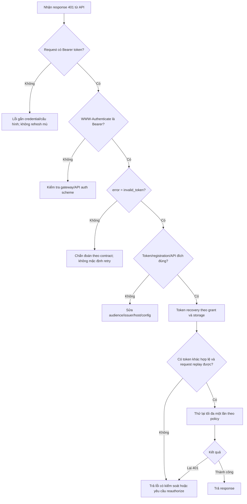
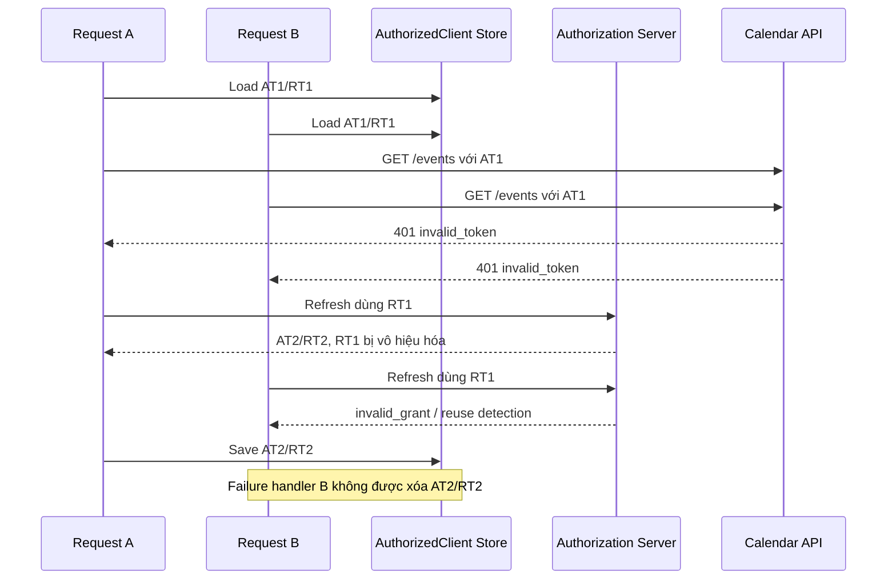

# 18.8. Token hết hạn, phản hồi 401 và chính sách thực hiện lại request

Trong một ứng dụng **Spring Security OAuth 2.0 / OpenID Connect (OIDC) Client** sử dụng **Spring MVC/Servlet**, backend thường gọi REST API bên ngoài bằng **OAuth2 access token**. Khi token hết hạn, Authorization Server thu hồi token hoặc API không còn chấp nhận nó, HTTP client có thể nhận phản hồi **401 Unauthorized**. Một phản xạ dễ mắc sai lầm là: *“Gặp 401 thì refresh token và gửi lại request ngay.”*

Cách xử lý đó **không an toàn nếu áp dụng cho mọi trường hợp**. Phản hồi 401 không luôn chứng minh access token đã hết hạn; OAuth2 Client Manager không tự biết mọi kết quả của Resource Server; thao tác cấp lại token có thể thất bại; và việc gửi lại POST/PUT/DELETE hoặc request chứa stream có thể gây **ghi dữ liệu hai lần, phát sinh giao dịch trùng hoặc rò token**.

Bài học này trình bày quy trình xử lý đúng trong **Spring Boot 3.x, Spring Security 6.x, Servlet và RestClient**:

- Phân biệt **hết hạn theo `expiresAt`**, **401 từ Resource Server**, **403 thiếu quyền**, và lỗi Token Endpoint.
- Hiểu `OAuth2AuthorizedClientManager` làm mới token *trước request* và các giới hạn của nó.
- Đọc `WWW-Authenticate: Bearer ...` theo RFC 6750; không suy đoán từ mỗi HTTP status.
- Sử dụng Spring Security OAuth2 Client với `RestClient`; chọn cách tích hợp theo phiên bản framework.
- Thiết kế retry **có điều kiện, có giới hạn, chỉ với request an toàn để phát lại**.
- Tránh retry ngầm trên thao tác thay đổi trạng thái, body không replay được, refresh token rotation và nhiều request đồng thời.
- Tách lỗi xác thực client tại Token Endpoint khỏi lỗi Bearer token tại downstream API.
- Kiểm thử và quan sát mà không làm lộ access/refresh token.

Các URL, scopes, client IDs và response trong bài chỉ để minh họa, không phải cấu hình của một provider cụ thể.

## 1. Ba nơi xảy ra lỗi rất khác nhau

Trước khi viết retry, cần biết lỗi phát sinh ở chặng nào.

```mermaid
sequenceDiagram
    autonumber
    actor B as Browser
    participant S as Spring MVC / OAuth2 Client
    participant AS as Authorization Server
    participant API as Resource Server REST API
    B->>S: GET /my-orders + session cookie
    Note over S: Có Authentication của user
    S->>S: manager.authorize(...)
Kiểm tra authorized client
    opt Access token cần reauthorize và có thể refresh
        S->>AS: POST /token grant_type=refresh_token
        AS-->>S: access_token mới (+ refresh_token nếu rotate)
        Note over S: Lưu OAuth2AuthorizedClient mới
    end
    S->>API: GET /orders + Authorization: Bearer AT
    alt API chấp nhận token và quyền
        API-->>S: 200 + dữ liệu
        S-->>B: 200 + response
    else API không chấp nhận token
        API-->>S: 401 + WWW-Authenticate
        Note over S: Phân loại lỗi; không mặc định replay
        S-->>B: Response ứng dụng phù hợp
    else Token hợp lệ nhưng thiếu quyền
        API-->>S: 403 insufficient_scope
        Note over S: Không dùng refresh để tự nâng quyền
        S-->>B: Response ứng dụng phù hợp
    end
```

Có ba tầng cần tách:

| Tầng | Ví dụ | Ý nghĩa |
| --- | --- | --- |
| **OIDC login của browser** | Callback `/login/oauth2/code/calendar` báo lỗi `state`/ID Token | Không xác thực được browser user, không phải 401 của REST API |
| **Token Endpoint của Authorization Server** | `POST /token` trả `invalid_grant` hoặc `invalid_client` | Client xin hoặc refresh token thất bại |
| **Resource Server REST API** | `GET /orders` trả `401`/`403` | API không chấp nhận credential hoặc từ chối quyền truy cập |

Nếu log chỉ ghi “OAuth2 failed” mà không có chặng, người vận hành rất dễ sửa sai phần: đổi client secret để chữa lỗi API `insufficient_scope`, hoặc làm lại login khi thực tế `Bearer` token bị gửi nhầm audience.

## 2. Access token hết hạn không đồng nghĩa API vừa trả 401

Một `OAuth2AuthorizedClient` trong Spring Security lưu `OAuth2AccessToken` với các thông tin như:

```java
OAuth2AuthorizedClient authorizedClient = ...;

Instant issuedAt = authorizedClient.getAccessToken().getIssuedAt();
Instant expiresAt = authorizedClient.getAccessToken().getExpiresAt();
Set<String> scopes = authorizedClient.getAccessToken().getScopes();
```

Nhờ metadata này, `OAuth2AuthorizedClientProvider` có thể xác định **đã đến thời điểm cần reauthorization hay chưa**. Với cấu hình có `refreshToken()` provider và một refresh token hợp lệ, manager có thể thực hiện refresh trước khi HTTP request tới API.

### 2.1. Refresh chủ động trước request

```text
Application muốn gọi API
       |
       v
OAuth2AuthorizedClientManager.authorize(...)
       |
       v
Đọc authorized client hiện tại
       |
       +--- AT còn phù hợp ---> trả lại AT hiện có
       |
       +--- AT hết/sắp hết hạn
                |
                +--- Có refresh token + provider hỗ trợ
                |       |
                |       v
                |    POST /token, lưu token mới
                |       |
                |       v
                |    Trả authorized client mới
                |
                +--- Không thể reauthorize
                        |
                        v
                      null / lỗi tùy ngữ cảnh
```

**Không phải mọi lời gọi `authorize()` đều gửi `POST /token`.** Manager có thể trả authorized client cũ khi provider nhận thấy chưa cần cấp mới. Đối với `client_credentials`, manager thường xin access token mới bằng grant này khi cần, thay vì dùng refresh token.

### 2.2. Clock skew có vai trò gì?

Giả sử đồng hồ client cho rằng token hết hạn lúc 10:00 nhưng API kiểm tra gần mốc đó. Request gửi lúc 09:59:59 có thể đến API khi token đã hết hạn. Một số token providers có **clock skew** để coi token gần hết hạn là cần làm mới sớm hơn.

Điều này giúp giảm 401 do chênh thời gian và độ trễ mạng, nhưng:

- Không bảo đảm API luôn chấp nhận token.
- Không chữa được token bị thu hồi trước hạn.
- Không chữa được sai issuer, audience hoặc quyền.
- Skew quá lớn có thể làm tăng số lần gọi Token Endpoint.
- Đồng hồ máy chủ vẫn phải được đồng bộ.

Không sửa lỗi bằng cách tăng skew tùy tiện đến vài giờ hoặc tắt kiểm tra hạn token.

## 3. Vì sao token chưa hết hạn vẫn có thể nhận 401?

Một access token có `expiresAt` trong tương lai **không có nghĩa** mọi Resource Server phải chấp nhận nó.

Các nguyên nhân có thể gồm:

1. **Token bị revoke hoặc tài khoản bị vô hiệu hóa** theo chính sách Authorization Server/Resource Server.
2. **Sai audience**: token được cấp cho API A nhưng lại gửi đến API B.
3. **Sai issuer** hoặc API đang trỏ sang môi trường/tenant khác.
4. **Token signature hoặc token introspection thất bại** tại API.
5. **Token không được truyền đi**: mất `Authorization` header do cấu hình client/gateway.
6. **Sai định dạng**: gửi ID Token thay vì access token, hoặc dùng token từ registration khác.
7. **Sai token type/scheme**: API yêu cầu Bearer nhưng request không có `Bearer` phù hợp.
8. **Key rotation hoặc cấu hình Resource Server chưa đồng bộ** với OP.
9. **Authorization Server và Resource Server có quy tắc chấp nhận khác thời hạn**.
10. **Header bị loại bỏ hoặc xử lý sai khi redirect qua proxy/gateway**.

Vì vậy, **401 là tín hiệu cần phân loại**, không phải chỉ thị vô điều kiện “refresh rồi retry”.

## 4. HTTP 401, 403 và `WWW-Authenticate`

Theo cơ chế Bearer Token của **RFC 6750**, một Resource Server có thể trả challenge:

```http
HTTP/1.1 401 Unauthorized
WWW-Authenticate: Bearer realm="orders", error="invalid_token"
Cache-Control: no-store
```

Hoặc khi token hợp lệ nhưng không đủ scope:

```http
HTTP/1.1 403 Forbidden
WWW-Authenticate: Bearer realm="orders",
    error="insufficient_scope",
    scope="orders.write"
```

Thông tin trên là ví dụ minh họa; challenge thực tế có thể nằm trên một dòng và có thêm tham số.

### 4.1. Ý nghĩa một số lỗi Bearer

| Status/challenge | Ý nghĩa thường gặp | Hành động phía client |
| --- | --- | --- |
| `401` + `Bearer error="invalid_token"` | Token hết hạn, không hợp lệ, bị thu hồi hoặc không chấp nhận | Kiểm tra token/registration/audience; cân nhắc invalidation/reauthorization có kiểm soát |
| `401` + Bearer challenge không nêu error | Credential thiếu hoặc cần xác thực | Kiểm tra request có gửi Bearer token đúng chỗ không |
| `401` với challenge không phải Bearer | Cơ chế xác thực khác hoặc gateway | Không mặc định xử lý như OAuth2 access-token expiration |
| `403` + `insufficient_scope` | Credential hợp lệ nhưng thiếu scope/quyền | Xem scope, consent, client registration hoặc nghiệp vụ; không refresh mù |
| `403` do object/tenant policy | API từ chối bản ghi/tenant | Phân quyền nghiệp vụ, không tự nâng quyền |
| `429` | Rate limit | Backoff theo policy; không phải lỗi token |
| `5xx` | API/gateway lỗi | Retry theo idempotency/network policy, không phải OAuth2 refresh |
| Timeout/connection reset | Không chắc API đã nhận/xử lý request chưa | Không replay thao tác thay đổi trạng thái khi chưa có bảo đảm idempotency |

**`invalid_token` có thể bao gồm access token hết hạn**, nhưng không có ánh xạ một-một. Nếu response chỉ có 401 và không có thông tin Bearer phù hợp, ứng dụng cần hiểu contract của API, đừng tự gán `invalid_token`.

### 4.2. Một 401 có thể đến từ gateway chứ không phải API

Ví dụ reverse proxy yêu cầu một header khác, hoặc API gateway tự trả 401 trước khi request đến Resource Server. Nếu handler chỉ dựa vào status, client có thể xóa authorized client hoàn toàn hợp lệ của user.

Hãy kiểm tra nguồn response, loại challenge và endpoint đã gọi. Có thể dùng correlation ID/trace trong hệ thống được kiểm soát, nhưng **không ghi raw Bearer token hoặc authorization code vào log**.

### 4.3. Không tin `error_description` như dữ liệu an toàn

`WWW-Authenticate` và response body là dữ liệu do hệ thống ngoài gửi về. Không đưa nguyên `error_description` vào HTML không escape, không dùng nó như câu lệnh điều khiển, không để nội dung ngoại lai quyết định API host hoặc token endpoint mới.

Chỉ trích xuất những mã lỗi đã được định nghĩa trong contract; log thông tin tối thiểu, có redaction.

## 5. Mối quan hệ giữa Client Manager và HTTP client

Trong Servlet ứng dụng, Spring Security có các abstraction:

| Thành phần | Trách nhiệm |
| --- | --- |
| `ClientRegistrationRepository` | Cấu hình client ID, secret, grant, provider, token endpoint, scopes |
| `OAuth2AuthorizedClientRepository` | Lưu/tìm authorized client có thể gắn với Servlet request/session |
| `OAuth2AuthorizedClientService` | Lưu/tìm authorized client độc lập HTTP request |
| `OAuth2AuthorizedClientManager` | Điều phối authorization và reauthorization |
| `OAuth2AuthorizedClientProvider` | Chọn cách refresh token, client credentials hoặc grant khác |
| `OAuth2AuthorizedClient` | Mang access token, refresh token (nếu có), registration và principal name |
| `RestClient` | Gửi HTTP request đến downstream API |
| `OAuth2ClientHttpRequestInterceptor` | Tích hợp OAuth2 token vào Spring `RestClient` trên các phiên bản hỗ trợ |
| `OAuth2AuthorizationFailureHandler` | Phản ứng khi authorization thất bại hoặc được tích hợp để xử lý failure thích hợp |

### 5.1. Hai thời điểm xử lý khác nhau

**Thời điểm A — trước khi gửi API request:**

```java
OAuth2AuthorizedClient client =
        authorizedClientManager.authorize(authorizeRequest);
```

Manager chọn authorized client còn phù hợp hoặc thực hiện reauthorization theo provider. Nếu thành công, caller có access token.

**Thời điểm B — sau khi API đã trả 401:**

```text
HTTP client nhận response 401
        |
        v
Client code hoặc OAuth2 HTTP interceptor/failure handler
        |
        v
Xác định có phải Bearer invalid_token?
        |
        v
Có invalidation/removal được cấu hình và phù hợp không?
        |
        v
Cần reauthorization/reconnect?
        |
        v
Có được gửi lại nghiệp vụ request hay không?
```

Đây là **hai bước không được nhập làm một**. Việc failure handler có thể xóa authorized client không có nghĩa nó tự phát lại HTTP request sau khi lấy token mới.

### 5.2. Tích hợp thất bại không đồng nghĩa tự retry

Trong Spring Security có tích hợp `RestClient`, một authorization failure handler được cấu hình có thể **loại bỏ authorized client không hợp lệ** để lần xử lý sau không tiếp tục dùng nó. Nhưng:

- Handler không tự tạo scope/consent còn thiếu.
- Với Authorization Code Flow, xóa authorized client có thể làm mất cả refresh token được lưu cùng bản ghi, dẫn đến **cần user reauthorization**.
- Nếu client credentials có thể xin token mới, vẫn phải quyết định **có replay HTTP request trước đó không**.
- Một handler chỉ biết status và token có thể cần phối hợp với storage để không xóa token mới do luồng khác vừa lưu.

Do đó cần tách **token recovery** khỏi **business request retry policy**.

## 6. Cấu hình ví dụ: OIDC user và service-to-service

Giả sử ứng dụng có hai REST integrations:

- **Calendar API**: người dùng đăng nhập OIDC, backend gọi thay mặt user qua `authorization_code`.
- **Inventory API**: backend chạy theo danh tính ứng dụng qua `client_credentials`.

### 6.1. `application.yml`

```yaml
spring:
  security:
    oauth2:
      client:
        registration:
          calendar-user:
            provider: calendar-oidc
            client-id: ${CALENDAR_CLIENT_ID}
            client-secret: ${CALENDAR_CLIENT_SECRET}
            client-authentication-method: client_secret_basic
            authorization-grant-type: authorization_code
            scope:
              - openid
              - profile
              - calendar.read
              - offline_access
            redirect-uri: "{baseUrl}/login/oauth2/code/{registrationId}"

          inventory-service:
            provider: inventory-as
            client-id: ${INVENTORY_CLIENT_ID}
            client-secret: ${INVENTORY_CLIENT_SECRET}
            client-authentication-method: client_secret_basic
            authorization-grant-type: client_credentials
            scope:
              - inventory.read

        provider:
          calendar-oidc:
            issuer-uri: ${CALENDAR_ISSUER_URI}
          inventory-as:
            token-uri: ${INVENTORY_TOKEN_URI}
```

`calendar.read` và `inventory.read` là scopes minh họa, không phải phạm vi chuẩn của mọi provider. `offline_access` có thể liên quan việc cấp refresh token nhưng **không bảo đảm OP cấp hoặc chấp nhận refresh token**.

Client secrets phải được lưu trong backend secret manager/environment. Không dùng token/secret hoạt động thật trong YAML của repository.

### 6.2. `application.properties` tương đương

```properties
spring.security.oauth2.client.registration.calendar-user.provider=calendar-oidc
spring.security.oauth2.client.registration.calendar-user.client-id=${CALENDAR_CLIENT_ID}
spring.security.oauth2.client.registration.calendar-user.client-secret=${CALENDAR_CLIENT_SECRET}
spring.security.oauth2.client.registration.calendar-user.client-authentication-method=client_secret_basic
spring.security.oauth2.client.registration.calendar-user.authorization-grant-type=authorization_code
spring.security.oauth2.client.registration.calendar-user.scope=openid,profile,calendar.read,offline_access
spring.security.oauth2.client.registration.calendar-user.redirect-uri={baseUrl}/login/oauth2/code/{registrationId}
spring.security.oauth2.client.provider.calendar-oidc.issuer-uri=${CALENDAR_ISSUER_URI}

spring.security.oauth2.client.registration.inventory-service.provider=inventory-as
spring.security.oauth2.client.registration.inventory-service.client-id=${INVENTORY_CLIENT_ID}
spring.security.oauth2.client.registration.inventory-service.client-secret=${INVENTORY_CLIENT_SECRET}
spring.security.oauth2.client.registration.inventory-service.client-authentication-method=client_secret_basic
spring.security.oauth2.client.registration.inventory-service.authorization-grant-type=client_credentials
spring.security.oauth2.client.registration.inventory-service.scope=inventory.read
spring.security.oauth2.client.provider.inventory-as.token-uri=${INVENTORY_TOKEN_URI}
```

Chọn YAML hoặc properties theo convention dự án. Đảm bảo token được cấp cho **đúng API audience**, không chỉ có scope đúng tên.

## 7. Client Manager cho Servlet user request

Với `oauth2Login()`, user có `Authentication` trong `SecurityContext` và có thể có `OAuth2AuthorizedClient` sau Authorization Code Flow.

```java
import org.springframework.context.annotation.Bean;
import org.springframework.context.annotation.Configuration;
import org.springframework.security.oauth2.client.DefaultOAuth2AuthorizedClientManager;
import org.springframework.security.oauth2.client.OAuth2AuthorizedClientManager;
import org.springframework.security.oauth2.client.OAuth2AuthorizedClientProvider;
import org.springframework.security.oauth2.client.OAuth2AuthorizedClientProviderBuilder;
import org.springframework.security.oauth2.client.registration.ClientRegistrationRepository;
import org.springframework.security.oauth2.client.web.OAuth2AuthorizedClientRepository;

@Configuration
public class UserOauth2ManagerConfig {

    @Bean("userClientManager")
    OAuth2AuthorizedClientManager userClientManager(
            ClientRegistrationRepository registrations,
            OAuth2AuthorizedClientRepository authorizedClients) {

        OAuth2AuthorizedClientProvider provider =
                OAuth2AuthorizedClientProviderBuilder.builder()
                        .authorizationCode()
                        .refreshToken()
                        .build();

        DefaultOAuth2AuthorizedClientManager manager =
                new DefaultOAuth2AuthorizedClientManager(
                        registrations, authorizedClients);

        manager.setAuthorizedClientProvider(provider);
        return manager;
    }
}
```

Điều quan trọng:

- `authorizationCode()` không tự mở browser login từ một service method bất kỳ.
- `refreshToken()` chỉ giúp khi authorized client có refresh token phù hợp và đã đến điều kiện reauthorization.
- `DefaultOAuth2AuthorizedClientManager` được thiết kế cho môi trường có **Servlet request/response**.
- Nếu OP từ chối refresh hoặc token đã bị xóa khỏi store, ứng dụng có thể phải yêu cầu user **login/consent lại**.

### 7.1. `SecurityFilterChain` cho OIDC Login

```java
import org.springframework.context.annotation.Bean;
import org.springframework.context.annotation.Configuration;
import org.springframework.security.config.Customizer;
import org.springframework.security.config.annotation.web.builders.HttpSecurity;
import org.springframework.security.web.SecurityFilterChain;

@Configuration
public class WebSecurityConfig {

    @Bean
    SecurityFilterChain securityFilterChain(HttpSecurity http)
            throws Exception {

        http
            .authorizeHttpRequests(authorize -> authorize
                .requestMatchers("/", "/error", "/assets/**").permitAll()
                .anyRequest().authenticated())
            .oauth2Login(Customizer.withDefaults());

        return http.build();
    }
}
```

Không cần tắt CSRF để thực hiện GET tới REST API bên ngoài. CSRF của **website dùng session cookie** và OAuth2 Bearer authentication của **REST API downstream** là hai vấn đề bảo mật khác nhau.

## 8. Client Manager cho ứng dụng tự gọi API

Với `inventory-service` dùng `client_credentials`, chọn manager không phụ thuộc HTTP request:

```java
import org.springframework.context.annotation.Bean;
import org.springframework.context.annotation.Configuration;
import org.springframework.security.oauth2.client.AuthorizedClientServiceOAuth2AuthorizedClientManager;
import org.springframework.security.oauth2.client.OAuth2AuthorizedClientManager;
import org.springframework.security.oauth2.client.OAuth2AuthorizedClientProvider;
import org.springframework.security.oauth2.client.OAuth2AuthorizedClientProviderBuilder;
import org.springframework.security.oauth2.client.OAuth2AuthorizedClientService;
import org.springframework.security.oauth2.client.registration.ClientRegistrationRepository;

@Configuration
public class MachineOauth2ManagerConfig {

    @Bean("machineClientManager")
    OAuth2AuthorizedClientManager machineClientManager(
            ClientRegistrationRepository registrations,
            OAuth2AuthorizedClientService authorizedClients) {

        OAuth2AuthorizedClientProvider provider =
                OAuth2AuthorizedClientProviderBuilder.builder()
                        .clientCredentials()
                        .build();

        AuthorizedClientServiceOAuth2AuthorizedClientManager manager =
                new AuthorizedClientServiceOAuth2AuthorizedClientManager(
                        registrations, authorizedClients);

        manager.setAuthorizedClientProvider(provider);
        return manager;
    }
}
```

Với `client_credentials`, OAuth2AuthorizedClientManager có thể cấp access token mới khi token hiện tại không còn phù hợp. Không cần user hoặc browser login. Tuy nhiên, `principal("inventory-worker")` khi tạo authorize request chỉ là **khóa quản lý authorized client của workload**, không trở thành một OIDC end user hay tự tạo quyền admin.

## 9. `RestClient` và OAuth2 HTTP interceptor trong Spring Security

**Spring Framework 6.1+** cung cấp `RestClient`; tích hợp `OAuth2ClientHttpRequestInterceptor` dành cho `RestClient` xuất hiện trong **Spring Security 6.4+**. Nếu dự án đang dùng Spring Boot/Security cũ hơn, hãy dùng API tương thích hoặc cách chủ động gọi manager như phần 10.

### 9.1. Để interceptor gắn Bearer token

Ví dụ Servlet web integration cho phiên bản Spring Security có API này:

```java
import org.springframework.beans.factory.annotation.Qualifier;
import org.springframework.context.annotation.Bean;
import org.springframework.context.annotation.Configuration;
import org.springframework.security.oauth2.client.OAuth2AuthorizedClientManager;
import org.springframework.security.oauth2.client.web.OAuth2AuthorizedClientRepository;
import org.springframework.security.oauth2.client.web.client.OAuth2ClientHttpRequestInterceptor;
import org.springframework.web.client.RestClient;

@Configuration
public class CalendarRestClientConfig {

    @Bean("calendarRestClient")
    RestClient calendarRestClient(
            @Qualifier("userClientManager")
            OAuth2AuthorizedClientManager manager,
            OAuth2AuthorizedClientRepository authorizedClientRepository) {

        OAuth2ClientHttpRequestInterceptor interceptor =
                new OAuth2ClientHttpRequestInterceptor(manager);

        interceptor.setAuthorizationFailureHandler(
                OAuth2ClientHttpRequestInterceptor
                        .authorizationFailureHandler(
                                authorizedClientRepository));

        return RestClient.builder()
                .baseUrl("https://calendar-api.example.com")
                .requestInterceptor(interceptor)
                .build();
    }
}
```

**Lưu ý về phiên bản:** chữ ký helper tạo failure handler và cơ chế resolve client registration có thể thay đổi giữa các nhánh Spring Security. Ví dụ dựa trên API `OAuth2ClientHttpRequestInterceptor` ở những bản hỗ trợ; hãy đối chiếu Javadoc của **đúng phiên bản dự án** khi áp dụng.

### 9.2. Chọn registration ID trong request

Với resolver request attribute được Spring Security phiên bản tương ứng hỗ trợ:

```java
import static org.springframework.security.oauth2.client.web.client
        .RequestAttributeClientRegistrationIdResolver.clientRegistrationId;

// Trong một controller/service được gọi bởi user đã đăng nhập:
String result = calendarRestClient.get()
        .uri("/v1/events")
        .attributes(clientRegistrationId("calendar-user"))
        .retrieve()
        .body(String.class);
```

`clientRegistrationId("calendar-user")` ở ví dụ này là helper để interceptor nhận biết registration, **không phải một HTTP header hoặc query parameter gửi ra API**.

Việc resolve principal phải đúng ngữ cảnh user/session hiện tại; với tác vụ nền, thường cần service manager và principal resolver rõ ràng. **Không cho browser truyền registration ID tùy ý** rồi gọi manager với client credential mà user không được phép sử dụng.

### 9.3. Failure handler làm gì và không làm gì?

Trong những cấu hình được hỗ trợ, failure handler có thể xử lý trường hợp Resource Server trả `401` kèm Bearer error thích hợp để **xóa authorized client bị coi là invalid** khỏi repository/service. Điều này giúp tránh tiếp tục sử dụng credential đã thất bại ở các requests sau.

Nhưng **không được giả định interceptor tự replay request vừa nhận 401**:

```text
Request #1 -> API trả 401 invalid_token
            -> failure handler có thể remove authorized client
            -> Request #1 vẫn đã thất bại

Request #2 (sau đó) -> manager authorize() lại
            -> có thể xin token mới, hoặc
            -> cần browser authorization/consent
```

Với Authorization Code Flow, nếu xóa authorized client, refresh token bên trong nó cũng có thể mất. Lần gọi sau **không tự refresh được** nếu không còn authorized client/refresh token. Ứng dụng cần chính sách reconnect thay vì coi deletion là “refresh ngay”.

### 9.4. Không trộn hai cách gắn Authorization header

Nếu đã dùng `OAuth2ClientHttpRequestInterceptor`, không nên đồng thời gắn Bearer header thủ công cho cùng request bằng một token khác. Trộn interceptor + manual header dễ gây:

- Gửi token sai registration.
- Token được thay thế không theo thứ tự mong đợi.
- Failure handler xóa authorized client không tương ứng với token thực tế.
- Debug khó do một lớp ghi đè header của lớp khác.

Chọn một cơ chế cấp/gắn token có chủ đích cho mỗi HTTP client.

## 10. Cách chủ động lấy token rồi gửi request bằng `RestClient`

Khi muốn kiểm soát rõ luồng, service có thể gọi manager và gắn Bearer token. Ví dụ **machine-to-machine GET** sau đây chủ ý **không tự retry 401**:

```java
import org.springframework.beans.factory.annotation.Qualifier;
import org.springframework.security.oauth2.client.OAuth2AuthorizeRequest;
import org.springframework.security.oauth2.client.OAuth2AuthorizedClient;
import org.springframework.security.oauth2.client.OAuth2AuthorizedClientManager;
import org.springframework.stereotype.Service;
import org.springframework.web.client.RestClient;
import org.springframework.web.client.RestClientResponseException;

@Service
public class InventoryApiClient {

    private final OAuth2AuthorizedClientManager manager;
    private final RestClient api = RestClient.create(
            "https://inventory-api.example.com");

    public InventoryApiClient(
            @Qualifier("machineClientManager")
            OAuth2AuthorizedClientManager manager) {
        this.manager = manager;
    }

    public String fetchInventory() {
        OAuth2AuthorizeRequest request =
                OAuth2AuthorizeRequest
                        .withClientRegistrationId("inventory-service")
                        .principal("inventory-worker")
                        .build();

        OAuth2AuthorizedClient client = manager.authorize(request);
        if (client == null) {
            throw new IllegalStateException(
                    "Inventory OAuth2 client not authorized");
        }

        try {
            return api.get()
                    .uri("/v1/stock")
                    .headers(headers -> headers.setBearerAuth(
                            client.getAccessToken().getTokenValue()))
                    .retrieve()
                    .body(String.class);
        }
        catch (RestClientResponseException ex) {
            if (ex.getStatusCode().value() == 401) {
                // Phân loại 401 bằng WWW-Authenticate nếu có;
                // xử lý credential invalidation/reconnect ở tầng policy.
                // Không gửi lại GET tự động chỉ vì status=401.
                throw new IllegalStateException(
                        "Inventory API rejected its Bearer credential", ex);
            }
            throw ex;
        }
    }
}
```

Đoạn này dành cho **Spring Framework 6.1+/Spring Boot 3.2+**. Với version cũ hơn, dùng HTTP client tương thích nhưng giữ nguyên mô hình manager và token lifecycle.

**Điểm an toàn:** mã chỉ gắn token vào host API cố định, không đưa token ra browser hoặc URL query string. `setBearerAuth(...)` nhận giá trị token cần được xem là secret; không in nó vào log.

### 10.1. Vì sao ví dụ không retry ngay?

Nếu API trả 401, hiện chưa rõ:

- Token hết hạn hay sai audience.
- Client thiếu header do proxy hoặc misconfiguration.
- API có trả Bearer `invalid_token` thật không.
- Authorized client có thể làm mới theo grant nào.
- Failure handler đã xóa hoặc thay đổi token state chưa.
- Request có replay được không.

Lớp API client nên chuyển một lỗi đã chuẩn hóa tới **policy layer** phù hợp, không tự tạo vòng lặp vô hạn trong `catch`.

### 10.2. `retrieve()` và response handler

Với `RestClient.retrieve()`, phản hồi 4xx/5xx mặc định có thể ném exception, nên mã `.body(...)` có thể **không trả về value** khi status 401. Có thể dùng `onStatus(...)` hoặc `exchange(...)` nếu cần tự đọc status/challenge/body trong giới hạn API hiện tại.

Lựa chọn nào cũng cần bảo đảm:

- Response body bị giới hạn kích thước.
- Không log raw error body chứa token/dữ liệu nhạy cảm.
- Không parse challenge bằng logic string `contains("expired")` tùy tiện.
- Không biến mọi 401 thành lỗi cần retry.

## 11. Cách phân loại một phản hồi 401 có hệ thống

Một decision tree đơn giản:



### 11.1. Không dùng mỗi timestamp để quyết định

Nếu 401 xảy ra khi `expiresAt` còn trong tương lai, khả năng **revocation/sai audience/sai issuer** tăng lên. Nhưng metadata đó vẫn chỉ là một manh mối, không phải bằng chứng chắc chắn.

Nếu response `invalid_token` được xác nhận từ API tin cậy, client có thể **invalidate authorized client** theo policy, nhưng phải cẩn thận với race condition và việc mất refresh token.

### 11.2. Không để lỗi được chuẩn hóa thành credential leakage

Có thể log:

```text
targetService=inventory-api
registrationId=inventory-service
httpStatus=401
bearerError=invalid_token
operation=fetchStock
requestId=<opaque-correlation-id>
```

Không log:

```text
Authorization: Bearer eyJ...
refresh_token=...
client_secret=...
Cookie: JSESSIONID=...
```

Ngay cả `WWW-Authenticate` cũng nên được parse để lấy error code đã cho phép, không log nguyên chuỗi nếu provider có thể đưa thông tin nhạy cảm vào `error_description`.

## 12. Retry HTTP request là quyết định nghiệp vụ, không chỉ kỹ thuật

Giả sử một request gửi để tạo đơn hàng:

```http
POST /v1/orders HTTP/1.1
Host: orders-api.example.com
Authorization: Bearer ACCESS_TOKEN
Content-Type: application/json

{"sku":"BOOK-001","quantity":1}
```

Client nhận 401. Nếu gọi lại ngay, một số hệ thống có thể tạo đơn hai lần khi lần đầu đã qua một phần business flow trước khi phản hồi lỗi, hoặc khi 401 đến từ một thành phần proxy/hậu xử lý không phản ánh trạng thái ghi ở upstream.

Về thiết kế HTTP chuẩn, xác thực thường diễn ra trước khi thực hiện side effects. Tuy nhiên, **một client tổng quát không được giả định mọi upstream/gateway đều thực thi đúng thứ tự đó**. Chính sách retry phải dựa vào **hợp đồng và tính idempotent của thao tác**, không chỉ phương thức HTTP.

### 12.1. Safe, idempotent và replayable khác nhau

| Khái niệm | Ý nghĩa |
| --- | --- |
| **Safe HTTP method** | Theo semantics HTTP, request không yêu cầu thay đổi trạng thái do client mong muốn; điển hình GET/HEAD |
| **Idempotent operation** | Thực hiện một lần hay nhiều lần với cùng input có tác động cuối cùng tương đương |
| **Replayable request** | Client có thể tạo lại đầy đủ URL, method, headers/body và các điều kiện bảo mật của request |
| **Retriable under policy** | Hợp đồng nghiệp vụ, transport và security cho phép gửi lại trong điều kiện cụ thể |

Một **GET** thường an toàn để thử lại khi upstream thực thi đúng HTTP semantics, nhưng GET có side effect trong một ứng dụng thiết kế sai thì không. **PUT/DELETE** được định nghĩa là idempotent theo HTTP semantics, song việc retry chúng vẫn có thể cần ETag, concurrency control, body repeatability và hiểu đúng side effects/audit. **POST** thường không idempotent, trừ khi API hỗ trợ một cơ chế như idempotency key.

### 12.2. Ma trận chính sách retry khởi đầu

| HTTP method / thao tác | Retry sau 401 có thể cân nhắc? | Điều kiện |
| --- | --- | --- |
| `GET` đọc dữ liệu | **Có điều kiện** | Đã phân loại Bearer invalid_token, đã có credential mới, host cố định, tối đa một retry |
| `HEAD` kiểm tra metadata | **Có điều kiện** | Tương tự GET, không thay đổi trạng thái |
| `OPTIONS` | **Có điều kiện** | Chỉ khi thực sự cần, contract phù hợp |
| `PUT` cập nhật tài nguyên xác định | **Chỉ khi policy cho phép** | Idempotent thực tế; ETag/`If-Match` nếu cần; body replayable |
| `DELETE` | **Chỉ khi policy cho phép** | Resource semantics và trạng thái đã xóa được xử lý nhất quán |
| `POST` tạo đơn/giao dịch/thanh toán | **Không mặc định** | API hỗ trợ idempotency key và xử lý retry được kiểm chứng |
| `PATCH` thay đổi một phần | **Không mặc định** | Có idempotent semantics cụ thể hoặc khóa chống trùng và concurrency control |
| File upload/multipart/streaming POST | **Không mặc định** | Body có thể tái tạo chính xác và API hỗ trợ chống thao tác trùng |
| Queue command gây side effect | **Không mặc định** | Dedupe key, transactional/outbox/inbox semantics |
| API request qua URL do user chỉ định | **Không** | Không gửi token tới host chưa được phê duyệt |

Đây là **một chính sách khởi đầu bảo thủ**, không phải quy tắc của Spring Security bắt buộc phải auto retry GET hoặc cấm vĩnh viễn mọi POST retry. Mỗi API cần contract riêng.

### 12.3. Idempotency key cho POST

Một API có thể hỗ trợ:

```http
POST /v1/orders HTTP/1.1
Host: orders-api.example.com
Authorization: Bearer ACCESS_TOKEN
Idempotency-Key: order-request-7e4b... 
Content-Type: application/json

{"sku":"BOOK-001","quantity":1}
```

Một idempotency key được tạo cho **một ý định nghiệp vụ** và được **giữ nguyên khi thử lại đúng cùng ý định**. Server phải thực sự lưu và so khớp key/payload trong một khoảng thời gian, trả lại cùng kết quả hoặc ngăn tác động trùng theo contract.

Nếu API không hỗ trợ idempotency key, tự gửi thêm header **không tạo ra tính idempotent**. Trong hệ thống tiền bạc, cần idempotency contract, request ID, transaction state và reconciliation chứ không chỉ retry middleware.

## 13. Đề xuất chính sách retry có giới hạn

Một retry policy có thể được mô tả như sau:

1. **Giới hạn tối đa một lần retry do 401** cho cùng HTTP operation, và có tổng retry budget chung theo request.
2. Chỉ kích hoạt khi đã nhận diện **Bearer `invalid_token`** từ endpoint tin cậy hoặc tín hiệu tương đương được contract xác nhận.
3. Xác định **đúng OAuth2 ClientRegistration, principal và API audience**.
4. Chỉ thử reauthorization theo grant hợp lệ; không tự nâng scopes hoặc đổi provider.
5. Chỉ tiếp tục khi có **credential thực sự mới/khác** hoặc cơ sở rõ ràng rằng token trước đã bị thay thế bằng credential hợp lệ.
6. Chỉ replay khi request **được policy cho phép** và **body có thể tạo lại**.
7. Không gửi lại nếu có mâu thuẫn về account/tenant/authorization sau lần đầu.
8. Không retry nếu API trả `403 insufficient_scope`, sai audience/issuer hoặc lỗi do cấu hình.
9. Dừng ngay nếu request thứ hai vẫn nhận 401, tránh vòng lặp.
10. Log outcome/metrics đã che credential; khi không thể phục hồi, trả lỗi ổn định cho caller hoặc yêu cầu người dùng authorize lại.

### 13.1. Pseudocode cho GET an toàn

```java
// PSEUDOCODE: không phải API Spring Security có sẵn.
// tokenCoordinator và trustedApi là abstractions của ứng dụng.
Response getWithAtMostOne401Retry(
        AuthenticatedPrincipal principal) {

    TokenSnapshot first = tokenCoordinator
            .authorizeForTrustedApi("calendar-user", principal);

    Response response = trustedApi.getEvents(first.accessToken());

    if (!isTrustedBearerInvalidToken(response)) {
        return response;
    }

    // Điều phối credential recovery cho đúng registration/principal.
    // Không xóa refresh token/authorized client mới bằng stale failure.
    TokenSnapshot second = tokenCoordinator
            .recoverAfterInvalidTokenIfPermitted(
                    "calendar-user", principal, first.version());

    if (second == null
            || second.sameCredentialAs(first)
            || !trustedApi.isGetEventsReplayable()) {
        throw new ReauthorizationRequiredException();
    }

    // Lần thứ hai, cũng là lần cuối cùng.
    return trustedApi.getEvents(second.accessToken());
}
```

Ở ví dụ kiến trúc này, `TokenSnapshot`, `tokenCoordinator` và `trustedApi` là thành phần **ứng dụng tự xây**, không phải các class có sẵn trong Spring Security. Ý tưởng quan trọng:

- Chỉ có một quyết định recovery.
- Không dùng lại chính token vừa bị API từ chối.
- Không loại bỏ authorized client mới của luồng khác.
- Không retry với grant/identity sai.
- Không đưa raw Bearer token ra caller ngoài boundary cần thiết.

### 13.2. Retry budget toàn cục

Nếu tầng HTTP client đã retry 401 một lần, tầng service và controller **không nên lại mỗi tầng retry thêm ba lần**. Nhiều lớp retry chồng nhau có thể khuếch đại số request theo cấp số nhân.

Có thể truyền một **request-scoped retry context** hoặc tổ chức retry ở **một điểm duy nhất**:

```text
HTTP operation budget:
  authorization recovery retries = 1
  API network retries             = 0 hoặc theo contract
  Token Endpoint retries          = theo provider policy riêng
  deadline                        = không vượt request timeout
```

Các con số là ví dụ chính sách; lựa chọn thực tế phải dựa trên latency SLO, idempotency, rate limit và bảo mật.

## 14. Token recovery phụ thuộc grant type

Không thể viết một hàm chung “401 -> refresh” mà bỏ qua grant của registration.

### 14.1. `authorization_code` với refresh token

Luồng có thể:

```text
User đã consent calendar
       |
       v
Stored authorized client:
  access token AT1
  refresh token RT1
       |
       v
Manager refresh khi token cần reauthorization
       |
       v
OP trả AT2 và có thể RT2
       |
       v
Lưu trạng thái mới nhất quán
```

Nếu API trả `invalid_token` **trước `expiresAt`**, manager có thể vẫn đánh giá AT1 còn hạn và trả lại AT1. Chỉ gọi `authorize()` lần nữa **không bảo đảm** nó sẽ sử dụng refresh token ngay lập tức.

Ứng dụng phải có cơ chế policy rõ để xử lý credential không còn được API chấp nhận, nhưng cần tránh việc xóa authorized client làm mất RT hợp lệ. Một hướng là yêu cầu reauthorization qua browser nếu không có phương án recovery an toàn đã được hỗ trợ/kiểm chứng.

### 14.2. `authorization_code` không có refresh token

Nếu OP không cấp refresh token, khi access token hết hạn hoặc bị thu hồi, backend **không thể tự tạo authorization code mới** bằng cách gọi manager. Người dùng có thể phải bắt đầu lại authorization flow:

```text
/oauth2/authorization/calendar-user
```

Đây là browser flow có `state`/PKCE/nonce theo cấu hình, không phải một HTTP replay tự động của REST API.

### 14.3. `client_credentials`

Với machine-to-machine client, sau khi xác định token không còn dùng được, một chính sách có thể invalidate cached authorized client rồi yêu cầu token mới qua `client_credentials`. Tuy nhiên:

- Không xóa token mới mà worker khác vừa lưu.
- Không retry vô hạn khi API từ chối vì issuer/audience sai.
- Hạn chế Token Endpoint stampede khi nhiều workers cùng nhận 401.
- Chỉ replay business request theo idempotency policy.

`principal("inventory-worker")` chỉ là khóa ổn định cho authorized client storage, **không phải end-user identity**.

### 14.4. Refresh token rotation

Nếu OP rotate refresh token từ RT1 sang RT2:

```text
Stored: AT1, RT1

Refresh:
  send RT1
  receive AT2, RT2

Persist:
  AT2, RT2     (không còn RT1)
```

**Không retry refresh request dùng RT1** khi một lần refresh trước có thể đã thành công. Nếu Authorization Server bật reuse detection, replay RT1 có thể khiến cả token family bị thu hồi.

Retry **API GET với AT2** và retry **Token Endpoint refresh bằng RT1** là hai hành động khác nhau; action thứ hai có nguy cơ nghiêm trọng hơn.

## 15. Concurrency: nhiều requests cùng nhận 401

Giả sử hai tabs của một user hoặc hai nodes cùng gọi Calendar API:



Đây là trường hợp **race condition**:

1. **Duplicate refresh:** A/B cùng dùng RT1, provider có thể phát hiện reuse.
2. **Stale delete:** failure handler của B có thể xóa authorized client A vừa cập nhật.
3. **Stale write:** luồng cũ có thể ghi đè refresh token mới.
4. **Retry amplification:** mỗi request tự retry, làm Token Endpoint và API chịu tải lớn.

### 15.1. Điều phối theo authorized client key

Một khóa khái niệm:

```text
(registrationId, trustedPrincipalKey, tenantNamespace)
```

Để tránh nhiều requests cùng refresh:

- Dùng **single-flight** hoặc lock theo key.
- Sau khi lấy lock phải **đọc lại authorized client mới nhất**.
- Nếu một request khác đã cấp AT2, không cần dùng RT1 nữa.
- Có điều kiện version/token generation khi ghi/xóa.
- Dùng retry budget chung, không tạo vòng lặp.

Với nhiều ứng dụng replicas, `synchronized` trong một JVM không đủ. Có thể dùng distributed lock/lease + fencing và atomic compare-and-swap, nhưng cũng phải xử lý lease hết hạn giữa network call.

### 15.2. Failure handler có thể xóa token mới

Một tình huống:

```text
A: refresh AT1/RT1 -> AT2/RT2, save version=2
B: xử lý 401 gắn AT1
B: removeAuthorizedClient(registrationId, principalName)
```

Nếu B xóa không có điều kiện, AT2/RT2 của A cũng mất. Cần cơ chế **conditional eviction** khi storage/requirements cần bảo vệ concurrency:

```text
Remove chỉ khi:
  currentRecord.version == failedRequest.version
hoặc:
  currentRecord.accessTokenGeneration == failedRequest.tokenGeneration
```

Đây là một **chiến lược ứng dụng tùy biến**. Không mặc định `OAuth2AuthorizedClientRepository.removeAuthorizedClient(...)` có compare-and-swap semantics vì interface chung không cam kết điều đó.

### 15.3. Unknown outcome: không retry refresh token mù

Nếu POST refresh tới Authorization Server bị timeout:

```text
Client -> POST /token RT1
OP có thể đã nhận và rotate RT1 -> RT2
Network làm mất response
Client chỉ còn RT1
```

Không thể chứng minh OP chưa xử lý chỉ vì client timeout. Retry RT1 có thể bị xem là reuse. Phương án cần theo provider: kiểm tra token store, chờ luồng khác/lease, dùng grace period nếu được tài liệu hóa hoặc yêu cầu user reauthorize khi không khôi phục được.

## 16. Request body và khả năng phát lại

Ngay cả khi token đã được làm mới, HTTP operation còn phải **có thể phát lại chính xác**.

### 16.1. Body thường replayable

Một object DTO JSON đã được giữ ổn định có thể serialize lại:

```java
public record CreateOrderRequest(
        String productId,
        int quantity
) {}
```

Nhưng replay được body **không có nghĩa** nghiệp vụ tạo đơn hàng idempotent. API cần idempotency contract hoặc đảm bảo thao tác chưa xảy ra.

### 16.2. Body không replayable hoặc tốn kém

Những dạng cần xem xét kỹ:

- `InputStream` đã bị đọc đến EOF.
- `StreamingHttpOutputMessage` hoặc cơ chế upload streaming.
- Multipart file được lấy từ nguồn tạm đã bị xóa.
- Request body được ký theo timestamp/nonce mỗi lần gửi.
- One-shot publisher hoặc dữ liệu từ queue chỉ cho đọc một lần.
- Upload dữ liệu lớn không thể giữ toàn bộ trong bộ nhớ.
- Body có reference đến trạng thái/ETag đã thay đổi từ lần đầu.

Một interceptor gửi lại bằng cùng request object **không được giả định** rằng mọi stream đều có thể mở lại. Nếu cần retry, application layer phải có cách **tạo lại request từ immutable command** hoặc một nguồn dữ liệu replayable được kiểm soát.

### 16.3. Conditional headers cũng cần nhất quán

Với PUT/PATCH, các header như `If-Match: "<etag>"` và version điều khiển optimistic concurrency. Khi retry, không tự ý bỏ điều kiện hoặc thay ETag để thao tác “thành công bằng mọi giá”.

Nếu lần đầu đã thay đổi tài nguyên, lần sau có thể trả `412 Precondition Failed`, và đây có thể là tín hiệu cần reconciliation thay vì tiếp tục retry.

## 17. Cấm gửi lại Bearer token sai host

Một failure mode nghiêm trọng khác là redirect hoặc target URL được nhận từ input:

```java
// ANTI-PATTERN: không gắn token vào URL do user điều khiển.
String destination = request.getParameter("url");
restClient.get()
        .uri(destination)
        .headers(h -> h.setBearerAuth(accessToken))
        .retrieve();
```

Nếu client gửi credential đến host không tin cậy, access token bị lộ. Retry middleware càng làm tăng số lần credential đi qua các kết nối.

Biện pháp:

1. Dùng **base URL cố định hoặc allowlist** cho mỗi API integration.
2. Không để query parameter, header hoặc response error tự đổi token endpoint/issuer/API host.
3. Kiểm soát redirect cross-origin và **không forward `Authorization` sang host khác**.
4. Chỉ chọn `ClientRegistration` từ chính sách server-side.
5. Token phải có đúng **audience/resource** cho API đang gọi.
6. Không đính token vào URL query string hoặc log.
7. Khi retry, xác nhận **đích vẫn là cùng API tin cậy**.

Không tin rằng client HTTP bất kỳ sẽ tự xử lý mọi redirect và header chính xác theo threat model của ứng dụng; cần kiểm thử hành vi thực tế.

## 18. 401 của ứng dụng web và 401 của API khác nhau

Trong ứng dụng dùng `oauth2Login()`:

- Browser chưa đăng nhập đến một trang bảo vệ có thể nhận **302 redirect** tới login/OP.
- Browser đã đăng nhập nhưng thiếu authority có thể nhận **403**.
- Backend gọi API bên ngoài và API trả **401** là một lỗi **outbound REST call**.
- Nếu backend không xử lý lỗi đúng, nó có thể trả 500, 502, 503 hoặc một response ứng dụng khác cho browser.
- Một API của chính ứng dụng có thể dùng `oauth2ResourceServer()` và trả 401 Bearer riêng.

**Không tự chuyển mọi outbound 401 thành “user chưa đăng nhập website”.** User có thể đang có phiên OIDC hợp lệ nhưng Calendar API từ chối token vì audience, revoke hoặc consent. UX hợp lý có thể là thông báo “Cần kết nối lại tài khoản Calendar”, không xóa toàn bộ Spring session trừ khi chính sách yêu cầu.

### 18.1. Bảng quyết định với browser

| Tình huống | Hướng xử lý |
| --- | --- |
| User chưa login website | Bắt đầu OIDC login/return 401 phù hợp API contract |
| User login website nhưng chưa authorize external Calendar | Hướng user tới consent/account linking |
| Calendar access token hết hạn, refresh token hợp lệ | Manager có thể refresh trước request |
| Calendar token bị API từ chối và không có recovery an toàn | Báo user kết nối lại Calendar, không dùng token của user khác |
| API thiếu scope | Yêu cầu permission/consent theo contract, không retry cùng token |
| Lỗi API 5xx | Trả lỗi dịch vụ phụ thuộc, chỉ retry khi idempotent |
| User có session nhưng API bản ghi bị forbidden | Hiển thị 403 nghiệp vụ, không logout user |

## 19. Một thuật toán retry phòng thủ ở application layer

Một kiến trúc có thể tách trách nhiệm:

```text
Controller
  |
  v
Application Service
  |
  +--> AuthorizationPolicy:
  |      principal, registration, tenant, permissions
  |
  +--> TokenProvider / OAuth2AuthorizedClientManager
  |
  +--> TrustedApiClient (RestClient)
  |
  +--> OutboundResponseClassifier
  |      status + WWW-Authenticate
  |
  +--> RetryPolicy:
         - request có replay được?
         - có credential mới?
         - còn budget?
         - api host an toàn?
         - operation idempotent?
```

### 19.1. Pseudocode đầy đủ theo từng bước

```text
function callTrustedApi(command, principal):
  assert command.allowedApiHost
  assert command.authorizedRegistration
  assert command.authorizedPrincipal
  assert command.retryBudget >= 0

  authorizedClient = manager.authorize(
      registration, principal
  )

  if authorizedClient == null:
      return AUTHORIZATION_REQUIRED

  firstTokenGeneration = authorizedClient.generation
  firstResponse = sendOnce(command, authorizedClient.accessToken)

  if firstResponse.isSuccess:
      return firstResponse

  if firstResponse.status != 401:
      return classifyOtherFailure(firstResponse)

  if not isBearerInvalidToken(firstResponse):
      return AUTHENTICATION_CONFIG_FAILURE

  if not command.isSafeToReplayUnderBusinessContract:
      return AUTHENTICATION_RECOVERY_REQUIRED

  if not command.hasReplayableBody:
      return AUTHENTICATION_RECOVERY_REQUIRED

  if not retryBudget.allowsOne401Retry:
      return AUTHENTICATION_RECOVERY_REQUIRED

  // Có thể xóa/cập nhật token cache theo version, lock và provider.
  recovery = recoverCredential(
      registration,
      principal,
      firstTokenGeneration
  )

  if recovery.failed or recovery.accessTokenIsSame:
      return AUTHORIZATION_REQUIRED

  // Dùng cùng operation context; không đổi URL, tenant, scope.
  secondResponse = sendOnce(command, recovery.accessToken)
  return secondResponse  // KHÔNG retry 401 thêm lần nữa
```

**Đây là thuật toán chính sách**, không phải một API duy nhất mà Spring Security tự cung cấp. `recoverCredential(...)` phải được thiết kế theo grant/storage và có thể thất bại hoặc yêu cầu browser reauthorization. `generation` là metadata ứng dụng có thể tự quản lý, không mặc định là trường của `OAuth2AuthorizedClient`.

### 19.2. Vì sao yêu cầu credential phải đổi?

Nếu API đã từ chối AT1 mà lần retry lại gửi đúng AT1, hành vi chỉ tăng tải, làm noise metrics và có thể bị rate-limit. Đối với token opaque, không được in token ra log để so; storage có thể dùng **version/fingerprint một chiều hoặc định danh thế hệ nội bộ** nhằm xác định token đã thay đổi.

### 19.3. Trường hợp recovery không có token mới

Nếu manager/provider không thể reauthorize, hoặc provider vẫn trả authorized client cũ, **dừng**. Với OIDC user, có thể cần user tự authorize lại. Với service client, kiểm tra `client_credentials`, client secret, audience và token endpoint.

## 20. Thứ tự lỗi và thứ tự xử lý

Một kiến trúc dễ điều tra cần giữ lỗi nguyên thủy ở đúng tầng:

| Điều kiện đầu vào | Trả lời câu hỏi | Không nên làm |
| --- | --- | --- |
| `manager.authorize() == null` | Grant/provider có thể authorize ở ngữ cảnh này không? | Không gọi API bằng token null |
| `OAuth2AuthorizationException` | Token Endpoint/reauthorization thất bại vì sao? | Không đổi thành “API 401” |
| `RestClientResponseException 401` | API có Bearer invalid_token không? | Không giả định `invalid_grant` |
| `RestClientResponseException 403` | Scope/permission/object rule? | Không refresh vô hạn |
| `RestClientResponseException 429` | API rate limit? | Không tạo nhiều token để né limit |
| Network timeout | Request có thể đã tới server chưa? | Không replay POST vô điều kiện |
| HTTP 5xx | API tạm lỗi hay trạng thái không rõ? | Không trộn với token invalidation |
| Local persistence conflict | Token vừa được luồng khác cập nhật? | Không xóa token mới do stale handler |

### 20.1. Có nên xóa authorized client trên mọi 401?

Không. Xóa authorized client có thể hợp lý khi **Resource Server xác thực Bearer `invalid_token`** và policy storage phù hợp. Nhưng nếu nguyên nhân là sai audience, việc xóa và xin cùng registration sẽ không giải quyết. Với Authorization Code, xóa client còn làm mất refresh token. Với nhiều requests đồng thời, xóa theo registration/principal mà không kiểm tra version có thể gây race.

Một failure handler phải biết **mình đang xử lý token thế hệ nào** và ứng dụng phải cân nhắc khả năng khôi phục, nhất là trong production nhiều instances.

## 21. Timeout và backoff cho token request khác API request

Các giới hạn chờ cần tách:

```text
Browser request deadline
  |
  +-- token acquisition/refresh
  |     +-- HTTP connect timeout
  |     +-- HTTP read timeout
  |     +-- retry policy của Token Endpoint (nếu an toàn)
  |
  +-- API request
        +-- HTTP connect timeout
        +-- HTTP read timeout
        +-- retry policy của API (idempotency)
```

Không dùng chung một vòng lặp retry mù cho cả hai. Token refresh dùng refresh token có thể bị **rotation/reuse detection**, nên retry token request với cùng refresh token **sau một timeout không rõ kết quả** có rủi ro riêng. API GET có thể có thể retry sau mạng lỗi, còn API POST gửi tiền thì không.

Một deadline tổng thể giúp tránh user chờ lâu khi các tầng cùng backoff. Cũng cần circuit breaker/bulkhead và giới hạn concurrency để sự cố OP không làm tất cả request threads bị nghẽn.

### 21.1. Retry storm

Nếu 100 requests cùng dùng token gần hết hạn, mỗi request thử refresh rồi retry API ba lần, một lỗi Token Endpoint có thể biến thành hàng trăm token requests và hàng trăm API calls.

Biện pháp:

- **Single-flight** cho cùng registration/principal.
- Clock skew thích hợp.
- Rate limit/queue token acquisition.
- Circuit breaker khi OP unavailable.
- Retry budget và backoff có jitter khi applicable.
- Không tự động retry request non-idempotent.
- Metrics cảnh báo số token acquisitions tăng bất thường.

## 22. Giới hạn thực thi trong một request Servlet

Request đến Spring MVC thường có `Authentication` của user và `HttpServletRequest` hiện tại. `DefaultOAuth2AuthorizedClientManager` phù hợp trong luồng này.

Nhưng nếu application service được gọi từ:

- `@Scheduled` job.
- `@Async` method.
- Message listener.
- Thread pool callback sau khi HTTP request kết thúc.
- Batch operation chạy nhiều giờ.

thì **không còn đảm bảo Servlet request context hoặc SecurityContext ban đầu**. Không đơn giản gọi lại user manager từ worker và hy vọng đọc được đúng refresh token.

Nếu background job cần token **của ứng dụng**, dùng `client_credentials` manager dựa trên `OAuth2AuthorizedClientService`. Nếu job cần **delegated user token**, cần storage được thiết kế cho user authorization và quy trình quyền/consent/revocation rõ ràng, không tự chuyển sang service token.

### 22.1. Retry trong worker có thể tạo kết quả trùng

Job xử lý thông báo, webhook hoặc lệnh nền có thể được hệ thống queue giao lại do at-least-once delivery. Nếu ngoài việc queue redelivery còn có HTTP retry riêng, số lần gọi có thể nhân lên.

Cần idempotency key và durable work-state gắn với **business command**, không chỉ token request. Việc refresh thành công không chứng minh nghiệp vụ trước đó chưa được xử lý.

## 23. Ví dụ GET web user bằng manager, không auto retry

Một ví dụ với `calendar-user` trong HTTP request:

```java
import org.springframework.beans.factory.annotation.Qualifier;
import org.springframework.security.core.Authentication;
import org.springframework.security.oauth2.client.OAuth2AuthorizeRequest;
import org.springframework.security.oauth2.client.OAuth2AuthorizedClient;
import org.springframework.security.oauth2.client.OAuth2AuthorizedClientManager;
import org.springframework.stereotype.Service;
import org.springframework.web.client.RestClient;

@Service
public class CalendarApiGateway {

    private final OAuth2AuthorizedClientManager manager;
    private final RestClient client =
            RestClient.create("https://calendar-api.example.com");

    CalendarApiGateway(
            @Qualifier("userClientManager")
            OAuth2AuthorizedClientManager manager) {
        this.manager = manager;
    }

    String readEvents(Authentication authenticatedUser) {
        OAuth2AuthorizeRequest authorizeRequest =
                OAuth2AuthorizeRequest
                        .withClientRegistrationId("calendar-user")
                        .principal(authenticatedUser)
                        .build();

        OAuth2AuthorizedClient authorizedClient =
                manager.authorize(authorizeRequest);

        if (authorizedClient == null) {
            throw new IllegalStateException(
                    "Calendar consent/authorization required");
        }

        return client.get()
                .uri("/v1/events")
                .headers(headers -> headers.setBearerAuth(
                        authorizedClient.getAccessToken()
                                .getTokenValue()))
                .retrieve()
                .body(String.class);
    }
}
```

Đây là đường gọi cơ bản, không có HTTP interceptor để tự xử lý downstream 401 và **không tự retry**. Ưu điểm là dễ nhìn thấy lúc nào token được lấy và gửi.

Khi muốn thêm 401 retry, không chỉ thêm `while(true)` quanh đoạn `client.get()`. Hãy áp dụng policy đã xác định: phân loại Bearer challenge, kiểm soát authorized client storage, xác minh credential mới, idempotency và retry budget.

### 23.1. Request user chưa đăng nhập

Nếu controller đã được bảo vệ bằng `.anyRequest().authenticated()`, anonymous user thường bị đưa tới login flow trước khi `CalendarApiGateway` chạy.

**Không** truyền một `Authentication` từ query parameter hay một biến global để thay user. Principal phải đến từ context đã xác thực; mọi authorized client state phải được tách theo principal/registration.

### 23.2. REST API của ứng dụng có thể muốn JSON lỗi

Nếu backend API chỉ trả JSON và không muốn HTML redirect, có thể cấu hình `AuthenticationEntryPoint`/`AccessDeniedHandler` phù hợp cho các endpoint API nội bộ. Tuy nhiên đó là chính sách **inbound authentication** của Spring application, khác với việc downstream Calendar API trả 401.

## 24. Kiểm thử chính sách retry

Một bộ kiểm thử có ích không chỉ kiểm tra “cuối cùng nhận 200”, mà phải kiểm tra **bao nhiêu lần Token Endpoint được gọi, bao nhiêu lần API operation được phát lại, và token nào được gắn vào request nào**.

### 24.1. Các kịch bản cốt lõi

| Test | Setup | Kết quả mong đợi |
| --- | --- | --- |
| T1: Token còn hạn | Authorized client có AT hợp lệ | Một API call, không refresh không cần thiết |
| T2: Token sắp hết hạn | Có RT hợp lệ, refresh provider bật | Token refresh trước API call, state lưu đúng |
| T3: API 401 Bearer invalid_token | API từ chối AT cũ | Invalidation/recovery theo policy; không tự động replay nếu chưa cho phép |
| T4: API 401 nhưng header không phải Bearer | Gateway Basic auth challenge | Không xóa OAuth2 client mù |
| T5: API 403 insufficient_scope | Token hợp lệ nhưng thiếu quyền | Không refresh/retry vô hạn |
| T6: API 401 vì wrong audience | Token từ registration sai | Sửa registration/audience; retry cùng token không được phép |
| T7: GET replayable, credential mới | Policy cho 1 retry | Tối đa 2 API calls, call sau gắn credential mới |
| T8: GET retry lần 2 vẫn 401 | API tiếp tục từ chối | Dừng, không loop |
| T9: POST tạo đơn không idempotency | 401 từ API/gateway | Không tự động gửi lại POST |
| T10: POST có idempotency contract | API hỗ trợ key/dedupe | Retry dùng **cùng key và cùng business intent**, theo policy |
| T11: Stream body one-shot | Upload stream không mở lại được | Không auto retry |
| T12: Access token bị API reject sau khi luồng khác refresh | Store đã có AT mới | Không xóa authorized client thế hệ mới |
| T13: Refresh token rotation | RT1 được đổi thành RT2 | Không dùng lại RT1, không ghi đè RT2 |
| T14: Timeout lúc refresh | Kết quả ở OP không rõ | Không blind retry RT1 |
| T15: Client credentials nhận 401 | Có thể lấy service token mới | Recovery giới hạn, không stampede |
| T16: Logout/disconnect giữa retry | User đã thu hồi quyền | Không hồi sinh authorized client hoặc phát lại thao tác |
| T17: API redirect cross-origin | API trả Location tới host lạ | Không forward Bearer token |
| T18: 100 concurrent GETs | Cùng user/registration | Có điều phối, không tạo 100 refresh requests |
| T19: 429 / 503 | API rate limit/unavailable | Xử lý riêng với credential invalidation |
| T20: Logging bật DEBUG | Request/response có token giả test | Không xuất raw token/secret vào log |

### 24.2. Dùng mock API và mock Token Endpoint

Có thể dùng:

- `MockRestServiceServer` khi phù hợp với `RestClient`/HTTP client được dựng qua builder.
- WireMock, MockWebServer hoặc test HTTP server tương đương.
- Một Authorization Server test fixture có token expiry/rotation behavior.
- Stub `OAuth2AuthorizedClientManager` cho test chính sách HTTP retry độc lập.
- Integration test thực tế với `OAuth2AuthorizedClientRepository`/Service được cấu hình.

Mock đơn thuần:

```text
API first call -> 401 invalid_token
API second call -> 200
```

**chưa đủ**. Test còn phải chứng minh request thứ hai gắn **token mới** và chỉ diễn ra khi policy cho phép. Đừng dùng token thật trong tests; tạo fixture giả với dấu hiệu thế hệ rõ ràng như `AT1`/`AT2`.

### 24.3. Test không retry thao tác nguy hiểm

Một kịch bản:

```text
Given:
  POST /payments, amount=100
  API stub returns 401
  No server-recognized idempotency key

Then:
  outgoing POST calls = 1
  no automatic replay
  application reports an actionable failure
```

Nếu sử dụng idempotency key theo contract API:

```text
Given:
  POST /payments, amount=100, idempotencyKey=K1
  first response uncertain or invalid token according to contract
  policy explicitly permits retry

Then:
  second POST uses same K1 + same immutable payload
  no more than configured attempts
  server deduplicates according to its documented guarantee
```

Không coi việc request có header `Idempotency-Key` là đủ nếu upstream bỏ qua header.

## 25. Metrics, logging và truy vết

Một số fields có thể ghi:

```text
operation=calendar.readEvents
clientRegistrationId=calendar-user
upstream=calendar-api
status=401
bearerError=invalid_token
retryEligible=true
retryAttempt=0
result=authorization_required
traceId=non-secret-id
```

**Không ghi**:

- Full Bearer token/access token.
- Refresh token hoặc client secret.
- HTTP Authorization header.
- Token Endpoint request/response body.
- OIDC ID Token, callback authorization code/state/PKCE verifier.
- Browser session cookie.
- PII không cần cho chẩn đoán.

### 25.1. Metrics nên có

| Metric | Lợi ích |
| --- | --- |
| Outbound 401/403 theo API và registration | Phát hiện sai cấu hình quyền/token |
| Token refresh attempts/success/failure | Phân biệt 401 với lỗi Token Endpoint |
| Invalid_token challenge count | Đo Bearer credential bị từ chối |
| Retry eligible/executed/skipped | Kiểm chứng policy hoạt động như kỳ vọng |
| Retry success vs repeat 401 | Phát hiện retry vô ích |
| Duplicate API request prevented | Theo dõi phòng vệ idempotency |
| Token acquisition concurrency / lock wait | Nhận biết stampede |
| Refresh token rotation/invalid_grant metrics | Nhận biết token reuse/race |
| Upstream latency/timeout/rate limit | Phân biệt vấn đề network với auth |
| Reauthorization-required cases | Đo ảnh hưởng UX |

Không dùng access token, email hay subject raw làm metric labels. Giữ cardinality thấp và retention phù hợp.

## 26. Bảng khắc phục sự cố

| Triệu chứng | Nguyên nhân có thể | Hướng xử lý |
| --- | --- | --- |
| Mỗi request đều refresh token | Clock skew quá lớn, expiry metadata sai, storage không lưu | Kiểm tra time sync, token expiresAt, authorized client persistence |
| API trả 401 dù `expiresAt` còn lâu | Revocation, wrong audience/issuer, thiếu header | Đọc Bearer challenge; kiểm tra API contract |
| API trả 401 nhưng manager không refresh | Provider chỉ refresh khi token sắp/hết hạn | Không giả định gọi lại `authorize()` là force-refresh |
| Handler xóa token nhưng user phải login lại | Cả authorized client chứa RT đã bị xóa | Thiết kế reconnect/consent policy; không dùng stale token |
| Sau refresh vẫn 401 | API sai audience/issuer, credential chưa được cập nhật | Dừng retry, điều tra token/resource server |
| API 403 nhưng HTTP retry liên tục | Chẩn đoán sai `insufficient_scope` | Không retry; xem scope/permission/tenant policy |
| Hai tabs gây `invalid_grant` | Dùng lại refresh token RT1 do concurrent refresh | Single-flight, atomic persistence, tránh stale deletion |
| Resource Server 401 nhưng Token Endpoint hoạt động | Hai dịch vụ có contract khác nhau | Kiểm tra Resource Server audience/issuer/JWKS/policy |
| Mỗi 401 gây hàng chục token requests | Retry storm hoặc nhiều managers/stores | Giới hạn retry, coordinate per authorized client |
| Gọi GET lại vẫn dùng token cũ | Không invalidation, manager trả cached token | Recovery phải bảo đảm credential mới hoặc dừng |
| POST được gửi hai lần | Retry middleware không xét nghiệp vụ | Idempotency policy và test số outgoing calls |
| Streaming upload thất bại khi retry | Request body one-shot | Không retry hoặc cung cấp nguồn replayable đúng contract |
| Service token gửi tới host lạ | Redirect/SSRF hoặc URL động | Cố định target, kiểm soát redirects/cross-origin header |
| Background job thiếu request context | Dùng Default manager trong `@Scheduled` | Dùng service-based manager |
| Login vẫn chạy nhưng downstream API 401 | Token cho API khác hoặc chưa consent scope | Tách OIDC Authentication và OAuth2 API authorization |
| Logs xuất Bearer token | HTTP debug/tracing không che header | Redaction tại app/gateway/APM, rà soát retention |
| `401` từ gateway không có Bearer challenge | Gateway áp dụng auth scheme khác | Điều tra upstream route thay vì xóa authorized client |

### 26.1. Thứ tự điều tra an toàn

1. Xác định lỗi do **Token Endpoint**, **Resource Server**, **gateway**, hay **inbound web authentication**.
2. Kiểm tra HTTP status và `WWW-Authenticate` nếu có; lấy error code, không dump token.
3. Xác định registration, principal và API host mà request dùng.
4. Kiểm tra có gắn đúng Bearer access token và đúng audience/scopes không.
5. Xem access token expiry, skew và refresh provider có được cấu hình không.
6. Kiểm tra token store có lưu bản mới nhất, tránh race/stale deletion.
7. Xác định recovery theo grant `authorization_code` hay `client_credentials`.
8. Đánh giá request có an toàn/idempotent/replayable không.
9. Giới hạn retry, đo số outgoing calls và lưu correlation ID không nhạy cảm.
10. Nếu vẫn thất bại, xử lý reconnect/failure theo contract thay vì mở rộng retry.

## 27. Những anti-pattern cần tránh

### 27.1. `while (status == 401) { retry(); }`

Đây là vòng lặp không giới hạn, có thể làm tăng tải và vô tình dùng lại credential cũ. Phải có **retry budget**, deadline và điều kiện credential đã thay đổi.

### 27.2. Gặp 401 là gọi refresh token trực tiếp

`401` có thể do sai audience, issuer, header bị mất hoặc gateway; refresh không sửa được. Nếu đã có `OAuth2AuthorizedClientManager`, dùng đúng provider/storage trước khi quyết định tùy biến.

### 27.3. Gặp 401 là xóa toàn bộ SecurityContext

User có thể vẫn đăng nhập website hợp lệ. Lỗi outbound Calendar API không mặc nhiên có nghĩa Spring web session phải bị hủy.

### 27.4. Xóa authorized client không xét concurrency

Failure handler của request cũ có thể xóa AT2/RT2 do request mới vừa lưu. Cần version/conditional delete nếu storage và rủi ro concurrency yêu cầu.

### 27.5. Retry POST vì “chắc 401 xảy ra trước nghiệp vụ”

Không nên giả định khi chưa có contract chính xác. POST tạo giao dịch, upload và gửi thông báo có thể gây side effects trùng.

### 27.6. Retry GET với cùng token cũ

Không tạo khả năng phục hồi. Nếu manager trả đúng token vừa bị reject, dừng hoặc xử lý reauthorization có chủ đích.

### 27.7. Xem `client_credentials` như token của người dùng

Grant này xác thực client application; không thay thế user-delegated access token cho API yêu cầu quyền cá nhân.

### 27.8. Coi mọi status 403 là access token hết hạn

`403` thường nói về scope/permission. Retry với cùng grant không cấp quyền cao hơn; nên xử lý authorization/consent.

### 27.9. Thêm interceptor và manual Bearer header cùng lúc

Hai nguồn header có thể ghi đè/lẫn registration. Dùng một đường cấp credential có chủ đích.

### 27.10. Retry refresh token RT1 sau timeout

OP có thể đã rotate sang RT2 dù response mất. Retry RT1 có thể kích hoạt reuse detection và revoke token family.

## 28. Bài tập thực hành

**Bài 1 — Token gần hết hạn.** Manager thấy access token hết hạn trong vài giây, authorized client có refresh token hợp lệ. Nên làm gì trước khi gọi API?

> Cho `refreshToken()` provider/manager thực hiện reauthorization theo chính sách và dùng authorized client đã cập nhật; không chờ API 401 mới refresh nếu có thể tránh.

**Bài 2 — Token còn hạn nhưng API 401.** `expiresAt` còn 30 phút, API trả `WWW-Authenticate: Bearer error="invalid_token"`. Có thể khẳng định clock skew sai không?

> Không. Token có thể bị revoke, sai audience/issuer hoặc không được Resource Server chấp nhận vì lý do khác. Cần phân loại và kiểm tra registration/API contract.

**Bài 3 — Status 403.** API báo `insufficient_scope`. Có nên làm mới token liên tục để có scope cao hơn?

> Không. Refresh thường không tự cấp thêm quyền chưa được ủy quyền; xem scope, consent, registration và permission policy.

**Bài 4 — HTTP interceptor.** `OAuth2ClientHttpRequestInterceptor` được cấu hình failure handler. Có được coi request GET vừa nhận 401 sẽ tự gửi lại không?

> Không. Failure handling và business HTTP replay là hai trách nhiệm khác nhau. Phải thiết kế retry riêng và chỉ thực hiện khi có credential mới/replay an toàn.

**Bài 5 — POST tạo đơn.** Request đầu gửi `POST /orders` rồi nhận 401 qua gateway. API không có idempotency contract. Có thể tự replay không?

> Không nên. Có rủi ro tác động trùng hoặc trạng thái không rõ. Cần xác minh contract hoặc triển khai idempotency trước.

**Bài 6 — Idempotency key.** API hỗ trợ `Idempotency-Key`. Khi retry cùng business command, dùng key nào?

> Dùng **cùng key và cùng payload** cho cùng ý định. Key mới có thể bị xem là một giao dịch mới.

**Bài 7 — Streaming body.** Một `InputStream` upload đã bị đọc hết khi gửi request đầu. Có thể gọi lại HTTP client bằng stream cũ không?

> Không bảo đảm. Phải có nguồn dữ liệu có thể mở lại và API retry contract, hoặc không replay.

**Bài 8 — Hai tabs.** A refresh RT1 → RT2; B dùng RT1 nhận `invalid_grant`. B có nên xóa mọi authorized client theo principal không?

> Không xóa mù. A có thể đã lưu token mới. Cần reread store, điều phối refresh và conditional eviction.

**Bài 9 — Timeout refresh.** POST `/token` dùng RT1 bị timeout, client chưa biết OP có rotate chưa. Có nên tự retry RT1 ngay?

> Không nên. Có thể kích hoạt reuse detection. Cần recovery policy theo provider và trạng thái storage.

**Bài 10 — API khác audience.** AT có scope `orders.read` nhưng `aud` là API X, còn request gửi tới API Y. Làm mới AT cùng registration có giúp không?

> Không nếu Authorization Server tiếp tục cấp cùng audience. Phải dùng registration/resource request đúng cho API Y.

**Bài 11 — Client credentials.** Inventory API từ chối AT của workload. Khi nào có thể cân nhắc xin AT mới và retry GET?

> Khi lỗi là credential invalidation đã phân loại, registration/issuer/audience đúng, cache được invalidation có kiểm soát, token mới thực sự khác và retry vẫn trong budget/idempotency policy.

**Bài 12 — Web session.** User login website hợp lệ nhưng Calendar API 401 vì consent bị thu hồi. Có nên tự logout cả website?

> Không mặc định. Có thể yêu cầu reconnect Calendar; logout website chỉ khi chính sách bảo mật/nghiệp vụ yêu cầu.

**Bài 13 — Retry layering.** HTTP interceptor retry 1 lần, service retry 2 lần, controller retry 3 lần. Nguy cơ gì?

> Các lớp có thể nhân số outgoing requests, gây retry storm và side effects trùng. Cần một điểm kiểm soát retry/budget chung.

**Bài 14 — Proxy.** Header `Authorization` biến mất sau redirect cross-host. Có nên forward token tới destination mới để sửa 401?

> Không tự động. Cần chặn/kiểm soát redirect và chỉ gửi credential đến host được phê duyệt.

**Bài 15 — Test.** Test chỉ stub “401 rồi 200” và assert cuối cùng 200. Đủ chưa?

> Chưa. Phải assert số API calls, credential mới, HTTP method, payload/idempotency key, host, retry budget và các trường hợp không retry.

## 29. Tổng kết: ra quyết định đúng sau 401

```text
Spring OAuth2 Client cần gọi REST API
                 |
                 v
manager.authorize(registration, principal)
                 |
          +------+------+
          |             |
      Có token       Không authorize được
          |             |
          v             v
  Gửi request       Reconnect / xử lý lỗi
  tới API tin cậy
          |
          v
       HTTP response
          |
    +-----+-----------------------+
    |              |              |
  2xx            403            401
    |              |              |
    v              v              v
  Success      Kiểm tra quyền   Đọc Bearer challenge
               và scopes          |
                                  v
                          invalid_token hợp lệ?
                             |           |
                            Không        Có
                             |           |
                             v           v
                         Chẩn đoán     Token recovery
                         auth scheme   theo grant/storage
                                          |
                                          v
                                     Token mới thật?
                                       |      |
                                      Không   Có
                                       |      |
                                       v      v
                                  Dừng/reconnect  Replay được?
                                                   |      |
                                                  Không   Có
                                                   |      |
                                                   v      v
                                                  Dừng  Retry 1 lần
                                                          |
                                                          v
                                                    Trả kết quả,
                                                    không loop
```

**Những nguyên tắc cần nhớ:**

1. **Refresh chủ động trước request** giúp tránh một số 401 do token hết hạn; `OAuth2AuthorizedClientManager` đảm nhiệm theo grant/provider phù hợp.
2. **401 không chỉ có nghĩa token expired**. Kiểm tra `WWW-Authenticate`, issuer, audience, API host và credential attachment.
3. **403 insufficient_scope không được chữa bằng retry vô hạn**; đó thường là vấn đề authorization/consent.
4. **Failure handler có thể invalidate authorized client nhưng không có nghĩa HTTP request đã được replay**.
5. **Không chỉ gọi lại `manager.authorize()` rồi giả định token mới**; token cũ có thể vẫn được coi là chưa hết hạn.
6. **Chỉ retry khi có credential mới, request replayable, operation an toàn/idempotent theo contract và còn budget**.
7. **POST/PATCH/streaming** phải được xem xét riêng; cần idempotency hoặc business reconciliation, không retry mù.
8. **Refresh token rotation có thể gây reuse detection**. Không retry refresh token cũ sau timeout không rõ kết quả; xử lý concurrency và conditional persistence.
9. **Phân biệt user-delegated và client_credentials**: manager, principal, storage và recovery khác nhau.
10. **Giữ token trong backend, gắn vào API host tin cậy, không log/forward credential sai đích**, và kiểm thử số outgoing calls.

### Tài liệu tham khảo

- [Spring Security Reference — OAuth2 Client](https://docs.spring.io/spring-security/reference/servlet/oauth2/client/index.html).
- [Spring Security Reference — Authorized Clients](https://docs.spring.io/spring-security/reference/servlet/oauth2/client/authorized-clients.html).
- [Spring Security Reference — OAuth2 Login](https://docs.spring.io/spring-security/reference/servlet/oauth2/login/index.html).
- [Spring Security Reference — RestClient](https://docs.spring.io/spring-security/reference/servlet/oauth2/client/authorized-clients.html#oauth2-client-restclient).
- [Spring Security API — OAuth2ClientHttpRequestInterceptor](https://docs.spring.io/spring-security/site/docs/current/api/org/springframework/security/oauth2/client/web/client/OAuth2ClientHttpRequestInterceptor.html).
- [Spring Security API — OAuth2AuthorizedClientManager](https://docs.spring.io/spring-security/site/docs/current/api/org/springframework/security/oauth2/client/OAuth2AuthorizedClientManager.html).
- [Spring Framework Reference — RestClient](https://docs.spring.io/spring-framework/reference/integration/rest-clients.html#rest-restclient).
- [RFC 6750 — OAuth 2.0 Bearer Token Usage, Section 3: WWW-Authenticate](https://www.rfc-editor.org/rfc/rfc6750#section-3).
- [RFC 6749 — OAuth 2.0 Authorization Framework](https://www.rfc-editor.org/rfc/rfc6749).
- [RFC 9110 — HTTP Semantics: Safe and Idempotent Methods](https://www.rfc-editor.org/rfc/rfc9110#section-9.2).
- [RFC 9700 — Best Current Practice for OAuth 2.0 Security](https://www.rfc-editor.org/rfc/rfc9700).
- [OWASP REST Security Cheat Sheet](https://cheatsheetseries.owasp.org/cheatsheets/REST_Security_Cheat_Sheet.html).
