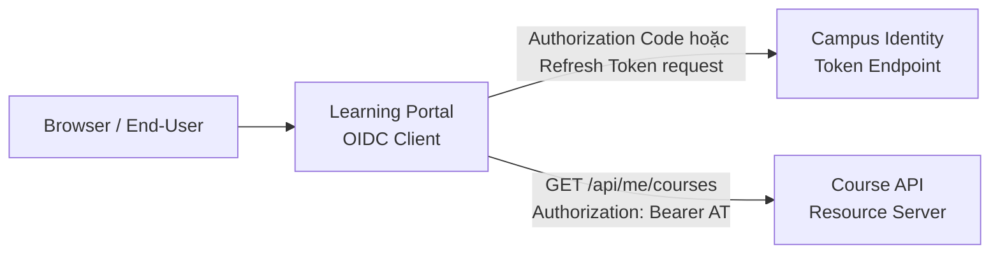

# 18.11. Tương thích API HTTP client giữa các phiên bản Spring Security

## Mục tiêu bài học

Sau khi học xong, bạn có thể:

- Hiểu sự thay đổi giữa **`RestTemplate`**, **`RestClient`** và **`WebClient`** khi Spring Security OAuth 2.0/OIDC Client gọi Token Endpoint hoặc Resource Server.
- Nhận biết mốc phiên bản quan trọng: **Spring Framework 6.1** giới thiệu `RestClient`, trong khi **Spring Security 6.4** giới thiệu `OAuth2ClientHttpRequestInterceptor` và họ `RestClient...TokenResponseClient`.
- Xác định tại sao một project có `RestClient` nhưng không có `OAuth2ClientHttpRequestInterceptor`, hoặc có lớp `Default...TokenResponseClient` nhưng không có lớp `RestClient...TokenResponseClient`.
- Phân biệt **HTTP client gọi API mang Bearer token** với **HTTP client trao đổi OAuth2 grant tại Token Endpoint**; chọn extension point phù hợp cho từng loại.
- Dùng đúng import và method khi cấu hình `ClientRegistration`, `OAuth2AuthorizedClientManager`, RestClient interceptor, WebClient filter và Token Response Client.
- Di chuyển code từ `RestTemplate`/`setRestOperations(...)` sang `RestClient`/`setRestClient(...)` khi phiên bản cho phép, tránh copy nguyên cấu hình converter của API cũ.
- Lập kế hoạch migration từ Spring Security 5.x hoặc các đời 6.x sang 6.4+/7.x, quản lý dependency theo Spring Boot BOM và kiểm thử hành vi OAuth2 thực tế.
- Chẩn đoán lỗi biên dịch, khác biệt mặc định, thiếu Bean, sai HTTP request body, sai token store và lỗi bảo mật khi thay HTTP client.

## 1. Bối cảnh: tại sao cùng là Spring Security OAuth2 Client nhưng code không chạy ở mọi phiên bản?

Giả sử **Learning Portal** là ứng dụng Spring Boot Servlet cho phép sinh viên đăng nhập qua Campus Identity bằng OpenID Connect. Sau OIDC Login, backend muốn gọi **Course API** bằng access token:

```http
GET /api/me/courses HTTP/1.1
Host: courses.example.org
Authorization: Bearer <access-token>
```

Một bài hướng dẫn mới có thể dùng:

```java
OAuth2ClientHttpRequestInterceptor interceptor =
    new OAuth2ClientHttpRequestInterceptor(authorizedClientManager);

RestClient restClient = RestClient.builder()
    .requestInterceptor(interceptor)
    .build();
```

Nhưng ở project Spring Security cũ, IDE báo:

```text
Cannot resolve symbol: OAuth2ClientHttpRequestInterceptor
```

Hoặc developer nâng Spring Framework đủ để có `RestClient`, nhưng Spring Security OAuth2 Client chưa có interceptor tương ứng. Vì sao?

Vì **API của HTTP client được phát triển ở hai thư viện khác nhau**:

1. **Spring Framework** định nghĩa `RestTemplate`, `RestClient`, `WebClient` và các interface HTTP nền tảng.
2. **Spring Security** bổ sung các thành phần OAuth2/OIDC Client, Token Response Client, authorized client manager và cơ chế tự gắn Bearer token.

Hai nhánh có **lịch sử phát hành và mốc hỗ trợ khác nhau**. Chỉ nhìn thấy `RestClient` trong project chưa đủ kết luận bạn có thể import mọi class OAuth2 của Spring Security đời mới.

> **Ý quan trọng nhất:** Trước khi áp dụng đoạn code HTTP OAuth2, hãy xác định **Spring Boot**, **Spring Framework** và **Spring Security** thực tế trên compile/runtime classpath. Chọn một API tương thích với **cả hai tầng HTTP và Security**, không chỉ theo tên class nhìn thấy trong bài viết.

### 1.1. Hai tuyến HTTP rất dễ nhầm

Trong cùng một ứng dụng có thể tồn tại hai loại HTTP request:



Hai đường outbound HTTP cần **cơ chế tích hợp khác nhau**:

| Loại request | Mục tiêu | Component tương ứng |
| --- | --- | --- |
| **Token Endpoint request** | Đổi authorization code, refresh token hoặc xin client credentials access token | `OAuth2AccessTokenResponseClient<T>` và implementation theo grant |
| **Protected Resource request** | Gọi API với access token đã được cấp | `RestClient` + `OAuth2ClientHttpRequestInterceptor`, hoặc `WebClient` + OAuth2 filter, hoặc giải pháp thủ công ở bản cũ |

Ví dụ ở Token Endpoint:

```http
POST /oauth2/token HTTP/1.1
Host: login.example.org
Content-Type: application/x-www-form-urlencoded

grant_type=refresh_token&refresh_token=<refresh-token>
```

Ví dụ ở Resource Server:

```http
GET /api/me/courses HTTP/1.1
Host: courses.example.org
Authorization: Bearer <access-token>
```

`OAuth2ClientHttpRequestInterceptor` **không phải** một lớp thay thế trực tiếp `DefaultAuthorizationCodeTokenResponseClient` hoặc `RestClientAuthorizationCodeTokenResponseClient`. Một bên gắn token cho API; bên kia lấy token từ Authorization Server.

## 2. Dòng thời gian các API cần nhớ

### 2.1. Ma trận theo phiên bản

| Thế hệ | HTTP API nổi bật | Cách tích hợp OAuth2 Client ở Servlet | Lưu ý thực hành |
| --- | --- | --- | --- |
| Spring Security **5.x** với Spring Framework 5.x | `RestTemplate`, `WebClient` | `Default...TokenResponseClient` sử dụng `RestOperations`; WebClient có Servlet OAuth2 filter khi đủ dependency | Không có `RestClient` của Spring Framework 6.1 |
| Spring Security **6.0–6.1** | `RestTemplate`, `WebClient`; `RestClient` chưa có trước Spring Framework 6.1 | Các Token Response Client truyền thống; OAuth2 manager và WebClient filter | Không copy API interceptor được giới thiệu ở 6.4 |
| Spring Security **6.2–6.3** với Spring Framework phù hợp | Có thể đã có `RestClient` của Framework | Token Endpoint ở Servlet vẫn chủ yếu theo `RestTemplate`/`RestOperations`; cấu hình bean OAuth2 Client đã được đơn giản hóa | Có `RestClient` **không đồng nghĩa** đã có `OAuth2ClientHttpRequestInterceptor` |
| Spring Security **6.4** | `RestClient` và `WebClient` | Bổ sung **`OAuth2ClientHttpRequestInterceptor`**, `RestClientAuthorizationCodeTokenResponseClient`, `RestClientRefreshTokenTokenResponseClient`, `RestClientClientCredentialsTokenResponseClient` | Có thể chủ động chuyển HTTP OAuth2 Servlet sang RestClient |
| Spring Security **6.5** | Tiếp tục phát triển RestClient OAuth2 | Các class `Default...TokenResponseClient` dựa trên RestTemplate bị đánh dấu deprecated/for removal ở một số trường hợp; RestClient là hướng thay thế | Dùng mốc này để chuẩn bị nâng 7.x |
| Spring Security **7.x** với dòng Spring Boot/Framework tương thích | Các API RestClient của OAuth2 Client tiếp tục được tài liệu chính thức giới thiệu | Ưu tiên hướng tích hợp RestClient và cấu hình được hỗ trợ ở phiên bản chạy thật | Phải đối chiếu migration guide 7.x, không giả định API deprecated ở 6.x vẫn tồn tại |

**Cách đọc bảng:** đây là các **mốc tính năng**, không phải lời khuyên trộn version JAR thủ công. Bản vá nhỏ và Spring Boot BOM có thể thay đổi bộ dependency thực tế.

Các mốc có thể ghi nhớ:

```text
Spring Framework 6.1:
    RestClient

Spring Security 6.2/6.3:
    Đơn giản hóa OAuth2 Client bean configuration

Spring Security 6.4:
    OAuth2ClientHttpRequestInterceptor
    RestClient...TokenResponseClient
    RequestAttributeClientRegistrationIdResolver
    RequestAttributePrincipalResolver

Spring Security 6.5:
    Lộ trình deprecate API cũ để chuyển sang 7

Spring Security 7:
    Theo migration guide của dòng tương ứng
```

### 2.2. Đừng suy luận version từ phiên bản Java duy nhất

Ví dụ một ứng dụng chạy Java 17 không tự suy ra nó có:

```java
OAuth2ClientHttpRequestInterceptor
```

Lớp này phụ thuộc **Spring Security version**. Tương tự, Spring Security 6.4 không thể vận hành ổn định khi kéo vào một Spring Framework đời không tương thích chỉ vì Java version đủ cao.

### 2.3. Tương quan với Spring Boot

Các cặp dòng thông dụng trong hệ sinh thái Spring Boot:

| Dòng Spring Boot | Spring Framework / Spring Security tương ứng thường gặp |
| --- | --- |
| Boot **3.1** | Framework **6.0**, Security **6.1** |
| Boot **3.2** | Framework **6.1**, Security **6.2** |
| Boot **3.3** | Framework **6.1**, Security **6.3** |
| Boot **3.4** | Framework **6.2**, Security **6.4** |
| Boot **3.5** | Framework **6.2**, Security **6.5** |
| Boot **4.0** | Dòng Framework **7**, Security **7** |

Đây là ánh xạ **theo dòng phát hành thông dụng**, không thay thế việc kiểm tra dependency tree của dự án thật. BOM, build plugin, dependency override và bản vá có thể làm classpath khác mô tả trên. Không trộn `spring-security-oauth2-client` 6.4 với các module Security 6.1 và Framework 6.0 chỉ để có class mới.

### 2.4. Tại sao Spring Security 6.4 là mốc quan trọng?

Trước 6.4, Token Endpoint HTTP client ở Servlet mặc định dựa chủ yếu trên RestTemplate, còn outbound API call có thể được tích hợp qua WebClient filter hoặc lấy token thủ công.

Từ 6.4, ứng dụng có thể dùng một mô hình **RestClient đồng bộ** cho:

- Gọi **Resource Server** với Bearer token thông qua `OAuth2ClientHttpRequestInterceptor`.
- Gọi **Token Endpoint** thông qua các `RestClient...TokenResponseClient` theo grant.

Sự nhất quán này giúp giảm những khác biệt API khi cấu hình HTTP client, nhưng không làm hai loại request trở thành cùng một flow.

## 3. Bản đồ package và class giữa các đời

### 3.1. HTTP client của Spring Framework

| API | Package | Dùng làm gì? |
| --- | --- | --- |
| `RestTemplate` | `org.springframework.web.client` | HTTP client đồng bộ kiểu template |
| `RestClient` | `org.springframework.web.client` | HTTP client đồng bộ fluent API, từ Framework 6.1 |
| `ClientHttpRequestInterceptor` | `org.springframework.http.client` | Giao diện intercept request/response synchronous |
| `WebClient` | `org.springframework.web.reactive.function.client` | HTTP client reactive/fluent |
| `ExchangeFilterFunction` | `org.springframework.web.reactive.function.client` | Hook/filter của WebClient |

### 3.2. OAuth2 Client của Spring Security

| API | Package / module thường gặp | Chức năng |
| --- | --- | --- |
| `OAuth2AuthorizedClientManager` | `org.springframework.security.oauth2.client` | Điều phối authorize/re-authorize |
| `OAuth2AuthorizedClient` | `org.springframework.security.oauth2.client` | Access token/refresh token và registration |
| `DefaultOAuth2AuthorizedClientManager` | `org.springframework.security.oauth2.client.web` | Manager dành cho Servlet request context |
| `AuthorizedClientServiceOAuth2AuthorizedClientManager` | `org.springframework.security.oauth2.client` | Manager dựa trên service, phù hợp job không có Servlet request |
| `OAuth2ClientHttpRequestInterceptor` | `org.springframework.security.oauth2.client.web.client` | RestClient outbound Bearer injection, từ 6.4 |
| `RequestAttributeClientRegistrationIdResolver` | `org.springframework.security.oauth2.client.web.client` | Resolve registration ID từ request attributes, từ 6.4 |
| `RequestAttributePrincipalResolver` | `org.springframework.security.oauth2.client.web.client` | Resolve principal từ request attributes, từ 6.4 |
| `ServletOAuth2AuthorizedClientExchangeFilterFunction` | `org.springframework.security.oauth2.client.web.reactive.function.client` | OAuth2 filter cho WebClient **trong Servlet application** |
| `OAuth2AccessTokenResponseClient<T>` | `org.springframework.security.oauth2.client.endpoint` | Đổi OAuth grant thành token response |

**Hai class trông giống nhau nhưng không thể thay cho nhau:**

```text
RestClient:
  OAuth2ClientHttpRequestInterceptor
  RequestAttributeClientRegistrationIdResolver

WebClient Servlet:
  ServletOAuth2AuthorizedClientExchangeFilterFunction
  clientRegistrationId(...) helper riêng
```

Tên `clientRegistrationId(...)` có thể giống nhau nhưng kiểu dữ liệu attributes và integration point **khác nhau**.

## 4. Kiểm tra dependency trước khi sao chép code

### 4.1. Maven và Spring Boot

Đối với ứng dụng Servlet OAuth2 Client, dependency cơ bản thường là:

```xml
<dependencies>
    <dependency>
        <groupId>org.springframework.boot</groupId>
        <artifactId>spring-boot-starter-web</artifactId>
    </dependency>
    <dependency>
        <groupId>org.springframework.boot</groupId>
        <artifactId>spring-boot-starter-oauth2-client</artifactId>
    </dependency>
</dependencies>
```

`spring-boot-starter-web` cung cấp các phần Spring Web cần thiết cho ứng dụng MVC; starter OAuth2 Client cung cấp tích hợp Spring Security OAuth2 Client và những dependency liên quan.

Nếu dự án quản lý phiên bản bằng Spring Boot parent/BOM, nên để BOM điều phối các version:

```text
spring-web
spring-security-config
spring-security-oauth2-client
spring-security-oauth2-core
spring-security-web
spring-security-core
```

Không đặt mỗi artifact Spring Security một version khác nhau trừ khi có một kế hoạch nâng cấp được kiểm chứng trên cả dependency graph.

### 4.2. Gradle

Ví dụ Gradle Kotlin DSL:

```kotlin
dependencies {
    implementation("org.springframework.boot:spring-boot-starter-web")
    implementation("org.springframework.boot:spring-boot-starter-oauth2-client")
}
```

Với plugin/BOM được cấu hình đúng, không cần viết version cụ thể cho từng starter.

Có thể **kiểm tra thủ công** tại dự án bằng các lệnh sau:

```bash
./gradlew dependencyInsight \
  --dependency spring-security-oauth2-client \
  --configuration runtimeClasspath

./gradlew dependencyInsight \
  --dependency spring-web \
  --configuration runtimeClasspath
```

Hoặc Maven:

```bash
mvn dependency:tree -Dincludes=org.springframework.security
mvn dependency:tree -Dincludes=org.springframework:spring-web
```

Các lệnh này là hướng dẫn cho người học; không phải bắt buộc chạy ở mọi môi trường. Quan trọng là xem **version cuối cùng được resolve** chứ không chỉ version ghi trong một dependency declaration.

### 4.3. Triệu chứng mismatch dependency

Ví dụ:

```text
Cannot resolve symbol OAuth2ClientHttpRequestInterceptor
```

Kiểm tra:

1. Module `spring-security-oauth2-client` thực sự nằm trên compile classpath không?
2. Version có từ **6.4** trở lên và phù hợp Framework không?
3. Có project module nào đang kéo Security cũ thông qua dependency management không?
4. Có typo package `...oauth2.client.web.client` không?
5. IDE đã reload build model theo dependency mới chưa?

Ví dụ runtime:

```text
NoSuchMethodError
NoClassDefFoundError
ClassCastException liên quan API nội bộ
```

Có thể là dấu hiệu trộn JAR Spring/Spring Security không tương thích hoặc build artifact chứa version khác lúc compile. Đừng vội sửa bằng cách cast object hoặc tắt các security filter.

## 5. Trước Spring Security 6.4: gọi API bằng RestTemplate

Trong project Servlet đời cũ, một cách đơn giản là dùng `RestTemplate` và tự gắn access token đã được authorized client manager/argument resolver cung cấp.

Ví dụ với controller OIDC Login:

```java
@RestController
class LegacyCourseController {

    private final RestTemplate restTemplate;

    LegacyCourseController(RestTemplate restTemplate) {
        this.restTemplate = restTemplate;
    }

    @GetMapping("/api/my-courses")
    String courses(
            @RegisteredOAuth2AuthorizedClient("campus")
            OAuth2AuthorizedClient authorizedClient) {

        HttpHeaders headers = new HttpHeaders();
        headers.setBearerAuth(
            authorizedClient.getAccessToken().getTokenValue()
        );

        HttpEntity<Void> entity = new HttpEntity<>(headers);

        return restTemplate.exchange(
            "https://courses.example.org/api/me/courses",
            HttpMethod.GET,
            entity,
            String.class
        ).getBody();
    }
}
```

Một bean cơ bản:

```java
@Bean
RestTemplate restTemplate() {
    return new RestTemplate();
}
```

**Ưu điểm:** tương thích với nhiều project cũ, không cần API interceptor 6.4.

**Hạn chế:** controller hoặc service phải xử lý rõ:

- Authorized client có được resolve cho đúng principal/registration không?
- Access token có bị hết hạn hoặc cần refresh không?
- Những request khác có lặp logic set Bearer header không?
- Khi Resource Server trả `401 invalid_token`, state của authorized client có được xử lý không?
- Token có thể bị đưa tới URL khác do caller điều khiển không?

`@RegisteredOAuth2AuthorizedClient` có thể dựa trên manager để resolve/authorize theo cấu hình; tuy nhiên **`RestTemplate` trong code trên không tự làm refresh token**. Việc lấy token mới phụ thuộc cách authorized client đã được cung cấp cho controller và manager/provider.

### 5.1. RestTemplate không tự biết OAuth2

Đây là một sai lầm phổ biến:

```java
RestTemplate restTemplate = new RestTemplate();
restTemplate.getForObject(
    "https://courses.example.org/api/me/courses",
    String.class
);
```

Một `RestTemplate` bình thường **không tự động thêm Bearer token** chỉ vì có `spring-boot-starter-oauth2-client` trên classpath.

Cần inject token hoặc gắn một interceptor tùy biến phù hợp. Trong trường hợp code cũ dùng custom interceptor, phải xem nó có giữ đúng trạng thái principal/registration hay không; không mặc định rằng mọi interceptor đều an toàn.

### 5.2. Có nên tự viết `ClientHttpRequestInterceptor` đời cũ?

Về mặt kỹ thuật, có thể viết interceptor gắn Bearer token thủ công:

```java
ClientHttpRequestInterceptor customBearer = (request, body, execution) -> {
    // Lấy token từ một OAuth2AuthorizedClientManager thích hợp,
    // gắn Bearer token cho request được phép,
    // tránh cache token toàn cục.
    return execution.execute(request, body);
};
```

Đây là pseudo-code để nêu trách nhiệm, không phải interceptor hoàn chỉnh. Nếu tự triển khai, ứng dụng phải xử lý registration ID, principal, refresh token và lỗi; đó là lý do Spring Security 6.4 thêm một interceptor chuyên dụng.

**Không nên** viết:

```java
private static String LAST_BEARER_TOKEN;
```

rồi dùng biến đó cho nhiều người dùng hoặc nhiều client registration.

## 6. Spring Security 6.2–6.3: có RestClient nhưng chưa có interceptor chuyên dụng

Một project có Spring Framework 6.1 và Spring Security 6.2/6.3 có thể compile code này:

```java
RestClient restClient = RestClient.builder()
    .baseUrl("https://courses.example.org")
    .build();
```

Nhưng không compile được:

```java
new OAuth2ClientHttpRequestInterceptor(manager);
```

vì class OAuth2 này được giới thiệu **sau đó ở Spring Security 6.4**.

Đây là khác biệt quan trọng giữa:

```text
Spring Framework API có sẵn
```

và:

```text
Spring Security OAuth2 integration đã hỗ trợ API đó
```

Các lựa chọn hợp lý trong project 6.2/6.3:

1. Giữ `RestTemplate` và token management đã hoạt động nếu chưa có kế hoạch nâng cấp.
2. Dùng **WebClient + `ServletOAuth2AuthorizedClientExchangeFilterFunction`** nếu project đã có dependency reactive HTTP client và muốn OAuth2 integration sẵn có.
3. Dùng `RestClient` với custom interceptor đã được thiết kế và kiểm thử kỹ, nếu cần synchronous fluent API.
4. Nâng **toàn bộ dòng Spring Boot/Spring Security** lên một bộ tương thích có tính năng 6.4+ trước khi chuyển sang interceptor chính thức.

Không copy package của Spring Security 6.4 vào project 6.2 rồi bổ sung từng JAR riêng lẻ theo báo lỗi compiler.

## 7. WebClient trong ứng dụng Servlet: API tương thích theo hướng khác

Ngay cả khi server sử dụng Spring MVC/Servlet, ứng dụng có thể gọi outbound API bằng `WebClient`.

Một ví dụ tích hợp OAuth2 Client:

```java
@Bean
WebClient courseWebClient(
        OAuth2AuthorizedClientManager authorizedClientManager) {

    ServletOAuth2AuthorizedClientExchangeFilterFunction oauth2 =
        new ServletOAuth2AuthorizedClientExchangeFilterFunction(
            authorizedClientManager
        );

    return WebClient.builder()
        .apply(oauth2.oauth2Configuration())
        .baseUrl("https://courses.example.org")
        .build();
}
```

Khi gọi:

```java
import static org.springframework.security.oauth2.client.web.reactive.function.client.ServletOAuth2AuthorizedClientExchangeFilterFunction.clientRegistrationId;

Mono<String> result = courseWebClient.get()
    .uri("/api/me/courses")
    .attributes(clientRegistrationId("campus"))
    .retrieve()
    .bodyToMono(String.class);
```

`Mono<String>` là kiểu reactive. Trong một ứng dụng Servlet cũ, có thể có code `.block()` tại boundary synchronous, nhưng cần cân nhắc ảnh hưởng hiệu năng và không nhầm với WebFlux server reactive.

### 7.1. Các chi tiết không được trộn lẫn

| RestClient | WebClient |
| --- | --- |
| `org.springframework.web.client.RestClient` | `org.springframework.web.reactive.function.client.WebClient` |
| `.requestInterceptor(...)` | `.filter(...)` hoặc `.apply(oauth2.oauth2Configuration())` |
| `OAuth2ClientHttpRequestInterceptor` | `ServletOAuth2AuthorizedClientExchangeFilterFunction` |
| `.retrieve().body(String.class)` | `.retrieve().bodyToMono(String.class)` |
| `RequestAttributeClientRegistrationIdResolver.clientRegistrationId` | `ServletOAuth2AuthorizedClientExchangeFilterFunction.clientRegistrationId` |
| Không cần `Mono` | Dùng `Mono`/`Flux` |

Một lỗi code rất thường gặp:

```java
// Sai: helper của WebClient được dùng cho RestClient
restClient.get()
    .uri("/api/me/courses")
    .attributes(
        ServletOAuth2AuthorizedClientExchangeFilterFunction
            .clientRegistrationId("campus")
    );
```

Cách đúng cho RestClient 6.4+ là:

```java
import static org.springframework.security.oauth2.client.web.client.RequestAttributeClientRegistrationIdResolver.clientRegistrationId;
```

Không đánh đồng hai loại request attributes chỉ vì cả hai phương thức tên `clientRegistrationId`.

### 7.2. Không chuyển WebClient sang RestClient bằng đổi tên class

Code:

```java
webClient.get()
    .uri("/api/me/courses")
    .retrieve()
    .bodyToMono(CourseDto[].class)
```

không thể tự chuyển thành:

```java
restClient.get()
    .uri("/api/me/courses")
    .retrieve()
    .bodyToMono(CourseDto[].class)
```

`RestClient` không trả `Mono` theo API đồng bộ. Cách đúng:

```java
CourseDto[] courses = restClient.get()
    .uri("/api/me/courses")
    .retrieve()
    .body(CourseDto[].class);
```

Nếu hệ thống sử dụng non-blocking I/O thực sự, việc chuyển sang synchronous RestClient cần đánh giá thread model và hiệu năng chứ không chỉ sửa tên method.

## 8. Spring Security 6.4+: RestClient + OAuth2ClientHttpRequestInterceptor

Ở Spring Security 6.4+ với Spring Framework tương thích, có thể cấu hình:

```java
@Configuration
class CourseApiClientConfiguration {

    @Bean
    RestClient courseRestClient(
            OAuth2AuthorizedClientManager authorizedClientManager,
            RestClient.Builder builder) {

        OAuth2ClientHttpRequestInterceptor interceptor =
            new OAuth2ClientHttpRequestInterceptor(
                authorizedClientManager
            );

        return builder
            .baseUrl("https://courses.example.org")
            .requestInterceptor(interceptor)
            .build();
    }
}
```

Trong controller:

```java
import static org.springframework.security.oauth2.client.web.client.RequestAttributeClientRegistrationIdResolver.clientRegistrationId;

@RestController
class CourseController {

    private final RestClient courseRestClient;

    CourseController(RestClient courseRestClient) {
        this.courseRestClient = courseRestClient;
    }

    @GetMapping("/api/my-courses")
    String courses() {
        return courseRestClient.get()
            .uri("/api/me/courses")
            .attributes(clientRegistrationId("campus"))
            .retrieve()
            .body(String.class);
    }
}
```

**Điểm thay đổi:** controller không tự gọi `getAccessToken().getTokenValue()` và không tự gắn Authorization header. Interceptor dùng manager để resolve authorized client rồi gắn token.

### 8.1. Ý nghĩa các class

```text
OAuth2ClientHttpRequestInterceptor
    |
    +-- ClientRegistrationIdResolver
    |      +-- RequestAttributeClientRegistrationIdResolver (default)
    |
    +-- PrincipalResolver
    |      +-- SecurityContextHolderPrincipalResolver (default)
    |
    +-- OAuth2AuthorizedClientManager
           +-- Repository / Service
           +-- AuthorizedClientProvider
           +-- Token Response Client
```

- `ClientRegistrationIdResolver` chọn registration OAuth2.
- `PrincipalResolver` xác định principal hiện tại hoặc principal kỹ thuật.
- Manager tìm/xin/cấp lại authorized client.
- Interceptor gắn Bearer access token cho outbound request.

Mỗi thành phần có trách nhiệm riêng. Không biến `RestClient` thành token store.

### 8.2. Chọn registration ID tường minh

Dùng static helper:

```java
import static org.springframework.security.oauth2.client.web.client.RequestAttributeClientRegistrationIdResolver.clientRegistrationId;
```

Và:

```java
.attributes(clientRegistrationId("campus"))
```

Khi đó:

```text
registrationId = campus
```

được dùng để tìm `ClientRegistration`, không phải OAuth Client ID thực gửi Token Endpoint.

Nếu registration khai báo:

```yaml
registration:
  campus:
    client-id: learning-portal-web
```

thì `campus` và `learning-portal-web` là **hai giá trị khác nhau**.

### 8.3. Principal mặc định

Interceptor dùng `SecurityContextHolderPrincipalResolver` để lấy Authentication hiện tại. Trong OIDC Login Servlet:

```text
Browser -> SecurityFilterChain
       -> OAuth2AuthenticationToken / OidcUser
       -> Controller
       -> RestClient interceptor
       -> Principal của user hiện tại
```

Nếu request A của user A và request B của user B được xử lý đồng thời, authorized client manager/repository phải phân tách token đúng principal/session.

Một background job không có Servlet request và Authentication của người dùng nên tránh phụ thuộc vào mặc định này.

## 9. Với RestClient mới, dùng `RequestAttributePrincipalResolver` cho M2M

Trong hệ thống machine-to-machine chạy ngoài browser, token thuộc client/service, không thuộc End-User. Có thể dùng:

```java
OAuth2ClientHttpRequestInterceptor interceptor =
    new OAuth2ClientHttpRequestInterceptor(
        serviceAuthorizedClientManager
    );

interceptor.setPrincipalResolver(
    new RequestAttributePrincipalResolver()
);
```

Khi gọi:

```java
import static org.springframework.security.oauth2.client.web.client.RequestAttributeClientRegistrationIdResolver.clientRegistrationId;
import static org.springframework.security.oauth2.client.web.client.RequestAttributePrincipalResolver.principal;

String result = restClient.get()
    .uri("/api/catalog")
    .attributes(clientRegistrationId("catalog-sync"))
    .attributes(principal("catalog-sync-service"))
    .retrieve()
    .body(String.class);
```

`principal("catalog-sync-service")` là một tên **service principal ổn định** dùng trong authorized-client store; nó không làm xuất hiện OIDC user.

### 9.1. Chọn manager phù hợp với request context

Trong một HTTP Servlet request:

```java
new DefaultOAuth2AuthorizedClientManager(
    clientRegistrationRepository,
    authorizedClientRepository
);
```

Trong job không có Servlet request:

```java
new AuthorizedClientServiceOAuth2AuthorizedClientManager(
    clientRegistrationRepository,
    authorizedClientService
);
```

Không tạo fake `HttpServletRequest` để chạy manager Servlet trong scheduled job. `AuthorizedClientServiceOAuth2AuthorizedClientManager` và `OAuth2AuthorizedClientService` được thiết kế cho use case không phụ thuộc request.

### 9.2. Provider cho client credentials

Ví dụ cấu hình:

```java
@Bean
OAuth2AuthorizedClientManager serviceAuthorizedClientManager(
        ClientRegistrationRepository registrations,
        OAuth2AuthorizedClientService authorizedClients) {

    OAuth2AuthorizedClientProvider provider =
        OAuth2AuthorizedClientProviderBuilder.builder()
            .clientCredentials()
            .build();

    AuthorizedClientServiceOAuth2AuthorizedClientManager manager =
        new AuthorizedClientServiceOAuth2AuthorizedClientManager(
            registrations, authorizedClients
        );

    manager.setAuthorizedClientProvider(provider);
    return manager;
}
```

Khi access token M2M hết hạn, provider thường xin access token mới bằng `client_credentials`, không cần browser OIDC Login.

## 10. Mục tiêu HTTP khác: thay thế Token Response Client cũ

Những người nâng Spring Security thường gặp các tên class sau:

```text
DefaultAuthorizationCodeTokenResponseClient
DefaultRefreshTokenTokenResponseClient
DefaultClientCredentialsTokenResponseClient
```

Và muốn chuyển sang:

```text
RestClientAuthorizationCodeTokenResponseClient
RestClientRefreshTokenTokenResponseClient
RestClientClientCredentialsTokenResponseClient
```

**Đây là nhánh gọi Token Endpoint, không phải nhánh `RestClient` gắn Bearer token gọi Resource Server.**

### 10.1. Bảng mapping phổ biến

| Grant | Implementation RestTemplate đời cũ | Implementation RestClient mới |
| --- | --- | --- |
| Authorization Code | `DefaultAuthorizationCodeTokenResponseClient` | `RestClientAuthorizationCodeTokenResponseClient` |
| Refresh Token | `DefaultRefreshTokenTokenResponseClient` | `RestClientRefreshTokenTokenResponseClient` |
| Client Credentials | `DefaultClientCredentialsTokenResponseClient` | `RestClientClientCredentialsTokenResponseClient` |
| JWT Bearer extension | `DefaultJwtBearerTokenResponseClient` ở các đời có hỗ trợ | `RestClientJwtBearerTokenResponseClient` |
| Token Exchange extension | Implementation cũ tùy version | `RestClientTokenExchangeTokenResponseClient` ở version hỗ trợ |

Danh sách không có nghĩa mỗi grant đều được hỗ trợ trong mọi release 5.x/6.x. Mốc chính của họ `RestClient...` dành cho Servlet là **Spring Security 6.4**; các API cũ bị deprecate trong dòng 6.5 để chuẩn bị chuyển thế hệ.

### 10.2. Ví dụ cũ: `DefaultAuthorizationCodeTokenResponseClient`

Cách tùy biến thường gặp ở code cũ:

```java
DefaultAuthorizationCodeTokenResponseClient tokenClient =
    new DefaultAuthorizationCodeTokenResponseClient();

RestTemplate restOperations = new RestTemplate(
    Arrays.asList(
        new FormHttpMessageConverter(),
        new OAuth2AccessTokenResponseHttpMessageConverter()
    )
);

restOperations.setErrorHandler(
    new OAuth2ErrorResponseErrorHandler()
);

tokenClient.setRestOperations(restOperations);
```

Đoạn trên thuộc **API cũ dựa trên RestOperations/RestTemplate**. Các converter và error handler đặc thù token response là một phần quan trọng: nếu thay bằng một `RestTemplate` trống mà không có cấu hình phù hợp, việc gửi form và phân tích token response có thể khác mong đợi.

Không sao chép đoạn này vào một `RestClient...TokenResponseClient` rồi gọi:

```java
tokenClient.setRestOperations(...);
```

vì API mới dùng **RestClient**.

### 10.3. Ví dụ mới: `RestClientAuthorizationCodeTokenResponseClient`

Ở Spring Security 6.4+:

```java
RestClientAuthorizationCodeTokenResponseClient tokenClient =
    new RestClientAuthorizationCodeTokenResponseClient();

RestClient tokenRestClient = RestClient.builder()
    .messageConverters(converters -> {
        converters.clear();
        converters.add(new FormHttpMessageConverter());
        converters.add(
            new OAuth2AccessTokenResponseHttpMessageConverter()
        );
    })
    .defaultStatusHandler(
        new OAuth2ErrorResponseErrorHandler()
    )
    .build();

tokenClient.setRestClient(tokenRestClient);
```

**Chú ý:** `tokenRestClient` trong ví dụ này là client chuyên gửi **Token Endpoint request**. Nó có form encoder, token response converter và OAuth2 error handler phù hợp.

Không lấy `courseRestClient` đã cài `OAuth2ClientHttpRequestInterceptor` để gắn vào `tokenClient` một cách mù quáng. Token Endpoint cần HTTP request/credential khác và có thể gây recursion trong quá trình `authorize(...)` nếu cùng outbound interceptor lại xin access token.

### 10.4. Tạo Token Response Client theo từng grant

Ví dụ:

```java
@Bean
OAuth2AccessTokenResponseClient<OAuth2AuthorizationCodeGrantRequest>
        authorizationCodeTokenResponseClient() {

    return new RestClientAuthorizationCodeTokenResponseClient();
}

@Bean
OAuth2AccessTokenResponseClient<OAuth2RefreshTokenGrantRequest>
        refreshTokenResponseClient() {

    return new RestClientRefreshTokenTokenResponseClient();
}

@Bean
OAuth2AccessTokenResponseClient<OAuth2ClientCredentialsGrantRequest>
        clientCredentialsTokenResponseClient() {

    return new RestClientClientCredentialsTokenResponseClient();
}
```

Các beans này chỉ được khai báo khi thật sự cần tùy biến hoặc khi phiên bản/cấu hình yêu cầu. Ở các dòng Spring Security mới, nhiều thành phần mặc định đã được cấu hình tự động; có thể bỏ qua các bean trùng và để framework chọn implementation.

Khi dùng custom bean, phải đối chiếu **kiểu generic** `OAuth2AccessTokenResponseClient<T>` với grant request tương ứng. Đăng ký một client cho authorization code không có nghĩa nó tự được dùng cho refresh token.

### 10.5. Cấu hình bean thay đổi theo version

Trong các phiên bản cũ, có thể phải nối Token Response Client trực tiếp vào DSL của `oauth2Login()`, provider hoặc manager theo cách riêng.

Từ dòng **6.2–6.3**, Spring Security cải thiện cấu hình bằng cách tự phát hiện nhiều bean của OAuth2 Client, gồm `OAuth2AccessTokenResponseClient<T>` và `OAuth2AuthorizedClientManager`. Dòng 6.4 tiếp tục mô hình đó với các class RestClient mới.

Tuy vậy, không khẳng định mọi class và mọi generic bean đều được auto-wired giống nhau ở tất cả bản patch. Phải tham khảo reference guide của đúng version ứng dụng và xác minh đường gọi grant cụ thể.

## 11. Chuyển API custom request parameters: `add`, `set`, `customizer`

Một Token Endpoint đặc thù có thể yêu cầu tham số thêm:

```text
audience=course-api
resource=https://courses.example.org
```

Ở Spring Security mới, Token Response Client hỗ trợ nhiều cách tùy biến.

### 11.1. Thêm tham số: `addParametersConverter(...)`

Ví dụ với refresh-token client:

```java
RestClientRefreshTokenTokenResponseClient tokenClient =
    new RestClientRefreshTokenTokenResponseClient();

tokenClient.addParametersConverter(grantRequest -> {
    LinkedMultiValueMap<String, String> parameters =
        new LinkedMultiValueMap<>();

    if (grantRequest.getClientRegistration()
            .getRegistrationId().equals("campus")) {
        parameters.add("audience", "course-api");
    }

    return parameters;
});
```

Dùng cách này khi muốn **thêm** tham số vào request mà không muốn thay toàn bộ request chuẩn của Spring Security.

Tuy nhiên `audience` không phải tham số bắt buộc của mọi Authorization Server. Chỉ gửi theo hợp đồng provider; giá trị scope/audience sai có thể bị từ chối hoặc cấp token không phù hợp.

### 11.2. Override tham số: `setParametersConverter(...)`

Một số API mới cho phép cung cấp converter với mục đích **override những giá trị mặc định**. Các default grant parameters vẫn được tạo trước và converter được áp dụng sau theo hành vi của implementation.

Điều này khác với suy đoán “`set...` luôn thay cả request từ đầu”. Khi chuyển từ API cũ sang mới, cần hiểu rõ:

- Converter nào được gọi trước?
- Tham số mặc định có được giữ không?
- Key bị trùng được **ghi đè** hay **thêm giá trị**?
- Authorization Server có chấp nhận tham số mở rộng không?

Nếu sai, token request có thể mất `grant_type`, `redirect_uri`, `client_assertion` hoặc gửi trùng `client_id`.

### 11.3. Xóa/sửa toàn bộ tham số: `setParametersCustomizer(...)`

Ví dụ provider dùng `client_assertion` và yêu cầu loại bỏ `client_id` khỏi form body:

```java
RestClientClientCredentialsTokenResponseClient tokenClient =
    new RestClientClientCredentialsTokenResponseClient();

tokenClient.setParametersCustomizer(parameters -> {
    if (parameters.containsKey(
            OAuth2ParameterNames.CLIENT_ASSERTION)) {
        parameters.remove(OAuth2ParameterNames.CLIENT_ID);
    }
});
```

Đây là ví dụ minh họa API trong dòng hỗ trợ. Ứng dụng còn phải có cấu hình **JWT client authentication** thích hợp để thực sự tạo và ký `client_assertion`; `setParametersCustomizer` không tự sinh JWT.

**Không loại `client_id` hoặc thay default parameter chỉ để “sửa lỗi” nếu provider không yêu cầu.** Nó có thể làm hỏng flow, đặc biệt khi nhiều client registration dùng phương thức authentication khác nhau.

### 11.4. Phân biệt `addParametersConverter()` và `setParametersCustomizer()`

| API | Mục đích điển hình | Rủi ro khi dùng sai |
| --- | --- | --- |
| `addParametersConverter(...)` | Bổ sung tham số theo grant/registration | Gửi thêm field không được provider cho phép |
| `setParametersConverter(...)` | Ghi đè giá trị mặc định theo yêu cầu | Đổi nhầm `client_id`, `scope` hoặc grant parameter |
| `setParametersCustomizer(...)` | Chỉnh sửa/xóa các tham số đã tạo | Vô tình xóa tham số bắt buộc |
| `addHeadersConverter(...)` | Thêm header vào token request | Ghi đè Authorization header không chủ đích |
| `setHeadersConverter(...)` | Kiểm soát cách tạo header | Làm mất client authentication hoặc Content-Type |

Thao tác của các hook phải được kiểm tra theo **API thực** và wire path của bản đang dùng. Không đổi tên method bằng tìm-thay hàng loạt mà không hiểu thứ tự áp dụng converter.

## 12. HTTP message converters: mảnh ghép thường bị bỏ sót

Khi tự tạo `RestClient` dành cho Token Endpoint, HTTP body thường phải là:

```http
Content-Type: application/x-www-form-urlencoded

grant_type=authorization_code&code=<code>&redirect_uri=<redirect-uri>
```

Trong khi response thành công là OAuth2 token JSON:

```json
{
  "access_token": "<token>",
  "token_type": "Bearer",
  "expires_in": 3600
}
```

Và response thất bại:

```json
{
  "error": "invalid_grant",
  "error_description": "authorization code expired"
}
```

Vì vậy khi customize Token Response Client theo API mới, cần giữ khả năng:

1. **Form encode** request: `FormHttpMessageConverter`.
2. **Decode token response**: `OAuth2AccessTokenResponseHttpMessageConverter`.
3. **Decode OAuth2 error**: `OAuth2ErrorResponseErrorHandler` với converter thích hợp.

Nếu copy configuration của một `RestClient` dùng gọi JSON API thông thường vào token client, request/response có thể bị parse sai dù network hoạt động.

### 12.1. `RestClient.create(RestTemplate)` có đủ cho migration không?

Spring Framework cho phép tạo:

```java
RestClient adapted = RestClient.create(existingRestTemplate);
```

Đây là một con đường chuyển cấu hình HTTP từ `RestTemplate` sang `RestClient` trong các trường hợp phù hợp. Nhưng việc tạo adapter **không tự bổ sung** OAuth2 interceptor 6.4, không tự chuyển các custom `OAuth2AccessTokenResponseClient` và không thay đổi semantics authorization của ứng dụng.

Phải phân biệt:

```text
Reuse HTTP client settings
```

với:

```text
Migrate OAuth2 integration architecture
```

Hai việc có thể cần bước kiểm thử riêng.

### 12.2. Token Endpoint RestClient khác Resource Server RestClient

Một ví dụ cấu trúc bean có chủ đích:

```text
RestClient "tokenEndpointHttp"
   -> form converter
   -> OAuth2 token response converter
   -> OAuth2 error handler
   -> Token Endpoint only

RestClient "courseApi"
   -> OAuth2ClientHttpRequestInterceptor
   -> baseUrl = https://courses.example.org
   -> Course API only
```

Giữ chúng độc lập giúp tránh vô ý gửi access token đến Token Endpoint hoặc gửi client credentials vào API nghiệp vụ.

## 13. Failure Handler: API mới có thêm khả năng dọn token sau 401

Ở RestClient interceptor 6.4+, có thể cấu hình failure handler:

```java
@Bean
RestClient courseApi(
        OAuth2AuthorizedClientManager manager,
        OAuth2AuthorizedClientRepository repository) {

    OAuth2ClientHttpRequestInterceptor interceptor =
        new OAuth2ClientHttpRequestInterceptor(manager);

    interceptor.setAuthorizationFailureHandler(
        OAuth2ClientHttpRequestInterceptor
            .authorizationFailureHandler(repository)
    );

    return RestClient.builder()
        .baseUrl("https://courses.example.org")
        .requestInterceptor(interceptor)
        .build();
}
```

Nếu manager dùng `OAuth2AuthorizedClientService` cho M2M:

```java
interceptor.setAuthorizationFailureHandler(
    OAuth2ClientHttpRequestInterceptor
        .authorizationFailureHandler(authorizedClientService)
);
```

Chọn handler phù hợp với **cùng kho authorized client** mà manager đang sử dụng.

### 13.1. Cơ chế có tác dụng gì?

Resource Server có thể trả:

```http
HTTP/1.1 401 Unauthorized
WWW-Authenticate: Bearer error="invalid_token"
```

Trong một số lỗi OAuth2 Bearer được nhận diện, failure handler có thể xóa authorized client không còn hợp lệ khỏi store. Request **sau đó** có thể xin token mới nếu grant/provider cho phép.

Không mặc định rằng interceptor **retry cùng HTTP request ngay lập tức**. Retry request không idempotent có thể gây thao tác trùng.

### 13.2. 401 và 403 không giống nhau

| API response | Ý nghĩa thường gặp | Giải pháp |
| --- | --- | --- |
| `401 invalid_token` | Token hết hạn, bị thu hồi, sai audience/issuer hoặc không hợp lệ | Kiểm tra token/AS/RS; có thể remove và reauthorize |
| `403 insufficient_scope` | Token hợp lệ nhưng thiếu scope | Xử lý permission/scope, không refresh token mù |
| `403` theo chính sách nghiệp vụ | Chủ thể không có quyền truy cập bản ghi | Kiểm tra role/ownership |
| `429` | Rate limit | Retry/backoff có giới hạn |
| `500/503` | API tạm lỗi | Không mặc định xóa OAuth2 grant |

Thay `RestTemplate` bằng `RestClient` không được làm thay đổi nguyên tắc: **Token acquisition khác authorization nghiệp vụ**.

## 14. Thay đổi cấu hình bean qua các đời Spring Security

Ở một codebase cũ, bạn có thể thấy những cách cấu hình rời rạc:

```text
SecurityFilterChain:
  oauth2Login().tokenEndpoint().accessTokenResponseClient(...)

OAuth2AuthorizedClientManager:
  manager.setAuthorizedClientProvider(...)

Token Response Client:
  DefaultAuthorizationCodeTokenResponseClient
  DefaultRefreshTokenTokenResponseClient
```

Ở dòng mới, việc publish bean `OAuth2AccessTokenResponseClient<T>` theo grant và `OAuth2AuthorizedClientManager` có thể giúp Spring Security tự lắp nhiều thành phần.

Tuy vậy, phải hiểu thứ tự:

- Có bean mặc định từ Boot?
- Có bean người dùng tự khai báo cùng interface không?
- Generic type của token response client có đúng grant không?
- Một `DefaultOAuth2AuthorizedClientManager` của MVC có dùng cùng repository với OAuth2 Login không?
- Custom provider chain có thay thế refresh token provider mặc định không?

**Không nên đổi tất cả cấu hình chỉ vì API mới cho phép.** Nếu dự án cũ hoạt động ổn định và chưa nâng version, ưu tiên giữ một đường tích hợp rõ ràng; khi nâng cấp, thay từng phần có kiểm soát.

### 14.1. Ví dụ quản lý bean theo grant

Khi cần custom Authorization Code Token Endpoint request:

```java
@Bean
OAuth2AccessTokenResponseClient<OAuth2AuthorizationCodeGrantRequest>
        codeTokenClient() {

    RestClientAuthorizationCodeTokenResponseClient client =
        new RestClientAuthorizationCodeTokenResponseClient();

    client.addHeadersConverter(grant -> {
        HttpHeaders headers = new HttpHeaders();
        headers.set("X-Integration", "learning-portal");
        return headers;
    });

    return client;
}
```

Đoạn trên dùng API 6.4+, giả định `X-Integration` được provider chấp nhận. Nếu registration của bạn không cần header riêng, không thêm tùy biến vô ích.

Một bean khác cho refresh token:

```java
@Bean
OAuth2AccessTokenResponseClient<OAuth2RefreshTokenGrantRequest>
        refreshTokenClient() {

    return new RestClientRefreshTokenTokenResponseClient();
}
```

**Hai bean có generic khác nhau** và xử lý hai thời điểm khác nhau trong vòng đời. Nếu chỉ custom authorization code mà bỏ quên refresh token, login đầu có thể thành công nhưng token refresh chạy theo cấu hình khác.

### 14.2. Không trộn DSL cũ vào version mới mà không xem migration

Những đoạn cấu hình sử dụng:

```java
http.oauth2Login()
    .tokenEndpoint()
    .accessTokenResponseClient(...);
```

có thể được viết theo style DSL cũ. Trong các thế hệ mới, dạng lambda `Customizer` là hướng sử dụng phổ biến:

```java
http.oauth2Login(oauth -> oauth
    .tokenEndpoint(token -> token
        .accessTokenResponseClient(customTokenClient)
    )
);
```

Tính khả dụng của mỗi DSL và chính sách deprecated phụ thuộc phiên bản. Khi nâng lên Spring Security 7, cần dùng **migration guide của dòng 7**, không dựa vào việc code 5.x còn compile với Security 6.0.

## 15. Servlet API: `javax.servlet` và `jakarta.servlet`

Khi nâng từ Spring Boot 2 / Spring Security 5 lên Boot 3 / Spring Security 6, một lỗi compile thường thấy:

```text
package javax.servlet.http does not exist
```

Các ứng dụng Servlet hiện đại của Spring Framework 6+/Security 6+ sử dụng namespace:

```java
import jakarta.servlet.http.HttpServletRequest;
import jakarta.servlet.http.HttpServletResponse;
```

Thay vì namespace cũ:

```java
import javax.servlet.http.HttpServletRequest;
import javax.servlet.http.HttpServletResponse;
```

Đây là thay đổi **Servlet API**, không phải API OAuth Token Endpoint. Nhưng nó ảnh hưởng các custom `OAuth2AuthorizedClientRepository`, filters, MVC resolver và extension point nhận request/response.

### 15.1. Cảnh báo khi copy code HTTP security cũ

Một đoạn dùng:

```java
DefaultOAuth2AuthorizedClientManager manager = ...;
```

có thể còn đúng về ý tưởng, nhưng custom repository trong cùng bài được khai báo `javax.servlet` sẽ không compile trên Framework 6.

Đừng sửa bằng cách thêm cả thư viện `javax.servlet-api` vào Boot 3 để code cũ “thấy class”. Hãy nâng API và dependency theo stack đúng, đồng thời kiểm tra những thay đổi ở SecurityFilterChain và cấu hình HTTP client.

### 15.2. Không đồng nhất Jakarta migration với RestClient migration

Có ít nhất ba việc độc lập:

1. **`javax` → `jakarta`** khi nâng Servlet stack.
2. **DSL/Security configuration** khi nâng Spring Security major version.
3. **`RestTemplate` → `RestClient`** hoặc **WebClient → RestClient** khi đổi outbound HTTP integration.

Không phải ứng dụng nâng từ Security 5 lên 6/7 đều buộc phải đổi đồng thời tất cả HTTP client. Chia các thay đổi để dễ kiểm tra nguyên nhân regression.

## 16. RestClient Servlet và WebClient Reactive: chọn đúng runtime

### 16.1. Servlet app có thể dùng RestClient

Ở Spring MVC:

```text
HTTP request thread
    -> controller/service
    -> RestClient blocking call
    -> response
```

Phù hợp khi ứng dụng cần giao tiếp đồng bộ và tài nguyên thread được quản lý tương ứng.

### 16.2. Servlet app vẫn có thể dùng WebClient

```text
Spring MVC
    -> WebClient
    -> Mono/Flux outbound
```

Phải cấu hình Servlet OAuth2 filter nếu muốn token theo SecurityContext/authorized client kiểu Servlet. Không dùng `ServerOAuth2AuthorizedClientExchangeFilterFunction` của WebFlux server để thay thế một cách tùy tiện.

### 16.3. WebFlux server có API OAuth2 riêng

Với WebFlux reactive:

```text
ReactiveOAuth2AuthorizedClientManager
ServerOAuth2AuthorizedClientRepository
ReactiveOAuth2AuthorizedClientService
```

Những interface này khác với:

```text
OAuth2AuthorizedClientManager
OAuth2AuthorizedClientRepository
OAuth2AuthorizedClientService
```

Mặc dù có thể cùng một grant và Authorization Server, **thread context vs Reactor context** và repository model khác nhau. Đừng copy WebFlux Security code vào Servlet rồi mong nó tự hoạt động.

## 17. Vấn đề bảo mật không được thay đổi khi nâng HTTP client

Một migration thành công không chỉ là “hết lỗi compiler”. Nó phải giữ các ranh giới bảo mật.

### 17.1. Gắn Bearer token đúng host

Với RestClient:

```java
RestClient.builder()
    .baseUrl("https://courses.example.org")
    .requestInterceptor(oauth2Interceptor)
    .build();
```

Vẫn cần kiểm soát URL. Caller có thể truyền absolute URL hoặc HTTP redirect làm request đi ra ngoài phạm vi mong đợi tùy request factory/redirect policy.

**Không** lấy URL tùy ý từ query parameter rồi dùng RestClient đã gắn OAuth2 interceptor:

```java
@GetMapping("/proxy")
String proxy(@RequestParam String url) {
    return restClient.get()
        .uri(url)
        .attributes(clientRegistrationId("campus"))
        .retrieve()
        .body(String.class);
}
```

Điều này có thể tạo **SSRF hoặc Bearer token forwarding** đến host do kẻ tấn công điều khiển.

### 17.2. Không log token

Các giá trị phải được redact:

```text
Authorization: Bearer ...
Authorization: Basic ...
access_token
refresh_token
client_secret
client_assertion
session cookie
```

Khi đổi từ RestTemplate sang RestClient, có thể thay đổi interceptor chain và HTTP logger, vô tình log header sau khi OAuth2 interceptor đã gắn token.

### 17.3. Không dùng token sai principal

Một cấu hình interceptor mới dùng `RequestAttributePrincipalResolver` không có nghĩa nên đặt:

```java
.attributes(principal("shared-service-principal"))
```

trong **user delegated flow** của tất cả sinh viên. Nếu store khóa theo principal name, nhiều user có thể đọc nhầm cùng authorized client.

Đối với OIDC user-delegated request, giữ Authentication của người dùng hiện tại và repository phù hợp. Với Client Credentials, dùng service principal riêng và ổn định.

### 17.4. Không coi access token của một API dùng được cho mọi API

`clientRegistrationId("campus")` chọn OAuth Client, nhưng access token vẫn phải có:

- Issuer mà Resource Server tin cậy.
- Audience dành cho Resource Server/Resource Indicator theo cấu hình.
- Scope/quyền API đã được cấp.
- Thời hạn và các ràng buộc bảo mật.

Thay HTTP client không làm tăng quyền token.

## 18. Migration theo từng giai đoạn

Một cách thực hiện giảm rủi ro:

### Bước 1 — Xác định stack thực tế

Ghi lại:

```text
Java version
Spring Boot version
Spring Framework version
Spring Security version
Servlet (MVC) hay Reactive (WebFlux)
HTTP client đang dùng: RestTemplate / RestClient / WebClient
OAuth grant: authorization_code / refresh_token / client_credentials / ...
```

Đừng dựa vào việc code import được `RestClient` để kết luận Security version.

### Bước 2 — Liệt kê những điểm tích hợp HTTP OAuth2

Phân loại rõ:

```text
A. OAuth2 Login / Authorization Code exchange
B. Refresh Token exchange
C. Client Credentials token request
D. Outbound Course API call
E. Outbound Partner API call
F. HTTP client gọi UserInfo Endpoint (nếu có)
```

Không chuyển cả sáu phần bằng một custom RestClient không rõ chức năng.

### Bước 3 — Chọn baseline hỗ trợ

Nếu project còn ở Security 6.2/6.3:

- Chỉ dùng API có ở version đó.
- Hoặc lập kế hoạch nâng Boot/Security lên dòng hỗ trợ 6.4+ rồi mới áp dụng `OAuth2ClientHttpRequestInterceptor`.
- Với migration lên Security 7, tham khảo migration guide từ 6.5 và điều kiện Framework/Boot tương ứng.

### Bước 4 — Giữ cấu hình OAuth2 nguyên tắc

Xác định:

```text
ClientRegistration: clientId, grant, provider, redirectUri, scopes
Manager: authorize/re-authorize, provider chain
Repository/Service: token persistence
Principal: End-User hay service
HTTP target: Token Endpoint hay Resource Server
```

Việc đổi HTTP client **không được đổi nhầm** nguyên tắc đăng ký OAuth2.

### Bước 5 — Migrating outbound API calls

Ví dụ:

```text
Trước:
  RestTemplate
  @RegisteredOAuth2AuthorizedClient
  manually headers.setBearerAuth(...)

Sau:
  RestClient
  OAuth2ClientHttpRequestInterceptor
  .attributes(clientRegistrationId("campus"))
```

Đảm bảo Bearer token được gắn đúng lần, đúng host và đúng authorized client.

### Bước 6 — Migrating Token Endpoint customization

Ví dụ:

```text
Trước:
  DefaultAuthorizationCodeTokenResponseClient
  setRestOperations(RestTemplate)

Sau:
  RestClientAuthorizationCodeTokenResponseClient
  setRestClient(RestClient)
```

Khi chuyển, kiểm tra:

- Content-Type form URL encoded.
- Client Authentication header/form.
- Grant-specific parameters.
- Response converter và error handler.
- JWT client assertion/PKCE nếu dùng.
- Refresh token grant và các client registrations khác.
- Proxy/timeout/TLS/truststore.

### Bước 7 — Kiểm thử tương thích theo flow

Với Authorization Code + OIDC Login:

```text
login redirect
 -> callback state
 -> code exchange
 -> ID Token validation
 -> authorized client persisted
 -> RestClient calls API
 -> token expiry/refresh
```

Với Client Credentials:

```text
service manager authorize
 -> POST token endpoint
 -> AT
 -> RestClient Bearer request
 -> reauthorize when AT expires
```

### Bước 8 — Theo dõi regression và rollback

Nên có metric:

```text
token_exchange_success/failure
authorized_client_refresh_success/failure
outbound_api_401/403
oauth2_authorize_latency
token_endpoint_latency
unknown_client_registration
```

Không ghi token value, secret hoặc ID Token vào log. Nếu cần rollback, rollback **bộ dependency và cấu hình OAuth2 liên quan**, không chỉ đổi một class.

## 19. Ma trận test hành vi qua phiên bản

| Tình huống | API cũ | API mới | Điều phải giữ |
| --- | --- | --- | --- |
| User OIDC Login thành công | Token được trao đổi qua implementation cũ | Token Response Client RestClient nếu đã chuyển | ID Token hợp lệ, đúng issuer/audience |
| Gọi Course API | Tự gắn Bearer hoặc WebClient filter | RestClient OAuth2 interceptor | Token đúng principal, registration, scope |
| Access token còn hạn | Dùng lại authorized client | Manager/interceptor dùng lại | Không gọi Token Endpoint quá nhiều |
| Access token hết hạn | Refresh qua provider cũ | Refresh qua provider/token client mới | Lưu access token và refresh token mới |
| Client Credentials | Default client credentials token response client | RestClient client credentials token client | Không tạo OIDC session End-User |
| Token Endpoint trả `invalid_client` | Bị từ chối | Bị từ chối | Không bỏ qua client authentication |
| Token Endpoint trả `invalid_grant` | Grant không hợp lệ | Grant không hợp lệ | Xử lý re-authorization, không retry vô hạn |
| Resource Server trả `invalid_token` | App tự xử lý hoặc WebClient handler | Interceptor failure handler nếu cấu hình | Loại state không dùng được theo chính sách |
| Resource Server trả `insufficient_scope` | Không tự tăng quyền | Không tự tăng quyền | Không refresh vô hạn |
| Token Endpoint có custom params | Converter RestTemplate API cũ | `add/setParametersConverter`, `setParametersCustomizer` | Request protocol không bị mất trường bắt buộc |
| Proxy/timeout/TLS | RestTemplate request factory | RestClient request factory | Trust và timeout đáp ứng môi trường |
| Multi-user concurrency | Repository phân tách user | Vẫn phân tách user | Không rò token giữa sessions |

### 19.1. Mock HTTP request của outbound RestClient

Với Spring Framework hỗ trợ, có thể dùng `MockRestServiceServer` gắn với `RestClient.Builder` để test request outbound.

Tư duy test:

```text
Given:
  manager trả OAuth2AuthorizedClient có access token test-token

When:
  RestClient GET /api/me/courses
  attributes(clientRegistrationId("campus"))

Then:
  HTTP request đi đến đúng URL
  Authorization header = Bearer test-token
  Không gửi client secret/refresh token
```

Không cần dùng token thật để test header injection.

### 19.2. Kiểm thử Token Endpoint khác với kiểm thử Resource Server

Một test `MockRestServiceServer` xác minh RestClient gắn Bearer header **không chứng minh** Token Response Client đã gửi đúng Authorization Code grant hoặc có thể refresh token.

Cần test riêng cho:

```text
grant_type=authorization_code
grant_type=refresh_token
grant_type=client_credentials
```

và kiểm tra client authentication, encoding, response converter, error mapping.

## 20. Các lỗi biên dịch và runtime phổ biến

| Triệu chứng | Nguyên nhân thường gặp | Cách xử lý |
| --- | --- | --- |
| `Cannot resolve symbol RestClient` | Spring Framework trước 6.1 hoặc thiếu spring-web | Dùng API version tương thích hoặc nâng toàn bộ stack |
| `Cannot resolve symbol OAuth2ClientHttpRequestInterceptor` | Spring Security trước 6.4 hoặc thiếu module OAuth2 Client | Kiểm tra `spring-security-oauth2-client` |
| `Cannot resolve symbol RestClientRefreshTokenTokenResponseClient` | Spring Security trước 6.4 | Dùng implementation cũ phù hợp hoặc nâng stack |
| `setRestOperations` không tồn tại | Dùng client RestClient đời mới | Chuyển sang `setRestClient(...)` với config phù hợp |
| `setRestClient` không tồn tại | Đang dùng Default...TokenResponseClient đời cũ | Dùng đúng class RestClient... |
| `.bodyToMono(...)` không có ở RestClient | Copy API WebClient | Dùng `.body(Type.class)` |
| `.requestInterceptor(...)` không có ở WebClient | Copy API RestClient | Dùng WebClient ExchangeFilterFunction |
| `clientRegistrationId(...)` import sai | Trộn helper của WebClient và RestClient | Import đúng package theo HTTP client |
| `package javax.servlet.http does not exist` | Nâng Boot 3 / Spring Framework 6 | Dùng Jakarta Servlet và dependency tương thích |
| `NoClassDefFoundError`/`NoSuchMethodError` | Trộn version Spring Framework/Security | Kiểm tra dependency tree và BOM |
| Bean `OAuth2AuthorizedClientManager` không được inject | Auto-configuration thiếu điều kiện hoặc user config override | Khai báo manager tương thích và kiểm tra bean |
| Access token không được gắn | Không chọn registration/principal hoặc manager không authorize | Kiểm tra resolver và provider chain |
| OIDC Login thành công nhưng API thiếu token | Login lưu ở repository khác manager dùng | Đồng bộ authorized-client store |
| Job M2M lỗi vì thiếu request | Dùng manager Servlet ngoài request context | Dùng service-based manager |
| 401 sau đổi HTTP client | Header Bearer sai, audience/issuer không hợp lệ hoặc token expired | Kiểm tra Token Endpoint/Resource Server boundaries |
| 403 sau đổi HTTP client | Scope/role/ownership không đủ | Kiểm tra authorization, không hạ bảo mật |
| Token Endpoint trả 400 sau chuyển `setRestClient` | Sai form converter/request params | Bảo toàn OAuth2 Token Endpoint converters |
| Request auth header bị log | Interceptor/logger thay đổi thứ tự | Redact credential ở mọi logger |
| Token gửi nhầm host | Dùng URL tuyệt đối/redirect không kiểm soát | Fixed base URL, allowlist và redirect policy |

### 20.1. Cách đọc stack trace

Nếu lỗi xảy ra ở:

```text
RestClientAuthorizationCodeTokenResponseClient
RestClientRefreshTokenTokenResponseClient
```

thì đang xử lý **Token Endpoint**.

Nếu lỗi xảy ra ở:

```text
OAuth2ClientHttpRequestInterceptor
RestClient
```

trong lúc gọi `/api/...`, thường đang ở bước **Resource Server outbound request** hoặc token resolution do interceptor kích hoạt.

Nếu có lỗi:

```text
OAuth2AuthorizationException: invalid_grant
```

cần tìm grant và token exchange tương ứng. Nếu có HTTP `403 insufficient_scope` từ API, không nên sửa Token Response Client chỉ vì API từ chối permission.

## 21. Các tình huống migration thực tế

### Tình huống A — Dự án Boot 3.2 muốn dùng OAuth2ClientHttpRequestInterceptor

Project có `RestClient` nhưng IDE không tìm ra interceptor.

**Nguyên nhân:** dòng Framework đã đủ để có `RestClient`, nhưng Spring Security của Boot 3.2 thường chưa tới 6.4.

**Hướng xử lý:** dùng HTTP/OAuth2 integration hiện có của dòng đó, hoặc nâng Boot/Security theo bộ phiên bản tương thích trước khi áp dụng API mới. Không nâng đơn lẻ `spring-security-oauth2-client`.

### Tình huống B — Migrating Token Response Client làm lỗi grant

Code cũ có `DefaultAuthorizationCodeTokenResponseClient#setRestOperations`. Developer đổi class sang `RestClientAuthorizationCodeTokenResponseClient` nhưng giữ method và converter kiểu cũ.

**Hướng xử lý:** dùng `setRestClient(...)`, giữ `FormHttpMessageConverter`, `OAuth2AccessTokenResponseHttpMessageConverter`, OAuth2 error handler; kiểm tra request/response của đúng grant.

### Tình huống C — WebClient code bị copy vào RestClient

Service dùng:

```java
.attributes(
    ServletOAuth2AuthorizedClientExchangeFilterFunction
        .clientRegistrationId("campus")
)
```

và:

```java
.bodyToMono(String.class)
```

nhưng builder là `RestClient`.

**Hướng xử lý:** chuyển static helper sang `RequestAttributeClientRegistrationIdResolver.clientRegistrationId` và response sang `.body(String.class)`.

### Tình huống D — Client Credentials job có RestClient interceptor nhưng không có principal

Scheduled job không có user/session và dùng interceptor mặc định theo SecurityContext, khiến token resolution thất bại.

**Hướng xử lý:** dùng `AuthorizedClientServiceOAuth2AuthorizedClientManager`, `RequestAttributePrincipalResolver` và service principal name ổn định. Không giả lập OIDC Login cho workload M2M.

### Tình huống E — Cấu hình interceptor mới gây lộ token

Đội triển khai xây một RestClient chung cho nhiều host; user có thể truyền URL vào controller. Interceptor gắn Bearer token cho request đến host ngoài allowlist.

**Hướng xử lý:** tách RestClient theo API, bảo vệ registration mapping, giới hạn host và redirect, không nhận absolute URL từ client chưa được kiểm soát.

### Tình huống F — Hai request cùng refresh và ghi đè token

Migration đổi RestTemplate sang RestClient nhưng vẫn sử dụng repository/database không có concurrency control cho refresh token rotation. Hai request cùng dùng RT1; một request ghi RT2, request khác trả `invalid_grant`.

**Hướng xử lý:** xử lý single-flight refresh hoặc optimistic locking theo principal/registration; thay HTTP client không giải quyết distributed race.

### Tình huống G — Spring Security 7 làm lỗi API bị deprecated

Code 6.5 còn compile được với class `Default...TokenResponseClient` đã bị deprecated for removal. Khi nâng major version, class hoặc phương thức có thể không còn tồn tại.

**Hướng xử lý:** chuyển sang `RestClient...` trong giai đoạn chuẩn bị, đọc guide 6.5 → 7.0, cập nhật Java/Jakarta/Boot/Framework và test các grant. Không cố dùng lại API đã bị loại khỏi classpath bằng cách thêm JAR cũ.

## 22. Bài tập thực hành

### Bài tập 1 — Xác định mốc phiên bản

Một ứng dụng có Spring Framework 6.1 và Spring Security 6.3.

**Câu hỏi:** Có thể dùng `RestClient` không? Có sẵn `OAuth2ClientHttpRequestInterceptor` không?

**Đáp án:** Có `RestClient` của Framework, nhưng interceptor chuyên dụng được giới thiệu ở Spring Security 6.4 nên không có trong Security 6.3.

### Bài tập 2 — Chọn đúng Token Response Client

Bạn cần custom token request của Authorization Code Grant trên Spring Security 6.4+.

**Đáp án gợi ý:**

```java
RestClientAuthorizationCodeTokenResponseClient tokenClient =
    new RestClientAuthorizationCodeTokenResponseClient();
```

Dùng các hook `addHeadersConverter`, `addParametersConverter`, `setRestClient` theo yêu cầu thực tế. Không dùng interceptor Bearer của Resource Server thay cho token client.

### Bài tập 3 — Sửa static import

Code gọi:

```java
restClient.get()
    .uri("/api/me/courses")
    .attributes(clientRegistrationId("campus"))
    .retrieve()
    .body(String.class);
```

**Câu hỏi:** Static import phải thuộc đâu?

**Đáp án:**

```java
import static org.springframework.security.oauth2.client.web.client.RequestAttributeClientRegistrationIdResolver.clientRegistrationId;
```

### Bài tập 4 — Chọn manager

Một controller Servlet gọi Course API thay mặt user, trong khi một scheduled job dùng `client_credentials` gọi Catalog API.

**Đáp án:**

```text
Servlet controller:
  DefaultOAuth2AuthorizedClientManager
  OAuth2AuthorizedClientRepository

Scheduled job:
  AuthorizedClientServiceOAuth2AuthorizedClientManager
  OAuth2AuthorizedClientService
```

### Bài tập 5 — HTTP client nào có `.bodyToMono(...)`?

**Đáp án:** `WebClient`, không phải `RestClient`.

### Bài tập 6 — Tại sao mới đổi HTTP client mà token exchange bị 400?

**Đáp án gợi ý:** có thể custom Token Response Client mới thiếu FormHttpMessageConverter hoặc parameter converter làm mất `grant_type`, `redirect_uri`, `code`/`refresh_token`; cần đối chiếu HTTP Token Endpoint request và error mapping.

### Bài tập 7 — Resource Server trả 403 sau migration

Interceptor đã thêm Bearer token đúng, nhưng Course API trả `insufficient_scope`.

**Đáp án:** OAuth2 Client HTTP integration không tự cấp quyền. Cần kiểm tra scope/consent/role/ownership, không refresh vô hạn hoặc bỏ xác minh API.

### Bài tập 8 — Có nên thêm spring-security-oauth2-client 6.4 vào Boot 3.2?

**Đáp án:** không nên nâng một module riêng theo kiểu chữa lỗi import. Cần chọn bộ Spring Boot, Spring Framework và Spring Security tương thích, rồi chạy test hồi quy.

### Bài tập 9 — Tại sao một RestClient token endpoint không nên dùng cùng interceptor với RestClient gọi API?

**Đáp án:** Token Endpoint cần OAuth grant request và client authentication, còn Bearer interceptor lấy access token để gọi Resource Server. Ghép chúng tùy tiện có thể gửi header sai, gây vòng gọi lặp hoặc rò credential.

### Bài tập 10 — Legacy application có buộc dùng RestClient ngay không?

**Đáp án:** không. Nếu đang ở phiên bản cũ, có thể dùng `RestTemplate`/WebClient phù hợp và lên kế hoạch migration theo baseline tương thích, có test bảo mật và hiệu năng. Đổi HTTP client chỉ có ý nghĩa khi thực hiện kiểm soát được behavior mới.

## 23. Câu hỏi tự kiểm tra

**1. `RestClient` thuộc Spring Framework hay Spring Security?**

> Thuộc **Spring Framework**, xuất hiện từ Framework 6.1.

**2. `OAuth2ClientHttpRequestInterceptor` thuộc thư viện nào và xuất hiện khi nào?**

> Thuộc **Spring Security OAuth2 Client**, được giới thiệu từ Spring Security 6.4 để tích hợp RestClient outbound Bearer token.

**3. Dòng 6.2/6.3 có thể có RestClient nhưng thiếu interceptor không?**

> Có, vì hai API thuộc các mốc phát hành khác nhau.

**4. `RestClientAuthorizationCodeTokenResponseClient` có phải cùng nhiệm vụ với interceptor không?**

> Không. Token Response Client đổi authorization code lấy token tại Token Endpoint; interceptor dùng access token để gọi Resource Server.

**5. API mới thay `setRestOperations(...)` bằng gì?**

> Khi dùng họ `RestClient...TokenResponseClient`, tùy biến HTTP client qua `setRestClient(...)`.

**6. Có nên dùng `ServletOAuth2AuthorizedClientExchangeFilterFunction` làm RestClient interceptor không?**

> Không. Đó là OAuth2 filter của WebClient trong ứng dụng Servlet.

**7. Khi nào `RequestAttributePrincipalResolver` hữu ích?**

> Khi muốn truyền principal kỹ thuật tường minh cho M2M hoặc bối cảnh khác không dựa vào Authentication từ SecurityContext.

**8. Đổi từ RestTemplate sang RestClient có tự xử lý refresh token không?**

> Không. Refresh phụ thuộc authorized-client manager, provider, Token Response Client và trạng thái grant được cấu hình.

**9. HTTP client gửi Token Endpoint có cần form encoder không?**

> Có, OAuth2 Token Endpoint request thông thường sử dụng `application/x-www-form-urlencoded`; Token Response Client mới cần hỗ trợ chuyển đổi form và token/error response phù hợp.

**10. Nâng Spring Security 7 có nên giữ lại mọi class deprecated của 6.5 không?**

> Không. Phải đọc migration guide và kiểm tra API còn tồn tại, ưu tiên hướng RestClient đã được hỗ trợ trước khi nâng major version.

**11. Một RestClient có Bearer interceptor có nên cho user nhập URL bất kỳ không?**

> Không. Có nguy cơ SSRF và gửi token đến host không được phép; cần cố định hoặc allowlist destination.

**12. Resource Server trả 403 có nghĩa Token Response Client bị lỗi không?**

> Không nhất thiết. Token có thể hợp lệ nhưng thiếu scope, role hoặc quyền nghiệp vụ.

---

## Ghi nhớ

**Tương thích HTTP OAuth2 Client là bài toán của cả Spring Framework lẫn Spring Security.** `RestClient` xuất hiện trong Framework **6.1**, còn `OAuth2ClientHttpRequestInterceptor` và họ `RestClient...TokenResponseClient` xuất hiện từ Spring Security **6.4**. Ở project cũ, `RestTemplate`/`Default...TokenResponseClient` và `WebClient` filter có thể vẫn là lựa chọn phù hợp. Khi nâng cấp, hãy phân biệt **HTTP gọi Resource Server** (Bearer token injection) với **HTTP gọi Token Endpoint** (grant request/response); dùng đúng method, converters, resolver, manager và repository theo version thực tế. Đảm bảo một bộ dependency tương thích, không trộn API Servlet/Reactive, giữ token gắn đúng principal/registration, khóa đường gửi token đến đúng host, và kiểm thử riêng login, token exchange, refresh, Client Credentials cùng quyền API.

## Tài liệu tham khảo

- [Spring Security — Authorized Client Features, RestClient Integration](https://docs.spring.io/spring-security/reference/servlet/oauth2/client/authorized-clients.html): `OAuth2ClientHttpRequestInterceptor`, registration/principal resolver và failure handler.
- [Spring Security — Authorization Grant Support](https://docs.spring.io/spring-security/reference/servlet/oauth2/client/authorization-grants.html): các `RestClient...TokenResponseClient`, request converters và token error handling.
- [Spring Security — OAuth2 Servlet](https://docs.spring.io/spring-security/reference/servlet/oauth2/): cách lắp OAuth2 Client vào Servlet.
- [Spring Engineering Blog — RestClient Support for OAuth2 in Spring Security 6.4](https://spring.io/blog/2024/10/28/restclient-support-for-oauth2-in-spring-security-6-4/): mốc 6.4 và lộ trình chuyển từ RestTemplate.
- [Spring Security — Migration to 7.0](https://docs.spring.io/spring-security/reference/7.0/migration/index.html): chuẩn bị từ 6.5 sang 7.0, cập nhật dependencies và API.
- [Spring Framework — REST Clients](https://docs.spring.io/spring-framework/reference/integration/rest-clients.html): `RestClient`, `RestTemplate` và HTTP API.
- [Spring Security API — OAuth2ClientHttpRequestInterceptor](https://docs.spring.io/spring-security/reference/api/java/org/springframework/security/oauth2/client/web/client/OAuth2ClientHttpRequestInterceptor.html): mô tả constructor và extension points.
- [Spring Security API — RestClientAuthorizationCodeTokenResponseClient](https://docs.spring.io/spring-security/reference/api/java/org/springframework/security/oauth2/client/endpoint/RestClientAuthorizationCodeTokenResponseClient.html): implementation Token Endpoint được giới thiệu ở 6.4.
