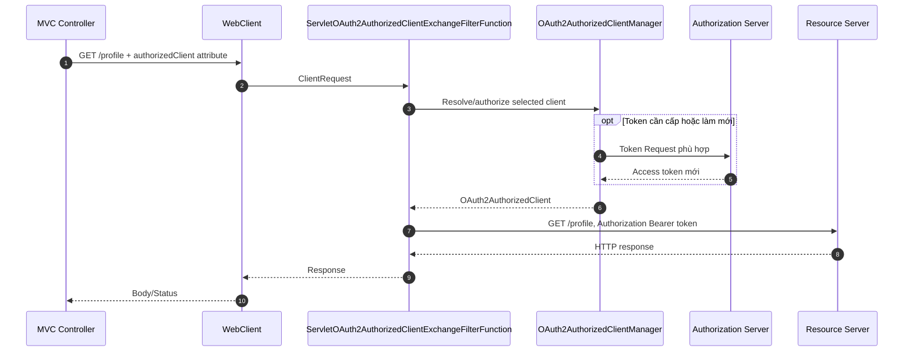
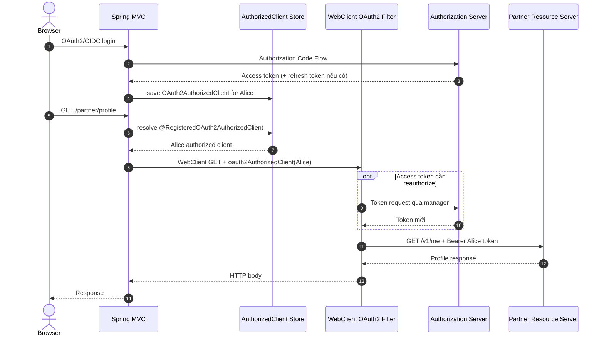

# 19.3. Truyền OAuth2AuthorizedClient vào từng request

## 1. Bài toán: Cùng một WebClient, mỗi HTTP request dùng token nào?

Trong module **Spring Security OAuth 2.0/OIDC Client**, ứng dụng Servlet như Spring MVC có thể vừa sử dụng **OAuth2 Login** để xác thực người dùng, vừa dùng **WebClient** để gọi Resource Server/API bên ngoài.

Ví dụ, một cổng doanh nghiệp cho phép Alice đăng nhập qua OpenID Provider, sau đó gọi Partner API để lấy dữ liệu của chính Alice:

```text
Trình duyệt Alice
    |
    | 1. Đăng nhập OIDC qua Spring Security
    v
Spring Boot MVC / Servlet
    |
    | 2. OAuth2AuthorizedClient của Alice
    |    registrationId = partner-login
    |    principalName = alice-sub
    |    accessToken = AT_ALICE
    v
WebClient gọi Partner API
    |
    | Authorization: Bearer AT_ALICE
    v
Resource Server / Partner API
```

Một ứng dụng có thể đồng thời hỗ trợ Bob và nhiều registrations khác. Điều quan trọng là **request gọi API cho Alice phải dùng đúng authorized client của Alice**, không tự sử dụng token cuối cùng được lưu trong biến global hoặc token được gắn mặc định cho mọi outgoing request.

Spring Security có API giúp xác định **OAuth2AuthorizedClient cần dùng ở đúng từng WebClient request**:

```java
.attributes(oauth2AuthorizedClient(authorizedClient))
```

Trong đó `oauth2AuthorizedClient(...)` là static helper của:

```java
ServletOAuth2AuthorizedClientExchangeFilterFunction
```

Đây là trọng tâm của bài học.

### Mục tiêu

Sau bài học, bạn sẽ:

1. Hiểu `WebClient` hoạt động được trong **Servlet/MVC** và khác gì với WebFlux security.
2. Phân biệt `ClientRegistration`, `OAuth2AuthorizedClient`, `Authentication` và access token.
3. Cấu hình `ServletOAuth2AuthorizedClientExchangeFilterFunction`.
4. Truyền một `OAuth2AuthorizedClient` cụ thể vào **một HTTP request** bằng `ClientRequest.attributes()`.
5. Kết hợp `@RegisteredOAuth2AuthorizedClient` trong MVC controller.
6. Phân biệt cách truyền object trực tiếp với `.attributes(clientRegistrationId(...))`.
7. Hiểu vì sao token không nên tự động gắn cho mọi request.
8. Hiểu refresh token, nơi lưu, token expiry và failure handling khi dùng WebClient.
9. Tránh lộ token, lẫn quyền user/service hoặc gửi Bearer token sang host không tin cậy.
10. Có cách thử nghiệm và chẩn đoán lỗi mà không ghi access token vào log.

> Phạm vi: **WebClient chạy bên trong một ứng dụng Servlet/MVC**, không phải reactive security application thuần WebFlux. Domain, IDs, tokens và API responses đều là minh họa.

---

## 2. WebClient trên Servlet không có nghĩa ứng dụng trở thành WebFlux

`WebClient` là HTTP client thuộc thư viện Spring WebFlux:

```java
org.springframework.web.reactive.function.client.WebClient
```

Nó có API reactive để gửi HTTP requests và xử lý responses. Nhưng **đưa WebClient vào ứng dụng Spring MVC không tự biến server thành WebFlux application**.

Ví dụ ứng dụng vẫn có:

```text
Tomcat / Servlet container
    |
    v
DispatcherServlet
    |
    v
Spring MVC @RestController
    |
    v
WebClient -> outbound HTTP -> External API
```

Trái lại, WebFlux server thường sử dụng:

```text
Reactive web runtime
    |
    v
DispatcherHandler
    |
    v
Reactive Controller
    |
    v
WebClient
```

Hai kiến trúc có thể cùng dùng `WebClient`, nhưng **security context, authorized client repository và cấu hình OAuth2 integration** không hoàn toàn giống nhau.

### 2.1. Vì sao ứng dụng MVC muốn dùng WebClient?

Các lý do có thể gồm:

- Cần gọi API dùng HTTP client hiện đại và API fluent.
- Muốn xử lý response dưới dạng `Mono<T>` hoặc `Flux<T>`.
- Muốn tổ chức nhiều HTTP calls bất đồng bộ.
- Cần filter để tự gắn OAuth2 access token.
- Muốn giữ outbound client dùng chung giữa nhiều service.

Tuy vậy, WebClient chỉ là **HTTP client**. Token lifecycle vẫn do các thành phần OAuth2 Client của Spring Security quản lý.

### 2.2. Thư viện cần có

Ví dụ dependencies với Spring Boot 3.x:

```groovy
dependencies {
    implementation 'org.springframework.boot:spring-boot-starter-web'
    implementation 'org.springframework.boot:spring-boot-starter-security'
    implementation 'org.springframework.boot:spring-boot-starter-oauth2-client'

    // Thêm API WebClient vào ứng dụng Servlet/MVC.
    implementation 'org.springframework:spring-webflux'

    // Một HTTP transport reactive thông dụng cho WebClient.
    implementation 'io.projectreactor.netty:reactor-netty-http'
}
```

Tên artifact và version cần đi theo Spring Boot BOM và stack thực tế; không tự trộn versions. Với Spring Boot 4.x, cấu trúc starters có sự thay đổi tên và module, cần đối chiếu BOM tương ứng.

Có thể dùng `spring-boot-starter-webflux` để kéo dependencies cho WebClient trong một ứng dụng có MVC starter; với cấu hình Boot thông thường khi cả MVC và WebFlux có mặt, MVC được ưu tiên cho kiểu web application. Nếu dự án cần kiểm soát chính xác web application type, hãy đặt cấu hình rõ ràng và dùng những dependencies cần thiết.

**Lưu ý:** WebClient có thể dùng Reactor Netty hoặc HTTP connector khác. HTTP transport quyết định timeout, TLS, proxy và connection pooling; không nên nhầm những phần này với OAuth2 exchange filter.

## 3. Các đối tượng cần phân biệt

### 3.1. ClientRegistration: cấu hình để xin token

Ví dụ:

```text
registrationId = partner-login
clientId = portal-web
authorizationGrantType = authorization_code
tokenUri = https://id.example.com/oauth2/token
scopes = openid profile partner.read
```

`ClientRegistration` là metadata được lấy từ `ClientRegistrationRepository`. Nó mô tả **cách client được đăng ký với Authorization Server**, không chứa access token cụ thể của Alice.

### 3.2. OAuth2AuthorizedClient: kết quả đã được cấp quyền

Đối tượng:

```java
org.springframework.security.oauth2.client.OAuth2AuthorizedClient
```

Chứa những thông tin như:

```text
OAuth2AuthorizedClient
    |
    +-- ClientRegistration
    |      registrationId = partner-login
    |
    +-- principalName = alice-sub
    |
    +-- OAuth2AccessToken
    |      tokenValue
    |      issuedAt
    |      expiresAt
    |      scopes
    |
    +-- OAuth2RefreshToken (nếu provider cấp)
```

Đây là **object cụ thể** ứng dụng muốn chọn cho từng outgoing HTTP request.

### 3.3. Authentication: danh tính hiện tại trong Spring Security

`Authentication` đại diện chủ thể đang được xác thực trong security context. Với OAuth2 Login, một implementation thường gặp là:

```java
org.springframework.security.oauth2.client.authentication.OAuth2AuthenticationToken
```

Nhưng `Authentication` không tự chính là `OAuth2AuthorizedClient`.

| Thành phần | Trả lời câu hỏi |
|---|---|
| `Authentication` | Ai đang thực hiện request? Đã xác thực chưa? Có authorities gì? |
| `ClientRegistration` | OAuth2 client nào được cấu hình để xin token? |
| `OAuth2AuthorizedClient` | Token nào đã được cấp cho client/principal nào? |
| `OAuth2AuthorizedClientRepository` hoặc `Service` | Token đã cấp đang được lưu ở đâu? |
| `OAuth2AuthorizedClientManager` | Có cần cấp/làm mới token cho principal/registration không? |

**Đừng tự dùng một access token chỉ dựa vào tên user hoặc email từ query parameter.** Đúng registration + đúng authenticated principal + đúng authorization là các ràng buộc phải bảo đảm.

## 4. ExchangeFilterFunction: bộ lọc thêm Bearer token vào outbound request

Trong Servlet environment, Spring Security cung cấp:

```java
org.springframework.security.oauth2.client.web.reactive.function.client
    .ServletOAuth2AuthorizedClientExchangeFilterFunction
```

Đây là một `ExchangeFilterFunction` cho WebClient. Nó có thể:

1. Xác định authorized client được yêu cầu trong `ClientRequest.attributes()`.
2. Phối hợp với `OAuth2AuthorizedClientManager` để dùng hoặc cấp lại authorization phù hợp.
3. Lấy access token từ authorized client.
4. Gắn Bearer token vào outgoing request:

```http
Authorization: Bearer ACCESS_TOKEN_VALUE
```

5. Chuyển request tới HTTP connector thực tế.
6. Hỗ trợ xử lý một số authorization failures theo cấu hình.

Sơ đồ:



Sơ đồ mô tả responsibility theo khái niệm. Chi tiết manager có gọi Token Endpoint hay không phụ thuộc access token hiện tại, grant, providers và nơi lưu.

### 4.1. Cấu hình WebClient một lần

Một bean dùng lại trong ứng dụng MVC:

```java
import org.springframework.context.annotation.Bean;
import org.springframework.context.annotation.Configuration;
import org.springframework.security.oauth2.client.OAuth2AuthorizedClientManager;
import org.springframework.security.oauth2.client.web.reactive.function.client.ServletOAuth2AuthorizedClientExchangeFilterFunction;
import org.springframework.web.reactive.function.client.WebClient;

@Configuration
public class PartnerWebClientConfiguration {

    @Bean("partnerWebClient")
    WebClient partnerWebClient(
            OAuth2AuthorizedClientManager authorizedClientManager) {

        ServletOAuth2AuthorizedClientExchangeFilterFunction oauth2 =
            new ServletOAuth2AuthorizedClientExchangeFilterFunction(
                authorizedClientManager
            );

        return WebClient.builder()
            .baseUrl("https://api.partner.example")
            .apply(oauth2.oauth2Configuration())
            .build();
    }
}
```

Chú ý:

- `WebClient` là một **HTTP client bean**, không tạo mới cho mọi request.
- `oauth2.oauth2Configuration()` cấu hình builder và đăng ký OAuth2 filter.
- Chưa bật `setDefaultOAuth2AuthorizedClient(true)`.
- Chưa chỉ định `setDefaultClientRegistrationId(...)`.
- Vì thế mỗi request cần **truyền thông tin chọn authorized client** khi muốn gắn token.
- `authorizedClientManager` là manager đã được cấu hình phù hợp với môi trường Servlet, provider grants và authorized client repository.

Đây là cách giữ token selection **tường minh**, giảm nguy cơ một WebClient dùng chung tự gắn token nhầm vào HTTP request không cần OAuth2.

### 4.2. `oauth2Configuration()` không tự tạo client registration

Bạn vẫn cần:

- OAuth2 client properties hoặc bean `ClientRegistrationRepository`.
- Nơi lưu authorized clients như `OAuth2AuthorizedClientRepository`.
- Grant provider hỗ trợ authorization code/refresh token khi thích hợp.
- OAuth2 Login nếu ứng dụng cần cho người dùng đăng nhập.
- Resource Server API được cấu hình để chấp nhận token có scope/audience đúng.

Filter **không tự phát hành token** và không thay AS.

---

## 5. Truyền một OAuth2AuthorizedClient vào một request cụ thể

API chính của bài:

```java
.attributes(oauth2AuthorizedClient(authorizedClient))
```

Static import đầy đủ:

```java
import static org.springframework.security.oauth2.client.web.reactive.function.client.ServletOAuth2AuthorizedClientExchangeFilterFunction.oauth2AuthorizedClient;
```

Ví dụ đơn giản:

```java
String profile = webClient.get()
    .uri("https://api.partner.example/v1/me")
    .attributes(oauth2AuthorizedClient(authorizedClient))
    .retrieve()
    .bodyToMono(String.class)
    .block();
```

Ở đây:

- `authorizedClient` có kiểu `OAuth2AuthorizedClient`.
- `oauth2AuthorizedClient(authorizedClient)` **không phải** một HTTP header.
- Helper tạo một consumer dùng để thêm object vào `ClientRequest.attributes()`.
- OAuth2 exchange filter đọc attribute đó và gắn access token phù hợp cho **chính HTTP request này**.
- Request kế tiếp không đương nhiên dùng authorized client đó nếu bạn không cấu hình default token.

### 5.1. Vì sao dùng `attributes(...)` thay vì `header(...)`?

So sánh:

```java
// Cách A: đưa authorized client cho Spring Security filter quản lý.
webClient.get()
    .uri("/v1/me")
    .attributes(oauth2AuthorizedClient(authorizedClient))
    .retrieve();
```

```java
// Cách B: gắn Bearer token thủ công, bỏ qua nhiều phần token lifecycle.
webClient.get()
    .uri("/v1/me")
    .headers(headers -> headers.setBearerAuth(
        authorizedClient.getAccessToken().getTokenValue()
    ))
    .retrieve();
```

Cách B có thể dùng trong các tình huống chuyên biệt, nhưng có những hạn chế:

- Tự đọc token value và điều khiển header ở code ứng dụng.
- Không tự yêu cầu authorized client manager reauthorize khi token hết hạn.
- Khó thống nhất cách xử lý token rotation, expired token, error handling.
- Dễ copy-paste sang client khác và gửi token không đúng audience.
- Dễ log hoặc serialize token nếu developer xử lý không cẩn thận.

Cách A là lựa chọn phù hợp khi bạn đã tích hợp WebClient với **`ServletOAuth2AuthorizedClientExchangeFilterFunction`** và muốn giữ token management trong Spring Security.

**Giới hạn cần biết:** chỉ đặt `attributes(...)` mà **không có exchange filter** thì không tự tạo Bearer header. `attributes` là metadata nội bộ của WebClient request, chỉ có tác dụng khi một filter/handler hiểu nó.

## 6. Ví dụ hoàn chỉnh: @RegisteredOAuth2AuthorizedClient trong MVC Controller

Trong Spring MVC, Spring Security hỗ trợ annotation:

```java
org.springframework.security.oauth2.client.annotation.RegisteredOAuth2AuthorizedClient
```

Nó có thể được dùng để nhận authorized client đã được liên kết với một client registration trong context của request hiện tại.

Ví dụ:

```java
import static org.springframework.security.oauth2.client.web.reactive.function.client.ServletOAuth2AuthorizedClientExchangeFilterFunction.oauth2AuthorizedClient;

import java.time.Duration;

import org.springframework.beans.factory.annotation.Qualifier;
import org.springframework.security.oauth2.client.OAuth2AuthorizedClient;
import org.springframework.security.oauth2.client.annotation.RegisteredOAuth2AuthorizedClient;
import org.springframework.web.bind.annotation.GetMapping;
import org.springframework.web.bind.annotation.RestController;
import org.springframework.web.reactive.function.client.WebClient;

@RestController
public class PartnerProfileController {

    private final WebClient partnerWebClient;

    public PartnerProfileController(
            @Qualifier("partnerWebClient") WebClient partnerWebClient) {
        this.partnerWebClient = partnerWebClient;
    }

    @GetMapping("/partner/profile")
    public String profile(
            @RegisteredOAuth2AuthorizedClient("partner-login")
            OAuth2AuthorizedClient authorizedClient) {

        return partnerWebClient.get()
            .uri("/v1/me")
            .attributes(oauth2AuthorizedClient(authorizedClient))
            .retrieve()
            .bodyToMono(String.class)
            .block(Duration.ofSeconds(10));
    }
}
```

Diễn giải:

1. HTTP request `/partner/profile` đến Spring MVC controller sau khi security chain đã xác thực người dùng.
2. `@RegisteredOAuth2AuthorizedClient("partner-login")` yêu cầu authorized client tương ứng với registration trong ngữ cảnh hiện tại.
3. Controller nhận **object của principal tương ứng**, không tự chọn một record bằng username do browser gửi.
4. `partnerWebClient.get()` tạo một **outgoing request mới**.
5. `.attributes(oauth2AuthorizedClient(authorizedClient))` gắn authorized client vào request attributes.
6. Servlet OAuth2 exchange filter dùng object được chỉ định để gắn Bearer token.
7. Resource Server nhận token và quyết định quyền truy cập.
8. Controller đọc body từ API và trả kết quả phù hợp.

### 6.1. Về `.block()` trong Spring MVC

Ví dụ dùng `.block(Duration.ofSeconds(10))` để controller trả kết quả đồng bộ, dễ thấy luồng hoạt động.

Trong **Servlet MVC**, việc block ở servlet request thread có thể chấp nhận về mặt kỹ thuật, nhưng nó **chiếm một servlet thread trong lúc chờ API**. Với tải lớn, cần cân nhắc:

- Spring MVC async return type nếu thiết kế phù hợp.
- Timeout của WebClient/HTTP connector.
- Giới hạn concurrency và connection pool.
- Không block bên trong Reactor Netty event loop.
- Tổng thời gian chờ bao gồm cả authorized client resolution/refresh và API call.

`.block(Duration)` ở controller **không thay thế hoàn toàn** connect/read/response timeout ở HTTP transport. Nếu request Token Endpoint bị chậm, cần kiểm tra timeout của token response client nữa.

### 6.2. Có thể trả `Mono<T>` từ Spring MVC không?

Spring MVC có thể thích ứng với một số reactive return types thông qua cơ chế adapter/asynchronous request processing khi dependencies hỗ trợ.

Một phiên bản controller bất đồng bộ:

```java
import reactor.core.publisher.Mono;

@GetMapping("/partner/profile-async")
public Mono<String> profileAsync(
        @RegisteredOAuth2AuthorizedClient("partner-login")
        OAuth2AuthorizedClient authorizedClient) {

    return partnerWebClient.get()
        .uri("/v1/me")
        .attributes(oauth2AuthorizedClient(authorizedClient))
        .retrieve()
        .bodyToMono(String.class);
}
```

Đây là **method bổ sung trong controller đã khai báo**, không phải một file Java độc lập. Kiểm tra cấu hình Spring MVC async, timeout và lifecycle request khi dùng reactive return type, đặc biệt nếu filter cần Servlet request/response context trong bước authorize.

Không mặc định một `Mono` xử lý sau khi HTTP request đã kết thúc vẫn còn đầy đủ request attributes hoặc `SecurityContextHolder` thread-local.

### 6.3. Tại sao `@RegisteredOAuth2AuthorizedClient` hữu ích?

Nó làm cho việc chọn registration **tường minh ở biên controller**, rồi controller chuyển đúng authorized client cho service/API client.

Điều này dễ bảo trì hơn cách service nhận chuỗi `"alice"` từ URL rồi tự tìm mọi authorized clients và lấy token bất kỳ. Nếu xây custom lookup, phải kiểm tra principal ownership và tenant boundaries.

---

## 7. Cấu hình OAuth2 Login và registration cho ví dụ

Ví dụ Spring Boot `application.yml`:

```yaml
spring:
  security:
    oauth2:
      client:
        registration:
          partner-login:
            provider: partner-oidc
            client-id: ${PARTNER_CLIENT_ID}
            client-secret: ${PARTNER_CLIENT_SECRET}
            client-authentication-method: client_secret_basic
            authorization-grant-type: authorization_code
            redirect-uri: "{baseUrl}/login/oauth2/code/{registrationId}"
            scope:
              - openid
              - profile
              - partner.read
        provider:
          partner-oidc:
            issuer-uri: https://id.partner.example
```

Trong ví dụ:

- `partner-login`: registration ID Spring Security dùng.
- `partner-oidc`: provider config key.
- `authorization-grant-type: authorization_code`: luồng người dùng tương tác.
- `openid`: scope kích hoạt OIDC Login khi AS hỗ trợ.
- `partner.read`: scope **minh họa**, chỉ có ý nghĩa nếu AS/API công bố và cấp quyền đó.
- `issuer-uri`: dùng cho OIDC discovery/issuer metadata khi phù hợp.

**OIDC Login thành công không tự bảo đảm access token có audience/scope dùng được tại Partner API.** AS cần cấp token đúng cho API, và Resource Server phải chấp nhận issuer, audience, scope. Đừng gửi ID Token thay access token chỉ vì cả hai là JWT.

### 7.1. Cấu hình SecurityFilterChain cho Servlet

```java
import org.springframework.context.annotation.Bean;
import org.springframework.context.annotation.Configuration;
import org.springframework.security.config.Customizer;
import org.springframework.security.config.annotation.web.builders.HttpSecurity;
import org.springframework.security.web.SecurityFilterChain;

@Configuration
public class SecurityConfiguration {

    @Bean
    SecurityFilterChain securityFilterChain(HttpSecurity http)
            throws Exception {

        http
            .authorizeHttpRequests(authorize -> authorize
                .requestMatchers("/", "/public/**").permitAll()
                .anyRequest().authenticated()
            )
            .oauth2Login(Customizer.withDefaults())
            .oauth2Client(Customizer.withDefaults());

        return http.build();
    }
}
```

Đoạn này thiết lập OAuth2 Login và OAuth2 Client support trong một Servlet security chain.

Nếu ứng dụng đã có `SecurityFilterChain`, tích hợp đúng cấu hình vào chain hiện hữu. Không tạo thêm nhiều chains đều match toàn bộ URLs rồi kỳ vọng framework tự kết hợp mọi cấu hình.

### 7.2. Luồng đầy đủ



Lưu ý: phần token flow có thể do filter/manager điều phối thông qua collaborators, không nên hiểu rằng filter tự trực tiếp lưu tokens mà không qua repository/service.

## 8. `oauth2AuthorizedClient(...)` tác động đến request nào?

Điểm cốt lõi là **phạm vi request-local**.

Ví dụ:

```java
Mono<String> aliceResponse = webClient.get()
    .uri("https://api.partner.example/v1/me")
    .attributes(oauth2AuthorizedClient(aliceAuthorizedClient))
    .retrieve()
    .bodyToMono(String.class);

Mono<String> bobResponse = webClient.get()
    .uri("https://api.partner.example/v1/me")
    .attributes(oauth2AuthorizedClient(bobAuthorizedClient))
    .retrieve()
    .bodyToMono(String.class);
```

Đây là hai outgoing HTTP requests khác nhau. Chúng có thể dùng **cùng WebClient instance** nhưng token selection khác nhau.

Tuy nhiên, ví dụ này chỉ an toàn nếu `aliceAuthorizedClient` và `bobAuthorizedClient` đã được lấy thông qua **nguồn xác thực/ủy quyền đáng tin**. Một ứng dụng không được để Alice tự truyền `bobAuthorizedClient` bằng cách chọn `?user=bob` mà không kiểm tra quyền.

### 8.1. Những gì không xảy ra

`.attributes(oauth2AuthorizedClient(...))` không:

- Thay đổi OAuth2 authorized client mặc định trên bean `WebClient`.
- Thay đổi SecurityContext của phiên.
- Ghi authorized client mới vào database ngay khi set attribute.
- Chuyển nội dung `OAuth2AuthorizedClient` thành HTTP header trực tiếp.
- Gửi refresh token tới Resource Server.
- Tạo một OAuth2 ClientRegistration mới.
- Cho phép caller vượt qua authorization của Resource Server.

Sau khi request kết thúc, request attributes của WebClient không phải một kho lưu token lâu dài. Lưu/truy xuất authorized client thuộc trách nhiệm manager và authorized client repository/service.

### 8.2. Request attributes khác HTTP headers

| Khái niệm | Vai trò | Bên nhận |
|---|---|---|
| `ClientRequest.attributes()` | Metadata nội bộ cho filters/HTTP client. | WebClient pipeline trong ứng dụng. |
| `Authorization: Bearer ...` | Credential được gửi với HTTP request. | Resource Server đích. |
| `HttpServletRequest` attributes | Dữ liệu gắn với inbound Servlet request. | Servlet/application server components. |
| `SecurityContext` | Authentication của request/phiên. | Spring Security application. |
| `OAuth2AuthorizedClientService` | Kho lưu authorized client qua nhiều requests. | Backend storage abstraction. |

Không nhầm `.attributes(...)` của WebClient với `request.setAttribute(...)` của Servlet hoặc với JWT claims.

---

## 9. Hai cách chọn token: object trực tiếp và registration ID

Spring Security cung cấp các static helpers cho filter.

### 9.1. Cách 1: truyền `OAuth2AuthorizedClient` cụ thể

```java
.attributes(oauth2AuthorizedClient(authorizedClient))
```

Ý nghĩa: **tôi đã có object authorized client cho đúng user và registration; hãy dùng object này cho outgoing request**.

Điểm mạnh:

- Tường minh về authorized client được chọn.
- Dễ kiểm tra ở call site.
- Phù hợp khi controller đã nhận object qua `@RegisteredOAuth2AuthorizedClient`.
- Giảm sự phụ thuộc vào việc filter tự suy luận registration từ authentication hiện tại.
- Giúp WebClient bean có thể dùng chung nhưng mỗi call chọn một authorized client.

Điểm cần lưu ý:

- Caller phải có object đúng chủ thể.
- Object có thể stale nếu được cache/lưu giữ lâu ngoài authorized client manager.
- Token có thể cần refresh thông qua manager; behavior tùy providers và storage.
- Không truyền object của principal khác khi business policy không cho phép.

### 9.2. Cách 2: truyền `clientRegistrationId`

```java
import static org.springframework.security.oauth2.client.web.reactive.function.client.ServletOAuth2AuthorizedClientExchangeFilterFunction.clientRegistrationId;

String body = webClient.get()
    .uri("https://api.partner.example/v1/me")
    .attributes(clientRegistrationId("partner-login"))
    .retrieve()
    .bodyToMono(String.class)
    .block();
```

Ý nghĩa: **chọn registration ID**, rồi để filter/manager xác định hoặc cấp authorized client theo authentication/principal trong context.

Điểm mạnh:

- Không cần mang `OAuth2AuthorizedClient` object xuyên qua các tầng của code.
- Hữu ích cho API client chuyên dùng một registration hoặc client credentials.
- Manager có thể load/authorize dựa trên registration và principal.

Rủi ro cần quản lý:

- Phải xác định principal đúng.
- Khi không có authenticated user hoặc request context, manager có thể không tìm được authorized client hoặc flow có thể cần authorization tương tác.
- Một registration đúng chưa đủ: Resource Server vẫn cần token đúng scope/audience.
- Nếu service không biết rõ user hiện tại, việc chỉ đưa registration ID chưa xác định được toàn bộ authorization context.

### 9.3. So sánh

| Tiêu chí | `oauth2AuthorizedClient(client)` | `clientRegistrationId("id")` |
|---|---|---|
| Chỉ định authorized client object | **Có** | Không |
| Chỉ định registration | Gián tiếp qua object | **Trực tiếp** |
| Phụ thuộc lookup từ manager | Có thể dùng manager để reauthorize/lưu token | Thường manager cần resolve/load/authorize |
| Phù hợp controller có `@Registered...` | **Rất phù hợp** | Có thể dùng, nhưng ít tường minh hơn về object |
| Phù hợp service-token call đơn giản | Có thể, nếu đã có object | Thường tiện lợi |
| Rủi ro gửi sai token | Khi caller truyền sai object | Khi registration/principal bị chọn sai |
| Tái sử dụng WebClient bean | Có | Có |

Không nên coi một cách luôn tốt hơn mọi cách. Chủ đề bài này nhấn mạnh **truyền object tường minh theo request**, đặc biệt hữu ích với user-delegated tokens.

## 10. Phân biệt authorized client tường minh với default authorized client

`ServletOAuth2AuthorizedClientExchangeFilterFunction` có các tùy chọn mặc định.

### 10.1. `setDefaultOAuth2AuthorizedClient(true)`

Ví dụ:

```java
ServletOAuth2AuthorizedClientExchangeFilterFunction oauth2 =
    new ServletOAuth2AuthorizedClientExchangeFilterFunction(manager);

oauth2.setDefaultOAuth2AuthorizedClient(true);
```

Khi có OAuth2 Login authentication hiện tại, filter có thể dùng authorized client mặc định gắn với principal ấy nếu request không chỉ định lựa chọn khác.

**Cảnh báo:** Với một WebClient bean dùng chung cho nhiều destinations, cấu hình này có thể khiến access token được gắn vào **mọi HTTP request đi qua WebClient đó**, kể cả request không nên có Bearer token.

### 10.2. `setDefaultClientRegistrationId("partner-login")`

Ví dụ:

```java
oauth2.setDefaultClientRegistrationId("partner-login");
```

Filter có thể dùng registration này khi request không chỉ định object/registration.

Điều đó cũng có rủi ro:

```text
WebClient dùng chung:
    GET https://api.partner.example/v1/me    -> Token nên dùng
    GET https://weather.example.org/current   -> Token KHÔNG nên dùng
```

Nếu cấu hình default token, request thứ hai có thể vô tình gửi access token sang host không thuộc Resource Server tin cậy.

### 10.3. Khuyến nghị cho WebClient dùng chung

**Không tự bật default token cho một WebClient gọi nhiều hosts.** Thay vào đó:

```java
webClient.get()
    .uri("https://api.partner.example/v1/me")
    .attributes(oauth2AuthorizedClient(partnerAuthorizedClient))
    .retrieve();
```

Hoặc tách những WebClient beans theo host/resource và chỉ dùng default registration khi bạn **thực sự kiểm soát tất cả outgoing destinations** của client đó.

### 10.4. Explicit selection và default selection

Về nguyên tắc, filter ưu tiên request-specific OAuth2 client selection hơn default theo cấu hình. Không dựa vào một default token để thay cho yêu cầu phân quyền theo user/tenant.

Khi request không chứa `oauth2AuthorizedClient` hay `clientRegistrationId` và default không được bật, filter **không có cơ sở tường minh để tự chọn Bearer token**. Điều này giúp giảm token propagation ngoài ý muốn.

## 11. Cấu hình client credentials cho request không có user login

Một backend có thể đồng thời:

- Dùng `partner-login` cho user-delegated API calls.
- Dùng `reporting-service` với `client_credentials` cho backend batch job.

Ví dụ registration:

```yaml
spring:
  security:
    oauth2:
      client:
        registration:
          reporting-service:
            provider: internal-as
            client-id: ${REPORTING_CLIENT_ID}
            client-secret: ${REPORTING_CLIENT_SECRET}
            client-authentication-method: client_secret_basic
            authorization-grant-type: client_credentials
            scope:
              - reports.read
        provider:
          internal-as:
            token-uri: https://auth.internal.example/oauth2/token
```

Có thể chọn theo request:

```java
webClient.get()
    .uri("https://reports.internal.example/v1/summary")
    .attributes(clientRegistrationId("reporting-service"))
    .retrieve()
    .bodyToMono(String.class);
```

Tuy nhiên, **không nên tự giả định** WebClient Servlet filter đã có principal/context thích hợp nếu gọi từ scheduled job không có Servlet request. Trong background code, thường dùng:

```java
AuthorizedClientServiceOAuth2AuthorizedClientManager
```

để authorize theo stable service principal, sau đó gọi HTTP client với token đúng hoặc một integration được cấu hình thích hợp.

### 11.1. Không biến service token thành user token

`client_credentials` đại diện client/service, không đại diện Alice. Nếu frontend Alice gọi endpoint quản trị báo cáo, backend vẫn phải áp business authorization trước khi dùng service token.

Không dùng token có scope rộng của service để bỏ qua những hạn chế mà user-delegated token có.

## 12. `OAuth2AuthorizedClientManager` hỗ trợ token lifecycle ra sao?

Với một `OAuth2AuthorizedClientManager` được cấu hình đúng, filter có thể tận dụng:

- Tra authorized client hiện tại theo registration/principal.
- Yêu cầu authorization nếu chưa có token và grant phù hợp.
- Refresh access token bằng refresh token nếu có và cần.
- Lấy token mới bằng client credentials khi cần.
- Lưu authorized client mới vào repository/service qua success handling.
- Xử lý một số lỗi theo failure handling.

Ví dụ `OAuth2AuthorizedClientProviderBuilder`:

```java
import org.springframework.security.oauth2.client.OAuth2AuthorizedClientProvider;
import org.springframework.security.oauth2.client.OAuth2AuthorizedClientProviderBuilder;

OAuth2AuthorizedClientProvider provider =
    OAuth2AuthorizedClientProviderBuilder.builder()
        .authorizationCode()
        .refreshToken()
        .clientCredentials()
        .build();
```

Việc ghép provider không có nghĩa một token user lỗi sẽ được tự động thay bằng token service. Mỗi grant có semantics riêng; provider chain chỉ thử những chiến lược phù hợp với registration/context.

### 12.1. Khi object được truyền đã gần hết hạn

Giả sử:

```text
@RegisteredOAuth2AuthorizedClient -> AT1 gần hết hạn, RT1 hiện có
```

Trong một WebClient request có:

```java
.attributes(oauth2AuthorizedClient(authorizedClient))
```

Filter/manager có thể thực hiện refresh nếu manager đã được cấu hình với refresh provider và authorized client còn refresh token hợp lệ. Token được sử dụng cho API có thể là **AT2** sau khi reauthorize thành công.

Không nên hiểu rằng **filter chắc chắn gửi `getAccessToken().getTokenValue()` của object cũ bất chấp expiry**; lý do sử dụng Spring Security filter thay gắn header thủ công là để giữ token lifecycle gắn với manager.

Nhưng cũng **không nên hứa filter luôn refresh được**: AS có thể không cấp refresh token, token có thể bị revoke, provider thiếu grant support hoặc store thiếu authorized client.

### 12.2. Access token hết hạn không đồng nghĩa refresh token luôn có

Với OAuth2 Login, AS có thể không cấp refresh token dù người dùng đăng nhập thành công. Việc `OAuth2AuthorizedClient.getRefreshToken()` trả `null` là bình thường trong nhiều tình huống.

Trong trường hợp không thể refresh, ứng dụng có thể cần một **Authorization Code Flow mới** khi business logic yêu cầu user authorization. Không tự dùng client credentials để thay token người dùng.

### 12.3. Tránh cache `OAuth2AuthorizedClient` object vô hạn ở application code

Một `OAuth2AuthorizedClient` đọc tại thời điểm T0 có thể trở thành stale:

```text
T0: AT1, RT1
T1: Manager refresh thành AT2, RT2
T2: Service cũ vẫn giữ object AT1, RT1 đã cache từ T0
```

Nếu liên tục truyền object stale vào filter/manager, có thể gây refresh trùng hoặc lỗi `invalid_grant`, nhất là với refresh token rotation.

Khi cần token cho request mới, ưu tiên lấy authorized client mới nhất từ một nguồn đã được quản lý, hoặc để manager resolve bằng registration/principal. Không giữ `OAuth2AuthorizedClient` trong biến singleton toàn cục theo user.

## 13. ClientRequest attributes không phải SecurityContext

Một request-specific attribute như:

```java
.attributes(oauth2AuthorizedClient(authorizedClient))
```

là dữ liệu của **outgoing WebClient request**.

Ngược lại, `SecurityContextHolder` lưu `Authentication` ở ngữ cảnh thực thi mà Spring Security quản lý, thường liên quan tới Servlet request thread.

Có hai tình huống khác nhau:

1. Controller nhận một authorized client đúng user và truyền object đó theo HTTP request.
2. Filter phải **tự tìm principal/authentication từ security context** và resolve registration.

Cách 1 giảm mức độ phụ thuộc vào việc filter phải suy ra object từ thread context, nhưng không hoàn toàn loại bỏ mọi nhu cầu request/response context trong quá trình reauthorization/lưu token.

### 13.1. ThreadLocal có thể không đi qua mọi async boundary

Một WebClient pipeline có thể chạy một phần trên scheduler/reactor threads. Đừng tự giả định `SecurityContextHolder` thread-local luôn hiện diện như ở controller Servlet thread.

Nếu bạn dùng:

```java
someMono.subscribeOn(Schedulers.boundedElastic())
```

hoặc xử lý sau khi inbound request đã hoàn tất, cần hiểu cách security context và Servlet attributes được propagate. Dùng explicit authorized client có thể giúp việc lựa chọn token rõ ràng hơn, nhưng nếu authorization manager cần Servlet request/response trong quá trình refresh, vẫn phải bảo đảm environment phù hợp.

### 13.2. Không giữ `HttpServletRequest` sau khi request kết thúc

Một `HttpServletRequest` không phải object phù hợp để lưu trong singleton service hoặc reactive pipeline tồn tại vô hạn. Khi cần background authorization, dùng service-oriented manager và stable principal phù hợp thay vì giữ Servlet request để gọi lại sau.

## 14. Nhiều người dùng cùng gọi API: token isolation

Giả sử:

```text
Alice:
  principalName = alice-sub
  registrationId = partner-login
  accessToken = AT_ALICE

Bob:
  principalName = bob-sub
  registrationId = partner-login
  accessToken = AT_BOB
```

Một WebClient bean có thể dùng chung:

```java
WebClient webClient = ...;
```

Nhưng mỗi call phải chọn token đúng:

```text
Alice controller request
    -> attributes(oauth2AuthorizedClient(authorizedClientOfAlice))
    -> Bearer AT_ALICE

Bob controller request
    -> attributes(oauth2AuthorizedClient(authorizedClientOfBob))
    -> Bearer AT_BOB
```

### 14.1. Sai lầm: cache authorized client trong field singleton

Không nên:

```java
@Service
public class BadPartnerGateway {

    private OAuth2AuthorizedClient lastAuthorizedClient;

    public void setAuthorizedClient(OAuth2AuthorizedClient client) {
        this.lastAuthorizedClient = client;
    }

    // Một request khác có thể đọc token của người dùng trước đó.
}
```

Trong singleton service dùng chung giữa users, field này có thể bị ghi đè bởi Alice/Bob và dẫn đến gửi nhầm token.

Tốt hơn là đưa authorized client như một **tham số của method**, hoặc dùng manager resolve authorization trong đúng context.

### 14.2. Sai lầm: nhận principal name từ browser

Ví dụ nguy hiểm:

```text
GET /api/partner?principalName=bob-sub
```

rồi backend gọi:

```java
authorizedClientService.loadAuthorizedClient(
    "partner-login",
    principalNameFromQuery
);
```

Nếu không kiểm tra quyền, Alice có thể truy xuất token của Bob chỉ bằng cách biết tên định danh của Bob.

**Phân quyền ownership phải được kiểm soát ở backend**. `@RegisteredOAuth2AuthorizedClient` trong request có authenticated principal là một cách giảm sự tùy tiện so với query param, nhưng vẫn cần business authorization khi cho phép truy cập thay mặt người khác.

### 14.3. Multi-tenant còn cần namespace

Nếu các tenants khác nhau đều có principal name `admin` hoặc `1234`, cần đảm bảo authorized client storage/key không va chạm.

Với OIDC, cặp `(issuer, subject)` là nền tảng xác định external identity; ứng dụng có thể ánh xạ sang stable local account ID. Không dùng email hoặc display name làm khóa duy nhất khi chúng có thể đổi/trùng.

---

## 15. Không gửi token sai Resource Server

Việc truyền một authorized client đúng user **chưa đủ** nếu URL đích không đúng Resource Server.

Ví dụ authorized client `partner-login` có token:

```text
scope = partner.read
audience = partner-api
```

Dùng nó cho:

```text
https://api.partner.example/v1/me
```

có thể hợp lệ nếu API chấp nhận issuer/audience/scope đó.

Nhưng dùng cùng token cho:

```text
https://public-weather.example/data
```

là rủi ro rò rỉ credential sang host không có quyền nhận token.

### 15.1. Dùng baseUrl cố định cho API client chuyên biệt

Một cấu hình an toàn hơn:

```java
@Bean("partnerWebClient")
WebClient partnerWebClient(OAuth2AuthorizedClientManager manager) {
    ServletOAuth2AuthorizedClientExchangeFilterFunction oauth2 =
        new ServletOAuth2AuthorizedClientExchangeFilterFunction(manager);

    return WebClient.builder()
        .baseUrl("https://api.partner.example")
        .apply(oauth2.oauth2Configuration())
        .build();
}
```

Khi service gọi:

```java
webClient.get().uri("/v1/me")
```

URL đích được giới hạn theo base URL bạn quản lý.

**Nhưng baseUrl không tự là một security allowlist tuyệt đối**: WebClient có thể nhận absolute URIs hoặc redirect behavior tùy connector/client configuration. Nếu URL nhận từ dữ liệu người dùng, cần kiểm soát destination host, redirects và SSRF bằng các cơ chế riêng.

### 15.2. Redirect từ Resource Server có thể làm gì?

Một external API có thể trả HTTP 302/307. Tùy connector, HTTP client có thể hoặc không tự theo redirect và có thể thay đổi cách chuyển headers.

Không để access token được chuyển tới host khác qua redirect chain mà không có policy. Cấu hình redirect handling và destination restrictions phù hợp với API; không giả định mọi HTTP transport xử lý `Authorization` header giống nhau.

### 15.3. Không lấy token từ provider để gọi một API bất kỳ

OAuth2 token phải dành cho đúng resource/audience và có scopes phù hợp. OIDC ID Token không phải Access Token của Resource Server. Việc Resource Server trả 401/403 có thể là vấn đề audience, scopes hoặc authorization chứ không phải lỗi truyền request attribute.

## 16. Một method cho hai API calls với cùng authorized client

Ví dụ application muốn lấy profile và danh sách projects của Alice:

```java
import static org.springframework.security.oauth2.client.web.reactive.function.client.ServletOAuth2AuthorizedClientExchangeFilterFunction.oauth2AuthorizedClient;

import reactor.core.publisher.Mono;

public Mono<DashboardDto> loadDashboard(
        OAuth2AuthorizedClient authorizedClient) {

    Mono<ProfileDto> profile = webClient.get()
        .uri("/v1/me")
        .attributes(oauth2AuthorizedClient(authorizedClient))
        .retrieve()
        .bodyToMono(ProfileDto.class);

    Mono<ProjectsDto> projects = webClient.get()
        .uri("/v1/projects")
        .attributes(oauth2AuthorizedClient(authorizedClient))
        .retrieve()
        .bodyToMono(ProjectsDto.class);

    return Mono.zip(profile, projects)
        .map(tuple -> new DashboardDto(
            tuple.getT1(),
            tuple.getT2()
        ));
}
```

Các DTO `ProfileDto`, `ProjectsDto`, `DashboardDto` là types do ứng dụng định nghĩa; ví dụ thể hiện cách truyền request attributes cho **từng request**, không cung cấp DTO definitions đầy đủ.

### 16.1. Vì sao phải thêm attributes ở cả hai calls?

Hai nhánh `webClient.get()` tạo **hai ClientRequests riêng biệt**.

Việc gắn object cho nhánh profile không tự truyền vào nhánh projects. Đây chính là ưu điểm của cách chỉ định per-request: không có token global được lưu ở WebClient bean để tự động gắn vào mọi destination.

### 16.2. Đồng thời refresh token có thể phát sinh

Nếu AT1 sắp hết hạn, hai outgoing calls trong `Mono.zip` có thể đồng thời yêu cầu manager refresh cùng authorized client.

Với refresh token rotation, có nguy cơ cả hai cùng dùng RT1 trước khi một call lưu RT2, gây `invalid_grant`.

Do đó:

- Cùng một authorization có thể được tái sử dụng giữa các requests nhưng token lifecycle vẫn cần concurrency control.
- Không mặc định authorized client service/JDBC tự đồng bộ hóa **toàn bộ** load–refresh–save.
- Với single instance, có thể có single-flight/per-key lock trong token management path.
- Với nhiều instances, cần shared-store coordination và re-read state sau lock nếu dùng strict rotation.
- Không tự cache một object `OAuth2AuthorizedClient` cũ trong singleton service để tránh lookup.

Việc per-request truyền authorized client giải quyết **chọn token đúng**, không tự giải quyết mọi race condition refresh.

## 17. So sánh `.attributes(...)` với WebClient filter riêng do ứng dụng viết

Một số dự án tự viết filter:

```java
ExchangeFilterFunction bearerFilter =
    (request, next) -> {
        // Tự lấy token từ service, tự set Authorization...
        return next.exchange(request);
    };
```

Cách này có thể hợp lý cho một giao thức/token source đặc thù, nhưng với Spring Security OAuth2 Client đã có contract thì thường không cần tự viết.

`ServletOAuth2AuthorizedClientExchangeFilterFunction` đã kết hợp:

- Chọn authorized client qua request attributes.
- Authorization manager.
- Đặt Bearer token lên request.
- Sử dụng token đã cấp hoặc hỗ trợ reauthorization theo manager.
- Các điểm mở rộng xử lý lỗi.

Nếu tự tạo filter, cần giải quyết:

1. Làm sao xác định principal hiện tại?
2. Làm sao chọn registration đúng?
3. Làm sao xử lý token hết hạn?
4. Làm sao xử lý refresh token rotation?
5. Làm sao lưu authorized client mới?
6. Làm sao cô lập token giữa users/tenants?
7. Làm sao không gửi token sang API sai host?
8. Làm sao xử lý 401/403 từ Resource Server?
9. Làm sao không log secrets?
10. Làm sao test không có token leakage?

Phần lớn các nhu cầu này đã có abstraction trong Spring Security, nên nên tận dụng thay vì tạo lại từ đầu.

## 18. Xử lý lỗi Resource Server 401/403

Dù đã chọn đúng authorized client, Resource Server vẫn có thể trả lỗi:

```http
HTTP/1.1 401 Unauthorized
WWW-Authenticate: Bearer error="invalid_token"
```

Hoặc:

```http
HTTP/1.1 403 Forbidden
WWW-Authenticate: Bearer error="insufficient_scope"
```

Những lỗi này khác với **Token Endpoint errors** như `invalid_grant` hoặc `invalid_client`.

### 18.1. Hai tầng xử lý thất bại

| Tầng | Ví dụ | Vị trí |
|---|---|---|
| Token Endpoint/authorization manager | `invalid_grant`, `invalid_client`, timeout token request | Grant provider, token response client, manager failure handler |
| Resource Server/API | 401, 403, `invalid_token`, `insufficient_scope` | WebClient exchange filter, API error handler |
| HTTP network | DNS, TLS, proxy, connect/response timeout | WebClient HTTP connector |
| Business policy | User không có quyền xem một order | Resource Server và ứng dụng |

Khi Resource Server trả 401 `invalid_token`, một chính sách hợp lý có thể là xóa stored authorized client tương ứng để **lần yêu cầu tiếp theo** xin token mới, tùy error code và manager/repository. Nhưng không nên xóa mọi authorized clients khi bất kỳ HTTP 403 nào xuất hiện: 403 có thể đơn giản do thiếu quyền và token vẫn hợp lệ.

### 18.2. Constructor ảnh hưởng đến failure handling

Theo API Spring Security, có hai cách khởi tạo đáng lưu ý:

```java
new ServletOAuth2AuthorizedClientExchangeFilterFunction(
    authorizedClientManager
);
```

và:

```java
new ServletOAuth2AuthorizedClientExchangeFilterFunction(
    clientRegistrationRepository,
    authorizedClientRepository
);
```

Ở các dòng Spring Security có hỗ trợ hai constructors:

- **Constructor nhận manager:** việc chuyển Resource Server 401/403 đến `OAuth2AuthorizationFailureHandler` **không tự cấu hình**. Nếu muốn xử lý invalid token bằng cách remove authorized client trong store, hãy cấu hình `setAuthorizationFailureHandler(...)` thích hợp.
- **Constructor nhận repositories:** Spring Security có thể tự cấu hình `RemoveAuthorizedClientOAuth2AuthorizationFailureHandler` cho các Resource Server failures phù hợp (từ những phiên bản hỗ trợ behavior đó).

Đây là điểm kỹ thuật quan trọng khi ứng dụng đã tích hợp filter nhưng thấy **token không hợp lệ bị gửi lại ở request sau**.

Việc remove theo lỗi nào phụ thuộc OAuth2 error semantics và handler, không phải “gặp 401 hoặc 403 là xóa token”. Kiểm tra API docs của phiên bản đang dùng và wiring của custom manager.

### 18.3. Không tự retry mọi HTTP operation

Khi API POST đã thực hiện thay đổi dữ liệu nhưng response bị mất, tự retry POST chỉ vì đã lấy token mới có thể tạo giao dịch trùng lặp.

Nếu muốn retry sau `invalid_token`, cần:

- Nhận diện chính xác lỗi token.
- Đảm bảo authorized client cũ bị xử lý theo policy.
- Giới hạn số lần retry.
- Xem tính idempotent của API method hoặc dùng idempotency key.
- Không chạy lại request business nếu kết quả thực thi không rõ.
- Không chuyển sang token của người dùng/service khác để “thành công bằng mọi giá”.

---

## 19. `@RegisteredOAuth2AuthorizedClient` không cho phép vượt quyền user

Một controller có thể nhận authorized client qua:

```java
@RegisteredOAuth2AuthorizedClient("partner-login")
OAuth2AuthorizedClient authorizedClient
```

Điều này không có nghĩa controller có quyền truy xuất token của một tài khoản khác theo tên tùy ý.

Đúng mô hình:

```text
Authenticated Alice
    |
    -> MVC argument resolver
    -> Alice authorized client for partner-login
    -> outgoing API with Alice access token
```

Sai mô hình:

```text
Alice requests ?account=bob
    |
    -> custom lookup authorized client of Bob
    -> outgoing API using Bob access token
```

Trường hợp quản trị viên thật sự được phép “act on behalf of” người dùng khác cần thiết kế delegated authorization hoặc token exchange theo giao thức và business policy, không chỉ thay object trong `.attributes(...)`.

### 19.1. PrincipalName có thể khác email

`OAuth2AuthorizedClient.getPrincipalName()` thường dùng giá trị tên trong `Authentication` được Spring Security sử dụng khi lưu authorized client.

Với OIDC, dựa vào `sub` và issuer/local stable identity có thể an toàn hơn email. Nếu email đổi, lookup theo email có thể thất bại hoặc lẫn tài khoản.

Không lấy `getName()` của OAuth2User và tự gắn sang account khác mà không bảo đảm ánh xạ principal/issuer đúng.

### 19.2. Một registration có thể có nhiều authorized clients

Ví dụ:

| Registration | Principal | Token |
|---|---|---|
| `partner-login` | `alice-sub` | Token Alice |
| `partner-login` | `bob-sub` | Token Bob |
| `partner-login` | `charlie-sub` | Token Charlie |

Chọn `partner-login` không có nghĩa chỉ có một token toàn ứng dụng. Phải chọn **principal tương ứng**.

## 20. Một ứng dụng có nhiều registrations

Giả sử portal đăng nhập qua `corporate-oidc` và gọi hai APIs:

```text
corporate-oidc:
    OIDC Login và API corporate

partner-api:
    Một OAuth2 authorization khác của người dùng, nếu đã cấp

reporting-service:
    Client Credentials, không gắn người dùng
```

Ba authorized clients có thể có grant, scope, issuer và principal semantics khác nhau.

### 20.1. Mỗi WebClient request chọn đúng authorized client

```java
Mono<String> corporateData = webClient.get()
    .uri("https://api.corporate.example/v1/me")
    .attributes(oauth2AuthorizedClient(corporateAuthorizedClient))
    .retrieve()
    .bodyToMono(String.class);

Mono<String> partnerData = webClient.get()
    .uri("https://api.partner.example/v1/tasks")
    .attributes(oauth2AuthorizedClient(partnerAuthorizedClient))
    .retrieve()
    .bodyToMono(String.class);
```

Nhưng ví dụ này dùng một WebClient chung cho nhiều hosts. Với production, nên cân nhắc **WebClient riêng theo API host**, baseUrl cố định, outbound allowlist và các HTTP connector settings phù hợp.

### 20.2. Không trộn client credentials và user delegation

Một `OAuth2AuthorizedClient` cho `reporting-service` dùng client credentials không đại diện cho Alice. Không dùng nó trong một controller của Alice chỉ để truy cập tài nguyên user mà Alice chưa được phép.

Ngược lại, token của Alice không phù hợp để gọi API thuộc workflow backend chỉ cần client/service permissions nếu audience/scope không đúng.

## 21. `OAuth2AuthorizedClientRepository` và `Service` liên quan thế nào?

Nơi lưu authorized client có thể gồm:

| Thành phần | Đặc điểm |
|---|---|
| `OAuth2AuthorizedClientRepository` | Contract gắn với Servlet request, nhận Authentication và HttpServletRequest/Response. |
| `OAuth2AuthorizedClientService` | Load/save theo `registrationId` và principal name, phù hợp cả ngoài request. |
| `AuthenticatedPrincipalOAuth2AuthorizedClientRepository` | Với authenticated principal, delegate sang service; anonymous thường qua session repository. |
| `HttpSessionOAuth2AuthorizedClientRepository` | Lưu token theo HTTP session. |
| `InMemoryOAuth2AuthorizedClientService` | Lưu trong RAM của một application instance. |
| `JdbcOAuth2AuthorizedClientService` | Lưu trong DB, cần schema và chính sách bảo mật. |

Một authorized client có thể được lấy ra qua `@RegisteredOAuth2AuthorizedClient`, sau đó truyền bằng `.attributes(oauth2AuthorizedClient(...))`. Nhưng WebClient attribute **không quyết định store**. Manager/repository/service được cấu hình mới quyết định việc load/save.

### 21.1. Khi InMemory mất token sau restart

Một request sau restart có thể không tìm thấy authorized client cũ. Điều đó không có nghĩa WebClient attributes bị lỗi; lỗi thuộc token persistence/lifecycle.

### 21.2. Khi đa instance không có shared store

Alice login trên pod A, nhưng request `/partner/profile` đến pod B, nơi không có token của Alice. Nếu app dùng InMemory per node mà không có session routing/shared storage phù hợp, authorized client có thể không tìm được.

Nên đánh giá session replication và authorized client persistence tách biệt, không giải quyết bằng cách cache token toàn cục trong WebClient bean.

## 22. Request-specific token và refresh token rotation

Một vấn đề concurrency dễ xuất hiện khi cùng authorized client được dùng cho nhiều outgoing requests song song.

Ví dụ:

```text
Alice authorized client:
    AT1 gần hết hạn
    RT1 hiện có

Request 1 và Request 2 đều nhận object chứa RT1

Request 1:
    refresh(RT1) -> AT2, RT2

Request 2:
    refresh(RT1) -> invalid_grant / replay detection
```

Không mặc định repository/service tự làm **toàn bộ** load-check-refresh-save thành một transaction atomic giữa threads/pods.

Một số giải pháp kiến trúc:

1. Tránh giữ object cũ trong singleton cache.
2. Re-resolve authorized client mới nhất trước khi cần refresh.
3. Khi provider dùng strict refresh token rotation, dùng per-key single-flight.
4. Với đa instances, có thể cần distributed coordination.
5. Re-read store sau khi acquire lock.
6. Dùng conditional write/delete hoặc versioning khi storage hỗ trợ.
7. Không retry refresh token cũ mù quáng sau timeout.
8. Không để failure handler của request stale xóa nhầm entry mới.

**Truyền object theo request không bảo đảm chỉ một refresh operation được phép diễn ra.** Đây là trách nhiệm của token lifecycle design.

## 23. Lỗi thực tế: `.attributes(...)` nhưng không có Bearer header

Các nguyên nhân thường gặp:

- Bean `WebClient` được inject không phải bean đã gắn `ServletOAuth2AuthorizedClientExchangeFilterFunction`.
- Request gọi một WebClient mới tạo bằng `WebClient.create(...)` thay vì bean đã cấu hình.
- Import nhầm `ReactiveOAuth2AuthorizedClientExchangeFilterFunction` trong ứng dụng Servlet.
- Dùng `oauth2AuthorizedClient(...)` nhưng không gọi `.apply(oauth2.oauth2Configuration())` hoặc không đăng ký filter theo API thích hợp.
- Request không có authorized client hợp lệ.
- Custom filter trong chain ghi đè/loại bỏ `Authorization` header.
- Code sử dụng sai method overload hoặc truyền một object khác registration.
- Filter/manager fail khi authorize/refresh nên request đến API không diễn ra như tưởng.
- Outgoing request dùng endpoint khác với yêu cầu authorization mong muốn.

### 23.1. Import đúng class

```java
import static org.springframework.security.oauth2.client.web.reactive.function.client.ServletOAuth2AuthorizedClientExchangeFilterFunction.oauth2AuthorizedClient;
```

và:

```java
import org.springframework.security.oauth2.client.web.reactive.function.client.ServletOAuth2AuthorizedClientExchangeFilterFunction;
```

Tên package có `reactive.function.client` **không có nghĩa class này dành cho WebFlux security server**. Chính prefix `Servlet` chỉ rõ nó dùng trong môi trường Servlet.

### 23.2. Vì sao không đọc Authorization header bằng log?

Đừng bật wiretap chứa Bearer token ở production chỉ để biết filter có hoạt động hay không.

Có thể kiểm tra tại mock API server trong test, ở nơi token là giá trị giả, hoặc ghi metrics như:

```text
clientRegistrationId=partner-login
tokenSelected=true
upstreamStatus=200
requestDurationMs=123
```

Không log raw token value, refresh token, client secret hoặc HTTP Authorization header.

---

## 24. Testing: đảm bảo request A và B dùng token đúng

Đối với bài toán per-request token selection, các tests có giá trị nhất là **kiểm chứng outgoing HTTP request thực tế**.

### 24.1. Test ý tưởng với fake authorized clients

Dựng hai `OAuth2AuthorizedClient` test với:

```text
registrationId = partner-login

Alice:
    principalName = alice-sub
    accessToken = fake-alice-token

Bob:
    principalName = bob-sub
    accessToken = fake-bob-token
```

Dùng một WebClient đã cấu hình OAuth2 filter, cùng một mock HTTP connector hoặc test HTTP server. Gửi:

```java
webClient.get()
    .uri("/v1/me")
    .attributes(oauth2AuthorizedClient(aliceClient))
    .retrieve()
    .bodyToMono(String.class);
```

và:

```java
webClient.get()
    .uri("/v1/me")
    .attributes(oauth2AuthorizedClient(bobClient))
    .retrieve()
    .bodyToMono(String.class);
```

Assert mock server quan sát được lần lượt:

```text
Authorization: Bearer fake-alice-token
Authorization: Bearer fake-bob-token
```

Với token giả đã định nghĩa trong test, phép assert này phù hợp. Không kiểm tra hoặc in token thật trên production.

### 24.2. Ví dụ tạo fake authorized client trong unit test

```java
import java.time.Instant;
import java.util.Set;

import org.springframework.security.oauth2.client.OAuth2AuthorizedClient;
import org.springframework.security.oauth2.client.registration.ClientRegistration;
import org.springframework.security.oauth2.core.OAuth2AccessToken;

OAuth2AccessToken fakeToken = new OAuth2AccessToken(
    OAuth2AccessToken.TokenType.BEARER,
    "fake-alice-token",
    Instant.now(),
    Instant.now().plusSeconds(600),
    Set.of("partner.read")
);

OAuth2AuthorizedClient aliceClient =
    new OAuth2AuthorizedClient(
        registration,
        "alice-sub",
        fakeToken
    );
```

`registration` là `ClientRegistration` test đã được dựng hợp lệ với `registrationId = "partner-login"`, token URI và thông tin cần thiết; ví dụ minh họa phần test object, không phải file test hoàn chỉnh.

Nếu có `OAuth2AuthorizedClientManager` stub, cần để nó xử lý authorization requests theo hợp đồng mà filter gửi vào. Đừng dùng một mock manager luôn trả token Alice cho mọi principal khi đang test token isolation.

### 24.3. Test `@RegisteredOAuth2AuthorizedClient`

Có thể dùng Spring MVC Test/MockMvc với Spring Security Test để giả lập authentication và authorized client, hoặc test controller ở mức integration với repository/service.

Cần phân biệt:

- Test controller có truyền object tới WebClient không?
- Test filter có gắn đúng Bearer token không?
- Test manager có refresh token khi cần không?
- Test Resource Server có chấp nhận đúng audience/scope không?

Một `MockMvc` test chỉ dùng `.with(oauth2Login())` thường mô phỏng **principal đã đăng nhập**, không tự chứng minh toàn bộ UserInfo/token exchange hoặc OAuth2AuthorizedClient storage đã chạy.

Spring Security Test có các post-processors hỗ trợ OAuth2 Login và OAuth2 Client. Với tests cần behavior thật của `@RegisteredOAuth2AuthorizedClient`, hãy cấu hình authorized client resolution/repository tương ứng.

### 24.4. Kiểm thử response errors

Mock API trả:

```http
HTTP/1.1 401 Unauthorized
WWW-Authenticate: Bearer error="invalid_token"
```

Kiểm tra failure handler theo cấu hình có xử lý authorized client như mong đợi, và request tiếp theo có reauthorize khi được phép hay không.

Thêm test HTTP 403 `insufficient_scope`: đừng kỳ vọng mọi 403 đều phải xóa token hoặc làm lại authorization. Policy resource server vẫn phải được tôn trọng.

### 24.5. Kiểm thử concurrency

Nếu API service đồng thời gọi hai endpoints với cùng authorized client sắp hết hạn, cần mô phỏng refresh token rotation để xem có duplicate refresh requests không.

Chỉ test per-request `.attributes(...)` không chứng minh token lifecycle là concurrency-safe. Đó là một nhóm test khác nhưng quan trọng với hệ thống nhiều requests/nodes.

## 25. Diagnostics khi request không lấy được authorized client

Nếu controller có:

```java
@RegisteredOAuth2AuthorizedClient("partner-login")
OAuth2AuthorizedClient authorizedClient
```

nhưng authorization không có hoặc manager không thể cấp, cần xem:

1. Spring Security OAuth2 Client support đã được cấu hình chưa?
2. `ClientRegistrationRepository` có `partner-login` không?
3. User đã đăng nhập và có đúng `Authentication` chưa?
4. `OAuth2AuthorizedClientRepository` hoặc `Service` dùng store nào?
5. Authorized client có được lưu sau login thành công không?
6. Request có tới đúng session/instance không?
7. Authorized client principal name có khớp current principal không?
8. Có refresh token khi access token cần gia hạn không?
9. Provider có yêu cầu user authorization lại không?
10. Có lỗi token endpoint, redirect/state/PKCE hoặc client authentication không?

Nếu triệu chứng là **request không có Authorization header**, thêm kiểm tra WebClient bean/filter và request attribute.

Nếu triệu chứng là **API trả 401/403**, xem audience, scopes, issuer, API policy và failure handler.

Nếu triệu chứng là **một user nhận dữ liệu user khác**, ưu tiên kiểm tra **token ownership và cách truyền object** thay vì chỉ xem kết nối HTTP.

## 26. Những lỗi thường gặp và cách khắc phục

| Triệu chứng | Nguyên nhân | Cách xử lý |
|---|---|---|
| `oauth2AuthorizedClient(...)` không có tác dụng | WebClient thiếu Servlet OAuth2 filter | Cấu hình filter vào đúng WebClient bean. |
| API không nhận Bearer header | Quên `.attributes(...)`, chọn sai bean hoặc filter order | Truyền object vào request và kiểm tra connector trong test. |
| Request A dùng token của B | Cache token ở singleton field hoặc nhận user ID tùy ý | Truyền đúng authorized client theo authenticated principal. |
| WebClient gọi host công khai vẫn gửi token | Bật default authorized client cho bean dùng chung | Bỏ default, chọn token theo request hoặc tách client theo host. |
| Token user hết hạn và lỗi refresh | Không có refresh token, provider không được cấu hình hoặc token đã revoke | Kiểm tra manager/providers và authorization flow. |
| Token mới vẫn API 403 | Thiếu scope/business permission | Sửa registration/consent/API policy; không retry mù quáng. |
| Browser login OIDC thành công nhưng API 401 | Token không đúng audience/issuer/API | Kiểm tra AS cấp token cho Resource Server phù hợp. |
| Spring MVC controller treo khi gọi API | Block lâu, timeout/proxy/TLS sai | Cấu hình HTTP transport và timeouts. |
| WebFlux event loop bị block | `.block()` trong reactive server | Dùng reactive pipeline, không block event loop. |
| Scheduled job không có Servlet context | Dùng Servlet manager/filter không phù hợp | Dùng service manager và outbound integration phù hợp. |
| Token mất sau restart | InMemory storage | Dùng persistence nếu yêu cầu. |
| Token không dùng được ở pod khác | Store/session local | Shared storage/session hoặc kiến trúc phù hợp. |
| Hai requests refresh cùng RT1 | Token rotation concurrency race | Single-flight/re-read/coordination. |
| Request sau tiếp tục dùng invalid token | Constructor manager chưa có failure handler phù hợp | Cấu hình `setAuthorizationFailureHandler(...)` theo policy. |
| Gửi ID Token thay access token | Nhầm OIDC ID Token với API access token | Dùng `OAuth2AuthorizedClient.getAccessToken()` qua filter. |
| Cấu hình `clientRegistrationId()` nhưng sai principal | Manager lookup theo context không đúng | Truyền authorized client tường minh hoặc cung cấp Authentication đúng. |
| Logs chứa token | Wiretap/interceptor ghi header | Tắt body/header logging nhạy cảm, redact secrets. |

---

## 27. Khi nào nên chọn từng cách?

### 27.1. Controller Servlet đã có authorized client

Chọn:

```java
@GetMapping("/partner/data")
public String data(
        @RegisteredOAuth2AuthorizedClient("partner-login")
        OAuth2AuthorizedClient client) {

    return webClient.get()
        .uri("/v1/data")
        .attributes(oauth2AuthorizedClient(client))
        .retrieve()
        .bodyToMono(String.class)
        .block();
}
```

Đây là trường hợp **điển hình nhất** cho tiêu đề “Truyền OAuth2AuthorizedClient vào từng request”.

### 27.2. API client chỉ có một registration, manager tự resolve

Chọn:

```java
.attributes(clientRegistrationId("partner-login"))
```

khi ngữ cảnh principal/manager được thiết kế rõ và không cần truyền object trực tiếp qua các method signatures.

### 27.3. WebClient dùng chung nhiều hosts

Ưu tiên truyền authorized client tường minh **cho những requests thực sự cần token**. Không bật token mặc định nếu không kiểm soát destinations.

### 27.4. Background service không có Servlet request

Dùng `AuthorizedClientServiceOAuth2AuthorizedClientManager` với `OAuth2AuthorizedClientService` và stable service principal cho phù hợp grant. Không cố dùng HTTP session của một user khi worker chạy ngoài request.

### 27.5. Spring WebFlux server thực sự

Dùng reactive security integration và `ServerOAuth2AuthorizedClientExchangeFilterFunction` tương ứng trong WebFlux, không copy nguyên mẫu Servlet vào một ứng dụng thuần reactive mà không kiểm tra context APIs.

## 28. So sánh Servlet và WebFlux OAuth2 WebClient filter

| Nội dung | Servlet/MVC | WebFlux |
|---|---|---|
| Web security configuration | `HttpSecurity`, `SecurityFilterChain` | `ServerHttpSecurity`, `SecurityWebFilterChain` |
| WebClient OAuth2 filter | `ServletOAuth2AuthorizedClientExchangeFilterFunction` | `ServerOAuth2AuthorizedClientExchangeFilterFunction` |
| Manager | `OAuth2AuthorizedClientManager` | `ReactiveOAuth2AuthorizedClientManager` |
| Authorized client repository | `OAuth2AuthorizedClientRepository` | `ServerOAuth2AuthorizedClientRepository` |
| Security context | Chủ yếu Servlet request / SecurityContextHolder theo cơ chế ứng dụng | Reactor context/reactive security |
| Resource call | `WebClient` có thể block trong MVC hoặc trả reactive type | Thường giữ reactive pipeline, không block |
| Chọn authorized client per-request | `.attributes(oauth2AuthorizedClient(...))` của Servlet filter | API chọn authorized client tương ứng của reactive filter |
| Background service | Service-oriented manager | Reactive service-oriented manager |

**Tên các lớp rất giống nhau nhưng không thể tùy ý hoán đổi.** Prefix `Servlet` hoặc `Server` và kiểu manager chính là dấu hiệu cần kiểm tra.

## 29. Bài tập tình huống

### Tình huống A — Alice và Bob cùng truy cập `/partner/profile`

Alice đăng nhập bằng `partner-login`, Bob cũng vậy. Mỗi controller nhận authorized client đúng principal.

**Cách làm:** mỗi outbound call dùng:

```java
.attributes(oauth2AuthorizedClient(authorizedClient))
```

Không lưu `authorizedClient` vào singleton field dùng chung.

### Tình huống B — Một WebClient gọi Partner API và API public

WebClient có `.setDefaultOAuth2AuthorizedClient(true)`, sau đó ứng dụng dùng nó gọi một host bên thứ ba không liên quan.

**Vấn đề:** có nguy cơ gắn Bearer token sai destination.

**Cách làm:** tắt default, gắn token per-request, cân nhắc WebClient beans riêng.

### Tình huống C — Controller có client object nhưng dùng header thủ công

Developer lấy `client.getAccessToken().getTokenValue()` rồi `headers.setBearerAuth(...)`.

**Vấn đề:** tự quản lý token lifecycle, dễ dùng token stale.

**Cách làm:** dùng OAuth2 exchange filter cùng `.attributes(oauth2AuthorizedClient(client))`.

### Tình huống D — User token gần hết hạn

`OAuth2AuthorizedClient` được lấy trong controller, manager có refresh provider và store hợp lệ.

**Kỳ vọng:** filter/manager có thể refresh trước API call khi điều kiện phù hợp. Không khẳng định chắc chắn refresh nếu AS không cấp RT hoặc RT đã revoke.

### Tình huống E — WebClient thiếu OAuth2 filter

Developer viết `.attributes(oauth2AuthorizedClient(client))` nhưng khởi tạo WebClient bằng `WebClient.create()`.

**Vấn đề:** không có filter tiêu thụ attribute; không tự sinh Bearer header.

**Cách làm:** dùng bean đã cấu hình `ServletOAuth2AuthorizedClientExchangeFilterFunction`.

### Tình huống F — Multi-tenant

Tenant A và B cùng có user `admin`, cùng tên registration.

**Vấn đề:** nếu authorized client lookup không namespace đúng, có thể lẫn token.

**Cách làm:** dùng stable tenant-aware principal/registration design và authz kiểm soát nguồn token.

### Tình huống G — API trả 401 invalid_token

Một số requests sau vẫn dùng token cũ.

**Vấn đề:** khi tạo filter bằng constructor nhận manager, failure handler không tự xử lý 401/403 của Resource Server.

**Cách làm:** cấu hình authorization failure handler phù hợp và không retry vô hạn.

### Tình huống H — API trả 403 insufficient_scope

Token đúng nhưng thiếu scope cần thiết.

**Cách làm:** kiểm tra scope/consent/AS registration và quyền tại Resource Server. Việc truyền object đúng không tạo ra quyền mới.

### Tình huống I — Hai calls trong Mono.zip

Cùng authorized client được truyền cho profile và projects request.

**Vấn đề:** mỗi request có attributes riêng. Nếu token gần hết hạn, hai calls có thể cùng làm refresh nếu manager/storage chưa kiểm soát concurrency.

**Cách làm:** giữ per-request selection và bổ sung token refresh single-flight khi kiến trúc yêu cầu.

### Tình huống J — Scheduled job cần token service

Job gọi API báo cáo bằng `client_credentials` nhưng không có user session.

**Cách làm:** dùng service-oriented manager; không giả mạo Servlet authentication để tái sử dụng token của user.

### Tình huống K — Redirect sang host khác

Partner API trả redirect đến host do bên thứ ba quản lý.

**Vấn đề:** không nên để Bearer token được chuyển tiếp không kiểm soát.

**Cách làm:** kiểm soát redirects, destinations và security boundary của HTTP connector.

### Tình huống L — `@RegisteredOAuth2AuthorizedClient` không tìm được client

User đăng nhập nhưng service storage không có entry hoặc token đã bị remove.

**Cách làm:** kiểm tra registration ID, authenticated principal, authorized client repository/service và manager behavior, không tự tạo một token chuỗi bất kỳ.

## 30. Câu hỏi tự kiểm tra

**Câu 1.** Static helper nào cho phép truyền `OAuth2AuthorizedClient` vào một WebClient request trên Servlet?

**Trả lời:** `ServletOAuth2AuthorizedClientExchangeFilterFunction.oauth2AuthorizedClient(authorizedClient)`.

**Câu 2.** Để helper phát huy tác dụng, WebClient cần gì?

**Trả lời:** Phải đăng ký `ServletOAuth2AuthorizedClientExchangeFilterFunction`, thường bằng `.apply(oauth2.oauth2Configuration())`.

**Câu 3.** `.attributes(...)` có trực tiếp gửi token lên HTTP không?

**Trả lời:** Không. Nó thêm metadata vào WebClient request; OAuth2 filter đọc metadata và thêm Bearer header phù hợp.

**Câu 4.** Khác biệt chính giữa `.attributes(oauth2AuthorizedClient(client))` và `.attributes(clientRegistrationId("id"))`?

**Trả lời:** Cách đầu chỉ định object authorized client cụ thể; cách sau chỉ định registration và để manager/filter resolve authorized client theo context.

**Câu 5.** Vì sao không nên lưu một authorized client vào field của singleton WebClient gateway?

**Trả lời:** Các requests của nhiều principals có thể ghi đè field và dùng nhầm token của nhau.

**Câu 6.** `@RegisteredOAuth2AuthorizedClient` dùng ở đâu?

**Trả lời:** Trong handler method của Spring MVC để nhận authorized client gắn với registration/principal theo OAuth2 Client infrastructure.

**Câu 7.** Vì sao `setDefaultOAuth2AuthorizedClient(true)` cần thận trọng?

**Trả lời:** Nó có thể làm access token được gắn vào nhiều outgoing requests, kể cả request tới host không được phép nhận token.

**Câu 8.** Nếu Resource Server trả 403, có thể kết luận token hết hạn không?

**Trả lời:** Không. 403 có thể do thiếu scope/quyền nghiệp vụ. Phải xem error semantics và policy.

**Câu 9.** Nếu dùng constructor filter nhận `OAuth2AuthorizedClientManager`, Resource Server 401/403 có tự remove client không?

**Trả lời:** Không nên giả định. Trong các dòng Spring Security hiện đại, constructor đó không tự gắn failure handler; cần cấu hình khi muốn xử lý phù hợp.

**Câu 10.** Khi token gần hết hạn, việc truyền object theo request có tự ngăn hai calls cùng refresh RT1 không?

**Trả lời:** Không. Per-request token selection và refresh concurrency là hai vấn đề khác nhau.

**Câu 11.** WebClient trong Servlet có bắt buộc `.block()` không?

**Trả lời:** Không. Có thể xử lý reactive return type/async phù hợp trong MVC; `.block()` chỉ là một lựa chọn đồng bộ cần cân nhắc thread/timeouts.

**Câu 12.** WebFlux server có nên dùng `ServletOAuth2AuthorizedClientExchangeFilterFunction` không?

**Trả lời:** Không phải lựa chọn phù hợp cho WebFlux security thuần reactive; dùng reactive/server OAuth2 WebClient integration tương ứng.

**Câu 13.** Có thể dùng ID Token của OIDC để gọi Partner API thay access token không?

**Trả lời:** Không. ID Token dùng để xác thực user tại client, không phải OAuth2 access token dành cho Resource Server.

**Câu 14.** WebClient request attribute có thay thế authorized client service không?

**Trả lời:** Không. Attribute chọn authorized client cho một outgoing request; store và manager quản lý token qua nhiều requests.

**Câu 15.** Nếu server nhận URL đích từ browser, thêm authorized client vào request có an toàn không?

**Trả lời:** Không tự động an toàn. Phải kiểm soát destination/redirect để tránh SSRF và gửi Bearer token đến host không tin cậy.

## 31. Ghi nhớ trọng tâm

| Khái niệm/API | Vai trò |
|---|---|
| **`ServletOAuth2AuthorizedClientExchangeFilterFunction`** | OAuth2 WebClient filter dành cho môi trường Servlet. |
| **`oauth2Configuration()`** | Cấu hình WebClient builder với OAuth2 filter và request defaults cần thiết. |
| **`oauth2AuthorizedClient(client)`** | Chọn một authorized client object cho **một outgoing request**. |
| **`.attributes(...)`** | Truyền metadata của request đến exchange filter. |
| **`@RegisteredOAuth2AuthorizedClient`** | Nhận authorized client trong MVC handler theo registration. |
| **`clientRegistrationId("id")`** | Chọn registration và để manager resolve/authorize theo context. |
| **`OAuth2AuthorizedClientManager`** | Xử lý authorization, token reuse/refresh và lưu kết quả theo cấu hình. |
| **`OAuth2AuthorizedClientRepository/Service`** | Lưu authorized clients, không phải request attributes. |
| **`setDefaultOAuth2AuthorizedClient(true)`** | Có thể tự gắn token mặc định, cần cẩn trọng với nhiều destinations. |
| **`setDefaultClientRegistrationId(...)`** | Chỉ định default registration; không tương đương token per-request. |
| **`setAuthorizationFailureHandler(...)`** | Xử lý Resource Server authorization failures theo policy. |
| **`Authorization: Bearer ...`** | HTTP header do filter thêm khi chọn được token. |
| **`OAuth2AuthenticationToken`** | Authentication của user đăng nhập, không phải authorized client object. |
| **`ServerOAuth2AuthorizedClientExchangeFilterFunction`** | Counterpart cho WebFlux/reactive server. |
| **Token isolation** | Phải chọn đúng user, tenant, registration, audience và Resource Server. |
| **Refresh concurrency** | Không được giải quyết chỉ bằng `.attributes(...)`; cần token lifecycle coordination. |

### Kết luận

Trong ứng dụng **Spring Security OAuth 2.0/OIDC Client chạy trên Servlet**, cách rõ ràng nhất để chọn token cho một WebClient call là nhận **`OAuth2AuthorizedClient`** từ ngữ cảnh đã xác thực và truyền nó bằng:

```java
webClient.get()
    .uri("/v1/resource")
    .attributes(oauth2AuthorizedClient(authorizedClient))
    .retrieve();
```

Phải dùng một WebClient đã được cấu hình với **`ServletOAuth2AuthorizedClientExchangeFilterFunction`**. Khi đó Spring Security có thể chọn access token theo đúng object và phối hợp với authorized client manager để duy trì token lifecycle.

Hãy ưu tiên **per-request selection** nếu WebClient được dùng chung hoặc có nhiều principals/registrations. Chỉ bật token mặc định khi destinations được kiểm soát chặt chẽ. Không gửi user token cho host khác, không tự gắn ID Token, không lưu authorized client trong singleton mutable field, và không bỏ qua quyền truy cập của Resource Server. Với token expiry, refresh token rotation và nhiều concurrent requests, cần thêm quản lý token/storage phù hợp thay vì cho rằng request attributes tự giải quyết tất cả.

## Tài liệu tham khảo chính thức

- [Spring Security — Authorized Client Features (Servlet)](https://docs.spring.io/spring-security/reference/servlet/oauth2/client/authorized-clients.html): `ServletOAuth2AuthorizedClientExchangeFilterFunction`, `oauth2AuthorizedClient`, `clientRegistrationId` và default authorized client.
- [Spring Security — OAuth2 support in Servlet](https://docs.spring.io/spring-security/reference/servlet/oauth2/): cấu hình WebClient với OAuth2 Client.
- [Spring Security API — ServletOAuth2AuthorizedClientExchangeFilterFunction](https://docs.spring.io/spring-security/reference/api/java/org/springframework/security/oauth2/client/web/reactive/function/client/ServletOAuth2AuthorizedClientExchangeFilterFunction.html): static helpers, constructors, `oauth2Configuration`, failure handler.
- [Spring Security API — RegisteredOAuth2AuthorizedClient](https://docs.spring.io/spring-security/reference/api/java/org/springframework/security/oauth2/client/annotation/RegisteredOAuth2AuthorizedClient.html): MVC method argument.
- [Spring Security API — OAuth2AuthorizedClient](https://docs.spring.io/spring-security/reference/api/java/org/springframework/security/oauth2/client/OAuth2AuthorizedClient.html): nội dung authorized client.
- [Spring Security — WebClient integration (Reactive)](https://docs.spring.io/spring-security/reference/reactive/oauth2/client/authorized-clients.html): đối chiếu với reactive WebFlux stack.
- [Spring Framework — WebClient](https://docs.spring.io/spring-framework/reference/web/webflux-webclient.html): WebClient API, request attributes, filters, timeout và connector.
