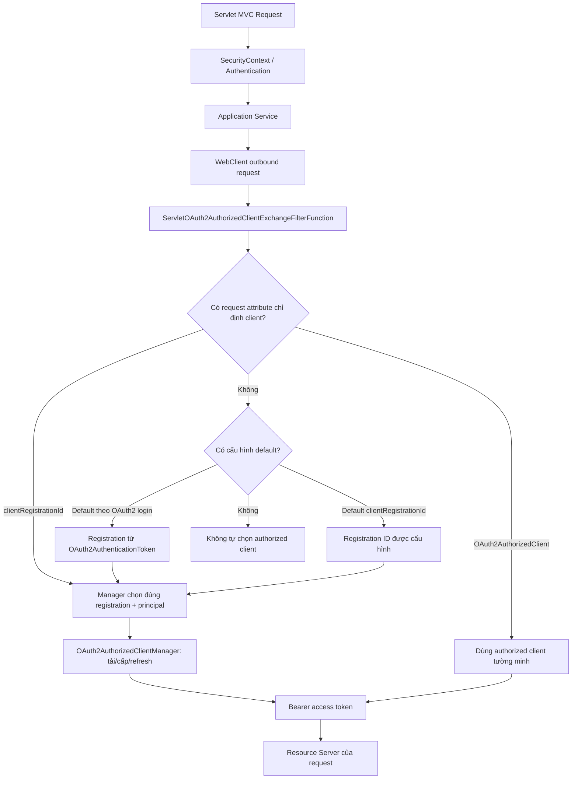

# 19.5. Default authorized client và phạm vi sử dụng theo request

Trong **Spring Security OAuth 2.0 / OIDC Client**, sau khi người dùng đăng nhập hoặc cấp quyền truy cập một dịch vụ bên ngoài, ứng dụng có thể dùng **`OAuth2AuthorizedClient`** để gọi các API bằng access token. Trên **Servlet stack**, `WebClient` được tích hợp qua **`ServletOAuth2AuthorizedClientExchangeFilterFunction`**.

Khi cấu hình tích hợp này, một câu hỏi rất quan trọng xuất hiện: **nếu một lời gọi `WebClient` không chỉ định authorized client thì Spring Security sẽ dùng token nào?**

Có ba tình huống cần phân biệt:

1. **Không có default:** mỗi outbound request tự chỉ định `OAuth2AuthorizedClient` hoặc `clientRegistrationId`; nếu không chỉ định, OAuth2 filter không tự ý chọn một token tùy ý.
2. **Default theo người đang đăng nhập:** `setDefaultOAuth2AuthorizedClient(true)` cho phép suy ra authorized client từ `OAuth2AuthenticationToken` hiện tại, khi có thể.
3. **Default theo registration:** `setDefaultClientRegistrationId("...")` dùng một `ClientRegistration` được định trước cho các lời gọi không chỉ định client tường minh.

Hai cơ chế default rất tiện, nhưng cũng dễ khiến **Bearer access token được gửi tới mọi HTTP request đi qua một `WebClient`**. Nếu cùng WebClient được dùng để truy cập API khác, host bên ngoài hoặc URL do user nhập, đây có thể là lỗi **token leakage** nghiêm trọng.

Bài học này giải thích cách default authorized client hoạt động, **phạm vi của nó theo từng outbound request**, cách override tường minh bằng request attributes và cách thiết kế an toàn khi có nhiều API, nhiều registration hoặc nhiều người dùng.

> Phạm vi: **Spring Boot 3.x / Spring Security 6.x, ứng dụng Spring MVC Servlet dùng WebClient**. Trong tên package có đoạn `reactive.function.client` vì WebClient dùng API reactive, nhưng `ServletOAuth2AuthorizedClientExchangeFilterFunction` được thiết kế riêng cho môi trường **Servlet**. Những ví dụ dùng `company-login`, `reports-api` và `calendar-api` là registration minh họa.

## 1. Nhắc lại bốn khái niệm cốt lõi

### 1.1. ClientRegistration

`ClientRegistration` là cấu hình của một OAuth2/OIDC client đã đăng ký với Authorization Server:

```text
registrationId       = company-login
clientId             = portal-web-prod
authorizationGrant   = authorization_code
scope                = openid, profile
issuer               = https://id.example.test/realms/company
redirectUri          = {baseUrl}/login/oauth2/code/{registrationId}
```

Một ứng dụng có thể khai báo nhiều registration, dù chúng cùng sử dụng một OP:

```text
company-login     -> đăng nhập portal
reports-api       -> đọc Reports API thay mặt user
calendar-api      -> truy cập Calendar API thay mặt user
billing-service   -> gọi API machine-to-machine
```

**`registrationId` không phải `client-id`**. Nó là key ứng dụng dùng để chọn cấu hình thích hợp.

### 1.2. OAuth2AuthorizedClient

Sau khi một registration được cấp quyền và có token, Spring Security biểu diễn trạng thái đó bằng **`OAuth2AuthorizedClient`**:

```text
OAuth2AuthorizedClient
  clientRegistration = reports-api
  principalName      = alice
  accessToken        = <redacted>
  refreshToken       = <optional>
```

Nó gắn token với **registration và principal**. Với cùng registration `reports-api`, token của Alice không được dùng thay Bob.

### 1.3. Authentication hiện tại

`Authentication` trong `SecurityContextHolder` mô tả người dùng hoặc service principal đang được xác thực. Sau `oauth2Login()`, Authentication thường là **`OAuth2AuthenticationToken`**, trong đó có `authorizedClientRegistrationId` đã dùng cho login.

Registration dùng để **đăng nhập** không nhất thiết là registration dùng để **gọi API**.

### 1.4. WebClient + ExchangeFilterFunction

`WebClient` là HTTP client của Spring Framework. Spring Security dùng **`ServletOAuth2AuthorizedClientExchangeFilterFunction`** để:

- Chọn authorized client cho outbound request;
- Yêu cầu hoặc tái sử dụng access token qua `OAuth2AuthorizedClientManager`;
- Refresh/renew token khi khả năng và điều kiện cho phép;
- Gắn header `Authorization: Bearer <token>`;
- Cho phép cấu hình xử lý authorization failure từ Resource Server.

**Tích hợp này không thay thế kiểm tra quyền ở downstream Resource Server.** Token vẫn phải hợp lệ về issuer, audience, scope và chính sách API.

## 2. Luồng tổng quát khi WebClient gọi API



Sơ đồ mô tả **quy tắc lựa chọn**, không phải hứa rằng token sẽ luôn có hoặc manager sẽ hoàn tất authorization ngay. Với `authorization_code`, client chưa được authorize có thể cần redirect browser và consent; với `client_credentials`, manager có thể gọi token endpoint trực tiếp.

Điều cần nhớ là **một WebClient instance có cấu hình filter chung**, nhưng **mỗi lời gọi outbound có request attributes riêng**.

## 3. Cấu hình cơ bản: không bật default authorized client

Đây là cấu hình khởi đầu an toàn và rõ ràng nhất cho ứng dụng phải gọi nhiều API:

```java
import org.springframework.context.annotation.Bean;
import org.springframework.context.annotation.Configuration;
import org.springframework.security.oauth2.client.OAuth2AuthorizedClientManager;
import org.springframework.security.oauth2.client.web.reactive.function.client
    .ServletOAuth2AuthorizedClientExchangeFilterFunction;
import org.springframework.web.reactive.function.client.WebClient;

@Configuration
class WebClientConfiguration {

    @Bean
    WebClient oauth2WebClient(OAuth2AuthorizedClientManager manager) {
        ServletOAuth2AuthorizedClientExchangeFilterFunction oauth2 =
            new ServletOAuth2AuthorizedClientExchangeFilterFunction(manager);

        // Không bật setDefaultOAuth2AuthorizedClient(true).
        // Không đặt setDefaultClientRegistrationId(...).
        return WebClient.builder()
            .apply(oauth2.oauth2Configuration())
            .build();
    }
}
```

Trong Java thật, **import class phải trên một dòng**:

```java
import org.springframework.security.oauth2.client.web.reactive.function.client.ServletOAuth2AuthorizedClientExchangeFilterFunction;
```

Cách `.apply(oauth2.oauth2Configuration())` quan trọng hơn việc chỉ gọi `.filter(oauth2)`: nó thêm exchange filter và cấu hình request defaults phục vụ lấy `HttpServletRequest`, `HttpServletResponse` từ `RequestContextHolder`, cũng như Authentication từ `SecurityContextHolder` khi cần.

**Với manager constructor, `setDefaultOAuth2AuthorizedClient` mặc định là `false`**. Không bật default giúp call site phải thể hiện rõ client nào được dùng.

### 3.1. Dependency cho WebClient trong ứng dụng Servlet

Một ứng dụng Maven có thể dùng:

```xml
<dependencies>
    <dependency>
        <groupId>org.springframework.boot</groupId>
        <artifactId>spring-boot-starter-web</artifactId>
    </dependency>

    <dependency>
        <groupId>org.springframework.boot</groupId>
        <artifactId>spring-boot-starter-security</artifactId>
    </dependency>

    <dependency>
        <groupId>org.springframework.boot</groupId>
        <artifactId>spring-boot-starter-oauth2-client</artifactId>
    </dependency>

    <!-- Cung cấp WebClient cùng reactive HTTP client. -->
    <dependency>
        <groupId>org.springframework.boot</groupId>
        <artifactId>spring-boot-starter-webflux</artifactId>
    </dependency>
</dependencies>
```

Dùng đồng thời `spring-boot-starter-web` và `spring-boot-starter-webflux` trong Spring Boot thông thường **không tự biến MVC app thành WebFlux server**: Spring MVC thường được ưu tiên cho loại ứng dụng web khi cả hai có mặt. Ở đây WebClient chỉ là **HTTP client**.

Nếu dự án tổ chức dependency khác, điều cốt lõi là có class `WebClient` và các module Spring Security OAuth2 Client tương thích phiên bản.

### 3.2. Client registration minh họa

```yaml
spring:
  security:
    oauth2:
      client:
        registration:
          company-login:
            provider: company
            client-id: ${LOGIN_CLIENT_ID}
            client-secret: ${LOGIN_CLIENT_SECRET}
            authorization-grant-type: authorization_code
            redirect-uri: "{baseUrl}/login/oauth2/code/{registrationId}"
            scope: [openid, profile, email]

          reports-api:
            provider: company
            client-id: ${REPORTS_CLIENT_ID}
            client-secret: ${REPORTS_CLIENT_SECRET}
            authorization-grant-type: authorization_code
            redirect-uri: "{baseUrl}/login/oauth2/code/{registrationId}"
            scope: [reports.read]

          calendar-api:
            provider: partner
            client-id: ${CALENDAR_CLIENT_ID}
            client-secret: ${CALENDAR_CLIENT_SECRET}
            authorization-grant-type: authorization_code
            redirect-uri: "{baseUrl}/login/oauth2/code/{registrationId}"
            scope: [calendar.read]

        provider:
          company:
            issuer-uri: https://id.example.test/realms/company
          partner:
            issuer-uri: https://login.partner.example.test/tenant
```

Scope `reports.read` và `calendar.read` là ví dụ về quyền API do provider tương ứng phải hỗ trợ. Scope được khai báo không bảo đảm quyền đã được cấp.

## 4. Cách thứ nhất: chỉ định clientRegistrationId theo outbound request

Đây là hướng phù hợp nếu business service biết chắc API cần client registration nào.

```java
import static org.springframework.security.oauth2.client.web.reactive.function.client.ServletOAuth2AuthorizedClientExchangeFilterFunction.clientRegistrationId;

import org.springframework.stereotype.Service;
import org.springframework.web.reactive.function.client.WebClient;

@Service
class ReportGateway {

    private final WebClient oauth2WebClient;

    ReportGateway(WebClient oauth2WebClient) {
        this.oauth2WebClient = oauth2WebClient;
    }

    String loadReports() {
        return oauth2WebClient.get()
            .uri("https://reports.example.test/v1/reports/mine")
            .attributes(clientRegistrationId("reports-api"))
            .retrieve()
            .bodyToMono(String.class)
            .block();
    }
}
```

Phương thức `clientRegistrationId(...)` là **static helper của `ServletOAuth2AuthorizedClientExchangeFilterFunction`**, không phải helper của `RestClient`.

### 4.1. Request attributes chỉ có hiệu lực cho lời gọi đang xây dựng

Hai lời gọi trên **cùng WebClient bean**:

```java
String reports = oauth2WebClient.get()
    .uri("https://reports.example.test/v1/reports")
    .attributes(clientRegistrationId("reports-api"))
    .retrieve()
    .bodyToMono(String.class)
    .block();

String calendar = oauth2WebClient.get()
    .uri("https://calendar.example.test/v1/events")
    .attributes(clientRegistrationId("calendar-api"))
    .retrieve()
    .bodyToMono(String.class)
    .block();
```

Lời gọi Reports không làm WebClient “chuyển vĩnh viễn sang `reports-api`”; lời gọi Calendar có attributes độc lập.

```text
WebClient instance
  |
  +-- Request 1
  |     URI: reports.example.test
  |     attribute: reports-api
  |     -> authorized client (reports-api, current principal)
  |
  +-- Request 2
        URI: calendar.example.test
        attribute: calendar-api
        -> authorized client (calendar-api, current principal)
```

Điểm cốt lõi là **per-outbound-request selection**, không phải per-thread global mutable state.

### 4.2. Phạm vi theo principal còn quan trọng hơn

Giả sử cả Alice và Bob cùng sử dụng `reports-api`:

```text
(reports-api, alice) -> Alice's access token
(reports-api, bob)   -> Bob's access token
```

Khi một Servlet request được xác thực là Bob, manager phải thao tác trong **ngữ cảnh principal của Bob**. Không lưu access token gần nhất vào biến `static` rồi dùng cho mọi request.

**`clientRegistrationId("reports-api")` chỉ chọn registration, không cố ý chọn user khác.**

## 5. Cách thứ hai: đưa OAuth2AuthorizedClient tường minh vào WebClient

Nếu MVC controller đã được Spring Security giải quyết một authorized client, bạn có thể truyền chính đối tượng đó cho WebClient.

```java
import static org.springframework.security.oauth2.client.web.reactive.function.client.ServletOAuth2AuthorizedClientExchangeFilterFunction.oauth2AuthorizedClient;

import org.springframework.security.oauth2.client.OAuth2AuthorizedClient;
import org.springframework.security.oauth2.client.annotation.RegisteredOAuth2AuthorizedClient;
import org.springframework.web.bind.annotation.GetMapping;
import org.springframework.web.bind.annotation.RestController;
import org.springframework.web.reactive.function.client.WebClient;

@RestController
class ReportController {

    private final WebClient webClient;

    ReportController(WebClient webClient) {
        this.webClient = webClient;
    }

    @GetMapping("/my-reports")
    String reports(
            @RegisteredOAuth2AuthorizedClient("reports-api")
            OAuth2AuthorizedClient authorizedClient) {

        return webClient.get()
            .uri("https://reports.example.test/v1/reports/mine")
            .attributes(oauth2AuthorizedClient(authorizedClient))
            .retrieve()
            .bodyToMono(String.class)
            .block();
    }
}
```

Ở đây có **hai cơ chế Spring Security khác nhau**:

1. **`@RegisteredOAuth2AuthorizedClient("reports-api")`**: giải quyết parameter của Spring MVC controller thành authorized client.
2. **`.attributes(oauth2AuthorizedClient(authorizedClient))`**: gắn authorized client đó cho **một outbound WebClient request**.

Hai cơ chế đều có vai trò trong cùng một flow nhưng không phải là một.

### 5.1. Khi nào nên truyền object thay vì registration ID?

Truyền `OAuth2AuthorizedClient` tường minh hữu ích khi:

- Controller đã nhận authorized client qua annotation.
- Service đã được truyền authorized client hợp lệ bởi một lớp caller có ngữ cảnh xác thực rõ ràng.
- Bạn cần khẳng định request đang dùng **đúng authorized client cụ thể**.
- Ứng dụng muốn tránh suy luận từ default hoặc trạng thái global.

**Không lấy object từ một kho token bằng raw username do user nhập** rồi truyền cho WebClient. Một authorized client phải thuộc đúng principal/registration được phép.

### 5.2. Đối tượng tường minh khác “dùng login client mặc định”

Nếu request đang đăng nhập qua `company-login`, nhưng controller có:

```java
@RegisteredOAuth2AuthorizedClient("reports-api")
OAuth2AuthorizedClient reportsClient
```

thì request outbound đã có thể chỉ định **reportsClient**, không cần fallback đến token đăng nhập `company-login`.

Khi user chưa authorize `reports-api`, việc giải quyết annotation hoặc manager có thể phải bắt đầu authorization tương ứng hoặc thất bại theo cấu hình; không được tự thay bằng login token.

## 6. Khi không có request attributes: default có tự hoạt động không?

**Không nhất thiết.** Theo API của `ServletOAuth2AuthorizedClientExchangeFilterFunction`, `setDefaultOAuth2AuthorizedClient` có default **`false`**.

Nếu WebClient không được cấu hình default và lời gọi không cung cấp:

```java
.attributes(clientRegistrationId("..."))
```

hoặc:

```java
.attributes(oauth2AuthorizedClient(...))
```

thì OAuth2 filter **không có một client tường minh để chọn theo những cơ chế này**. Nó không được hiểu là “cứ lấy token đầu tiên trong kho”, cũng không mặc định “API nào gọi cũng dùng token login”.

### 6.1. Bảng hành vi khái niệm

| Request attribute | Cấu hình default | Client được lựa chọn |
| --- | --- | --- |
| `oauth2AuthorizedClient(A)` | Bất kỳ | Authorized client A được chỉ định |
| `clientRegistrationId("reports-api")` | Bất kỳ | Registration `reports-api` trong ngữ cảnh principal |
| Không có | Không bật default | Không tự chọn OAuth2 client từ hai cơ chế default này |
| Không có | `setDefaultOAuth2AuthorizedClient(true)` | Có thể suy ra registration từ OAuth2 login Authentication hiện tại |
| Không có | `setDefaultClientRegistrationId("reports-api")` | Dùng `reports-api` làm registration mặc định |

Bảng mô tả tình huống rõ ràng khi dùng **một default tại một thời điểm**. Nếu cấu hình đồng thời hai default, hãy xác định chính xác hành vi của phiên bản đang dùng; không nên dựa vào thứ tự ưu tiên ngầm khi kiến trúc có nhiều API. Cách tốt hơn là **chọn tường minh hoặc chỉ cấu hình một default phù hợp**.

### 6.2. Tại sao default phải được bật có chủ đích?

Vì “chọn token mặc định” là một quyết định bảo mật. Một WebClient bean có thể được gọi bởi nhiều service khác nhau và gửi HTTP request tới nhiều đích khác nhau. Bật default toàn bộ khi chưa giới hạn destination khiến access token dễ bị chuyển sai nơi.

## 7. setDefaultOAuth2AuthorizedClient(true): default theo OAuth2 login

Khi bạn bật:

```java
oauth2.setDefaultOAuth2AuthorizedClient(true);
```

và request hiện tại được xác thực bằng **`oauth2Login()`**, filter có thể lấy authorized client gắn với **`OAuth2AuthenticationToken`** hiện tại. Registration được suy ra từ login Authentication.

### 7.1. Cấu hình WebClient

```java
import org.springframework.context.annotation.Bean;
import org.springframework.context.annotation.Configuration;
import org.springframework.security.oauth2.client.OAuth2AuthorizedClientManager;
import org.springframework.security.oauth2.client.web.reactive.function.client.ServletOAuth2AuthorizedClientExchangeFilterFunction;
import org.springframework.web.reactive.function.client.WebClient;

@Configuration
class LoginDefaultWebClientConfig {

    @Bean
    WebClient loginDefaultWebClient(OAuth2AuthorizedClientManager manager) {
        ServletOAuth2AuthorizedClientExchangeFilterFunction oauth2 =
            new ServletOAuth2AuthorizedClientExchangeFilterFunction(manager);

        oauth2.setDefaultOAuth2AuthorizedClient(true);

        return WebClient.builder()
            .baseUrl("https://userinfo-gateway.example.test")
            .apply(oauth2.oauth2Configuration())
            .build();
    }
}
```

Trong một Servlet request sau khi user đăng nhập qua `company-login`, lời gọi sau **không chỉ định attributes**:

```java
String response = loginDefaultWebClient.get()
    .uri("/v1/profile")
    .retrieve()
    .bodyToMono(String.class)
    .block();
```

có thể dùng access token gắn với registration đăng nhập hiện tại.

### 7.2. Default này không có nghĩa token của “mọi user”

`setDefaultOAuth2AuthorizedClient(true)` hoạt động theo **Authentication đang được resolve**, không phải một token toàn ứng dụng. Với Alice và Bob:

```text
Servlet request của Alice
  Authentication: OAuth2AuthenticationToken(company-login, alice)
  Default client:  company-login + Alice

Servlet request của Bob
  Authentication: OAuth2AuthenticationToken(company-login, bob)
  Default client:  company-login + Bob
```

Điều này **không tự bảo vệ** nếu ứng dụng tự override Authentication bằng thông tin của người khác, dùng shared mutable state hoặc mất ngữ cảnh thread khi chuyển sang xử lý bất đồng bộ.

### 7.3. Những điều kiện để default này có tác dụng

- Authentication hiện tại phù hợp với OAuth2 Login, thường là `OAuth2AuthenticationToken`.
- Có authorized client tương ứng với registration của Authentication hoặc manager có thể authorize theo cấu hình.
- WebClient được cấu hình đúng filter và request context.
- Request không chỉ định một authorized client/registration khác cần được ưu tiên.
- Resource Server thực sự chấp nhận access token của registration đăng nhập.

Nếu user đăng nhập bằng form login hoặc một cơ chế khác không có `OAuth2AuthenticationToken`, **không được mặc định có OIDC login authorized client để suy ra**.

### 7.4. Rủi ro lớn: tất cả outbound calls dùng cùng WebClient có thể nhận token

Giả sử `loginDefaultWebClient` được tiêm vào một service vừa gọi API nội bộ, vừa gọi URL ảnh/avatar bên ngoài:

```java
String internal = loginDefaultWebClient.get()
    .uri("https://api.company.example.test/v1/profile")
    .retrieve()
    .bodyToMono(String.class)
    .block();

String external = loginDefaultWebClient.get()
    .uri("https://untrusted.example.test/collect")
    .retrieve()
    .bodyToMono(String.class)
    .block();
```

**Nếu default authorized client được resolve, cả hai HTTP requests có thể mang access token**. Câu lệnh thứ hai có nguy cơ gửi token đến nơi không được phép.

Spring Security cảnh báo rõ rằng bật `setDefaultOAuth2AuthorizedClient(true)` có thể khiến **mọi HTTP request đi qua WebClient đó** nhận access token. Vì vậy, chỉ sử dụng cấu hình này khi **mọi destination có thể truy cập qua instance đó đều được phép nhận token tương ứng**.

## 8. setDefaultClientRegistrationId(...): default theo registration cố định

Một lựa chọn khác:

```java
oauth2.setDefaultClientRegistrationId("reports-api");
```

Với cấu hình này, nếu request không chỉ định authorized client hoặc registration ID, filter có thể dùng registration **`reports-api`** để manager tìm/cấp token.

### 8.1. Ví dụ WebClient dành riêng cho Reports API

```java
import org.springframework.context.annotation.Bean;
import org.springframework.context.annotation.Configuration;
import org.springframework.security.oauth2.client.OAuth2AuthorizedClientManager;
import org.springframework.security.oauth2.client.web.reactive.function.client.ServletOAuth2AuthorizedClientExchangeFilterFunction;
import org.springframework.web.reactive.function.client.WebClient;

@Configuration
class ReportsDefaultWebClientConfig {

    @Bean
    WebClient reportsWebClient(OAuth2AuthorizedClientManager manager) {
        ServletOAuth2AuthorizedClientExchangeFilterFunction oauth2 =
            new ServletOAuth2AuthorizedClientExchangeFilterFunction(manager);

        oauth2.setDefaultClientRegistrationId("reports-api");

        return WebClient.builder()
            .baseUrl("https://reports.example.test")
            .apply(oauth2.oauth2Configuration())
            .build();
    }
}
```

Service sử dụng:

```java
String response = reportsWebClient.get()
    .uri("/v1/reports/mine")
    .retrieve()
    .bodyToMono(String.class)
    .block();
```

Cách này làm code gọn nếu **WebClient instance chỉ có trách nhiệm gọi Reports API**.

### 8.2. Default registration không đồng nghĩa default principal

`setDefaultClientRegistrationId("reports-api")` xác định **client registration**, không tự quyết định người dùng là ai.

Trong Servlet request, manager vẫn cần principal/Authentication phù hợp. Hai user có thể dùng cùng `reports-api` nhưng có authorized clients khác nhau.

```text
Default registrationId = reports-api

Request Alice -> (reports-api, alice)
Request Bob   -> (reports-api, bob)
```

Với `client_credentials`, principal thường nên là một **service identity** có chủ đích, thay vì vô tình lấy tên user từ SecurityContext khi token thật sự đại diện ứng dụng.

### 8.3. Base URL cố định vẫn chưa phải biện pháp chặn tuyệt đối

Dù `WebClient.builder().baseUrl("https://reports.example.test")`, API của WebClient vẫn có thể nhận absolute URI ở một call site khác. Nếu người lập trình hoặc dữ liệu đầu vào cho phép:

```java
reportsWebClient.get()
    .uri("https://other.example.test/path")
    .retrieve()
    .bodyToMono(String.class)
    .block();
```

thì cấu hình default có thể đưa token của `reports-api` tới host đó.

**Giới hạn destination cần được thực thi bằng thiết kế integration service, allowlist, kiểm tra redirect và egress policy**, không chỉ dựa vào `baseUrl`.

## 9. Phạm vi sử dụng: một WebClient instance, nhiều outbound requests

Điểm hay bị hiểu nhầm nhất của từ **default** là phạm vi của nó.

### 9.1. Default không phải biến toàn cục của mọi WebClient

Nếu ứng dụng tạo:

```java
WebClient reportsWebClient = /* default reports-api */;
WebClient publicWebClient  = /* không có OAuth2 filter */;
```

thì việc bật default trên `reportsWebClient` **không tự làm `publicWebClient` gửi token**. Cấu hình thuộc về filter trên **WebClient instance / builder configuration** mà bạn đã áp dụng.

### 9.2. Default áp dụng cho mọi lời gọi không override qua instance đó

```text
WebClient có defaultClientRegistrationId("reports-api")
    |
    +-- GET /v1/reports       không có attribute -> reports-api
    |
    +-- GET /v1/status        không có attribute -> reports-api
    |
    +-- GET /v1/calendar      có attribute calendar-api -> calendar-api
    |
    +-- GET external absolute URI không có attribute -> reports-api (nguy hiểm)
```

Đặc điểm đáng chú ý: **override bằng request attributes giúp chọn client khác cho một request**, nhưng nó không làm thay đổi default cho những request sau.

### 9.3. Default không có nghĩa dùng một access token chung cho toàn bộ ứng dụng

Dù registration mặc định cố định, token được manager quản lý theo **registration + principal**, và có thể có vòng đời refresh/re-authorization riêng.

Không được tự triển khai một biến static `DEFAULT_ACCESS_TOKEN` nhằm mô phỏng default; cách đó dễ làm token của user A bị dùng cho user B.

### 9.4. Default không phải hợp đồng authorization của API

Một API có thể từ chối token dù WebClient đã gắn header thành công. Điều này phụ thuộc quyền được cấp và Resource Server:

```text
WebClient chọn reports-api
    |
    v
Manager lấy access token reports-api + user
    |
    v
Resource Server kiểm tra issuer / audience / scope / policy
    |
    +-- Hợp lệ -> 200
    |
    +-- Thiếu scope -> 403 insufficient_scope
    |
    +-- Token sai/hết hạn/revoked -> 401 invalid_token
```

Default chỉ giải quyết **chọn OAuth2 client phù hợp với chính sách cấu hình**, không thay thế authorization business.

## 10. Request attributes có thể override default

Đây là quy tắc quan trọng nhất để sử dụng WebClient chung trong ứng dụng nhiều API.

### 10.1. Override bằng registrationId

Ví dụ WebClient mặc định dùng `reports-api` nhưng một request cần `calendar-api`:

```java
import static org.springframework.security.oauth2.client.web.reactive.function.client.ServletOAuth2AuthorizedClientExchangeFilterFunction.clientRegistrationId;

String calendar = reportsWebClient.get()
    .uri("https://calendar.example.test/v1/events")
    .attributes(clientRegistrationId("calendar-api"))
    .retrieve()
    .bodyToMono(String.class)
    .block();
```

Request chỉ định `calendar-api` thay vì dựa vào default. Dù vậy, cấu hình chung WebClient tên `reportsWebClient` cho nhiều host là dấu hiệu thiết kế cần xem lại; nên tách integrations nếu chúng có trust boundary khác nhau.

### 10.2. Override bằng authorized client object

```java
import static org.springframework.security.oauth2.client.web.reactive.function.client.ServletOAuth2AuthorizedClientExchangeFilterFunction.oauth2AuthorizedClient;

String data = webClient.get()
    .uri("https://reports.example.test/v1/reports")
    .attributes(oauth2AuthorizedClient(authorizedClient))
    .retrieve()
    .bodyToMono(String.class)
    .block();
```

`authorizedClient` phải là object đến từ một giao dịch cấp quyền hợp lệ của đúng người dùng/registration. Nếu được truyền tường minh, nó là ngữ cảnh được yêu cầu cho lời gọi này.

### 10.3. Không kết hợp các chỉ định mâu thuẫn rồi trông chờ fallback

Ví dụ không rõ chủ ý:

```java
webClient.get()
    .uri("https://reports.example.test/v1/reports")
    .attributes(clientRegistrationId("reports-api"))
    .attributes(oauth2AuthorizedClient(calendarAuthorizedClient))
    .retrieve()
    .bodyToMono(String.class)
    .block();
```

Request này chứa **hai mô tả khác nhau** về client. Dù phiên bản framework có thứ tự xử lý, code vẫn khó hiểu và có nguy cơ sử dụng token không đúng API.

**Chọn một cách rõ ràng cho từng request**: hoặc registration ID, hoặc authorized client object. Không dựa vào precedence mơ hồ khi hai giá trị xung đột.

## 11. Tại sao mặc định tắt là khuyến nghị cho WebClient dùng chung?

Giả sử một application service có:

```text
WebClient commonWebClient
    |
    +-- Reports API
    +-- Calendar API
    +-- Public image service
    +-- Webhook endpoint nhận URL từ user
    +-- Internal config API
```

Nếu bật default token cho `commonWebClient`, mọi outbound request không override có nguy cơ gắn access token, kể cả request đến Public image service hay webhook.

Một cấu hình an toàn hơn:

```text
publicWebClient      -> không có OAuth2 filter
reportsWebClient     -> OAuth2 filter, registration reports-api tường minh
calendarWebClient    -> OAuth2 filter, registration calendar-api tường minh
serviceWebClient     -> OAuth2 filter, service registration + principal riêng
```

Không nhất thiết phải tạo WebClient bean cho mọi endpoint, nhưng nên **tách theo trust boundary** và giới hạn dải đích mà mỗi client có thể gọi.

### 11.1. Với HTTP client gọi URL do user nhập

Một anti-pattern đặc biệt nguy hiểm:

```java
@GetMapping("/preview")
String preview(@RequestParam String url) {
    return loginDefaultWebClient.get()
        .uri(url)
        .retrieve()
        .bodyToMono(String.class)
        .block();
}
```

Nếu token được gắn mặc định, người dùng có thể điều khiển `url` tới host mà họ kiểm soát và nhận Bearer token. Đây vừa là **SSRF** vừa có thể là **credential exfiltration**.

Không giải quyết bằng cách “chỉ kiểm tra `url.startsWith("https")`”: HTTPS không chứng minh origin được phép. Cần endpoint allowlist, kiểm tra scheme/host/port, xử lý DNS/rebinding và redirect, cùng outbound network policy khi thích hợp.

### 11.2. Nếu cần gọi API công khai trong cùng service

Dùng một **WebClient không có OAuth2 filter** cho request công khai:

```java
@Bean
WebClient publicWebClient() {
    return WebClient.builder()
        .baseUrl("https://public-api.example.test")
        .build();
}
```

Không dùng thủ thuật “truyền clientRegistrationId null” để hy vọng tắt default nếu không có hợp đồng API hỗ trợ cụ thể. **Tách HTTP client có token và client không token** là cách biểu đạt ý định bảo mật rõ ràng hơn.

## 12. Ví dụ tương đối đầy đủ: đăng nhập bằng OP A, gọi API B

Giả sử người dùng đăng nhập qua `company-login`:

```text
/oauth2/authorization/company-login
```

Sau OIDC login, `OAuth2AuthenticationToken` của user gắn với `company-login`. Nhưng ứng dụng cần gọi `calendar-api` của một provider khác.

### 12.1. Sai: mặc định suy ra login client cho Calendar API

```java
ServletOAuth2AuthorizedClientExchangeFilterFunction oauth2 =
    new ServletOAuth2AuthorizedClientExchangeFilterFunction(manager);

oauth2.setDefaultOAuth2AuthorizedClient(true);
```

Nếu Calendar call không có attributes:

```java
webClient.get()
    .uri("https://calendar.example.test/v1/events")
    .retrieve()
    .bodyToMono(String.class)
    .block();
```

filter có thể chọn **`company-login`**, không phải `calendar-api`. Token login có thể bị API từ chối do issuer/audience/scope, hoặc tệ hơn bị gửi tới endpoint không được phép nhận token đó.

### 12.2. Đúng: chỉ định Calendar registration

```java
String events = webClient.get()
    .uri("https://calendar.example.test/v1/events")
    .attributes(clientRegistrationId("calendar-api"))
    .retrieve()
    .bodyToMono(String.class)
    .block();
```

Nếu chưa có authorized client cho `calendar-api`, manager có thể cần người dùng authorize registration này riêng. Trong UX, nên hiển thị hành động **“Kết nối Calendar”** phù hợp, không tự replay login token của Company.

### 12.3. Cùng browser session không có nghĩa cùng token

```text
Authentication:
  User Alice đã login qua company-login

Authorized clients:
  (company-login, Alice) -> Token A (OIDC login)
  (calendar-api, Alice)  -> Token B (Calendar API)
  (reports-api, Alice)   -> Token C (Reports API)
```

Hai token B/C không tự xuất hiện vì user có token A. Mỗi registration có grant, scope, consent và vòng đời riêng.

## 13. Request-scoped principal và authentication attributes

Bên cạnh lựa chọn authorized client, Spring Security còn cho phép cung cấp **Authentication** cho một outbound request:

```java
import static org.springframework.security.oauth2.client.web.reactive.function.client.ServletOAuth2AuthorizedClientExchangeFilterFunction.authentication;
```

Ví dụ kỹ thuật:

```java
String response = webClient.get()
    .uri("https://reports.example.test/v1/reports")
    .attributes(clientRegistrationId("reports-api"))
    .attributes(authentication(trustedAuthentication))
    .retrieve()
    .bodyToMono(String.class)
    .block();
```

`trustedAuthentication` trong ví dụ phải đến từ **ngữ cảnh xác thực được ứng dụng tin cậy**. Không lấy `Authentication` từ tên user do HTTP caller nhập.

### 13.1. Tại sao cần Authentication đúng?

Manager thường cần tìm authorized client theo:

```text
registrationId + principalName
```

Với `reports-api`, nếu ngữ cảnh principal bị thay:

```text
(reports-api, Alice) -> access token Alice
(reports-api, Bob)   -> access token Bob
```

Gắn Authentication của Bob vào request do Alice khởi tạo có thể khiến API call dùng token của Bob. Đó là lỗi kiểm soát truy cập rất nghiêm trọng.

### 13.2. Không dùng principal kỹ thuật thay user một cách mơ hồ

Với `client_credentials`, một service identity như `billing-worker` là hợp lý, nhưng nó **không phải delegated user**.

Nếu API yêu cầu quyền thay người dùng, token client_credentials của backend không được dùng để giả làm consent của Alice. Cần chọn grant và scope đúng nghiệp vụ.

### 13.3. Không dùng Authentication giả để “vượt thiếu token”

Nếu user chưa authorize `calendar-api`, đừng chế ra `Authentication` với tên người dùng khác để tìm token có sẵn. Luồng đúng là yêu cầu authorization riêng hoặc báo trạng thái chưa kết nối.

## 14. Servlet request context và WebClient reactive execution

Tên `WebClient` dễ khiến người học nhầm rằng ứng dụng đã chuyển hẳn sang Spring WebFlux. Nhưng trong bài này:

```text
Incoming HTTP:
  DispatcherServlet
    -> SecurityFilterChain (Servlet)
    -> Spring MVC Controller
    -> Service
    -> WebClient
    -> ServletOAuth2AuthorizedClientExchangeFilterFunction
    -> Outbound HTTP API
```

`ServletOAuth2AuthorizedClientExchangeFilterFunction` được thiết kế cho Servlet environment và có khả năng lấy:

- `HttpServletRequest` và `HttpServletResponse` từ `RequestContextHolder`;
- `Authentication` từ `SecurityContextHolder`.

Cách `.apply(oauth2.oauth2Configuration())` thiết lập filter và default request logic cần thiết.

### 14.1. Ví dụ controller MVC đồng bộ

```java
@GetMapping("/reports")
String reports() {
    return webClient.get()
        .uri("https://reports.example.test/v1/reports")
        .attributes(clientRegistrationId("reports-api"))
        .retrieve()
        .bodyToMono(String.class)
        .block();
}
```

Trong Spring MVC Servlet, `.block()` có thể được dùng khi controller được thiết kế đồng bộ và chạy trên thread Servlet, nhưng nó **chặn thread** trong lúc chờ I/O. Cần đánh giá timeout, thread pool và khả năng chịu tải; không sao chép cách dùng `.block()` vào reactive event loop của WebFlux.

### 14.2. Deferred subscription có thể làm mất ngữ cảnh

`WebClient` trả `Mono`; hoạt động I/O thường xảy ra khi subscription thực sự được kích hoạt. Nếu bạn tạo một publisher trong Servlet request nhưng thực thi muộn ở thread khác hoặc sau khi request đã kết thúc, **thread-local RequestContextHolder/SecurityContextHolder có thể không còn ngữ cảnh phù hợp**.

Ví dụ rủi ro:

```java
Mono<String> pending = webClient.get()
    .uri("https://reports.example.test/v1/reports")
    .retrieve()
    .bodyToMono(String.class);

// Không giả định subscribe ở background thread sau này
// vẫn còn đúng Servlet Request/Authentication ban đầu.
```

Nếu workflow thực sự bất đồng bộ:

- Không trông chờ `SecurityContextHolder` tự động truyền qua mọi scheduler.
- Dùng manager phù hợp cho background/service-level work.
- Mang theo một **ngữ cảnh định danh đáng tin** qua cơ chế context propagation được kiểm soát nếu thật sự cần delegated authorization.
- Không truyền `HttpServletRequest` hoặc access token raw vào job queue một cách thiếu bảo vệ.
- Phân biệt tác vụ chạy *trong* Servlet request với tác vụ chạy sau request.

**Default authorized client trong Servlet không phải hệ thống tự động cấp quyền cho mọi asynchronous execution.**

## 15. DefaultClientRegistrationId và client_credentials

Một lựa chọn kỹ thuật phổ biến cho machine-to-machine:

```text
billing-service:
  authorization-grant-type: client_credentials
  scope: billing.read
```

Nếu WebClient chỉ dành để gọi Billing API, bạn có thể cân nhắc:

```java
ServletOAuth2AuthorizedClientExchangeFilterFunction oauth2 =
    new ServletOAuth2AuthorizedClientExchangeFilterFunction(serviceManager);

oauth2.setDefaultClientRegistrationId("billing-service");

WebClient billingWebClient = WebClient.builder()
    .baseUrl("https://billing.example.test")
    .apply(oauth2.oauth2Configuration())
    .build();
```

Nhưng `serviceManager` phải được cấu hình hỗ trợ client_credentials và persistence thích hợp. Với background job không có HTTP request, hướng phù hợp là **`AuthorizedClientServiceOAuth2AuthorizedClientManager`**, không phải manager mặc định phụ thuộc Servlet request.

### 15.1. Vì sao cần principal kỹ thuật ổn định?

Trong OAuth2AuthorizedClient storage, token thường được gắn với registration và principal name. Với machine-to-machine, tên `billing-worker` hoặc service identity cố định giúp phân biệt với token được cấp theo user.

Tuy nhiên, việc đặt `defaultClientRegistrationId` **không tự thiết lập service principal**. Cần cấu hình request authentication/context hoặc sử dụng manager/service API cho app-only token theo thiết kế cụ thể.

### 15.2. Không dùng default user token để gọi tác vụ của hệ thống

Nếu WebClient bật `setDefaultOAuth2AuthorizedClient(true)` trong một request của Alice, token sẽ dựa theo login Authentication. Đừng để một thao tác billing machine-to-machine vô tình dùng login token của Alice.

## 16. Bảo mật: mặc định nào nên chọn?

Một hướng thực tế:

| Tình huống | Cấu hình nên ưu tiên | Lý do |
| --- | --- | --- |
| Một WebClient dùng chung cho nhiều OAuth2 APIs | **Không bật default**; chỉ định `clientRegistrationId` theo request | Tránh gửi token nhầm API |
| Controller đã nhận đúng authorized client | `.attributes(oauth2AuthorizedClient(client))` | Tường minh token/ngữ cảnh sử dụng |
| Một WebClient dành riêng cho một API tin cậy | Có thể cân nhắc `setDefaultClientRegistrationId` | Giảm boilerplate, nhưng phải kiểm soát destination |
| WebClient chỉ phục vụ API của provider đã đăng nhập | Có thể cân nhắc `setDefaultOAuth2AuthorizedClient(true)` | Token theo Authentication hiện tại, vẫn phải kiểm soát host |
| API công khai không cần OAuth2 | WebClient **không có OAuth2 filter** | Tránh credential leakage |
| Job client_credentials | Service-level manager + service principal | Không phụ thuộc user session |
| Ứng dụng đa tenant / đa provider | Mapping tường minh từ tenant/resource sang registration đã allowlist | Giữ ranh giới quyền và issuer |

**Default không phải lúc nào cũng sai**, nhưng nếu có nhiều destination hoặc nhiều registration, **chọn tường minh theo request** dễ kiểm toán và an toàn hơn.

### 16.1. Least privilege

Một login token có thể có `openid profile` trong khi Reports API cần `reports.read`. Gửi login token tới Reports không tự tạo scope còn thiếu.

Nếu API bị 403 `insufficient_scope`, cần xem cách cấp quyền và registration đúng, không tự chọn client có nhiều quyền hơn để “thử cho chạy”.

### 16.2. Không tin URL hoặc registration ID do caller cung cấp

Sai:

```java
@GetMapping("/fetch")
String fetch(@RequestParam String url,
             @RequestParam String registrationId) {
    return webClient.get()
        .uri(url)
        .attributes(clientRegistrationId(registrationId))
        .retrieve()
        .bodyToMono(String.class)
        .block();
}
```

Kẻ tấn công có thể chọn token thuộc registration nội bộ và gửi nó tới một host do họ kiểm soát. Backend cần ánh xạ từ chức năng nghiệp vụ và quyền đã kiểm tra sang **destination + registration** thuộc allowlist.

### 16.3. Không ghi token vào logs

Tránh ghi:

```java
logger.info("Authorized client: {}", authorizedClient);
logger.info("Access token: {}",
    authorizedClient.getAccessToken().getTokenValue());
```

Chỉ nên quan sát tên API logic, registration ID cấu hình, nhóm lỗi và trace ID nội bộ. Không log authorization code, refresh token, ID Token, Authorization header, cookie hoặc nguyên UserInfo chứa PII.

## 17. Thiết kế WebClient theo trust boundary

Để tránh lỗi default, một kiến trúc tốt thường có các adapter cụ thể:

```text
Spring MVC Controllers
        |
        v
Business Services
        |
        +-- ReportsGateway
        |     WebClient baseUrl Reports API
        |     registration reports-api (per request)
        |
        +-- CalendarGateway
        |     WebClient baseUrl Calendar API
        |     registration calendar-api (per request)
        |
        +-- PublicMetadataGateway
        |     WebClient không OAuth2 filter
        |
        +-- BillingGateway
              WebClient Billing API
              client_credentials + service principal
```

Những gateway đó có thể dùng một OAuth2AuthorizedClientManager chung khi security policy phù hợp, hoặc các manager khác nhau theo grant/storage.

### 17.1. Không cần clone WebClient mỗi request

`WebClient` được thiết kế để có thể tái sử dụng. Thay đổi request attributes qua:

```java
webClient.get()
    .uri("/v1/reports")
    .attributes(clientRegistrationId("reports-api"))
```

không biến bean thành stateful theo user. Tránh làm một global mutable field như:

```java
// KHÔNG NÊN:
static String currentRegistrationId;
```

để thread A đổi sang `reports-api` trong khi thread B cần `calendar-api`.

### 17.2. Hai layers của bảo mật

- **Client selection:** chọn đúng `ClientRegistration`, principal và authorized client.
- **Destination control:** giới hạn host/path/redirect mà Bearer token được phép tới.

Một hệ thống an toàn cần **cả hai**; chọn registration đúng mà URI không tin cậy vẫn có thể làm lộ token.

## 18. Failure handling không thuộc cơ chế default selection

Bật default chỉ giúp WebClient lựa chọn client khi request không chỉ định tường minh. Nó **không thay thế xử lý lỗi Authorization Server hoặc Resource Server**.

Những lỗi có thể gặp:

| Nguồn | Dấu hiệu | Hướng xử lý |
| --- | --- | --- |
| Authorization/refresh | `invalid_grant` | Refresh token hỏng/expired/revoked; dừng dùng record cũ và reauthorize khi phù hợp |
| Resource Server | 401 + Bearer `invalid_token` | Token không được chấp nhận; xem audience, expiry, revoke |
| Resource Server | 403 + Bearer `insufficient_scope` | Token thiếu quyền/scope; không xóa token rồi retry vô hạn |
| Resource Server | 503 / timeout | Sự cố API/network; không tự coi token bị revoke |
| Chưa được authorize | Cần consent/Authorization Code Flow | Hướng người dùng kết nối API tương ứng |
| Không có login Authentication | Default theo login không có ngữ cảnh | Chỉ định client/principal đúng hoặc dùng manager service-level |

### 18.1. Authorization failure handler trong WebClient

`ServletOAuth2AuthorizedClientExchangeFilterFunction` hỗ trợ:

```java
oauth2.setAuthorizationFailureHandler(failureHandler);
```

Một `OAuth2AuthorizationFailureHandler` có thể xử lý các lỗi Bearer token từ Resource Server và loại bỏ `OAuth2AuthorizedClient` lỗi theo chính sách.

Khi dùng constructor nhận `OAuth2AuthorizedClientManager`, bạn nên **xem cấu hình failure handler của chính filter** thay vì giả định mọi lỗi HTTP 401/403 tự động xóa token; cách tạo filter và phiên bản Spring Security có thể ảnh hưởng đến handler được cấu hình mặc định.

Quan trọng: **xóa một authorized client nội bộ không đồng nghĩa revoke token tại OP**, cũng không tự logout session SSO.

### 18.2. Không retry mọi request sau 401

Nếu API trả 401 do audience sai, xin token mới bằng **cùng registration sai** có thể không giải quyết được. Nếu call là POST thanh toán, retry không kiểm soát còn có nguy cơ gửi thao tác trùng.

Cần phân loại lỗi, giới hạn retry, sử dụng idempotency key khi phù hợp, và không tự động đổi registration sang client quyền cao hơn.

## 19. So sánh với RestClient trên Servlet

Cả `WebClient` và `RestClient` đều có thể được Spring Security tích hợp OAuth2 Client trong Servlet app, nhưng **API chọn registration khác nhau**:

| Nội dung | WebClient trên Servlet | RestClient trên Servlet |
| --- | --- | --- |
| Tích hợp | `ServletOAuth2AuthorizedClientExchangeFilterFunction` | `OAuth2ClientHttpRequestInterceptor` |
| Chọn registration theo request | `ServletOAuth2AuthorizedClientExchangeFilterFunction.clientRegistrationId(...)` | `RequestAttributeClientRegistrationIdResolver.clientRegistrationId(...)` |
| Gắn authorized client cụ thể | `oauth2AuthorizedClient(...)` | Thường chọn registration/principal qua interceptor/manager |
| Bật default login client | `setDefaultOAuth2AuthorizedClient(true)` | Có thể tùy chỉnh registration resolver, không dùng API này |
| Default registration | `setDefaultClientRegistrationId(...)` | Resolver policy phù hợp, không dùng API này |
| HTTP programming model | Reactive-style `Mono`/`Flux`, có thể `block()` trong MVC đồng bộ | Synchronous imperative API |

**Đừng dùng nhầm static import**:

```java
// ĐÚNG: WebClient trong Servlet
import static org.springframework.security.oauth2.client.web.reactive.function.client.ServletOAuth2AuthorizedClientExchangeFilterFunction.clientRegistrationId;

// KHÁC: RestClient trong Servlet
import static org.springframework.security.oauth2.client.web.client.RequestAttributeClientRegistrationIdResolver.clientRegistrationId;
```

Hai method cùng tên nhưng thuộc **hai đường tích hợp khác nhau**.

## 20. Multi-tenant: không dùng default để vượt ranh giới tenant

Một hệ thống SaaS có thể có nhiều client registrations:

```text
tenant-a -> reports-tenant-a
tenant-b -> reports-tenant-b
```

Dùng `setDefaultClientRegistrationId("reports-tenant-a")` trên WebClient chung cho cả hai tenant có thể gây gửi token tenant A khi xử lý request của tenant B.

Giải pháp:

1. Xác thực user và xác định tenant membership từ nguồn đáng tin.
2. Ánh xạ tenant đã được kiểm tra quyền sang registration tương ứng.
3. Gắn `clientRegistrationId(...)` theo **từng outbound request**.
4. Chọn API destination tương ứng tenant đã xác minh.
5. Manager/repository phân tách authorized client theo registration và principal; nếu cần thêm tenant context, thiết kế storage key và quy tắc liên kết phù hợp.

### 20.1. Không nối registration từ input thô

Sai:

```java
String registrationId = "reports-" + request.getParameter("tenant");
```

Caller có thể thử tenant khác. Nên map từ tenant ID **đã được authorization service chấp nhận** sang một allowlist registration.

### 20.2. Default theo login không phải default theo tenant

Một `OAuth2AuthenticationToken` có login registration cụ thể, nhưng không đồng nghĩa token đăng nhập đã được cấp quyền vào mọi tenant/app API. Cần tách xác thực danh tính khỏi phân quyền tài nguyên theo tenant.

## 21. Quan sát cơ chế selection mà không làm lộ credentials

Một log sự kiện nên có schema giới hạn:

```json
{
  "event": "webclient_oauth2_selection",
  "source": "request_attribute",
  "registration_id": "reports-api",
  "api": "reports",
  "result": "resolved",
  "environment": "staging",
  "trace_id": "internal-trace"
}
```

Đây là schema do ứng dụng định nghĩa, **không phải JSON Spring Security tự sinh**.

Có thể ghi:
- Nguồn selection (explicit authorized client, explicit registration, default login, default registration).
- Registration ID từ cấu hình tin cậy.
- Tên API logic.
- Outcome success/failure và nhóm lỗi.
- Trace ID nội bộ.

Không ghi:
- Access token, refresh token, ID Token hoặc authorization code.
- Raw Authorization/Cookie headers.
- Client secret hoặc PKCE verifier.
- Toàn bộ OAuth2AuthorizedClient.
- URL do user cung cấp nếu chứa tham số nhạy cảm.
- Email, subject, UserInfo hoặc JWT claims không cần cho chẩn đoán.

**Không suy ra source “default” bằng cách xem token payload trong log**. Nên ghi source ngay tại adapter/service nơi quyết định registration, không cần tiết lộ token.

## 22. Troubleshooting phổ biến

| Hiện tượng | Nguyên nhân có thể | Hướng chẩn đoán |
| --- | --- | --- |
| WebClient không gửi Bearer token | Chưa thêm OAuth2 filter hoặc không có explicit/default client | Xem `oauth2Configuration()` và request attributes |
| Bật `setDefaultOAuth2AuthorizedClient(true)` nhưng không có token | Authentication không phải OAuth2 login, hoặc không có authorized client phù hợp | Kiểm tra SecurityContext và login registration |
| Token login được gửi sang Calendar API | Dùng default login client thay vì `calendar-api` | Gắn `clientRegistrationId("calendar-api")` |
| Default registration không hoạt động | Registration ID sai, manager/provider thiếu hoặc client chưa authorize | Kiểm tra key `registration.<id>`, grant và principal |
| WebClient chung làm rò token sang host ngoài | Bật default rộng, destination do user kiểm soát | Tách WebClient, hạn chế URI và bỏ default không cần thiết |
| Alice dùng token Bob | Authentication/authorized client được truyền sai, token cache dùng global key | Kiểm tra registration + principal và storage |
| `clientRegistrationId(...)` bị import từ RestClient | Sai static import | Import helper của `ServletOAuth2AuthorizedClientExchangeFilterFunction` |
| Request dùng `.attributes(oauth2AuthorizedClient(...))` nhưng API 403 | Token thiếu scope/policy, không phải selection thiếu | Kiểm tra downstream Resource Server |
| Token hết hạn nhưng refresh không chạy | Không có refresh token hoặc manager provider chưa hỗ trợ | Kiểm tra manager và grant |
| Có WebClient bean nhưng không lấy được Servlet request | Cấu hình filter/request defaults thiếu hoặc reactive execution xảy ra ngoài request | Dùng `oauth2Configuration()`, xem request context |
| Background worker nhận sai principal | Dựa vào SecurityContextHolder của thread khác | Dùng service-level manager và principal tin cậy |
| Bật hai default rồi chọn nhầm token | Phụ thuộc precedence không rõ ràng | Chỉ dùng một default hoặc explicit attributes |
| API trả 401 dù có token | Token sai audience, issuer, expired hoặc bị revoke | Xem Bearer challenge, policy và registration |
| API trả 403 insufficient_scope | Scope API chưa được cấp | Authorization/consent phù hợp, không retry với client tùy ý |
| Gọi API công khai nhưng có Authorization header | Dùng WebClient có default OAuth2 | Chuyển sang WebClient không OAuth2 filter |
| Ứng dụng có nhiều bean OAuth2AuthorizedClientManager | Inject nhầm manager Servlet/service-level | Dùng qualifier, xem provider/storage |
| Login tốt nhưng gọi thêm API yêu cầu consent | API registration chưa được authorize | Thiết kế bước “Kết nối API” riêng |
| Một request dùng authorizedClient khác user | Caller truyền object không thuộc principal hiện tại | Chỉ nhận client từ context tin cậy/authorization service |

### 22.1. Bật default rồi tưởng tất cả API dùng được token

```java
oauth2.setDefaultOAuth2AuthorizedClient(true);
```

không làm token `company-login` có scope `calendar.read`. Nếu cần Calendar API, phải dùng registration/consent tương ứng.

### 22.2. Tạo WebClient chỉ với filter()

```java
WebClient webClient = WebClient.builder()
    .filter(oauth2)
    .build();
```

Cách này có thể thiếu phần default request configuration để bắt Servlet request/response context theo tích hợp được Spring Security khuyến nghị. Dùng:

```java
WebClient webClient = WebClient.builder()
    .apply(oauth2.oauth2Configuration())
    .build();
```

trong Servlet integration thông thường.

### 22.3. Trả nguyên authorized client cho frontend

```java
// Không nên return object có bearer credentials.
@GetMapping("/debug")
OAuth2AuthorizedClient debug(
        @RegisteredOAuth2AuthorizedClient("reports-api")
        OAuth2AuthorizedClient client) {
    return client;
}
```

Chỉ trả metadata thực sự cần thiết sau khi lọc và bảo vệ endpoint; không serialize access token, refresh token hoặc full object.

## 23. Bài thực hành

### Bài A — WebClient chưa bật default

Cấu hình:

```java
ServletOAuth2AuthorizedClientExchangeFilterFunction oauth2 =
    new ServletOAuth2AuthorizedClientExchangeFilterFunction(manager);

WebClient webClient = WebClient.builder()
    .apply(oauth2.oauth2Configuration())
    .build();
```

Request:

```java
webClient.get()
    .uri("https://reports.example.test/v1/reports")
    .retrieve()
    .bodyToMono(String.class)
    .block();
```

**Hỏi:** có chắc Spring Security gắn access token không?

> Không. Không có explicit request attribute và chưa bật default selection. Không được giả định filter sẽ tự lấy authorized client bất kỳ trong kho.

### Bài B — Default theo login

Người dùng đăng nhập bằng `company-login`, WebClient bật `setDefaultOAuth2AuthorizedClient(true)`.

**Hỏi:** lời gọi Calendar API không có attributes sẽ chọn registration nào?

> Nó có thể chọn authorized client gắn với `OAuth2AuthenticationToken` của login, tức `company-login`, không phải Calendar. Điều này có thể làm gửi token sai Resource Server. Cần chỉ định `calendar-api`.

### Bài C — Default theo registration

WebClient cấu hình:

```java
oauth2.setDefaultClientRegistrationId("reports-api");
```

**Hỏi:** khi user Bob gọi service bằng cùng bean thì token của Alice có được dùng không?

> Không được phép. Default xác định client registration; manager vẫn phải gắn authorized client đúng principal. Nếu token Alice bị dùng cho Bob, đó là lỗi cấu hình principal/storage hoặc caching nghiêm trọng.

### Bài D — Override request

```java
webClient.get()
    .uri("https://calendar.example.test/v1/events")
    .attributes(clientRegistrationId("calendar-api"))
    .retrieve()
    .bodyToMono(String.class)
    .block();
```

**Hỏi:** attribute này có làm thay default của bean cho tất cả request sau không?

> Không. Request attributes thuộc outbound request hiện tại. Những request khác vẫn sử dụng default (nếu có) hoặc attributes riêng của chúng.

### Bài E — Truyền authorized client cụ thể

```java
@RegisteredOAuth2AuthorizedClient("reports-api")
OAuth2AuthorizedClient client
```

**Hỏi:** đưa vào WebClient bằng cách nào?

> Dùng `.attributes(oauth2AuthorizedClient(client))`, với static helper thuộc `ServletOAuth2AuthorizedClientExchangeFilterFunction`. Không trả client này thành JSON ra browser.

### Bài F — WebClient dùng cho public API

Một service dùng WebClient đã bật default authorized client để gọi metadata công khai bên ngoài.

**Hỏi:** nên thay đổi gì?

> Dùng WebClient **không có OAuth2 filter** dành cho public API. Không phụ thuộc vào việc endpoint “sẽ bỏ qua Authorization header”; chỉ gửi credential tới origin được phép.

### Bài G — User nhập URL

Một controller nhận `url` từ query parameter, rồi dùng WebClient có default OAuth2 để GET địa chỉ đó.

**Hỏi:** rủi ro gì?

> SSRF và token exfiltration. Phải giới hạn URL/destination theo allowlist, không để user chọn host tùy ý, đồng thời tách các HTTP clients theo trust boundary.

### Bài H — 403 insufficient_scope

WebClient đã chọn `reports-api` nhưng API trả `insufficient_scope`.

**Hỏi:** có phải default selector sai?

> Không thể kết luận. Token có thể thuộc đúng registration nhưng không được cấp đủ scope. Cần kiểm tra scope, consent, audience và policy tại Resource Server.

### Bài I — Job không có Servlet request

Một `@Scheduled` job dùng WebClient cấu hình `setDefaultOAuth2AuthorizedClient(true)`.

**Hỏi:** nó có lấy token của user đăng nhập cuối cùng không?

> Không nên kỳ vọng hoặc thiết kế như vậy. Job không có Authentication của browser và không được dùng token user cuối cùng. Với công việc app-only, dùng service-level manager cùng service principal đã xác định.

### Bài J — Hai default cùng bật

WebClient bật cả `setDefaultOAuth2AuthorizedClient(true)` và `setDefaultClientRegistrationId("reports-api")`.

**Hỏi:** có nên xem đây là thiết kế rõ ràng?

> Không. Nó khiến code phụ thuộc logic ưu tiên của implementation/phiên bản. Nên chỉ dùng một default phù hợp hoặc gắn `clientRegistrationId(...)` tường minh tại các request quan trọng.

### Bài K — Chạy deferred Mono sau khi request kết thúc

Controller tạo `Mono`, worker khác subscribe sau khi Servlet request không còn.

**Hỏi:** có chắc default dựa vào `SecurityContextHolder` vẫn xác định được principal không?

> Không. Servlet/security context có thể không được truyền sang thread hoặc thời điểm khác. Cần thiết kế context propagation có kiểm soát hoặc dùng manager/service-level authorization tương ứng.

### Bài L — Multi-tenant

User chỉ có quyền tenant A nhưng gửi `tenant=B` để yêu cầu chọn `reports-tenant-b`.

**Hỏi:** có thể dùng `clientRegistrationId("reports-tenant-b")` theo input đó không?

> Không nếu chưa xác minh membership. Backend phải kiểm tra quyền tenant và ánh xạ sang registration/destination được phép.

## 24. Ghi nhớ

```text
Spring MVC Servlet Request
       |
       v
SecurityContext / Authentication hiện tại
       |
       v
WebClient outbound call
       |
       v
ServletOAuth2AuthorizedClientExchangeFilterFunction
       |
       +-- Explicit OAuth2AuthorizedClient request attribute
       |         |
       |         v
       |     Dùng đúng authorized client
       |
       +-- Explicit clientRegistrationId request attribute
       |         |
       |         v
       |     Manager chọn registration + principal
       |
       +-- Không có explicit attribute
                 |
                 +-- setDefaultOAuth2AuthorizedClient(true)
                 |       -> chọn theo OAuth2 login Authentication
                 |
                 +-- setDefaultClientRegistrationId("reports-api")
                 |       -> chọn registration cố định
                 |
                 +-- Không cấu hình default
                         -> không tự chọn client

       Sau khi chọn được authorized client:
                 |
                 v
       Bearer access token -> Resource Server
       (phải đúng origin, audience, scope và policy)
```

**Năm nguyên tắc cần giữ:**

1. **`setDefaultOAuth2AuthorizedClient(true)` mặc định tắt** và khi bật có thể dùng authorized client từ `OAuth2AuthenticationToken` của user hiện tại.
2. **`setDefaultClientRegistrationId(...)`** chọn một registration mặc định, nhưng vẫn phải xác định đúng principal và grant.
3. **`clientRegistrationId(...)` và `oauth2AuthorizedClient(...)`** là cách gắn lựa chọn tường minh trên **một outbound WebClient request**.
4. **Default áp dụng với những lời gọi đi qua WebClient đã cấu hình**, không phải authorization toàn cục cho mọi API; rủi ro lớn nhất là **gửi Bearer token nhầm destination**.
5. **Ưu tiên explicit selection và tách WebClient theo trust boundary** khi ứng dụng có nhiều API, provider, tenant hoặc cả tài nguyên công khai.

### Tài liệu chính thức

- [Spring Security 6.5 — Authorized Client Features, WebClient Integration for Servlet Environments](https://docs.spring.io/spring-security/reference/6.5/servlet/oauth2/client/authorized-clients.html)
- [Spring Security API — ServletOAuth2AuthorizedClientExchangeFilterFunction](https://docs.spring.io/spring-security/reference/6.5/api/java/org/springframework/security/oauth2/client/web/reactive/function/client/ServletOAuth2AuthorizedClientExchangeFilterFunction.html)
- [Spring Security API — OAuth2AuthorizedClient](https://docs.spring.io/spring-security/reference/6.5/api/java/org/springframework/security/oauth2/client/OAuth2AuthorizedClient.html)
- [Spring Security API — DefaultOAuth2AuthorizedClientManager](https://docs.spring.io/spring-security/reference/6.5/api/java/org/springframework/security/oauth2/client/web/DefaultOAuth2AuthorizedClientManager.html)
- [Spring Security — OAuth2 Client Core Interfaces](https://docs.spring.io/spring-security/reference/6.5/servlet/oauth2/client/core.html)
- [Spring Framework — WebClient](https://docs.spring.io/spring-framework/reference/web/webflux-webclient.html)
- [RFC 6750 — OAuth 2.0 Bearer Token Usage](https://www.rfc-editor.org/rfc/rfc6750)
