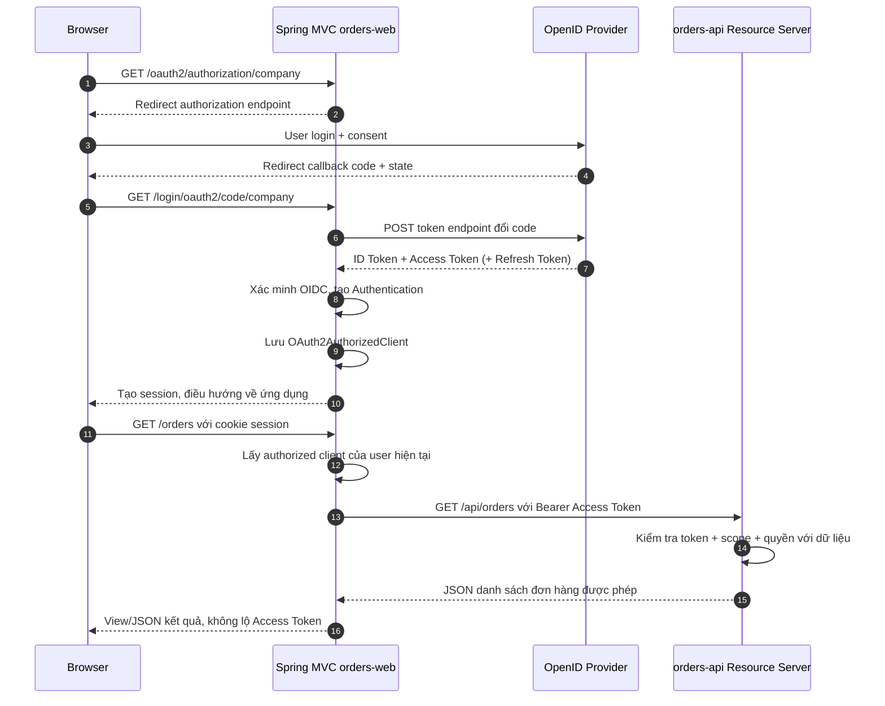
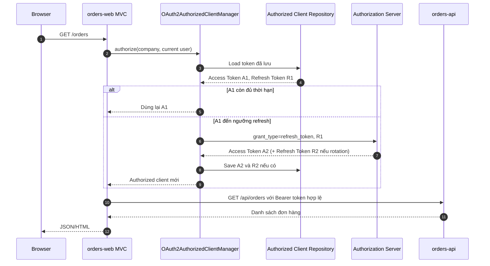
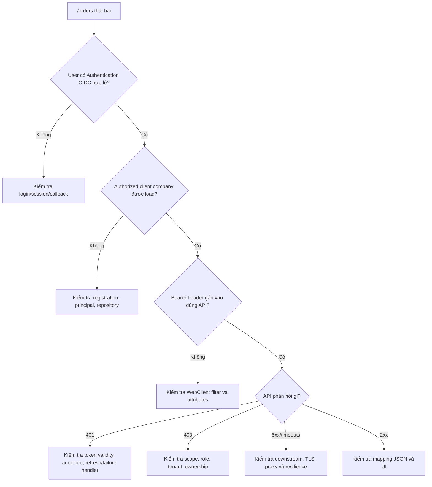

# 19.6. Gọi API thay mặt người dùng sau `oauth2Login`

Trong ứng dụng **Spring Security OAuth 2.0 / OpenID Connect (OIDC) Client**, `oauth2Login()` giúp người dùng đăng nhập qua OpenID Provider (OP), nhận ID Token, xác minh danh tính và thiết lập một `Authentication` trong `SecurityContext`. Tuy nhiên, sau khi đăng nhập thành công, ứng dụng thường còn phải **gọi một REST API khác thay mặt người dùng đang đăng nhập**, chẳng hạn đọc đơn hàng, lịch làm việc hoặc thông tin cá nhân được bảo vệ bởi OAuth 2.0.

Với **Spring MVC/Servlet** và **`WebClient`**, cách làm đúng không phải là lấy ID Token rồi dùng làm Bearer token, cũng không phải tự chép giá trị Access Token vào session attribute tùy tiện. Spring Security đã có mô hình **`OAuth2AuthorizedClient`** để liên kết Access Token, Refresh Token (nếu có) với client registration và principal, cũng như bộ lọc **`ServletOAuth2AuthorizedClientExchangeFilterFunction`** để đưa Access Token vào request outbound của `WebClient`.

Bài học này triển khai toàn bộ đường đi:

1. Người dùng hoàn tất `oauth2Login()` qua browser.
2. Spring Security tạo principal OIDC và lưu `OAuth2AuthorizedClient` tương ứng.
3. Controller/service lấy **authorized client của chính người dùng hiện tại**.
4. `WebClient` gửi `Authorization: Bearer <access-token>` tới **API được phép nhận token ấy**.
5. Nếu cần, authorized client manager xử lý Access Token sắp hết hạn/refresh theo cấu hình.
6. Resource Server xác minh token, audience, scope và quyền truy cập tới từng tài nguyên.

Trọng tâm xuyên suốt là **giữ đúng ngữ cảnh người dùng, tránh rò token sang host khác và tách xác thực OIDC khỏi ủy quyền ở API**.

## 1. Bài toán: đăng nhập thành công nhưng vẫn cần gọi API

Giả sử một hệ thống bán hàng gồm:

- **Browser**: nơi nhân viên mở ứng dụng.
- **`orders-web`**: ứng dụng Spring Boot MVC, đóng vai OAuth2/OIDC Client.
- **`company-idp`**: OpenID Provider/Authorization Server.
- **`orders-api`**: Resource Server cung cấp `GET /api/orders`, chỉ chấp nhận Access Token đúng audience/scope.

Người dùng đã đăng nhập tại `orders-web` nhưng backend vẫn phải gọi `orders-api` để lấy danh sách đơn hàng thuộc quyền của người đó.



Điểm cốt lõi: **browser gọi `orders-web` bằng cookie session, còn `orders-web` gọi `orders-api` bằng Access Token**. Hai kiểu credential được dùng ở hai chặng khác nhau.

Trong mô hình backend-for-frontend (BFF), browser không cần đọc Access Token từ JavaScript để gọi Resource Server; backend giữ token và chịu trách nhiệm giới hạn downstream destination.

### 1.1. «Thay mặt người dùng» nghĩa là gì?

Trong OAuth 2.0, một Access Token có thể đại diện cho quyền mà Authorization Server đã cấp trong ngữ cảnh **người dùng và client**. Ứng dụng web sử dụng token đó để truy cập tài nguyên được cho phép.

Nói «thay mặt người dùng» **không** có nghĩa ứng dụng được phép tùy ý:

- Gọi mọi API chỉ vì người dùng đã đăng nhập.
- Dùng ID Token thay Access Token.
- Tạo một chuỗi Bearer token từ `sub` hoặc email.
- Sử dụng Access Token của người dùng A để truy xuất dữ liệu người dùng B.
- Bỏ qua quyền tenant/ownership của API.
- Dùng Client Credentials rồi đổi `principalName` thành tên người dùng để giả lập delegation.

Việc ủy quyền thực sự phải được thể hiện qua **Access Token hợp lệ, audience/scope/policy** và các kiểm tra của Resource Server.

## 2. Phân biệt bốn đối tượng trong luồng

| Đối tượng | Thời điểm xuất hiện | Dùng để làm gì? |
|---|---|---|
| **`Authentication` / `OidcUser`** | Sau `oauth2Login()` thành công | Xác định người dùng hiện tại ở `orders-web`, authorities và principal của phiên ứng dụng. |
| **`OidcIdToken`** | OP phát hành trong OIDC login | Chứng minh sự kiện xác thực và danh tính cho OIDC Client; chứa `iss`, `sub`, `aud` và các claim. |
| **`OAuth2AuthorizedClient`** | Sau authorization/token exchange | Gắn `ClientRegistration`, `principalName` và Access/Refresh Token với nhau. |
| **`OAuth2AccessToken`** | Trong authorized client | Được gửi tới API theo quy tắc Bearer và quyền đã cấp. |

Ví dụ về authorized client:

```text
ClientRegistration:
  registrationId = company
  clientId       = orders-web
  provider       = company-idp

OAuth2AuthorizedClient:
  principalName  = employee-sub-2841
  accessToken    = <sensitive>
  refreshToken   = <sensitive hoặc null>
  expiresAt      = 2026-11-16T10:05:00Z

Authentication:
  principal      = OidcUser employee-sub-2841
  authorities    = các quyền được app ánh xạ
```

`principalName` giúp **lưu và tải authorized client đúng ngữ cảnh người dùng**. Đừng coi nó là bằng chứng để API cấp quyền: Resource Server sẽ xác minh Access Token của request, không đọc trực tiếp `principalName` trong ứng dụng MVC.

### 2.1. Vì sao không dùng ID Token làm Bearer?

ID Token dành cho **OIDC Client** và thường có `aud` chứa `client_id` của ứng dụng web, ví dụ `orders-web`. API `orders-api` có thể yêu cầu Access Token có audience tương ứng API.

Đưa ID Token vào:

```http
Authorization: Bearer <id-token>
```

là sai về vai trò giao thức đối với một API mong đợi OAuth2 Access Token. API có thể từ chối; nếu API chấp nhận nhầm ID Token thì đó còn là lỗi thiết kế kiểm soát token.

### 2.2. Cookie session không phải API Access Token

Browser gửi cookie `JSESSIONID` hoặc cookie session khác tới `orders-web` để Spring Security khôi phục `SecurityContext`. API downstream không mặc nhiên biết hoặc tin cookie đó.

Không forwarding cookie session đến API để «dùng lại đăng nhập» trừ khi có giao thức/session-sharing riêng được thiết kế an toàn. Trong kiến trúc OAuth2, `orders-web` cần Access Token được cấp cho API.

## 3. Điều kiện tiên quyết: Access Token phải dành cho API nào?

Trước khi viết một dòng `WebClient`, cần xác định **Authorization Server sẽ cấp token có thể truy cập `orders-api` hay không**.

Các khái niệm:

- **Issuer**: Authorization Server phát token và là nguồn tin cậy theo cấu hình.
- **Audience / resource**: API hoặc nhóm resource mà token dành cho; cách biểu diễn phụ thuộc provider và token format.
- **Scope**: phạm vi API được cấp, ví dụ `orders.read`.
- **Consent và client policy**: điều kiện provider cho phép client yêu cầu scope/resource.
- **Subject**: danh tính người dùng trong Access Token nếu token/profile có thông tin ấy.
- **Resource Server policy**: quyền truy cập cụ thể với tenant, ownership, order ID, trạng thái đơn hàng.

`openid profile email` thường là scope phục vụ OIDC. **Chúng không tự cấp quyền `orders.read`**, và không bảo đảm Access Token có audience của `orders-api`.

Một cấu hình client có thể yêu cầu thêm scope:

```yaml
spring:
  security:
    oauth2:
      client:
        registration:
          company:
            provider: company-oidc
            client-id: ${OIDC_CLIENT_ID}
            client-secret: ${OIDC_CLIENT_SECRET}
            client-authentication-method: client_secret_basic
            authorization-grant-type: authorization_code
            redirect-uri: "{baseUrl}/login/oauth2/code/{registrationId}"
            scope:
              - openid
              - profile
              - orders.read
        provider:
          company-oidc:
            issuer-uri: https://id.example.org/realms/company
```

Đây là cấu hình **yêu cầu** scope; Authorization Server mới quyết định scope thực tế được cấp. Nếu API còn yêu cầu audience/resource indicator riêng, client registration và authorization request phải được cấu hình theo **cơ chế provider hỗ trợ**. Một dòng `scope: orders.read` không bảo đảm audience đúng.

### 3.1. Khi provider chỉ cấp token cho UserInfo

Một số OP cấp Access Token phù hợp để gọi **UserInfo** nhưng không dùng được trực tiếp cho API nghiệp vụ. Nếu `orders-api` từ chối vì `aud` không khớp, đừng cố bỏ kiểm tra audience ở Resource Server.

Các hướng thiết kế đúng có thể gồm:

1. Đăng ký đúng API resource/audience khi xin authorization.
2. Xin scope được provider cho phép và user consent khi cần.
3. Dùng token exchange/on-behalf-of grant nếu Authorization Server hỗ trợ và kiến trúc yêu cầu.
4. Tách client registration hoặc flow cho resource khác khi chính sách provider yêu cầu.

Không phải Authorization Server nào cũng hỗ trợ cùng một cơ chế audience hoặc token exchange. Cần theo hợp đồng của provider, không tự copy tham số `audience` vào mọi OP rồi coi là tiêu chuẩn chung.

### 3.2. Quyền của token không thay thế authorization theo đối tượng

Một Access Token có scope `orders.read` vẫn có thể chỉ được đọc đơn hàng trong tenant A. `orders-api` phải kiểm tra:

```text
token hợp lệ
AND scope có orders.read
AND user/client có quyền trong tenant liên quan
AND order thuộc phạm vi mà subject được phép xem
```

WebClient chỉ gắn Bearer token; nó **không quyết định** đơn hàng nào được truy cập. Quyết định cuối thuộc Resource Server và nghiệp vụ.

## 4. Dependency cho `WebClient` trên ứng dụng Servlet

Một Spring Boot MVC application có thể sử dụng **`WebClient` từ Spring WebFlux** như một HTTP client, dù request inbound vẫn được xử lý bằng Servlet stack.

Ví dụ Gradle:

```gradle
dependencies {
    implementation("org.springframework.boot:spring-boot-starter-web")
    implementation("org.springframework.boot:spring-boot-starter-security")
    implementation("org.springframework.boot:spring-boot-starter-oauth2-client")
    implementation("org.springframework.boot:spring-boot-starter-webflux")
}
```

Ở những cấu hình Spring Boot thông dụng, khi cả Spring MVC và WebFlux nằm trên classpath, ứng dụng web vẫn dùng **Servlet/MVC** theo cơ chế lựa chọn web application type mặc định. `WebClient` là client HTTP có API reactive, **không có nghĩa toàn bộ ứng dụng tự chuyển sang WebFlux Security**.

Cần phân biệt:

| Thành phần | Bên Servlet/MVC | Bên Reactive/WebFlux |
|---|---|---|
| Inbound authentication | `SecurityFilterChain`, `HttpSecurity` | `SecurityWebFilterChain`, `ServerHttpSecurity` |
| OAuth2 client WebClient filter | `ServletOAuth2AuthorizedClientExchangeFilterFunction` | `ServerOAuth2AuthorizedClientExchangeFilterFunction` |
| Principal context | `SecurityContextHolder` và Servlet request context | Reactor Context và reactive security context |
| Authorized client store | Servlet repository/service | Reactive authorized client repository/service |

**Không dùng `ServerOAuth2AuthorizedClientExchangeFilterFunction` chỉ vì client tên là `WebClient`.** Bài đang xét WebClient **trong ứng dụng Servlet**, nên dùng servlet-specific filter function phù hợp.

### 4.1. Cấu hình Spring Security web cơ bản

```java
import org.springframework.context.annotation.Bean;
import org.springframework.context.annotation.Configuration;
import org.springframework.security.config.Customizer;
import org.springframework.security.config.annotation.web.builders.HttpSecurity;
import org.springframework.security.web.SecurityFilterChain;

@Configuration
public class SecurityConfiguration {

    @Bean
    SecurityFilterChain securityFilterChain(HttpSecurity http)
            throws Exception {

        http
            .authorizeHttpRequests(auth -> auth
                .requestMatchers("/", "/public/**").permitAll()
                .anyRequest().authenticated()
            )
            .oauth2Login(Customizer.withDefaults())
            .oauth2Client(Customizer.withDefaults());

        return http.build();
    }
}
```

- `oauth2Login()` xử lý flow đăng nhập OIDC.
- `oauth2Client()` tích hợp các chức năng OAuth2 Client cho Servlet, bao gồm những thành phần giải quyết authorized client/annotation khi được cấu hình phù hợp.
- Cấu hình yêu cầu login không đồng nghĩa mọi outbound WebClient tự động gửi Access Token. Phải cấu hình filter function hoặc gắn token một cách có kiểm soát.

Mẫu này phù hợp với Spring Security hiện đại dùng lambda DSL; API chính xác có thể thay đổi theo phiên bản dự án.

## 5. Thành phần then chốt: `ServletOAuth2AuthorizedClientExchangeFilterFunction`

Spring Security cung cấp `ServletOAuth2AuthorizedClientExchangeFilterFunction` để tích hợp OAuth2 authorized client với outbound request của `WebClient` trong ứng dụng Servlet.

Filter có thể:

- Xác định authorized client phù hợp cho request.
- Dùng Access Token từ authorized client để đặt `Authorization: Bearer ...`.
- Tương tác với `OAuth2AuthorizedClientManager` theo cấu hình để xử lý token sắp hết hạn và refresh.
- Phối hợp failure handler để xử lý một số lỗi liên quan authorized client/token.
- Nhận lựa chọn explicit qua `WebClient.RequestHeadersSpec.attributes(...)`.

**Điểm cần nhớ:** filter function **không** tạo quyền API từ `Authentication` của web user; nó chỉ dùng token đã được Authorization Server cấp trong đúng ngữ cảnh. Resource Server vẫn chịu trách nhiệm xác minh token và authorization.

### 5.1. Các cách xác định authorized client cho request

Một request `WebClient` có thể chọn token theo nhiều cách:

| Cách | Mô tả | Mức độ kiểm soát |
|---|---|---|
| **Đưa thẳng `OAuth2AuthorizedClient` vào attributes** | Caller đã xác định authorized client phù hợp. | Rõ ràng, dễ audit destination/registration/user. |
| **Chỉ định `clientRegistrationId`** | Filter/manager tra cứu authorized client theo registration và principal/context. | Thuận tiện, cần đảm bảo ngữ cảnh user và repository đúng. |
| **Default OAuth2 authorized client** | Filter có thể dùng token của authentication hiện tại nếu được bật. | Nguy cơ gắn token ngoài ý muốn vào nhiều request. |
| **Default client registration ID** | Filter chọn registration mặc định cho các request không chỉ định. | Dễ lộ token nếu WebClient dùng nhiều API/host. |

Với API mang quyền người dùng, **ưu tiên explicit selection** để reviewer đọc code có thể biết request nào sẽ mang token nào.

## 6. Cách 1: truyền authorized client tường minh — ưu tiên khi gọi API người dùng

Đây là mẫu an toàn, dễ hiểu: controller nhận authorized client theo registration sau `oauth2Login()`, truyền nó cho service, rồi WebClient chỉ gắn Bearer token ở **request cụ thể**.

### 6.1. Cấu hình Bean WebClient với OAuth2 filter

```java
import org.springframework.context.annotation.Bean;
import org.springframework.context.annotation.Configuration;
import org.springframework.security.oauth2.client.registration.ClientRegistrationRepository;
import org.springframework.security.oauth2.client.web.OAuth2AuthorizedClientRepository;
import org.springframework.security.oauth2.client.web.reactive.function.client.ServletOAuth2AuthorizedClientExchangeFilterFunction;
import org.springframework.web.reactive.function.client.WebClient;

@Configuration
public class OrdersWebClientConfiguration {

    @Bean
    WebClient ordersWebClient(
            ClientRegistrationRepository registrations,
            OAuth2AuthorizedClientRepository authorizedClients) {

        ServletOAuth2AuthorizedClientExchangeFilterFunction oauth2 =
            new ServletOAuth2AuthorizedClientExchangeFilterFunction(
                registrations,
                authorizedClients
            );

        // Không bật defaultOAuth2AuthorizedClient(true).
        return WebClient.builder()
            .baseUrl("https://api.orders.example.org")
            .apply(oauth2.oauth2Configuration())
            .build();
    }
}
```

Cấu hình có các ưu điểm:

- Chỉ tạo filter dành cho **Servlet OAuth2 Client**.
- `baseUrl` trỏ tới API cố định đã được cho phép.
- Không đặt Access Token vào default header của WebClient, do token thay đổi theo user/request.
- Không bật cơ chế tự gắn token mặc định vào **mọi** outbound request.
- Caller quyết định authorized client ở từng request.

Ví dụ dùng constructor `(ClientRegistrationRepository, OAuth2AuthorizedClientRepository)`. Spring Security cung cấp khả năng tích hợp manager/repository phù hợp với Servlet; nếu ứng dụng có manager riêng để cấu hình refresh, có thể dùng constructor nhận manager và wiring tương ứng, như phần sau.

### 6.2. DTO của API

```java
public record OrderSummary(
    long id,
    String orderNumber,
    String status
) { }
```

DTO chỉ chứa trường mà frontend cần hiển thị. Không đưa Access Token hoặc Refresh Token vào DTO. Các public Java types trong các ví dụ bài học cần được đặt vào file nguồn riêng đúng quy tắc Java khi triển khai.

### 6.3. Service thực hiện HTTP request

```java
import java.util.List;

import org.springframework.core.ParameterizedTypeReference;
import org.springframework.security.oauth2.client.OAuth2AuthorizedClient;
import org.springframework.security.oauth2.client.web.reactive.function.client.ServletOAuth2AuthorizedClientExchangeFilterFunction;
import org.springframework.stereotype.Service;
import org.springframework.web.reactive.function.client.WebClient;
import reactor.core.publisher.Mono;

@Service
public class OrdersApiClient {

    private final WebClient ordersWebClient;

    public OrdersApiClient(WebClient ordersWebClient) {
        this.ordersWebClient = ordersWebClient;
    }

    public Mono<List<OrderSummary>> listOrders(
            OAuth2AuthorizedClient authorizedClient) {

        return ordersWebClient.get()
            .uri("/api/orders")
            .attributes(
                ServletOAuth2AuthorizedClientExchangeFilterFunction
                    .oauth2AuthorizedClient(authorizedClient)
            )
            .retrieve()
            .bodyToMono(
                new ParameterizedTypeReference<List<OrderSummary>>() { }
            );
    }
}
```

Dòng quyết định là:

```java
.attributes(
    ServletOAuth2AuthorizedClientExchangeFilterFunction
        .oauth2AuthorizedClient(authorizedClient)
)
```

Nó chọn **authorized client cụ thể** để filter đưa Access Token vào request outbound. Token vẫn ở backend và chỉ được dùng cho call tới API đã xác định.

**Không sử dụng `webClient.defaultHeader("Authorization", ...)` với token của một user**: `WebClient` là Bean có thể được chia sẻ giữa nhiều request/users, nên gắn token vào default mutable/global configuration có nguy cơ dùng chéo credential.

### 6.4. MVC controller nhận authorized client

```java
import java.util.List;

import org.springframework.security.oauth2.client.OAuth2AuthorizedClient;
import org.springframework.security.oauth2.client.annotation.RegisteredOAuth2AuthorizedClient;
import org.springframework.web.bind.annotation.GetMapping;
import org.springframework.web.bind.annotation.RestController;
import reactor.core.publisher.Mono;

@RestController
public class OrdersController {

    private final OrdersApiClient ordersApi;

    public OrdersController(OrdersApiClient ordersApi) {
        this.ordersApi = ordersApi;
    }

    @GetMapping("/orders")
    public Mono<List<OrderSummary>> orders(
            @RegisteredOAuth2AuthorizedClient("company")
            OAuth2AuthorizedClient authorizedClient) {

        return ordersApi.listOrders(authorizedClient);
    }
}
```

`@RegisteredOAuth2AuthorizedClient("company")` giúp MVC argument resolver lấy authorized client của registration tương ứng trong ngữ cảnh request hiện tại, theo wiring Spring Security/OAuth2 Client. Tùy cách manager và provider được cấu hình, việc giải quyết argument có thể tham gia authorize/refresh khi cần.

Spring MVC có hỗ trợ một số reactive return types khi thư viện tương ứng có trên classpath. Ví dụ trả `Mono` để minh họa luồng bất đồng bộ; không nhất thiết phải gọi `block()`.

**Lợi ích bảo mật:** authorized client được giải quyết trong request đã xác thực, truyền explicit sang WebClient và không cần đọc `SecurityContextHolder` lại trong callback reactive, nơi thread có thể thay đổi.

### 6.5. Vì sao explicit token tốt hơn default?

Xem hai calls:

```java
ordersWebClient.get()
    .uri("/api/orders")
    .attributes(oauth2AuthorizedClient(authorizedClient))
    .retrieve();
```

và:

```java
publicWebClient.get()
    .uri("https://news.example.net/public-feed")
    .retrieve();
```

Chỉ request API đơn hàng cần Bearer token. Nếu cấu hình default oauth2 token trên một WebClient dùng chung, request lấy public feed có thể vô tình mang token của user sang host không liên quan.

Nên tạo **WebClient riêng cho từng downstream API** và lựa chọn authorized client tường minh khi quyền người dùng cần thiết.

## 7. Cách 2: chỉ định `clientRegistrationId` cho request

Filter function còn có attribute helper cho registration ID:

```java
import static org.springframework.security.oauth2.client.web.reactive.function.client.ServletOAuth2AuthorizedClientExchangeFilterFunction.clientRegistrationId;

Mono<String> response = ordersWebClient.get()
    .uri("/api/orders/summary")
    .attributes(clientRegistrationId("company"))
    .retrieve()
    .bodyToMono(String.class);
```

Cách này yêu cầu **manager có thể xác định đúng principal và authorized client store** trong ngữ cảnh hiện tại. Ở request Servlet thông thường, Spring Security có thể cung cấp ngữ cảnh authentication/request qua cấu hình filter function; nhưng khi rời Servlet thread hoặc chạy job, không được giả định những ThreadLocal context ấy vẫn tồn tại.

Khác với cách truyền `OAuth2AuthorizedClient`, khi chỉ có registration ID, filter/manager cần tự **load/authorize** từ store. Vì vậy, behavior có thể phụ thuộc:

- Authorized client đã được lưu theo principal nào.
- Cấu hình `OAuth2AuthorizedClientRepository`/`OAuth2AuthorizedClientService`.
- Provider chain có hỗ trợ refresh hoặc authorization code không.
- Có đúng Servlet request/response và authentication context không.
- Version Spring Security và cách Bean WebClient được wiring.

Với service có yêu cầu tách biệt rõ user context, lựa chọn explicit authorized client vẫn thường dễ kiểm soát hơn.

### 7.1. Đừng dùng registration ID như một tham số tự do từ browser

Sai:

```java
// Nguy hiểm nếu không kiểm soát: caller tự chọn client registration
String registrationId = request.getParameter("client");
```

Nếu ứng dụng có nhiều registration với quyền/API khác nhau, user có thể kích hoạt token thuộc registration không được phép sử dụng. Chỉ cho phép các registration đã được policy quyết định từ ngữ cảnh đã xác thực.

## 8. Cẩn trọng với `setDefaultOAuth2AuthorizedClient(true)`

Ví dụ Spring Security thường có tùy chọn:

```java
oauth2.setDefaultOAuth2AuthorizedClient(true);
```

Khi bật, filter có thể sử dụng authorized client gắn với `OAuth2AuthenticationToken` hiện tại cho những request không chỉ định rõ token. Điều này thuận tiện nhưng **nguy hiểm nếu một WebClient được dùng để gọi nhiều host hoặc endpoint khác nhau**.

Hãy hình dung:

```text
Một WebClient dùng chung:
  GET https://api.orders.example.org/api/orders -> cần token của user
  GET https://status.example.net/health         -> không cần token
  GET https://external.example.com/data         -> host khác
```

Nếu default OAuth2 authorized client được bật, một request không có explicit marker có thể mang Access Token tới đích không mong đợi. Đây là một rủi ro **token exfiltration**.

### 8.1. Nguyên tắc chọn mặc định

- **Ưu tiên không bật** default token trên WebClient chia sẻ.
- Dùng `oauth2AuthorizedClient(authorizedClient)` ở những request thực sự cần token.
- Có thể tạo WebClient chỉ phục vụ một API cố định, nhưng vẫn phải quản lý redirect và destination.
- Nếu dùng `setDefaultClientRegistrationId(...)`, phải hiểu tất cả request không chỉ định token có thể sử dụng registration mặc định.
- Trong hệ thống nhiều user, tránh mọi global state chứa Access Token mới nhất.

Một cách cấu hình ít gây bất ngờ là explicit token per request, như ví dụ ở mục 6.

### 8.2. `setDefaultClientRegistrationId` không đồng nghĩa token user hiện tại

Đặt registration mặc định khiến filter chọn registration đó khi request thiếu thông tin cụ thể. Tuy nhiên, việc chọn **đúng user authorized client** vẫn phụ thuộc principal/context và store.

Không dùng default registration của một machine client để thay thế Access Token delegated của user, và cũng không coi default registration là cơ chế kiểm tra scope/permission.

## 9. Constructor dùng `OAuth2AuthorizedClientManager`

Nếu ứng dụng cần cấu hình provider chain, refresh skew hoặc custom storage, có thể xây `ServletOAuth2AuthorizedClientExchangeFilterFunction` từ một manager đã được cấu hình:

```java
import org.springframework.context.annotation.Bean;
import org.springframework.context.annotation.Configuration;
import org.springframework.security.oauth2.client.OAuth2AuthorizedClientManager;
import org.springframework.security.oauth2.client.web.reactive.function.client.ServletOAuth2AuthorizedClientExchangeFilterFunction;
import org.springframework.web.reactive.function.client.WebClient;

@Configuration
public class ManagedOrdersWebClientConfiguration {

    @Bean
    WebClient managedOrdersWebClient(
            OAuth2AuthorizedClientManager authorizedClientManager) {

        ServletOAuth2AuthorizedClientExchangeFilterFunction oauth2 =
            new ServletOAuth2AuthorizedClientExchangeFilterFunction(
                authorizedClientManager
            );

        // Với constructor manager, xem xét thiết lập authorization
        // failure handler cho các lỗi token được hỗ trợ.
        return WebClient.builder()
            .baseUrl("https://api.orders.example.org")
            .apply(oauth2.oauth2Configuration())
            .build();
    }
}
```

Lưu ý:

1. Manager phải có quyền truy cập **đúng kho authorized client** mà login sử dụng.
2. Với ngữ cảnh Servlet, thường dùng `DefaultOAuth2AuthorizedClientManager` kết hợp `OAuth2AuthorizedClientRepository`.
3. Nếu cần refresh, provider chain phải gồm `RefreshTokenOAuth2AuthorizedClientProvider` theo cách thích hợp.
4. Constructor từ manager **không nên được giả định tự cấu hình mọi authorization failure handler** như mọi constructor khác. Cần kiểm tra version Spring Security và đặt handler khi cần.
5. Không khai báo nhiều WebClient Bean không có qualifier rồi trông chờ dependency injection luôn chọn đúng.

### 9.1. Default manager cho Servlet khác service manager của job

| Manager | Ngữ cảnh phù hợp |
|---|---|
| `DefaultOAuth2AuthorizedClientManager` | Servlet request/response, dùng `OAuth2AuthorizedClientRepository`. |
| `AuthorizedClientServiceOAuth2AuthorizedClientManager` | Job nền và service-to-service không có Servlet request, dùng `OAuth2AuthorizedClientService`. |

Nếu một batch job cần gọi API thay mặt user không có request Servlet, phải thiết kế delegation/token storage và chính sách offline access phù hợp; không chỉ sử dụng ngẫu nhiên `SecurityContextHolder` từ một request trước đó.

## 10. Refresh Access Token trước khi gọi API

Sau đăng nhập, Access Token có thể đã gần hết hạn khi người dùng mở trang đơn hàng. Nếu được cấp Refresh Token, Spring Security authorized client manager/provider có thể **refresh** và lưu authorized client mới.



**Không phải mọi call WebClient đều tự refresh**: việc refresh phụ thuộc filter có được cấu hình dùng manager thích hợp, client registration, Access Token expiry, có Refresh Token hay không và ngữ cảnh authorize.

### 10.1. Cấu hình refresh provider với clock skew

Một ví dụ khi tự tạo manager cho Servlet:

```java
import java.time.Duration;

import org.springframework.context.annotation.Bean;
import org.springframework.context.annotation.Configuration;
import org.springframework.security.oauth2.client.AuthorizationCodeOAuth2AuthorizedClientProvider;
import org.springframework.security.oauth2.client.DefaultOAuth2AuthorizedClientManager;
import org.springframework.security.oauth2.client.DelegatingOAuth2AuthorizedClientProvider;
import org.springframework.security.oauth2.client.OAuth2AuthorizedClientManager;
import org.springframework.security.oauth2.client.OAuth2AuthorizedClientProvider;
import org.springframework.security.oauth2.client.RefreshTokenOAuth2AuthorizedClientProvider;
import org.springframework.security.oauth2.client.registration.ClientRegistrationRepository;
import org.springframework.security.oauth2.client.web.OAuth2AuthorizedClientRepository;

@Configuration
public class AuthorizedClientManagerConfiguration {

    @Bean
    OAuth2AuthorizedClientManager authorizedClientManager(
            ClientRegistrationRepository registrations,
            OAuth2AuthorizedClientRepository authorizedClients) {

        RefreshTokenOAuth2AuthorizedClientProvider refresh =
            new RefreshTokenOAuth2AuthorizedClientProvider();

        refresh.setClockSkew(Duration.ofSeconds(60));

        OAuth2AuthorizedClientProvider provider =
            new DelegatingOAuth2AuthorizedClientProvider(
                new AuthorizationCodeOAuth2AuthorizedClientProvider(),
                refresh
            );

        DefaultOAuth2AuthorizedClientManager manager =
            new DefaultOAuth2AuthorizedClientManager(
                registrations,
                authorizedClients
            );

        manager.setAuthorizedClientProvider(provider);
        return manager;
    }
}
```

`clockSkew=60s` nghĩa là token có thể được xem là cần làm mới **trước `expiresAt` khoảng 60 giây** khi manager được gọi. Nó **không tạo timer tự refresh**, cũng không đảm bảo provider sẽ cấp token mới nếu Refresh Token bị revoke/hết hạn.

### 10.2. Một lưu ý về explicit `OAuth2AuthorizedClient`

Khi truyền trực tiếp một authorized client vào request, cần hiểu **mối quan hệ giữa attribute đó và manager** trong phiên bản Spring Security đang dùng. Nếu service giữ một đối tượng authorized client cũ trong biến lâu dài, nó có thể mất đồng bộ với token mới lưu trong repository.

Cách an toàn:

- Giải quyết authorized client theo **request và principal hiện tại**, qua resolver/manager phù hợp.
- Không cache `OAuth2AuthorizedClient` trong singleton field cho tất cả users.
- Khi refresh trả token mới, không tiếp tục cố gắn Access Token cũ lên các request kế tiếp.
- Kiểm tra failure handler và chính sách load/save đối với token được rotate.

### 10.3. Refresh Token không đồng nghĩa session được gia hạn

Refresh Token thuộc vòng đời OAuth2 authorized client. HTTP session thuộc vòng đời authentication của ứng dụng.

Người dùng có thể còn session nhưng Refresh Token đã bị revoke; hoặc Access Token vừa được refresh nhưng session app sắp hết hạn. Không dựa vào kết quả refresh để tự cấp lại quyền/role nội bộ hoặc gia hạn SSO session.

## 11. Xử lý lỗi 401/403 từ downstream API

Một WebClient call có thể thất bại dù login thành công. Các lỗi cần phân loại:

| HTTP status | Ý nghĩa thường gặp | Hướng xử lý |
|---|---|---|
| **401 Unauthorized** | Access Token không hợp lệ, hết hạn, bị revoke hoặc thiếu credential. | Kiểm tra token đúng API, audience, expiry, failure handler và refresh/reauthorization. |
| **403 Forbidden** | Token/identity hợp lệ nhưng không được phép thao tác. | Kiểm tra scope, permission, tenant/ownership và policy API. |
| **404 Not Found** | Resource không tồn tại; đôi khi API che giấu resource không được phép. | Theo hợp đồng Resource Server, không suy ra tự động lỗi login. |
| **429 Too Many Requests** | API giới hạn tốc độ. | Tôn trọng backoff và Retry-After khi có. |
| **5xx** | Downstream service lỗi. | Timeout, retry có giới hạn, circuit breaker nếu phù hợp. |
| **Connection/TLS error** | Chưa nhận được response HTTP. | DNS, proxy, trust store, timeout, network; không tắt TLS. |

### 11.1. `retrieve()` và WebClient response exceptions

Với:

```java
webClient.get()
    .uri("/api/orders")
    .retrieve()
    .bodyToMono(String.class);
```

các HTTP status 4xx/5xx mặc định có thể phát sinh `WebClientResponseException` khi publisher được subscribe. Tầng controller/service nên ánh xạ lỗi sang response ứng dụng phù hợp, **không ném nguyên Access Token hoặc raw downstream response nhạy cảm về browser**.

Ví dụ mô tả chính sách:

```text
orders-api 401:
  -> xem xét authorized client/token bị từ chối
  -> xử lý failure/reauthorization có kiểm soát
  -> browser nhận thông báo cần xác thực lại nếu policy yêu cầu

orders-api 403:
  -> browser nhận 403/không đủ quyền
  -> không tự refresh hoặc đổi grant để nâng quyền

orders-api 503:
  -> browser nhận lỗi dịch vụ tạm thời
  -> retry chỉ khi request phù hợp và có giới hạn
```

### 11.2. Authorization failure handler

Spring Security có các handler như `RemoveAuthorizedClientOAuth2AuthorizationFailureHandler` để loại authorized client bị lỗi trong những trường hợp thích hợp, giúp request sau có thể được authorize lại theo flow được hỗ trợ.

Điểm cần nhớ:

- Không mặc định **mọi 401** đều làm token bị xóa.
- Hành vi xử lý phụ thuộc HTTP OAuth2 error code, constructor filter, manager và phiên bản Spring Security.
- Nếu dùng constructor `ServletOAuth2AuthorizedClientExchangeFilterFunction(OAuth2AuthorizedClientManager)`, cần đánh giá việc tự thiết lập `setAuthorizationFailureHandler(...)`.
- Xóa local authorized client không đồng nghĩa token đã bị revoke tại Authorization Server.
- Với user delegated token, yêu cầu reauthorization có thể phải đưa user qua browser flow mới.

Đừng viết một handler «401 => lấy Client Credentials token chung của ứng dụng => retry» để thay cho token của user. Đó là thay đổi quyền/identity, không phải khắc phục expiry.

### 11.3. Retry phải xét idempotency

Một lệnh:

```http
POST /api/orders/42/approve
Authorization: Bearer <user-access-token>
```

có thể thay đổi dữ liệu. Nếu downstream trả 401/timeout, ứng dụng không được tự retry vô hạn mà không biết request trước đã thực thi hay chưa. Cần cơ chế idempotency, giới hạn retry và hợp đồng API rõ ràng.

## 12. Ngữ cảnh Servlet và WebClient reactive: điểm dễ sai

`WebClient` có API reactive, còn ứng dụng MVC thường gắn `SecurityContextHolder` và Servlet request context với **ThreadLocal của request thread**.

Một request có thể đi như sau:

```text
Servlet request thread
   -> Controller (@RegisteredOAuth2AuthorizedClient)
   -> Service tạo Mono cho WebClient
   -> Reactor/HTTP client subscribe, có thể chạy thread khác
   -> Response tới controller/browser
```

Nếu code reactive callback tự gọi:

```java
SecurityContextHolder.getContext().getAuthentication()
```

tại một thread khác, authentication có thể rỗng hoặc không đúng như kỳ vọng nếu context không được truyền một cách chính thức. Tương tự, `RequestContextHolder` có thể không hiện diện trong job nền hoặc callback bất đồng bộ.

### 12.1. Truyền explicit authorized client giải quyết vấn đề gì?

Khi controller giải quyết authorized client **trong HTTP request đã xác thực**, rồi truyền đối tượng đó xuống service, phần gọi API không cần tự tìm identity bằng ThreadLocal trong một callback chạy muộn.

```java
@GetMapping("/orders")
public Mono<List<OrderSummary>> orders(
        @RegisteredOAuth2AuthorizedClient("company")
        OAuth2AuthorizedClient client) {

    return ordersApi.listOrders(client);
}
```

Dữ liệu cần thiết đã được truyền tường minh. Đây là một lợi thế rõ ràng khi viết WebClient trong Servlet application.

Tuy nhiên, **đối tượng authorized client tự nó không phải capability vô giới hạn**. Tầng service vẫn phải đảm bảo caller được phép sử dụng client đó và destination là API tương ứng.

### 12.2. Không lấy principal từ user request rồi dùng trong job

Một scheduled job không có browser `HttpServletRequest`. Nếu job cần Client Credentials, dùng `AuthorizedClientServiceOAuth2AuthorizedClientManager` với technical principal.

Nếu job cần tiếp tục thao tác thay mặt người dùng vắng mặt, phải có **quyền offline/delegation và token storage chính thức**, không chỉ giữ `Authentication` hoặc Access Token từ một HTTP request cũ trong bộ nhớ.

### 12.3. `block()` trong MVC: dùng được nhưng phải hiểu chi phí

Ví dụ một controller đồng bộ có thể gọi:

```java
List<OrderSummary> orders = ordersApi
    .listOrders(authorizedClient)
    .block();
```

Trong một Servlet/MVC request thread thông thường, việc block publisher có thể hoạt động, nhưng nó **giữ thread chờ kết quả I/O**, làm giảm hiệu quả tài nguyên khi tải lớn. Không gọi `block()` trong Reactor event-loop thread vì có thể gây lỗi hoặc làm nghẽn pipeline.

Lựa chọn:

- Trả `Mono` hoặc reactive type được MVC hỗ trợ và cấu hình phù hợp.
- Nếu API controller cần đồng bộ, chấp nhận blocking nhưng đặt timeout/giới hạn concurrency và quan sát latency.
- Cân nhắc `RestClient` khi kiến trúc cố ý synchronous và WebClient không mang thêm lợi ích.
- Tránh tự `subscribe()` rồi trả HTTP 200 trước khi biết downstream có thành công hay chưa.

### 12.4. Không gọi `subscribe()` để «chạy nền» bên trong controller

Sai lầm:

```java
ordersWebClient.get()
    .uri("/api/orders")
    .retrieve()
    .bodyToMono(String.class)
    .subscribe();

// Controller trả 200 trước khi biết API có thành công.
```

Ngoài việc không quản lý error/timeout, việc subscribe tự do có thể làm mất context/security lifecycle. Nên trả publisher cho MVC hoặc thực hiện orchestration bất đồng bộ có hệ thống khi thật sự cần background processing.

## 13. Cách bảo vệ Access Token khi dùng WebClient

Access Token là **bearer credential**: bên nắm giữ có thể được Resource Server chấp nhận nếu token còn hợp lệ và chính sách cho phép. Vì vậy việc đưa token vào WebClient phải tuân thủ các quy tắc nghiêm ngặt.

### 13.1. Chỉ gửi tới resource đã được phép

Nên dùng một `WebClient` được cấu hình với base URL cố định cho API mà token được cấp:

```java
WebClient.builder()
    .baseUrl("https://api.orders.example.org")
    .apply(oauth2.oauth2Configuration())
    .build();
```

Tránh:

```java
// Không an toàn nếu URL đến trực tiếp từ input không tin cậy:
webClient.get()
    .uri(userProvidedAbsoluteUrl)
    .attributes(oauth2AuthorizedClient(authorizedClient))
    .retrieve();
```

Kẻ tấn công có thể đưa URL tới host mình kiểm soát và khiến backend gửi Bearer token sang đó (**token exfiltration/SSRF**).

Dù đã đặt `baseUrl`, vẫn cần kiểm soát những URI absolute có thể override destination, redirect, DNS/proxy và các endpoint động của ứng dụng.

### 13.2. Bảo vệ HTTP redirect

Nếu downstream trả 302 đến host khác, HTTP client cần có chính sách redirect **không làm lộ Authorization header** sang origin không đáng tin cậy. Không coi redirect là lý do gửi cùng Access Token tới mọi host.

Nếu API đã di chuyển host, cập nhật cấu hình endpoint theo quy trình deployment/allowlist, không để user nhập URL mới trong runtime rồi tự mang token đến.

### 13.3. HTTPS và TLS verification

Dùng HTTPS, kiểm tra server certificate/hostname và trust store đúng. Không tắt TLS verification khi staging có CA riêng; hãy cấu hình CA chain/trust material được cho phép.

Token có thể bị đánh cắp hoặc response bị can thiệp nếu WebClient gửi Bearer qua kết nối không được bảo vệ.

### 13.4. Không log raw request/response chứa credential

Cẩn trọng với:

- `ExchangeFilterFunction` do ứng dụng tự viết để log HTTP headers.
- Reactor Netty wiretap/debug logging.
- APM/distributed tracing capture headers.
- Error handlers đưa toàn bộ request vào exception.
- Logging của proxy/gateway.

Không log `Authorization: Bearer ...`, Access Token/Refresh Token, ID Token, session cookie, authorization code hoặc PKCE verifier. Metric có thể ghi host alias, registration ID, status, duration và error code đã chuẩn hóa.

### 13.5. Không đặt token vào URL

Sai:

```text
GET /api/orders?access_token=<bearer-token>
```

URL có thể xuất hiện trong logs, tracing, history và cache. Dùng `Authorization` header theo Bearer Token Usage.

## 14. Bảo đảm user A không dùng token của user B

Giả sử có hai nhân viên:

```text
User A:
  registrationId = company
  principalName = employee-A
  Access Token = token-A

User B:
  registrationId = company
  principalName = employee-B
  Access Token = token-B
```

`OAuth2AuthorizedClientRepository`/`OAuth2AuthorizedClientService` cần giữ ranh giới theo **client registration và principal**. Khi service gọi API thay mặt user A, nó phải dùng authorized client của A.

### 14.1. Không lưu token trong singleton field

Sai:

```java
@Service
public class BadTokenCache {
    private String latestAccessToken;
}
```

Một singleton Bean phục vụ nhiều request có thể bị user B ghi đè token của A. Nếu service sau đó dùng `latestAccessToken`, nguy cơ gọi API bằng identity sai rất rõ ràng.

Dùng Spring Security authorized client storage và truyền authorized client/token đúng request context. Không tự cache raw Access Token chung cho mọi user.

### 14.2. Không tự tìm principal theo email người dùng nhập

Sai về nguyên tắc:

```text
GET /orders?user=alice@example.org
    -> loadAuthorizedClient(company, "alice@example.org")
    -> dùng token được tìm
```

Nếu tham số `user` không được kiểm soát, một caller có thể cố load token của người khác. Principal cần đến từ **`Authentication` đã xác thực**, không phải query parameter không tin cậy.

### 14.3. Multi-tenant còn cần kiểm tra tenant

Ngay cả khi token đúng user, API có thể có nhiều tenant. Một request:

```text
GET /api/tenants/beta/orders
Authorization: Bearer token-cua-user-A
```

chỉ hợp lệ nếu user A được phép truy cập tenant beta. API phải kiểm tra membership/ownership; WebClient không tự chứng minh quyền tenant chỉ bằng token.

## 15. Authorized client được lưu ở đâu sau login?

Spring Security có hai abstraction liên quan:

| Interface | Ngữ cảnh | Mục đích |
|---|---|---|
| `OAuth2AuthorizedClientRepository` | Servlet `HttpServletRequest`/`HttpServletResponse` và `Authentication` | Lưu/tải authorized client trong flow web. |
| `OAuth2AuthorizedClientService` | `registrationId` và `principalName` | Lưu/tải authorized client độc lập HTTP request. |

Có các implementation như:

- `HttpSessionOAuth2AuthorizedClientRepository`.
- `AuthenticatedPrincipalOAuth2AuthorizedClientRepository`.
- `InMemoryOAuth2AuthorizedClientService`.
- `JdbcOAuth2AuthorizedClientService`.

Một số hệ thống dùng session, số khác dùng database hoặc repository delegate tới service. **WebClient filter/manager phải dùng cùng một chiến lược lưu trữ với login** nếu muốn tìm lại authorized client của user.

### 15.1. Khi lỗi «đăng nhập thành công nhưng không có token»

Có thể xuất phát từ:

- Login lưu theo registration `company-login` nhưng WebClient tìm `company`.
- Authorized client lưu theo principal name khác principal của request.
- WebClient dùng một service trong bộ nhớ khác với repository của login.
- HTTP session đã hết hạn hoặc request đến node không chia sẻ session.
- Provider không cấp quyền/token cho API mà ứng dụng đang mong đợi.
- Controller chạy ngoài ngữ cảnh authentication hiện tại.

Tăng clock skew không sửa được lỗi **không tìm thấy authorized client**. Hãy điều tra registration, principal, repository/service và Servlet context trước.

### 15.2. Database persistence không tạo lại HTTP login session

Có Refresh Token lưu trong JDBC không tự làm browser được authenticated sau restart. `OAuth2AuthorizedClient` là kho token phía OAuth2 Client; `SecurityContext`/HTTP session là dữ liệu khác. Không lấy việc token còn trong database làm bằng chứng user đang đăng nhập.

### 15.3. Session còn sống không bảo đảm Access Token còn hạn

Ngược lại, user có thể có session Spring Security hợp lệ nhưng Access Token đã hết hạn. Khi cần gọi API, phải dùng manager/provider có khả năng refresh hoặc bắt đầu authorization flow mới theo chính sách.

## 16. Khi nào nên dùng `@RegisteredOAuth2AuthorizedClient`?

Một controller MVC có thể khai báo:

```java
@GetMapping("/orders")
public Mono<List<OrderSummary>> orders(
        @RegisteredOAuth2AuthorizedClient("company")
        OAuth2AuthorizedClient authorizedClient) {
    return ordersApi.listOrders(authorizedClient);
}
```

Mẫu này phù hợp khi:

- Endpoint được gọi bởi user đang authenticated.
- Registration cần dùng được biết tường minh.
- Controller/service muốn sử dụng Access Token của chính user.
- WebClient destination cố định và được phép nhận token.
- Không có yêu cầu dynamic delegation hoặc tenant routing phức tạp.

Nếu controller chỉ muốn xử lý profile, dùng `@AuthenticationPrincipal OidcUser`. Nếu cần gọi API delegated, dùng authorized client; không tự đọc `OidcUser.getIdToken().getTokenValue()` rồi gắn làm Bearer.

### 16.1. Lấy cả danh tính và token trong cùng endpoint

Ví dụ minh họa:

```java
@GetMapping("/orders/me")
public Mono<List<OrderSummary>> myOrders(
        @AuthenticationPrincipal OidcUser user,
        @RegisteredOAuth2AuthorizedClient("company")
        OAuth2AuthorizedClient authorizedClient) {

    // Có thể dùng user.getSubject() cho audit nội bộ theo policy.
    // Downstream API nhận ACCESS TOKEN, không phải ID Token.
    return ordersApi.listOrders(authorizedClient);
}
```

Imports tương ứng gồm `org.springframework.security.core.annotation.AuthenticationPrincipal` và `org.springframework.security.oauth2.core.oidc.user.OidcUser`.

Không đưa `sub` từ `OidcUser` vào query parameter API như bằng chứng authorization thay cho token. Resource Server phải dựa trên token đã xác minh và policy của chính nó.

### 16.2. Khi request không có user login

Nếu một scheduler cần gọi API bằng Client Credentials, không đưa `@RegisteredOAuth2AuthorizedClient` của user vào một job không có Servlet request. Dùng service-backed manager và technical principal.

Nếu business yêu cầu **làm việc offline thay mặt user**, cần thiết kế lưu Refresh Token/delegation theo consent, lifecycle, logout và policy. Không sao chép token trong request controller vào scheduler để dùng mãi.

## 17. Gọi nhiều downstream API sau login

Giả sử ứng dụng gọi:

```text
orders-api: https://api.orders.example.org
billing-api: https://api.billing.example.org
profile-api: https://api.profile.example.org
```

Đừng dùng một WebClient global có `defaultOAuth2AuthorizedClient(true)` rồi gửi cùng token đến cả ba.

Một kiến trúc rõ hơn:

1. Mỗi API có **WebClient riêng** với base URL được cấu hình/allowlist.
2. Registration và scopes/audience tương ứng với quyền mà Authorization Server cấp.
3. Chỉ những call cần user delegation mới gắn authorized client của user.
4. Nếu API yêu cầu audience khác, dùng flow cấp token/token exchange hợp lệ thay vì gửi cùng token mù quáng.
5. Không để một service tự chọn token của mọi registration qua input tự do.
6. Theo dõi errors theo API alias, registration và token policy.

### 17.1. Một authorization có thể dùng cho nhiều API không?

Có thể, nếu Authorization Server và Resource Servers đã thiết kế token phù hợp để truy cập các tài nguyên đó. Nhưng không **mặc định** rằng Access Token cho API A cũng hợp lệ cho API B.

Một Resource Server nên kiểm tra audience/scope phù hợp với nó. Nếu token bị từ chối do audience, đó là chính sách cần sửa ở authorization design, không phải lỗi của WebClient.

### 17.2. Phân biệt token của user với token ứng dụng

`orders-web` có thể đồng thời dùng:

- Delegated user token từ `oauth2Login()` để đọc đơn hàng của người đang đăng nhập.
- Client Credentials token để chạy job đồng bộ báo cáo.

Hai loại phải có registration, principal, manager/store và API policy rõ ràng. Không dùng machine token nhiều quyền để thay cho user token bị thiếu/expired.

## 18. Cấu hình timeout và resilience cho WebClient

Một API downstream có thể chậm hoặc lỗi mạng. Cần chọn timeout phù hợp với yêu cầu MVC, thay vì chờ vô hạn.

Ví dụ với Reactor Netty:

```java
import java.time.Duration;

import io.netty.channel.ChannelOption;
import reactor.netty.http.client.HttpClient;

import org.springframework.http.client.reactive.ReactorClientHttpConnector;
import org.springframework.web.reactive.function.client.WebClient;

HttpClient httpClient = HttpClient.create()
    .option(ChannelOption.CONNECT_TIMEOUT_MILLIS, 3000)
    .responseTimeout(Duration.ofSeconds(5));

WebClient webClient = WebClient.builder()
    .baseUrl("https://api.orders.example.org")
    .clientConnector(new ReactorClientHttpConnector(httpClient))
    .apply(oauth2.oauth2Configuration())
    .build();
```

Đây là ví dụ cấu hình network timeout cho WebClient; khi triển khai trong Bean thực tế, `oauth2` là filter function đã tạo ở phần trước. Giới hạn **3 giây/5 giây** chỉ minh họa; phải đo latency của API và SLA sản phẩm để chọn.

### 18.1. Timeout khác Access Token expiry

- Connect timeout: chờ thiết lập kết nối TCP/TLS.
- Response timeout: chờ phản hồi HTTP.
- Access Token expiry: thời hạn credential được Authorization Server cấp.
- Refresh Token lifetime: vòng đời credential dùng xin token mới.

Nếu API trả 401 vì Access Token sai audience, tăng response timeout không có tác dụng. Nếu mạng kết nối chậm, tăng clock skew có thể cũng không đủ. Điều tra đúng loại lỗi trước khi sửa cấu hình.

### 18.2. Circuit breaker và retry

Có thể tích hợp giới hạn concurrency, circuit breaker hoặc retry theo chính sách khi API downstream không sẵn sàng. Tuy nhiên:

- Không retry vô hạn.
- Không tự retry POST/PUT gây side effect nếu thiếu idempotency.
- Không gửi Access Token tới fallback host không đáng tin cậy.
- Không đổi user token thành machine token chỉ để retry.
- Không log Bearer header qua filters retry/debug.

## 19. Cách ánh xạ response API về frontend mà không lộ token

Sau khi Resource Server xác minh token và trả dữ liệu JSON, MVC backend có thể trả DTO cho browser.

Ví dụ:

```json
[
  {
    "id": 42,
    "orderNumber": "SO-2026-0042",
    "status": "APPROVED"
  },
  {
    "id": 43,
    "orderNumber": "SO-2026-0043",
    "status": "PENDING"
  }
]
```

Frontend chỉ cần danh sách được phép xem. Không trả:

```json
{
  "accessToken": "<access-token>",
  "refreshToken": "<refresh-token>",
  "orders": []
}
```

nếu kiến trúc yêu cầu backend giữ credential. Hãy để backend xử lý API call và phát ra kết quả nghiệp vụ tối thiểu.

### 19.1. Không tin dữ liệu trả về hoàn toàn cho mục đích hiển thị

Dù API là downstream tin cậy, trường text như `orderNumber`, `description` hoặc `customerName` vẫn cần encoding/escaping phù hợp khi render HTML. OAuth2 token validation không thay thế bảo vệ XSS hoặc input validation.

### 19.2. Không chuyển toàn bộ API error body về browser

Error body có thể chứa request ID nội bộ, service topology hoặc thông tin nhạy cảm. Tầng web nên chuẩn hóa lỗi thành một response an toàn, giữ chi tiết chẩn đoán trong log có kiểm soát và loại bỏ token/raw headers.

## 20. Vấn đề proxy, session và nhiều instance

Trong production, `orders-web` có thể chạy nhiều replica sau load balancer:

```text
Browser -- HTTPS --> Load Balancer --> orders-web node A
                              \----> orders-web node B
                                      |
                                      v
                                   orders-api
```

Nếu login hoàn tất ở node A nhưng request `/orders` tới node B, cần bảo đảm:

- Session/SecurityContext được chia sẻ hoặc routing phù hợp.
- Authorized client repository/service chứa token mà node B có thể tải.
- Client registration/provider config nhất quán giữa các node.
- Principal name được dùng nhất quán khi load/save.
- TLS/forwarded headers đúng để authorization redirect URI hợp lệ.
- Token refresh rotation không bị hai node tranh chấp.

### 20.1. Refresh race khi nhiều request tới API đồng thời

Ví dụ Access Token A1 sắp hết hạn và Refresh Token R1 được lưu ở shared store:

```text
Request X tới node A: load A1/R1 -> cần refresh
Request Y tới node B: load A1/R1 -> cũng cần refresh

Node A: đổi R1 -> A2/R2
Node B: dùng lại R1 -> invalid_grant hoặc token reuse detection
```

Nếu provider dùng Refresh Token Rotation, race có thể khiến token family bị revoke. Cần xem xét coordination/single-flight, optimistic locking hoặc distributed lock theo authorized client key, lưu Access/Refresh Token mới nguyên tử và đọc lại record sau khi giành lock.

**WebClient filter không tự đảm bảo distributed refresh serialization.** Đây là trách nhiệm kiến trúc manager/storage và chính sách provider khi triển khai cluster.

### 20.2. Clock skew giúp tránh sát hạn, không giải quyết concurrency

Một `RefreshTokenOAuth2AuthorizedClientProvider` có thể dùng `clockSkew` để xem Access Token sắp hết hạn trước `expiresAt`. Nhưng nếu nhiều request đồng thời, các request vẫn có thể cùng quyết định refresh. Để xử lý race cần phối hợp ở tầng lưu token/manager.

### 20.3. Session timeout không đồng nghĩa token bị revoke

Nếu browser session hết hạn nhưng Refresh Token còn trong DB, không vì thế mà một browser mới không xác thực được phép tải lại token của user. Trạng thái HTTP authentication và OAuth2 authorized client là hai đối tượng khác nhau.

## 21. Xử lý đăng xuất và thu hồi quyền

Một user logout khỏi `orders-web`. Những việc có thể xảy ra:

- HTTP session cục bộ bị hủy.
- `SecurityContext` bị xóa.
- Authorized client cục bộ có thể bị xóa theo chính sách ứng dụng.
- OP SSO session có thể hoặc không bị kết thúc tùy tích hợp OIDC logout.
- Access/Refresh Token đã phát hành có thể hoặc không bị revoke tại Authorization Server.

**Logout local không tự bảo đảm token đã bị vô hiệu ở mọi API**. Nếu sản phẩm yêu cầu thu hồi token ngay, cần thiết kế revocation/cleanup và phù hợp khả năng provider.

### 21.1. Quyền ứng dụng thay đổi khi session vẫn tồn tại

Người dùng có thể mất `orders.read` hoặc bị khóa tài khoản nội bộ sau khi đã login. `OAuth2AuthorizedClient` có thể vẫn có Access Token còn hạn. API phải kiểm tra policy hiện hành hoặc cơ chế token revocation theo thiết kế.

Không chỉ dựa vào authorities được lưu trong phiên nhiều giờ trước để quyết định xem đơn hàng nhạy cảm. Có thể cần authorization lookup, policy cache TTL ngắn hoặc session invalidation.

### 21.2. Một Access Token có thể bị từ chối trước `expiresAt`

Authorization Server/Resource Server có thể revoke token, thay đổi policy hoặc phát hiện rủi ro. WebClient phải xử lý 401/403 thích hợp, không coi timestamp `expiresAt` là bảo đảm API chắc chắn chấp nhận token.

## 22. Troubleshooting: login thành công nhưng API call thất bại

| Triệu chứng | Nguyên nhân cần nghĩ tới | Hướng xử lý |
|---|---|---|
| `@RegisteredOAuth2AuthorizedClient` không lấy được token | Registration ID sai, resolver/repository chưa cấu hình, principal không khớp, token chưa lưu. | Kiểm tra `oauth2Client()`, registration, repo và user session. |
| WebClient không gắn Bearer header | Thiếu OAuth2 filter/attributes hoặc manager không tìm được authorized client. | Kiểm tra WebClient Bean được dùng và explicit attribute. |
| API trả 401 ngay sau login | Access Token không dành cho API, sai audience/issuer, thiếu header hoặc API không tin provider. | Kiểm tra API contract và Access Token validation. |
| API trả 403 | Scope/role/tenant/ownership không đủ. | Kiểm tra chính sách Resource Server, không chỉ login. |
| WebClient gửi token tới host không liên quan | Bật default authorized client hoặc dùng URI động/redirect không kiểm soát. | Tắt default, tách WebClient, allowlist destination. |
| API request mang token của user khác | Global token cache, sai principal lookup hoặc service dùng shared state. | Dùng authorized client per request/user; bỏ singleton token field. |
| Token hết hạn dù session còn sống | Manager không refresh, thiếu Refresh Token hoặc user không được phép refresh. | Kiểm tra provider chain, `expiresAt` và failure handler. |
| `invalid_grant` khi refresh | Refresh Token hết hạn, revoke, rotation hoặc nhiều node cùng refresh. | Cleanup/relogin và giải quyết concurrency. |
| Chỉ lỗi khi chạy nhiều node | Session/store không phân tán, clock lệch, token refresh race. | Kiểm tra session, authorized client persistence và time sync. |
| Reactor callback không thấy Authentication | Dựa vào `SecurityContextHolder` ThreadLocal ở thread khác. | Truyền explicit authorized client hoặc propagate context bằng cơ chế chuẩn. |
| Controller trả 200 nhưng API call thất bại âm thầm | Tự `subscribe()` rồi không chờ/không trả publisher. | Trả `Mono` cho MVC hoặc quản lý async orchestration đúng cách. |
| Response WebClient không parse được | API đổi schema/Content-Type hoặc DTO không tương thích. | Kiểm tra contract/mapping và log lỗi đã làm sạch. |
| Login được nhưng không truy cập API thứ hai | Token audience/scope chỉ dành cho API thứ nhất. | Thiết kế authorization/token acquisition cho đúng resource. |
| 401 xuất hiện dù token còn thời hạn | Token bị revoke, sai issuer/audience hoặc Resource Server policy. | Phân loại lỗi, không chỉ tăng clock skew. |
| Request bị treo | Kết nối/proxy/downstream chậm, không có timeout. | Cấu hình timeout, limit concurrency và quan sát latency. |

### 22.1. Phân biệt ba loại lỗi thường gặp

**Lỗi login:** Spring Security chưa tạo `Authentication` OIDC hợp lệ, thường liên quan callback, token exchange, ID Token validation, state/nonce hoặc session.

**Lỗi authorized client:** người dùng đã login nhưng ứng dụng không tìm được Access Token đúng registration/principal, hoặc refresh bị từ chối.

**Lỗi Resource Server:** WebClient gửi token nhưng API từ chối do token validation, scope, audience, tenant hoặc quyền nghiệp vụ.

Ba loại lỗi dẫn đến cách sửa khác nhau. Không giải quyết mọi tình huống bằng việc bắt user logout/login liên tục.

### 22.2. Quy trình điều tra không lộ token



Không in Access Token chỉ để nhìn `aud`/`scope` trong production log. Nếu cần kiểm tra token để chẩn đoán, dùng công cụ có quyền phù hợp và bảo vệ dữ liệu, chỉ ghi metadata đủ để xác định nguyên nhân.

## 23. Các tình huống kiểm chứng hành vi

Khi tích hợp WebClient vào Servlet app, nên hiểu các tình huống sau:

| Tình huống | Kết quả mong đợi |
|---|---|
| User A đã login, gọi `/orders` | WebClient sử dụng Access Token của A. |
| User B đã login cùng registration | Không sử dụng token của A; kết quả được phân quyền cho B. |
| Browser chưa login | Bị chuyển vào login hoặc nhận 401 theo endpoint policy; không lấy token của user khác. |
| ID Token hợp lệ nhưng token thiếu audience API | Resource Server từ chối; ứng dụng không tắt audience validation. |
| Access Token còn hạn | Manager có thể dùng lại; không gọi token endpoint không cần thiết. |
| Access Token đến vùng refresh, có Refresh Token | Manager/provider refresh theo cấu hình và lưu token mới. |
| Refresh Token đã revoke | Không dùng token stale; xử lý reauthorization có kiểm soát. |
| API trả 403 | Không tự đổi sang token có quyền cao hơn. |
| API trả 429/503 | Retry/backoff theo policy, không lộ token vào logs. |
| API redirect sang host lạ | Token không được gửi theo redirect không đáng tin cậy. |
| User truyền URL tuyệt đối vào API proxy | Không gửi Bearer tới host do user tự chọn. |
| Multi-node với session store riêng | Phát hiện lỗi session/context không nhất quán. |
| Hai node cùng refresh | Thiết kế chống token rotation race. |
| MVC trả Mono từ WebClient | Response/error được xử lý theo lifecycle, không fire-and-forget. |
| Job nền không có Servlet request | Không dùng ThreadLocal user context; dùng flow/manager đúng mục đích. |
| User logout rồi gọi lại `/orders` | Không sử dụng token từ session không còn authentication. |
| Token bị revoke trước expiry | API lỗi được xử lý; không chỉ dựa vào expiresAt. |

Các tình huống này giúp hình dung kỳ vọng của thiết kế; kiểm thử tự động và Content QA của bài được thực hiện ở giai đoạn riêng của quy trình module.

## 24. Những anti-pattern cần tránh

### 24.1. Gắn Access Token vào `defaultHeader` của singleton WebClient

```java
// SAI nếu accessToken thuộc một user cụ thể:
WebClient.builder()
    .defaultHeader("Authorization", "Bearer " + userAccessToken)
    .build();
```

WebClient là Bean dùng chung; token có thể bị sử dụng cho request/user khác. Chọn token per request bằng attributes/filter.

### 24.2. Bật `defaultOAuth2AuthorizedClient(true)` trên client gọi mọi host

Điều này có thể tự gắn Bearer token vào request không liên quan. Chỉ định authorized client tường minh và tách WebClient theo downstream.

### 24.3. Đọc `OidcUser.getIdToken()` rồi gửi cho API

ID Token phục vụ OIDC Client, không phải Access Token của Resource Server. Dùng `OAuth2AuthorizedClient.getAccessToken()` qua filter/manager.

### 24.4. Coi `Authentication` hợp lệ là đủ quyền xem mọi đơn hàng

API còn cần kiểm tra token audience/scope và giới hạn tenant/resource. Không bỏ kiểm tra ủy quyền ở Resource Server chỉ vì web user đã login.

### 24.5. Lấy token bằng query parameter `user=...`

Dễ thành rò token chéo user nếu không có authorization mạnh. Định danh người gọi phải đến từ session/authentication được Spring Security xác minh.

### 24.6. Bỏ qua chính sách refresh

Dùng Access Token được lấy lúc login rồi cache trong field cho tới khi logout dễ dẫn đến 401 khi token expired. Hãy sử dụng authorized client manager đúng cách.

### 24.7. Dùng `subscribe()` tùy tiện trong controller

Fire-and-forget khiến lỗi downstream không được phản hồi đúng và có thể mất context. Trả `Mono` hoặc quản lý workflow async có kiểm soát.

### 24.8. Retry bất kỳ request nào sau 401

POST với tác dụng phụ cần idempotency; 401 không phải luôn vì expiry; retry phải có điều kiện và giới hạn.

### 24.9. Trộn token user và token máy

Không dùng Client Credentials token quyền rộng để «cứu» API call thay mặt user khi delegated token bị thiếu. Đây là thay đổi danh tính/ủy quyền cần được thiết kế riêng.

## 25. Kiến trúc tham chiếu

```text
                      Browser
                        |
                        | Cookie session
                        v
               Spring MVC Servlet App
                        |
              Spring Security oauth2Login()
                        |
       +----------------+-------------------+
       |                                    |
       v                                    v
  Authentication                        Authorized Client
  OidcUser (identity)                   Repository/Service
       |                                    |
       |                                    v
       |                           OAuth2AuthorizedClient
       |                           Access/Refresh Token
       |                                    |
       +----------------+-------------------+
                        |
                        v
                  Orders Controller
                        |
              @RegisteredOAuth2AuthorizedClient
                        |
                        v
                  OrdersApiClient
                        |
                        v
                    WebClient
           ServletOAuth2AuthorizedClient
             ExchangeFilterFunction
                        |
                        | Authorization: Bearer <access-token>
                        v
                orders-api Resource Server
                        |
              issuer / audience / scope
                 tenant / ownership
                        |
                        v
                 Response DTO / JSON
                        |
                        v
                       Browser
```

Những ranh giới cần giữ:

- **OIDC login** xác minh danh tính và tạo phiên web.
- **Authorized client store/manager** quản lý token theo đúng client registration và principal.
- **WebClient filter** đưa Bearer token vào request outbound đã được chỉ định.
- **Resource Server** xác minh token và quyết định quyền với tài nguyên.
- **Backend controller** trả dữ liệu nghiệp vụ phù hợp cho browser, không phát token ra ngoài.

## 26. Tài liệu tham khảo

- [Spring Security Reference — OAuth 2.0 Login (Servlet)](https://docs.spring.io/spring-security/reference/servlet/oauth2/login/index.html)
- [Spring Security Reference — OAuth 2.0 Client (Servlet)](https://docs.spring.io/spring-security/reference/servlet/oauth2/client/index.html)
- [Spring Security Reference — OAuth 2.0 Client Core](https://docs.spring.io/spring-security/reference/servlet/oauth2/client/core.html)
- [Spring Security Reference — Authorized Clients](https://docs.spring.io/spring-security/reference/servlet/oauth2/client/authorized-clients.html)
- [Spring Security API — ServletOAuth2AuthorizedClientExchangeFilterFunction](https://docs.spring.io/spring-security/site/docs/current/api/org/springframework/security/oauth2/client/web/reactive/function/client/ServletOAuth2AuthorizedClientExchangeFilterFunction.html)
- [Spring Security API — RegisteredOAuth2AuthorizedClient](https://docs.spring.io/spring-security/site/docs/current/api/org/springframework/security/oauth2/client/annotation/RegisteredOAuth2AuthorizedClient.html)
- [Spring Security API — OAuth2AuthorizedClient](https://docs.spring.io/spring-security/site/docs/current/api/org/springframework/security/oauth2/client/OAuth2AuthorizedClient.html)
- [Spring Framework Reference — WebClient](https://docs.spring.io/spring-framework/reference/web/webflux-webclient.html)
- [OAuth 2.0 RFC 6749](https://www.rfc-editor.org/rfc/rfc6749)
- [OAuth 2.0 Bearer Token Usage — RFC 6750](https://www.rfc-editor.org/rfc/rfc6750)
- [OAuth 2.0 Security Best Current Practice — RFC 9700](https://www.rfc-editor.org/rfc/rfc9700)

**Kết luận:** gọi API thay mặt người dùng sau `oauth2Login()` trong ứng dụng Servlet nên dựa trên **`OAuth2AuthorizedClient` của chính principal đang đăng nhập**, sử dụng **`ServletOAuth2AuthorizedClientExchangeFilterFunction`** để gắn Access Token vào **WebClient request cụ thể**, và để `OAuth2AuthorizedClientManager` xử lý vòng đời token theo cấu hình. Không dùng ID Token làm Bearer, không gắn token vào default header của WebClient dùng chung, không gửi token tới host do người dùng chọn và không coi login thành công là giấy phép truy cập mọi API. Tách rõ danh tính OIDC, authorized client storage, Resource Server authorization và dữ liệu trả về browser sẽ giúp luồng gọi API đúng ngữ cảnh, dễ bảo trì và an toàn khi mở rộng nhiều user, nhiều API và nhiều instance.

