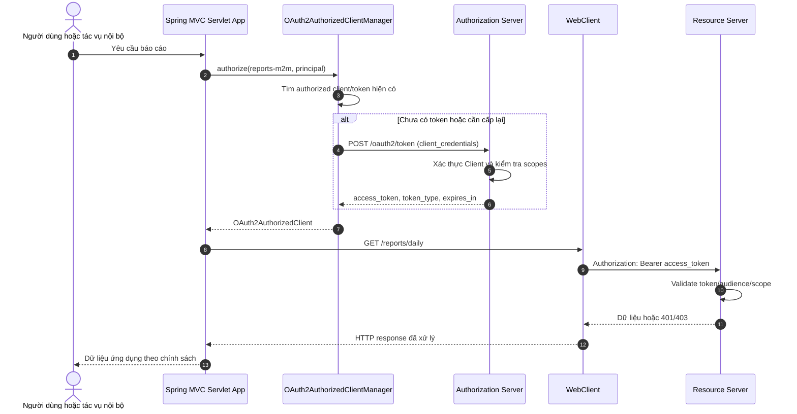
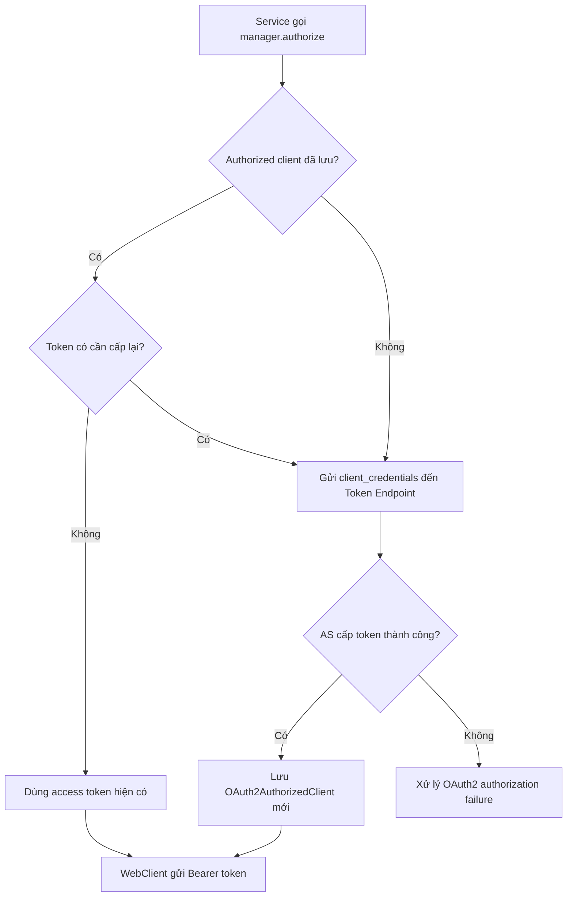

# 19.7. Gọi API bằng client credentials trong ứng dụng Servlet

> **Module:** Spring Security OAuth 2.0 OIDC Client  
> **Chương:** 19. WebClient trên Servlet  
> **Phạm vi:** Spring Boot/Spring Security Servlet (Spring MVC) sử dụng `WebClient` làm HTTP client để gọi Resource Server bằng **OAuth 2.0 Client Credentials Grant**, không phụ thuộc vào việc người dùng đăng nhập bằng OIDC.

Một ứng dụng Spring Boot cung cấp controller theo mô hình Servlet vẫn có thể dùng `WebClient` để gọi dịch vụ HTTP bên ngoài. Khi dịch vụ đó yêu cầu bearer access token và ứng dụng cần truy cập bằng danh tính **của chính ứng dụng**, mô hình phổ biến là OAuth 2.0 **Client Credentials Grant**.

Ví dụ: hệ thống quản trị có một API `GET /internal/reports/daily`; service xử lý báo cáo phải gọi `https://api.example.test/reports/daily`. API đích không cần biết người đang mở dashboard là ai, nhưng cần xác minh rằng Client `reporting-worker` đã được Authorization Server cấp quyền `reports.read`. Luồng cần có:

1. Spring Security xác định OAuth2 Client registration `reports-m2m`.
2. OAuth2 Authorized Client Manager tìm token đã lưu hoặc xin token theo `client_credentials`.
3. Authorization Server xác thực Client bằng phương thức đã đăng ký, phát access token theo phạm vi cho phép.
4. `WebClient` gửi HTTP request đến Reports API kèm `Authorization: Bearer <access-token>`.
5. Resource Server kiểm tra issuer, token validity, audience/scope và policy riêng trước khi trả dữ liệu.

Điểm đặc biệt của bài học là **WebClient không biến ứng dụng Servlet thành một Reactive WebFlux server**. Đây chỉ là lựa chọn HTTP client được xây trên Reactor. Ứng dụng vẫn có thể dùng `SecurityFilterChain`, `HttpSecurity`, `@RestController` và HTTP session của Spring MVC. Đồng thời, Client Credentials **không phải OAuth2 Login của người dùng**: nó không yêu cầu browser, redirect URI, authorization code, ID token hoặc `OidcUser`.

Bài này trình bày hai cách tích hợp hợp lệ nhưng khác ngữ cảnh: (A) để Spring Security `ServletOAuth2AuthorizedClientExchangeFilterFunction` tự gắn bearer token cho `WebClient` trong HTTP request; (B) dùng `AuthorizedClientServiceOAuth2AuthorizedClientManager` với principal hệ thống ổn định cho các API machine-to-machine, kể cả khi không có request.

---

## 1. Mục tiêu học tập

Sau bài học, bạn có thể:

1. Giải thích vì sao `WebClient` sử dụng được trong Spring MVC Servlet application.
2. Phân biệt Client Credentials Grant với OAuth2/OIDC Login qua browser.
3. Cấu hình `ClientRegistration` gồm `client-id`, `client-secret`, `authorization-grant-type: client_credentials`, `scope` và `token-uri`.
4. Giải thích vai trò của `OAuth2AuthorizedClientManager`, `OAuth2AuthorizedClientService` và `OAuth2AuthorizedClientRepository`.
5. Tạo một `WebClient` được tích hợp `ServletOAuth2AuthorizedClientExchangeFilterFunction` khi xử lý Servlet HTTP request.
6. Chỉ định registration của lời gọi API bằng `clientRegistrationId(...)` thay vì tự động gửi token đăng nhập của user tới mọi URL.
7. Dùng service-backed manager và principal key cố định để tránh trộn machine token với principal của người đang truy cập web.
8. Gọi Resource Server bằng `WebClient` với Bearer token và xử lý phản hồi 401/403 đúng nguyên nhân.
9. Hiểu vì sao Client Credentials thường **không có refresh token**, nhưng manager vẫn có thể xin access token mới khi cần.
10. Chọn điểm sử dụng `.block()` hợp lý trong Servlet MVC, không block Reactor event loop.
11. Phân biệt token endpoint credentials với access token và session cookie.
12. Thiết kế timeout, retry, caching, concurrency, tests và logging bảo mật cho outbound API calls.
13. Nhận biết trường hợp Resource Server yêu cầu audience, scope, resource hoặc app role theo provider.
14. Tránh những nhầm lẫn như dùng `OAuth2AuthenticationToken` của người dùng làm cơ sở cấp quyền cho machine client.

## 2. Kiến trúc tổng quan

Một backend Servlet thường đóng hai vai trò khác nhau:

- **Web application:** nhận request từ browser/người dùng, chịu trách nhiệm authentication/authorization cho endpoint của chính nó.
- **OAuth2 Client:** gọi một API khác, xác thực Client tại Authorization Server để lấy access token phù hợp.



Sơ đồ không bắt buộc phải có một browser user. Một `@Scheduled` job cũng có thể kích hoạt `WebClient`. Nhưng nếu lời gọi được kích hoạt bởi người dùng, **ứng dụng vẫn phải bảo vệ endpoint của nó**; token Client Credentials không chứng minh người dùng đang truy cập có quyền xem mọi dữ liệu của API.

### 2.1. Ba ranh giới bảo mật

| Ranh giới | Cơ chế | Ai kiểm tra? |
|---|---|---|
| Browser → Spring MVC | Session/OIDC Login, bearer token, hoặc cách auth khác | Spring Security của ứng dụng |
| Spring MVC → Authorization Server | Client authentication, grant `client_credentials` | Authorization Server |
| Spring MVC → Resource Server | Bearer access token, scopes/audience và API authorization | Resource Server |

Một yêu cầu browser thành công ở lớp đầu không có nghĩa Client có quyền xin token máy–máy. Ngược lại, Client có token hợp lệ không có nghĩa tất cả users có quyền sử dụng API đó.

## 3. Client Credentials Grant hoạt động thế nào?

Client Credentials Grant trong OAuth 2.0 dành cho một Client được AS cho phép hành động bằng **quyền của chính Client hoặc workload**, không phải bằng authorization code gắn với một người dùng vừa đăng nhập.

Token request điển hình:

```http
POST /oauth2/token HTTP/1.1
Host: login.example.test
Authorization: Basic <redacted-client-credentials>
Content-Type: application/x-www-form-urlencoded

grant_type=client_credentials&scope=reports.read
```

Token response minh họa:

```json
{
  "access_token": "<redacted-access-token>",
  "token_type": "Bearer",
  "expires_in": 3600,
  "scope": "reports.read"
}
```

Những gì có thể diễn ra:

- Authorization Server kiểm tra Client ID và credential theo registration.
- Authorization Server chỉ cấp scopes/resources Client được phép sử dụng.
- Access token có thời hạn hoặc điều kiện hiệu lực theo chính sách.
- Resource Server kiểm tra token khi nhận API request.
- Khi token hết hạn, Client Credentials provider có thể **thực hiện grant mới** để lấy token mới.

Những gì **không** diễn ra như một phần mặc định của grant:

- Không có trang login OP cho end-user.
- Không có Authorization Code callback.
- Không có OIDC ID Token dùng để tạo `OidcUser`.
- Không cần `HttpSession` của user.
- Thông thường không có refresh token cho grant này.
- Không tự gia hạn session đăng nhập của người đang mở browser.

### 3.1. Client ID và secret khác Bearer access token

| Credential | Nơi sử dụng | Mục đích |
|---|---|---|
| Client ID | Token Endpoint và registration | Định danh Client |
| Client secret hoặc private key | Token Endpoint | Xác thực Client đã đăng ký |
| Access token | Resource Server API | Cho phép API đánh giá quyền của Client |
| HTTP session cookie | Browser ↔ ứng dụng web | Duy trì phiên người dùng (nếu có) |
| OIDC ID Token | RP khi OIDC Login | Xác minh danh tính người dùng |

Không gửi Client secret đến Resource Server như bearer token. Không dùng access token của machine client để tạo phiên đăng nhập user.

## 4. WebClient trên Servlet khác gì WebFlux server?

`WebClient` thuộc hệ sinh thái Spring WebFlux nhưng có thể được dùng làm **HTTP client trong một ứng dụng Spring MVC**.

Một ứng dụng có thể đồng thời có:

```java
@RestController
class ReportsController {
    @GetMapping("/reports")
    String reports() {
        // Servlet request thread gọi một service dùng WebClient.
        return "...";
    }
}
```

và:

```java
WebClient webClient = WebClient.builder()
    .baseUrl("https://api.example.test")
    .build();
```

Điều này **không** đồng nghĩa:

- `HttpSecurity` trở thành `ServerHttpSecurity`.
- `SecurityContextHolder` của Servlet trở thành Reactor Context.
- `ClientRegistrationRepository` tự biến thành `ReactiveClientRegistrationRepository`.
- Controller `@RestController` Servlet bắt buộc trả `Mono`/`Flux`.
- OAuth2 Client Credentials đòi ứng dụng phải triển khai reactive server.

### 4.1. Hai loại OAuth2 WebClient filter

| Ngữ cảnh | Integration | Infrastructure |
|---|---|---|
| **Servlet/MVC** | `ServletOAuth2AuthorizedClientExchangeFilterFunction` | `OAuth2AuthorizedClientManager` dùng các abstraction Servlet hoặc service |
| **Reactive WebFlux** | `ServerOAuth2AuthorizedClientExchangeFilterFunction` | Reactive authorized client/registration abstractions |

Trong bài này dùng **Servlet** integration. Không copy đoạn cấu hình Reactive `ServerOAuth2AuthorizedClientExchangeFilterFunction` sang MVC chỉ vì cả hai đều là `WebClient`.

### 4.2. Có nên gọi block()?

`WebClient` trả `Mono<T>` hoặc `Flux<T>`. Trong một controller MVC đồng bộ, nếu service cần kết quả trước khi trả response thì có thể:

```java
ReportSummary result = webClient.get()
    .uri("/reports/daily")
    .retrieve()
    .bodyToMono(ReportSummary.class)
    .block();
```

Đó là **blocking ở ranh giới Servlet**: thread xử lý MVC chờ network response. Có thể phù hợp nếu hệ thống vốn đồng bộ và có timeout/pool thích hợp. Nhưng:

- Không gọi `block()` bên trong Reactor event loop hoặc luồng reactive đang được quản lý non-blocking.
- Không mặc định block trong mọi service nếu ứng dụng đã dùng async composition.
- Cần timeout và quan sát latency để tránh giữ Servlet thread quá lâu.
- Không gọi `subscribe()` rồi trả kết quả khi side effect còn đang chạy mà không có cơ chế kiểm soát.

Nếu toàn bộ request path được thiết kế reactive, giữ `Mono`/`Flux` thay vì block.

## 5. Phụ thuộc Maven trong Spring Boot Servlet

Ví dụ module web Spring MVC sử dụng Spring Security OAuth2 Client và WebClient:

```xml
<dependencies>
    <dependency>
        <groupId>org.springframework.boot</groupId>
        <artifactId>spring-boot-starter-web</artifactId>
    </dependency>

    <dependency>
        <groupId>org.springframework.boot</groupId>
        <artifactId>spring-boot-starter-security</artifactId>
    </dependency>

    <dependency>
        <groupId>org.springframework.boot</groupId>
        <artifactId>spring-boot-starter-oauth2-client</artifactId>
    </dependency>

    <dependency>
        <groupId>org.springframework.boot</groupId>
        <artifactId>spring-boot-starter-webflux</artifactId>
    </dependency>
</dependencies>
```

Trong cấu hình Spring Boot thông dụng có cả MVC và WebFlux starters, MVC thường được chọn làm web server stack, còn WebClient có sẵn để gọi HTTP. Hãy kiểm tra phiên bản Spring Boot/framework của dự án khi chọn HTTP connector và security configuration.

Ở các dự án muốn dependency tối giản, có thể dùng dependency `spring-webflux` và HTTP client connector được hỗ trợ thay cho toàn bộ WebFlux starter; khi đó cần quản lý các thành phần HTTP client liên quan.

### 5.1. Không nhầm cấu hình client với resource server

Nếu ứng dụng chỉ **gọi API** bằng Client Credentials thì cần OAuth2 Client starter. Nó không nhất thiết cần:

```text
spring-boot-starter-oauth2-resource-server
```

trừ khi ứng dụng còn có nhiệm vụ **nhận bearer access tokens và xác minh chúng** ở inbound endpoints.

Một ứng dụng có thể vừa là OAuth2 Client vừa là Resource Server, nhưng phải cấu hình inbound/outbound security riêng.

## 6. application.yml cho machine-to-machine Client

Giả sử Authorization Server cung cấp Token Endpoint `https://login.example.test/oauth2/token`, và Resource Server là `https://api.example.test`:

```yaml
spring:
  security:
    oauth2:
      client:
        registration:
          reports-m2m:
            provider: internal-as
            client-id: reporting-worker
            client-secret: ${REPORTING_CLIENT_SECRET}
            client-authentication-method: client_secret_basic
            authorization-grant-type: client_credentials
            scope:
              - reports.read

        provider:
          internal-as:
            token-uri: https://login.example.test/oauth2/token
```

Giải thích:

| Property | Giá trị | Ý nghĩa |
|---|---|---|
| `registration.reports-m2m` | `reports-m2m` | Registration ID nội bộ để WebClient/manager chọn |
| `provider` | `internal-as` | Liên kết với Token Endpoint provider |
| `client-id` | `reporting-worker` | ID của machine Client tại AS |
| `client-secret` | Environment variable | Credential nhạy cảm; không hard-code |
| `client-authentication-method` | `client_secret_basic` | Phương thức Client authentication tại Token Endpoint |
| `authorization-grant-type` | `client_credentials` | Grant máy–máy |
| `scope` | `reports.read` | Quyền Client yêu cầu AS |
| `token-uri` | HTTPS URL | Token Endpoint để xin access token |

**Không cần** `redirect-uri` hoặc `scope: openid` trong đăng ký Client Credentials này. Không có interactive OIDC login trong grant.

### 6.1. Cấu hình hai resources riêng biệt

Nếu ứng dụng phải gọi cả Reports và Inventory, nên cân nhắc registrations riêng:

```yaml
spring:
  security:
    oauth2:
      client:
        registration:
          reports-m2m:
            provider: internal-as
            client-id: reporting-worker
            client-secret: ${REPORTING_CLIENT_SECRET}
            client-authentication-method: client_secret_basic
            authorization-grant-type: client_credentials
            scope: [reports.read]

          inventory-m2m:
            provider: internal-as
            client-id: inventory-worker
            client-secret: ${INVENTORY_CLIENT_SECRET}
            client-authentication-method: client_secret_basic
            authorization-grant-type: client_credentials
            scope: [inventory.read]

        provider:
          internal-as:
            token-uri: https://login.example.test/oauth2/token
```

Hai registrations tách quyền, dễ tránh gửi token của Reports tới Inventory. Nếu AS dùng `resource` theo RFC 8707 hoặc `audience` extension riêng, request Token Endpoint cũng cần các tham số phù hợp — **chỉ định scope trong YAML không tự bảo đảm token có đúng audience**.

## 7. Đăng ký Client tại Authorization Server

Spring Boot properties chỉ mô tả Client **phía ứng dụng**. AS còn phải có Client registration tương ứng.

Ví dụ thiết lập:

- Client ID `reporting-worker` tồn tại tại AS.
- Client được đăng ký làm **confidential client** hoặc có cơ chế Client authentication được AS chấp nhận.
- Grant `client_credentials` được bật cho Client.
- Token authentication method khớp `client_secret_basic` (hoặc phương thức thực tế).
- Client được phép xin scope `reports.read`.
- Access token phát cho đúng Reports API audience/resource.
- Token lifetime và chính sách revocation phù hợp.
- Resource Server nhận token từ issuer tin cậy và yêu cầu quyền đúng.

Nếu AS không cho phép `client_credentials` thì sửa YAML để thêm grant **không làm AS thay đổi policy**. Lỗi `unauthorized_client` có thể xuất hiện.

### 7.1. Không chọn public client cho machine grant chỉ vì không muốn secret

Trong mô hình thông dụng, Client Credentials Grant dựa trên Client authentication của workload. Không chuyển sang `client-authentication-method: none` để “sửa” `invalid_client` khi AS yêu cầu confidential Client.

Thay vì xóa credential, hãy sửa đúng Client ID, secret, phương thức xác thực hoặc dùng lựa chọn được AS hỗ trợ như `private_key_jwt` hoặc mutual TLS theo yêu cầu bảo mật.

## 8. Các thành phần quản lý authorized client

Spring Security cung cấp nhiều abstraction dễ nhầm:

| Thành phần | Vai trò |
|---|---|
| `ClientRegistrationRepository` | Tìm cấu hình Client theo registration ID |
| `OAuth2AuthorizedClient` | Client registration cùng access token, refresh token nếu có và principal name |
| `OAuth2AuthorizedClientRepository` | Lưu/đọc authorized client với `HttpServletRequest`/`HttpServletResponse` trong Servlet |
| `OAuth2AuthorizedClientService` | Lưu/đọc/xóa authorized client không phụ thuộc HTTP request |
| `OAuth2AuthorizedClientManager` | Điều phối authorize/reauthorize, dùng grant provider và storage |
| `OAuth2AuthorizedClientProvider` | Thực thi grant được bật, ví dụ `clientCredentials()` |
| `ServletOAuth2AuthorizedClientExchangeFilterFunction` | Gắn OAuth2 authorization vào request `WebClient` trong Servlet integration |

### 8.1. Manager không đồng nghĩa storage

Manager có thể:

1. Tìm `OAuth2AuthorizedClient` đã lưu.
2. Xem token đã đủ điều kiện sử dụng chưa.
3. Gọi Token Endpoint khi cần authorize lại.
4. Lưu authorized client mới theo success handler.
5. Trả authorized client cho caller.

Storage service/repository không tự xin token khi chỉ được gọi `loadAuthorizedClient(...)`.

### 8.2. Client Credentials thông thường không dùng refresh token

Khi access token theo machine grant hết hạn, manager/provider thường thực hiện **Client Credentials Grant mới**:

```text
grant_type=client_credentials
```

chứ không phải:

```text
grant_type=refresh_token
```

đối với token response Client Credentials thông thường. Đừng đặt kỳ vọng `OAuth2AuthorizedClient.getRefreshToken()` luôn khác `null`.

## 9. Phương án A — WebClient filter tích hợp Servlet request

Khi một Spring MVC controller hoặc service được gọi **bên trong HTTP request**, có thể cấu hình `ServletOAuth2AuthorizedClientExchangeFilterFunction` với `DefaultOAuth2AuthorizedClientManager`. Manager này tương tác `OAuth2AuthorizedClientRepository` và ngữ cảnh Servlet.

Luồng:

```text
MVC request
  -> Service dùng WebClient
     -> ServletOAuth2AuthorizedClientExchangeFilterFunction
        -> DefaultOAuth2AuthorizedClientManager
           -> ClientRegistrationRepository
           -> OAuth2AuthorizedClientRepository (HTTP context)
           -> OAuth2AuthorizedClientProvider.clientCredentials()
              -> Token Endpoint nếu cần
     -> WebClient gửi Bearer token tới API
```

Cách này hữu ích khi authorized client cần gắn với HTTP context hoặc ứng dụng đã có web repository được thiết kế phù hợp.

### 9.1. Tạo DefaultOAuth2AuthorizedClientManager

```java
package example.security;

import org.springframework.context.annotation.Bean;
import org.springframework.context.annotation.Configuration;
import org.springframework.security.oauth2.client.OAuth2AuthorizedClientManager;
import org.springframework.security.oauth2.client.OAuth2AuthorizedClientProvider;
import org.springframework.security.oauth2.client.OAuth2AuthorizedClientProviderBuilder;
import org.springframework.security.oauth2.client.registration.ClientRegistrationRepository;
import org.springframework.security.oauth2.client.web.DefaultOAuth2AuthorizedClientManager;
import org.springframework.security.oauth2.client.web.OAuth2AuthorizedClientRepository;

@Configuration
public class ServletMachineClientConfiguration {

    @Bean("servletMachineClientManager")
    OAuth2AuthorizedClientManager servletMachineClientManager(
            ClientRegistrationRepository registrations,
            OAuth2AuthorizedClientRepository authorizedClients) {

        OAuth2AuthorizedClientProvider provider =
            OAuth2AuthorizedClientProviderBuilder.builder()
                .clientCredentials()
                .build();

        DefaultOAuth2AuthorizedClientManager manager =
            new DefaultOAuth2AuthorizedClientManager(
                registrations,
                authorizedClients
            );

        manager.setAuthorizedClientProvider(provider);
        return manager;
    }
}
```

Điểm quan trọng:

- `DefaultOAuth2AuthorizedClientManager` phù hợp với **ngữ cảnh Servlet request**.
- Nó sử dụng repository cần request/response theo cơ chế hiện hành.
- Provider `clientCredentials()` được bật tường minh.
- Client registration quyết định Token Endpoint và Client authentication.
- Session/AuthN của user không được dùng làm **bằng chứng quyền của machine client**.

### 9.2. Gắn manager vào ServletOAuth2AuthorizedClientExchangeFilterFunction

```java
package example.security;

import org.springframework.beans.factory.annotation.Qualifier;
import org.springframework.context.annotation.Bean;
import org.springframework.context.annotation.Configuration;
import org.springframework.security.oauth2.client.OAuth2AuthorizedClientManager;
import org.springframework.security.oauth2.client.web.reactive.function.client.ServletOAuth2AuthorizedClientExchangeFilterFunction;
import org.springframework.web.reactive.function.client.WebClient;

@Configuration
class ServletWebClientConfiguration {

    @Bean("reportsServletWebClient")
    WebClient reportsServletWebClient(
            @Qualifier("servletMachineClientManager")
            OAuth2AuthorizedClientManager manager) {

        ServletOAuth2AuthorizedClientExchangeFilterFunction oauth2 =
            new ServletOAuth2AuthorizedClientExchangeFilterFunction(
                manager
            );

        return WebClient.builder()
            .baseUrl("https://api.example.test")
            .apply(oauth2.oauth2Configuration())
            .build();
    }
}
```

`oauth2.oauth2Configuration()` gắn OAuth2 ExchangeFilterFunction và các cấu hình liên quan vào `WebClient.Builder`. Không cần tự tạo `Authorization: Basic ...` cho API; Basic Client credentials được sử dụng trong token request theo ClientRegistration, còn API dùng Bearer access token.

**Không đặt global default OAuth2 Client cho mọi outbound URL** trừ khi mọi request đều tới đúng Resource Server và đúng quyền. Tránh vô tình gửi token tới một URL không được tin cậy.

### 9.3. Chỉ rõ registration cho từng request

Trong service:

```java
package example.reports;

import org.springframework.beans.factory.annotation.Qualifier;
import org.springframework.stereotype.Service;
import org.springframework.web.reactive.function.client.WebClient;

import static org.springframework.security.oauth2.client.web.reactive.function.client.ServletOAuth2AuthorizedClientExchangeFilterFunction.clientRegistrationId;

@Service
public class ServletReportsClient {

    private final WebClient reportsWebClient;

    public ServletReportsClient(
            @Qualifier("reportsServletWebClient")
            WebClient reportsWebClient) {
        this.reportsWebClient = reportsWebClient;
    }

    public String loadDailyReport() {
        return reportsWebClient.get()
            .uri("/reports/daily")
            .attributes(clientRegistrationId("reports-m2m"))
            .retrieve()
            .bodyToMono(String.class)
            .block();
    }
}
```

Dòng quan trọng:

```java
.attributes(clientRegistrationId("reports-m2m"))
```

nói với OAuth2 filter: hãy authorize **registration `reports-m2m`** cho request này. Đây là registration ID trong `application.yml`, không phải OAuth2 `client-id` ở AS.

Không đặt tên API đích vào `clientRegistrationId`; nếu base URL là `https://api.example.test` nhưng registration ID là `reports-m2m`, phải dùng `reports-m2m`.

### 9.4. Giới hạn của phương án Servlet repository

`ServletOAuth2AuthorizedClientExchangeFilterFunction` có thể dùng thông tin servlet request, response và Authentication để authorize. Trong HTTP request có logged-in user, manager/repository có thể lưu authorized client theo **principal name của người đang truy cập** tùy cấu hình.

Điều này **không biến Client Credentials thành delegated user token**. Access token vẫn đại diện Client/service; principal name chỉ có thể được dùng làm **khóa lưu authorized client**.

Hệ quả đáng lưu ý:

- Nhiều users có thể khiến service lưu nhiều authorized client records cùng Client Credentials registration.
- Với HTTP-session repository, token máy–máy có thể được lưu theo session không cần thiết.
- Nếu nghiệp vụ chỉ cần một machine credential chung, có thể muốn **một principal logic ổn định** thay vì principal từ từng web session.
- Nếu gọi từ `@Scheduled` job, đừng kỳ vọng có servlet request để filter/manager kiểu này hoạt động đúng.

Trong hệ thống machine-to-machine thường xuyên, cân nhắc phương án B để chủ động tách token storage khỏi người dùng web.

## 10. Phương án B — Manager không phụ thuộc HTTP request

Với yêu cầu “Ứng dụng Servlet gọi API bằng Client Credentials” nhưng **token thuộc workload chung**, hoặc endpoint và scheduled job cùng gọi một API, cách rõ ràng là dùng `AuthorizedClientServiceOAuth2AuthorizedClientManager`.

Manager này hoạt động với:

- `ClientRegistrationRepository`;
- `OAuth2AuthorizedClientService`;
- `OAuth2AuthorizedClientProvider.clientCredentials()`.

Nó không cần `HttpServletRequest`, `HttpServletResponse` hoặc Authentication từ browser. Ứng dụng chọn một **principal key cố định của workload** để lưu token. Ví dụ `"reports-service"`.

### 10.1. Tạo service-backed manager

```java
package example.security;

import org.springframework.context.annotation.Bean;
import org.springframework.context.annotation.Configuration;
import org.springframework.security.oauth2.client.AuthorizedClientServiceOAuth2AuthorizedClientManager;
import org.springframework.security.oauth2.client.OAuth2AuthorizedClientManager;
import org.springframework.security.oauth2.client.OAuth2AuthorizedClientProvider;
import org.springframework.security.oauth2.client.OAuth2AuthorizedClientProviderBuilder;
import org.springframework.security.oauth2.client.OAuth2AuthorizedClientService;
import org.springframework.security.oauth2.client.registration.ClientRegistrationRepository;

@Configuration
public class MachineAuthorizedClientConfiguration {

    @Bean("machineAuthorizedClientManager")
    OAuth2AuthorizedClientManager machineAuthorizedClientManager(
            ClientRegistrationRepository registrations,
            OAuth2AuthorizedClientService authorizedClientService) {

        OAuth2AuthorizedClientProvider provider =
            OAuth2AuthorizedClientProviderBuilder.builder()
                .clientCredentials()
                .build();

        AuthorizedClientServiceOAuth2AuthorizedClientManager manager =
            new AuthorizedClientServiceOAuth2AuthorizedClientManager(
                registrations,
                authorizedClientService
            );

        manager.setAuthorizedClientProvider(provider);
        return manager;
    }
}
```

Nếu ứng dụng có cả manager cho Servlet và manager cho background, dùng bean names và `@Qualifier` rõ ràng. Không khai báo hai beans cùng tên trong một context.

### 10.2. Tạo service lấy authorized client với machine principal

```java
package example.reports;

import org.springframework.beans.factory.annotation.Qualifier;
import org.springframework.security.oauth2.client.OAuth2AuthorizeRequest;
import org.springframework.security.oauth2.client.OAuth2AuthorizedClient;
import org.springframework.security.oauth2.client.OAuth2AuthorizedClientManager;
import org.springframework.stereotype.Service;

@Service
public class MachineAuthorizationService {

    private final OAuth2AuthorizedClientManager manager;

    public MachineAuthorizationService(
            @Qualifier("machineAuthorizedClientManager")
            OAuth2AuthorizedClientManager manager) {
        this.manager = manager;
    }

    public OAuth2AuthorizedClient authorizeReports() {
        OAuth2AuthorizeRequest request =
            OAuth2AuthorizeRequest
                .withClientRegistrationId("reports-m2m")
                .principal("reports-service")
                .build();

        OAuth2AuthorizedClient client = manager.authorize(request);

        if (client == null) {
            throw new IllegalStateException(
                "Cannot authorize Client Credentials for reports-m2m"
            );
        }

        return client;
    }
}
```

`"reports-service"` là **khóa lưu token**, không phải người dùng đăng nhập. Sử dụng cùng principal key qua các lần request/job giúp manager có thể tìm authorized client cũ và tái sử dụng access token còn hiệu lực.

### 10.3. Gắn token vào WebClient

Ví dụ theo cách minh bạch, tự đặt bearer token trong một service:

```java
package example.reports;

import java.time.Duration;

import org.springframework.beans.factory.annotation.Qualifier;
import org.springframework.stereotype.Service;
import org.springframework.web.reactive.function.client.WebClient;

@Service
public class ReportsApiClient {

    private final MachineAuthorizationService authorization;
    private final WebClient webClient;

    public ReportsApiClient(
            MachineAuthorizationService authorization,
            @Qualifier("reportsApiWebClient") WebClient webClient) {
        this.authorization = authorization;
        this.webClient = webClient;
    }

    public String fetchDailyReport() {
        var authorizedClient = authorization.authorizeReports();

        return webClient.get()
            .uri("/reports/daily")
            .headers(headers -> headers.setBearerAuth(
                authorizedClient.getAccessToken().getTokenValue()
            ))
            .retrieve()
            .bodyToMono(String.class)
            .timeout(Duration.ofSeconds(5))
            .block();
    }
}
```

Bean WebClient thuần:

```java
import org.springframework.context.annotation.Bean;
import org.springframework.context.annotation.Configuration;
import org.springframework.web.reactive.function.client.WebClient;

@Configuration
class ReportsApiHttpConfiguration {

    @Bean("reportsApiWebClient")
    WebClient reportsApiWebClient(WebClient.Builder builder) {
        return builder
            .baseUrl("https://api.example.test")
            .build();
    }
}
```

Ở phương án này:

- Manager quản lý Client Credentials grant và token storage.
- `WebClient` gửi access token đến đúng API khi service yêu cầu.
- Không phụ thuộc một HTTP session đang hoạt động.
- Cùng một service có thể được gọi từ MVC controller hoặc scheduled job.
- Tên principal ổn định hỗ trợ token reuse trong một JVM/storage tương ứng.

**Trade-off:** đoạn code tự chèn Bearer token. Cần giới hạn WebClient tới endpoint tin cậy và không làm lộ token khi log/retry. Khi dự án có OAuth2-aware WebClient filter phù hợp phiên bản, có thể gắn service-backed manager trực tiếp để filter tự authorize và thêm token; cách thủ công ở đây giúp thấy rõ ranh giới.

### 10.4. Có thể dùng Servlet filter với service-backed manager không?

Có. `ServletOAuth2AuthorizedClientExchangeFilterFunction` nhận `OAuth2AuthorizedClientManager` qua constructor, nên bạn có thể truyền service-backed manager nếu cần dùng filter cho HTTP client.

Tuy nhiên, **cần kiểm soát principal/authorized-client context** mà filter dùng khi gọi manager. Nếu mặc định lấy Authentication của request web, bạn có thể vẫn tạo authorized clients theo từng user thay vì theo workload, dù manager không phụ thuộc Servlet request. Vì vậy, với machine token dùng chung và tác vụ nền, việc gọi `authorize(...).principal("reports-service")` tường minh là một cách dễ hiểu và ít bất ngờ.

Không tự tạo `Authentication` “admin” rồi gắn vào SecurityContext chỉ để lấy machine token. Cần giữ machine identity riêng và không làm sai nghĩa của principal web.

## 11. Tại sao nên chọn service-backed manager cho workload chung?

So sánh:

| Tình huống | Servlet manager + WebClient filter | Service-backed manager + principal cố định |
|---|---|---|
| MVC request có Authentication | Phù hợp | Phù hợp |
| `@Scheduled` job không có HTTP request | Không phải lựa chọn điển hình | **Phù hợp** |
| Token cần gắn với session/user trong web request | Có thể phù hợp | Cần thiết kế user principal rõ ràng |
| Token thực sự là quyền của ứng dụng | Cần tránh storage theo từng user không cần thiết | **Rõ ràng hơn** |
| WebClient tự chèn Bearer token | Có, qua filter | Có thể tự chèn hoặc wiring filter theo context được kiểm soát |
| Chia sẻ token giữa request và job | Phụ thuộc web repository | Có thể dùng chung service store |
| In-memory cache một instance | Tùy storage | Có, nếu service in-memory và principal ổn định |
| Nhiều nodes | Cần storage/coordination phù hợp | Cần JDBC/shared storage và concurrency policy |

Việc “đẹp” hơn không phải ưu tiên duy nhất. Chọn thiết kế phản ánh **ai sở hữu authorization** và có ngữ cảnh HTTP nào lúc gọi manager.

## 12. Kết nối từ MVC controller đến ReportsApiClient

Một controller Spring MVC đơn giản:

```java
package example.reports;

import org.springframework.web.bind.annotation.GetMapping;
import org.springframework.web.bind.annotation.RestController;

@RestController
class ReportsController {

    private final ReportsApiClient reports;

    ReportsController(ReportsApiClient reports) {
        this.reports = reports;
    }

    @GetMapping("/internal/reports/daily")
    String daily() {
        return reports.fetchDailyReport();
    }
}
```

Controller này **chưa tự bảo vệ** endpoint. Ứng dụng cần `SecurityFilterChain` quy định ai được dùng chức năng đọc báo cáo. Bởi backend đang gọi API bằng quyền máy–máy, nếu inbound endpoint mở cho mọi người, một người không có quyền có thể gián tiếp gọi API bằng token có quyền cao.

Ví dụ HTTP security cho ứng dụng có authentication riêng:

```java
import org.springframework.context.annotation.Bean;
import org.springframework.context.annotation.Configuration;
import org.springframework.security.config.annotation.web.builders.HttpSecurity;
import org.springframework.security.web.SecurityFilterChain;

@Configuration
class WebAccessPolicy {

    @Bean
    SecurityFilterChain webSecurityChain(HttpSecurity http)
            throws Exception {

        return http
            .authorizeHttpRequests(auth -> auth
                .requestMatchers("/public/**").permitAll()
                .requestMatchers("/internal/reports/**")
                    .hasAuthority("REPORT_VIEWER")
                .anyRequest().authenticated()
            )
            .build();
    }
}
```

Đây là ví dụ access policy **để minh họa**, không bao gồm cách người dùng lấy authority `REPORT_VIEWER`. Trong ứng dụng có OIDC Login, có thể thêm `.oauth2Login(Customizer.withDefaults())` và mapping authorities theo nguồn tin cậy. Nếu sản phẩm nhận JWT bearer inbound, cấu hình `oauth2ResourceServer(...)` thích hợp.

**Không cấp `REPORT_VIEWER` cho mọi người chỉ vì machine Client được AS cấp `reports.read`.** Đó là hai cấp quyền ở hai ranh giới khác nhau.

## 13. Scheduled job dùng chung WebClient và machine token

Cùng `ReportsApiClient` có thể được dùng từ scheduler:

```java
package example.reports;

import org.springframework.scheduling.annotation.Scheduled;
import org.springframework.stereotype.Component;

@Component
class DailyReportSyncJob {

    private final ReportsApiClient reportsApi;

    DailyReportSyncJob(ReportsApiClient reportsApi) {
        this.reportsApi = reportsApi;
    }

    @Scheduled(cron = "0 0 2 * * *", zone = "UTC")
    void syncReports() {
        String report = reportsApi.fetchDailyReport();

        // Xử lý dữ liệu sau khi nhận báo cáo.
        // Không ghi access token hoặc client secret vào log.
    }
}
```

Để bật scheduling:

```java
import org.springframework.boot.autoconfigure.SpringBootApplication;
import org.springframework.boot.SpringApplication;
import org.springframework.scheduling.annotation.EnableScheduling;

@SpringBootApplication
@EnableScheduling
public class Application {

    public static void main(String[] args) {
        SpringApplication.run(Application.class, args);
    }
}
```

Điểm mạnh của phương án service-backed: `authorizeReports()` không cần session hoặc user Authentication. Không cần truyền servlet request giả hoặc dựa vào `SecurityContextHolder` từ scheduler.

### 13.1. Một trường hợp dễ sai

Không làm:

```java
String principalName =
    SecurityContextHolder.getContext()
        .getAuthentication()
        .getName();  // Có thể null trong @Scheduled.
```

Khi job dùng `client_credentials`, principal key phải mô tả workload, không bắt nguồn từ người dùng cuối.

## 14. Access token hết hạn: manager có tự xử lý không?

Nếu dùng `OAuth2AuthorizedClientManager` với provider `clientCredentials()`, manager có thể:

1. Load authorized client đã lưu theo registration ID và principal.
2. Nếu access token còn dùng được theo logic provider, tái sử dụng nó.
3. Nếu chưa có hoặc cần cấp mới, gọi Token Endpoint bằng Client Credentials Grant.
4. Lưu authorized client mới nếu success handler/storage được cấu hình.
5. Trả authorized client cho caller.

Đây là **reauthorization bằng client_credentials**, không nhất thiết là Refresh Token Grant.



**Không nên** tự chạy một job refresh token mỗi vài giây chỉ để tránh access token expiry nếu manager đã có cơ chế tái sử dụng/cấp mới khi cần. Cần cân nhắc policy token TTL, concurrency và số lượng token requests.

### 14.1. Không mặc định mọi access token có refresh token

Với Client Credentials, response thường gồm `access_token`, `token_type` và `expires_in`; refresh token thường không được phát. Kiểm tra:

```java
OAuth2AuthorizedClient authorized = ...;
boolean hasRefreshToken = authorized.getRefreshToken() != null;
```

Nhưng code này chỉ phục vụ chẩn đoán; nếu API là machine grant, đừng cố gọi refresh grant khi AS không hỗ trợ.

### 14.2. Token hết hạn khác việc API từ chối

Một token theo metadata còn hạn vẫn có thể bị Resource Server từ chối do:

- Token bị thu hồi.
- Audience sai.
- Scope/role không đủ.
- Resource Server không tin issuer hoặc signing key.
- Authorization policy bị thay đổi.
- Token bị gửi tới sai API.

Manager biết expiration metadata và grant provider, nhưng không tự đoán mọi nguyên nhân 401/403 do API trả về. Xử lý đúng ở HTTP client/error policy.

## 15. Scope, audience, resource phải đúng API

Cấu hình:

```yaml
scope:
  - reports.read
```

đòi Client được AS cấp quyền tương ứng. Nhưng scope **không tự xác định audience** theo một quy tắc OAuth2 chung.

Một số Authorization Servers yêu cầu:

- `resource` tại Token Endpoint theo RFC 8707 Resource Indicators.
- `audience` theo extension riêng, ví dụ một số API/M2M provider.
- `scope=<resource>/.default` trong các trường hợp Client Credentials của Microsoft identity platform v2.
- Audience mapper/client scopes ở Keycloak hoặc policy provider khác.

Để thêm tham số riêng của provider, cần tùy chỉnh **Client Credentials Token Endpoint request**, chẳng hạn qua `OAuth2AccessTokenResponseClient<OAuth2ClientCredentialsGrantRequest>` trong phiên bản Spring Security hỗ trợ.

### 15.1. Đừng đặt audience vào WebClient request gửi API

Nếu AS yêu cầu `audience` để phát token đúng API, thì audience cần được yêu cầu **khi xin token**, không phải thêm một HTTP header `X-Audience` tùy ý khi gọi Resource Server rồi mong `aud` của access token tự thay đổi.

Một access token đã phát có claims/metadata nhất định. Client **không sửa token** được để đổi resource/scope. Cần xin token mới theo registration/AS policy phù hợp.

### 15.2. Cẩn thận cache key

Authorized client thường lưu theo cặp **registration ID + principal name**. Nếu bạn tái sử dụng cùng key cho hai resource audiences thay đổi động, manager có thể tái sử dụng token của resource A khi bạn muốn gọi resource B.

Chiến lược dễ hiểu: registrations/keys rõ ràng cho từng API hoặc một cơ chế cache/token manager tùy biến có key bao gồm target/scopes/tenant khi có yêu cầu phức tạp. Không tin rằng thêm `audience` vào token request thì cache tự phân vùng.

## 16. Phản hồi HTTP: xử lý 2xx, 401, 403, 5xx

Khi gọi API bằng WebClient, cần phân biệt lỗi **Token Endpoint** và lỗi **Resource Server**.

### 16.1. Token Endpoint lỗi

| Mã OAuth2 | Nguyên nhân thường gặp | Hướng kiểm tra |
|---|---|---|
| `invalid_client` | Client ID/secret hoặc auth method sai | Credentials, registration, phương thức Client auth |
| `unauthorized_client` | Client không được phép dùng Client Credentials | AS grant policy |
| `invalid_scope` | Scope không được phép hoặc sai cú pháp | Scopes của registration và AS permissions |
| `invalid_target` | Resource indicator không hợp lệ/không được phép khi AS hỗ trợ RFC 8707 | Resource targeting policy |
| `server_error` hoặc HTTP 5xx | AS gặp lỗi hệ thống | Timeout, retry/backoff, circuit breaker |

Nếu Token Endpoint không cấp được token, WebClient không nên cố gửi một Bearer token rỗng hoặc Client secret thay thế.

### 16.2. Resource Server lỗi

| HTTP status | Nguyên nhân có thể | Xử lý |
|---|---|---|
| 401 | Token không có, không hợp lệ, hết hạn, sai audience/issuer, revoke | Kiểm tra token, Resource Server configuration, cân nhắc cấp lại có giới hạn khi phù hợp |
| 403 | Scope/app role/authorization không đủ | Sửa quyền/AS/API policy; không retry vô hạn |
| 404 | Sai endpoint hoặc resource không hiện hữu | Kiểm tra URI, tránh suy đoán 404 luôn do auth |
| 429 | Rate limit | Respect `Retry-After` và backoff theo contract |
| 5xx | Lỗi dịch vụ đích | Retry idempotent requests có giới hạn, timeout/circuit breaker |

**Không** “sửa” 403 bằng cách tăng scope `admin` tùy tiện. AS cấp token không thay thế authorization nghiệp vụ của Resource Server.

### 16.3. Không log error body chứa token

Một số OAuth2 HTTP clients hoặc interceptors log raw HTTP bodies khi DEBUG. Tránh trả nguyên Token Endpoint response hoặc headers chứa credentials. Trong sản phẩm, phân loại lỗi và dùng correlation IDs, không đưa secrets vào ticket.

## 17. Xử lý WebClientResponseException

Với `WebClient.retrieve()`, HTTP 4xx/5xx thường dẫn tới `WebClientResponseException` khi kết quả được subscribe/block.

Ví dụ xử lý theo status mà không trả raw response body cho browser:

```java
import org.springframework.web.reactive.function.client.WebClientResponseException;

public String fetchDailySafely() {
    try {
        return reportsApiClient.fetchDailyReport();
    } catch (WebClientResponseException.Unauthorized ex) {
        throw new IllegalStateException(
            "Reports API rejected the machine access token"
        );
    } catch (WebClientResponseException.Forbidden ex) {
        throw new IllegalStateException(
            "Reports API denied the requested operation"
        );
    } catch (WebClientResponseException ex) {
        throw new IllegalStateException(
            "Reports API call failed with status " +
            ex.getStatusCode().value()
        );
    }
}
```

Đây là ví dụ service-level exception mapping. Trong sản phẩm, cần handler/mapping API lỗi chuẩn hóa theo Spring MVC, correlation ID và retry policy. Không chỉ bọc mọi lỗi bằng IllegalStateException rồi trả stacktrace ra browser.

### 17.1. Token errors có thể không phải WebClientResponseException

Nếu `manager.authorize(...)` thất bại trước khi WebClient gửi request đến API, lỗi có thể là `OAuth2AuthorizationException` hoặc exception liên quan Client Credentials provider/Token Endpoint. Phân biệt:

```text
authorize manager -> Token Endpoint (lỗi OAuth2)
                        |
                        v
                 Nếu có token
                        |
                        v
                 WebClient -> API (lỗi HTTP 401/403/5xx)
```

Không gom lỗi `invalid_client` của AS thành “Reports API 403”.

## 18. Token không được lộ qua redirect hoặc URL

Phần lớn access tokens Client Credentials là Bearer credentials. Ai có token hợp lệ có thể thử gửi nó tới Resource Server chấp nhận token đó.

Cần bảo vệ:

- Không đặt access token trong query string `?access_token=...`.
- Không trả `authorizedClient.getAccessToken().getTokenValue()` cho browser.
- Không dùng WebClient với untrusted URL được người dùng cung cấp kèm token.
- Không ghi `Authorization` header vào log.
- Không lưu Client secret trong mã nguồn hoặc public config.
- Không serialize toàn bộ `OAuth2AuthorizedClient`.
- Không đưa token vào exception message, metrics labels hoặc traces.
- Chỉ gọi API đúng HTTPS base URL được phép.

Nếu API URL có thể đến từ request parameter, phải chống SSRF và token exfiltration bằng allowlist/URI validation và thiết kế HTTP client theo từng destination, không cho bất kỳ host nào nhận Bearer token.

## 19. Timeout, kết nối và thread model

Dùng `WebClient` trong MVC có thể tạo nhiều request outbound đồng thời. Cần kiểm soát:

- Connection timeout khi kết nối API.
- Response timeout/overall timeout.
- Pooling và connection limits.
- Retry khi lỗi tạm thời.
- Circuit breaker để tránh cạn Servlet threads khi API đích chậm.
- Graceful handling khi Token Endpoint chậm hoặc không truy cập được.

### 19.1. timeout trên pipeline

```java
String response = webClient.get()
    .uri("/reports/daily")
    .retrieve()
    .bodyToMono(String.class)
    .timeout(java.time.Duration.ofSeconds(5))
    .block();
```

Timeout ở Reactor pipeline giới hạn thời gian chờ của operation này nhưng không thay thế mọi cấu hình connect timeout, response timeout hoặc network-level timeouts.

### 19.2. Ví dụ Reactor Netty connector

Khi dự án dùng Reactor Netty:

```java
import java.time.Duration;

import org.springframework.context.annotation.Bean;
import org.springframework.context.annotation.Configuration;
import org.springframework.http.client.reactive.ReactorClientHttpConnector;
import org.springframework.web.reactive.function.client.WebClient;

import reactor.netty.http.client.HttpClient;

@Configuration
class OutboundHttpConfiguration {

    @Bean("reportsApiWebClient")
    WebClient reportsApiWebClient(WebClient.Builder builder) {
        HttpClient client = HttpClient.create()
            .responseTimeout(Duration.ofSeconds(5));

        return builder
            .baseUrl("https://api.example.test")
            .clientConnector(new ReactorClientHttpConnector(client))
            .build();
    }
}
```

Đây là một lựa chọn cấu hình **thay cho bean WebClient thuần** ở mục 10.3; đừng khai báo cả hai beans cùng tên. Nếu chọn connector khác, dùng timeout API tương ứng.

### 19.3. Không block trên Reactor event loop

Nếu service dùng `.block()` trong Servlet MVC thread, đây là một mô hình đồng bộ có chủ đích. Nếu cùng service được gọi trong `Mono.flatMap(...)` hoặc một Reactor event loop, blocking có thể gây lỗi hoặc làm nghẽn reactive pipeline.

Khi xây ứng dụng end-to-end reactive, nên cho service trả `Mono<T>`, dùng reactive OAuth2 Client integration và xử lý context theo WebFlux. **Bài này tập trung Servlet**, nên các ví dụ có `block()` ở ranh giới MVC.

## 20. Tái sử dụng token và phân vùng principal key

`OAuth2AuthorizedClientService` thường lưu authorized clients theo:

```text
(clientRegistrationId, principalName)
```

Trong phương án B:

```text
(reports-m2m, reports-service)    -> token cho Reports API
(inventory-m2m, inventory-service)-> token cho Inventory API
```

Ở đây principal name là **machine workload identity** chỉ dùng để xác định bản ghi token.

### 20.1. Không sinh principal ngẫu nhiên mỗi lần

Tránh:

```java
.principal(java.util.UUID.randomUUID().toString())
```

trong mỗi lời gọi API. Điều đó có thể khiến manager luôn thấy một key mới, gửi token requests dư thừa và làm storage phình to.

### 20.2. Không dùng một principal cho tất cả tenants thiếu phân vùng

Nếu ứng dụng có tenant A/B và token mang audience/permissions khác nhau, dùng chung key `(reports-m2m, reports-service)` có thể làm trộn token nếu thực tế Client registration/AS policy không tách biệt.

Nên thiết kế registration ID, principal key, resource targeting và authorized client storage tương ứng ranh giới tenant/workload. Một token có client_credentials không tự bỏ qua quy định dữ liệu tenant.

### 20.3. Nhiều instances

Với `InMemoryOAuth2AuthorizedClientService`, token chỉ sống trong bộ nhớ mỗi JVM. Trong cluster nhiều pods, các pods có thể xin các token riêng.

Nếu muốn shared storage, có thể dùng `JdbcOAuth2AuthorizedClientService` hoặc implementation phù hợp. Nhưng database chung **không tự giải quyết concurrency**: nhiều pods có thể cùng thấy token hết hạn và xin lại. Thiết kế coordination nếu AS áp rate limit hoặc token issuance có yêu cầu mạnh.

## 21. InMemory và JDBC authorized client service

### 21.1. In-memory service

Trong ứng dụng đơn giản, Spring Boot có thể auto-configure service in-memory khi các điều kiện thỏa; hoặc khai báo tường minh:

```java
import org.springframework.context.annotation.Bean;
import org.springframework.security.oauth2.client.InMemoryOAuth2AuthorizedClientService;
import org.springframework.security.oauth2.client.OAuth2AuthorizedClientService;
import org.springframework.security.oauth2.client.registration.ClientRegistrationRepository;

@Bean
OAuth2AuthorizedClientService authorizedClientService(
        ClientRegistrationRepository registrations) {
    return new InMemoryOAuth2AuthorizedClientService(registrations);
}
```

Phù hợp development/test hoặc một instance chấp nhận mất token sau restart.

### 21.2. JDBC service

Đối với storage bền vững:

```java
import org.springframework.context.annotation.Bean;
import org.springframework.jdbc.core.JdbcOperations;
import org.springframework.security.oauth2.client.JdbcOAuth2AuthorizedClientService;
import org.springframework.security.oauth2.client.OAuth2AuthorizedClientService;
import org.springframework.security.oauth2.client.registration.ClientRegistrationRepository;

@Bean
OAuth2AuthorizedClientService authorizedClientService(
        JdbcOperations jdbc,
        ClientRegistrationRepository registrations) {
    return new JdbcOAuth2AuthorizedClientService(jdbc, registrations);
}
```

Cần JDBC dependency, DataSource và schema tương thích version Spring Security. Một script schema tham khảo được đóng gói trong thư viện:

```text
org/springframework/security/oauth2/client/oauth2-client-schema.sql
```

Không đồng thời khai báo InMemory và JDBC beans cùng tên/type mà không có chủ đích. Dùng migrations và bảo vệ database vì nó có thể lưu raw access/refresh tokens.

### 21.3. Chọn storage theo yêu cầu

| Trường hợp | Storage cân nhắc |
|---|---|
| Demo/POC | InMemory |
| Một pod stateless, token có thể xin lại đơn giản | InMemory hoặc policy phù hợp |
| Nhiều pods muốn giảm token requests | Shared service/JDBC, cùng concurrency strategy |
| Có lưu refresh tokens dài hạn | Secure persistent store với rotation/revocation policy |
| Token phải bị xóa khi logout user | Repository/session/lifecycle tương ứng, tùy ngữ cảnh |
| Machine token độc lập với user session | Service-backed manager và principal key rõ ràng |

Không dùng WebClient filter của Servlet mà không biết authorized-client repository thực tế lưu token vào đâu.

## 22. Lỗi thiết kế: thay quyền của user bằng machine token

Giả sử user không được phép xem báo cáo nhạy cảm. Nếu endpoint MVC dùng token machine `reports.read-all` để gọi API, backend có thể truy cập dữ liệu mà user không được phép thấy.

Đây là rủi ro **confused deputy**: backend sở hữu quyền mạnh hơn người gọi và vô tình thực hiện hành động trái quyền.

Giải pháp:

1. Bảo vệ inbound endpoint với authentication.
2. Kiểm tra role/permission của user ở Spring Security và tầng nghiệp vụ.
3. Giới hạn dữ liệu theo tenant và đối tượng tài nguyên ở backend/API.
4. Dùng Client Credentials access token chỉ cho những operation mà service được thiết kế thực hiện.
5. Nếu API cần quyền delegated của người dùng, sử dụng Authorization Code/On-Behalf-Of/Token Exchange theo AS policy phù hợp, **không thay bằng machine token mặc định**.

**Client Credentials hợp lệ về mặt OAuth2 vẫn có thể dẫn tới lỗi phân quyền sản phẩm nếu backend không kiểm tra user permissions.**

## 23. Vì sao không cần OIDC ID Token ở Client Credentials?

OIDC ID Token được dùng để khẳng định danh tính end-user với Client/Relying Party, trong các luồng OIDC có scope `openid` và authentication request tương ứng.

Client Credentials không có người dùng vừa đăng nhập. AS có thể phát JWT access token với claims nhận diện service principal, nhưng đó **không phải OIDC ID Token của user**.

Không làm:

```java
// Sai về mặt mô hình:
OidcUser user = parseMachineAccessTokenAsOidcUser(token);
SecurityContextHolder.getContext().setAuthentication(
    createLoginSessionForUser(user)
);
```

Đó là hành vi tạo danh tính user từ machine access token, vượt ranh giới trust. Nếu ứng dụng có cả OIDC Login và Client Credentials, duy trì hai flow và policy riêng.

## 24. Logging an toàn và quan sát

Trong quá trình phát triển, cần phân biệt lỗi Token Endpoint với API outbound, nhưng không nên bật raw HTTP request/response logging thiếu kiểm soát.

**Có thể ghi:**

```text
event=machine_api_call
registrationId=reports-m2m
grantType=client_credentials
destination=reports-api
tokenObtained=true
resourceServerStatus=200
durationMs=145
correlationId=opaque-generated-id
```

**Không ghi:**

- `client_secret`, private keys, client assertions.
- HTTP `Authorization: Basic ...` của Token Endpoint.
- HTTP `Authorization: Bearer ...` của Resource Server.
- `access_token`/`refresh_token` response body.
- Full `OAuth2AuthorizedClient` object khi không bảo đảm masking.
- Raw exception/HTTP traces có thể chứa token hoặc dữ liệu nhạy cảm.
- Tenant/user identifiers nhạy cảm không được phê duyệt log.

Với outbound WebClient, kiểm tra filters/interceptors dùng cho wire logging, đặc biệt trong Reactor Netty/HTTP clients. Logs trong môi trường dev có test data vẫn không nên trở thành nguồn lưu credentials lâu dài.

## 25. Không sử dụng dynamic URL tùy ý cùng Bearer filter

Một rủi ro đáng kể là cấu hình:

```java
webClient.get()
    .uri(userProvidedUrl)
    .attributes(clientRegistrationId("reports-m2m"))
    .retrieve()
    ...
```

Nếu caller có thể điều khiển host đích, nó có thể khiến OAuth2 filter gắn Bearer token vào một server không tin cậy. Không bảo đảm OAuth2 filter tự giới hạn token cho đúng API audience.

Biện pháp:

- Dùng `baseUrl` cố định và URI paths được kiểm soát.
- Nếu cần nhiều APIs, tạo WebClient riêng cho từng API/registration.
- Không chấp nhận absolute URL từ input không tin cậy mà không có allowlist.
- Kiểm tra redirect behavior của HTTP client để tránh token bị chuyển hướng không mong muốn.
- Hạn chế credentials theo audience/resource và scopes.
- Cân nhắc network egress policy/SSRF protection ở hạ tầng.

Token yêu cầu được phát cho đúng audience giúp Resource Server từ chối token sai, nhưng **không thay thế bảo vệ chống gửi token tới một host do attacker kiểm soát**.

## 26. Mock và integration tests

Cần test ở nhiều lớp khác nhau.

### 26.1. Unit test service

Mock `OAuth2AuthorizedClientManager` để trả một `OAuth2AuthorizedClient` có access token giả. Dùng mock HTTP server hoặc `ExchangeFunction` giả để kiểm tra WebClient gửi:

```http
Authorization: Bearer fake-test-token
```

cho đúng API URL. Không dùng token thật. Unit test này xác nhận việc gắn header, nhưng **không kiểm tra Token Endpoint grant thực tế**.

### 26.2. Integration test với mock Authorization Server

Một test server có thể giả lập:

1. `POST /oauth2/token`.
2. Kiểm tra `grant_type=client_credentials`.
3. Kiểm tra Client authentication method đã đăng ký.
4. Kiểm tra requested scope/resource nếu AS hỗ trợ.
5. Trả token response giả có `access_token` và `expires_in`.
6. Resource API kiểm tra `Authorization: Bearer ...`.
7. Ghi các request đã che credentials, không lưu token thật.

Đây là cách kiểm thử toàn bộ manager + WebClient mà không dùng OP/AS production.

### 26.3. Test session độc lập

Với Servlet MVC, kiểm tra rằng:

- Một user đăng nhập web có thể gọi endpoint được cấp quyền.
- User không có `REPORT_VIEWER` không thể khiến backend gọi Reports API.
- Máy chạy scheduler không cần HTTP session vẫn gọi được Resource API khi dùng service-backed manager.
- Token của `reports-m2m` không gửi tới `inventory-api`.
- Lỗi Token Endpoint không bị trả nguyên client secret/stacktrace ra browser.

### 26.4. Test expiry và reuse

Cho token test có thời gian hết hạn ngắn hoặc dùng clock được kiểm soát:

- Lần authorize đầu → Token Endpoint được gọi.
- Lần sau khi token còn dùng được → manager có thể tái sử dụng authorized client.
- Khi token cần cấp mới → Client Credentials token request được thực hiện theo policy.
- Nếu credentials bị từ chối → manager không gửi token rỗng tới API.
- Khi source code dùng `OAuth2AuthorizedClientService.loadAuthorizedClient(...)` đơn thuần → test cho thấy không tự cấp token mới.

## 27. Bài thực hành A — Gọi API từ Spring MVC bằng Servlet filter

**Mục tiêu:** dùng `ServletOAuth2AuthorizedClientExchangeFilterFunction` gắn token của `reports-m2m` vào WebClient request.

**Chuẩn bị:** một test AS hỗ trợ Client Credentials, test Reports API, Spring Boot MVC project có OAuth2 Client và WebClient dependencies.

**Các bước:**

1. Đăng ký machine Client trong test AS; bật Client Credentials và cấp `reports.read`.
2. Đặt `REPORTING_CLIENT_SECRET` trong environment.
3. Khai báo `reports-m2m` trong `application.yml`.
4. Tạo `DefaultOAuth2AuthorizedClientManager` với `clientCredentials()`.
5. Tạo `ServletOAuth2AuthorizedClientExchangeFilterFunction` và WebClient theo mục 9.
6. Gọi WebClient với `.attributes(clientRegistrationId("reports-m2m"))`.
7. Trong test API, kiểm tra sự có mặt của Bearer token mà không ghi tokenValue.
8. Chạy lại cùng request và quan sát token reuse theo repository/principal lifecycle.
9. Thử một registration ID không tồn tại để nhận biết lỗi configuration.

**Kết quả mong đợi:** WebClient gọi Reports API với access token được AS phát. API response không chứa Client secret hay token.

**Câu hỏi:** nếu web repository lưu authorized client theo principal của browser, khi hai users khác nhau gọi endpoint thì authorized client keys có thể khác nhau không?

## 28. Bài thực hành B — Dùng service-backed manager với principal cố định

**Mục tiêu:** dùng một machine token context rõ ràng độc lập session.

**Các bước:**

1. Tạo bean `AuthorizedClientServiceOAuth2AuthorizedClientManager` như mục 10.
2. Tạo `MachineAuthorizationService.authorizeReports()` với `principal("reports-service")`.
3. Dùng `ReportsApiClient` gửi Bearer token qua WebClient.
4. Gọi từ MVC controller đã được bảo vệ.
5. Gọi cùng service từ `@Scheduled` job trong test.
6. Xác nhận không cần HTTP session trong job.
7. Quan sát storage theo key `(reports-m2m, reports-service)`.
8. Khởi động lại ứng dụng dùng in-memory service; quan sát lần sau cần token mới.
9. Thử JDBC/shared store nếu cần persistence.

**Kết quả mong đợi:** machine token lifecycle độc lập với principal của user đang dùng web. Không tạo user Authentication từ Client Credentials token.

## 29. Bài thực hành C — Thiếu scope và sai audience

**Mục tiêu:** phân biệt Token Endpoint cấp quyền với Resource Server authorization.

**Các bước:**

1. API test yêu cầu `reports.read` và audience `reports-api`.
2. Cấp Client một token có đúng audience nhưng thiếu `reports.read`; API phải từ chối theo policy.
3. Cấp token có scope đúng nhưng audience `inventory-api`; API phải từ chối.
4. Đăng ký scopes/resource targeting đúng ở AS.
5. Xin token mới theo registration tương ứng.
6. Gọi lại API và xác nhận thành công khi policy cho phép.
7. Ghi status và granted scopes, không ghi raw token.

**Kết quả mong đợi:** OAuth2 Client Credentials không tự tạo quyền. API đích kiểm tra audience và scopes.

## 30. Bài thực hành D — Token Endpoint lỗi và API lỗi

**Mục tiêu:** xử lý lỗi đúng lớp.

**Kịch bản:**

| Test | Lỗi tạo ra | Điều cần thấy |
|---|---|---|
| Client secret sai | `invalid_client` tại Token Endpoint | Manager authorization thất bại; API không được gọi với token giả |
| Client grant chưa bật | `unauthorized_client` | Cần sửa AS registration |
| Scope không được cấp | `invalid_scope` | Cần sửa permission |
| Token API sai audience | HTTP 401/invalid token | Resource Server không chấp nhận |
| Token đúng audience, thiếu quyền | HTTP 403 | Không retry vô hạn |
| API 5xx | Lỗi backend đích | Timeout/backoff và thông báo an toàn |
| Token Endpoint chậm | Timeout của token client | Không treo Servlet thread vô hạn |
| Token cũ hết hạn | Manager cấp lại theo client_credentials | Không yêu cầu OIDC Login của user |

Test bằng AS/API giả lập; không làm thay đổi production settings.

## 31. Bài thực hành E — Bảo vệ endpoint proxy

**Mục tiêu:** ngăn user không đủ quyền lợi dụng machine Client token.

**Các bước:**

1. Cấu hình `/internal/reports/**` yêu cầu authority `REPORT_VIEWER`.
2. Đăng nhập bằng user không có authority đó; request phải bị chặn trước khi gọi API.
3. Dùng user được phép; request mới đi tới `ReportsApiClient`.
4. Đảm bảo business authorization không chỉ dựa trên registration `reports-m2m`.
5. Dùng test tenant A/B để kiểm tra giới hạn dữ liệu nếu API phục vụ nhiều tenants.
6. Đảm bảo API token không bị serialize về browser response.
7. Thử untrusted absolute URL input trong unit test để xác nhận outbound client không chuyển token tới host khác.

**Kết quả mong đợi:** machine token chỉ trao quyền cho workload ở tầng API; người dùng cuối vẫn chịu chính sách riêng của ứng dụng.

## 32. Bài thực hành F — Giới hạn đồng thời và retry

**Mục tiêu:** quan sát nhiều requests có thể cùng xin token khi token hết hạn.

**Các bước:**

1. Chạy hai luồng gọi `ReportsApiClient` với cùng principal key.
2. Dùng test AS ghi số lần token request và status.
3. Với in-memory storage, quan sát token reuse trong một JVM theo manager policy.
4. Thử hai instances có storage tách biệt; chúng có thể xin token riêng.
5. Thử JDBC store dùng chung và kiểm tra có cần coordination khi token expiry không.
6. Khi Token Endpoint 5xx, áp timeout và bounded retry; không retry vô hạn.
7. Với 401 API, xử lý có kiểm soát; không tự cấp scopes cao hơn.
8. Nếu công việc tạo tác dụng phụ, thêm idempotency ở nghiệp vụ, không trông đợi token manager ngăn job trùng.

**Kết quả mong đợi:** token storage giải quyết một phần việc tái sử dụng token, không tự cung cấp distributed lock, rate limit hoặc business idempotency.

## 33. Bảng chẩn đoán lỗi thường gặp

| Triệu chứng | Nguyên nhân có thể | Cách xử lý |
|---|---|---|
| `NoSuchBeanDefinitionException` với WebClient | Thiếu dependency/bean hoặc Spring Boot auto configuration không khớp | Kiểm tra WebClient dependency và bean wiring |
| Servlet WebClient filter không chạy | Chưa `apply(oauth2.oauth2Configuration())` hoặc bean khác | Gắn đúng filter vào WebClient |
| `clientRegistrationId("reports-m2m")` không tìm thấy | Sai registration ID | So với key trong YAML, không dùng client ID của AS |
| Token Endpoint `invalid_client` | Secret/method sai | Sửa Client registration và AS |
| Token Endpoint `unauthorized_client` | Grant chưa được phép | Bật chính sách Client Credentials tại AS |
| Token Endpoint `invalid_scope` | Scope không được cấp | Kiểm tra AS permission |
| API 401 sau khi lấy token | Audience/issuer/expiry/revoke | Kiểm tra Resource Server validation |
| API 403 | Thiếu scope/role/permission | Sửa authorization, không retry vô hạn |
| Không có token trong scheduled job | Dùng manager Servlet cần HTTP request | Dùng service-backed manager và principal cố định |
| Nhiều user làm sinh nhiều machine tokens | Repository/principal gắn từng user | Xem xét service-backed manager với workload key |
| Code `.block()` gây nghẽn | Blocking trên event loop hoặc API chậm | Dùng reactive composition khi cần; timeout và kiểm soát threads |
| API treo | Thiếu timeout | Cấu hình response/network/pipeline timeout |
| Access token bị gửi tới URL lạ | WebClient nhận absolute URI không tin cậy | Allowlist destinations, tách WebClient |
| Token cũ vẫn được dùng sau sửa scope | Authorized client cũ còn trong storage | Invalidate/reauthorize có kiểm soát |
| Test có token nhưng response sai | API cần audience/resource khác | Kiểm tra AS targeting và API policy |
| Restart làm token mất | InMemory service | Chọn shared/persistent store nếu thật sự cần |
| Logout user không xóa machine token | Machine storage độc lập user session | Đây có thể là thiết kế đúng; xác định lifecycle riêng |
| Manager `authorize()` trả null | Không có provider/authorization path phù hợp | Cấu hình `clientCredentials()` và ClientRegistration |
| API token được trả cho browser | Serialize authorized client/token | Dùng DTO dữ liệu nghiệp vụ, không trả Bearer credential |

## 34. Những hiểu lầm cần tránh

| Hiểu lầm | Cách hiểu đúng |
|---|---|
| “WebClient chỉ dùng trong Reactive WebFlux server.” | WebClient dùng làm HTTP client trong Spring MVC Servlet được. |
| “Ứng dụng Servlet phải dùng `ServerOAuth2AuthorizedClientExchangeFilterFunction`.” | Servlet integration dùng `ServletOAuth2AuthorizedClientExchangeFilterFunction`. |
| “Client Credentials là đăng nhập OIDC.” | Đây là machine-to-machine authorization, không tạo OIDC end-user session. |
| “Gọi `clientRegistrationId(...)` là đang chỉ định Client ID ở OP.” | Đây là Spring registration ID. |
| “Có scope trong YAML thì API luôn đồng ý.” | AS và Resource Server còn kiểm tra quyền và target. |
| “Mỗi lần WebClient gọi API phải xin token mới.” | Manager có thể tái sử dụng authorized client còn phù hợp. |
| “Client Credentials luôn có refresh token.” | Thông thường cấp lại qua grant client_credentials. |
| “Người dùng nào gọi API thì token máy–máy thuộc về user đó.” | Machine token thuộc Client/workload; principal có thể chỉ là storage key. |
| “Session hết là không thể dùng machine token.” | Service-backed manager hoạt động ngoài HTTP request nếu đủ quyền AS. |
| “Token machine có quyền read-all nên user nào cũng xem được.” | Đây là rủi ro confused deputy; inbound authorization vẫn cần. |
| “WebClient tự kiểm tra API audience giúp server.” | Resource Server phải tự validate audience/token. |
| “Một bearer token dùng cho nhiều URL có HTTPS đều an toàn.” | Phải gửi đúng trusted destination và đúng audience. |
| “Dùng `.block()` ở đâu cũng được.” | Chỉ block có chủ đích trên thread phù hợp, không chặn Reactor event loop. |
| “Đổi scope YAML làm token đang cache đổi ngay.” | Cần token lifecycle/invalidation/reauthorize. |
| “JDBC tự ngăn các pods xin token trùng.” | Shared storage không tự giải quyết concurrency. |
| “401/403 luôn giải quyết bằng xin token mới.” | 403 có thể là thiếu quyền; 401 có thể do audience hoặc revocation. |

## 35. Câu hỏi tự kiểm tra

**Câu 1.** Vì sao một ứng dụng Spring MVC vẫn có thể sử dụng WebClient?

*Gợi ý:* WebClient là HTTP client; việc sử dụng nó không tự đổi Servlet server stack.

**Câu 2.** Với Client Credentials, có cần authorization code callback hoặc `OidcUser` không?

*Gợi ý:* không có end-user interaction trong grant.

**Câu 3.** Spring Security dùng component nào để tự động gắn OAuth2 authorized client vào WebClient request trong Servlet integration?

*Gợi ý:* `ServletOAuth2AuthorizedClientExchangeFilterFunction`.

**Câu 4.** `.attributes(clientRegistrationId("reports-m2m"))` nhận registration ID hay client ID của AS?

*Gợi ý:* nhận registration ID của Spring.

**Câu 5.** Khi nào nên dùng `AuthorizedClientServiceOAuth2AuthorizedClientManager` thay cho `DefaultOAuth2AuthorizedClientManager`?

*Gợi ý:* tác vụ không có Servlet request và nhu cầu dùng service-backed storage/principal key ổn định.

**Câu 6.** Vì sao `principal("reports-service")` không đại diện user đang mở dashboard?

*Gợi ý:* đây là khóa lưu authorized client cho machine workload.

**Câu 7.** Access token Client Credentials hết hạn thì có bắt buộc dùng refresh token grant không?

*Gợi ý:* thường thực hiện client_credentials grant mới.

**Câu 8.** API trả 403 sau khi Token Endpoint cấp token thành công. Có nên bỏ authorization check của API không?

*Gợi ý:* không; API có thể đòi scopes/roles/permissions khác.

**Câu 9.** Vì sao không trả `OAuth2AuthorizedClient` trực tiếp từ REST controller?

*Gợi ý:* chứa bearer credentials và có thể chứa thông tin nhạy cảm.

**Câu 10.** Nếu WebClient gọi URI do người dùng cung cấp, nguy cơ gì xảy ra khi tự gắn Bearer token?

*Gợi ý:* SSRF/token exfiltration.

**Câu 11.** Trong Spring MVC service, khi nào `.block()` có thể phù hợp và khi nào không?

*Gợi ý:* ranh giới Servlet đồng bộ khác Reactor event loop.

**Câu 12.** Vì sao một machine token được AS cấp scope `reports.read` chưa đủ để mọi người dùng web xem báo cáo?

*Gợi ý:* inbound user authorization và backend business policy độc lập với machine permissions.

## 36. Tài liệu tham khảo

- [RFC 6749 — OAuth 2.0 Authorization Framework, Client Credentials](https://www.rfc-editor.org/rfc/rfc6749#section-4.4): grant máy–máy và Token Endpoint.
- [RFC 6750 — OAuth 2.0 Bearer Token Usage](https://www.rfc-editor.org/rfc/rfc6750): cách gửi bearer access token tới Resource Server.
- [RFC 8707 — Resource Indicators for OAuth 2.0](https://www.rfc-editor.org/rfc/rfc8707): yêu cầu resource target cho access token khi AS hỗ trợ.
- [RFC 9700 — OAuth 2.0 Security Best Current Practice](https://www.rfc-editor.org/rfc/rfc9700): bảo mật Client, token và authorization.
- [Spring Security Reference — OAuth 2.0 Client](https://docs.spring.io/spring-security/reference/servlet/oauth2/client/index.html): cấu hình OAuth2 Client trên Servlet.
- [Spring Security Reference — WebClient Integration](https://docs.spring.io/spring-security/reference/servlet/oauth2/client/authorized-clients.html): cách sử dụng authorized clients/HTTP clients trong Servlet.
- [Spring Security API — ServletOAuth2AuthorizedClientExchangeFilterFunction](https://docs.spring.io/spring-security/reference/api/java/org/springframework/security/oauth2/client/web/reactive/function/client/ServletOAuth2AuthorizedClientExchangeFilterFunction.html): filter tích hợp OAuth2 với WebClient trong Servlet.
- [Spring Security API — DefaultOAuth2AuthorizedClientManager](https://docs.spring.io/spring-security/reference/api/java/org/springframework/security/oauth2/client/web/DefaultOAuth2AuthorizedClientManager.html): manager trong HTTP Servlet request.
- [Spring Security API — AuthorizedClientServiceOAuth2AuthorizedClientManager](https://docs.spring.io/spring-security/reference/api/java/org/springframework/security/oauth2/client/AuthorizedClientServiceOAuth2AuthorizedClientManager.html): manager dùng service-backed storage ngoài HTTP request.
- [Spring Security API — OAuth2AuthorizedClientProviderBuilder](https://docs.spring.io/spring-security/reference/api/java/org/springframework/security/oauth2/client/OAuth2AuthorizedClientProviderBuilder.html): cấu hình `clientCredentials()` provider.
- [Spring Security API — OAuth2AuthorizedClientService](https://docs.spring.io/spring-security/reference/api/java/org/springframework/security/oauth2/client/OAuth2AuthorizedClientService.html): lưu/đọc/xóa authorized clients.
- [Spring Framework Reference — WebClient](https://docs.spring.io/spring-framework/reference/web/webflux-webclient.html): HTTP client API, retrieve, error handling, timeout và client connector.
- [Spring Security Reference — Servlet Authorization](https://docs.spring.io/spring-security/reference/servlet/authorization/authorize-http-requests.html): bảo vệ inbound endpoints để tránh confused deputy.

**Điểm cần nhớ:** ứng dụng Spring MVC/Servlet có thể sử dụng **`WebClient` để gọi Resource Server bằng Client Credentials Grant**. Cấu hình Client registration và manager để nhận/tái sử dụng access token; dùng `ServletOAuth2AuthorizedClientExchangeFilterFunction` cho HTTP request khi muốn tự gắn token, hoặc **service-backed manager với principal workload ổn định** để dùng cả trong controller và background job. Dù chọn cách nào, token máy–máy không phải phiên đăng nhập người dùng: phải bảo vệ inbound endpoint, target API đúng audience/scope, không làm lộ bearer token và kiểm soát timeout, retry, storage cùng concurrency.
