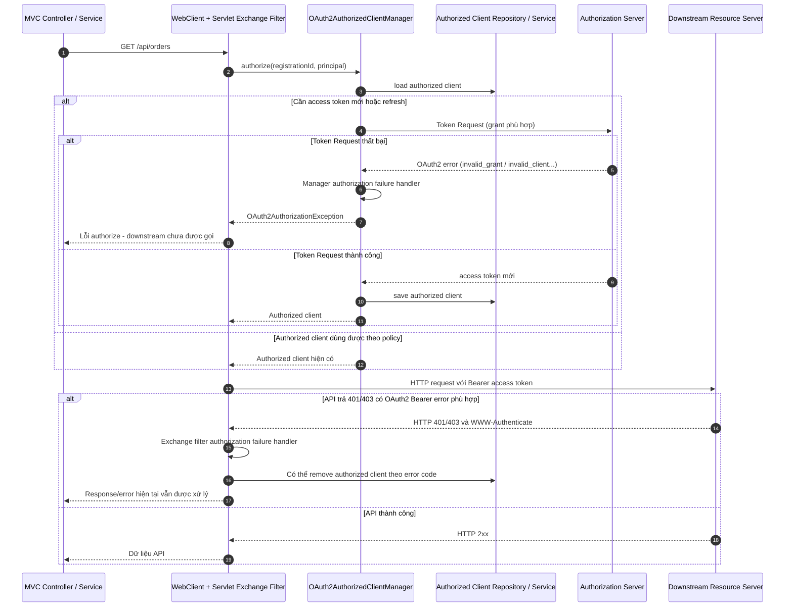

# 19.8. Xử lý lỗi authorize và failure handler của exchange filter

## 1. Bối cảnh: lỗi OAuth2 có thể xuất hiện ở hai nơi khác nhau

Một ứng dụng **Spring Boot chạy trên Servlet/MVC** có thể sử dụng `WebClient` để gọi một Resource Server bên ngoài sau khi người dùng đăng nhập qua **Spring Security OAuth 2.0/OIDC Client**. Khi tích hợp OAuth2 Client với `WebClient`, ứng dụng thường dùng bộ lọc:

```java
org.springframework.security.oauth2.client.web.reactive.function.client
    .ServletOAuth2AuthorizedClientExchangeFilterFunction
```

Bộ lọc này lấy `OAuth2AuthorizedClient` theo registration/principal, sử dụng `OAuth2AuthorizedClientManager` để cấp hoặc cấp lại token khi cần và đặt access token vào outbound HTTP header:

```http
Authorization: Bearer <access-token>
```

Nhưng có **hai giai đoạn có thể thất bại**:

1. **Authorize/re-authorize trước khi gọi downstream:** manager chưa lấy được token hoặc không làm mới được token hiện có. Lỗi thường phát sinh từ Authorization Server/Token Endpoint như `invalid_client`, `invalid_grant`, `invalid_scope`, timeout hoặc lỗi TLS. Trong giai đoạn này, request tới Resource Server có thể **chưa được gửi đi**.
2. **Resource Server trả lỗi sau khi có token:** `WebClient` đã gửi HTTP request có bearer token nhưng API đáp `401 Unauthorized` hoặc `403 Forbidden`. Có thể vì token đã bị thu hồi, không còn hợp lệ, sai audience, không đủ scope hoặc bị policy từ chối.

**Hai lỗi này không được xử lý bằng một quy tắc “cứ lỗi là refresh token”.** `OAuth2AuthorizedClientManager` có failure handler cho lỗi **authorize/re-authorize**, còn `ServletOAuth2AuthorizedClientExchangeFilterFunction` có `setAuthorizationFailureHandler(...)` để xử lý các lỗi OAuth2 authentication/authorization **do Resource Server trả về**.

Một `OAuth2AuthorizationFailureHandler` có thể được dùng ở **cả hai điểm tích hợp**, nhưng *thời điểm gọi, dữ liệu ngữ cảnh và nguyên nhân lỗi* khác nhau. Nếu không phân biệt, ứng dụng có thể xóa nhầm token còn hợp lệ, retry vô hạn hoặc tiếp tục gửi cùng một access token đã bị từ chối.

### 1.1. Mục tiêu bài học

Sau bài này, người học cần giải thích và cấu hình được:

- `ServletOAuth2AuthorizedClientExchangeFilterFunction` khi sử dụng `WebClient` trong **Servlet**, không nhầm với filter dành cho WebFlux.
- Lỗi `OAuth2AuthorizationException` trong manager/provider và failure handler tương ứng.
- Lỗi `401/403` từ Resource Server, sự liên quan với `WWW-Authenticate: Bearer ...` và việc xóa authorized client không còn dùng được.
- Sự khác biệt giữa hai constructors của Servlet exchange filter, đặc biệt là **failure handler mặc định**.
- Cách gắn `RemoveAuthorizedClientOAuth2AuthorizationFailureHandler` vào filter khi tạo bằng `OAuth2AuthorizedClientManager`.
- Cách lựa chọn `OAuth2AuthorizedClientRepository` hay `OAuth2AuthorizedClientService` để xóa đúng entry.
- Vòng đời sau khi xóa: request hiện tại không tự thành công; lần gọi **sau** có thể được cấp token mới.
- Chiến lược xử lý `invalid_grant`, `invalid_token`, `insufficient_scope`, HTTP 429/5xx, timeout và concurrency.
- Những giới hạn khi dùng `WebClient` reactive trong một ứng dụng Servlet đồng bộ.

## 2. Kiến trúc: `WebClient` trên Servlet không biến ứng dụng thành WebFlux

`WebClient` thuộc Spring WebFlux, nhưng có thể được sử dụng làm **HTTP client** bên trong một ứng dụng Spring MVC/Servlet. Vì vậy ta có thể đồng thời sử dụng:

```text
Inbound:
  Servlet Filter Chain
  Spring MVC Controller
  SecurityContextHolder / HttpServletRequest

Outbound:
  WebClient
  ExchangeFilterFunction
  Reactor Mono / Flux
  Netty hoặc HTTP connector khác
```

Đối với OAuth2 Client trong Servlet, thành phần phù hợp là:

```java
ServletOAuth2AuthorizedClientExchangeFilterFunction
```

**Không nhầm với:**

```java
ServerOAuth2AuthorizedClientExchangeFilterFunction
```

Lớp `ServerOAuth2AuthorizedClientExchangeFilterFunction` dùng cho **WebFlux server** với reactive security context và `ReactiveOAuth2AuthorizedClientManager`. Lớp `Servlet...` dùng các abstraction Servlet như `HttpServletRequest`, `HttpServletResponse`, `Authentication`, `OAuth2AuthorizedClientRepository` và manager non-reactive.

### 2.1. Dependencies minh họa

Ứng dụng MVC có thể khai báo:

```gradle
dependencies {
    implementation 'org.springframework.boot:spring-boot-starter-web'
    implementation 'org.springframework.boot:spring-boot-starter-security'
    implementation 'org.springframework.boot:spring-boot-starter-oauth2-client'

    // Để sử dụng WebClient như outbound HTTP client
    implementation 'org.springframework.boot:spring-boot-starter-webflux'
}
```

Có cả `spring-boot-starter-web` và `spring-boot-starter-webflux` **không có nghĩa ứng dụng nhất thiết chạy reactive web server**. Spring Boot chọn web application type theo classpath/configuration; trong tình huống bài học, inbound ứng dụng vẫn là Servlet/MVC.

Các ví dụ dùng kiểu API phổ biến của Spring Security 6.x/7.x. Một số extension points thay đổi theo phiên bản, nên cần đối chiếu dependency cụ thể khi tích hợp.

## 3. Luồng có hai nhánh failure handler



**Hai điều cần nhớ:**

- Khi **Token Endpoint** từ chối refresh token (`invalid_grant`), đó thường là vấn đề của **manager và provider**. Manager có thể dùng `RemoveAuthorizedClientOAuth2AuthorizationFailureHandler` để xóa bản authorized client cũ theo policy.
- Khi **Resource Server** từ chối access token (`invalid_token` trong HTTP Bearer challenge), đó là vấn đề **sau khi WebClient đã gửi HTTP request**. Exchange filter có thể chuyển tín hiệu này cho `OAuth2AuthorizationFailureHandler` để xóa token cũ.

Không phải mọi response `401/403` đều mang đủ thông tin OAuth2 để kết luận token cần bị xóa. Sự khác nhau nằm ở **mã lỗi OAuth2, header challenge, cách filter phân tích response và chính sách failure handler**.

## 4. Các đối tượng liên quan và vai trò

| Thành phần | Chức năng | Failure liên quan |
| --- | --- | --- |
| `ClientRegistrationRepository` | Lưu cấu hình client, grant, Token Endpoint | Thiếu/sai registration |
| `OAuth2AuthorizedClient` | Registration, principal, access token, refresh token nếu có | Token cũ/hết hạn/revoked |
| `OAuth2AuthorizedClientRepository` | Lưu/load/remove token trong Servlet request | Xóa authorized client theo request/principal |
| `OAuth2AuthorizedClientService` | Lưu/load/remove theo registration + principal, ngoài request | Xóa authorized client theo storage key |
| `OAuth2AuthorizedClientProvider` | Cấp/cấp lại token theo grant | Token Endpoint error |
| `OAuth2AuthorizedClientManager` | Điều phối provider, storage, success/failure handlers | Authorize/re-authorize failure |
| `ServletOAuth2AuthorizedClientExchangeFilterFunction` | Tích hợp WebClient với OAuth2 Client | Resource Server 401/403 |
| `OAuth2AuthorizationFailureHandler` | Interface nhận lỗi OAuth2 authorization | Dùng ở manager hoặc exchange filter |
| `RemoveAuthorizedClientOAuth2AuthorizationFailureHandler` | Có thể remove record theo error codes được cấu hình | Token/grant được coi là không còn phù hợp |
| `WebClient.ResponseSpec` / `retrieve()` | Xử lý HTTP response của downstream | `WebClientResponseException`/business mapping |
| Resource Server | Xác minh bearer token và quyền API | `invalid_token`, `insufficient_scope`, policy denial |

### 4.1. `OAuth2AuthorizationFailureHandler` có chữ ký gì?

Hợp đồng trọng tâm:

```java
void onAuthorizationFailure(
        OAuth2AuthorizationException authorizationException,
        Authentication principal,
        Map<String, Object> attributes);
```

Trong đó:

- `authorizationException` chứa `OAuth2Error` với error code và thông tin lỗi theo ngữ cảnh.
- `principal` là authentication liên quan tới authorized client.
- `attributes` là metadata tùy ngữ cảnh, có thể chứa Servlet request/response hoặc thông tin cần thiết khác.

**Không log toàn bộ exception/attributes một cách thiếu kiểm soát** nếu chúng có thể chứa dữ liệu nhạy cảm. Không ghi raw access token, refresh token, client secret, HTTP Authorization header hoặc cookie.

### 4.2. `RemoveAuthorizedClientOAuth2AuthorizationFailureHandler` làm gì?

Class này thực hiện `OAuth2AuthorizationFailureHandler` và **chỉ remove authorized client khi `OAuth2Error.getErrorCode()` thuộc tập mã lỗi được cấu hình**.

Ý nghĩa:

```text
OAuth2 error xuất hiện
    ↓
Failure handler đọc OAuth2 error code
    ↓
Nếu error code thuộc remove set:
    tìm đúng registration + principal
    remove authorized client trong repository/service
Nếu không:
    không nhất thiết xóa entry
```

Trong implementation có hằng số:

```java
RemoveAuthorizedClientOAuth2AuthorizationFailureHandler
    .DEFAULT_REMOVE_AUTHORIZED_CLIENT_ERROR_CODES
```

Không nên tự viết logic `if (status == 401 || status == 403) remove everything`. **Mã HTTP chỉ là dấu hiệu ban đầu**, còn lý do OAuth2 thật sự mới quyết định liệu lưu token có nên bị vô hiệu hay không.

## 5. Điểm dễ bỏ sót: constructor quyết định failure handler mặc định

`ServletOAuth2AuthorizedClientExchangeFilterFunction` có hai kiểu tạo phổ biến, với **hành vi default khác nhau**.

### 5.1. Tạo bằng registration repository + authorized client repository

```java
new ServletOAuth2AuthorizedClientExchangeFilterFunction(
    clientRegistrationRepository,
    authorizedClientRepository);
```

Với constructor này, Spring Security cấu hình sẵn **`RemoveAuthorizedClientOAuth2AuthorizationFailureHandler`** để nhận các OAuth2 authentication/authorization failures từ Resource Server, rồi *có thể* xóa authorized client tùy error code.

Ví dụ:

```java
@Configuration
class DefaultWebClientConfiguration {

    @Bean
    WebClient protectedApiWebClient(
            ClientRegistrationRepository registrations,
            OAuth2AuthorizedClientRepository authorizedClients) {

        var oauth2 = new ServletOAuth2AuthorizedClientExchangeFilterFunction(
            registrations, authorizedClients);

        return WebClient.builder()
            .baseUrl("https://api.example.com")
            .apply(oauth2.oauth2Configuration())
            .build();
    }
}
```

**Ưu điểm:** dễ dùng và có hành vi remove-on-relevant-OAuth2-error theo mặc định của filter.

**Giới hạn:** constructor tự tạo/quản lý cơ chế authorize từ các repositories; nếu ứng dụng có một `OAuth2AuthorizedClientManager` tùy chỉnh (providers, clock skew, success handler, Token Endpoint HTTP client...), cần cân nhắc constructor nhận manager và gắn handler rõ ràng.

### 5.2. Tạo bằng `OAuth2AuthorizedClientManager`

```java
new ServletOAuth2AuthorizedClientExchangeFilterFunction(
    authorizedClientManager);
```

**Với constructor nhận manager, failure handler cho `401/403` của Resource Server không tự được cấu hình như constructor nhận repositories.** Tức là token bị API từ chối có thể vẫn được lưu và dùng lại ở lần request sau nếu ứng dụng không tự gắn handler.

Cần gọi:

```java
oauth2.setAuthorizationFailureHandler(
    authorizationFailureHandler);
```

để cấu hình xử lý lỗi từ Resource Server.

> **Đây là khác biệt quan trọng của bài:** manager có thể có failure handler **bên trong** để xử lý lỗi Token Endpoint khi authorize, nhưng điều đó **không đồng nghĩa** exchange filter đã có failure handler xử lý Resource Server `401/403`.

### 5.3. Bảng đối chiếu

| Cách tạo Servlet exchange filter | Có manager? | Handler xử lý lỗi 401/403 Resource Server |
| --- | --- | --- |
| `(ClientRegistrationRepository, OAuth2AuthorizedClientRepository)` | Được filter cấu hình theo constructor | `RemoveAuthorizedClient...` được cấu hình mặc định |
| `(OAuth2AuthorizedClientManager)` | Nhận manager do ứng dụng cung cấp | **Không tự có remove handler**; nên gọi `setAuthorizationFailureHandler(...)` |
| WebFlux `ServerOAuth2AuthorizedClientExchangeFilterFunction` | **API khác** | Dùng reactive manager/repository và reactive failure handler |

Những nội dung trên là hợp đồng của class Servlet exchange filter được Spring Security mô tả từ các phiên bản hỗ trợ failure forwarding (5.3+). Vẫn nên kiểm tra API/behavior của phiên bản hiện dùng.

## 6. Cấu hình Spring Boot và OAuth2 Client cho ví dụ Servlet

### 6.1. Registration OIDC có user token và refresh token

Ví dụ `application.yml`:

```yaml
spring:
  security:
    oauth2:
      client:
        registration:
          corporate:
            provider: company-oidc
            client-id: ${CORPORATE_CLIENT_ID}
            client-secret: ${CORPORATE_CLIENT_SECRET}
            authorization-grant-type: authorization_code
            client-authentication-method: client_secret_basic
            redirect-uri: "{baseUrl}/login/oauth2/code/{registrationId}"
            scope:
              - openid
              - profile
              - email
              - reports.read
              - offline_access

        provider:
          company-oidc:
            issuer-uri: https://idp.example.com/realms/employees
```

Cấu hình này tạo một OAuth2 Client Registration với Authorization Code/OIDC Login. Scope `offline_access` có thể liên quan đến refresh token nhưng **không bảo đảm provider cấp refresh token**: còn phụ thuộc chính sách IdP, consent, allowed scopes và loại client.

### 6.2. Cấu hình SecurityFilterChain tối thiểu

```java
@Configuration
class SecurityConfiguration {

    @Bean
    SecurityFilterChain securityFilterChain(HttpSecurity http)
            throws Exception {

        http
            .authorizeHttpRequests(auth -> auth
                .requestMatchers("/", "/assets/**").permitAll()
                .anyRequest().authenticated())
            .oauth2Login(Customizer.withDefaults())
            .oauth2Client(Customizer.withDefaults());

        return http.build();
    }
}
```

Khi đăng nhập thành công, Spring Security có thể tạo `OidcUser` trong `Authentication` và `OAuth2AuthorizedClient` với access token/refresh token (nếu được cấp). Manager/repository về sau dùng authorized client này để gọi downstream API.

**Không tự coi ID Token từ `OidcUser` là bearer access token** để gọi Reports API. `OAuth2AuthorizedClient.getAccessToken()` mới là nguồn token dành cho outbound Resource Server request.

## 7. Cấu hình manager Servlet và failure handler tường minh

Đây là một cấu hình đầy đủ về mặt *kiến trúc*: manager xử lý authorize/re-authorize, exchange filter xử lý Resource Server OAuth2 failures.

### 7.1. Tạo manager với authorization_code và refresh_token

```java
@Configuration(proxyBeanMethods = false)
class OAuth2ClientManagerConfiguration {

    @Bean
    OAuth2AuthorizedClientManager servletAuthorizedClientManager(
            ClientRegistrationRepository clientRegistrations,
            OAuth2AuthorizedClientRepository authorizedClients) {

        OAuth2AuthorizedClientProvider provider =
            OAuth2AuthorizedClientProviderBuilder.builder()
                .authorizationCode()
                .refreshToken()
                .build();

        var manager = new DefaultOAuth2AuthorizedClientManager(
            clientRegistrations,
            authorizedClients);

        manager.setAuthorizedClientProvider(provider);
        return manager;
    }
}
```

`DefaultOAuth2AuthorizedClientManager` dành cho **HTTP Servlet request** và sử dụng `OAuth2AuthorizedClientRepository`. Khi authorize/re-authorize thành công, manager mặc định lưu authorized client mới trong repository. Với lỗi `invalid_grant` (ví dụ refresh token không còn hợp lệ), manager mặc định có failure handling để xóa authorized client cũ theo chính sách.

Điều đó **không thay thế** failure handler của WebClient exchange filter, bởi lỗi từ **Resource Server** xuất hiện sau khi manager đã trả token.

### 7.2. Cách đơn giản cho service-backed authorized client: remove theo service

Nếu authorized clients được lưu trong `OAuth2AuthorizedClientService`, có thể tạo remover qua interface chuyên biệt.

```java
@Configuration(proxyBeanMethods = false)
class ReportsWebClientConfiguration {

    @Bean
    WebClient reportsWebClient(
            OAuth2AuthorizedClientManager servletAuthorizedClientManager,
            OAuth2AuthorizedClientService authorizedClientService) {

        var oauth2 =
            new ServletOAuth2AuthorizedClientExchangeFilterFunction(
                servletAuthorizedClientManager);

        var removeHandler =
            new RemoveAuthorizedClientOAuth2AuthorizationFailureHandler(
                (registrationId, principal, attributes) -> {
                    if (principal != null) {
                        authorizedClientService.removeAuthorizedClient(
                            registrationId,
                            principal.getName());
                    }
                });

        oauth2.setAuthorizationFailureHandler(removeHandler);

        return WebClient.builder()
            .baseUrl("https://reports-api.example.com")
            .apply(oauth2.oauth2Configuration())
            .build();
    }
}
```

**Điều kiện:** đây là phương án đúng khi `OAuth2AuthorizedClientService` thực sự là store của authorized client được manager/filter sử dụng. Nếu web flow đang lưu trong **HTTP session repository** hoặc một repository khác, gọi `removeAuthorizedClient(...)` trên một service không được dùng có thể **không xóa token đang gây lỗi**.

Vì vậy trong một ứng dụng Servlet dựa trên `OAuth2AuthorizedClientRepository`, thường hợp lý hơn khi tạo **remover gắn với đúng repository** (phần 7.3).

### 7.3. Xóa qua đúng `OAuth2AuthorizedClientRepository`

`RemoveAuthorizedClientOAuth2AuthorizationFailureHandler` nhận một `OAuth2AuthorizedClientRemover`. Callback này có chữ ký logic:

```java
void removeAuthorizedClient(
    String clientRegistrationId,
    Authentication principal,
    Map<String, Object> attributes);
```

Một adapter Servlet có thể truy cập request/response trong attributes khi filter/manager đã cung cấp chúng:

```java
@Bean
OAuth2AuthorizationFailureHandler webClientFailureHandler(
        OAuth2AuthorizedClientRepository repository) {

    return new RemoveAuthorizedClientOAuth2AuthorizationFailureHandler(
        (registrationId, principal, attributes) -> {

            HttpServletRequest servletRequest =
                (HttpServletRequest) attributes.get(
                    HttpServletRequest.class.getName());

            HttpServletResponse servletResponse =
                (HttpServletResponse) attributes.get(
                    HttpServletResponse.class.getName());

            if (servletRequest == null || servletResponse == null) {
                // Không đoán một session/request khác để xóa token.
                // Cần giải quyết thiếu context theo kiến trúc thực tế.
                return;
            }

            repository.removeAuthorizedClient(
                registrationId,
                principal,
                servletRequest,
                servletResponse);
        });
}
```

Đoạn này minh họa việc nối handler với **storage theo HTTP request**. Các attributes được filter cung cấp trong ngữ cảnh Servlet; nếu ứng dụng gọi `WebClient` từ scheduler hoặc async task không còn request, cần dùng **service-based remover** hoặc bối cảnh khác được thiết kế rõ ràng.

**Quan trọng về code:** trong các bản Spring Security có cung cấp request/response context qua `ClientRequest.attributes()`, API tĩnh `ServletOAuth2AuthorizedClientExchangeFilterFunction.httpServletRequest(...)` và `httpServletResponse(...)` có thể hỗ trợ đưa các đối tượng này vào request attributes. Khi custom code cần chúng, phải bảo đảm **cùng context và lifetime** với HTTP request hiện hành, không lưu request/response lại để dùng sau khi request đã kết thúc.

Cấu hình filter:

```java
@Bean
WebClient reportsWebClient(
        OAuth2AuthorizedClientManager servletAuthorizedClientManager,
        OAuth2AuthorizationFailureHandler webClientFailureHandler) {

    var oauth2 =
        new ServletOAuth2AuthorizedClientExchangeFilterFunction(
            servletAuthorizedClientManager);

    oauth2.setAuthorizationFailureHandler(webClientFailureHandler);

    return WebClient.builder()
        .baseUrl("https://reports-api.example.com")
        .apply(oauth2.oauth2Configuration())
        .build();
}
```

Hai beans ở trên là một **phương án thay thế** cho bean WebClient service-backed ở phần 7.2; trong ứng dụng thật **chọn một cấu hình phù hợp**, không khai báo hai beans trùng tên và chờ Spring tự chọn.

### 7.4. Lựa chọn ít cấu hình hơn: constructor hai repositories

Nếu không có nhu cầu manager tùy chỉnh:

```java
@Bean
WebClient reportsWebClient(
        ClientRegistrationRepository registrations,
        OAuth2AuthorizedClientRepository authorizedClients) {

    var oauth2 =
        new ServletOAuth2AuthorizedClientExchangeFilterFunction(
            registrations,
            authorizedClients);

    return WebClient.builder()
        .baseUrl("https://reports-api.example.com")
        .apply(oauth2.oauth2Configuration())
        .build();
}
```

Constructor này đã có `RemoveAuthorizedClientOAuth2AuthorizationFailureHandler` mặc định cho các OAuth2 Resource Server failure codes thích hợp. Cần hiểu vòng đời được filter cấu hình và bảo đảm registration/provider phù hợp với ứng dụng.

**Không phải cứ dùng `OAuth2AuthorizedClientManager` constructor là filter tự lấy handler mặc định từ manager.** Manager handler và filter handler độc lập ở đây.

## 8. Dùng WebClient đúng cách trong controller Servlet

Ví dụ MVC endpoint gọi Reports API bằng registration `corporate`:

```java
@RestController
class ReportsController {

    private final WebClient reportsWebClient;

    ReportsController(WebClient reportsWebClient) {
        this.reportsWebClient = reportsWebClient;
    }

    @GetMapping("/my/reports")
    String myReports() {

        return reportsWebClient.get()
            .uri("/api/reports/me")
            .attributes(
                ServletOAuth2AuthorizedClientExchangeFilterFunction
                    .clientRegistrationId("corporate"))
            .retrieve()
            .bodyToMono(String.class)
            .block();
    }
}
```

Trong tình huống đơn giản, code chạy trên **Servlet request thread** đã được Spring Security xác thực. `oauth2Configuration()` giúp filter có cơ chế đưa mặc định Servlet request/response và authentication vào request attributes từ context hiện tại, khi context còn tồn tại.

Việc `.block()` **có thể phù hợp trong Spring MVC đồng bộ**, nhưng nó chặn thread Servlet trong lúc chờ kết quả. Cần đặt timeout/deadline, giới hạn số request đồng thời và tránh dùng `.block()` nếu code đang thực thi trên Reactor event loop. Nếu chuyển call sang scheduler/thread khác, context theo ThreadLocal có thể **không tự truyền** sang nơi subscribe.

### 8.1. Chọn registration tường minh cho mỗi downstream

Ở ví dụ trên, `clientRegistrationId("corporate")` là một helper tĩnh của Servlet exchange filter. Nó báo filter dùng registration `corporate`.

**Không nên bật `setDefaultOAuth2AuthorizedClient(true)` một cách đại trà**, vì cấu hình này có thể khiến mọi outbound request từ WebClient đó mang token của user hiện tại, kể cả URL không phải API dự định. Tương tự, `setDefaultClientRegistrationId(...)` gắn default registration cho **mọi request qua client**, cần dùng rất cẩn thận.

Đề xuất kiến trúc: một WebClient/gateway riêng cho mỗi downstream, base URL cố định, registration được chọn từ **cấu hình tin cậy**, không từ query user hoặc URL tùy ý.

### 8.2. Khi cần truyền một authorized client đã resolve

Nếu controller đã nhận `@RegisteredOAuth2AuthorizedClient`:

```java
@GetMapping("/my/profile")
String myProfile(
        @RegisteredOAuth2AuthorizedClient("corporate")
        OAuth2AuthorizedClient authorizedClient) {

    return reportsWebClient.get()
        .uri("/api/me")
        .attributes(
            ServletOAuth2AuthorizedClientExchangeFilterFunction
                .oauth2AuthorizedClient(authorizedClient))
        .retrieve()
        .bodyToMono(String.class)
        .block();
}
```

Cách này **chọn một authorized client cụ thể** thay vì chỉ registration ID. Với custom failure handler, phải xác định storage/repository đang gắn với authorized client đó để có thể xóa đúng record khi token bị từ chối.

### 8.3. Ngữ cảnh HttpServletRequest khi dùng WebClient async

`ServletOAuth2AuthorizedClientExchangeFilterFunction` sử dụng Spring Servlet context (`RequestContextHolder`, `SecurityContextHolder`) để tìm authentication và request/response mặc định.

Trong Spring MVC đơn giản, nếu gọi `.block()` ngay trong controller, context thường vẫn còn. Nhưng khi:

- Tạo `Mono` trong request A và subscribe sau khi request A đã kết thúc.
- Chuyển publisher sang task scheduler.
- Dùng `publishOn`, `subscribeOn` với thread không truyền context.
- Truy xuất token khi không có HTTP session/request.
- Tạo một `Mono` được chia sẻ cho nhiều users.

thì không được giả định Servlet request context vẫn tồn tại. Tùy kiến trúc, truyền authorized client/authentication đã xác minh theo cách an toàn, hoặc dùng **service-based authorized-client manager** cho background tasks, không chuyển một đối tượng `HttpServletRequest` đã hết lifetime sang task nền.

## 9. Khác biệt giữa lỗi authorize và lỗi Resource Server 401/403

### 9.1. Nhóm A — lỗi trước khi gửi outbound API request

Ví dụ lần đầu client credentials hoặc refresh token:

```text
WebClient filter
  └── manager.authorize(...)
      └── Token Endpoint
          └── error: invalid_client / invalid_grant / timeout ...
```

Các lỗi thường gặp:

| Lỗi/hiện tượng | Ý nghĩa thường gặp | Bên chịu trách nhiệm |
| --- | --- | --- |
| `invalid_client` | Sai secret, client authentication method hoặc certificate | Authorization Server / client registration |
| `invalid_grant` | Refresh token hết hạn, revoked hoặc đã rotate | Provider/manager failure handler |
| `unauthorized_client` | Client không được phép grant | Authorization Server policy |
| `invalid_scope` | Scope chưa được cấp phép | Authorization Server/client config |
| TLS `PKIX` | HTTP client gọi Token Endpoint không tin certificate | Truststore/transport của token response client |
| Connect/read timeout | Token Endpoint/proxy/mạng chậm hoặc unreachable | Network/HTTP client của manager/provider |
| Missing registration | Sai `registrationId`/wiring | ClientRegistrationRepository |
| Manager trả `null` | Grant/provider không hỗ trợ hoặc không thể authorize theo contract | OAuth2AuthorizedClientManager configuration |

Ở giai đoạn này, **Resource Server có thể chưa nhận request**. Vì vậy `ServletOAuth2AuthorizedClientExchangeFilterFunction` không có downstream `401/403` để phân tích.

### 9.2. Nhóm B — Resource Server trả HTTP failure

Ví dụ:

```http
HTTP/1.1 401 Unauthorized
WWW-Authenticate: Bearer error="invalid_token"
```

hoặc:

```http
HTTP/1.1 403 Forbidden
WWW-Authenticate: Bearer error="insufficient_scope", scope="reports.admin"
```

Đây là **HTTP response của API**, không phải JSON error của Token Endpoint.

`ServletOAuth2AuthorizedClientExchangeFilterFunction` có thể chuyển những lỗi OAuth2/Bearer phù hợp trong response này cho handler đã cấu hình. `RemoveAuthorizedClientOAuth2AuthorizationFailureHandler` sẽ cân nhắc **OAuth2 error code**, không xóa mọi token chỉ vì HTTP status thuộc 4xx.

### 9.3. Phân biệt `invalid_token` và `insufficient_scope`

| Error | Diễn giải thường gặp | Có nên xóa authorized client? |
| --- | --- | --- |
| `invalid_token` trong Bearer challenge | Resource Server không chấp nhận access token | **Thường có ích** để không tiếp tục gửi token cũ; theo remove policy |
| `insufficient_scope` | Token đã đến API nhưng không đủ scope | Không tự động xóa rồi xin lại cùng scopes; cần giải quyết quyền |
| `invalid_grant` từ Token Endpoint | Refresh token/grant không còn hợp lệ | Manager có thể remove authorized client cũ |
| `invalid_client` từ Token Endpoint | Client authentication sai | Không giải quyết bằng xóa token và xin lại với cùng secret |
| HTTP 401 không có Bearer error rõ | Có thể do gateway auth, proxy hoặc ứng dụng khác | Không thể kết luận token cũ cần xóa chỉ từ status |
| HTTP 403 nghiệp vụ không liên quan OAuth2 Bearer | Người dùng/service thiếu quyền thao tác | Không nhất thiết xóa token |

Khi Resource Server **chỉ trả status 401/403** mà không có một OAuth2/Bearer challenge phù hợp, exchange filter không nhất thiết có error code dùng để quyết định remove. Chẩn đoán dựa trên response headers/contract thực tế, không dựa vào suy đoán.

## 10. `WWW-Authenticate` và chuẩn Bearer Token Error

Theo RFC 6750, Resource Server có thể trả Bearer challenge như sau:

```http
HTTP/1.1 401 Unauthorized
WWW-Authenticate: Bearer realm="reports",
                  error="invalid_token",
                  error_description="Token has expired"
```

Hoặc:

```http
HTTP/1.1 403 Forbidden
WWW-Authenticate: Bearer realm="reports",
                  error="insufficient_scope",
                  scope="reports.write"
```

Một hệ thống có proxy/WAF hoặc middleware trung gian đôi khi trả HTML hoặc JSON không theo chuẩn Bearer challenge. Trong trường hợp đó, filter có thể không diễn giải được lý do OAuth2, dù tầng HTTP vẫn thấy 401/403.

**Không dùng `error_description` như nguồn tin duy nhất để tự động xóa credential.** Nó có thể là chuỗi mô tả từ server; quyết định phải gắn với error code/chính sách/nguồn response đáng tin.

### 10.1. Vì sao không remove mọi token khi 403?

`403 Forbidden` thường là **thiếu quyền** chứ không phải token hết hạn. Ví dụ:

```text
Access token:
    scope = reports.read

API endpoint:
    requires reports.admin
```

Nếu xóa token và xin lại đúng cùng client registration/scopes, Authorization Server có thể phát một token mới **vẫn chỉ có `reports.read`**, dẫn tới 403 lặp lại.

Cách giải quyết là thay đổi **authorized scopes/consent/business permission** theo quy trình được phép, không tự động refresh/retry vô hạn.

### 10.2. Tại sao 401 invalid_token nên remove theo đúng key?

Nếu token đã bị revoke, API không nên tiếp tục nhận nó trong những request sau. Xóa **đúng authorized client** theo `(registrationId, principalName)` cho phép manager thử cấp token mới trong lần sau (nếu grant/client vẫn hợp lệ).

Nhưng nếu nguyên nhân là sai audience hoặc provider đã thu hồi cả client, việc cấp lại token có thể tiếp tục bị từ chối. Remove không thay thế việc sửa **authorization server config, Resource Server validation hoặc client credentials**.

## 11. Failure handler không tự retry HTTP request hiện tại

Một sự nhầm lẫn nghiêm trọng:

> “WebClient nhận 401, filter xóa token, vậy cùng request lập tức được retry và thành công bằng token mới.”

**Không nên giả định như vậy.** Vai trò chính của `RemoveAuthorizedClientOAuth2AuthorizationFailureHandler` là **xóa record cũ**, để **request sau** khi manager authorize lại có thể lấy token mới. Response 401/403 của request hiện tại vẫn cần được application code xử lý.

Ví dụ:

```text
Lần gọi #1:
  Token A đã bị Resource Server revoke
  WebClient gửi Bearer A
  Resource Server trả 401 invalid_token
  Exchange filter gọi failure handler
  Authorized client (registration, principal) bị remove nếu error code phù hợp
  Lần gọi #1 vẫn kết thúc với 401/error

Lần gọi #2:
  Manager load -> không còn token A
  Manager dùng grant/provider hợp lệ để xin token B
  WebClient gửi Bearer B
  API có thể chấp nhận hoặc vẫn từ chối
```

Không có bảo đảm request #2 thành công: có thể client credentials sai, refresh grant không còn hợp lệ, scope thiếu, audience sai hoặc downstream tiếp tục gặp lỗi.

### 11.1. `retrieve()` xử lý status như thế nào?

Ví dụ MVC:

```java
try {
    return reportsWebClient.get()
        .uri("/api/reports/me")
        .attributes(
            ServletOAuth2AuthorizedClientExchangeFilterFunction
                .clientRegistrationId("corporate"))
        .retrieve()
        .bodyToMono(String.class)
        .block();
} catch (WebClientResponseException.Unauthorized ex) {
    // API trả 401. Có thể filter đã xử lý Bearer error phù hợp,
    // nhưng exception cho request hiện tại vẫn cần được xử lý.
    throw new ResponseStatusException(
        HttpStatus.BAD_GATEWAY,
        "Downstream rejected authorization");
}
```

Ví dụ trả `502 Bad Gateway` chỉ là một lựa chọn minh họa. Với user-facing API, cần có error mapping hợp đồng rõ ràng; có thể trả 401 để yêu cầu login mới nếu chính **portal session** không còn hợp lệ, hoặc trả 503 khi downstream/service token tạm thời không khả dụng. Không tùy tiện phản chiếu mọi 401 của downstream thành 401 cho browser, vì hai tầng authentication khác nhau.

### 11.2. `onStatus` không thay thế exchange filter handler

Có thể cấu hình:

```java
webClient.get()
    .uri("/api/reports/me")
    .retrieve()
    .onStatus(
        status -> status.value() == 403,
        (request, response) ->
            Mono.error(new AccessDeniedException(
                "Reports permission denied")))
    .bodyToMono(String.class);
```

Đây là cách **mapping HTTP response thành lỗi nghiệp vụ** tại tầng WebClient consumer. Nó không tự gọi `OAuth2AuthorizationFailureHandler` và không tự xóa authorized client.

Ngược lại, exchange filter failure handler chịu trách nhiệm về **token lifecycle** khi thấy OAuth2 Bearer failure tương ứng, chứ không quyết định toàn bộ error response cho controller/business service. Hai lớp nên bổ trợ nhau.

## 12. Retry cẩn trọng: tối đa một lần trong điều kiện phù hợp

Khi có `invalid_token`, có thể cân nhắc **retry có kiểm soát** ở một số operation, nhưng không nên cấu hình một global `retryWhen(...)` cho mọi `401/403`.

### 12.1. Quy tắc thiết kế

Một retry hợp lý cần xác định:

1. Request là **idempotent** (ví dụ GET) hay có side effect (POST thanh toán)?
2. Error có thực sự là `invalid_token` theo Bearer challenge của Resource Server tin cậy?
3. Authorized client cũ đã bị remove/invalidated chưa?
4. Manager có thể lấy token mới bằng grant hợp lệ không?
5. Có giới hạn một lần hoặc số lần rất nhỏ, cùng timeout/budget?
6. Có nguy cơ nhiều requests đồng thời cùng lấy token mới gây rate limit không?
7. Có thể phân biệt user token với service token để tránh cross-principal leakage?
8. Nếu lỗi vẫn xảy ra, có dừng và trả lỗi thay vì lặp vô hạn không?

**Không retry tự động `insufficient_scope`**: token mới thường không có quyền mới.

### 12.2. Vì sao retry `POST /payments` có thể nguy hiểm?

Một HTTP request có side effect có thể đã được Resource Server xử lý trước khi phản hồi bị mất; retry không kiểm soát có thể tạo duplicate transaction. Dù 401 thường xảy ra ở auth filter trước nghiệp vụ, không nên suy ra mọi middleware và API đều xử lý theo cùng thứ tự, đặc biệt khi có proxy hoặc logic custom.

Với các hành động quan trọng, sử dụng **idempotency key** khi downstream hỗ trợ và có cơ chế xác định operation status.

### 12.3. Pseudocode retry ở gateway

```text
callDownstream(request):
    result = executeWithAuthorizedClient()

    if result = 401 invalid_token:
        ensure old authorized client removed under the correct key
        if request operation is safe-to-retry
           and retriesRemaining > 0
           and current identity/context is still valid:
            authorize again
            call downstream one additional time
        else:
            return mapped failure

    if result = 403 insufficient_scope:
        return authorization failure without token retry

    otherwise:
        return result
```

Đây là pseudocode về **policy**, không phải API có sẵn của exchange filter. Phải tránh cả hai lỗi: (a) retry nhưng vẫn dùng chính access token cũ; (b) retry request cho một principal khác hoặc sau khi Servlet session đã kết thúc.

## 13. Khi muốn xử lý lỗi authorize ở manager

`DefaultOAuth2AuthorizedClientManager` có:

```java
setAuthorizationFailureHandler(
    OAuth2AuthorizationFailureHandler handler)
```

Handler này được gọi khi **authorize/re-authorize** thất bại, ví dụ Token Endpoint trả `invalid_grant` trong lúc refresh. Manager mặc định có handling remove authorized client cho `invalid_grant` theo policy.

Ví dụ ý tưởng custom logging **không làm mất xử lý remove**:

```java
OAuth2AuthorizationFailureHandler managerHandler =
    (exception, principal, attributes) -> {
        String errorCode =
            exception.getError().getErrorCode();

        // Ghi metric/telemetry đã làm sạch theo mã lỗi.
        // Sau đó phải giữ logic remove thích hợp nếu đây
        // là lỗi khiến authorized client không còn dùng được.
    };
```

**Đây chỉ là skeleton để nói về contract**, không phải handler production hoàn chỉnh. Nếu gọi `manager.setAuthorizationFailureHandler(managerHandler)` mà handler **chỉ log**, ứng dụng có thể vô tình **thay thế** behavior mặc định loại authorized client không còn hợp lệ khi refresh token bị `invalid_grant`.

Cần chọn một trong các cách:

- Giữ default manager handler nếu không có lý do sửa.
- Wrap/delegate sang `RemoveAuthorizedClientOAuth2AuthorizationFailureHandler` khi cần thêm telemetry.
- Custom failure policy có cơ sở, xử lý riêng `invalid_grant` và storage phù hợp.

### 13.1. So sánh failure handler ở hai cấp

| Thuộc tính | Manager failure handler | Exchange filter failure handler |
| --- | --- | --- |
| Thời điểm | Khi OAuth2 Client xin/cấp lại token | Khi outbound Resource Server đã trả response |
| Điểm gắn | `manager.setAuthorizationFailureHandler(...)` | `servletExchangeFilter.setAuthorizationFailureHandler(...)` |
| Lỗi điển hình | `invalid_grant` từ Token Endpoint | `invalid_token` từ Bearer challenge |
| Storage | Authorized-client repository/service của manager | Phải xóa đúng repository/service đang giữ token |
| Có sẵn mặc định? | Có theo loại manager và default policy | **Phụ thuộc constructor của filter** |
| Có tự retry downstream hiện tại? | Không áp dụng; downstream có thể chưa được gọi | Không mặc nhiên |
| Có thay đổi quyền/scope? | Không | Không |

Đây là lý do khi chẩn đoán cần biết chính xác **lỗi được ném ở bước nào**, không chỉ nhìn thông báo `OAuth2AuthorizationException`.

## 14. WebClient cho `client_credentials` ngoài Servlet request

Một scheduled job có thể dùng WebClient trong cùng ứng dụng Servlet, nhưng nó không có user/browser request.

### 14.1. Manager service-based cho background job

```java
@Configuration
class MachineTokenManagerConfig {

    @Bean("machineAuthorizedClientManager")
    OAuth2AuthorizedClientManager machineAuthorizedClientManager(
            ClientRegistrationRepository registrations,
            OAuth2AuthorizedClientService authorizedClients) {

        var provider =
            OAuth2AuthorizedClientProviderBuilder.builder()
                .clientCredentials()
                .build();

        var manager =
            new AuthorizedClientServiceOAuth2AuthorizedClientManager(
                registrations,
                authorizedClients);

        manager.setAuthorizedClientProvider(provider);
        return manager;
    }
}
```

`AuthorizedClientServiceOAuth2AuthorizedClientManager` không đòi `HttpServletRequest`. Trong batch, dùng một principal name ổn định để giữ token:

```text
registrationId = reporting-m2m
principalName  = reporting-worker
```

Nếu mỗi lần tạo một principal ngẫu nhiên, token store bị chia thành nhiều entries và manager có thể xin token mới nhiều hơn cần thiết.

### 14.2. Exchange filter manager-based cho job

```java
@Bean
WebClient machineReportsWebClient(
        @Qualifier("machineAuthorizedClientManager")
        OAuth2AuthorizedClientManager manager,
        OAuth2AuthorizedClientService authorizedClients) {

    var oauth2 =
        new ServletOAuth2AuthorizedClientExchangeFilterFunction(manager);

    var removeHandler =
        new RemoveAuthorizedClientOAuth2AuthorizationFailureHandler(
            (registrationId, principal, attributes) -> {
                if (principal != null) {
                    authorizedClients.removeAuthorizedClient(
                        registrationId,
                        principal.getName());
                }
            });

    oauth2.setAuthorizationFailureHandler(removeHandler);

    return WebClient.builder()
        .baseUrl("https://reports-api.example.com")
        .apply(oauth2.oauth2Configuration())
        .build();
}
```

**Nhưng:** filter cần xác định registration/principal đúng. Trong scheduled job, không giả định `SecurityContextHolder` có user. Có thể dùng `OAuth2AuthorizedClientManager` trực tiếp để lấy authorized client với `.principal("reporting-worker")`, sau đó gắn bearer token vào request; hoặc cấu hình explicit authentication/principal resolver của filter theo API phiên bản đang dùng.

Ví dụ rõ ràng hơn cho job:

```java
OAuth2AuthorizeRequest authorizeRequest =
    OAuth2AuthorizeRequest
        .withClientRegistrationId("reporting-m2m")
        .principal("reporting-worker")
        .build();

OAuth2AuthorizedClient authorized =
    manager.authorize(authorizeRequest);

if (authorized == null) {
    throw new IllegalStateException(
        "Cannot authorize reporting machine client");
}

Mono<String> response = machineReportsWebClient.get()
    .uri("/api/reports/daily")
    .attributes(
        ServletOAuth2AuthorizedClientExchangeFilterFunction
            .oauth2AuthorizedClient(authorized))
    .retrieve()
    .bodyToMono(String.class);
```

Ở đây `manager` được gọi tường minh để cấp token theo principal của job. Việc đưa một `OAuth2AuthorizedClient` cụ thể làm request attribute giúp filter sử dụng token đã resolve; **cách xóa/lookup trong failure handler phải dùng cùng registration/principal**, và cần hiểu request attributes của filter trong ngữ cảnh không có Servlet request.

Một số phiên bản filter có `setPrincipalResolver(...)` hoặc helper `authentication(...)`. Cần đối chiếu phiên bản Spring Security của dự án nếu muốn điều khiển principal resolver thay vì truyền authorized client trực tiếp.

### 14.3. Không phụ thuộc handler của Servlet repository khi không có Servlet request

Nếu một handler gọi:

```java
authorizedClientRepository.removeAuthorizedClient(
    registrationId, principal, httpServletRequest, httpServletResponse);
```

trong background job, `httpServletRequest`/`httpServletResponse` có thể không tồn tại. Không nên tạo fake Servlet request hoặc cố tái sử dụng request cũ chỉ để xóa token.

Với service-based manager, nên dùng remover dựa trên `OAuth2AuthorizedClientService` hoặc API storage tương ứng. Điểm quan trọng là **cùng store, cùng registration, cùng principal**.

## 15. Concurrency và refresh token rotation

Xóa authorized client nghe có vẻ đơn giản nhưng có thể tạo race nếu nhiều requests cùng refresh hoặc cùng gặp `401`.

### 15.1. Hai requests dùng cùng access token A

```text
Request X lấy A từ store.
Request Y lấy A từ store.

X -> API 401 invalid_token.
Y -> API 200 OK.

X -> failure handler remove authorized client theo key.
```

Ở đây việc remove có thể hợp lý nếu token A thực sự không còn hợp lệ theo policy, nhưng nó cũng có thể gây request kế tiếp xin token mới dù Y vừa thành công. Không nên coi một API/tenant/endpoint trả `invalid_token` là bằng chứng mọi token/registration khác phải bị xóa.

### 15.2. Race xóa token mới bằng lỗi cũ

```text
T0: Token A còn trong store.
T1: Request X dùng A; API xử lý chậm.
T2: Request Y refresh/reauthorize, lưu token B.
T3: Response của X trả 401 invalid_token với A.
T4: Handler của X remove key -> có nguy cơ xóa luôn entry B.
```

Với store chỉ hỗ trợ `remove(registrationId, principalName)`, handler có thể không phân biệt value hiện tại là A hay B. Đây là vấn đề **compare-and-remove** trong môi trường concurrency.

Khi yêu cầu nghiêm ngặt:

- Tạo cơ chế version/token fingerprint nội bộ trong store để xóa **chỉ khi record vẫn là token cũ**.
- Hạn chế refresh đồng thời theo registration/principal.
- Dùng transaction/CAS nếu có shared storage.
- Áp dụng cooldown/rate-limit để tránh bão token request.
- Kiểm soát TTL, refresh token rotation và lỗi mạng trước khi retry.

**Không log raw token value để so sánh**; dùng một identifier/fingerprint được bảo vệ nếu cần.

### 15.3. Refresh token rotation và `invalid_grant`

Nếu Authorization Server cấp refresh token mới R2 sau khi dùng R1, một request khác vẫn dùng R1 có thể nhận `invalid_grant`. Failure handler của manager có thể xóa authorized client, nhưng nếu request thứ nhất đã lưu R2, cần tránh **xóa nhầm record mới**.

Đây là lý do khi triển khai nhiều pods với shared token store phải xem xét concurrency và failure policy, không chỉ thêm `RemoveAuthorizedClientOAuth2AuthorizationFailureHandler` là hoàn tất.

## 16. Token bị xóa nhưng user vẫn đăng nhập: có bất thường không?

**Không nhất thiết.** Một Spring MVC app dùng OIDC Login có thể giữ `Authentication` trong HTTP session. Khi exchange filter xóa `OAuth2AuthorizedClient` khỏi repository/service, browser session có thể vẫn tồn tại.

Phân biệt:

| Hành động | Ý nghĩa |
| --- | --- |
| Remove authorized client | Không dùng lại token cũ ở token store |
| Refresh token được cấp lại | Token lifecycle thay đổi, không mặc nhiên đổi principal |
| Invalidate HTTP session | Kết thúc authenticated session của browser |
| Logout tại OIDC Provider | Kết thúc SSO session theo protocol/chính sách |
| Token revocation | Authorization Server được yêu cầu thu hồi token |
| Resource Server 403 | Bị từ chối quyền API, không nhất thiết logout |

Nếu user-delegated token bị API từ chối do revocation và client không thể cấp token mới, ứng dụng có thể cần một flow **đăng nhập/consent lại** theo chính sách, thay vì lặng lẽ refresh vô hạn.

**Không tự động logout mọi user khi một downstream báo 403**; có thể lỗi chỉ là thiếu scope cho một operation.

## 17. Phân loại lỗi: không nhầm Token Endpoint, API và HTTP network

| Giai đoạn | Dấu hiệu | Nguyên nhân cần xem xét | Hướng xử lý |
| --- | --- | --- | --- |
| Manager authorize | `invalid_client` | Secret/method/cert/realm sai | Sửa client registration/client auth |
| Manager refresh | `invalid_grant` | Refresh token expired/revoked/rotated | Handler manager, reauthorization hoặc login |
| Manager authorize | `invalid_scope` | Scopes không được cấp | Cấu hình IdP/consent |
| Manager authorize | TLS/PKIX | Token Endpoint cert không được trust | HTTP client/truststore của token exchange |
| Manager authorize | Connect/read timeout | IdP/proxy/egress lỗi | Timeout/backoff, không coi là invalid token |
| Resource Server | `401` + `invalid_token` | API không chấp nhận bearer token | Exchange filter failure handler có thể remove |
| Resource Server | `403` + `insufficient_scope` | Token thiếu scope | Quyền/consent/config; không retry vô hạn |
| Resource Server | `401` không có Bearer error | Proxy/auth khác hoặc response không chuẩn | Chẩn đoán headers và contract |
| Resource Server | HTTP 429 | Rate limit | Backoff, quota, không remove token vô cớ |
| Resource Server | HTTP 5xx | API lỗi | Retry có giới hạn nếu idempotent |
| Resource Server | DNS/TLS/socket exception | Network, trust, proxy | Cấu hình HTTP client outbound |
| Consumer | JSON parse failure | Body/schema sai | API DTO/error mapping, không mặc định refresh |
| Servlet context | Không thấy principal | Request context mất, chạy ngoài thread | Truyền auth đúng hoặc service manager |
| Authorized-client store | Không tìm thấy entry | Sai registration/principal hoặc đã bị xóa | Kiểm tra key/wiring/lifecycle |

Một `WebClientResponseException` là tín hiệu tầng HTTP, còn `OAuth2AuthorizationException` có thể chứa error code tầng OAuth. Không viết `catch (Exception e) { refreshAndRetry(); }` cho mọi loại lỗi.

## 18. Quan sát lỗi mà không làm lộ credential

Một số event/metric có thể gắn vào Gateway/Manager:

```text
oauth2_authorize_attempt
oauth2_authorize_success
oauth2_authorize_failure
oauth2_authorized_client_removed
downstream_http_401
downstream_bearer_invalid_token
downstream_bearer_insufficient_scope
downstream_http_403
downstream_network_timeout
downstream_retry_attempt
```

Đây là **tên gợi ý**, không phải metrics mặc định của Spring Security.

Thông tin log phù hợp:

```text
registrationId=corporate
principalRef=<internal-correlation-id>
downstream=reports-api
stage=resource_server_response
httpStatus=401
oauth2ErrorCode=invalid_token
authorizedClientRemoval=attempted
```

Không log:

```text
Authorization: Bearer <raw-access-token>
refresh_token=<raw-secret>
client_secret=<secret>
Cookie: JSESSIONID=<value>
ID Token=<raw-jwt>
```

### 18.1. Đừng đưa raw principal name vào metric labels

Principal name có thể là user ID, email hoặc subject; hàng triệu giá trị khác nhau làm tăng metric cardinality và gây rủi ro dữ liệu cá nhân. Metric label nên dùng `registrationId`, `downstream`, `stage`, `errorCode` đã được chuẩn hóa. Nếu cần correlation, dùng trace ID ngắn hạn ở logs được kiểm soát quyền truy cập.

### 18.2. Quan sát cả handler và storage

Một handler có thể được gọi nhưng **không xóa gì** vì error code không thuộc remove set hoặc vì nó trỏ sai storage. Vì vậy khi chẩn đoán cần xem:

1. Filter có nhận Bearer challenge hợp lệ không?
2. `OAuth2Error.getErrorCode()` là gì?
3. Handler có được cấu hình trên đúng filter bean không?
4. Handler dùng `OAuth2AuthorizedClientRepository` hay service?
5. Registration/principal có khớp entry được save không?
6. Handler có thực sự gọi remove thành công không?
7. Lần request sau manager có xin token mới không?

Không suy ra `setAuthorizationFailureHandler(...)` hoạt động chỉ vì Spring Boot app startup thành công.

## 19. Trường hợp failure handler được gọi nhưng token vẫn được dùng lại

Một số nguyên nhân thực tế:

### 19.1. Xóa nhầm store

Manager sử dụng `AuthenticatedPrincipalOAuth2AuthorizedClientRepository` hoặc custom session repository, còn handler xóa `InMemoryOAuth2AuthorizedClientService` không chứa record tương ứng. Token vẫn còn trong repository mà manager dùng.

**Giải pháp:** xác định store thật, nối handler với đúng repository/service.

### 19.2. Principal name khác nhau

Authorized client được lưu bằng `(corporate, sub-123)`, nhưng handler remove bằng `(corporate, user@example.com)` hoặc một principal của service khác.

**Giải pháp:** dùng principal ổn định, đồng nhất giữa authorize, save, remove và không lẫn user token với machine token.

### 19.3. HTTP response không có Bearer challenge đúng chuẩn

Resource Server trả `401` nhưng không có `WWW-Authenticate: Bearer error="invalid_token"` phù hợp; filter không có đủ thông tin để ánh xạ một OAuth2 error remove thích hợp.

**Giải pháp:** phối hợp Resource Server tuân thủ OAuth2 Bearer Token Error semantics, không ép xóa token ở client chỉ vì mọi 401.

### 19.4. Filter được tạo bằng manager constructor nhưng chưa set handler

Manager có failure handler mặc định, developer tưởng exchange filter cũng tự remove khi API trả 401.

**Giải pháp:** cấu hình `oauth2.setAuthorizationFailureHandler(...)` tường minh, hoặc dùng constructor `(registrations, repository)` nếu phù hợp với kiến trúc.

### 19.5. Một request khác đã lưu token mới

Handler của request cũ remove theo key sau khi refresh đã thành công ở request khác.

**Giải pháp:** nếu cần, dùng compare-and-remove hoặc versioned record và quản lý concurrency; không giả định mỗi remove đều tác động đúng token mà request đã sử dụng.

### 19.6. Authorization Server vẫn cấp token giống/cùng policy

Sau remove, manager có thể xin token mới nhưng API vẫn trả 401 vì sai audience/issuer hoặc registration cấp cho resource khác.

**Giải pháp:** kiểm tra cả token issuance và Resource Server validation. Việc remove không thể sửa sai trust/audience.

## 20. Những tình huống thực hành

### Tình huống A — `invalid_token` từ Reports API

Browser còn đăng nhập; Reports API trả:

```http
HTTP/1.1 401 Unauthorized
WWW-Authenticate: Bearer error="invalid_token"
```

**Diễn giải:** Resource Server không chấp nhận access token hiện tại. Exchange filter với `RemoveAuthorizedClientOAuth2AuthorizationFailureHandler` có thể remove authorized client nếu mã lỗi nằm trong remove set. Lần gọi sau có thể làm manager xin token mới. **Lần gọi hiện tại vẫn cần error mapping.**

### Tình huống B — Reports API trả `insufficient_scope`

```http
HTTP/1.1 403 Forbidden
WWW-Authenticate: Bearer error="insufficient_scope", scope="reports.admin"
```

**Diễn giải:** token thiếu quyền. Không tự động xóa rồi retry vô hạn. Cần xét consent/allowed scopes/quyền nghiệp vụ và API policy.

### Tình huống C — Refresh Token Endpoint trả `invalid_grant`

Manager tìm authorized client cũ, gọi refresh nhưng provider trả `invalid_grant`.

**Diễn giải:** lỗi xảy ra **trước** downstream request; manager failure handler là nơi xử lý token cũ. Cần xác định refresh token đã hết hạn/revoked/rotated hay dùng sai client, sau đó yêu cầu authorization mới khi thích hợp.

### Tình huống D — Constructor nhận manager không tự remove token

Ứng dụng dùng:

```java
new ServletOAuth2AuthorizedClientExchangeFilterFunction(manager);
```

nhưng không gọi `setAuthorizationFailureHandler(...)`. API báo 401 ở nhiều request liên tiếp với cùng token.

**Diễn giải:** đây là khác biệt documented giữa các constructors. Gắn RemoveAuthorizedClient handler tới đúng store.

### Tình huống E — Batch job không có Servlet request

Job dùng service-based manager nhưng custom handler cố lấy `HttpServletRequest` từ attributes và trả về khi null.

**Diễn giải:** sai mô hình storage/context. Với background job, dùng service remover theo registration/principal của job; không tạo fake HTTP request để xóa token.

### Tình huống F — Một user có nhiều client registrations

Cùng user gọi Reports và Calendar APIs. Reports token bị revoke, Calendar token vẫn hợp lệ.

**Diễn giải:** remove **chỉ** `(reports, user)`; không xóa `(calendar, user)` hoặc logout user vì một API bị lỗi.

### Tình huống G — Hai requests đồng thời và refresh token rotation

Một request làm mới token A thành B, request cũ dùng A nhận 401 rồi xóa theo key.

**Diễn giải:** có thể xóa nhầm token B vừa được lưu. Với hệ thống nhiều users/pods cần cân nhắc versioned store/atomic conditional remove.

### Tình huống H — WebClient trả 401 nhưng API không dùng OAuth2 Bearer

Gateway phía trước API trả 401 cho một cơ chế authentication khác, không có Bearer challenge.

**Diễn giải:** không được suy ra access token của OAuth2 Client không hợp lệ. Kiểm tra gateway/proxy/API contract.

### Tình huống I — Resource Server trả 503

API đang bảo trì, token còn hợp lệ.

**Diễn giải:** không remove authorized client. Áp dụng timeout/retry/circuit breaker phù hợp, nhất là với idempotent operations.

### Tình huống J — User tự dùng URL tuyệt đối trong WebClient

Một gateway nhận URI từ query và gửi access token đến một host bất kỳ.

**Diễn giải:** lỗi có thể là credential leakage/SSRF, không phải failure handler. Giới hạn base URL/host được phép và không dùng `setDefaultOAuth2AuthorizedClient(true)` cho client gọi nhiều đích không tin cậy.

## 21. Câu hỏi ôn tập

**Câu 1. `ServletOAuth2AuthorizedClientExchangeFilterFunction` và `ServerOAuth2AuthorizedClientExchangeFilterFunction` khác nhau ở đâu?**

Lớp `Servlet...` dành cho ứng dụng Servlet/MVC dùng non-reactive OAuth2 Client abstractions; lớp `Server...` dành cho WebFlux reactive server.

**Câu 2. Lỗi `invalid_grant` tại Token Endpoint được xử lý ở tầng nào?**

Trong quá trình manager/provider authorize hoặc re-authorize; manager failure handler có thể remove authorized client cũ.

**Câu 3. Lỗi `401 invalid_token` từ Resource Server được xử lý ở tầng nào?**

Servlet WebClient exchange filter có thể forward OAuth2 Bearer failure tới `OAuth2AuthorizationFailureHandler`; remover có thể xóa authorized client theo policy.

**Câu 4. Constructor nào có remove handler mặc định cho các lỗi Resource Server phù hợp?**

Constructor nhận `ClientRegistrationRepository` và `OAuth2AuthorizedClientRepository` của `ServletOAuth2AuthorizedClientExchangeFilterFunction`.

**Câu 5. Khi constructor nhận `OAuth2AuthorizedClientManager`, có tự cấu hình failure handler 401/403 không?**

Không theo documented behavior. Cần gắn handler tường minh qua `setAuthorizationFailureHandler(...)` nếu muốn loại token cũ theo OAuth2 Bearer errors.

**Câu 6. `RemoveAuthorizedClientOAuth2AuthorizationFailureHandler` xóa mọi token khi thấy HTTP 403 không?**

Không. Nó xét OAuth2 error code thuộc remove set được cấu hình; `403 insufficient_scope` không đồng nghĩa token invalid.

**Câu 7. Xóa authorized client có tự retry HTTP request đã nhận 401 không?**

Không mặc nhiên. Request hiện tại vẫn thất bại; lần gọi sau mới có cơ hội xin token mới.

**Câu 8. Vì sao service remover có thể không hoạt động trong một MVC web app?**

Vì manager/repository thực tế có thể lưu authorized client trong session hoặc storage khác, không nằm trong service mà remover đang xóa.

**Câu 9. Với background job không có Servlet request, nên xóa token qua gì?**

Dùng `OAuth2AuthorizedClientService`/storage phù hợp với `AuthorizedClientServiceOAuth2AuthorizedClientManager`, không cố dùng Servlet request/response giả.

**Câu 10. `WebClient.retrieve().onStatus(...)` có thay thế failure handler OAuth2 không?**

Không. `onStatus` chủ yếu ánh xạ HTTP response thành lỗi cho business layer; token invalidation thuộc exchange filter/authorized-client management.

**Câu 11. Vì sao không retry mọi lỗi 401/403 vô hạn?**

Có thể sai scope/audience/client configuration, thiếu quyền hoặc là request có side effect; retry vô hạn gây vòng lặp, token issuance storm và nguy cơ duplicate operations.

**Câu 12. Một access token còn hạn nhưng API trả `invalid_token` có thể do đâu?**

Token bị revoke, sai audience/issuer, policy Resource Server thay đổi hoặc key/trust mismatch; `expiresAt` chỉ là một điều kiện.

**Câu 13. Nếu manager đã lưu token B, handler của request cũ có thể xóa nhầm không?**

Có nếu store xóa theo registration/principal mà không kiểm tra version/token hiện hành. Đây là race condition cần cân nhắc trong môi trường concurrent.

**Câu 14. `setDefaultOAuth2AuthorizedClient(true)` có rủi ro gì?**

Có thể tự gắn access token cho mọi request qua WebClient đó, kể cả request tới một downstream không dự định. Chỉ gắn token tới đích đáng tin và registration phù hợp.

**Câu 15. Vì sao `offline_access` không bảo đảm refresh token?**

Provider còn kiểm tra loại client, consent, allowed grants/scopes và policy phát hành refresh token.

**Câu 16. Nếu API trả 429 hoặc 503, có nên remove token?**

Thông thường không; đây là rate limit/availability, không phải bằng chứng token invalid. Dùng timeout/backoff/circuit breaker phù hợp.

**Câu 17. Có thể chỉ dùng `SecurityContextHolder` trong một publisher được subscribe ở thread nền sau request không?**

Không nên giả định. Servlet security context thường gắn với request/thread và có thể không được propagate. Dùng đúng manager/ngữ cảnh hoặc truyền identity đã được xác minh an toàn.

**Câu 18. Thông tin nào nên log khi xử lý OAuth2 failure?**

Registration ID, downstream, HTTP status, OAuth2 error code đã chuẩn hóa, correlation ID và outcome; không log raw token, refresh token, secret hoặc cookie.

## 22. Tài liệu tham khảo chính thức

- [Spring Security Reference — OAuth 2.0 Client (Servlet)](https://docs.spring.io/spring-security/reference/servlet/oauth2/client/index.html)
- [Spring Security Reference — Authorized Clients (Servlet), WebClient Integration](https://docs.spring.io/spring-security/reference/servlet/oauth2/client/authorized-clients.html)
- [Spring Security Reference — Core Interfaces and Classes](https://docs.spring.io/spring-security/reference/servlet/oauth2/client/core.html)
- [Spring Security API — ServletOAuth2AuthorizedClientExchangeFilterFunction](https://docs.spring.io/spring-security/reference/api/java/org/springframework/security/oauth2/client/web/reactive/function/client/ServletOAuth2AuthorizedClientExchangeFilterFunction.html)
- [Spring Security API — RemoveAuthorizedClientOAuth2AuthorizationFailureHandler](https://docs.spring.io/spring-security/reference/api/java/org/springframework/security/oauth2/client/RemoveAuthorizedClientOAuth2AuthorizationFailureHandler.html)
- [Spring Security API — OAuth2AuthorizationFailureHandler](https://docs.spring.io/spring-security/reference/api/java/org/springframework/security/oauth2/client/OAuth2AuthorizationFailureHandler.html)
- [Spring Security API — DefaultOAuth2AuthorizedClientManager](https://docs.spring.io/spring-security/reference/api/java/org/springframework/security/oauth2/client/web/DefaultOAuth2AuthorizedClientManager.html)
- [Spring Security API — AuthorizedClientServiceOAuth2AuthorizedClientManager](https://docs.spring.io/spring-security/reference/api/java/org/springframework/security/oauth2/client/AuthorizedClientServiceOAuth2AuthorizedClientManager.html)
- [Spring Framework Reference — WebClient](https://docs.spring.io/spring-framework/reference/web/webflux-webclient.html)
- [RFC 6749 — OAuth 2.0 Authorization Framework](https://www.rfc-editor.org/rfc/rfc6749)
- [RFC 6750 — OAuth 2.0 Bearer Token Usage và Error Response](https://www.rfc-editor.org/rfc/rfc6750)
- [RFC 7009 — OAuth 2.0 Token Revocation](https://www.rfc-editor.org/rfc/rfc7009)
- [RFC 9700 — Best Current Practice for OAuth 2.0 Security](https://www.rfc-editor.org/rfc/rfc9700)

**Ghi nhớ:** Trong Spring Security WebClient chạy trên Servlet, phải tách **lỗi authorize/re-authorize ở `OAuth2AuthorizedClientManager`** khỏi **lỗi Bearer `401/403` do Resource Server trả về**. `ServletOAuth2AuthorizedClientExchangeFilterFunction` tạo từ repositories đã có remove handler mặc định; khi tạo từ manager, hãy cấu hình `setAuthorizationFailureHandler(...)` và nối remover tới **đúng authorized-client store**. `RemoveAuthorizedClientOAuth2AuthorizationFailureHandler` xét **OAuth2 error code**, không xóa mọi token vì 401/403; nó không tự retry request hiện tại. Quản lý đúng principal/registration, clock/refresh, concurrency và response error mapping sẽ giúp ứng dụng không tái sử dụng token lỗi, cũng không xóa nhầm token còn hợp lệ.
