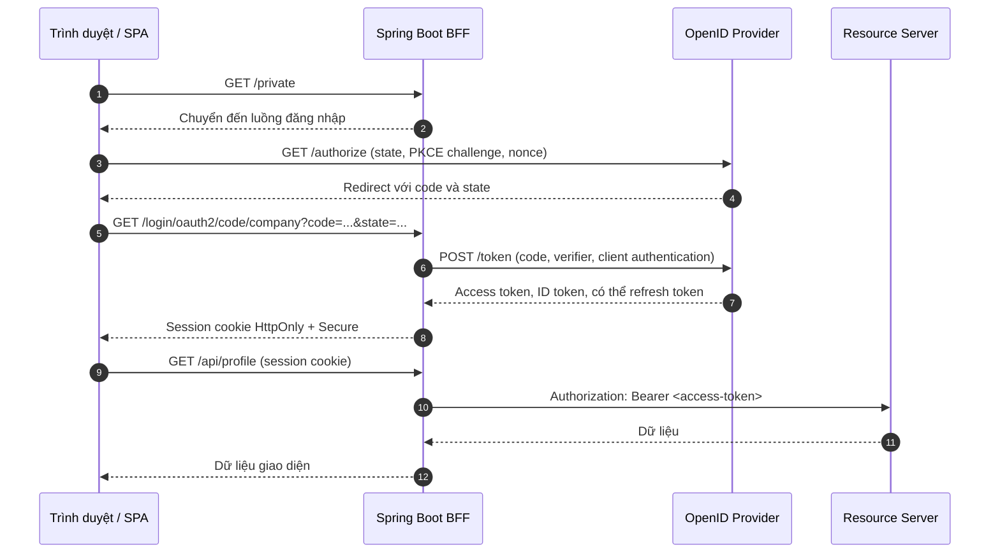

# 2.2. Public client, confidential client và mô hình triển khai ứng dụng

Trong OAuth 2.0, việc phân biệt **public client** và **confidential client** quyết định ứng dụng có thể xác thực chính nó với Authorization Server bằng thông tin bí mật hay không. Phân loại này ảnh hưởng trực tiếp đến cách đăng ký client, chọn luồng ủy quyền, quản lý token và triển khai Spring Security OAuth2/OIDC Client.

Một ứng dụng có giao diện chạy trong trình duyệt chưa chắc là public client; nếu giao diện chỉ giao tiếp với một backend sở hữu toàn bộ luồng OAuth, **backend** có thể là confidential client. Ngược lại, một ứng dụng di động được phân phối dưới dạng tệp cài đặt vẫn là public client dù có mã nguồn được biên dịch và kho lưu trữ an toàn của hệ điều hành.

## 1. Client nằm ở đâu trong OAuth 2.0 và OIDC?

Các vai trò cơ bản:

| Vai trò | Trách nhiệm | Ví dụ |
|---|---|---|
| Resource Owner | Chủ thể cấp quyền truy cập dữ liệu; thường là người dùng | Người dùng đăng nhập và đồng ý cấp quyền |
| Client | Ứng dụng yêu cầu quyền hoặc đăng nhập thay mặt người dùng | Spring MVC, SPA, ứng dụng Android |
| Authorization Server (AS) | Xác thực người dùng, xử lý cấp quyền, phát hành token | Identity Provider hỗ trợ OAuth 2.0 |
| Resource Server (RS) | Bảo vệ API và kiểm tra access token | REST API Spring Boot |

**OpenID Connect (OIDC)** bổ sung lớp định danh trên OAuth 2.0. Khi client yêu cầu scope `openid` theo giao thức OIDC, OpenID Provider (OP) có thể phát hành **ID token** để client xác thực thông tin về phiên đăng nhập. **Access token** được dùng để truy cập API; ID token dành cho client nhận và xác minh thông tin đăng nhập, không thay thế access token tại API.

Trong các ví dụ dưới đây:

- **Client đăng nhập**: một ứng dụng Spring Boot dùng `oauth2Login()`.
- **Client gọi API**: một ứng dụng Spring Boot dùng `oauth2Client()` để nhận và gắn access token.
- **Resource Server**: một API dùng `oauth2ResourceServer()` để xác thực bearer access token.

Một tiến trình Spring Boot có thể kiêm nhiều vai trò, nhưng mỗi vai trò có trách nhiệm bảo mật khác nhau.

## 2. Public client và confidential client được phân biệt như thế nào?

Tiêu chí cốt lõi là **khả năng bảo mật thông tin xác thực của client trước người dùng/người kiểm soát môi trường chạy**, theo mô hình đe dọa và thỏa thuận với Authorization Server.

### 2.1. Public client

**Public client** không có khả năng giữ an toàn một bí mật chung (ví dụ `client_secret`) trên tất cả bản cài đặt trước người dùng có quyền kiểm soát môi trường chạy.

Ví dụ điển hình:

- **Single-Page Application (SPA) chạy hoàn toàn trên trình duyệt**: JavaScript, source map, lưu lượng mạng và cấu hình tải xuống có thể bị xem; không được nhúng `client_secret` vào bundle, HTML hay biến môi trường build phía frontend.
- **Ứng dụng native/mobile/desktop phân phối tới thiết bị người dùng**: một bí mật đóng gói trong APK, IPA hoặc executable có thể bị trích xuất, dù được làm rối mã.
- **Công cụ CLI cài trên máy người dùng**: người chạy có quyền đọc tệp cấu hình và tiến trình cục bộ.

Thông thường client này đăng ký `client_id`, các redirect URI và sử dụng **Authorization Code + PKCE**, với phương thức xác thực client là `none`. `client_id` chỉ là mã định danh và **không phải bí mật**.

Public client vẫn có thể đăng nhập người dùng an toàn khi dùng Authorization Code + PKCE, kiểm tra `state`, tuân thủ redirect URI, dùng TLS và bảo vệ token phù hợp. PKCE giảm rủi ro kẻ khác lấy trộm authorization code để đổi token; **PKCE không biến public client thành confidential client** và không bảo vệ khỏi mọi dạng XSS trên trình duyệt.

### 2.2. Confidential client

**Confidential client** có môi trường thực thi đáng tin cậy để bảo vệ credential, và có thể xác thực danh tính client tại Authorization Server. Ví dụ:

- Web backend Spring Boot chạy trong hạ tầng do tổ chức quản lý.
- Backend for Frontend (BFF) thực hiện OAuth thay cho giao diện web.
- Dịch vụ chạy định kỳ hoặc máy chủ gọi máy chủ bằng `client_credentials`.

Các cơ chế xác thực client có thể bao gồm:

| Cơ chế | Đặc điểm | Lưu ý |
|---|---|---|
| `client_secret_basic` | Backend gửi client ID/secret qua HTTP Basic khi gọi token endpoint | Chỉ qua HTTPS; secret phải ở phía server |
| `client_secret_post` | Backend đặt secret trong request body đến token endpoint | Thường không ưu tiên nếu có cơ chế phù hợp hơn |
| `private_key_jwt` | Client ký JWT assertion bằng khóa riêng | Phù hợp khi quản lý khóa và vòng đời chứng thư nghiêm ngặt |
| Mutual TLS (mTLS) | Xác thực client bằng chứng thư TLS | Phụ thuộc cấu hình hỗ trợ của AS và hạ tầng |

Confidential client **không đồng nghĩa** với việc được cấp quyền truy cập rộng hơn; quyền vẫn phụ thuộc grant, scope, audience, chính sách và đồng ý của người dùng. Confidential client cũng nên dùng **PKCE với Authorization Code** để ràng buộc việc đổi code với yêu cầu ủy quyền ban đầu.

### 2.3. Bảng đối chiếu

| Thuộc tính | Public client | Confidential client |
|---|---|---|
| Giữ một bí mật chung an toàn | Không thể giả định | Có thể trong môi trường server đáng tin cậy |
| `client_id` | Có, công khai | Có, công khai |
| `client_secret` ở runtime phía người dùng | Không được dùng | Không được đưa ra phía người dùng |
| Xác thực client tại token endpoint | Thường `none` | Secret, JWT assertion, mTLS… |
| Authorization Code + PKCE | Bắt buộc theo thực hành bảo mật hiện đại | Khuyến nghị mạnh, nên áp dụng |
| Vị trí giữ token | Trong ứng dụng phía người dùng, cần giảm phơi lộ | Phía backend/server |
| Ví dụ | SPA thuần, mobile, desktop, CLI | Spring MVC server, BFF, backend-to-backend |

**Điểm tinh tế:** Phân loại áp dụng cho **OAuth client và môi trường thực sự thực hiện giao thức**, không đơn thuần theo nhãn “web app”, “mobile app” hay “Spring Boot app”. Nếu một sản phẩm có cả SPA và backend, cần xác định **thành phần nào gửi yêu cầu authorization và đổi code lấy token**. Hai thành phần có thể là hai OAuth client đăng ký riêng với loại bảo mật khác nhau.

## 3. Vì sao Authorization Code + PKCE phù hợp với public client?

Luồng chuẩn cho đăng nhập tương tác của public client là **Authorization Code Flow kết hợp Proof Key for Code Exchange (PKCE)**.

1. Trước khi chuyển hướng, client tạo `code_verifier` ngẫu nhiên với entropy cao, rồi tính `code_challenge = BASE64URL(SHA256(code_verifier))`; dùng phương thức `S256`.
2. Client chuyển trình duyệt sang authorization endpoint với `client_id`, `redirect_uri`, `response_type=code`, `scope`, `state` và các tham số PKCE.
3. Authorization Server xử lý xác thực, quyền truy cập rồi trả **authorization code** qua redirect URI đã đăng ký.
4. Client kiểm tra `state` và gửi code cùng **`code_verifier` ban đầu** tới token endpoint.
5. Authorization Server đối chiếu verifier với challenge trước khi phát token.

`code_verifier` phải được tạo mới cho **mỗi yêu cầu ủy quyền**, không dùng một chuỗi cố định cho toàn ứng dụng. Trong public client, token request thông thường không có `client_secret`.

```text
Authorization request:
GET /authorize?
  response_type=code
  &client_id=spa-client
  &redirect_uri=https%3A%2F%2Fapp.example.com%2Fcallback
  &scope=openid%20profile
  &state=<random-state>
  &code_challenge=<S256-challenge>
  &code_challenge_method=S256

Token request (minh họa):
POST /token
  grant_type=authorization_code
  code=<authorization-code>
  redirect_uri=https://app.example.com/callback
  client_id=spa-client
  code_verifier=<original-verifier>
```

Bốn cơ chế thường bị nhầm lẫn:

| Cơ chế | Trả lời câu hỏi | Điều không thay thế được |
|---|---|---|
| **PKCE** | Bên đổi authorization code có giữ verifier của yêu cầu ban đầu không? | Không xác thực danh tính public client và không chống XSS toàn diện |
| **`state`** | Callback có tương ứng với yêu cầu do client khởi tạo không? | Không thay cho PKCE |
| **`nonce` (OIDC)** | ID token có gắn với yêu cầu xác thực ban đầu không? | Không dùng thay việc kiểm tra chữ ký, issuer và audience |
| **Client authentication** | Client có chứng minh được credential đã đăng ký không? | Không thay cho PKCE trong luồng có authorization code |

Ngoài ra, redirect URI phải được đăng ký và đối chiếu chặt chẽ; dùng HTTPS (trừ các ngoại lệ loopback cho native app theo chuẩn), hạn chế scope và tránh ghi code/token vào log. Không dùng **Implicit Flow** chỉ để tránh token endpoint trong SPA; Authorization Code + PKCE là cách tiếp cận hiện đại. **Resource Owner Password Credentials** cũng không phù hợp cho ứng dụng mới.

## 4. Các mô hình triển khai phổ biến

| Mô hình | Thành phần đóng vai OAuth client | Loại client thường dùng | Token thường được giữ ở đâu? | Cơ chế tương tác với trình duyệt/người dùng |
|---|---|---|---|---|
| Server-rendered web (MVC/SSR) | Backend Spring | Confidential | Server | Cookie phiên |
| SPA + BFF | Backend Spring BFF | Confidential | Server | Cookie phiên tới BFF |
| SPA thuần gọi API | JavaScript trong trình duyệt | Public | Phía trình duyệt | Authorization Code + PKCE và bearer token |
| Mobile/native | Ứng dụng cài trên thiết bị | Public | Phía thiết bị | System browser + PKCE |
| Desktop/CLI | Ứng dụng cục bộ | Public | Thiết bị/ngữ cảnh cục bộ | Loopback redirect hoặc Device Authorization |
| Backend-to-backend | Service hoặc batch job | Confidential | Server | `client_credentials`; không có phiên người dùng |

Đây là bảng định hướng thiết kế, không phải luật áp đặt theo framework. Một backend có thể **chỉ là Resource Server**, không phải OAuth client; một frontend static có thể truy cập API thông qua BFF mà không tự sở hữu token.

### 4.1. Web server-rendered: Spring MVC / Thymeleaf

Với ứng dụng Spring Boot render HTML phía server, Spring Security OAuth2 Login có thể thực hiện redirect đến OpenID Provider, nhận authorization code, đổi token ở backend và thiết lập phiên đăng nhập.

- Backend giữ client credential và token.
- Browser chỉ nhận session cookie; không cần truy cập access token.
- Có thể dùng OAuth2 Client để gắn access token khi backend gọi API thay mặt người dùng.
- Cần bảo vệ session, chống CSRF cho thao tác thay đổi trạng thái, đảm bảo HTTPS và cấu hình cookie phù hợp.

Client loại **confidential** khi backend giữ và sử dụng credential một cách an toàn.

### 4.2. SPA + BFF: giao diện JavaScript, OAuth tại backend

Backend for Frontend cung cấp API phù hợp với giao diện; **BFF là OAuth client**, quản lý authorization code, PKCE, client authentication và token. Frontend nói chuyện với BFF bằng **session cookie** thay vì giữ access token trong JavaScript.



Lợi ích chính là giảm khả năng **JavaScript đọc và đánh cắp trực tiếp token**, vì token ở backend. Tuy vậy, XSS vẫn có thể gửi yêu cầu **thông qua phiên người dùng**, nên cần mã hóa đầu ra, CSP phù hợp, phòng chống CSRF và kiểm soát phiên. BFF đúng nghĩa không trả access token cho JavaScript; nếu backend cấp lại token để browser gọi API trực tiếp thì phân tích rủi ro token phía trình duyệt vẫn cần thiết.

Với nhiều instance Spring Boot, session và nơi lưu authorized client/token phải phù hợp triển khai phân tán; tránh phụ thuộc vô tình vào bộ nhớ của một node.

### 4.3. SPA thuần + Spring REST API

Khi React/Vue/Angular được phát như tệp tĩnh và tự nói chuyện với Authorization Server:

- **SPA là public OAuth/OIDC client**, đăng ký riêng không có client secret.
- Frontend dùng một thư viện OAuth/OIDC hỗ trợ Authorization Code + PKCE, `state`, `nonce` và kiểm tra callback.
- Authorization Server phải cho phép CORS thích hợp tại token endpoint nếu trình duyệt cần gọi endpoint này.
- SPA gửi access token tới API qua `Authorization: Bearer ...`.
- Spring REST API đóng vai **Resource Server**, kiểm tra issuer, signature, expiration, audience và quyền cần thiết cho endpoint.

Rủi ro nổi bật là XSS có thể truy cập token hoặc thực hiện hành động khi người dùng đang đăng nhập. Hạn chế giữ token trong lưu trữ JavaScript tồn tại lâu; nếu cần refresh token ở SPA thì chỉ dùng theo chính sách của AS, ưu tiên rotation hoặc sender constraint và thời hạn phù hợp. Không có giải pháp lưu trữ token trong browser làm biến mất hoàn toàn rủi ro XSS.

**Không được** thêm `client_secret` vào file `.env` của frontend rồi cho rằng secret được bảo vệ: các biến được đưa vào bundle cuối cùng hoặc mạng của trình duyệt vẫn có thể lộ.

### 4.4. Native/mobile/desktop client

Ứng dụng trên điện thoại hoặc máy tính cá nhân thường là **public client**:

- Mở Authorization Server bằng **system browser** hoặc cơ chế tab xác thực do hệ điều hành cung cấp, thay vì yêu cầu người dùng nhập mật khẩu vào WebView do ứng dụng kiểm soát.
- Dùng Authorization Code + PKCE và redirect URI phù hợp: app/universal link được xác minh hoặc loopback URI trên desktop theo hướng dẫn native app.
- Dùng kho lưu trữ an toàn của hệ điều hành cho token khi cần; biện pháp này hạn chế rủi ro nhưng **không làm bí mật được nhúng trở thành client secret đáng tin cậy**.
- Với CLI hoặc thiết bị hạn chế bàn phím/trình duyệt, có thể dùng **OAuth 2.0 Device Authorization Grant** nếu AS hỗ trợ và use case phù hợp.

Backend Spring phục vụ mobile app có thể là **Resource Server** nhận bearer token. Chính backend ấy cũng có thể là một confidential OAuth client độc lập khi gọi dịch vụ khác.

### 4.5. Service-to-service hoặc batch job

Một Spring Boot service gọi API khác mà không có người dùng tương tác thường dùng **Client Credentials Grant**. Service tự xác thực bằng secret, private key JWT hoặc mTLS và nhận access token cho danh tính của client/workload:

```text
Spring batch/service --(client authentication + client_credentials)--> AS
Spring batch/service <--(access token)------------------------------- AS
Spring batch/service --(Bearer access token)-----------------------> API
```

Đây là **ủy quyền của client**, không phải quy trình đăng nhập OIDC của một người dùng. Không nên kỳ vọng có ID token hoặc danh tính người dùng cuối từ `client_credentials`. Khi nhiều service dùng chung một secret, cần cân nhắc tách registration/credential để giới hạn ảnh hưởng khi lộ khóa và hỗ trợ thu hồi độc lập.

## 5. Áp dụng với Spring Security OAuth2/OIDC Client

### 5.1. Cấu hình một confidential OIDC client tại backend

Ví dụ Spring Boot dùng OAuth2 Login cho ứng dụng web phía server. Phía Authorization Server cần đăng ký confidential client `company`, bật Authorization Code, khai báo redirect URI chính xác và cấu hình client authentication tương ứng.

Thêm dependency (Gradle Groovy):

```groovy
dependencies {
    implementation 'org.springframework.boot:spring-boot-starter-security'
    implementation 'org.springframework.boot:spring-boot-starter-oauth2-client'
}
```

Cấu hình `application.yml`:

```yaml
spring:
  security:
    oauth2:
      client:
        registration:
          company:
            provider: company
            client-id: ${OIDC_CLIENT_ID}
            client-secret: ${OIDC_CLIENT_SECRET}
            client-authentication-method: client_secret_basic
            authorization-grant-type: authorization_code
            redirect-uri: "{baseUrl}/login/oauth2/code/{registrationId}"
            scope:
              - openid
              - profile
              - email
        provider:
          company:
            issuer-uri: ${OIDC_ISSUER_URI}
```

Giá trị `OIDC_ISSUER_URI` phải là issuer mà OP công bố (chẳng hạn `https://id.example.org/realms/learning`); Spring Security dùng discovery metadata để tìm các endpoint và khóa công khai nếu provider hỗ trợ. `client-secret` được đưa vào runtime server qua secret manager hoặc environment, **không commit vào repository**.

Một cấu hình Servlet Security Filter Chain tối thiểu và chủ động bật PKCE cho cả confidential client:

```java
import org.springframework.context.annotation.Bean;
import org.springframework.context.annotation.Configuration;
import org.springframework.security.config.Customizer;
import org.springframework.security.config.annotation.web.builders.HttpSecurity;
import org.springframework.security.oauth2.client.registration.ClientRegistrationRepository;
import org.springframework.security.oauth2.client.web.DefaultOAuth2AuthorizationRequestResolver;
import org.springframework.security.oauth2.client.web.OAuth2AuthorizationRequestCustomizers;
import org.springframework.security.web.SecurityFilterChain;

@Configuration
public class SecurityConfig {

    @Bean
    SecurityFilterChain appSecurity(
            HttpSecurity http,
            ClientRegistrationRepository registrations) throws Exception {

        var resolver = new DefaultOAuth2AuthorizationRequestResolver(
                registrations, "/oauth2/authorization");

        resolver.setAuthorizationRequestCustomizer(
                OAuth2AuthorizationRequestCustomizers.withPkce());

        http
            .authorizeHttpRequests(auth -> auth
                .requestMatchers("/", "/error").permitAll()
                .anyRequest().authenticated())
            .oauth2Login(login -> login
                .authorizationEndpoint(endpoint ->
                    endpoint.authorizationRequestResolver(resolver)))
            .oauth2Client(Customizer.withDefaults());

        return http.build();
    }
}
```

Đường dẫn bắt đầu đăng nhập mặc định là `/oauth2/authorization/company`; redirect URI callback tương ứng là `/login/oauth2/code/company` (hoặc URI tuyệt đối do `{baseUrl}` mở rộng). Trong triển khai thực tế sau reverse proxy, phải xác định đúng public origin và forwarded headers từ proxy tin cậy để tránh sinh redirect URI sai.

Lớp `oauth2Login()` xử lý đăng nhập dựa trên OAuth2/OIDC; `oauth2Client()` hỗ trợ việc sử dụng authorized client khi gọi downstream API. Hai tính năng có thể cùng có mặt, nhưng không thay cho xác thực bearer token của một Resource Server.

**Lưu ý về PKCE:** cấu hình tự động và mức hỗ trợ mặc định có thể khác nhau theo Spring Security và kiểu client. Đoạn resolver trên chủ động yêu cầu PKCE cho Authorization Code; Authorization Server phải hỗ trợ kiểm tra code challenge/verifier. Khi làm public client trong Spring, phải cấu hình `ClientAuthenticationMethod.NONE`, bật PKCE và không cấu hình client secret; một ứng dụng SPA thuần thường xử lý luồng phía frontend chứ không dùng `oauth2Login()` tại API.

### 5.2. Spring REST API đứng sau một public SPA

API Spring Boot bên dưới SPA thường là **Resource Server**. Cài dependency:

```groovy
dependencies {
    implementation 'org.springframework.boot:spring-boot-starter-security'
    implementation 'org.springframework.boot:spring-boot-starter-oauth2-resource-server'
}
```

Ví dụ với access token dạng JWT mà issuer công bố khóa xác minh:

```yaml
spring:
  security:
    oauth2:
      resourceserver:
        jwt:
          issuer-uri: ${OIDC_ISSUER_URI}
```

```java
import org.springframework.context.annotation.Bean;
import org.springframework.context.annotation.Configuration;
import org.springframework.security.config.Customizer;
import org.springframework.security.config.annotation.web.builders.HttpSecurity;
import org.springframework.security.config.annotation.web.configurers.AbstractHttpConfigurer;
import org.springframework.security.config.http.SessionCreationPolicy;
import org.springframework.security.web.SecurityFilterChain;

@Configuration
public class ApiSecurityConfig {

    @Bean
    SecurityFilterChain apiSecurity(HttpSecurity http) throws Exception {
        http
            .sessionManagement(session ->
                session.sessionCreationPolicy(SessionCreationPolicy.STATELESS))
            .authorizeHttpRequests(auth ->
                auth.anyRequest().authenticated())
            .oauth2ResourceServer(resourceServer ->
                resourceServer.jwt(Customizer.withDefaults()))
            .csrf(AbstractHttpConfigurer::disable);

        return http.build();
    }
}
```

Đoạn này dành cho **API stateless chỉ dùng bearer token qua Authorization header và không xác thực bằng cookie**. Nếu ứng dụng đồng thời sử dụng cookie/session, không áp dụng nguyên xi cấu hình tắt CSRF; cần tách security chain hoặc thiết kế CSRF phù hợp. API đa miền cũng cần chính sách CORS rõ ràng.

Spring Resource Server cần nhận **access token dành cho API này**: ngoài kiểm tra issuer, chữ ký và thời hạn, hãy thiết lập kiểm tra **audience** đúng API và chính sách scope/authority cho từng endpoint. Không nhận ID token như access token chỉ vì cả hai có định dạng JWT. Nếu AS cấp opaque access token, dùng token introspection thay vì cấu hình JWT ở trên.

### 5.3. Client Credentials trong Spring

Một registration khác trong `application.yml` cho backend-to-backend:

```yaml
spring:
  security:
    oauth2:
      client:
        registration:
          inventory-service:
            provider: internal-as
            client-id: ${INVENTORY_CLIENT_ID}
            client-secret: ${INVENTORY_CLIENT_SECRET}
            client-authentication-method: client_secret_basic
            authorization-grant-type: client_credentials
            scope: inventory.read
        provider:
          internal-as:
            token-uri: https://auth.example.org/oauth2/token
```

Registration này không dùng `oauth2Login()` vì không có người dùng chuyển hướng. Ứng dụng dùng `OAuth2AuthorizedClientManager` hoặc tích hợp HTTP client của Spring Security để lấy/cấp lại token và gắn vào lời gọi API. Cần thiết kế nơi lưu authorized client phù hợp cho background service và lựa chọn principal kỹ thuật phù hợp; tránh dựa vào một HTTP session người dùng không tồn tại.

## 6. Chọn mô hình qua tình huống thực tế

**Tình huống A — Cổng quản trị nội bộ viết bằng Spring MVC.** HTML và các thao tác bảo vệ đều đi qua backend Spring. Chọn confidential OIDC client, `oauth2Login()`, lưu token server-side, trả session cookie cho browser.

**Tình huống B — React được host trên CDN, gọi trực tiếp Spring API.** Chọn public OIDC client cho React với Authorization Code + PKCE; Spring API là Resource Server. Không cấp secret của React; API chỉ chấp nhận access token đúng issuer/audience.

**Tình huống C — React dùng Spring BFF để giao tiếp API.** Chọn confidential client cho BFF. Trình duyệt dùng session cookie bảo vệ bằng HttpOnly/Secure/SameSite và CSRF; BFF giữ và dùng access token khi gọi downstream API. Nếu không cần gọi token endpoint từ browser, tránh chuyển token ra JavaScript.

**Tình huống D — Ứng dụng Android có đăng nhập công ty.** Chọn public native client, system browser, PKCE và callback phù hợp với nền tảng. Backend Spring API xác minh bearer access token.

**Tình huống E — Job đồng bộ tồn kho chạy mỗi giờ.** Chọn confidential service client với `client_credentials`. Quyền cấp cho job phải giới hạn vào API và hành động cần thiết; không tạo phiên OIDC cho một người dùng giả.

## 7. Lỗi thiết kế thường gặp và cách xử lý

| Lỗi | Vì sao nguy hiểm hoặc sai | Hướng xử lý |
|---|---|---|
| Gắn `client_secret` vào frontend bundle hoặc mobile APK | Người dùng có thể truy xuất bí mật chung | Đăng ký public client; hoặc đưa toàn bộ OAuth xuống BFF đáng tin cậy |
| Cho rằng `client_id` là mật khẩu | Không có giá trị xác thực bí mật | Dùng đúng authentication method cho confidential client; dùng PKCE cho public |
| Bỏ PKCE vì backend đã có client secret | Authorization code vẫn là thành phần cần ràng buộc với yêu cầu ban đầu | Dùng PKCE `S256` với Authorization Code |
| Dùng Implicit Flow để đăng nhập SPA | Access token đi qua kênh front-channel và dễ phơi lộ hơn | Authorization Code + PKCE |
| Dùng ID token làm bearer token gọi API | ID token có mục đích và audience khác access token | API chỉ chấp nhận access token được cấp cho API |
| Dùng `client_credentials` để giả đăng nhập người dùng | Grant này đại diện cho client, không mang ngữ cảnh người dùng | Dùng OIDC Authorization Code cho đăng nhập tương tác |
| Mở redirect URI bằng wildcard không kiểm soát | Tạo nguy cơ đánh cắp authorization code, open redirect | Đăng ký/so khớp redirect URI chặt chẽ theo loại client |
| Đưa token vào URL, log hoặc analytics | Token có thể bị lưu trong history, referrer và hệ thống log | Truyền bearer qua header; loại bỏ dữ liệu nhạy cảm khỏi log |
| Tắt CSRF cho ứng dụng dùng session cookie | Browser tự gửi cookie trong một số ngữ cảnh | Bật cơ chế CSRF phù hợp; cookie flags chỉ là một lớp phòng vệ |
| Chỉ kiểm tra JWT có chữ ký hợp lệ | Token hợp lệ của một API/issuer khác vẫn có thể bị dùng nhầm | Kiểm tra issuer, audience, thời hạn và authorization tại API |
| Giữ refresh token của SPA lâu dài không có kiểm soát | Mở rộng hậu quả khi token bị lộ | Áp dụng rotation hoặc sender constraint, expiry và quản lý phiên theo AS |
| Dùng một registration cho SPA và server với cùng secret | Không xác định được ranh giới tin cậy | Tách client registration, redirect URI và chính sách theo thành phần |

## 8. Tư duy lựa chọn kiến trúc

Khi thiết kế một ứng dụng, hãy lần lượt xác định:

1. **Ai thực sự là OAuth client?** Trình duyệt tự gọi authorization/token endpoint, hay backend thực hiện các bước giao thức?
2. **Credential có thể được bảo vệ khỏi người dùng cuối không?** Nếu không, đăng ký public client. Không “nâng cấp” client thành confidential chỉ bằng cách đặt secret trong file cấu hình của thiết bị.
3. **Token đi qua những thành phần nào?** Nếu yêu cầu nghiệp vụ cho phép, SSR/BFF giúp giữ token ở backend và đơn giản hóa việc frontend xử lý token.
4. **Có người dùng đang đăng nhập hay không?** Có: OIDC Authorization Code + PKCE thường thích hợp. Không: xem xét `client_credentials` cho service-to-service hoặc grant khác theo đúng use case.
5. **Ai xác minh access token tại API?** Resource Server cần kiểm tra đúng issuer, audience, expiry và quyền; việc client đăng nhập thành công không miễn trừ khâu kiểm tra API.
6. **Các trust boundary thay đổi ở đâu?** Mỗi môi trường tin cậy khác nhau có thể cần registration, redirect URI, cookie policy và token policy riêng.

**Nguyên tắc thực hành:** Không đặt bí mật OAuth của confidential client vào môi trường do người dùng cuối kiểm soát; dùng Authorization Code + PKCE cho luồng đăng nhập hiện đại, bảo vệ token theo vị trí triển khai, và phân biệt rõ **đăng nhập OIDC**, **ủy quyền OAuth 2.0** và **kiểm tra access token tại API**.

## 9. Tài liệu chuẩn để đào sâu

- [RFC 6749 — The OAuth 2.0 Authorization Framework](https://www.rfc-editor.org/rfc/rfc6749): phân loại public/confidential client và các grant.
- [RFC 7636 — Proof Key for Code Exchange by OAuth Public Clients](https://www.rfc-editor.org/rfc/rfc7636): quy trình verifier/challenge.
- [RFC 8252 — OAuth 2.0 for Native Apps](https://www.rfc-editor.org/rfc/rfc8252): system browser và redirect cho native app.
- [RFC 8628 — OAuth 2.0 Device Authorization Grant](https://www.rfc-editor.org/rfc/rfc8628): thiết bị có khả năng nhập liệu hạn chế.
- [RFC 9700 — Best Current Practice for OAuth 2.0 Security](https://www.rfc-editor.org/rfc/rfc9700): các khuyến nghị bảo mật OAuth 2.0 hiện đại.
- [OpenID Connect Core 1.0](https://openid.net/specs/openid-connect-core-1_0.html): ID token, nonce và đăng nhập OIDC.
- [Spring Security — OAuth 2.0 Login](https://docs.spring.io/spring-security/reference/servlet/oauth2/login/index.html) và [OAuth 2.0 Resource Server](https://docs.spring.io/spring-security/reference/servlet/oauth2/resource-server/index.html): cấu hình theo phiên bản Spring Security đang sử dụng.
