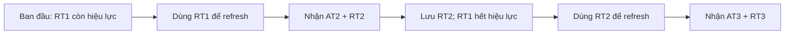
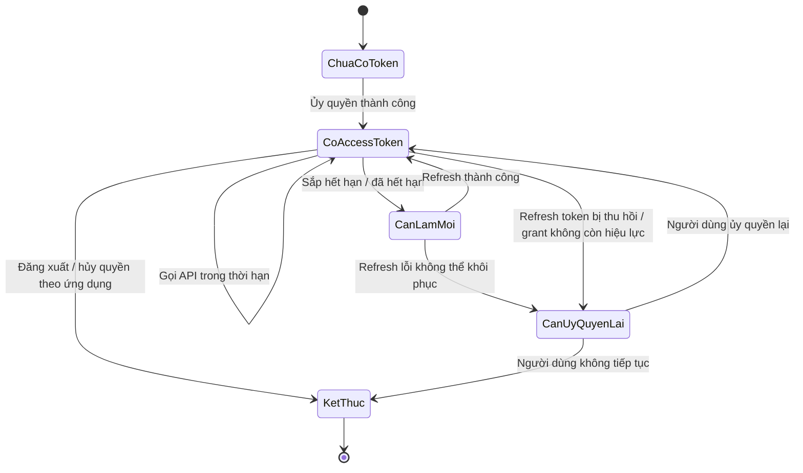

# 2.8. Refresh Token Grant và vòng đời cấp lại token

## Mục tiêu bài học

Sau bài này, bạn có thể:

- Giải thích tại sao **access token** thường sống ngắn nhưng ứng dụng vẫn duy trì được phiên truy cập mà không bắt người dùng đăng nhập sau mỗi vài phút.
- Mô tả đúng **Refresh Token Grant**: client gửi refresh token đến Authorization Server để xin access token mới; Resource Server không xử lý yêu cầu này.
- Phân biệt **cấp lại access token**, **xoay vòng refresh token**, **đăng nhập lại**, **gia hạn phiên ứng dụng** và **thu hồi token**.
- Hiểu các trường hợp refresh token hết hạn, bị thu hồi, bị dùng lại, bị từ chối hoặc không được cấp ngay từ đầu.
- Cấu hình và sử dụng các thành phần OAuth2 Client của Spring Security để quản lý refresh token theo vòng đời của `OAuth2AuthorizedClient`.
- Thiết kế cách lưu trữ token, đồng bộ giữa nhiều request/instance, xử lý lỗi và bảo vệ refresh token trong hệ thống dùng OAuth 2.0 và OpenID Connect (OIDC).

## 1. Vì sao cần refresh token?

Giả sử một ứng dụng Spring Boot tên **Course Portal** đăng nhập qua **Campus Identity** (Authorization Server/OpenID Provider), sau đó gọi **Course API** bằng access token. Authorization Server cấp access token với thời hạn 5 phút. Người dùng học bài trong 45 phút và tiếp tục mở tài liệu.

Nếu mọi access token đều buộc người dùng đăng nhập lại khi hết hạn, trải nghiệm sẽ bị gián đoạn. Ngược lại, cấp access token có hiệu lực quá lâu có thể làm tăng tác hại nếu token bị lộ.

**Refresh token** là một credential được Authorization Server cấp cho client (khi chính sách cho phép) để client xin access token mới mà không phải lặp lại toàn bộ bước người dùng đăng nhập và chấp thuận quyền ở mỗi lần. Đây là một phần của OAuth 2.0: Refresh Token Grant.

Bốn vai trò cần nhớ:

| Thành phần | Trong ví dụ | Liên quan đến refresh |
| --- | --- | --- |
| Resource Owner / End-User | Người dùng của Course Portal | Ban đầu xác thực, có thể cấp quyền; thường không tương tác trong lần refresh bình thường |
| Client | Course Portal | Giữ refresh token an toàn và gửi token đó đến token endpoint khi cần |
| Authorization Server | Campus Identity | Quyết định có cấp, chấp nhận, xoay vòng hay thu hồi refresh token; cấp access token mới |
| Resource Server | Course API | Chỉ nhận và kiểm tra **access token** để bảo vệ API; không nhận refresh token để làm mới |

**Refresh token không phải access token có thời hạn dài.** Nó có mục đích, đích nhận và phạm vi sử dụng riêng. Client không gửi refresh token trong `Authorization: Bearer ...` đến API nghiệp vụ.

### 1.1. Ba vòng đời cần phân biệt

1. **Access token:** quyền gọi một hoặc một nhóm Resource Server trong một thời gian giới hạn.
2. **Refresh token:** khả năng xin access token tiếp theo theo điều kiện của Authorization Server. Nó có thể hết hạn, bị thu hồi, bị xoay vòng hoặc không được phát hành.
3. **Phiên đăng nhập của ứng dụng / phiên SSO:** cookie session ở Course Portal và phiên người dùng tại Campus Identity có vòng đời riêng; chúng không tự động bằng vòng đời của hai token.

Ví dụ: người dùng vẫn có cookie phiên hợp lệ ở Course Portal nhưng refresh token đã bị thu hồi. Khi cần gọi API lần tiếp theo, Portal có thể phải yêu cầu người dùng ủy quyền/đăng nhập lại. Ngược lại, việc đăng xuất khỏi Portal chưa chắc đã tự thu hồi tất cả token mà Authorization Server đã cấp.

## 2. Access token, refresh token và các mốc thời gian

Một phản hồi token endpoint sau Authorization Code flow **có thể** trông như sau:

```json
{
  "access_token": "eyJ...example",
  "token_type": "Bearer",
  "expires_in": 300,
  "refresh_token": "rt_example_opaque",
  "scope": "courses.read"
}
```

Giá trị trên chỉ là minh họa; không dùng làm token thật. Trong OIDC, response phù hợp còn có thể chứa `id_token`.

| Trường | Ý nghĩa thực tế |
| --- | --- |
| `access_token` | Credential client dùng gọi Resource Server |
| `token_type` | Thường là `Bearer`; cho biết cách sử dụng access token |
| `expires_in` | Số giây sống của access token tại thời điểm response được tạo |
| `refresh_token` | Credential tùy chọn để xin token mới; **không phải grant nào, client nào hay provider nào cũng được cấp** |
| `scope` | Phạm vi đã được cấp; có thể được lược bỏ khi không khác yêu cầu theo quy tắc OAuth |

Thông thường client lưu access token cùng thời điểm hết hạn dự kiến (`expiresAt`) và refresh token đang còn hiệu lực. Không được mặc định refresh token có thời hạn giống access token. Tùy Authorization Server, refresh token có thể có cả giới hạn tuyệt đối, giới hạn không hoạt động, giới hạn theo phiên hoặc quy tắc bảo mật khác; nhiều response không công bố thời điểm hết hạn refresh token cho client.

Một lịch sử minh họa:

```text
09:00  Người dùng hoàn thành Authorization Code + OIDC.
       Client nhận AT1 (hết hạn dự kiến 09:05) và RT1.

09:04  Client sắp gọi Course API; AT1 gần hết hạn.
       Client gửi RT1 đến token endpoint.

09:04  Authorization Server trả AT2 (hết hạn dự kiến 09:09).
       Nếu refresh-token rotation bật, có thể trả RT2 thay RT1.

09:07  Client gọi Course API bằng AT2 mà người dùng không cần đăng nhập lại.

10:00  RT hiện hành bị hết hạn/thu hồi theo chính sách.
       Lần xin access token tiếp theo bị từ chối; Client cần xử lý tái ủy quyền.
```

Việc token được làm mới ở 09:04 là **cấp lại access token**, không có nghĩa phiên SSO hoặc mọi quyền của người dùng đã được gia hạn vĩnh viễn.

## 3. Refresh Token Grant hoạt động như thế nào?

Refresh Token Grant được định nghĩa trong OAuth 2.0, RFC 6749, phần 6. Nó là yêu cầu **trực tiếp từ Client đến token endpoint của Authorization Server**. Browser redirect, authorization code và consent screen thường không tham gia trong lần làm mới bình thường.

```mermaid
sequenceDiagram
    autonumber
    actor U as Người dùng
    participant C as Course Portal (Client)
    participant AS as Campus Identity (Authorization Server)
    participant RS as Course API (Resource Server)

    U->>C: Sử dụng Portal sau khi đã đăng nhập
    Note over C: AT1 sắp hết hạn; lưu RT1
    C->>AS: POST token endpoint, grant_type=refresh_token, RT1
    AS->>AS: Kiểm tra refresh token, client, phạm vi, chính sách
    alt Refresh hợp lệ
        AS-->>C: AT2 và có thể RT2
        C->>C: Lưu AT2; thay RT1 bằng RT2 nếu được cấp
        C->>RS: GET /api/me/courses, Bearer AT2
        RS-->>C: Dữ liệu được phép
        C-->>U: Hiển thị kết quả
    else Refresh bị từ chối
        AS-->>C: OAuth error, ví dụ invalid_grant
        C->>C: Loại trạng thái token không dùng được
        C-->>U: Yêu cầu đăng nhập/ủy quyền lại khi phù hợp
    end
```

### 3.1. HTTP request tại token endpoint

Ví dụ một **confidential client** đã được cấu hình xác thực bằng HTTP Basic gửi yêu cầu:

```http
POST /oauth2/token HTTP/1.1
Host: login.example.org
Authorization: Basic <base64-client-id-and-secret>
Content-Type: application/x-www-form-urlencoded

grant_type=refresh_token&refresh_token=<current-refresh-token>
```

Trong HTTP Basic, nội dung header phải được tạo đúng quy tắc OAuth cho thông tin xác thực client; biểu thức trong dấu `<...>` chỉ là chỗ giữ chỗ. Giao tiếp phải sử dụng HTTPS. Token endpoint và phương thức xác thực thực tế được quyết định bởi cấu hình provider.

Các tham số quan trọng:

| Tham số | Bắt buộc? | Ý nghĩa |
| --- | --- | --- |
| `grant_type=refresh_token` | Có | Xác định loại grant đang thực hiện |
| `refresh_token` | Có | Refresh token hiện hành đã được Authorization Server cấp |
| `scope` | Tùy chọn | Nếu có, không được đòi hỏi scope vượt quá scope ban đầu đã được cấp; provider vẫn có thể áp dụng chính sách chặt hơn |
| Thông tin xác thực client | Tùy loại client và cấu hình | Confidential client phải xác thực khi được yêu cầu; public client không thể dựa vào client secret được nhúng trong ứng dụng |

Refresh request **không** gửi `authorization_code`, `code_verifier` hay `code_challenge` như yêu cầu trao đổi authorization code. PKCE bảo vệ bước đổi authorization code ban đầu. Refresh token có ràng buộc, xác thực và bảo vệ riêng.

Trong public client, cách thể hiện client identity và bảo vệ refresh token phụ thuộc Authorization Server. Không copy mẫu HTTP Basic của confidential client vào SPA/mobile app rồi nhúng client secret.

### 3.2. Token response khi refresh thành công

```http
HTTP/1.1 200 OK
Content-Type: application/json
Cache-Control: no-store
Pragma: no-cache

{
  "access_token": "new_access_token_example",
  "token_type": "Bearer",
  "expires_in": 300,
  "refresh_token": "new_refresh_token_example",
  "scope": "courses.read"
}
```

Client phải:

1. Đọc access token mới và cập nhật thời hạn hết hạn.
2. Nếu server cấp **refresh token mới**, thay refresh token cũ đang lưu bằng token mới. Không tiếp tục dùng token cũ theo giả định nó còn hợp lệ.
3. Gắn access token mới vào request đến đúng Resource Server.
4. Duy trì ranh giới an toàn: không log hoặc trả refresh token ra frontend nếu backend là nơi quản lý credential.

Không phải lần refresh nào server cũng trả `refresh_token`. Nếu không trả token mới, client tiếp tục sử dụng refresh token hiện có trong phạm vi chính sách của nhà cung cấp. Nếu server xoay vòng, token cũ có thể bị vô hiệu ngay sau khi cấp token mới.

### 3.3. Refresh token có thể làm được những gì?

Nó không phải yêu cầu nâng quyền tùy ý:

- Scope xin lại không được rộng hơn ủy quyền ban đầu. Server có thể cấp scope hẹp hơn.
- Token mới có thể phải tuân theo audience/resource, chính sách người dùng, client binding và thời hạn còn lại của một phiên ủy quyền.
- Authorization Server có thể từ chối refresh vì người dùng rút quyền, tài khoản bị khóa, rủi ro tăng hoặc client không còn được phép.
- Refresh token không bảo đảm sẽ có access token hợp lệ mãi mãi; client cần luôn hỗ trợ điểm kết thúc của phiên ủy quyền.

## 4. Refresh Token Rotation và chống tái sử dụng

Refresh token thường có giá trị lâu hơn access token, nên khi bị đánh cắp, rủi ro có thể kéo dài. Một biện pháp quan trọng là **refresh-token rotation**: mỗi lần refresh thành công, Authorization Server cấp một refresh token mới và vô hiệu hóa token vừa dùng.



Khi phát hiện có hai bên cố dùng cùng một token cũ, Authorization Server có thể coi đó là dấu hiệu **token replay**. Tùy chính sách, server có thể vô hiệu hóa cả chuỗi token liên quan (token family) và yêu cầu client ủy quyền lại.

Ví dụ tình huống tấn công:

1. Kẻ tấn công sao chép được `RT1`.
2. Client hợp lệ đã đổi `RT1` lấy `RT2`.
3. Kẻ tấn công tiếp tục gửi `RT1` tới token endpoint.
4. Authorization Server phát hiện reuse và có thể thu hồi các token thuộc cùng grant/chuỗi rotation để ngăn cả hai bên tiếp tục truy cập.

**Lưu ý khi vận hành:** Hai request hợp lệ chạy đồng thời cũng có thể gây hiện tượng reuse:

```text
Request A đọc RT1  ─┬─> đổi RT1 thành RT2  (thành công)
Request B đọc RT1  ─┘─> đổi RT1 lần nữa    (invalid_grant hoặc bị phát hiện reuse)
```

Điều này có thể làm hỏng cả phiên token nếu hệ thống có cơ chế phát hiện replay nghiêm ngặt. Vì thế, refresh token rotation đòi hỏi việc **lưu phiên bản token mới nhất** và **đồng bộ refresh** giữa các request/instance.

Một số Authorization Server có cơ chế dung sai ngắn cho race condition, nhưng client không được dựa vào giả định này.

### 4.1. Rotation so với sender-constrained refresh token

Hai nhóm kỹ thuật thường dùng để giảm tác hại khi refresh token bị đánh cắp:

- **Rotation:** token mới thay token cũ; reuse bất thường có thể bị phát hiện.
- **Sender-constraining:** token được ràng buộc với vật liệu mật mã của client/người gửi, ví dụ phương thức xác thực bằng khóa phù hợp. Chỉ có chuỗi token mà thiếu bằng chứng sở hữu khóa thì chưa đủ dùng nó.

Theo OAuth 2.0 Security Best Current Practice (RFC 9700), refresh token cấp cho **public client** cần được bảo vệ bằng rotation **hoặc** sender-constraining theo yêu cầu của chuẩn. Các biện pháp cụ thể và cách phát hiện/revoke phụ thuộc hỗ trợ của Authorization Server, client và loại ứng dụng.

## 5. Các trạng thái của vòng đời token

Từ góc nhìn client, có thể mô hình hóa:



Các trạng thái trên là mô hình tư duy của **client**, không phải máy trạng thái bắt buộc trong OAuth.

| Sự kiện | Client nên hiểu thế nào | Hành động thông thường |
| --- | --- | --- |
| Access token còn hạn | Có thể thử gọi API nếu đúng audience/scope | Sử dụng access token |
| Access token gần hết hạn và có refresh token | Có thể xin access token mới | Refresh trước khi gọi API |
| Access token hết hạn, không có refresh token | Không có credential để thực hiện Refresh Token Grant | Khởi tạo lại luồng ủy quyền hoặc dùng grant khác được cho phép |
| Refresh thành công, response có refresh token mới | Rotation có thể đã xảy ra | Lưu token mới, loại token cũ |
| Refresh thành công, không có refresh token mới | Server không cấp token mới ở lần này | Giữ refresh token hiện hành theo chính sách |
| Refresh bị `invalid_grant` | Token/grant có thể hết hạn, bị thu hồi hoặc không hợp lệ | Không lặp lại vô hạn; xóa trạng thái không dùng được, yêu cầu ủy quyền lại khi phù hợp |
| API trả 401 `invalid_token` | API không chấp nhận access token | Kiểm tra expiry/issuer/audience/revocation; chỉ retry có kiểm soát |
| API trả 403 vì thiếu quyền | Quyền chưa đủ, kể cả token còn hạn | Kiểm tra scope và phân quyền; refresh không tự tăng scope |
| Người dùng đăng xuất | Phiên local kết thúc | Xóa phiên local và token lưu ở client; phối hợp revoke/logout của provider nếu có |

### 5.1. Nên refresh lúc nào?

Hai chiến lược thường gặp:

- **Làm mới theo nhu cầu (lazy refresh):** trước khi gọi API, nếu access token đã hết hạn hoặc nằm trong khoảng đệm, client gọi token endpoint. Đây là cách dễ phối hợp với `OAuth2AuthorizedClientManager`.
- **Làm mới chủ động (proactive refresh):** ứng dụng lên lịch làm mới trước hạn. Cần cân nhắc công việc nền, tình trạng người dùng, thời gian ngừng hoạt động và concurrency; không nên tự làm mới liên tục chỉ để giữ token sống vô hạn.

Với hệ thống nhiều request đồng thời, nên có một luồng làm mới cho mỗi authorized client/grant tại một thời điểm, thay vì mỗi HTTP request đều refresh riêng.

**Clock skew:** Đồng hồ của client và server không bao giờ đồng bộ tuyệt đối. Khi xác định “sắp hết hạn”, trừ một khoảng đệm phù hợp để tránh gửi access token vừa hết hạn trong khi request đang truyền qua mạng. Đây là đệm thời gian, không phải quyền kéo dài hạn sử dụng token.

## 6. Những trường hợp Refresh Token Grant không dùng được

### 6.1. Client chưa từng được cấp refresh token

OAuth cho phép Authorization Server không cấp refresh token. Việc client yêu cầu `offline_access` trong OIDC cũng không bảo đảm sẽ được cấp; provider có chính sách và điều kiện consent riêng. Khi `refresh_token` không tồn tại, không thể tự tạo hoặc suy diễn token đó từ `access_token` hay `id_token`.

### 6.2. Client Credentials Grant

Trong giao tiếp máy với máy theo **Client Credentials**, ứng dụng thường xin access token mới bằng chính client credentials khi token cũ hết hạn. OAuth 2.0 không khuyến khích phát hành refresh token cho Client Credentials; nhiều provider không cấp.

Điều này khác với luồng người dùng đăng nhập qua Authorization Code + OIDC: ở đây refresh token cho phép client tiếp tục sử dụng grant đã được người dùng cấp trong giới hạn chính sách.

### 6.3. Refresh token hết hạn, bị thu hồi hoặc bị phát hiện replay

Authorization Server có thể trả `invalid_grant`. Client cần ngừng sử dụng token không hợp lệ, cập nhật kho lưu trữ và đi qua luồng ủy quyền mới nếu người dùng vẫn muốn truy cập. Retry liên tục cùng một refresh token đã bị từ chối có thể dẫn tới khóa phiên, tăng tải hoặc làm sự cố khó chẩn đoán.

### 6.4. Access token mới vẫn bị Resource Server từ chối

Refresh thành công chỉ chứng minh token endpoint đã xử lý grant theo chính sách. Resource Server vẫn có thể từ chối vì audience không đúng, scope thiếu, JWT validation lỗi, token bị thu hồi hoặc người dùng không có quyền truy cập bản ghi. **Refresh không thay thế kiểm tra authorization tại API.**

## 7. Mối quan hệ với OIDC và phiên đăng nhập

Một OIDC Client thường có ba loại credential/định danh cần phân biệt:

| Đối tượng | Dùng cho việc gì? | Có được gửi gọi Course API? |
| --- | --- | --- |
| Access token | Ủy quyền truy cập API | Có, khi token dành cho API đó |
| Refresh token | Xin access token mới tại Authorization Server | Không |
| ID token | Client/Relying Party xác thực thông tin lần đăng nhập của End-User | Không |

OIDC có thể trả ID token mới trong token response sau refresh tùy quy định và provider. Nếu nhận ID token, client phải kiểm tra nó theo quy tắc OIDC áp dụng; không coi ID token mới như access token. Tùy kiến trúc, ứng dụng có thể tiếp tục giữ phiên local đang tồn tại thay vì tạo lại phiên đăng nhập mỗi lần refresh.

Scope `offline_access` trong OIDC thể hiện yêu cầu truy cập có khả năng tiếp diễn khi người dùng không hiện diện. Từng nhà cung cấp có thể quy định rõ điều kiện sử dụng, tương tác/consent, loại client và thời hạn. Không đánh đồng `openid`, `profile`, `email` với quyền mặc định có refresh token.

### 7.1. Phân biệt bốn sự kiện

- **Refresh access token:** OAuth2 Client xin credential API mới; có thể diễn ra hoàn toàn ở backend.
- **Đăng nhập lại tại OpenID Provider:** người dùng thực hiện xác thực mới hoặc sử dụng SSO session hiện có.
- **Gia hạn HTTP session của Portal:** cơ chế phiên/cookie của ứng dụng, được quản lý độc lập với token của provider.
- **Đăng xuất/revoke:** thu hồi trạng thái local và có thể yêu cầu provider thu hồi token/đăng xuất SSO nếu tích hợp hỗ trợ.

Nếu Portal dùng cookie session còn API dùng OAuth access token, hai thời hạn phải được thiết kế cùng nhau. Một người dùng đăng xuất không đồng nghĩa refresh token đã bị hủy phía provider; cần xử lý token store và quy trình revocation tương ứng.

## 8. Spring Security quản lý refresh token ở đâu?

Trong ứng dụng **Spring Security OAuth2 Client**, khái niệm trung tâm là `OAuth2AuthorizedClient`, đại diện cho một client registration đã được ủy quyền trong ngữ cảnh principal tương ứng. Đối tượng này lưu thông tin access token và refresh token nếu được cấp.

Các thành phần liên quan:

| Thành phần | Vai trò |
| --- | --- |
| `ClientRegistration` | Thông tin client và provider: client ID, grant type, token endpoint, scope... |
| `OAuth2AuthorizedClient` | Trạng thái được ủy quyền: client registration, principal, access token, optional refresh token |
| `OAuth2AuthorizedClientRepository` | Lưu/tải authorized client trong ngữ cảnh HTTP request của ứng dụng Servlet |
| `OAuth2AuthorizedClientService` | Lưu/tải authorized client theo client registration và tên principal, không nhất thiết gắn với HTTP request |
| `OAuth2AuthorizedClientProvider` | Quyết định cách authorize/re-authorize theo grant type, ví dụ `refreshToken()` |
| `OAuth2AuthorizedClientManager` | Điều phối authorize/refresh, đồng thời phối hợp cơ chế lưu và xử lý kết quả/lỗi |
| `DefaultOAuth2AuthorizedClientManager` | Manager thường dùng trong ngữ cảnh Servlet `HttpServletRequest` |
| `AuthorizedClientServiceOAuth2AuthorizedClientManager` | Manager dùng khi thực hiện bên ngoài ngữ cảnh request, ví dụ worker/service chạy nền |

Spring Security thường có thể lấy lại access token đã lưu và sử dụng **refresh-token provider** khi token gần hết hạn, refresh token sẵn có và điều kiện của provider cho phép. Cơ chế này không đồng nghĩa một timer nền luôn chạy để gia hạn tất cả token. Hầu hết khi dùng manager, refresh được xem xét **lúc có một lệnh authorize để sử dụng client**.

### 8.1. Cấu hình ứng dụng là OIDC Client

Giả định Course Portal là backend web confidential client, xác thực bằng `client_secret_basic`, và Campus Identity hỗ trợ OIDC discovery:

```yaml
spring:
  security:
    oauth2:
      client:
        registration:
          campus:
            provider: campus
            client-id: ${CAMPUS_CLIENT_ID}
            client-secret: ${CAMPUS_CLIENT_SECRET}
            client-authentication-method: client_secret_basic
            authorization-grant-type: authorization_code
            redirect-uri: "{baseUrl}/login/oauth2/code/{registrationId}"
            scope:
              - openid
              - profile
              - courses.read
        provider:
          campus:
            issuer-uri: https://login.example.org
```

Đây là ví dụ cấu hình, không phải thông tin của một nhà cung cấp thật. Trước khi trông đợi refresh token, cần kiểm tra **provider có cấp refresh token cho registration, scope và grant này không**. Có hệ thống yêu cầu `offline_access` và điều kiện consent riêng; chỉ thêm một scope vào file YAML chưa bảo đảm token được cấp.

Có thể bật đăng nhập OIDC và chức năng OAuth2 Client:

```java
@Configuration
class WebSecurityConfig {
    @Bean
    SecurityFilterChain securityFilterChain(HttpSecurity http) throws Exception {
        http
            .authorizeHttpRequests(auth -> auth
                .requestMatchers("/", "/error").permitAll()
                .anyRequest().authenticated()
            )
            .oauth2Login(Customizer.withDefaults())
            .oauth2Client(Customizer.withDefaults());

        return http.build();
    }
}
```

Những ví dụ Java trong bài tập trung vào thành phần liên quan, giả định các import và dependencies tương ứng của Spring Security đã được thêm vào dự án.

### 8.2. Cấu hình AuthorizedClientManager có Refresh Token provider

Ví dụ cho Servlet application có HTTP request:

```java
@Configuration
class OAuth2ClientConfiguration {

    @Bean
    OAuth2AuthorizedClientManager authorizedClientManager(
            ClientRegistrationRepository registrations,
            OAuth2AuthorizedClientRepository authorizedClients) {

        OAuth2AuthorizedClientProvider provider =
            OAuth2AuthorizedClientProviderBuilder.builder()
                .authorizationCode()
                .refreshToken()
                .build();

        DefaultOAuth2AuthorizedClientManager manager =
            new DefaultOAuth2AuthorizedClientManager(
                registrations,
                authorizedClients
            );

        manager.setAuthorizedClientProvider(provider);
        return manager;
    }
}
```

Khi client đã có access token, manager có thể tái sử dụng token còn hạn. Khi token đủ gần hết hạn và có refresh token hợp lệ, `refreshToken()` provider có thể thực hiện Refresh Token Grant, rồi manager lưu `OAuth2AuthorizedClient` cập nhật qua repository.

Cần lưu ý:

- Nếu Authorization Server **không cấp refresh token**, manager không thể tự tạo refresh token.
- Nếu authorized client không tồn tại, grant type, provider và ngữ cảnh xác thực sẽ quyết định có thể thực hiện authorization ban đầu hay không. Trên web, việc điều hướng người dùng sang trang đăng nhập là trách nhiệm của luồng OIDC/OAuth login.
- Nếu refresh thất bại, phải xử lý trạng thái authorized client và redirect/reauthorization có kiểm soát. Đừng coi một access token cũ là hợp lệ mãi.
- Cấu hình manager minh họa áp dụng cho Servlet request; một job nền hoặc service-to-service cần loại manager và principal thích hợp.

### 8.3. Sử dụng manager trước khi gọi Resource Server

Một endpoint chạy trong ngữ cảnh người dùng đã đăng nhập:

```java
@RestController
class CourseController {

    private final OAuth2AuthorizedClientManager authorizedClientManager;
    private final RestClient restClient;

    CourseController(
            OAuth2AuthorizedClientManager authorizedClientManager,
            RestClient.Builder restClientBuilder) {
        this.authorizedClientManager = authorizedClientManager;
        this.restClient = restClientBuilder.build();
    }

    @GetMapping("/my-courses")
    String myCourses(Authentication authentication) {
        OAuth2AuthorizeRequest authorizeRequest =
            OAuth2AuthorizeRequest
                .withClientRegistrationId("campus")
                .principal(authentication)
                .build();

        OAuth2AuthorizedClient authorizedClient =
            authorizedClientManager.authorize(authorizeRequest);

        if (authorizedClient == null) {
            throw new IllegalStateException(
                "No authorized client available; reauthorization required"
            );
        }

        String accessToken =
            authorizedClient.getAccessToken().getTokenValue();

        return restClient.get()
            .uri("https://courses.example.org/api/me/courses")
            .headers(headers -> headers.setBearerAuth(accessToken))
            .retrieve()
            .body(String.class);
    }
}
```

Đây là mã minh họa đường đi của token trong backend, cần bổ sung xử lý lỗi HTTP, mapping DTO, đồng bộ token store và ngoại lệ khi tích hợp thực tế. Quan trọng nhất: mỗi lần gọi `authorize(...)`, manager có cơ hội trả về authorized client đang hợp lệ hoặc thử làm mới trước khi lấy `accessToken`. **Không lấy một token rồi giữ mãi trong field singleton** vì token sẽ hết hạn và không phản ánh rotation.

Ứng dụng có thể dùng cơ chế tích hợp OAuth2 cho HTTP client để tránh thao tác header thủ công, nhưng luôn cần bảo đảm chọn đúng `clientRegistrationId`, principal và Resource Server đích.

### 8.4. Quan sát expiration mà không lộ credential

Ví dụ để debug metadata đã lưu:

```java
@GetMapping("/oauth-status")
Map<String, Object> oauthStatus(
        @RegisteredOAuth2AuthorizedClient("campus")
        OAuth2AuthorizedClient client) {

    return Map.of(
        "registrationId",
        client.getClientRegistration().getRegistrationId(),
        "accessTokenExpiresAt",
        client.getAccessToken().getExpiresAt().toString(),
        "hasRefreshToken",
        client.getRefreshToken() != null
    );
}
```

Không triển khai endpoint debug như vậy ra công khai khi không có mục đích và quyền truy cập rõ ràng. **Tuyệt đối không trả `getTokenValue()` của refresh token hoặc access token qua API log/debug.** Thời gian hết hạn của refresh token có thể không được cung cấp; `getRefreshToken().getExpiresAt()` không phải lúc nào cũng có giá trị khác `null`.

### 8.5. Manager chạy bên ngoài HTTP request

Nếu một tác vụ backend cần OAuth authorization mà không có Servlet request, Spring Security có `AuthorizedClientServiceOAuth2AuthorizedClientManager` với `ClientRegistrationRepository` và `OAuth2AuthorizedClientService`:

```java
@Bean
OAuth2AuthorizedClientManager backgroundAuthorizedClientManager(
        ClientRegistrationRepository registrations,
        OAuth2AuthorizedClientService clients) {

    OAuth2AuthorizedClientProvider provider =
        OAuth2AuthorizedClientProviderBuilder.builder()
            .refreshToken()
            .clientCredentials()
            .build();

    AuthorizedClientServiceOAuth2AuthorizedClientManager manager =
        new AuthorizedClientServiceOAuth2AuthorizedClientManager(
            registrations, clients
        );

    manager.setAuthorizedClientProvider(provider);
    return manager;
}
```

Cấu hình này là **một lựa chọn cho ngữ cảnh không có HTTP request**; ứng dụng phải cung cấp chính xác principal/authorized client đã lưu khi muốn refresh một grant có người dùng. Với `client_credentials`, `clientCredentials()` xin access token mới khi cần; không giả định grant này có refresh token. Cần cân nhắc có nên giữ grant của người dùng để chạy nền hay chỉ dùng service identity được cấp quyền phù hợp.

## 9. Lưu trữ refresh token an toàn

### 9.1. Backend web / BFF

Một ứng dụng server-side hoặc Backend for Frontend (BFF) có thể giữ access token và refresh token ở server, chỉ gửi cookie phiên đến browser. Đây là mô hình hữu ích khi muốn giảm mức độ token xuất hiện trong JavaScript phía trình duyệt.

Cần lưu ý:

- Không lưu refresh token vào JavaScript có thể đọc được, URL, query string, log, analytics hay response của API.
- Nếu lưu trong database, cân nhắc mã hóa ở trạng thái nghỉ và giới hạn quyền đọc/ghi. Cơ chế lưu cần hỗ trợ cập nhật/thu hồi.
- Nếu lưu trong HTTP session, cần hiểu timeout, persistence, hệ thống nhiều node và hành vi sau khi đăng xuất.
- Nếu lưu theo principal, phải chọn đúng khóa định danh người dùng/tenant/client registration; tránh ghi đè token của người khác.
- Cần bảo vệ session cookie bằng HTTPS, `HttpOnly`, `Secure`, chính sách `SameSite` phù hợp và cơ chế chống CSRF cho các endpoint dùng cookie.

**Refresh token là credential nhạy cảm ngay cả khi là chuỗi opaque.** Người đọc được nó có thể thử xin access token mới ở token endpoint; mức độ thành công phụ thuộc client binding, rotation và các biện pháp bảo vệ khác.

### 9.2. SPA và mobile public client

Public client không thể giữ client secret tĩnh một cách bí mật. Nếu Authorization Server cho phép refresh token cho public client, cần tuân theo yêu cầu bảo mật của provider và chuẩn OAuth 2.0 Security BCP, đặc biệt rotation hoặc sender-constrained refresh token.

- SPA thuần trình duyệt có bề mặt rủi ro từ XSS và script cùng origin. Không giả định `localStorage` là kho an toàn cho refresh token.
- Ứng dụng mobile nên sử dụng cơ chế lưu credential do hệ điều hành hỗ trợ, bảo vệ redirect URI/deep link và áp dụng PKCE cho authorization code.
- Khi có điều kiện, cân nhắc kiến trúc BFF để backend giữ token; thiết kế này vẫn cần bảo vệ cookie, session và request giả mạo.

Không có một cách lưu duy nhất phù hợp mọi ứng dụng: lựa chọn phụ thuộc threat model, UX, loại client và chính sách issuer.

## 10. Đồng bộ refresh trong hệ thống nhiều request và nhiều instance

### 10.1. Tình huống race condition

Giả sử Portal chạy ba instance, cùng lưu một `OAuth2AuthorizedClient` trong kho chung. AT1 sắp hết hạn, request A và B đến đồng thời:

1. Cả hai đọc trạng thái cũ có RT1.
2. A dùng RT1 để refresh, nhận AT2/RT2.
3. B vẫn gửi RT1. Nếu RT1 đã bị vô hiệu, B nhận `invalid_grant`; có provider còn có thể kích hoạt cơ chế reuse detection.
4. Nếu B ghi đè dữ liệu vừa được A cập nhật bằng trạng thái cũ, ứng dụng mất token mới nhất.

### 10.2. Các nguyên tắc xử lý

- **Single-flight/lock theo grant:** chỉ một tác vụ refresh được chạy tại cùng thời điểm cho một bộ `principal + clientRegistration + authorization`.
- **Cập nhật có điều kiện:** dùng optimistic locking/version hoặc compare-and-swap để tránh ghi đè RT mới bằng RT cũ.
- **Sau thất bại do cạnh tranh, đọc lại kho:** một instance khác có thể đã làm mới thành công; kiểm tra trạng thái mới trước khi kết luận cả phiên hỏng.
- **Không retry mù với refresh token cũ:** có thể bị phát hiện reuse.
- **Tôn trọng thời gian sống/thu hồi:** không tự tái tạo token hay giữ grant mãi chỉ để tránh đăng nhập lại.
- **Xóa trạng thái theo đúng phạm vi:** khi token bị thu hồi, tránh xóa nhầm token của client/user/tenant khác.

`OAuth2AuthorizedClientManager` giải quyết vòng đời authorize/refresh trong ngữ cảnh sử dụng, nhưng **không tự đảm bảo khóa phân tán cho mọi hệ thống triển khai**. Nếu nhiều node cùng dùng một token store, phần đồng bộ là trách nhiệm thiết kế của ứng dụng và kho lưu.

## 11. Xử lý lỗi và quyết định thử lại

Một refresh thất bại không giống việc Course API trả lỗi.

### 11.1. Lỗi từ token endpoint

Ví dụ phản hồi:

```http
HTTP/1.1 400 Bad Request
Content-Type: application/json
Cache-Control: no-store

{
  "error": "invalid_grant"
}
```

| Tín hiệu | Một số nguyên nhân có thể | Hướng xử lý |
| --- | --- | --- |
| `invalid_grant` | Refresh token hết hạn, đã bị thu hồi, bị reuse, không phù hợp client hoặc grant | Dừng retry cùng token; loại bỏ trạng thái không dùng được và tái ủy quyền khi cần |
| `invalid_client` | Client authentication sai, thông tin xác thực hết hạn hoặc cấu hình không khớp | Kiểm tra cấu hình/mật khẩu/khóa của client; không lặp lại bằng thông tin sai |
| `invalid_scope` | Scope refresh yêu cầu không được chấp nhận | Điều chỉnh scope theo grant đã có và chính sách |
| `unsupported_grant_type` | Token endpoint/client chưa hỗ trợ refresh grant | Kiểm tra đăng ký client/provider; không cố gửi refresh cho grant không hỗ trợ |
| HTTP 429, 5xx hoặc lỗi mạng | Giới hạn lưu lượng hoặc sự cố tạm thời | Backoff có giới hạn và chỉ retry khi an toàn; kiểm tra có rotation xảy ra trước timeout hay không |

Với timeout sau khi gửi refresh request, client có thể **không biết** Authorization Server đã phát hành RT mới hay chưa. Retry trực tiếp RT cũ có thể gây reuse detection. Cần lựa chọn chiến lược theo khả năng idempotency, token store, chính sách provider và khả năng tái ủy quyền; trong nhiều trường hợp phải yêu cầu người dùng xác thực lại.

### 11.2. Lỗi từ Resource Server

- **401 Unauthorized / `invalid_token`:** access token không được API chấp nhận; có thể đã hết hạn hoặc sai issuer/audience. Client có thể đọc lại authorized client, refresh khi đủ điều kiện rồi thử lại **có giới hạn**, nhưng cần tránh vòng lặp.
- **403 Forbidden / `insufficient_scope`:** token không có quyền phù hợp. Refresh không tự cấp thêm quyền; có thể cần ủy quyền mới với scope được phép hoặc sửa phân quyền nghiệp vụ.
- **404/403 ở bản ghi riêng:** có thể là kiểm tra ownership/tenant. Không thể khắc phục bằng cách làm mới token nếu vấn đề là quyền dữ liệu.

Spring Security tự xác định thời điểm thử refresh khi client được authorize; nó không thể tự suy ra mọi nguyên nhân 401 đến từ hệ thống nghiệp vụ. Thiết kế xử lý lỗi API cần tách khỏi logic kiểm tra token hết hạn trong client.

### 11.3. Tránh che lỗi bằng đăng nhập lại liên tục

Nếu token endpoint lỗi 5xx tạm thời mà ứng dụng lập tức xóa hết session người dùng, UX sẽ không ổn định. Nhưng nếu refresh token đã bị thu hồi, việc tiếp tục retry mãi là sai. Hãy phân loại: **lỗi có thể phục hồi** (network/temporary) hay **grant không còn hợp lệ** (`invalid_grant`), kết hợp giới hạn retry, telemetry không lộ token và cơ chế thông báo rõ ràng.

## 12. Bảo mật và quản trị vòng đời

Refresh token phải được quản lý như credential có thể bị đánh cắp. Các nguyên tắc theo vai trò:

| Vai trò | Trách nhiệm cần chú ý |
| --- | --- |
| Authorization Server | Chỉ cấp refresh token khi phù hợp; ràng buộc với client và phạm vi; áp dụng rotation hoặc sender-constraining cho public clients; kiểm soát idle/absolute expiry, revocation và phát hiện reuse theo chính sách |
| OAuth2 Client | Bảo vệ token store; dùng HTTPS; refresh qua token endpoint; cập nhật RT mới; chống refresh đồng thời; ngừng dùng credential bị từ chối |
| Resource Server | Chỉ nhận access token thích hợp; kiểm tra issuer/audience/scope/expiry và quyền tài nguyên; không chấp nhận refresh token thay access token |
| Người dùng/quản trị | Có thể rút quyền hoặc kết thúc phiên theo cơ chế được hỗ trợ; hiểu rằng logout local, IdP logout và revocation token là ba thao tác khác nhau |

### 12.1. Vòng đời refresh không có nghĩa là phiên vô hạn

Một Authorization Server có thể đặt:

- **Absolute lifetime:** token family hoặc grant kết thúc sau một mốc cố định bất kể có refresh bao nhiêu lần.
- **Idle timeout:** nếu không refresh trong một thời gian, refresh token không còn dùng được.
- **Rotation:** mỗi lần dùng một refresh token mới thay token cũ.
- **Revocation:** người dùng/admin hoặc sự kiện bảo mật thu hồi grant/token.
- **Client/session policy:** yêu cầu lại xác thực, MFA hoặc consent khi chính sách quy định.

Không giả định provider luôn áp dụng đủ năm chính sách, cũng không suy diễn thời hạn từ `expires_in` của access token.

### 12.2. Khóa bí mật và log

Trong hệ thống thật, tránh ghi các trường `access_token`, `refresh_token`, `client_secret`, `Authorization` header hoặc nội dung phản hồi token endpoint vào application log, tracing, crash report hay lỗi trả cho client. Nếu cần giám sát, chỉ ghi metadata không nhạy cảm: client registration, loại lỗi, trạng thái HTTP, thời điểm, issuer và correlation ID đã được làm sạch.

### 12.3. Token revocation

OAuth 2.0 Token Revocation (RFC 7009) định nghĩa một cơ chế để client yêu cầu Authorization Server thu hồi token, khi provider hỗ trợ. Đăng xuất an toàn thường gồm xóa token khỏi kho của client và phối hợp revocation/logout với provider theo yêu cầu sản phẩm. Đừng coi việc xóa browser cookie là bằng chứng toàn bộ refresh token đã bị thu hồi phía server.

## 13. Ba tình huống thực hành

### Tình huống A — Người dùng đang học, access token hết hạn

Course Portal có AT1 hết hạn, RT1 còn hiệu lực. Trước khi gọi Course API, `OAuth2AuthorizedClientManager` thử refresh và lấy AT2. Người dùng tiếp tục học mà không cần hiện trang login. Nếu server cấp RT2, trạng thái phải lưu RT2 trước các lần refresh tiếp theo.

**Bài học:** đây là trường hợp Refresh Token Grant giúp duy trì khả năng gọi API trong phạm vi grant đã cấp.

### Tình huống B — Người dùng đã rút quyền ở Identity Provider

RT1 bị thu hồi ở Campus Identity. Lần refresh kế tiếp trả `invalid_grant`. Portal phải ngừng dùng RT1, dọn trạng thái token không còn hợp lệ và yêu cầu ủy quyền mới nếu người dùng muốn tiếp tục.

**Bài học:** refresh token không phải quyền vĩnh viễn; quyết định cuối cùng vẫn ở Authorization Server.

### Tình huống C — Hai instance Portal cùng làm mới token

Instance A và B đều đọc RT1; A nhận RT2, còn B gửi RT1 và bị lỗi. Nếu B retry RT1 nhiều lần, tình hình có thể tệ hơn. Kho lưu trữ cần đồng bộ refresh, tránh ghi đè RT2 và kiểm tra xem instance A đã hoàn thành hay chưa.

**Bài học:** rotation cần phối hợp state giữa request/instance, ngoài việc cấu hình Spring Security `refreshToken()`.

### Tình huống D — API trả 403 dù vừa refresh thành công

Portal nhận AT2 mới nhưng Course API trả `403 insufficient_scope`. Thời hạn token đã được gia hạn nhưng quyền `courses.write` chưa từng được cấp.

**Bài học:** refresh chỉ đổi credential theo grant hiện hành; nó không tăng scope hay bỏ qua authorization của Resource Server.

## 14. Câu hỏi tự kiểm tra

**1. Access token sống 5 phút, refresh token sống 7 ngày. Vì sao không dùng refresh token gọi API cho tiện?**

> Refresh token chỉ dành cho Authorization Server/token endpoint; Resource Server cần access token có quyền và audience phù hợp. Gửi refresh token cho API làm lộ credential dài hạn và vi phạm phân chia trách nhiệm.

**2. Khi refresh thành công nhưng response không có trường `refresh_token`, client phải làm gì?**

> Dùng access token mới, tiếp tục giữ refresh token hiện hành theo chính sách server. Không tự sinh refresh token; không mặc định trường vắng mặt nghĩa là refresh bị lỗi.

**3. Nếu response có refresh token mới thì sao?**

> Cập nhật kho lưu trữ bằng token mới và không tiếp tục dùng token cũ. Khi có nhiều request/instance, cần cập nhật đồng bộ để tránh race/replay.

**4. Đã có `openid`, có chắc chắn OIDC Client nhận refresh token không?**

> Không. Refresh token là tùy chọn theo grant, loại client và chính sách provider; `offline_access` cũng không bảo đảm được cấp tự động.

**5. Nếu refresh token bị từ chối bằng `invalid_grant`, thử lại cùng token liên tục có đúng không?**

> Không. Cần xác định grant đã hết hiệu lực hay không, dừng dùng credential không hợp lệ và tái ủy quyền khi phù hợp; phân biệt với lỗi mạng/5xx tạm thời.

**6. `OAuth2AuthorizedClientManager` có tự chạy nền refresh mọi token liên tục không?**

> Thông thường không. Manager xem xét cấp/đổi token khi có lời gọi `authorize(...)` và provider phù hợp. Refresh chủ động cần cơ chế scheduling riêng nếu thực sự cần.

**7. Khi token endpoint trả access token mới nhưng API vẫn 403, phải sửa gì?**

> Kiểm tra scope/permission/audience và quyền nghiệp vụ ở API; refresh không tự biến một quyền đã cấp thành quyền rộng hơn.

---

## Ghi nhớ

**Refresh Token Grant** là cách OAuth2 Client yêu cầu Authorization Server cấp access token mới dựa trên refresh token còn hợp lệ. Nó giúp duy trì khả năng gọi API mà không bắt người dùng xác thực lại ở mỗi lần access token hết hạn. Authorization Server có thể từ chối, xoay vòng hoặc thu hồi refresh token; Resource Server chỉ tiếp nhận access token thích hợp. Trong Spring Security, `OAuth2AuthorizedClientManager` kết hợp `OAuth2AuthorizedClientProvider` và kho lưu `OAuth2AuthorizedClient` hỗ trợ vòng đời này, nhưng ứng dụng vẫn phải giải quyết lưu trữ an toàn, refresh đồng thời, lỗi token và thời điểm cần ủy quyền lại.
