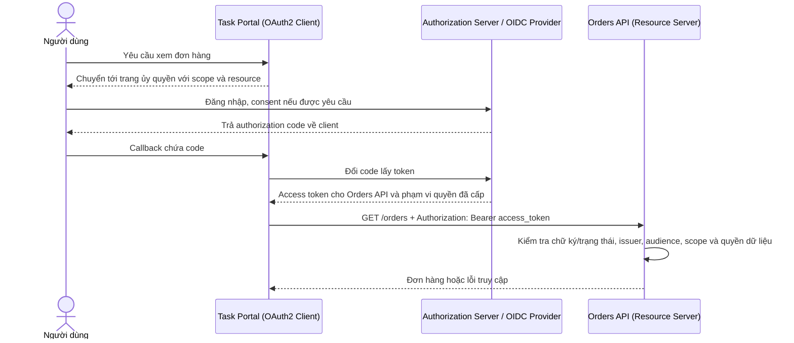
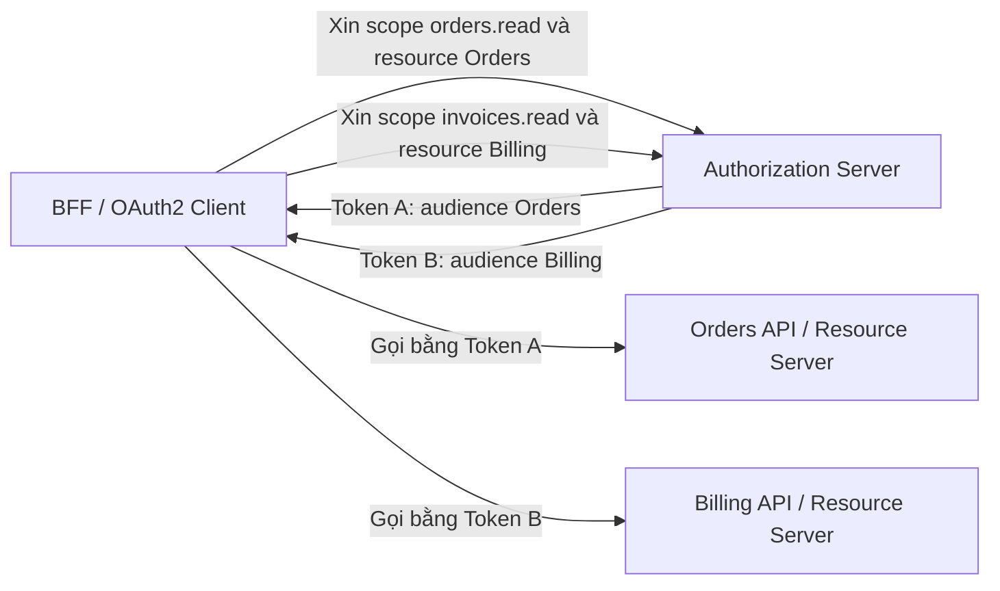

# 2.9. Scope, consent, audience và resource trong OAuth 2.0 / OpenID Connect

Trong OAuth 2.0, một ứng dụng có access token **không đồng nghĩa** với việc ứng dụng đó được gọi mọi API hoặc thực hiện mọi thao tác. Quyền truy cập được giới hạn bởi nhiều yếu tố, trong đó bốn khái niệm quan trọng là **scope**, **consent**, **audience** và **resource**. Chúng liên quan chặt chẽ nhưng giải quyết các câu hỏi khác nhau.

| Khái niệm | Câu hỏi mà nó giải quyết | Minh họa |
| --- | --- | --- |
| **Scope** | Client đang yêu cầu/được cấp **loại quyền** nào? | `orders.read`, `orders.write` |
| **Consent** | Chủ thể có quyền (thường là người dùng) có **đồng ý ủy quyền** cho client hay không, trong trường hợp cần sự đồng ý? | “Cho phép ứng dụng đọc đơn hàng của bạn?” |
| **Audience (`aud`)** | Access token này **dành cho bên nhận/API nào**? | `https://orders-api.example.com` |
| **Resource** | Client đang muốn truy cập **tài nguyên hoặc dịch vụ được bảo vệ nào**? | Orders API mà client khai báo bằng tham số `resource` |

**Ghi nhớ cách phân biệt:** *scope* nói về **hành động/quyền**, *consent* nói về **quyết định cấp quyền**, *audience* giới hạn **đối tượng nhận token**, còn *resource* chỉ **đích tài nguyên được yêu cầu**. Mặc dù một resource indicator đôi khi có giá trị giống `aud`, hai khái niệm không phải một trường có thể hoán đổi tùy ý.

## 1. Đặt bốn khái niệm vào đúng luồng OAuth 2.0

Giả sử có hệ thống:

- **Task Portal**: ứng dụng web mà nhân viên đăng nhập; là OAuth2 Client.
- **Identity Provider (IdP)**: Authorization Server / OIDC Provider xác thực và cấp token.
- **Orders API**: Resource Server cung cấp API đọc/ghi đơn hàng.
- **Nhân viên**: người có thể cấp quyền cho ứng dụng truy cập dữ liệu mà mình được phép sử dụng.

Nhân viên muốn dùng Task Portal để xem đơn hàng. Task Portal xin scope `orders.read` cho Orders API. IdP xác thực nhân viên, quyết định có cần hiển thị màn hình consent hay không, sau đó phát hành token được ràng buộc với Orders API theo chính sách của nó. Task Portal gửi access token tới Orders API. Orders API phải xác minh token **thật sự dành cho mình** và **có quyền đọc đơn hàng**, sau đó còn kiểm tra nhân viên có quyền xem *đơn hàng cụ thể* hay không.



Sơ đồ thể hiện trường hợp **authorization code grant**. Nếu client dùng `client_credentials`, không có người dùng tương tác và không có màn hình consent theo nghĩa người dùng duyệt quyền; tuy vậy scope, audience và resource vẫn có thể có vai trò.

## 2. Scope: tên các quyền mà client yêu cầu và được cấp

### 2.1. Scope thực chất là gì?

`scope` trong OAuth 2.0 là một hoặc nhiều **chuỗi đại diện cho phạm vi quyền truy cập** do Authorization Server và API thống nhất ý nghĩa. Chẳng hạn:

| Scope minh họa | Ý nghĩa theo chính sách của hệ thống |
| --- | --- |
| `orders.read` | Cho phép đọc đơn hàng trong phạm vi tài khoản/chủ thể hợp lệ |
| `orders.write` | Cho phép tạo hoặc sửa đơn hàng theo quy tắc nghiệp vụ |
| `reports.export` | Cho phép yêu cầu xuất báo cáo |
| `profile.read` | Cho phép đọc hồ sơ thông qua một API có định nghĩa scope này |

Các chuỗi trên chỉ là **quy ước minh họa**, không phải danh sách scope chuẩn áp dụng toàn cầu. Hai Authorization Server khác nhau có thể dùng cùng tên `orders.read` nhưng ý nghĩa, Resource Server áp dụng và chính sách cấp quyền khác nhau. Vì vậy cần dựa vào hợp đồng bảo mật giữa client, Authorization Server và Resource Server.

Trong yêu cầu OAuth 2.0 tiêu chuẩn, client có thể xin nhiều scope bằng một chuỗi phân tách bởi dấu cách:

```text
scope=orders.read orders.write
```

Khi đi trong URL hoặc form encoded, dấu cách thường được mã hóa thành `%20` hoặc `+` tùy ngữ cảnh:

```text
scope=openid%20profile%20orders.read
```

**Scope không phải URL API, tên vai trò trong database, hay token riêng.** Scope là một phần trong chính sách cấp và thực thi quyền. Một scope có thể bao phủ nhiều endpoint; ngược lại, cùng một endpoint có thể yêu cầu nhiều điều kiện ngoài scope.

### 2.2. Scope được *yêu cầu* và scope thực sự *được cấp*

Cần phân biệt:

1. **Requested scopes:** client khai báo những quyền mong muốn khi bắt đầu ủy quyền hoặc xin token.
2. **Granted scopes:** những quyền Authorization Server thực sự cấp sau khi áp dụng chính sách, cấu hình client, yêu cầu người dùng và các giới hạn khác.
3. **Enforced permissions:** điều kiện Resource Server dùng để chấp nhận request, có thể kết hợp granted scope với quyền dữ liệu chi tiết.

Authorization Server có thể từ chối scope không được phép (`invalid_scope`) hoặc chỉ cấp một tập con. Trong một OAuth 2.0 token response, nếu scope được cấp **khác** scope được yêu cầu, trường `scope` phải mô tả phạm vi thực sự được cấp; khi giống nhau, trường này có thể vắng mặt theo đặc tả. Không nên coi danh sách scope trong cấu hình client là bằng chứng rằng token hiện tại đã có tất cả quyền đó.

Ví dụ:

```http
POST /oauth2/token HTTP/1.1
Host: idp.example.com
Content-Type: application/x-www-form-urlencoded

grant_type=client_credentials&scope=orders.read%20orders.write
```

Token response minh họa khi chỉ được cấp quyền đọc:

```json
{
  "access_token": "<opaque-or-jwt-token>",
  "token_type": "Bearer",
  "expires_in": 3600,
  "scope": "orders.read"
}
```

`scope` ở phản hồi token là **metadata của grant**; định dạng bên trong access token là vấn đề khác. JWT access token có thể mang claim `scope` (chuỗi cách nhau bởi dấu cách) hoặc `scp` (thường là mảng, tùy hệ thống). Opaque token không bắt buộc cho client biết được scope từ cấu trúc token; Resource Server có thể lấy thông tin qua introspection.

### 2.3. Scope của OIDC không giống hoàn toàn scope của một business API

OIDC dùng một số scope chuẩn:

| Scope OIDC | Tác dụng chính |
| --- | --- |
| `openid` | Cho biết đây là yêu cầu OpenID Connect, hướng tới xác thực người dùng và ID Token |
| `profile` | Xin quyền truy cập các claim hồ sơ tiêu chuẩn, tùy các claim có sẵn và sự đồng ý/chính sách |
| `email` | Xin quyền truy cập claim liên quan email, có thể gồm `email` và `email_verified` |
| `phone` | Xin quyền truy cập claim số điện thoại liên quan |
| `address` | Xin quyền truy cập claim địa chỉ liên quan |
| `offline_access` | Yêu cầu khả năng truy cập khi người dùng không trực tuyến theo điều kiện OIDC/provider; không đảm bảo chắc chắn được cấp refresh token |

`openid profile email` thường gắn với **đăng nhập và thông tin danh tính**; `orders.read` gắn với **ủy quyền gọi Orders API**. Một access token chỉ có `openid profile email` không đương nhiên được gọi Orders API. Ngược lại, access token có `orders.read` không tự trở thành ID Token dùng để đăng nhập.

### 2.4. Scope có phải đủ để đọc một bản ghi không?

Không. Nếu token có scope `orders.read`, vẫn cần xem liệu chủ thể được phép đọc đơn hàng `order-732` không. Trong Resource Server có thể cần kết hợp:

- **Scope/authority**: request được phép thực hiện loại thao tác đọc đơn hàng.
- **Audience và issuer**: token hợp lệ cho đúng API và được cấp bởi nguồn tin cậy.
- **Quyền trên đối tượng**: đơn hàng thuộc tenant nào, người dùng hoặc service có quyền truy cập bản ghi cụ thể không.
- **Ràng buộc nghiệp vụ**: đơn hàng có đang khóa, có thuộc phòng ban được phép hay không.

Ví dụ pseudo-code phía API:

```java
@PreAuthorize("hasAuthority('SCOPE_orders.read')")
@GetMapping("/api/orders/{id}")
OrderDto findOrder(@PathVariable Long id, Authentication authentication) {
    // Bên trong service vẫn kiểm tra tenant/owner/quyền cụ thể của bản ghi.
    return orderService.findReadableOrder(id, authentication);
}
```

`@PreAuthorize` cần bật method security (ví dụ `@EnableMethodSecurity`) và phải cấu hình phương thức kiểm tra dữ liệu tương ứng. Chính sách quyền trên bản ghi **không thể được thay bằng một scope quá rộng**.

## 3. Consent: việc chấp thuận cấp quyền

### 3.1. Consent là quyết định gì?

**Consent** là hành vi chấp thuận cho client sử dụng những quyền truy cập nhất định, thường được người dùng đưa ra trên giao diện của Authorization Server. Một màn hình consent có thể hiển thị:

> Task Portal muốn xem các đơn hàng bạn có quyền truy cập. Bạn có đồng ý không?

Người dùng nhìn thấy tên ứng dụng, loại dữ liệu, quyền được yêu cầu và nút chấp thuận hoặc từ chối. Authorization Server mới là bên quyết định grant nào được phép phát hành, dựa trên consent và chính sách. Client **không được** tự coi việc hiển thị một checkbox của chính mình là quyền được Authorization Server cấp.

Consent khác với **authentication** và **authorization**:

| Hành động | Ý nghĩa |
| --- | --- |
| Người dùng nhập mật khẩu, dùng passkey hoặc SSO | **Authentication**: xác nhận danh tính |
| Người dùng bấm “Allow” cho `orders.read` | **Consent**: chấp thuận yêu cầu ủy quyền trong trường hợp áp dụng |
| Authorization Server phát hành token đã giới hạn quyền | **Authorization grant/token issuance**: cấp quyền phù hợp chính sách |
| Orders API kiểm tra scope và quyền trên từng đơn hàng | **Authorization enforcement**: thực thi chính sách trên tài nguyên |

Người dùng chấp thuận **không làm mất hiệu lực** chính sách hệ thống. Ví dụ họ đồng ý cấp quyền `reports.export` nhưng role của họ bị cấm xuất báo cáo: Authorization Server hoặc Resource Server vẫn có thể từ chối.

### 3.2. Có phải lần nào xin token cũng hiện màn hình consent?

Không. Việc có xuất hiện màn hình consent tùy vào chính sách IdP, loại client, quyền đã cấp trước đó, tổ chức và yêu cầu OIDC:

- **Lần đầu yêu cầu quyền mới:** có thể cần người dùng chấp thuận.
- **Đã consent cho scope đó trước đây:** IdP có thể ghi nhớ và không hỏi lại.
- **Ứng dụng nội bộ/first-party hoặc quyền đã được quản trị viên chấp thuận:** có thể bỏ qua tương tác consent tùy chính sách.
- **Client credentials:** không có người dùng trực tiếp phê duyệt trong luồng xin token; các quyền của service được quản trị/cấp cấu hình trước.
- **Yêu cầu thêm scope sau này:** IdP có thể yêu cầu consent bổ sung (incremental authorization) nếu hỗ trợ.

Trong OIDC, tham số `prompt=consent` yêu cầu OpenID Provider hiển thị giao diện lấy consent trong điều kiện nhà cung cấp hỗ trợ đúng hành vi của tham số này. Không nên coi `prompt=consent` là một tham số chuẩn chung của mọi OAuth2 Provider. Ngoài ra, `prompt=none` có thể khiến yêu cầu thất bại nếu cần tương tác nhưng bị cấm hiển thị giao diện.

### 3.3. Điều gì xảy ra khi người dùng từ chối?

Trong authorization code flow, Authorization Server thường trả về lỗi cho redirect URI đã được xác minh, chẳng hạn:

```http
GET /login/oauth2/code/acme?error=access_denied&state=<original-state>
```

Client cần xử lý tình huống này như một quyết định bị từ chối, thông báo dễ hiểu và không cố sử dụng quyền chưa được cấp. `state` là giá trị chống request forgery/ghép sai phản hồi; nó không đại diện cho consent.

### 3.4. Tư duy thiết kế consent an toàn

Hãy xin **quyền tối thiểu** cần cho tác vụ hiện tại. Nếu người dùng chỉ xem đơn hàng, yêu cầu `orders.read` thay vì `orders.read orders.write`; nếu sau đó họ bật tính năng cập nhật, mới cân nhắc xin thêm quyền. Hiển thị ngôn ngữ rõ ràng về dữ liệu và thao tác thay vì dồn mọi scope vào một thông báo khó hiểu. Quản lý vòng đời quyền đã cấp, việc thu hồi quyền và thay đổi chính sách theo năng lực của IdP.

## 4. Audience: token được phát hành cho ai?

### 4.1. Vai trò của claim `aud`

**Audience** là tập các bên nhận mà token được dự định sử dụng. Với JWT access token, trường `aud` có thể là chuỗi hoặc mảng chuỗi tùy trường hợp/đặc tả token đang dùng:

```json
{
  "iss": "https://idp.example.com",
  "sub": "employee-42",
  "aud": "https://orders-api.example.com",
  "scope": "orders.read",
  "iat": 1790000000,
  "exp": 1790003600
}
```

JSON này chỉ minh họa **payload đã giải mã** của JWT, không phải token được ký thật. Khi bảo vệ Orders API, Resource Server nên kiểm tra token được phát hành cho audience mà API chấp nhận, bên cạnh chữ ký và các điều kiện khác. Tên audience là quy ước giữa Authorization Server và API: có hệ thống dùng URL, có hệ thống dùng định danh logic (`orders-api`). API không được tự suy ra audience từ URL request nếu chính sách của IdP sử dụng một định danh khác.

Một JWT có thể có nhiều audience:

```json
{
  "aud": ["https://orders-api.example.com", "https://billing-api.example.com"]
}
```

Điều này có nghĩa token được nhắm đến nhiều bên nhận nếu hợp đồng token cho phép. Tuy nhiên, **token riêng cho từng API** thường dễ giới hạn quyền và giảm hậu quả khi token bị lộ hơn. Có nhiều audience chỉ vì tiện dùng lại token là thiết kế nên cân nhắc kỹ.

### 4.2. Vì sao có scope đúng vẫn không đủ?

Ví dụ `payment-api` nhận một JWT như sau:

```json
{
  "iss": "https://idp.example.com",
  "aud": "https://orders-api.example.com",
  "scope": "payments.read"
}
```

Ngay cả khi token có `payments.read` và chữ ký hợp lệ, Payment API cũng **phải từ chối** nếu audience không dành cho chính nó. Đây là cách giảm nguy cơ một token bị phát lại (*token replay*) sang dịch vụ khác, thường gọi là vấn đề **cross-resource token substitution**.

Một API thường cần xác thực các yếu tố:

1. Token có nguồn gốc từ **issuer** được tin cậy (`iss`).
2. Chữ ký/thuật toán và khóa xác minh đúng với cấu hình đáng tin cậy, nếu là JWT.
3. Token chưa hết hạn (`exp`), chưa đến thời điểm được phép dùng (`nbf`) nếu có.
4. **Audience** có định danh của API này (`aud`).
5. Token có quyền/scope và các ràng buộc truy cập cần thiết.

`scope` và `aud` bổ sung cho nhau: `aud` chọn **dịch vụ nhận token**; `scope` chọn **loại thao tác được phép**. Cả hai không thay thế kiểm tra quyền đối với bản ghi thực tế.

### 4.3. Audience của ID Token khác audience của Access Token

Trong **OIDC**, ID Token được phát hành để **client xác thực thông tin đăng nhập của người dùng**. `aud` của ID Token phải chứa `client_id` của Relying Party; có thể có các ràng buộc khác như `azp` theo chuẩn OIDC khi có nhiều audience.

Ngược lại, audience của **access token** biểu thị API/Resource Server mà token được sử dụng tại đó. Vì thế:

- **ID Token:** `aud = portal-web-client` để client xác minh thông tin đăng nhập.
- **Access Token:** `aud = https://orders-api.example.com` để Orders API xác minh token của request.

Không gửi ID Token làm bearer token gọi Orders API. Một JWT có cấu trúc hợp lệ không chứng minh rằng nó là **đúng loại token** hoặc có **đúng audience**.

Với **opaque access token**, API không tự xem được claim `aud` trong chuỗi token; API cần validation theo cơ chế hỗ trợ, thường là introspection và kiểm tra những metadata/thuộc tính audience mà Authorization Server công bố. Không giả định mọi opaque token đều chứa claim JWT.

## 5. Resource: chỉ rõ tài nguyên hoặc API đích

### 5.1. Ba cách dùng từ “resource” cần phân biệt

Trong một hệ thống OAuth2, từ *resource* có thể xuất hiện ở ba cấp độ:

| Cách dùng | Ví dụ | Ý nghĩa |
| --- | --- | --- |
| **Protected resource** | Một đơn hàng, tệp tin, dữ liệu hồ sơ | Đối tượng cụ thể cần bảo vệ |
| **Resource Server** | `orders-api` | Dịch vụ lưu trữ/phục vụ protected resource |
| **Resource indicator** | `resource=https://orders-api.example.com` | Tham số cho Authorization Server biết **dịch vụ tài nguyên đích** mà client muốn lấy token để truy cập |

Phần này tập trung vào cách dùng thứ ba: **resource indicator** theo [RFC 8707 — Resource Indicators for OAuth 2.0](https://www.rfc-editor.org/rfc/rfc8707).

### 5.2. Tham số chuẩn `resource` giải quyết bài toán gì?

Khi cùng một Authorization Server cấp token cho nhiều API, chỉ `scope=read` có thể chưa đủ để chỉ rõ token cần cấp **cho API nào**. RFC 8707 bổ sung tham số yêu cầu `resource` để client nêu rõ protected resource mong muốn khi yêu cầu ủy quyền hoặc token:

```text
scope=orders.read
resource=https://orders-api.example.com
```

Khi được IdP hỗ trợ, thông tin resource giúp Authorization Server đưa ra quyết định cấp token phù hợp đích sử dụng, hạn chế token được cấp cho các API không cần thiết, và thiết lập audience tương ứng.

Theo RFC 8707, giá trị `resource` là một **absolute URI**, không chứa fragment; URI đóng vai trò định danh đích, **không bắt buộc** là địa chỉ mà client phải gọi trực tiếp. Ví dụ `https://orders-api.example.com` là một resource indicator, còn `https://orders-api.example.com/orders/123` là URL của một bản ghi/endpoint cụ thể và thường **không** phải định danh scope của toàn API. Cần dùng đúng định danh mà Authorization Server công bố hoặc đăng ký.

Lưu ý: `resource` là tham số **chuẩn mở rộng OAuth 2.0**, nhưng **không phải Authorization Server nào cũng triển khai RFC 8707**. Một số sản phẩm cung cấp tham số `audience` riêng trong authorization request; tham số `audience` đó là quy ước của nhà cung cấp, không phải tham số chuẩn của RFC 8707. Khi tích hợp phải đọc tài liệu IdP cụ thể.

### 5.3. `resource` và `aud` liên hệ với nhau như thế nào?

Ví dụ client gửi:

```text
resource=https://orders-api.example.com
```

Authorization Server có thể phát hành JWT access token với:

```json
{
  "aud": "https://orders-api.example.com",
  "scope": "orders.read"
}
```

Trong ví dụ này, resource indicator và audience trùng nhau. Đó là **một lựa chọn thiết kế hợp lý**, nhưng không phải phép biến đổi cứng áp dụng cho mọi IdP:

- **`resource`** là tham số **đầu vào** trong yêu cầu ủy quyền/cấp token, định danh API đích client muốn truy cập.
- **`aud`** là thông tin **trong token** hoặc metadata token, dùng bởi bên nhận để kiểm tra mình có phải audience được phép không.
- Authorization Server có thể chuẩn hóa hoặc ánh xạ resource URI thành một audience identifier khác, tùy hợp đồng cấu hình. Client và API cần dùng **đúng giá trị được thống nhất**.

Một Authorization Server có thể từ chối resource chưa đăng ký hoặc không được phép (`invalid_target` theo RFC 8707). Không nên xem tham số client gửi lên là quyền tự động được cấp; Authorization Server vẫn quyết định token thực tế nhắm đến đâu.

### 5.4. Có thể yêu cầu nhiều resource không?

RFC 8707 cho phép yêu cầu nhiều resource indicator trong những điều kiện nhà cung cấp hỗ trợ. Ví dụ ý tưởng:

```text
resource=https://orders-api.example.com
resource=https://billing-api.example.com
```

Việc yêu cầu nhiều resource **không đảm bảo** Authorization Server sẽ cấp một token hợp lệ cho tất cả, cũng không có nghĩa Resource Server nào cũng nên chấp nhận token nhiều audience. Chính sách có thể từ chối yêu cầu hoặc giới hạn token. Khi hai API có phạm vi bảo mật khác nhau, một client thường nên xin **token dành riêng cho từng API**, với scope tương ứng.

### 5.5. Resource không thay thế resource-level authorization

`resource=https://orders-api.example.com` chỉ nêu **API đích**, không diễn đạt “được đọc mọi đơn hàng thuộc mọi tenant”. Token có audience đúng và `orders.read` vẫn có thể bị từ chối nếu người dùng không sở hữu đơn hàng, tenant không phù hợp hoặc thuộc chính sách cấm. Thiết kế phân quyền của API phải tách rõ **token targeting** khỏi **object authorization**.

## 6. Ghép cả bốn khái niệm trong một giao dịch

Giả sử một người dùng muốn đọc đơn hàng trong Portal. Luồng bên dưới sử dụng OIDC authorization code với PKCE và Resource Indicators khi IdP hỗ trợ.

### 6.1. Yêu cầu ủy quyền từ trình duyệt

Ví dụ URL đã được xuống dòng để dễ đọc:

```http
GET /authorize?
    response_type=code&
    client_id=portal-web&
    redirect_uri=https%3A%2F%2Fportal.example.com%2Flogin%2Foauth2%2Fcode%2Facme&
    scope=openid%20profile%20orders.read&
    resource=https%3A%2F%2Forders-api.example.com&
    state=<random-state>&
    nonce=<random-nonce>&
    code_challenge=<pkce-challenge>&
    code_challenge_method=S256
Host: idp.example.com
```

*Các dòng sau dấu `?` chỉ nhằm minh họa; một URL HTTP thực tế cần ghép thành một dòng và các giá trị đặc biệt phải được URL-encode hợp lệ. `state`, `nonce` và PKCE phải được tạo, lưu, xác minh đúng chuẩn, không điền chuỗi literal như ví dụ.*

Các trường có vai trò riêng:

| Trường | Vai trò |
| --- | --- |
| `scope=openid profile orders.read` | Xin xác thực OIDC và quyền đọc đơn hàng |
| `resource=https://orders-api.example.com` | Chỉ định API đích theo RFC 8707 nếu IdP hỗ trợ |
| `client_id=portal-web` | Định danh client xin quyền; **không phải audience của Orders API** |
| `state` | Liên kết request/response, hỗ trợ chống CSRF trong luồng chuyển hướng |
| `nonce` | Gắn ID Token với yêu cầu OIDC phù hợp, chống phát lại trong các tình huống liên quan |
| `code_challenge` | Phần thử thách PKCE bảo vệ authorization code, cần đối chiếu với `code_verifier` tại token endpoint |

Authorization Server xác thực người dùng và có thể hiển thị consent “Task Portal được đọc đơn hàng của bạn”. Nếu người dùng đồng ý và mọi chính sách cho phép, IdP trả **authorization code** về redirect URI.

### 6.2. Client đổi authorization code lấy token

Trong authorization code flow, client gửi code và các thông tin cần thiết tới Token Endpoint. Nếu IdP triển khai RFC 8707 và yêu cầu resource ở token request, client cũng truyền đúng định danh resource theo hợp đồng với IdP:

```http
POST /token HTTP/1.1
Host: idp.example.com
Content-Type: application/x-www-form-urlencoded

grant_type=authorization_code&code=<authorization-code>&redirect_uri=https%3A%2F%2Fportal.example.com%2Flogin%2Foauth2%2Fcode%2Facme&client_id=portal-web&code_verifier=<pkce-verifier>&resource=https%3A%2F%2Forders-api.example.com
```

Ví dụ giả định client dùng cơ chế xác thực tại Token Endpoint phù hợp loại client; với confidential client, cần xác thực client theo đăng ký. PKCE và xác thực client có vai trò khác nhau. Không đưa client secret vào trình duyệt hoặc một frontend không thể bảo mật bí mật.

Phản hồi có thể có:

```json
{
  "access_token": "<signed-or-opaque-access-token>",
  "token_type": "Bearer",
  "expires_in": 900,
  "scope": "openid profile orders.read",
  "id_token": "<oidc-id-token>"
}
```

`id_token` xuất hiện khi đáp ứng điều kiện OIDC; access token và ID Token có **đối tượng nhận khác nhau**. Những giá trị `expires_in` và các trường trong ví dụ chỉ minh họa một phản hồi, không phải mọi IdP đều trả về y hệt.

### 6.3. Client gọi Resource Server

Portal gửi **access token**, không gửi ID Token:

```http
GET /api/orders/732 HTTP/1.1
Host: orders-api.example.com
Authorization: Bearer <access-token>
```

Orders API xác thực token, kiểm tra audience phù hợp `orders-api`, scope/authority `orders.read`, rồi tiếp tục xác minh quyền đối với đơn hàng 732. Nếu một bước thất bại, API cần từ chối request; nó không được suy luận từ việc “người dùng đã bấm Allow” rằng mọi truy cập đều được chấp thuận.

## 7. Cấu hình trong Spring Security OAuth2 Client

### 7.1. Đăng ký scope trong Spring Boot

Với một ứng dụng web đăng nhập qua OIDC và cần gọi Orders API thay người dùng:

```gradle
dependencies {
    implementation 'org.springframework.boot:spring-boot-starter-security'
    implementation 'org.springframework.boot:spring-boot-starter-oauth2-client'
    implementation 'org.springframework.boot:spring-boot-starter-web'
}
```

```yaml
spring:
  security:
    oauth2:
      client:
        registration:
          acme:
            provider: acme-idp
            client-id: ${ACME_CLIENT_ID}
            client-secret: ${ACME_CLIENT_SECRET}
            authorization-grant-type: authorization_code
            redirect-uri: "{baseUrl}/login/oauth2/code/{registrationId}"
            scope:
              - openid
              - profile
              - orders.read
        provider:
          acme-idp:
            issuer-uri: https://idp.example.com/realms/acme
```

Trong cấu hình này:

- `scope` là **những quyền client xin**, không phải quyền đã được bảo đảm cấp.
- `issuer-uri` hướng dẫn Spring dùng metadata OIDC/OAuth2 của provider để xác định endpoint và thông tin phù hợp.
- `client-id` định danh ứng dụng với IdP; nó **không** xác định API đích mà access token sẽ được chấp nhận.
- Đường callback phải được đăng ký với IdP; secret phải đặt trong môi trường/secret manager, không commit bí mật vào source code.

Một `SecurityFilterChain` tối thiểu cho trang web:

```java
@Bean
SecurityFilterChain webSecurity(HttpSecurity http) throws Exception {
    http
        .authorizeHttpRequests(authorize -> authorize
            .requestMatchers("/", "/assets/**").permitAll()
            .anyRequest().authenticated())
        .oauth2Login(Customizer.withDefaults());
    return http.build();
}
```

Những đoạn Java trong bài lược bỏ `import`, `@Configuration` và phần bao lớp khi không cần thiết để làm rõ ý chính. `oauth2Login()` xử lý phiên đăng nhập; khi Portal gọi Orders API, cần sử dụng **access token thuộc `OAuth2AuthorizedClient`** hoặc HTTP client đã tích hợp với `OAuth2AuthorizedClientManager`.

### 7.2. Thêm resource indicator: không có phép gán tự động từ scope

`scope: orders.read` **không tự suy ra** `resource=https://orders-api.example.com`. Nếu IdP hỗ trợ RFC 8707, client cần tùy biến việc xây dựng authorization request. Ví dụ cấu hình cho một registration dùng một Orders API cố định:

```java
@Bean
SecurityFilterChain webSecurity(
        HttpSecurity http,
        ClientRegistrationRepository registrations) throws Exception {

    DefaultOAuth2AuthorizationRequestResolver resolver =
        new DefaultOAuth2AuthorizationRequestResolver(
            registrations, "/oauth2/authorization");

    resolver.setAuthorizationRequestCustomizer(builder ->
        builder.additionalParameters(params ->
            params.put("resource", "https://orders-api.example.com")));

    http
        .authorizeHttpRequests(auth -> auth
            .anyRequest().authenticated())
        .oauth2Login(oauth2 -> oauth2
            .authorizationEndpoint(endpoint -> endpoint
                .authorizationRequestResolver(resolver)));

    return http.build();
}
```

Ở ví dụ này, phần `resource` được thêm vào **authorization request** đi tới IdP. Nếu ứng dụng có nhiều client registration, phải chọn resource theo `registrationId`/ngữ cảnh thay vì gắn cùng một resource cho mọi client. **Ví dụ này không tự thêm tham số vào token request.** Nếu IdP yêu cầu tham số `resource` ở cả Token Endpoint, còn phải cấu hình token response client thích hợp với phiên bản Spring Security đang dùng; đặc biệt cần đối chiếu cách tùy biến authorization code token client hoặc client credentials token client trong phiên bản đó.

Một số nhà cung cấp không dùng RFC 8707 mà yêu cầu tham số `audience` tùy biến ở authorization request. Khi đó tên và giá trị tham số phải theo tài liệu của nhà cung cấp; không thể chỉ thay trường `scope` bằng một URL API hoặc kỳ vọng Spring tự tạo audience.

### 7.3. Với client credentials, scope vẫn cần nhưng không có consent người dùng

Ví dụ service gọi một API định kỳ:

```yaml
spring:
  security:
    oauth2:
      client:
        registration:
          orders-machine:
            provider: acme-idp
            client-id: ${ORDERS_CLIENT_ID}
            client-secret: ${ORDERS_CLIENT_SECRET}
            authorization-grant-type: client_credentials
            scope: orders.read
        provider:
          acme-idp:
            token-uri: https://idp.example.com/oauth2/token
```

Backend dùng `OAuth2AuthorizedClientManager` để xin và quản lý access token, rồi gửi token khi gọi Orders API. Trong grant `client_credentials`, scope được cấp theo chính sách dành cho **client/service**, không theo một màn hình consent người dùng. Nếu IdP yêu cầu resource indicator khi gọi Token Endpoint, cũng cần tùy biến token request tương ứng; cấu hình client registration tiêu chuẩn ở trên chỉ thể hiện scope.

## 8. Cấu hình trong Spring Security Resource Server

### 8.1. Resource Server phải kiểm tra audience và scope

Phía Orders API, cấu hình cần trả lời hai câu hỏi độc lập:

- **Token dành cho API này không?** Kiểm tra audience (ngoài issuer, chữ ký, thời hạn và các xác thực khác).
- **Token cho phép đọc đơn hàng không?** Kiểm tra scope hoặc authority tương ứng.

Dependency thường dùng cho JWT bearer token:

```gradle
dependencies {
    implementation 'org.springframework.boot:spring-boot-starter-security'
    implementation 'org.springframework.boot:spring-boot-starter-oauth2-resource-server'
    implementation 'org.springframework.boot:spring-boot-starter-web'
}
```

Cấu hình ví dụ trên phiên bản Spring Boot có hỗ trợ thuộc tính `audiences`:

```yaml
spring:
  security:
    oauth2:
      resourceserver:
        jwt:
          issuer-uri: https://idp.example.com/realms/acme
          audiences:
            - https://orders-api.example.com
```

`issuer-uri` thường giúp khởi tạo JWT decoder cùng xác thực issuer; `audiences` đặt audience mà Orders API chấp nhận. Tùy phiên bản Spring Boot/Spring Security, nếu thuộc tính `audiences` chưa được hỗ trợ thì cần cấu hình `JwtDecoder` với audience validator riêng. Không nên bỏ qua audience validation chỉ vì đã xác nhận token được ký bởi IdP hợp lệ.

```java
@Configuration
@EnableMethodSecurity
class OrdersApiSecurity {
    @Bean
    SecurityFilterChain apiSecurity(HttpSecurity http) throws Exception {
        http
            .authorizeHttpRequests(auth -> auth
                .requestMatchers(HttpMethod.GET, "/api/orders/**")
                    .hasAuthority("SCOPE_orders.read")
                .requestMatchers(HttpMethod.POST, "/api/orders/**")
                    .hasAuthority("SCOPE_orders.write")
                .anyRequest().authenticated())
            .oauth2ResourceServer(oauth2 ->
                oauth2.jwt(Customizer.withDefaults()));
        return http.build();
    }
}
```

Với cấu hình JWT mặc định, Spring Security thường chuyển scope từ claim `scope` hoặc `scp` thành authority có tiền tố `SCOPE_`. `orders.read` vì vậy trở thành `SCOPE_orders.read`. Nếu IdP phát hành claim theo định dạng khác, cần tùy biến `JwtAuthenticationConverter` hoặc converter tương đương. Định nghĩa các rule GET/POST chỉ là ví dụ; API thực tế phải bao phủ các HTTP method và endpoint liên quan, và còn kiểm tra quyền trên từng đơn hàng.

Nếu access token là **opaque**, Resource Server có thể cấu hình `opaqueToken(...)` và introspection thay vì `jwt(...)`. Khi ấy việc kiểm tra audience/scope cần dựa trên thông tin được IdP trả về từ introspection hoặc chính sách xác thực bổ sung; không tìm cách đọc trực tiếp opaque token như một JWT.

### 8.2. Lỗi HTTP phản ánh lớp kiểm tra nào?

| Hiện tượng | Ví dụ nguyên nhân | Phản hồi thường gặp |
| --- | --- | --- |
| Không có bearer token hoặc token hết hạn/sai chữ ký | Request thiếu thông tin xác thực hợp lệ | `401 Unauthorized` với thử thách `Bearer` |
| Token có chữ ký đúng nhưng audience sai | Token dành cho API khác; token không hợp lệ tại API hiện tại | Thường `401 Unauthorized` |
| Token hợp lệ nhưng thiếu scope `orders.read` | Đã xác thực, chưa đủ quyền | Thường `403 Forbidden`; có thể kèm `insufficient_scope` |
| Có `orders.read` nhưng không được đọc đơn hàng 732 | Không đủ quyền ở mức đối tượng | Thường `403 Forbidden`, hoặc `404` nếu chính sách che giấu tồn tại tài nguyên |

`insufficient_scope` là mã lỗi trong cơ chế bearer token của RFC 6750. Chi tiết status và `WWW-Authenticate` có thể phụ thuộc cấu hình entry point/access denied handler của Spring Security và chính sách API.

## 9. Hai API, hai audience: tình huống dễ sai

Một ứng dụng BFF cần gọi cả **Orders API** và **Billing API**. Hai API có policy riêng:

| Bước | Orders API | Billing API |
| --- | --- | --- |
| Resource indicator mong muốn | `https://orders-api.example.com` | `https://billing-api.example.com` |
| Scope cần xin | `orders.read` | `invoices.read` |
| Audience token hợp lệ | Orders API | Billing API |
| Bên kiểm tra token | Orders Resource Server | Billing Resource Server |

Ví dụ client có token A với `aud=orders-api`, `scope=orders.read` và token B với `aud=billing-api`, `scope=invoices.read`. Khi gọi Orders API, client dùng **A**; khi gọi Billing API, dùng **B**. Nếu gửi A sang Billing API, Billing API phải từ chối vì audience không đúng, kể cả client đã đăng nhập một lần với OIDC Provider chung.



Nếu IdP không hỗ trợ nhiều audience/resource hoặc chọn cơ chế khác để xin token cho API đích, cần thiết kế theo năng lực của IdP: có thể dùng client registration khác, grant khác hoặc token exchange phù hợp. Đừng tự sửa claim `aud` trong JWT đã ký: làm vậy phá chữ ký và không tạo được quyền truy cập hợp lệ.

## 10. Những nhầm lẫn thường gặp

1. **Scope là endpoint.** `orders.read` không phải URL `/api/orders`; nó là tên một quyền. Một scope có thể áp dụng cho nhiều URL, tùy chính sách API.
2. **Scope đủ là gọi được bất kỳ API nào.** Token vẫn phải có audience được API chấp nhận; trùng tên scope không làm token dành cho API khác trở nên hợp lệ.
3. **Consent đồng nghĩa với được phép truy cập mọi dữ liệu.** Người dùng chấp thuận chỉ là một phần của quá trình cấp quyền. API vẫn kiểm tra vai trò, tenant, sở hữu dữ liệu, chính sách pháp lý và nghiệp vụ.
4. **Mỗi lần OAuth2 login đều cần consent.** Một IdP có thể dùng quyền đã cấp trước, cấu hình của tổ chức, pre-authorization hoặc chính sách tương tác khác.
5. **Grant `client_credentials` cần người dùng bấm Allow.** Nó dành cho client/service tự xin token; quyền được quản trị và cấp theo chính sách của client.
6. **`aud` của ID Token và access token giống nhau.** ID Token thường có audience là client ID; access token có audience của Resource Server. Trộn hai loại dễ gây lỗ hổng token substitution.
7. **`resource` luôn bằng `aud`.** Có thể trùng trong một hệ thống, nhưng Resource Indicator là yêu cầu đầu vào và audience là ràng buộc của token; IdP quyết định cách ánh xạ.
8. **Chỉ cần điền `scope` trong `application.yml` là Spring tự gửi `resource`.** Resource Indicators theo RFC 8707 cần cấu hình thêm và đòi hỏi IdP hỗ trợ.
9. **`audience` trong URL authorization request luôn là tham số OAuth2 chuẩn.** Thực tế nhiều nhà cung cấp dùng extension riêng; tham số theo RFC 8707 là `resource`.
10. **Opaque token thì không cần audience.** API vẫn phải bảo đảm token hợp lệ cho chính nó; chỉ khác là nguồn kiểm tra có thể là introspection/metadata chứ không phải JWT claim tự giải mã.
11. **Scope được yêu cầu chắc chắn đã được cấp.** Authorization Server có thể từ chối hoặc cấp quyền hẹp hơn. Phải xét quyền thực nhận.
12. **Scope `openid` cho phép gọi mọi API.** Scope này dùng để bắt đầu yêu cầu OIDC, không phải wildcard cho business APIs.

## 11. Câu hỏi tự kiểm tra

**Bài 1.** Client xin `scope=orders.read` và `resource=https://orders-api.example.com`. Authorization Server cấp JWT có `aud=https://orders-api.example.com`, `scope=orders.read`. Resource Server phải kiểm tra những gì?

**Gợi ý đáp án:** Ngoài xác thực issuer/chữ ký/thời hạn/token type phù hợp, phải kiểm tra audience là Orders API, quyền `orders.read`, và điều kiện đọc đơn hàng cụ thể. `resource` trong request không tự thay thế validation ở API.

**Bài 2.** Người dùng đã consent cho `orders.read` từ tháng trước. Hôm nay họ đăng nhập lại, IdP không hỏi consent nữa. Đây có phải lỗi OAuth2 không?

**Gợi ý đáp án:** Không nhất thiết. IdP có thể ghi nhớ grant/consent theo chính sách. Mỗi lần đăng nhập không bắt buộc phải hiện lại màn hình consent.

**Bài 3.** JWT có `scope=payments.write` nhưng `aud=orders-api`. Payment API được phép dùng token đó không?

**Gợi ý đáp án:** Không, nếu Payment API không nằm trong audience hợp lệ của token. Scope trông phù hợp không giải quyết được lỗi audience.

**Bài 4.** Scheduler dùng `client_credentials` để gọi Orders API. Consent của người dùng ở đâu?

**Gợi ý đáp án:** Không có consent tương tác của người dùng trong grant đó. Authorization Server cấp quyền cho client dựa trên đăng ký và chính sách service-to-service.

**Bài 5.** Spring OAuth2 Client khai báo `scope: orders.read`, nhưng token nhận được không dành cho Orders API. Đổi cấu hình nào trước khi phát triển tiếp?

**Gợi ý đáp án:** Kiểm tra cấu hình API/audience tại IdP, xem provider có hỗ trợ RFC 8707 `resource` hoặc tham số audience riêng không, rồi cấu hình authorization/token request theo yêu cầu provider. Không sửa JWT bằng tay và không vô hiệu audience validation trên API để làm request chạy được.

## 12. Tài liệu chuẩn để đối chiếu

- [RFC 6749 — The OAuth 2.0 Authorization Framework](https://www.rfc-editor.org/rfc/rfc6749) — định nghĩa scope, authorization grant và token response.
- [RFC 8707 — Resource Indicators for OAuth 2.0](https://www.rfc-editor.org/rfc/rfc8707) — tham số `resource`, cú pháp resource indicator và xử lý nhiều resource.
- [RFC 9068 — JWT Profile for OAuth 2.0 Access Tokens](https://www.rfc-editor.org/rfc/rfc9068) — hồ sơ JWT access token, `aud`, `scope` và các ràng buộc token.
- [RFC 6750 — OAuth 2.0 Bearer Token Usage](https://www.rfc-editor.org/rfc/rfc6750) — bearer token, các tình huống `invalid_token`, `insufficient_scope`.
- [OpenID Connect Core 1.0](https://openid.net/specs/openid-connect-core-1_0.html) — OIDC scopes, ID Token audience, prompt/consent và các yêu cầu xác thực.
- [Spring Security — OAuth 2.0 Client](https://docs.spring.io/spring-security/reference/servlet/oauth2/client/index.html) — client registration, authorization code, access token và tích hợp HTTP client.
- [Spring Security — OAuth 2.0 Resource Server](https://docs.spring.io/spring-security/reference/servlet/oauth2/resource-server/index.html) — xử lý bearer token và phân quyền ở API.

Một thiết kế an toàn cần trả lời đầy đủ: **client muốn làm gì (`scope`), việc cấp quyền được quyết định ra sao (`consent` và chính sách), token dành cho API nào (`audience`), và API đích được chỉ định thế nào khi xin token (`resource`)**. Resource Server luôn là nơi thực thi quyền truy cập cuối cùng đối với tài nguyên mà nó quản lý.
