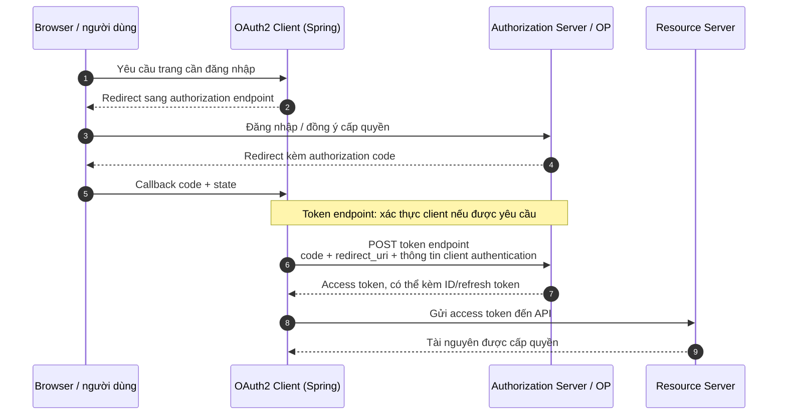

# 2.11. Client authentication và token endpoint authentication method

Trong OAuth 2.0 và OpenID Connect (OIDC), **client authentication** là cách một ứng dụng khách (client) chứng minh danh tính của chính nó với Authorization Server, đặc biệt khi gửi yêu cầu đến **token endpoint** để đổi authorization code, xin access token theo `client_credentials` hoặc làm mới token. Việc này khác với người dùng đăng nhập bằng mật khẩu, passkey hay tài khoản liên kết; người dùng xác thực với OpenID Provider, còn OAuth2 Client có thể phải xác thực với token endpoint dưới danh nghĩa ứng dụng đã đăng ký.

Spring Security OAuth2 Client cung cấp cấu hình `ClientRegistration` để mô tả phương thức xác thực của client, đồng thời có các thành phần thực hiện token request cho ứng dụng Servlet và Reactive. Hiểu rõ **`token_endpoint_auth_method`** giúp chọn đúng cách gửi client secret, ký JWT assertion, sử dụng chứng chỉ mTLS hoặc vận hành public client cùng PKCE. Đây cũng là một trong những nguyên nhân phổ biến của lỗi `invalid_client` khi tích hợp nhà cung cấp danh tính.

## 1. Client authentication nằm ở đâu trong OAuth 2.0?

Một hệ thống điển hình gồm bốn vai trò:

- **Resource Owner**: người dùng hoặc thực thể sở hữu tài nguyên.
- **Client**: ứng dụng muốn nhận token để thực hiện một tác vụ được ủy quyền.
- **Authorization Server / OpenID Provider**: hệ thống cấp token, quản lý client registration và xác thực client khi chính sách yêu cầu.
- **Resource Server**: API tiếp nhận access token để cho phép truy cập tài nguyên.

Với authorization-code flow, token request diễn ra **sau** khi trình duyệt được chuyển về client cùng authorization code:



Trong sơ đồ này có **ba hoạt động bảo mật khác nhau**:

1. Người dùng xác thực với Authorization Server/OpenID Provider và có thể cấp quyền cho client.
2. Client xác thực với **token endpoint** theo phương thức được đăng ký, nếu client thuộc loại phải xác thực.
3. Resource Server kiểm tra access token mà client mang tới; đây không phải là bước xác thực client tại token endpoint.

Một authorization code, PKCE `code_verifier` hay access token **không tự động thay thế** client authentication. Tùy loại client và grant, một token request có thể cần đồng thời authorization code, PKCE và client authentication.

### 1.1. Client ID có phải bí mật không?

`client_id` là định danh được Authorization Server cấp cho client. Nó thường xuất hiện công khai trong authorization request và **không phải một yếu tố xác thực bí mật**. Chỉ gửi `client_id` không chứng minh rằng bên gửi sở hữu client registration đó.

Ngược lại, `client_secret` là thông tin xác thực nhạy cảm. Tùy phương thức, client có thể dùng secret trực tiếp trong HTTP Basic/form body, dùng nó để ký JWT theo HMAC, hoặc dùng private key/chứng chỉ thay thế secret.

### 1.2. Confidential client và public client

| Loại client | Khả năng bảo vệ thông tin xác thực | Ví dụ thường gặp | Hướng xác thực |
|---|---|---|---|
| **Confidential client** | Có thể giữ an toàn secret/private key trong môi trường tin cậy | Backend Spring MVC, BFF, backend service | `client_secret_basic`, `client_secret_post`, `private_key_jwt`, mTLS,... |
| **Public client** | Không thể tin tưởng một secret nhúng trong mã/phân phối cho người dùng | SPA chạy trong browser, ứng dụng di động, ứng dụng desktop được phát hành tới thiết bị người dùng | `none`, thường kết hợp Authorization Code + PKCE |

Phân loại dựa vào **khả năng giữ bí mật của thành phần thực hiện OAuth**, không chỉ dựa vào tên framework hay việc ứng dụng có giao diện web. Chẳng hạn, BFF Spring chạy phía server có thể là confidential client; JavaScript chạy hoàn toàn trong browser không nên được cấp một client secret rồi nhúng vào bundle.

OAuth 2.0 `client_credentials` là grant dành cho confidential client; một public client không thể biến `client_credentials` thành an toàn chỉ bằng việc gửi `client_id`.

## 2. Token endpoint authentication method là gì?

Mỗi OAuth client registration khai báo một **phương thức xác thực với token endpoint**, thường được đặt tên `token_endpoint_auth_method` trong tài liệu OIDC, metadata khi đăng ký client và các hệ thống quản trị identity provider. Các giá trị thông dụng:

| Phương thức | Chứng cứ client gửi | Đặc điểm | Trường hợp phù hợp |
|---|---|---|---|
| `client_secret_basic` | Client ID và client secret qua HTTP `Authorization: Basic ...` | Đơn giản, được hỗ trợ rộng; Basic chỉ mã hóa Base64, bắt buộc dựa vào TLS | Confidential client tương thích OAuth 2.0 truyền thống |
| `client_secret_post` | `client_id` + `client_secret` trong form body | Hữu ích với provider yêu cầu form body; dễ lộ khi hệ thống log body | Chỉ dùng khi provider hỗ trợ/yêu cầu |
| `client_secret_jwt` | JWT assertion ký bằng HMAC với shared client secret | Không gửi raw secret trong mỗi token request; cần thống nhất thuật toán ký và quy tắc assertion | Provider hỗ trợ JWT client authentication với shared secret |
| `private_key_jwt` | JWT assertion ký bằng private key của client | Authorization Server xác minh bằng public key/JWKS đã đăng ký | Backend cần quản lý khóa độc lập, tổ chức có PKI/KMS |
| `tls_client_auth` | Chứng chỉ client trên kết nối mutual TLS | Xác thực dựa vào PKI và thuộc tính chứng chỉ đã đăng ký | Môi trường B2B, hệ thống kiểm soát certificate lifecycle |
| `self_signed_tls_client_auth` | Chứng chỉ tự ký đã đăng ký trước với server | Server khớp chứng chỉ công khai được đăng ký | Kết nối mTLS theo mô hình xác thực bằng chứng chỉ đã ghim |
| `none` | Không có client secret/assertion/chứng chỉ để xác thực | Client được nhận diện bằng ID nhưng **không được xác thực như confidential client** | Public client dùng Authorization Code + PKCE |

Không phải Authorization Server nào cũng hỗ trợ mọi giá trị. Hai phương thức có tên gần giống nhau vẫn tạo ra token request khác nhau; cấu hình `client_secret_basic` không thể thay bằng `client_secret_post` tùy ý. Theo OAuth 2.0, **mỗi token request không được dùng nhiều phương thức client authentication đồng thời**.

### 2.1. Phân biệt method, grant type, scope và token format

Những trường cấu hình này độc lập với nhau:

| Thuộc tính | Trả lời câu hỏi | Ví dụ |
|---|---|---|
| `authorization_grant_type` | Client đang xin token theo quy trình nào? | `authorization_code`, `refresh_token`, `client_credentials` |
| `token_endpoint_auth_method` | Client chứng minh danh tính ra sao khi gọi token endpoint? | `client_secret_basic`, `private_key_jwt`, `none` |
| `scope` | Client yêu cầu phạm vi quyền nào? | `openid`, `profile`, `orders.read` |
| Access-token format | Token được thể hiện dưới dạng gì? | Opaque token hoặc JWT |
| `response_type` | Authorization endpoint trả về thành phần nào? | `code` trong authorization-code flow |

Ví dụ một confidential client có thể dùng `authorization_code` + `client_secret_basic` và cũng dùng `refresh_token` + `client_secret_basic` sau khi người dùng đã đăng nhập. Một service khác có thể dùng `client_credentials` + `private_key_jwt`. Trong cả hai trường hợp, access token được cấp có thể là JWT hoặc opaque token; **`private_key_jwt` không có nghĩa access token cũng phải là JWT**.

## 3. Phương thức `client_secret_basic`

Đây là phương thức xác thực bằng HTTP Basic Authentication tại token endpoint. Giá trị Authorization header được tạo từ client ID và client secret theo quy tắc RFC 6749: form-url-encode từng giá trị theo `application/x-www-form-urlencoded`, ghép bằng dấu `:`, rồi mã hóa Base64.

Ví dụ với Authorization Code (giá trị chỉ để minh họa):

```http
POST /oauth2/token HTTP/1.1
Host: idp.example.test
Content-Type: application/x-www-form-urlencoded
Authorization: Basic <BASE64_OF_ENCODED_CLIENT_ID_COLON_CLIENT_SECRET>

grant_type=authorization_code&
code=AUTHORIZATION_CODE&
redirect_uri=https%3A%2F%2Fclient.example.test%2Flogin%2Foauth2%2Fcode%2Fportal&
code_verifier=PKCE_CODE_VERIFIER
```

Dòng form body ở trên được ngắt dòng **để dễ đọc**; HTTP request thực tế gửi các tham số form theo encoding tiêu chuẩn. Trong luồng này:

- `code` là authorization code nhận từ redirect callback.
- `redirect_uri` phải thỏa yêu cầu đối chiếu của server (với nhiều triển khai, cần khớp giá trị ở authorization request).
- `code_verifier` chỉ có khi luồng sử dụng PKCE; việc có PKCE phụ thuộc client/policy.
- Header `Authorization` chứa danh tính và secret của **client**, không phải username/password của người dùng.

Base64 là encoding có thể đảo ngược, **không phải mã hóa bảo mật**; TLS là điều kiện cần để bảo vệ credential trên đường truyền. Secret vẫn có thể lộ nếu proxy/APM/debugger ghi HTTP header.

Với Spring Security, cấu hình giá trị `client_secret_basic` trong `ClientRegistration` là cách thông thường để yêu cầu OAuth2 Client gửi thông tin xác thực kiểu Basic khi thực hiện token request bằng một client được hỗ trợ.

### 3.1. Client credentials grant với Basic

Khi backend tự gọi backend và không cần authorization code của người dùng, request thường có dạng:

```http
POST /oauth2/token HTTP/1.1
Host: idp.example.test
Authorization: Basic <BASE64_OF_ENCODED_CLIENT_ID_COLON_CLIENT_SECRET>
Content-Type: application/x-www-form-urlencoded

grant_type=client_credentials&scope=inventory.read
```

Lúc này Authorization Server xác thực **chính ứng dụng** và cấp token theo quyền được cấp cho ứng dụng. Không có browser redirect, không có `code` và thường không có ID Token OIDC. Token không mặc nhiên đại diện cho một người dùng.

## 4. Phương thức `client_secret_post`

`client_secret_post` chuyển credential vào phần form body của token request:

```http
POST /oauth2/token HTTP/1.1
Host: idp.example.test
Content-Type: application/x-www-form-urlencoded

grant_type=authorization_code&
code=AUTHORIZATION_CODE&
redirect_uri=https%3A%2F%2Fclient.example.test%2Flogin%2Foauth2%2Fcode%2Fportal&
client_id=portal-service&
client_secret=CLIENT_SECRET_VALUE
```

Trong thực tế body là form URL-encoded trên một dòng; các dấu xuống dòng ở đây chỉ phục vụ trình bày. Không nên vừa gửi `Authorization: Basic ...` vừa gửi `client_secret` như một phương thức xác thực thứ hai. Cách gửi bằng body không tự làm secret an toàn hơn: nhiều hệ thống quan sát HTTP request, access log hoặc exception report có thể thu thập payload. Cần cấu hình loại trừ/redact trường `client_secret` khỏi log.

**Khi nào chọn?** Khi thông số client registration và token endpoint của provider quy định `client_secret_post`. Nếu provider chấp nhận `client_secret_basic`, Basic thường là lựa chọn phổ biến và tránh đưa secret vào form body.

## 5. `none`: public client, Authorization Code và PKCE

Phương thức `none` nghĩa là client **không xác thực bằng secret, JWT assertion hoặc chứng chỉ** ở token endpoint. Nó không có nghĩa token endpoint bỏ qua mọi kiểm tra: server vẫn kiểm tra authorization code, client ID, redirect URI, PKCE, grant và các chính sách khác.

Ví dụ token request của public client dùng PKCE:

```http
POST /oauth2/token HTTP/1.1
Host: idp.example.test
Content-Type: application/x-www-form-urlencoded

grant_type=authorization_code&
client_id=public-browser-app&
code=AUTHORIZATION_CODE&
redirect_uri=https%3A%2F%2Fspa.example.test%2Fcallback&
code_verifier=ORIGINAL_HIGH_ENTROPY_VERIFIER
```

Trước đó, client đã gửi `code_challenge` và `code_challenge_method=S256` tại authorization endpoint. Authorization Server đối chiếu `code_verifier` với challenge đã lưu. Nhờ đó, người đánh cắp một authorization code riêng lẻ khó đổi code lấy token nếu không có verifier tương ứng.

Điểm cần ghi nhớ:

1. **PKCE không phải client authentication**: nó ràng buộc lần đổi authorization code với bên khởi tạo authorization request; một public client vẫn không chứng minh được danh tính bí mật theo kiểu confidential client.
2. **Không nhúng client secret vào JavaScript, ứng dụng mobile hoặc desktop**: secret phân phối tới thiết bị người dùng không còn là secret bảo mật.
3. Public client phải được đăng ký với provider theo chính sách thích hợp; không thể tự đổi `client_secret_basic` thành `none` mà không cập nhật phía Authorization Server.
4. Với OIDC, các yêu cầu xác minh ID Token, `state`/`nonce`, bảo vệ redirect và quản lý token vẫn tồn tại bên cạnh PKCE.
5. Không dùng `none` cho client credentials grant; grant đó dựa trên sự ủy quyền dành cho confidential client.

## 6. JWT client authentication: `client_secret_jwt` và `private_key_jwt`

Thay vì gửi raw secret tại token endpoint, client có thể tạo một **client assertion** là JWT được ký. Token endpoint xác minh chữ ký và các claim, từ đó xác thực client. Cơ chế này thuộc JWT client authentication (thường tham chiếu RFC 7523 và OIDC Core).

Hai phương thức chính:

- `client_secret_jwt`: JWT được ký bằng thuật toán MAC/HMAC, trong đó secret chung giữa client và Authorization Server đóng vai trò signing key.
- `private_key_jwt`: JWT được ký bằng private key của client; Authorization Server dùng public key hoặc JWKS đã đăng ký để xác minh.

Sự khác biệt nằm ở khóa ký, cách phân phối khóa và cấu hình trust. Cả hai đều gửi một `client_assertion` trong request, nhưng **không thể đổi tên method để biến một JWT ký HMAC thành JWT ký bất đối xứng**.

### 6.1. Cấu trúc JWT client assertion

Một assertion điển hình chứa các claim:

| Claim/header | Vai trò |
|---|---|
| `iss` | Issuer của assertion, thường bằng `client_id`. |
| `sub` | Chủ thể của assertion, thường cũng bằng `client_id`. |
| `aud` | Định danh người nhận assertion theo yêu cầu của Authorization Server, thường là token endpoint URL hoặc giá trị audience được provider quy định. |
| `exp` | Thời điểm hết hạn; assertion nên có tuổi thọ ngắn. |
| `iat` | Thời điểm phát hành, tùy profile/yêu cầu của provider. |
| `jti` | ID duy nhất để hỗ trợ ngăn chặn replay khi provider kiểm tra. |
| `alg` (JOSE header) | Thuật toán chữ ký được provider cho phép; không chấp nhận `none` cho một assertion cần ký. |
| `kid` (JOSE header, khi dùng) | ID giúp Authorization Server chọn public key tương ứng trong key set. |

Ví dụ cấu trúc payload mang tính minh họa:

```json
{
  "iss": "portal-service",
  "sub": "portal-service",
  "aud": "https://idp.example.test/oauth2/token",
  "iat": 1700000000,
  "exp": 1700000300,
  "jti": "unique-per-assertion"
}
```

Thời điểm `iat`/`exp` ở đây chỉ là số liệu minh họa với khoảng sống 5 phút; khi triển khai phải tính bằng thời gian thực tế. Provider có thể yêu cầu thêm claim hoặc quy tắc audience riêng, vì vậy cần dựa vào metadata và hợp đồng tích hợp.

Token request khi dùng JWT client authentication thường có dạng:

```http
POST /oauth2/token HTTP/1.1
Host: idp.example.test
Content-Type: application/x-www-form-urlencoded

grant_type=client_credentials&
scope=orders.read&
client_id=portal-service&
client_assertion_type=urn%3Aietf%3Aparams%3Aoauth%3Aclient-assertion-type%3Ajwt-bearer&
client_assertion=SIGNED_JWT_VALUE
```

Những tham số form ở ví dụ được ngắt dòng cho dễ đọc. `client_assertion_type` có giá trị logic đầy đủ là:

```text
urn:ietf:params:oauth:client-assertion-type:jwt-bearer
```

`client_assertion` phục vụ **xác thực client ở token endpoint**. Nó không phải access token, không phải ID Token của người dùng và không nên được gửi làm `Authorization: Bearer` tới Resource Server.

### 6.2. Khi chọn `client_secret_jwt`

Client và Authorization Server dùng cùng secret đủ mạnh để ký/xác minh bằng thuật toán HMAC được hỗ trợ (ví dụ một biến thể HS256/HS384/HS512 theo quy định của provider). Việc không gửi raw secret trong form body hữu ích, nhưng an toàn vẫn phụ thuộc vào việc giữ bí mật shared secret, độ mạnh khóa, TLS, cách triển khai xác minh assertion và chính sách chống replay.

Một password ngắn không phù hợp để sử dụng tùy tiện như khóa ký HMAC. Nếu tổ chức cần tách quyền ký của client khỏi shared secret, quản lý khóa tập trung và xoay vòng khóa linh hoạt, `private_key_jwt` thường đáng cân nhắc.

### 6.3. Khi chọn `private_key_jwt`

Một thiết kế tiêu biểu:

```text
Client / Spring application                 Authorization Server
  Private key                                   Public key / JWKS
      |                                              ^
      v                                              |
Sign JWT assertion  ---- POST token endpoint ----> Verify JWT signature
      |                                              |
      |                                    Verify iss/sub/aud/exp/jti...
      |                                              |
      <---------------- Access token ----------------+
```

Các trách nhiệm vận hành cần có:

- Client tạo key pair trong môi trường được bảo vệ và đăng ký public key hoặc `jwks_uri` với Authorization Server.
- Private key nằm trong keystore, HSM, KMS hoặc giải pháp bảo vệ khóa tương đương; không đưa vào source code và không gửi qua token endpoint.
- Client đặt `kid` phù hợp khi có nhiều khóa, ký bằng thuật toán thống nhất với server và tạo `jti` mới cho từng assertion.
- Authorization Server kiểm tra chữ ký, audience, issuer/subject, hiệu lực thời gian và điều kiện replay theo hợp đồng.
- Khi rotate key, phối hợp giai đoạn chấp nhận song song public key cũ/mới để tránh lỗi `invalid_client`.

Lưu ý: `private_key_jwt` **không giống** OAuth JWT bearer authorization grant. Một JWT assertion dùng để xác thực client và một JWT assertion dùng làm grant là hai vai trò giao thức khác nhau, dù có thể cùng dùng chuẩn biểu diễn JWT.

### 6.4. Phương thức mTLS

Với `tls_client_auth` hoặc `self_signed_tls_client_auth`, client hoàn thành bước xác thực bằng chứng chỉ TLS của mình trong phiên kết nối đến token endpoint:

- `tls_client_auth` dựa vào quy tắc PKI và thuộc tính danh tính trong chứng chỉ phù hợp với đăng ký client.
- `self_signed_tls_client_auth` cho phép client dùng một chứng chỉ tự ký đã được Authorization Server biết trước và đối chiếu.

Client cần cấu hình HTTP/TLS transport để trình diện chứng chỉ và private key phù hợp. Chỉ khai báo tên phương thức trong client registration **không tự động cấu hình kết nối mTLS**. Đặc biệt phải chú ý đường đi qua load balancer/reverse proxy: bên nào thực sự thực hiện TLS handshake và Authorization Server xác nhận danh tính chứng chỉ ra sao.

OAuth 2.0 Mutual-TLS Client Authentication còn có thể liên quan đến certificate-bound access token. Đây là một tính năng ràng buộc token với chứng chỉ, **khác** với việc chỉ dùng chứng chỉ để xác thực client ở token endpoint; không nên mặc định hai tính năng luôn bật cùng nhau.

## 7. Authorization Server xác định method nào được chấp nhận?

Token endpoint cần biết client ID, các phương thức đã đăng ký, secret/public key/chứng chỉ tương ứng và policy cho grant. Một request dùng `client_secret_post` sẽ không hợp lệ nếu provider chỉ cho phép `private_key_jwt` cho client đó.

Với OpenID Connect Discovery hoặc OAuth Authorization Server Metadata, metadata có thể cung cấp:

```json
{
  "issuer": "https://idp.example.test",
  "token_endpoint": "https://idp.example.test/oauth2/token",
  "token_endpoint_auth_methods_supported": [
    "client_secret_basic",
    "client_secret_post",
    "private_key_jwt"
  ],
  "token_endpoint_auth_signing_alg_values_supported": [
    "RS256",
    "PS256"
  ]
}
```

Đây là **ví dụ metadata**; các giá trị thật phụ thuộc provider. Nếu metadata công bố hỗ trợ một tập method, điều đó chỉ nói endpoint có khả năng sử dụng chúng, **không đảm bảo mọi client registration được phép dùng tất cả**. Client registration có thể chỉ cho phép một method cụ thể; metadata của từng đăng ký (nếu provider cung cấp) mới là nguồn cần đối chiếu khi tích hợp.

Trong OIDC Discovery, khi thiếu `token_endpoint_auth_methods_supported`, giá trị mặc định theo đặc tả là `client_secret_basic`. Không nên suy ra rằng provider hỗ trợ các kiểu JWT hay mTLS khi metadata không công bố và tài liệu/provider không xác nhận.

### 7.1. Các bước thống nhất cấu hình giữa client và provider

1. Xác định loại ứng dụng là confidential hay public và grant cần sử dụng.
2. Kiểm tra các method Authorization Server hỗ trợ; sau đó kiểm tra method được gán riêng cho client registration.
3. Thống nhất cơ chế phân phối secret, public key/JWKS hoặc chứng chỉ theo method đã chọn.
4. Đặt `client-authentication-method` tương ứng trong Spring Security và thiết lập token client/HTTP transport khi method đòi hỏi tùy biến.
5. Kiểm tra token request ở môi trường thử nghiệm, bảo đảm không ghi lại secret, assertion, access token hoặc refresh token vào log.

Nếu provider hỗ trợ dynamic client registration, trường `token_endpoint_auth_method` nằm trong metadata của client được đăng ký. Tên trường giao thức này khác với tên property tương ứng của Spring Boot là `client-authentication-method`.

## 8. Cấu hình token endpoint auth method trong Spring Security OAuth2 Client

Spring Security biểu diễn đăng ký OAuth2 Client bằng `ClientRegistration`. Trường xác thực nằm trong:

```java
ClientRegistration registration = /* cấu hình client đã đăng ký */;
ClientAuthenticationMethod method = registration.getClientAuthenticationMethod();
```

Các hằng số phổ biến của `ClientAuthenticationMethod` gồm `CLIENT_SECRET_BASIC`, `CLIENT_SECRET_POST`, `CLIENT_SECRET_JWT`, `PRIVATE_KEY_JWT` và `NONE`; hỗ trợ mTLS và các biến thể cụ thể tùy API/version/tích hợp đang dùng.

Trong Spring Boot, property `spring.security.oauth2.client.registration.<registrationId>.client-authentication-method` cấu hình method cho mỗi registration. Đây là điểm nối trực tiếp giữa khái niệm trong giao thức và cơ chế gửi request đến token endpoint.

### 8.1. Confidential client dùng `client_secret_basic` cho OIDC Login

Ví dụ `application.yml`:

```yaml
spring:
  security:
    oauth2:
      client:
        registration:
          portal:
            provider: company-idp
            client-id: ${OIDC_CLIENT_ID}
            client-secret: ${OIDC_CLIENT_SECRET}
            client-authentication-method: client_secret_basic
            authorization-grant-type: authorization_code
            redirect-uri: "{baseUrl}/login/oauth2/code/{registrationId}"
            scope: openid, profile, email
        provider:
          company-idp:
            issuer-uri: https://idp.example.test
```

Đây là ví dụ dành cho **backend Spring có khả năng bảo vệ secret**. Biến môi trường chứa credential được cấp từ hệ thống bảo mật; tuyệt đối không commit secret vào repository. Địa chỉ `idp.example.test` chỉ là placeholder, phải thay bằng issuer hợp lệ của provider.

Khi sử dụng OIDC discovery, Spring Boot/Spring Security có thể lấy các endpoint và khóa ký dựa trên `issuer-uri` khi provider công bố metadata hợp lệ. Chỉ có `openid` trong scope mới kích hoạt yêu cầu OIDC, còn method xác thực client vẫn là `client_secret_basic` như đăng ký.

Với Servlet, OAuth2 Login được tích hợp qua `SecurityFilterChain` và `HttpSecurity`. Với Reactive, tích hợp qua `SecurityWebFilterChain` và `ServerHttpSecurity`. Property registration phía trên có cấu trúc tương tự cho cả hai; stack sẽ tạo repository/HTTP token client tương ứng.

### 8.2. Khi provider yêu cầu `client_secret_post`

Thông thường chỉ cần đổi method ở registration **nếu token client và grant đang dùng hỗ trợ phương thức đó**:

```yaml
spring:
  security:
    oauth2:
      client:
        registration:
          portal:
            provider: company-idp
            client-id: ${OIDC_CLIENT_ID}
            client-secret: ${OIDC_CLIENT_SECRET}
            client-authentication-method: client_secret_post
            authorization-grant-type: authorization_code
            scope: openid, profile
        provider:
          company-idp:
            issuer-uri: https://idp.example.test
```

Với method này, token client gửi credential ở phần form body thay vì HTTP Basic. Nên đối chiếu một lần với yêu cầu phía Authorization Server, bởi lỗi `invalid_client` có thể do sai method dù client ID và secret đều đúng.

### 8.3. Public client với method `none`

Ví dụ một registration được provider đánh dấu là public:

```yaml
spring:
  security:
    oauth2:
      client:
        registration:
          public-app:
            provider: company-idp
            client-id: public-app-id
            client-authentication-method: none
            authorization-grant-type: authorization_code
            redirect-uri: "{baseUrl}/login/oauth2/code/{registrationId}"
            scope: openid, profile
        provider:
          company-idp:
            issuer-uri: https://idp.example.test
```

Khi cấu hình OAuth2 Login với public client, Spring Security có cơ chế hỗ trợ PKCE theo điều kiện của client registration. Tuy nhiên, muốn xây dựng một SPA thuần chạy trong browser thì kiến trúc OAuth/token storage của SPA phải được thiết kế riêng; cấu hình server-side Spring này chỉ minh họa thuộc tính `none`, không phải hướng dẫn nhúng Spring Security backend vào một SPA.

### 8.4. Method dùng JWT và mTLS cần bổ sung gì?

Việc đổi property thành `private_key_jwt` hoặc `client_secret_jwt` **chưa đủ** để đảm bảo token endpoint nhận được assertion hợp lệ trong mọi cấu hình/version Spring Security. Client cần thành phần tạo assertion, quản lý khóa và truyền tham số `client_assertion_type` / `client_assertion` tương ứng.

Trong các phiên bản Spring Security hỗ trợ, một hướng triển khai cho JWT client authentication là tạo `NimbusJwtClientAuthenticationParametersConverter` với cơ chế tra khóa từ `ClientRegistration` và gắn converter này vào OAuth2 token-response client phù hợp. Việc gắn converter thực tế khác nhau theo grant (`authorization_code`, `client_credentials`, `refresh_token`) và theo Servlet/Reactive. Đối với mTLS, cần cấu hình HTTP client hỗ trợ certificate authentication và cài đặt tin cậy TLS ở server tương ứng. Không thể giả định thêm một YAML property sẽ tự thiết lập private key, JWKS hay TLS handshake.

Trước khi tùy biến, nên xác định **phiên bản Spring Security cụ thể** của ứng dụng và API token-response client thực tế được dùng; tên lớp, cơ chế cấu hình và các giá trị method được hỗ trợ có thể thay đổi giữa các phiên bản.

### 8.5. Servlet và Reactive có thay đổi phương thức xác thực giao thức không?

Không. Giao thức gửi `client_secret_basic`, `client_secret_post` hoặc JWT assertion giống nhau về mặt ngữ nghĩa; sự khác biệt nằm ở cách Spring chạy request và lưu trạng thái:

| Lớp trách nhiệm | Servlet / Spring MVC | Reactive / Spring WebFlux |
|---|---|---|
| Registration repository | `ClientRegistrationRepository` | `ReactiveClientRegistrationRepository` |
| Authorized-client manager | `OAuth2AuthorizedClientManager` | `ReactiveOAuth2AuthorizedClientManager` |
| Token-response client | `OAuth2AccessTokenResponseClient<T>` | `ReactiveOAuth2AccessTokenResponseClient<T>` |
| Cơ chế HTTP | Thường dùng client blocking | Dùng reactive HTTP client phù hợp với Reactor |
| Security context | `SecurityContextHolder` với mô hình Servlet | `ReactiveSecurityContextHolder` trong Reactor context |

Chọn `ClientRegistration` theo grant, method và provider trước; sau đó cấu hình token-response client đúng loại stack. Không lấy trực tiếp các class của Servlet để đưa vào pipeline Reactive hoặc ngược lại.

## 9. Cùng một method có thể áp dụng cho các token grant khác nhau

Token endpoint phục vụ nhiều grant; phương thức client authentication vẫn liên quan đến đăng ký client, không gắn cứng với mỗi tên grant:

```text
authorization_code + client_secret_basic
    => code, redirect_uri và (nếu dùng) code_verifier
    => xác thực confidential client bằng Basic

refresh_token + client_secret_basic
    => refresh_token
    => tiếp tục xác thực confidential client theo policy

client_credentials + private_key_jwt
    => scope được ủy quyền cho chính client
    => JWT assertion ký bằng private key

authorization_code + none + PKCE
    => public client: client_id, code, redirect_uri, code_verifier
    => không có shared secret; server kiểm tra PKCE
```

### 9.1. Authorization code exchange

Authorization Server cần biết authorization code được cấp cho client nào và redirect URI nào. Đối với confidential client, xác thực client giúp ngăn bên chỉ biết `client_id` và code dùng token endpoint trái phép. PKCE là lớp ràng buộc khác, tăng khả năng chống đánh cắp mã ủy quyền, và hiện được khuyến nghị rộng rãi kể cả khi client có thể xác thực.

### 9.2. Refresh token

Một confidential client khi dùng refresh token thường tiếp tục phải xác thực theo method được đăng ký. Chỉ giữ refresh token mà thiếu client secret, private key hoặc chứng chỉ phù hợp có thể không đủ để gọi token endpoint. Public client có thể được cấp refresh token theo chính sách riêng (ví dụ rotation), nhưng phải thiết kế lưu trữ và phòng chống đánh cắp tương ứng.

### 9.3. Client credentials

Không có người dùng tương tác nên không có `openid`/ID Token xác thực người dùng theo mặc định. Việc xác thực danh tính client và quyền sử dụng client credentials grant là trung tâm của request. Nếu dùng `private_key_jwt`, đây thường là mô hình machine-to-machine: service ký assertion để xin token cho chính service.

## 10. Vì sao token endpoint trả lỗi `invalid_client`?

Authorization Server thường trả lỗi OAuth chuẩn trong HTTP response, chẳng hạn:

```http
HTTP/1.1 401 Unauthorized
Content-Type: application/json

{
  "error": "invalid_client",
  "error_description": "Client authentication failed"
}
```

Mã HTTP cụ thể và độ chi tiết thông báo do Authorization Server quyết định; với HTTP Basic, phản hồi `401` và `WWW-Authenticate` có thể xuất hiện, còn các phương thức khác có thể dẫn tới cách trả lỗi khác theo giao thức/profile.

Một số nguyên nhân thực tế:

| Hiện tượng | Khả năng cần kiểm tra | Cách tiếp cận |
|---|---|---|
`invalid_client` ngay khi đổi code | Đăng ký `client_secret_basic` nhưng provider yêu cầu `client_secret_post`, hoặc ngược lại | Đối chiếu method ở client registration và provider |
`invalid_client` sau khi đổi/rotate secret | Ứng dụng còn dùng secret cũ, sai environment hoặc secret bị cắt ký tự | Kiểm tra secret store và quy trình rotate mà không in secret |
`invalid_client` với `private_key_jwt` | Chữ ký sai, public key/JWKS chưa cập nhật, `kid` không khớp | Kiểm tra key registration và JWT header metadata |
JWT assertion bị từ chối | Sai `iss`/`sub`/`aud`, `exp` hết hạn, clock skew hoặc `jti` bị tái sử dụng | Kiểm tra policy assertion và đồng bộ thời gian |
mTLS handshake thất bại | Không gửi client certificate, trust chain không hợp lệ, proxy không truyền đúng chứng chỉ | Kiểm tra TLS transport và định tuyến mTLS |
`unauthorized_client` | Client có thể xác thực nhưng không được phép dùng grant hoặc policy đã chọn | Kiểm tra `authorization_grant_type` và quyền được provider cấp |
`invalid_grant` | Code hết hạn/đã dùng, redirect URI hoặc PKCE không khớp, refresh token hết hiệu lực | Kiểm tra logic của grant; không tự đổi auth method để chữa |
`invalid_scope` | Scope không được cấp hoặc không hợp lệ với client | Kiểm tra scope được đăng ký |

**`invalid_client` và `invalid_grant` khác bản chất**: lỗi đầu tiên chủ yếu liên quan xác thực/nhận diện client; lỗi thứ hai thường liên quan thông tin authorization grant. Provider có thể tối giản thông báo để giảm rò rỉ dữ liệu, vì vậy cần phối hợp log ở phía Authorization Server hoặc tracing an toàn khi chẩn đoán.

### 10.1. Cách quan sát token request mà không lộ credential

Trong môi trường phát triển, kiểm tra những thông tin có thể hiển thị an toàn: registration ID, method dự kiến, grant type, token endpoint host/path, response status và OAuth error code. Không đưa vào log:

- `Authorization` header (Basic chứa credential ở dạng Base64).
- Form `client_secret` hoặc `client_assertion`.
- Authorization code, `code_verifier`, access token, refresh token hoặc ID Token.
- Private key, key-store password và các giá trị nhạy cảm trong exception/debug dump.

Khi dùng proxy, reverse proxy, APM hoặc HTTP wire logging, phải cân nhắc khả năng các tầng đó đang giữ bản sao header/body. Môi trường production nên áp dụng redaction và quản lý secret tập trung.

## 11. Thiết kế bảo mật và vòng đời credential

### 11.1. Bảo vệ và rotate secret

Credential không được hardcode trong Java hay commit vào cấu hình. Dùng biến môi trường được quản lý an toàn, secret manager, KMS hoặc hệ thống tương đương theo chính sách tổ chức. Phân quyền truy cập credential tối thiểu và cấu hình rotate theo vòng đời vận hành.

Một chiến lược rotate cần tính tới nhiều instance của ứng dụng: nếu provider chỉ cho phép một active secret, việc thay secret có thể làm một phần instance không thể gọi token endpoint trong giai đoạn rollout. Khi provider cho phép overlap secret hoặc nhiều key, triển khai và cắt chuyển dần theo khả năng thực tế.

### 11.2. Phân biệt secret, signing key và chứng chỉ

| Credential | Phương thức tiêu biểu | Điều phải bảo vệ |
|---|---|---|
Shared client secret | `client_secret_basic` / `client_secret_post` | Giá trị secret ở client và Authorization Server |
Shared HMAC secret | `client_secret_jwt` | Khóa ký HMAC, entropy và thuật toán được phép |
Private key của client | `private_key_jwt` | Private key, quyền ký và vòng đời khóa; public key được công bố phù hợp |
Private key của chứng chỉ client | mTLS | Private key, chain/chứng chỉ, trust và TLS client configuration |
Không có secret | `none` | Authorization Code + PKCE, redirect/callback, browser/native app token storage |

Không dùng API key hoặc password của người dùng làm `client_secret` trừ khi hệ thống quản lý danh tính chỉ định rõ đây là credential dành riêng cho client. Không tái sử dụng cùng secret cho mọi ứng dụng và môi trường nếu có thể tránh.

### 11.3. TLS, redirect URI và mối liên hệ với OAuth Login

Token endpoint phải được gọi qua HTTPS và client phải xác minh chứng chỉ TLS hợp lệ. Authorization endpoint và redirect/callback cũng cần thiết kế an toàn. Trong OIDC Login:

- `state` liên kết callback với authorization request;
- `nonce` (khi áp dụng) ràng buộc ID Token với yêu cầu xác thực OIDC;
- PKCE bảo vệ authorization-code exchange;
- client authentication xác thực confidential client theo method đã đăng ký;
- xác minh ID Token bảo đảm kết quả đăng nhập đến từ issuer dự kiến và dành cho đúng client.

Đây là các cơ chế có vai trò riêng; không nên tắt một cơ chế chỉ vì đã bật cơ chế khác.

## 12. Tình huống kiến trúc điển hình

### Tình huống A: Spring MVC BFF cho nhân viên

Ứng dụng Spring MVC chạy phía server, lưu session và gọi API nội bộ thay mặt người dùng. Đăng ký OIDC client kiểu confidential, dùng `authorization_code`, scope `openid profile`, `client_secret_basic` hoặc `private_key_jwt` theo nhà cung cấp. Tại token endpoint, BFF phải xác thực client và đổi authorization code; khi gọi downstream API, nó dùng access token đã cấp qua authorized-client manager.

### Tình huống B: Scheduled job đồng bộ dữ liệu

Một Spring service không có browser hay người dùng tương tác. Dùng `client_credentials`, confidential client và method `private_key_jwt` hoặc `client_secret_basic` theo chính sách. Client authentication được thực hiện mỗi khi cần gọi token endpoint. Nên dùng authorized-client manager phù hợp với background service, không phụ thuộc `HttpServletRequest` hoặc `ServerWebExchange`.

### Tình huống C: Ứng dụng mobile đăng nhập OIDC

Ứng dụng phân phối tới thiết bị người dùng không giữ được shared secret. Đăng ký public client với `none`, sử dụng authorization-code flow cùng PKCE và redirect URI được phép. Backend Spring, nếu có, là một thành phần khác với chính sách xác thực và cách lưu credential riêng; không chia sẻ secret confidential client sang thiết bị.

### Tình huống D: Kết nối doanh nghiệp bắt buộc mTLS

Một đối tác yêu cầu service-to-service qua TLS client certificate. Ngoài registration method `tls_client_auth` hoặc `self_signed_tls_client_auth`, phải cấu hình HTTP stack gửi certificate đúng trong TLS handshake, đăng ký certificate/thuộc tính định danh tại provider và phối hợp vòng đời phát hành, rotate, thu hồi chứng chỉ.

## 13. Những điểm cần nhớ

1. **Client authentication chứng minh danh tính OAuth client với token endpoint**, khác với việc người dùng đăng nhập hay API kiểm tra access token.
2. `client_id` là định danh, không phải một bí mật dùng để xác thực.
3. `client_secret_basic`, `client_secret_post`, `client_secret_jwt`, `private_key_jwt`, mTLS và `none` là các method có cơ chế khác nhau; một token request chỉ dùng một phương thức xác thực client.
4. **Grant type** (`authorization_code`, `refresh_token`, `client_credentials`) và **client authentication method** là hai lựa chọn độc lập, cần tương thích với loại client và policy của provider.
5. Public client thường dùng `none` kết hợp Authorization Code + PKCE; PKCE bảo vệ code exchange nhưng không biến public client thành confidential.
6. Trong Spring Boot, property `client-authentication-method` thuộc `spring.security.oauth2.client.registration.<registrationId>`; các phương thức JWT/mTLS thường đòi hỏi tùy chỉnh khóa, signer hoặc HTTP transport.
7. Khi nhận `invalid_client`, hãy so khớp registration ID, phương thức xác thực, secret/key/certificate và metadata provider trước khi thay đổi logic OAuth Login.

## Tài liệu tham khảo

- [RFC 6749 — The OAuth 2.0 Authorization Framework](https://www.rfc-editor.org/rfc/rfc6749.html), đặc biệt các mục về client authentication và token endpoint.
- [RFC 7523 — JWT Profile for OAuth 2.0 Client Authentication and Authorization Grants](https://www.rfc-editor.org/rfc/rfc7523.html).
- [RFC 7636 — Proof Key for Code Exchange by OAuth Public Clients](https://www.rfc-editor.org/rfc/rfc7636.html).
- [RFC 8414 — OAuth 2.0 Authorization Server Metadata](https://www.rfc-editor.org/rfc/rfc8414.html).
- [RFC 8705 — OAuth 2.0 Mutual-TLS Client Authentication and Certificate-Bound Access Tokens](https://www.rfc-editor.org/rfc/rfc8705.html).
- [OpenID Connect Core 1.0](https://openid.net/specs/openid-connect-core-1_0.html), phần Client Authentication.
- [Spring Security — OAuth2 Client (Servlet)](https://docs.spring.io/spring-security/reference/servlet/oauth2/client/index.html).
- [Spring Security — OAuth2 Client (Reactive)](https://docs.spring.io/spring-security/reference/reactive/oauth2/client/index.html).
