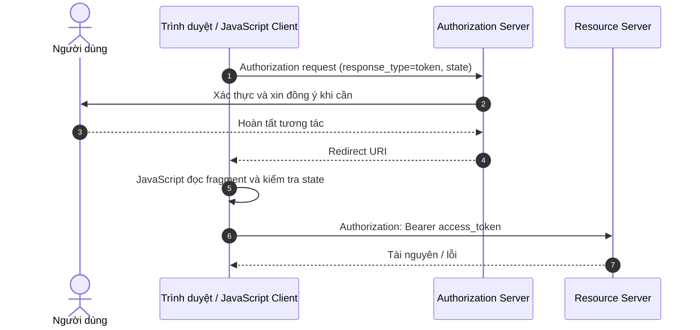
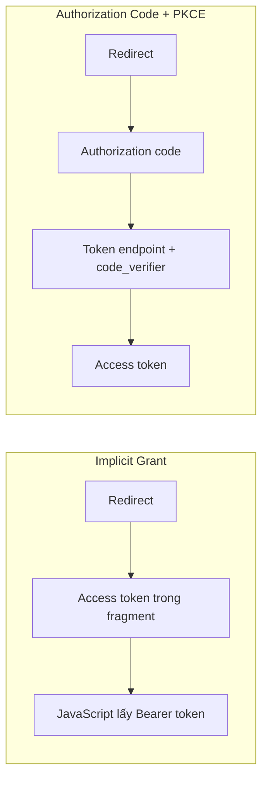
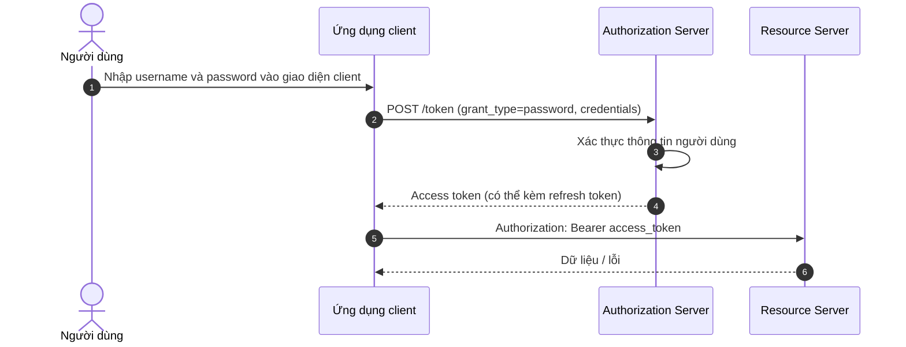

# 2.12. Implicit Grant, password grant và các rủi ro cần nhận diện

Trong OAuth 2.0, **grant type** xác định cách một client nhận được quyền cấp access token từ Authorization Server. Hai grant từng xuất hiện nhiều trong tài liệu và ứng dụng đời cũ là **Implicit Grant** và **Resource Owner Password Credentials Grant (ROPC, thường gọi là password grant)**. Cả hai đều là một phần của OAuth 2.0 truyền thống, nhưng **không còn là lựa chọn phù hợp để thiết kế ứng dụng mới**.

Bài học tập trung vào việc nhận diện hai luồng trong hệ thống thực tế, hiểu cơ chế tạo ra rủi ro, phân biệt chúng với đăng nhập OIDC, và chọn phương án thay thế khi dùng **Spring Security OAuth 2.0 / OIDC Client**.

## 1. Đặt hai grant vào đúng bối cảnh

OAuth 2.0 giải quyết việc *cấp quyền truy cập tài nguyên*; OIDC mở rộng OAuth 2.0 để *xác thực danh tính người dùng*. Trong kiến trúc thông thường:

- **Resource Owner**: chủ thể sở hữu quyền đối với tài nguyên, thường là người dùng.
- **Client**: ứng dụng muốn được cấp quyền để truy cập tài nguyên.
- **Authorization Server (AS)**: xác thực và cấp token theo chính sách.
- **Resource Server (RS)**: API bảo vệ tài nguyên và kiểm tra access token.
- **OpenID Provider (OP)**: vai trò của một Authorization Server khi hỗ trợ OIDC, có thể cấp thêm ID token.

Các grant khác nhau ở **ai tương tác với AS, thông tin nào đi qua trình duyệt, và điều gì được gửi tới token endpoint**.

| Luồng | Cách client nhận token | Có chuyển hướng người dùng? | Thực tế hiện nay |
| --- | --- | --- | --- |
| **Authorization Code + PKCE** | Nhận authorization code qua redirect, đổi code lấy token tại token endpoint với code verifier | Có, khi xác thực người dùng | Lựa chọn ưu tiên cho client có tương tác người dùng |
| **Implicit** | Access token được đưa trực tiếp qua redirect của trình duyệt | Có | Không khuyến nghị cho thiết kế mới |
| **Password grant / ROPC** | Client thu thập username/password rồi gửi thẳng đến token endpoint | Không theo redirect chuẩn | Không khuyến nghị; nên loại bỏ khỏi thiết kế mới |
| **Client Credentials** | Client xác thực bằng danh tính của chính mình tại token endpoint | Không | Phù hợp giao tiếp dịch vụ–dịch vụ theo chính sách |
| **Device Authorization Grant** | Thiết bị hiển thị mã/URL; người dùng xác thực trên thiết bị có trình duyệt | Có, trên thiết bị khác | Phù hợp TV, CLI và thiết bị hạn chế nhập liệu |

Lưu ý rằng **Authorization Code là grant**, còn **PKCE là cơ chế bảo vệ quá trình đổi authorization code**. PKCE không phải một grant riêng.

Về định hướng tiêu chuẩn, OAuth 2.0 Security Best Current Practice khuyến nghị tránh Implicit Grant và **không dùng password grant**. Các tài liệu OAuth 2.1 theo hướng loại hai grant này ra khỏi tập grant hiện đại. Tuy nhiên, khi đọc log hay bảo trì hệ thống cũ, bạn vẫn có thể gặp cả hai.

## 2. Implicit Grant là gì?

### 2.1. Mục đích lịch sử

Implicit Grant ra đời cho các client chạy trực tiếp trong trình duyệt, đặc biệt là ứng dụng JavaScript đời đầu. Khi đó việc gọi token endpoint từ browser và bảo vệ mã trao đổi token khó triển khai hơn, nên OAuth 2.0 cho phép **trả access token ngay trong authorization response**.

Thay vì nhận authorization code rồi đổi code tại token endpoint, client dùng:

```text
response_type=token
```

và nhận **access token trong fragment của redirect URI**.

Ví dụ giả lập request:

```http
GET /authorize?response_type=token
    &client_id=legacy-spa
    &redirect_uri=https%3A%2F%2Fapp.example.test%2Fcallback
    &scope=profile.read
    &state=random-request-value HTTP/1.1
Host: id.example.test
```

Nếu người dùng đã được cấp quyền, Authorization Server có thể trả:

```http
HTTP/1.1 302 Found
Location: https://app.example.test/callback#access_token=ACCESS_TOKEN_VALUE&token_type=Bearer&expires_in=3600&state=random-request-value
```

Đây là ví dụ để **nhận diện giao thức cũ**, không phải mẫu để triển khai tính năng mới.

Phần sau dấu `#` là **URL fragment**. Trình duyệt dùng fragment ở phía client; fragment **không được gửi trong đường dẫn HTTP request tiếp theo** đến `app.example.test`. Tuy nhiên, JavaScript chạy trên trang callback vẫn có thể đọc `window.location.hash`. Điều đó đặt access token vào môi trường thực thi của trình duyệt.

### 2.2. Luồng xử lý



**Đặc điểm nhận dạng:**

1. URL authorize có `response_type=token`.
2. Response chuyển hướng chứa `#access_token=...` cùng `token_type`, `expires_in` và có thể có `state`.
3. Client **không có bước đổi authorization code** bằng `grant_type=authorization_code`.
4. Theo định nghĩa Implicit Grant trong OAuth 2.0, **Authorization Server không cấp refresh token** trong luồng này.
5. Client công khai chạy trong browser không thể giữ bí mật `client_secret` một cách đáng tin cậy.

**Không nhầm với OIDC Implicit Flow.** OIDC từng có biến thể `response_type=id_token` hoặc `id_token token`, đưa ID token (và có thể access token) qua front channel. ID token mô tả kết quả xác thực dành cho client; nó không trở thành access token chỉ vì được trả cùng lúc. Với đăng nhập OIDC hiện đại, nên dùng **Authorization Code Flow**, kết hợp PKCE khi thích hợp.

## 3. Vì sao Implicit Grant bị khuyến nghị loại bỏ?

Vấn đề lớn nhất là **đưa access token trực tiếp qua front channel**: trình duyệt trở thành điểm tiếp nhận bearer token trong redirect. Những rủi ro cần hiểu đúng cơ chế:

### 3.1. Token dễ bị lộ qua môi trường trình duyệt

Nếu ứng dụng có **cross-site scripting (XSS)**, đoạn JavaScript độc hại có thể lấy access token từ URL fragment, bộ nhớ JavaScript hoặc nơi ứng dụng lưu token. Script bên thứ ba được nạp vào cùng trang cũng có thể truy cập dữ liệu do trang cho phép; tiện ích trình duyệt độc hại là một nguy cơ khác.

Ví dụ lỗi bảo mật trong ứng dụng cũ:

```javascript
// Ví dụ phản diện: không thực hiện trong ứng dụng thật.
const params = new URLSearchParams(window.location.hash.slice(1));
const token = params.get("access_token");

// Nếu một script độc hại đọc được token,
// nó có thể gửi token đi và giả danh client khi gọi API.
```

**Nuance quan trọng:** fragment không tự động được gửi lên server trong request HTTP thông thường, nên nói “fragment luôn nằm trong server access log” là không chính xác. Token vẫn có nguy cơ xuất hiện trong header `Location` bị ghi log ở một số hệ thống, công cụ giám sát phía client, URL được xử lý/sao chép không an toàn, lịch sử hoặc tiện ích trình duyệt, và nhất là trong JavaScript mà kẻ tấn công kiểm soát. Rủi ro phải được phân tích theo cách ứng dụng thực sự vận hành.

### 3.2. Không được hưởng sự bảo vệ của bước đổi code bằng PKCE

Với **Authorization Code + PKCE**, redirect mang **code** thay vì access token; client cần chứng minh sở hữu `code_verifier` khi đổi code lấy token. Kẻ đánh cắp code đơn lẻ khó sử dụng nếu không có verifier.

Implicit Grant không có bước đổi code để ràng buộc với PKCE. Khi access token bị đánh cắp, bên sở hữu bearer token có thể thử dùng nó với API trong phạm vi hiệu lực.



PKCE giúp chống **authorization code interception**; nó **không chữa khỏi XSS** nếu ứng dụng JavaScript vẫn nắm giữ access token. Vì thế không nên hiểu “chuyển sang PKCE” là đã giải quyết toàn bộ bảo mật token trong SPA.

### 3.3. Rủi ro token injection, nhầm client hoặc nhầm ngữ cảnh

Client xử lý redirect thiếu kiểm tra có thể chấp nhận một token không thuộc giao dịch authorization mong đợi. Việc kiểm tra `state` giúp liên kết authorization response với request ban đầu và giảm CSRF, nhưng không biến access token thành thông điệp được ràng buộc bằng PKCE.

Một client còn phải tránh **token substitution**: không gửi nhầm token của user, tenant hoặc resource khác. Tùy cơ chế token, API cần xác minh issuer, audience, hạn dùng và quyền thích hợp. Nếu dùng nhiều Authorization Server, client cũng phải xử lý đúng issuer và thông tin response để tránh nhầm nguồn cấp token.

### 3.4. Không có refresh token trong Implicit Grant

Khi access token hết hạn, ứng dụng cũ có thể cố “silent authorization” qua iframe, dựa vào cookie đăng nhập tại Identity Provider. Cách này rất dễ gặp vấn đề với chính sách cookie bên thứ ba, hạn chế trình duyệt, yêu cầu tương tác và kiểm soát bảo mật mới.

Khi chuyển sang Authorization Code + PKCE, **refresh token có thể được cấp nếu server và chính sách cho phép**. Đối với public client, cách lưu trữ, xoay vòng refresh token hoặc cơ chế ràng buộc token phải được thiết kế cẩn thận; có PKCE **không mặc nhiên** đồng nghĩa sẽ nhận refresh token.

## 4. Password grant (ROPC) là gì?

**Resource Owner Password Credentials Grant** cho phép client lấy **username và password của người dùng**, rồi gửi cả hai đến **token endpoint** để xin token:

```text
grant_type=password
```

Trong OAuth 2.0 đời đầu, grant này đôi khi được chọn cho ứng dụng “first-party” được người dùng tin cậy hoặc khi di chuyển từ hệ thống username/password. Tuy nhiên, nó làm mất ranh giới quan trọng: **người dùng phải giao mật khẩu cho ứng dụng client thay vì chỉ đăng nhập tại Authorization Server**.

Ví dụ yêu cầu lịch sử:

```http
POST /oauth2/token HTTP/1.1
Host: id.example.test
Content-Type: application/x-www-form-urlencoded
Authorization: Basic <client-credentials>

grant_type=password&username=alice&password=<user-password>&scope=profile.read
```

Đây chỉ là mẫu để đọc log và hiểu giao thức cũ. Không gửi mật khẩu thật trong ví dụ, tài liệu, terminal history hay log.

Authorization Server nhận yêu cầu, xác thực mật khẩu theo cơ chế của nó và, nếu được chấp nhận, cấp token. Client có thể phải tự xác thực tại token endpoint nếu là confidential client. **Client secret và mật khẩu người dùng là hai loại thông tin khác nhau**; client authentication không làm ROPC trở thành an toàn.

### 4.1. Sơ đồ vòng đời



**Đặc điểm nhận dạng**: mã nguồn hoặc request có `grant_type=password`, `username` và `password` trong payload xin token; không có redirect OAuth2 điển hình; ứng dụng đang hỏi người dùng mật khẩu của tài khoản tại Identity Provider.

**Đừng nhầm các trường hợp sau với ROPC:**

- Người dùng nhập mật khẩu **trên trang của Identity Provider** sau khi client redirect theo Authorization Code: đó là đăng nhập được ủy quyền bởi OP/AS, không phải ROPC.
- Spring Security `formLogin()` xác thực username/password trực tiếp vào hệ thống tài khoản của **ứng dụng mình**: đó là cơ chế xác thực web nội bộ; chỉ trở thành ROPC khi client dùng mật khẩu ấy để xin OAuth token bằng `grant_type=password`.
- `client_credentials` gửi thông tin xác thực của **ứng dụng**, không phải username/password của một người dùng; đây là grant riêng.
- “Đăng nhập không mật khẩu” bằng passkey/WebAuthn hoặc OTP trên trang OP không phải OAuth password grant.

## 5. Rủi ro của password grant

### 5.1. Client phải nhìn thấy mật khẩu người dùng

Trong Authorization Code + OIDC, client chuyển hướng đến OP; người dùng giao thông tin xác thực cho OP. Với ROPC, ứng dụng client thu thập mật khẩu ngay tại giao diện của mình.

Điều này tăng số nơi có thể lộ mật khẩu: form, JavaScript, thiết bị người dùng, memory dump, hệ thống theo dõi lỗi, middleware, proxy, log, hoặc mã client bị thay đổi. Vì mật khẩu thường có thể được tái sử dụng, hậu quả có thể vượt xa một access token ngắn hạn.

**TLS bảo vệ đường truyền, nhưng không bảo vệ thông tin xác thực khỏi chính client đang thu thập nó**, mã độc trên thiết bị hoặc cấu hình ghi log không an toàn.

### 5.2. Phá vỡ mô hình đăng nhập tập trung và giảm khả năng chống phishing

Người dùng quen với việc nhập mật khẩu vào nhiều giao diện client dễ bị các ứng dụng giả mạo yêu cầu cung cấp thông tin xác thực. Mô hình OAuth/OIDC hiện đại hướng người dùng tới giao diện xác thực do Identity Provider điều khiển, giúp kiểm soát domain, phương thức đăng nhập và chính sách một cách tập trung.

ROPC làm yếu ranh giới niềm tin giữa ứng dụng dùng token và bên thực hiện xác thực danh tính.

### 5.3. Không hỗ trợ tốt tương tác xác thực hiện đại

ROPC chuẩn chỉ có một lần gửi username/password đến token endpoint; nó **không mô tả một quy trình tương tác đầy đủ** cho:

- Multi-factor authentication (MFA), xác thực thích ứng hoặc step-up authentication.
- Passkey/WebAuthn, đăng nhập không mật khẩu hoặc phương thức xác thực qua trình duyệt.
- Federated SSO qua nhiều tổ chức/Identity Provider.
- Đồng ý cấp quyền (consent), lựa chọn tài khoản, chấp nhận điều khoản, khôi phục mật khẩu hay các màn hình tương tác.

Một nhà cung cấp có thể bổ sung cơ chế ngoài chuẩn hoặc trả lỗi đòi hỏi tương tác, nhưng điều đó **không làm ROPC thành một lựa chọn tương đương** Authorization Code + OIDC.

### 5.4. Sai lệch vai trò và khó duy trì

Client phải xử lý vòng đời mật khẩu: đổi mật khẩu, khóa tài khoản, tài khoản liên kết, chính sách MFA, thông báo lỗi và khả năng thu hồi. Điều này khiến client bị phụ thuộc sâu vào cách AS xác thực người dùng.

Dịch vụ chạy nền đôi khi lưu sẵn username/password của tài khoản “kỹ thuật” và dùng ROPC để gọi API. Đây là dấu hiệu cần cải tiến. Nếu thật sự là giao tiếp máy–máy, hãy xem xét **Client Credentials** hoặc một cơ chế danh tính workload thích hợp, với quyền tối thiểu.

### 5.5. Password grant không phải cơ sở cho đăng nhập OIDC hiện đại

OIDC chuẩn hóa luồng xác thực người dùng với các thông điệp như authentication request và ID token có ràng buộc với client. **Không nên xem ROPC là cách thay thế `oauth2Login()`** hay kỳ vọng cứ gửi `scope=openid` cùng `grant_type=password` là nhận được trải nghiệm OIDC đầy đủ. Hành vi như vậy, nếu nhà cung cấp tự hỗ trợ, có thể mang tính đặc thù và thiếu những bước xác thực tương tác cần thiết.

## 6. So sánh trực diện hai grant cũ với Authorization Code + PKCE

| Tiêu chí | Implicit Grant | Password Grant (ROPC) | Authorization Code + PKCE |
| --- | --- | --- | --- |
| Dấu hiệu giao thức | `response_type=token` | `grant_type=password` | `response_type=code`, `code_challenge` và `code_verifier` |
| Người dùng nhập mật khẩu ở đâu? | Tại AS/OP | Tại client | Tại AS/OP |
| Access token xuất hiện trong redirect? | **Có**, trong URL fragment | Không | **Không**; redirect chỉ mang code |
| Có token endpoint exchange? | Không trong luồng Implicit | Có; gửi mật khẩu người dùng | Có; gửi code và verifier |
| Có thể bảo vệ code bằng PKCE? | Không có code để bảo vệ | Không có code để bảo vệ | Có |
| Refresh token | Không cấp theo định nghĩa Implicit Grant | Có thể được cấp tùy chính sách | Có thể được cấp tùy chính sách |
| MFA/SSO/federation qua browser | Theo luồng AS nhưng token lộ front channel | Rất hạn chế bởi mô hình password | Phù hợp cho luồng tương tác |
| Khuyến nghị cho phát triển mới | Tránh | Tránh | Ưu tiên với ứng dụng có người dùng |

Đặc biệt lưu ý: **“Đã có HTTPS” không đồng nghĩa hai grant cũ được chấp nhận về thiết kế**. HTTPS là điều kiện bảo vệ giao tiếp; nó không xóa được rủi ro mật khẩu nằm trong client hoặc bearer token nằm ở front channel.

## 7. Luồng thay thế: Authorization Code + PKCE và OIDC

### 7.1. Tại sao khác biệt kiến trúc quan trọng?

Authorization Code Flow tách hai giai đoạn:

1. **Front channel** (thông qua trình duyệt): người dùng được điều hướng đến OP/AS; response trở lại client có authorization code tạm thời và `state`.
2. **Token endpoint**: client đổi code lấy token. Với PKCE, yêu cầu đổi code phải kèm `code_verifier` tương ứng với `code_challenge` đã gửi ban đầu.

```mermaid
sequenceDiagram
    autonumber
    actor User as Người dùng
    participant Browser as Trình duyệt
    participant Client as Spring Security Client
    participant AS as Authorization Server / OP

    Browser->>Client: Mở tài nguyên cần đăng nhập
    Client-->>Browser: Redirect /authorize (code, state, code_challenge)
    Browser->>AS: Authorization request
    AS->>User: Đăng nhập / MFA / consent khi cần
    AS-->>Browser: Redirect về callback với code và state
    Browser->>Client: Gửi callback chứa code và state
    Client->>Client: Kiểm tra state và request ban đầu
    Client->>AS: POST /token (code, code_verifier, thông tin client nếu cần)
    AS-->>Client: Access token, có thể refresh token, ID token khi là OIDC
    Client->>Client: Xác minh OIDC; lưu Authentication và authorized client
```

Trong OIDC:

- **`scope=openid`** biểu thị yêu cầu xác thực OIDC.
- **ID token** dùng để xác thực danh tính cho client, cần kiểm tra các điều kiện thích hợp như chữ ký, issuer, audience, thời hạn và nonce khi được sử dụng.
- **Access token** dùng để truy cập API có quyền tương ứng; không dùng ID token thay access token.
- **`state`** ràng buộc callback với request ban đầu; **PKCE** bảo vệ việc đổi authorization code. Hai cơ chế có mục đích khác nhau và không thay thế cho nhau.

### 7.2. PKCE giúp gì và chưa giúp gì?

Khi tạo yêu cầu, client sinh một chuỗi ngẫu nhiên khó đoán gọi là `code_verifier`. Từ verifier, client tính `code_challenge`, thường bằng phương thức `S256`:

```text
code_challenge = BASE64URL(SHA256(code_verifier))
code_challenge_method = S256
```

AS ghi nhận challenge, sau đó chỉ chấp nhận token request có verifier đúng. Kẻ chặn được authorization code trên redirect nhưng không có verifier không dễ đổi code lấy token.

Tuy nhiên:

- Nếu XSS đọc được verifier, token, hoặc thao tác trực tiếp thay người dùng trong SPA, PKCE không đủ bảo vệ.
- Public client không thể giữ client secret thực sự bí mật; do đó PKCE là yêu cầu bảo vệ trọng yếu cho native/browser client.
- Nếu dùng kiểu **Backend for Frontend (BFF)**, backend giữ token và browser giao tiếp qua cookie phiên được bảo vệ bằng `HttpOnly`, `Secure`, `SameSite` phù hợp, kết hợp kiểm soát CSRF. BFF có thể giảm việc JavaScript trực tiếp cầm token nhưng vẫn phải bảo vệ session và backend.
- Token được trả từ token endpoint phải được lưu và sử dụng theo chính sách, không đưa vào URL hoặc log.

## 8. Spring Security OAuth 2.0 / OIDC Client xử lý thế nào?

Spring Security hiện đại hướng đến **Authorization Code / OIDC Login** và quản lý authorized client cho các grant được hỗ trợ, chẳng hạn Authorization Code và Client Credentials.

Ba abstraction thường gặp là:

- **`ClientRegistration`**: mô tả cấu hình client và grant type.
- **`OAuth2AuthorizedClient`**: giữ access token, có thể có refresh token, gắn với một `ClientRegistration` và principal.
- **`OAuth2AuthorizedClientManager`** cùng **`OAuth2AuthorizedClientProvider`**: điều phối cấp token, sử dụng lại và refresh khi phù hợp.

**Không nên kỳ vọng `oauth2Login()` xử lý Implicit Grant hoặc password grant như một luồng OIDC Login chuẩn.** Cấu hình Spring Security được thiết kế cho callback Authorization Code; một callback đưa `#access_token` vào browser không tương đương callback `?code=...` đến backend.

Các phiên bản cũ của Spring Security từng có hỗ trợ password grant ở một số API, nhưng hỗ trợ này đã bị deprecate/loại khỏi các API client hiện đại. Nếu thấy code cũ dựa vào `password()`, cách làm đúng là **đánh giá và chuyển đổi flow**, thay vì tìm cách tái tạo password grant bằng extension tự viết.

### 8.1. Ví dụ registration an toàn hơn cho ứng dụng web Servlet

```yaml
spring:
  security:
    oauth2:
      client:
        registration:
          company-oidc:
            provider: company
            client-id: ${OIDC_CLIENT_ID}
            client-secret: ${OIDC_CLIENT_SECRET}
            authorization-grant-type: authorization_code
            redirect-uri: "{baseUrl}/login/oauth2/code/{registrationId}"
            scope:
              - openid
              - profile
              - email
        provider:
          company:
            issuer-uri: https://id.example.test/realms/company
```

Đây là ví dụ cho **web backend có khả năng giữ client secret**. `issuer-uri` là địa chỉ minh họa. Trong triển khai thực tế, AS/OP phải có metadata phù hợp với cấu hình discovery và client/redirect URI phải được đăng ký đúng.

Với public client, dùng cơ chế xác thực client phù hợp (thường không có client secret) và **Authorization Code + PKCE**; đừng chuyển một client secret từ backend vào JavaScript.

### 8.2. Cấu hình `oauth2Login()`

```java
import org.springframework.context.annotation.Bean;
import org.springframework.context.annotation.Configuration;
import org.springframework.security.config.Customizer;
import org.springframework.security.config.annotation.web.builders.HttpSecurity;
import org.springframework.security.web.SecurityFilterChain;

@Configuration
class SecurityConfig {

    @Bean
    SecurityFilterChain filterChain(HttpSecurity http) throws Exception {
        return http
            .authorizeHttpRequests(auth -> auth
                .requestMatchers("/public/**", "/error").permitAll()
                .anyRequest().authenticated())
            .oauth2Login(Customizer.withDefaults())
            .oauth2Client(Customizer.withDefaults())
            .build();
    }
}
```

Trong Servlet application, người dùng có thể bắt đầu login tại:

```text
/oauth2/authorization/company-oidc
```

Với cấu hình mặc định, callback Authorization Code thường đến:

```text
/login/oauth2/code/company-oidc?code=...&state=...
```

Sau khi đổi code và xác thực OIDC thành công, Spring Security thiết lập `Authentication` trong `SecurityContext` và lưu `OAuth2AuthorizedClient` theo cơ chế repository/service đã cấu hình. Access token dùng cho API; ID token phục vụ xác thực người dùng.

Mặc dù có `client-secret`, các môi trường hỗ trợ PKCE nên dùng PKCE theo chính sách bảo mật hiện đại. Khả năng PKCE được thêm tự động phụ thuộc loại client và phiên bản/cấu hình Spring Security; hãy xác nhận trên AS và request authorize thực tế có `code_challenge_method=S256` thay vì tự giả định.

### 8.3. Không dùng Resource Owner Password Credentials để “đăng nhập nhanh”

Đây là anti-pattern:

```text
[Form username/password của ứng dụng]
    -> POST /token (grant_type=password)
    -> Lưu token trong localStorage
    -> Tự coi như đã đăng nhập OIDC
```

Nó khiến client chạm vào mật khẩu, dễ lộ token qua JavaScript và bỏ qua các bước tương tác/kiểm tra OIDC vốn có trong login redirect.

Thay vào đó, luồng chính nên là:

```text
[Người dùng nhấn "Đăng nhập"]
    -> /oauth2/authorization/company-oidc
    -> Trang xác thực của OpenID Provider (có MFA/SSO theo chính sách)
    -> Callback với authorization code
    -> Spring Security đổi code, xác minh OIDC, lập phiên
```

Không cần tự thu thập hay lưu mật khẩu người dùng tại OAuth client.

## 9. Nhận diện code và lưu lượng legacy

Khi review hệ thống, có thể tìm dấu hiệu **giao thức**, thay vì suy đoán từ tên class:

| Dấu hiệu | Giải thích | Hướng xử lý |
| --- | --- | --- |
| `response_type=token` trong authorize URL | OAuth2 Implicit Grant | Chuyển sang Authorization Code + PKCE |
| `#access_token=` trong URL callback | Access token đi qua front channel | Xác định nguồn tạo redirect, điểm JavaScript đọc token và cách lưu token |
| `response_type=id_token` / `id_token token` | OIDC Implicit Flow | Chuyển sang OIDC Authorization Code |
| `grant_type=password` tại token endpoint | ROPC/password grant | Xác định client/luồng nghiệp vụ, thay bằng flow phù hợp |
| Client tự hỏi `username/password` của tài khoản IdP | Có khả năng đang tái hiện ROPC hoặc tự xây login | Xác minh luồng thực tế; ưu tiên redirect đến OP |
| Script lưu bearer token trong `localStorage` | Token có thể bị đọc bởi JavaScript cùng origin/XSS | Đánh giá threat model; cân nhắc BFF/session bảo vệ tốt |
| Job đặt `service-user-password` để gọi API | Có thể dùng ROPC như machine credential | Chuyển sang client credentials/workload identity nếu phù hợp |
| Không kiểm tra `state`, issuer, audience hoặc nonce | Callback/token dễ bị chấp nhận sai ngữ cảnh | Sử dụng thư viện chuẩn và cấu hình kiểm tra đầy đủ |

Khi kiểm tra log, **không in access token, refresh token, client secret hoặc mật khẩu**. Nếu cần quan sát, chỉ ghi metadata không nhạy cảm như grant type, client registration ID, trạng thái lỗi, issuer hợp lệ và thời điểm; tuyệt đối không lưu nguyên Authorization header hay request body chứa `password`.

### 9.1. Ví dụ: SPA có fragment và script quảng cáo

Ứng dụng cũ nhận `#access_token=...` rồi script đọc token. Sau đó nhóm sản phẩm thêm script bên thứ ba vào cùng trang. Nếu script ấy bị chiếm quyền điều khiển, nó có thể lấy token.

**Dấu hiệu:** token nằm trong JavaScript; không có bước token exchange. **Khắc phục nền tảng:** đổi flow sang Authorization Code + PKCE, tăng phòng vệ XSS và xem xét BFF nếu cần giảm bề mặt lộ token trong browser. Việc xóa fragment sau khi đọc chỉ hạn chế một số đường rò rỉ; **không ngăn script độc hại đã chạy trên trang**.

### 9.2. Ví dụ: ứng dụng dùng password grant để tránh màn hình SSO

Ứng dụng desktop có form username/password và gửi `grant_type=password` để lấy access token. Khi công ty bật passkey hoặc MFA bắt buộc, luồng không còn hoạt động.

**Dấu hiệu:** client thu mật khẩu và gọi token endpoint trực tiếp. **Khắc phục:** dùng system browser + Authorization Code + PKCE cho native app, để OP thực hiện MFA/SSO. Nếu là CLI không có trình duyệt thuận tiện, cân nhắc Device Authorization Grant.

### 9.3. Ví dụ: batch job đăng nhập bằng tài khoản nhân viên

Một lịch chạy đêm lưu mật khẩu người dùng trong secret manager, gửi password grant và gọi API. Secret manager giúp quản lý secret nhưng **không xóa vấn đề dùng danh tính người dùng cho workload tự động**.

**Dấu hiệu:** không có người dùng hiện diện; tên tài khoản service đi kèm username/password và `grant_type=password`. **Khắc phục:** cấp client identity riêng, scope/quyền tối thiểu và dùng Client Credentials hoặc cơ chế workload identity mà hệ thống chấp nhận.

## 10. Lựa chọn flow thay thế theo loại ứng dụng

| Loại ứng dụng / nhu cầu | Lựa chọn thường phù hợp | Ghi chú triển khai |
| --- | --- | --- |
| Web app Spring MVC chạy backend, đăng nhập người dùng | **OIDC Authorization Code**, thêm PKCE khi hỗ trợ | `oauth2Login()`, session và authorized-client repository |
| SPA chạy trong browser | **Authorization Code + PKCE** | Xử lý token an toàn; cân nhắc BFF nếu cần giảm token trong JavaScript |
| Mobile/native desktop | **Authorization Code + PKCE** với system browser | Tránh embedded WebView thu mật khẩu IdP |
| CLI, TV, thiết bị nhập liệu hạn chế | **Device Authorization Grant**, khi AS hỗ trợ | Xác thực ở trình duyệt của thiết bị khác |
| Backend gọi API bằng danh tính ứng dụng | **Client Credentials** | Quyền tối thiểu, không có danh tính người dùng |
| Backend cần hành động thay mặt người dùng | **Authorization Code** hoặc cơ chế delegation/token exchange đúng chuẩn hệ thống | Không tự dùng mật khẩu người dùng để lấy token |
| Hệ thống cần SSO/MFA/passkey | **OIDC Authorization Code**, qua OP | Để Identity Provider điều khiển chính sách xác thực |

Có hệ thống có yêu cầu đặc thù về token exchange, workload federation, mTLS hoặc DPoP; lựa chọn cuối cùng cần phù hợp khả năng của Authorization Server và Resource Server. Không nên tự xây một grant password “an toàn hơn” chỉ bằng cách đổi tên endpoint.

## 11. Lộ trình di chuyển khỏi hai grant cũ

Thay đổi flow có thể ảnh hưởng client, Authorization Server, token storage và Resource Server, nên cần tổ chức theo từng bước.

### Bước 1 — Kiểm kê và khoanh vùng

Xác định registration/client ID đang dùng `response_type=token` hoặc `grant_type=password`. Ghi nhận loại ứng dụng, người dùng, scope, API đích, refresh token policy và phụ thuộc thư viện. Dùng log đã che thông tin nhạy cảm để thống kê các luồng thực tế.

### Bước 2 — Thiết kế flow thay thế

- Với Implicit SPA: chọn Authorization Code + PKCE, cân nhắc BFF và cách lưu token.
- Với password grant của ứng dụng có người dùng: chuyển sang OIDC redirect login, đưa MFA/SSO sang OP.
- Với password grant của batch: xác lập danh tính workload riêng và phân quyền theo Client Credentials.
- Với CLI/thiết bị hạn chế: dùng Device Authorization Grant nếu hệ thống hỗ trợ.

Không phải client nào cũng nên dùng cùng một grant: loại người dùng và kiến trúc ứng dụng mới là tiêu chí chọn.

### Bước 3 — Cấu hình client và kiểm soát callback

Đăng ký đúng redirect URI, scope, grant, loại client; bật PKCE (S256) khi áp dụng. Kiểm soát `state`, OIDC nonce, issuer, audience, token expiry, cookie/session và lỗi callback. Không đưa authorization code, access token hoặc refresh token vào log.

### Bước 4 — Di chuyển trạng thái và kiểm tra hành vi

Kiểm tra đăng nhập lần đầu, MFA, đăng nhập lại, đổi tài khoản, logout, token hết hạn, scope thiếu, thu hồi token và luồng thất bại. Nếu client từng dùng ROPC để “tự động đăng nhập” trong nền, cần thiết kế lại trải nghiệm xác thực; **không thể thay thế một lần gửi password bằng một code flow không có tương tác mà vẫn giữ nguyên mọi giả định cũ**.

### Bước 5 — Ngừng cấp các grant cũ

Sau khi client đã chuyển đổi, tắt Implicit/password grant tại Authorization Server theo kế hoạch, hủy/đổi các client secret đã không còn sử dụng, thu hồi token nghi bị lộ, xóa password storage và loại bỏ logic xử lý fragment/token cũ. Giám sát lỗi sau thay đổi bằng metadata không nhạy cảm.

## 12. Những hiểu lầm thường gặp

**“Implicit nhanh hơn vì không cần gọi token endpoint, nên vẫn tốt cho SPA?”**

Không. Tiết kiệm một request không bù được việc access token được phát hành trực tiếp qua front channel. Authorization Code + PKCE đã trở thành giải pháp phù hợp hơn cho public client.

**“Fragment không được gửi đến server, vậy access token trong fragment hoàn toàn an toàn?”**

Không. Fragment không đi trong HTTP request của URL đích, nhưng JavaScript, tiện ích trình duyệt hoặc cơ chế xử lý URL ở phía client vẫn có thể tiếp cận token. Mô hình bearer token khiến việc lộ token có thể dẫn đến lạm dụng API.

**“Client có `client_secret` thì password grant an toàn?”**

Không. Client secret chứng minh danh tính của client với Authorization Server, không loại bỏ việc client nhận mật khẩu người dùng hay việc MFA/SSO phải đi vòng.

**“Đổi sang Authorization Code + PKCE thì không còn rủi ro XSS?”**

Không. PKCE bảo vệ code exchange, không đảm bảo JavaScript độc hại không thể lấy token hoặc thực hiện hành động trong phiên hợp lệ. Cần thêm CSP, kiểm soát script, cookie/session phù hợp và thiết kế lưu token an toàn.

**“Password grant và OIDC login là một vì cả hai đều nhập username/password?”**

Không. OIDC code flow đưa người dùng đến giao diện OP; password grant đưa mật khẩu vào ứng dụng client. Nơi tiếp nhận mật khẩu và cách client nhận token khác nhau về ranh giới tin cậy.

**“Tắt password grant là chuyển mọi backend sang client_credentials?”**

Không. Chỉ workload hành động bằng **danh tính của ứng dụng** mới phù hợp client credentials. Nếu cần đại diện một người dùng, phải dùng cơ chế delegation có sự đồng ý/ủy quyền phù hợp.

## 13. Câu hỏi tình huống

**Tình huống A:** Một URL từ Authorization Server có dạng:

```text
https://spa.example.test/callback#access_token=abc...&token_type=Bearer
```

Đây là dấu hiệu của luồng nào, và vấn đề trọng tâm là gì?

> Đây là dấu hiệu của **Implicit Grant**. Access token xuất hiện trực tiếp trong browser front channel. Nên đánh giá việc chuyển sang Authorization Code + PKCE, đồng thời xử lý rủi ro token trong JavaScript.

**Tình huống B:** Một đoạn mã gọi:

```text
POST /token
grant_type=password
username=...
password=...
```

Tại sao không chỉ “thêm TLS và mã hóa password trước khi gửi” để giữ nguyên flow?

> TLS cần thiết nhưng không thay đổi việc client đã tiếp nhận mật khẩu và loại grant không hỗ trợ tốt tương tác MFA/SSO/OP. Mã hóa tùy biến còn có thể làm hỏng tính tương thích, tạo thêm rủi ro quản lý khóa. Nên chuyển sang OIDC Authorization Code hoặc một grant phù hợp với workload.

**Tình huống C:** SPA đã đổi sang code + PKCE nhưng lưu access token trong `localStorage`. Có thể kết luận ứng dụng an toàn trước XSS không?

> Không. XSS vẫn có thể truy cập token trong `localStorage`. PKCE bảo vệ việc đổi authorization code chứ không bảo vệ vùng lưu token khỏi script đã bị chiếm quyền.

**Tình huống D:** Một dịch vụ chạy định kỳ không có người dùng đang đăng nhập, nhưng vẫn gọi token endpoint bằng mật khẩu của một nhân viên. Nên thay bằng gì?

> Nếu tác vụ thực sự cần quyền của **dịch vụ**, dùng Client Credentials hoặc workload identity tương ứng với quyền tối thiểu. Nếu nghiệp vụ cần ủy quyền theo người dùng, phải thiết kế một cơ chế delegation phù hợp thay vì lưu mật khẩu nhân viên.

---

## Tổng kết ý chính

- **Implicit Grant** được nhận diện qua `response_type=token` và access token trong redirect fragment; rủi ro chính là token đi qua front channel, thiếu ràng buộc của code exchange bằng PKCE.
- **Password grant (ROPC)** được nhận diện qua `grant_type=password`; rủi ro chính là client thu thập mật khẩu người dùng và khó đáp ứng MFA, federated SSO và đăng nhập hiện đại.
- **Authorization Code + PKCE** là lựa chọn ưu tiên cho client có người dùng; với OIDC, dùng code flow để thiết lập đăng nhập. **Client Credentials** dành cho giao tiếp máy–máy; **Device Authorization** dành cho thiết bị hạn chế.
- **Spring Security OAuth2/OIDC Client** nên sử dụng các cơ chế chuẩn như `oauth2Login()` và authorized-client manager, đồng thời quản lý token/session cẩn thận; không tái tạo các grant cũ chỉ vì cần một đường tắt đăng nhập.
