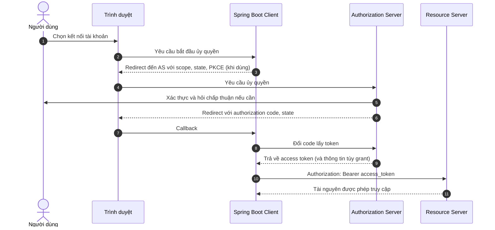
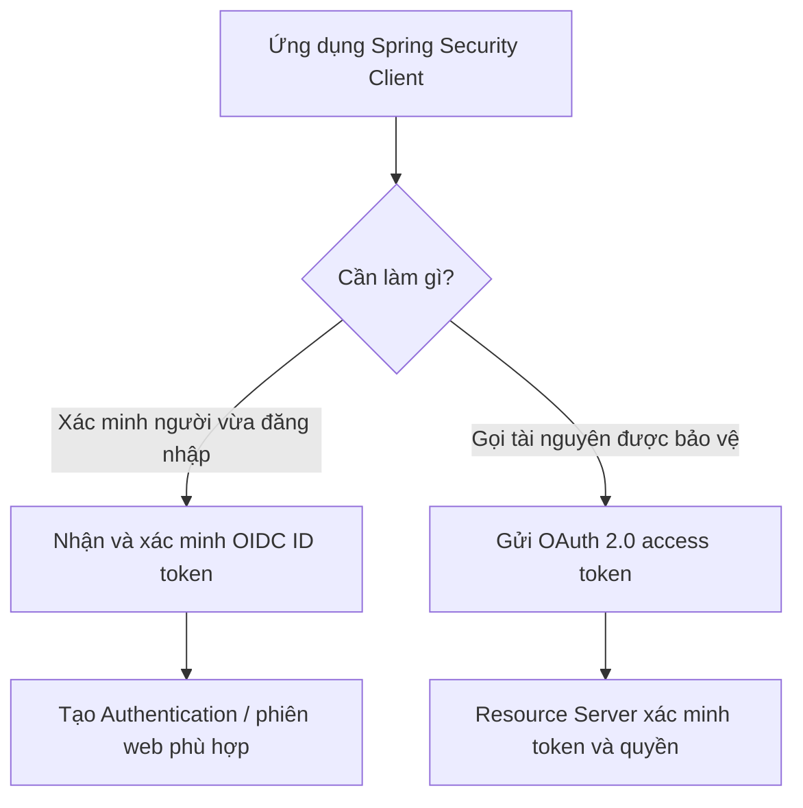

# 2.13. OAuth 2.0 hỗ trợ ủy quyền và giới hạn khi dùng để xác thực

> **Chủ đề:** Spring Security OAuth 2.0 OIDC Client  
> **Chương:** 2. Nền tảng OAuth 2.0  
> **Nội dung:** OAuth 2.0 được thiết kế để cấp quyền truy cập tài nguyên; một luồng OAuth 2.0 thành công không tự động mang lại bằng chứng danh tính chuẩn hóa cho ứng dụng Client. OpenID Connect (OIDC) giải quyết nhu cầu đăng nhập trên nền OAuth 2.0.

Khi một ứng dụng Spring Boot hiển thị nút “Đăng nhập bằng tài khoản bên ngoài”, người học rất dễ hình dung rằng OAuth 2.0 chính là giao thức đăng nhập. Trên thực tế, **OAuth 2.0 là khung ủy quyền (authorization framework)**. Nó cho phép ứng dụng Client nhận quyền truy cập giới hạn đến tài nguyên, thường thay mặt người dùng, mà không phải nhận mật khẩu của người dùng. Việc xác định “người dùng nào vừa đăng nhập vào Client?” là một mục tiêu khác: **xác thực danh tính (authentication)**.

Sự phân biệt này có hệ quả trực tiếp khi dùng Spring Security: cấu hình OAuth 2.0 Client để gọi API, cấu hình OIDC Login để đăng nhập người dùng và cấu hình Resource Server để xác thực access token là ba trách nhiệm liên quan nhưng khác nhau.

## 1. Mục tiêu học tập

Sau bài này, bạn có thể:

1. Giải thích OAuth 2.0 giải quyết bài toán ủy quyền như thế nào và vì sao Authorization Server có thể phải xác thực người dùng trong quá trình đó.
2. Phân biệt **quyền truy cập**, **danh tính người dùng**, **đăng nhập ứng dụng**, và **phân quyền nghiệp vụ**.
3. Chỉ ra vì sao access token, authorization code, scope và một phản hồi HTTP thành công không phải bằng chứng đăng nhập có thể dùng tùy ý.
4. Mô tả cách OIDC bổ sung ID token, issuer, subject và các quy tắc xác minh danh tính chuẩn hóa.
5. Chọn đúng cơ chế Spring Security cho từng tình huống: `oauth2Login()` với OIDC, `oauth2Client()` để gọi API, hoặc `oauth2ResourceServer()` ở API nhận bearer token.
6. Tự quan sát các trường hợp: đăng nhập OIDC, Client gọi API được cấp quyền, token bị dùng sai đối tượng nhận và luồng không có người dùng.

## 2. Ba câu hỏi thường bị gộp thành một

Hãy tưởng tượng ứng dụng “PhotoPrint” muốn lấy ảnh từ “PhotoCloud” để in. Ứng dụng này cần trả lời những câu hỏi sau:

| Câu hỏi | Khái niệm | Ví dụ |
|---|---|---|
| Ứng dụng có được đọc ảnh không? | **Ủy quyền truy cập (authorization)** | Người dùng cho PhotoPrint quyền `photos.read` trên PhotoCloud |
| Ai là người đang sử dụng PhotoPrint? | **Xác thực danh tính (authentication)** | PhotoPrint xác minh người đăng nhập là một chủ thể do nhà cung cấp danh tính xác nhận |
| Người đó được làm gì **trong PhotoPrint**? | **Phân quyền ứng dụng (application authorization)** | Chỉ tài khoản nội bộ có vai trò “admin” được đổi cấu hình thanh toán |

OAuth 2.0 tập trung vào câu hỏi thứ nhất. OIDC chuẩn hóa cách trả lời câu hỏi thứ hai khi dùng một OpenID Provider. Câu hỏi thứ ba vẫn do ứng dụng hoặc chính sách nội bộ quyết định; có thể dựa trên danh tính và quyền đã được ánh xạ hợp lệ, nhưng không tự động suy ra từ việc đăng nhập.

Ví dụ: người dùng cho PhotoPrint quyền đọc ảnh công khai của họ. Điều này **không đồng nghĩa** với việc PhotoPrint được phép truy cập các ảnh riêng tư nằm ngoài phạm vi được cấp; càng không có nghĩa người dùng có quyền quản trị toàn bộ PhotoPrint.

### 2.1. “Xác thực” xảy ra ở đâu?

Trong Authorization Code flow, Authorization Server có thể yêu cầu người dùng nhập mật khẩu, xác minh MFA hoặc dùng phiên SSO sẵn có. Đó là **hành động xác thực người dùng tại Authorization Server** để máy chủ quyết định có cấp quyền hay không.

Nhưng OAuth 2.0 không quy định một thông điệp nhận dạng người dùng chuẩn, dành riêng cho Client, với đầy đủ các quy tắc kiểm chứng như OIDC ID token. Vì vậy:

- **Authorization Server đã xác thực người dùng** không đồng nghĩa với **Client đã nhận một khẳng định danh tính hợp lệ và đủ ngữ nghĩa để đăng nhập người dùng**.
- Authorization Server có thể cấp quyền trong các bối cảnh không có người dùng tương tác. Ví dụ, grant `client_credentials` đại diện cho chính Client.
- Một token cấp cho API để đọc dữ liệu có mục đích và đối tượng nhận khác với một thông điệp xác thực danh tính dành cho Client.

Đây là lý do dùng từ “OAuth login” trong tên tính năng có thể gây nhầm lẫn. Một số sản phẩm triển khai đăng nhập dựa trên OAuth 2.0 cộng với API hồ sơ riêng; việc đó có thể hoạt động theo hợp đồng cụ thể của nhà cung cấp, nhưng **OAuth 2.0 thuần túy không đem lại cơ chế đăng nhập liên thông, chuẩn hóa như OIDC**.

## 3. OAuth 2.0 hỗ trợ ủy quyền bằng cơ chế nào?

OAuth 2.0 mô tả các vai trò chính:

- **Resource Owner:** chủ thể có quyền cấp truy cập đến tài nguyên được bảo vệ; thường là người dùng cuối trong các kịch bản có người dùng.
- **Client:** ứng dụng cần truy cập tài nguyên, ví dụ ứng dụng Spring Boot.
- **Authorization Server:** máy chủ xử lý ủy quyền và phát hành access token.
- **Resource Server:** API/tài nguyên nhận token và quyết định có cho truy cập hay không.

Ở kịch bản web có người dùng, Authorization Code flow diễn ra theo ý chính:



Điểm cuối của luồng OAuth 2.0 là **Client được cấp một cách truy cập tài nguyên theo phạm vi/quy tắc của Authorization Server**. Các nội dung sau có thể xuất hiện trong giao dịch nhưng không làm đổi mục tiêu giao thức:

- Người dùng đã đăng nhập ở Authorization Server.
- Người dùng nhìn thấy màn hình xin chấp thuận.
- Client nhận được authorization code rồi access token.
- API trả dữ liệu thuộc về một tài khoản.

Những tín hiệu này **không tự tạo ra một chuẩn chứng thực danh tính dành cho Client**. Client cần một cơ chế nhận dạng đúng mục đích nếu muốn tạo phiên đăng nhập dựa trên danh tính người dùng.

### 3.1. Access token là quyền truy cập, không phải “thẻ căn cước”

Access token thường là bearer token: bên nào sở hữu token hợp lệ có thể trình nó để thực hiện yêu cầu trong phạm vi được chấp nhận. Token có thể là chuỗi opaque hoặc JWT, tùy Authorization Server. OAuth 2.0 **không bắt buộc** Client phải đọc cấu trúc nội bộ của access token.

Ví dụ về cách API nhận một access token:

```http
GET /api/photos HTTP/1.1
Host: api.photocloud.example
Authorization: Bearer <access-token>
```

Resource Server phải thực hiện kiểm tra phù hợp với loại token và kiến trúc của mình: tính hợp lệ, issuer/audience khi áp dụng, thời hạn, quyền và các điều kiện truy cập. **Client không nên suy ra danh tính đăng nhập bằng cách tự giải mã access token rồi lấy một trường như `sub` hoặc `email`**, bởi vì:

1. Token có thể opaque, không chứa claim cho Client đọc.
2. Claim `sub` hoặc cấu trúc JWT không được OAuth 2.0 thuần túy định nghĩa thành khẳng định danh tính dùng để đăng nhập cho mọi nhà cung cấp.
3. Access token có thể được cấp cho **Resource Server**, không dành cho Client như một bên nhận chứng thực danh tính.
4. Hai token của các tài nguyên, Client hoặc issuer khác nhau có thể có ngữ nghĩa khác nhau.
5. Việc tự diễn giải token bỏ qua quy trình xác minh danh tính và ranh giới tin cậy đúng mục đích.

**Ví dụ:** JWT access token có `aud: "photos-api"` và `scope: "photos.read"`. Dù có `sub: "12345"`, Client PhotoPrint không được coi nó là ID token dành cho `web-client`. Với API, `aud` cho biết đối tượng nhận thích hợp của token; với Client đăng nhập OIDC, `aud` của **ID token** phải bao gồm client ID tương ứng.

### 3.2. Scope giới hạn quyền được yêu cầu/cấp

Scope là các chuỗi biểu diễn phạm vi truy cập theo chính sách Authorization Server, ví dụ `photos.read`, `calendar.write`. Một Client yêu cầu scope không có nghĩa luôn được cấp chính xác scope đó; máy chủ có thể thu hẹp hoặc từ chối. Resource Server còn phải đánh giá quyền trên từng tài nguyên cụ thể.

Scope cũng **không mặc nhiên là vai trò nội bộ**. `photos.read` không có nghĩa “người dùng đã xác thực với vai trò ADMIN”. Kể cả scope tên `admin` cũng chỉ có ý nghĩa theo hợp đồng giữa các hệ thống, không mang ý nghĩa mặc định toàn cục.

OIDC dùng scope đặc biệt `openid` để yêu cầu xử lý theo giao thức OIDC. Các scope `profile` và `email` liên quan đến yêu cầu claim hồ sơ, không đảm bảo mọi claim luôn hiện diện hoặc được xác minh như nhau.

### 3.3. Authorization code và state không phải danh tính

Authorization code là mã ngắn hạn được Client đổi lấy token; nó không phải access token, ID token hay một chuỗi chứng nhận “đây là Alice”. Tham số `state` hỗ trợ liên kết yêu cầu ủy quyền với callback và giúp chống một số cuộc tấn công như CSRF đối với luồng đăng nhập/ủy quyền. PKCE gắn việc đổi code với Client đã khởi tạo yêu cầu, giúp chống đánh cắp và sử dụng lại code.

Những cơ chế này bảo vệ **giao dịch OAuth**, nhưng không thay thế một khẳng định danh tính chuẩn hóa.

## 4. Những giới hạn cụ thể khi dùng OAuth 2.0 để đăng nhập

### 4.1. Không có định dạng chứng thực danh tính bắt buộc

OAuth 2.0 không yêu cầu Authorization Server phát hành ID token với những claim đã chuẩn hóa như `iss`, `sub` và `aud` cho Client. Nếu chỉ nhận access token, Client thiếu một thông điệp xác thực có cấu trúc và đối tượng nhận được định nghĩa cho trường hợp đăng nhập.

Một ứng dụng có thể gọi API hồ sơ của nhà cung cấp bằng access token, nhưng tên endpoint, các claim và mức độ tin cậy của chúng phụ thuộc từng nhà cung cấp. Tính năng “Sign in with X” dựa trên API hồ sơ riêng vì vậy không đương nhiên tương thích với nhà cung cấp khác.

### 4.2. Nhầm đối tượng nhận của token (token audience confusion)

Giả sử Client A nhận access token dành cho API B. Nếu Client A chấp nhận token đó làm bằng chứng đăng nhập của chính mình, token có thể bị sử dụng **ngoài mục đích được cấp**.

Ví dụ mô tả ngữ nghĩa, không phải token thật:

```json
{
  "iss": "https://login.example.test",
  "sub": "resource-owner-42",
  "aud": "orders-api",
  "scope": "orders.read",
  "exp": 1893456000
}
```

Một Client web có client ID `shop-web` không thể chỉ thấy `sub` rồi khẳng định đây là phiên đăng nhập của `shop-web`. Token trong ví dụ được cấp cho `orders-api`; chính API đó phải xác nhận token phù hợp trước khi cho truy cập.

**Hệ quả:** token dùng để truy cập tài nguyên và token dùng để xác thực người dùng phải có quy trình kiểm tra và đối tượng nhận riêng.

### 4.3. Không có bảo đảm chung về danh tính người dùng trong mọi grant

OAuth 2.0 có nhiều grant phù hợp nhu cầu khác nhau. Bảng sau cho thấy vì sao không thể nói “cứ có token OAuth là có người dùng đã đăng nhập”:

| Luồng/kiểu sử dụng | Có người dùng tương tác? | Ý nghĩa chính |
|---|---|---|
| Authorization Code với người dùng | Thường có, hoặc tái dùng phiên tại Authorization Server | Client được cấp quyền truy cập thay mặt Resource Owner |
| Authorization Code + OIDC | Thường có, hoặc tái dùng phiên hợp lệ tại OpenID Provider | Ngoài ủy quyền, Client nhận ID token phục vụ xác thực danh tính |
| Client Credentials | Không cần người dùng | Client truy cập tài nguyên theo quyền của chính nó |
| Refresh Token | Không nhất thiết có tương tác mới | Client xin token mới dựa trên một ủy quyền trước đó |

Ngay cả với Authorization Code, xác thực người dùng tại IdP có thể diễn ra bằng SSO đã tồn tại, chứ không phải màn hình mật khẩu mới. Không nên nhầm “không thấy màn hình login” với “không xác thực”, cũng không nên suy luận ngược rằng “thấy màn hình login” chứng minh ứng dụng đã xác minh danh tính đúng chuẩn.

### 4.4. Không tự ngăn được nhầm nhà cung cấp hoặc nhầm phiên

Khi ứng dụng hỗ trợ nhiều Authorization Server, Client cần nhận biết callback và thông tin danh tính thuộc đúng máy chủ đã khởi tạo giao dịch. Nếu ứng dụng chỉ dựa trên một token không có quy tắc nhận dạng issuer/audience phù hợp, nguy cơ nhầm nhà cung cấp, nhầm tài khoản hoặc chấp nhận kết quả không đúng phiên sẽ tăng.

Các biện pháp như `state`, PKCE, kiểm tra issuer và cơ chế bảo vệ tương ứng giúp bảo vệ luồng OAuth. Khi có yêu cầu **đăng nhập liên thông**, OIDC bổ sung thông điệp danh tính và các quy tắc xác minh rõ ràng.

### 4.5. Authentication và session là hai lớp khác nhau

Ứng dụng có thể có cookie phiên riêng sau khi đăng nhập và tiếp tục phục vụ yêu cầu dù access token dùng gọi API đã hết hạn. Ngược lại, có access token hợp lệ để gọi API không có nghĩa trình duyệt đã có phiên đăng nhập ở web Client.

| Dữ liệu | Bên sử dụng chính | Vai trò |
|---|---|---|
| Access token | Resource Server | Xin quyền truy cập API/tài nguyên |
| ID token OIDC | Client (Relying Party) | Xác minh sự kiện xác thực và danh tính được OP công bố |
| Session cookie của web app | Trình duyệt và ứng dụng web | Duy trì trạng thái phiên trong ứng dụng |
| Refresh token | Client theo chính sách cấp token | Xin access token mới khi được cho phép |

Token/phiên có vòng đời khác nhau. Quy trình logout, hết hạn, cấp lại và thu hồi cần được mô tả riêng theo thiết kế ứng dụng.

## 5. OpenID Connect bổ sung gì trên nền OAuth 2.0?

**OpenID Connect 1.0** là lớp danh tính xây dựng trên OAuth 2.0. Với OIDC Authorization Code flow, Client (thường được gọi là **Relying Party — RP**) nhận được **ID token** từ **OpenID Provider — OP**, bên cạnh các token phục vụ quyền truy cập theo yêu cầu.

ID token thường là JWT được bảo vệ bằng chữ ký. Nó chứa các claim phục vụ xác thực, điển hình:

| Claim | Ý nghĩa khi xác thực |
|---|---|
| `iss` | Issuer — nhà cung cấp phát hành khẳng định danh tính |
| `sub` | Subject — mã định danh người dùng trong phạm vi issuer |
| `aud` | Audience — một hoặc nhiều client ID được phép nhận ID token |
| `exp` | Thời điểm hết hạn ID token |
| `iat` | Thời điểm phát hành ID token |
| `nonce` | Liên kết ID token với yêu cầu xác thực khi có `nonce` theo luồng/quy tắc áp dụng |
| `auth_time` | Thời điểm xác thực người dùng, khi được yêu cầu/cung cấp |
| `azp` | Authorized party, có thể cần xem xét theo các điều kiện của OIDC |

Ví dụ phần payload **minh họa**; JSON này không phải JWT có chữ ký và không được dùng để kiểm thử xác thực thực tế:

```json
{
  "iss": "https://login.example.test",
  "sub": "person-42",
  "aud": "shop-web",
  "iat": 1893450000,
  "exp": 1893453600,
  "nonce": "example-nonce"
}
```

Trong thực tế, Client phải dùng thư viện hỗ trợ OIDC để **xác minh** ID token, thay vì chỉ giải mã payload. Những kiểm tra quan trọng gồm chữ ký và khóa xác minh hợp lệ, issuer dự kiến, audience/client ID đúng, thời hạn hiệu lực và các điều kiện `nonce`/`azp`/`auth_time` khi áp dụng.

Không nên coi những chuỗi trong JWT là đáng tin cậy trước khi hoàn thành kiểm tra. Lưu ý `sub` chỉ có ý nghĩa cùng issuer; để định danh nội bộ, thường dùng cặp **(issuer, subject)** thay vì email hoặc `sub` riêng lẻ. Một OP cũng có thể phát hành định danh pairwise khác nhau theo nhóm Client.

### 5.1. ID token không thay thế access token

Hai token thường cùng xuất hiện trong OIDC Code flow nhưng phục vụ hai bên nhận khác nhau:



**Không đưa ID token làm bearer token để gọi API** khi API yêu cầu OAuth access token. Ngược lại, **không dùng access token dành cho API như ID token** để tạo phiên đăng nhập.

### 5.2. UserInfo bổ sung hồ sơ, không thay ID token

Một OP có thể hỗ trợ **UserInfo endpoint** để cung cấp thêm claim hồ sơ theo scope và chính sách. Client gọi endpoint này bằng access token theo quy tắc OIDC. Khi sử dụng UserInfo, Client cần bảo đảm `sub` trong phản hồi tương ứng với `sub` của ID token hợp lệ.

Claim như `email`, `name`, `picture` chỉ là thuộc tính hồ sơ; tính sẵn có và mức xác minh phụ thuộc IdP. Không nên dùng địa chỉ email chưa được kiểm chứng như một danh tính bất biến, hoặc mặc định rằng mọi nhà cung cấp luôn trả về `email_verified`.

### 5.3. OIDC giải quyết phần nào, phần nào vẫn thuộc ứng dụng?

OIDC giúp Client nhận **khẳng định danh tính theo giao thức chuẩn hóa**. Nhưng OIDC không tự quyết định:

- Tài khoản đó có được tạo mới trong cơ sở dữ liệu nội bộ hay không.
- Người dùng có vai trò `ADMIN`, `EDITOR` hoặc được xem dữ liệu của tổ chức cụ thể hay không.
- Phải xử lý liên kết tài khoản nhiều IdP, khóa tài khoản, thu hồi quyền hoặc thay đổi nhóm thế nào.
- Phiên web có thời hạn bao lâu, có cần xác thực lại để thực hiện thao tác nhạy cảm hay không.

Ứng dụng vẫn phải đặt chính sách phân quyền và quản lý phiên tương ứng.

## 6. Đặt cạnh nhau: OAuth 2.0 authorization và OIDC authentication

| Khía cạnh | OAuth 2.0 | OIDC (trên OAuth 2.0) |
|---|---|---|
| Mục tiêu chuẩn hóa | Ủy quyền cho Client truy cập tài nguyên | Thêm xác thực danh tính người dùng cho Client |
| Đối tượng nhận kết quả chính | Client lấy token để truy cập Resource Server | Relying Party nhận ID token; Resource Server vẫn nhận access token khi cần |
| Thông điệp chính | Access token và các thành phần grant | ID token cùng các thành phần OAuth 2.0 |
| Danh tính end-user | Không có khẳng định danh tính chung bắt buộc cho Client | Chuẩn hóa `iss`, `sub`, `aud` và quy trình kiểm tra ID token |
| Scope tiêu biểu | Scope theo API như `files.read` | `openid`, thêm `profile`/`email` khi cần claim |
| Có thể dùng khi không có người dùng? | Có, ví dụ `client_credentials` | OIDC login hướng đến xác thực end-user |
| Kết luận hợp lệ của Client | “Tôi có token được cấp để truy cập tài nguyên này.” | “Tôi đã xác minh khẳng định danh tính OIDC dành cho Client này.” |

Cách diễn đạt đúng khi giải thích hệ thống là: **OAuth 2.0 cho phép ứng dụng được ủy quyền hành động với tài nguyên; OIDC cho phép ứng dụng xác minh danh tính người dùng dựa trên khẳng định của một OP đáng tin cậy**. Khi người dùng đăng nhập qua OIDC, ứng dụng cũng có thể sử dụng access token để truy cập API, nhưng hai mục đích phải được thực hiện và kiểm tra riêng.

## 7. Liên hệ với Spring Security OAuth 2.0/OIDC Client

Trong Spring Security, các thành phần quen thuộc thể hiện ba vai trò này:

| Spring Security | Mục tiêu | Dữ liệu/cơ chế thường gặp |
|---|---|---|
| `oauth2Login()` | Đăng nhập người dùng bằng OAuth 2.0/OIDC qua redirect | Authorization Code, `OAuth2AuthenticationToken`; khi có OIDC là `OidcUser` và ID token |
| `oauth2Client()` | Quản lý authorized client để gọi API được bảo vệ | `ClientRegistration`, `OAuth2AuthorizedClient`, `OAuth2AuthorizedClientManager` |
| `oauth2ResourceServer()` | Bảo vệ API nhận bearer access token | JWT decoder hoặc token introspection; xác minh và phân quyền request |

Spring Security có thể hỗ trợ **OAuth 2.0 Login** theo cách riêng của provider mà không dùng OIDC, ví dụ lấy thông tin người dùng qua endpoint UserInfo đặc thù và `OAuth2UserService`. Điều đó tạo được `Authentication` trong ứng dụng Spring, nhưng không biến bản thân OAuth 2.0 thành giao thức định danh liên thông. Với nhà cung cấp hỗ trợ OIDC, nên ưu tiên OIDC Login khi mục tiêu là xác minh danh tính người dùng.

### 7.1. Mẫu cấu hình OIDC login

Ví dụ sử dụng Spring Boot 3.x/Spring Security 6.x, ứng dụng Servlet/MVC. Giả sử một OP chạy **cục bộ** tại `http://localhost:9000/realms/demo` và đã đăng ký Client dạng confidential với redirect URI phù hợp. Địa chỉ/giá trị này chỉ để minh họa; môi trường thực cần HTTPS và thông số do IdP cung cấp.

Dependency Maven tối thiểu cho Client web:

```xml
<dependency>
    <groupId>org.springframework.boot</groupId>
    <artifactId>spring-boot-starter-web</artifactId>
</dependency>
<dependency>
    <groupId>org.springframework.boot</groupId>
    <artifactId>spring-boot-starter-oauth2-client</artifactId>
</dependency>
```

Cấu hình `application.yml`:

```yaml
server:
  port: 8080

spring:
  security:
    oauth2:
      client:
        registration:
          demo:
            provider: demo
            client-id: demo-web
            client-secret: ${OIDC_CLIENT_SECRET}
            authorization-grant-type: authorization_code
            redirect-uri: "{baseUrl}/login/oauth2/code/{registrationId}"
            scope: [openid, profile, email]
        provider:
          demo:
            issuer-uri: http://localhost:9000/realms/demo
```

Giải thích:

- `registrationId` là `demo`; người dùng có thể khởi tạo luồng bằng `/oauth2/authorization/demo`.
- `issuer-uri` trỏ đến nhà cung cấp và cho phép Spring Security lấy OIDC metadata khi được hỗ trợ.
- `openid` đánh dấu yêu cầu là OIDC. Các scope `profile`, `email` là tùy chọn phục vụ claim hồ sơ.
- `redirect-uri` phải khớp URI đã đăng ký ở OP: `http://localhost:8080/login/oauth2/code/demo`.
- `OIDC_CLIENT_SECRET` phải được cung cấp qua biến môi trường/secret manager; không chép secret thật vào Git. Với public client, phương thức xác thực Client và cấu hình PKCE sẽ khác.

Ví dụ `SecurityFilterChain`:

```java
import org.springframework.context.annotation.Bean;
import org.springframework.context.annotation.Configuration;
import org.springframework.security.config.Customizer;
import org.springframework.security.config.annotation.web.builders.HttpSecurity;
import org.springframework.security.web.SecurityFilterChain;

@Configuration
class WebSecurityConfig {

    @Bean
    SecurityFilterChain webSecurityFilterChain(HttpSecurity http) throws Exception {
        return http
            .authorizeHttpRequests(auth -> auth
                .requestMatchers("/", "/error").permitAll()
                .anyRequest().authenticated())
            .oauth2Login(Customizer.withDefaults())
            .oauth2Client(Customizer.withDefaults())
            .build();
    }
}
```

Với OIDC login thành công, controller có thể đọc subject/issuer từ `OidcUser`:

```java
import java.util.Map;
import org.springframework.security.core.annotation.AuthenticationPrincipal;
import org.springframework.security.oauth2.core.oidc.user.OidcUser;
import org.springframework.web.bind.annotation.GetMapping;
import org.springframework.web.bind.annotation.RestController;

@RestController
class WhoAmIController {

    @GetMapping("/me")
    Map<String, String> me(@AuthenticationPrincipal OidcUser user) {
        return Map.of(
            "subject", user.getSubject(),
            "issuer", user.getIdToken().getIssuer().toString()
        );
    }
}
```

Sau khi xác minh OIDC, Spring Security tạo đối tượng xác thực và thường lưu trong HTTP session của ứng dụng web. Endpoint `/me` chỉ hiển thị thông tin danh tính tối thiểu. **Không cần và không nên trả raw ID token, access token, refresh token hoặc cookie phiên về trang demo** để chứng minh login thành công.

### 7.2. Đọc kết quả đăng nhập có đúng mục đích

Một số điều cần diễn giải cẩn thận khi quan sát ứng dụng:

- HTTP redirect từ `/me` đến IdP nghĩa là ứng dụng **yêu cầu bắt đầu login**; chưa phải bằng chứng người dùng đã xác thực.
- Callback chứa `code` nghĩa là OP đã điều hướng về Client với dữ liệu giao dịch; ứng dụng vẫn cần kiểm tra `state` và đổi code hợp lệ.
- Token response theo OIDC chứa ID token; ứng dụng phải kiểm tra ID token trước khi sử dụng danh tính.
- Khi `/me` trả subject/issuer từ principal sau khi luồng đã hoàn tất, bạn đang quan sát **trạng thái xác thực của ứng dụng**.
- Gọi một API khác thành công còn cần access token **thích hợp với API đó** và chính sách quyền của Resource Server.

## 8. Các ví dụ đối chiếu: cùng OAuth 2.0 nhưng kết luận khác nhau

### Tình huống A — Ứng dụng được quyền đọc lịch, nhưng chưa có danh tính OIDC

Người dùng truy cập ứng dụng `reporting-client` và cho phép ứng dụng đọc sự kiện lịch qua Authorization Code. Authorization Server phát hành access token scope `calendar.read`; Client gọi API lịch thành công.

**Kết luận đúng:** Client đã được cấp quyền đọc các sự kiện phù hợp chính sách API. Nếu ứng dụng không có một cơ chế nhận dạng được xác minh riêng, OAuth 2.0 token này không tự bảo đảm danh tính để đăng nhập liên thông.

**Kết luận sai:** “Token đọc được lịch của Alice nên chắc chắn Alice đã đăng nhập an toàn vào ứng dụng của tôi.”

Nếu nhà cung cấp có API hồ sơ người dùng, ứng dụng có thể sử dụng theo hợp đồng cụ thể. Để có khẳng định danh tính chuẩn hóa, sử dụng OIDC khi được hỗ trợ.

### Tình huống B — OIDC login thành công, nhưng API vẫn trả 403

Ứng dụng `reporting-client` xác minh ID token cho `client-id=reporting-client`, tạo phiên người dùng. Sau đó, nó gọi API tài liệu với access token **thiếu scope `documents.write`**.

**Kết luận đúng:** người dùng đã được xác thực tại Client, nhưng yêu cầu ghi tài liệu không đủ quyền trên API. Resource Server có thể trả **403 Forbidden** khi token đã được chấp nhận nhưng thiếu quyền.

**Kết luận sai:** “Đăng nhập OIDC thành công thì tất cả API phải trả 200.”

### Tình huống C — Có token nhưng không có end-user

Một tác vụ định kỳ dùng grant `client_credentials` để lấy access token gọi API thanh toán nội bộ. Không có trình duyệt, redirect hay end-user.

**Kết luận đúng:** hệ thống có thể đã xác thực Client và cấp cho nó quyền máy–máy. Không có cơ sở để tạo phiên đăng nhập “người dùng Alice” từ grant này.

**Kết luận sai:** “Mọi access token đều tương ứng với một người dùng đã login.”

### Tình huống D — Token hợp lệ nhưng sai audience

Một token JWT có chữ ký hợp lệ của cùng issuer nhưng được cấp với `aud=inventory-api`. Ứng dụng `billing-api` được cấu hình chỉ nhận token có audience `billing-api`.

**Kết luận đúng:** `billing-api` phải từ chối token sai audience nếu chính sách token/JWT API yêu cầu kiểm tra đó. Chữ ký đúng và issuer đúng chưa đủ để chấp nhận token cấp cho một tài nguyên khác.

**Kết luận sai:** “Token của cùng nhà cung cấp danh tính thì dùng ở API nào cũng được.”

## 9. Bài thực hành: phân biệt bằng quan sát

Một phòng lab nhỏ gồm **IdP/OpenID Provider**, **Spring Boot web Client** và **Resource Server** là đủ. Giả sử Client ở cổng 8080, API ở cổng 8081, OP ở cổng 9000. Tên cổng, realm, scope và client ID phải được điều chỉnh theo môi trường thực tế.

### Lab 1 — Theo dõi một lần đăng nhập OIDC

**Chuẩn bị:** tạo Client `demo-web`, đăng ký redirect URI và scope `openid`. Khởi động ứng dụng có `oauth2Login()` và controller `/me` ở mục 7.

**Thao tác:**

1. Dùng cửa sổ trình duyệt riêng tư để tránh phiên đăng nhập cũ, truy cập `http://localhost:8080/me`.
2. Quan sát browser chuyển hướng đến OP qua URL ủy quyền, sau đó đăng nhập bằng tài khoản lab.
3. Theo dõi callback `/login/oauth2/code/demo` và lần truy cập `/me` sau khi luồng hoàn tất.
4. Ghi lại **issuer** và **subject** được ứng dụng hiển thị, không sao chép mã code, token, session cookie hay client secret.
5. Mở sơ đồ ở mục 3 và đánh dấu phần nào do trình duyệt thực hiện, phần nào do Spring Security thực hiện ở máy chủ.

**Kết quả mong đợi:** `/me` cho thấy một principal OIDC hợp lệ sau khi đăng nhập; ứng dụng có trạng thái xác thực riêng. Việc Client gọi token endpoint từ phía máy chủ có thể không xuất hiện như một request trực tiếp từ tab Network của trình duyệt.

**Câu hỏi:** Bên nào phát hành ID token? Vì sao `aud` của ID token phải đúng Client? Điều gì khác giữa cookie phiên và access token?

### Lab 2 — Đăng nhập vẫn thành công nhưng thiếu quyền API

**Chuẩn bị:** Resource Server bảo vệ `GET /api/reports` bằng scope `reports.read`. Cấu hình nó xác minh access token đúng loại (JWT hoặc introspection tùy OP) và các điều kiện của token, bao gồm issuer, audience khi phù hợp.

**Thao tác:**

1. Đăng nhập OIDC để ứng dụng web có principal hợp lệ.
2. Cho web Client gọi `/api/reports` bằng **access token** được quản lý qua authorized client; API không nhận ID token làm bearer.
3. Quan sát phản hồi với access token phù hợp, sau đó dùng cấu hình cấp quyền lab để thử trường hợp thiếu scope.
4. So sánh trạng thái login của web Client với trạng thái phân quyền ở API.

**Kết quả mong đợi:** khi API yêu cầu quyền `reports.read`, token hợp lệ với scope đó có thể được cấp quyền theo chính sách; token được xác thực nhưng thiếu quyền thường dẫn đến 403. Token bị thiếu/hết hạn/không hợp lệ thường dẫn đến 401. Kết quả cụ thể phụ thuộc cấu hình `SecurityFilterChain` và chính sách API.

**Câu hỏi:** Ai xác thực danh tính người dùng tại web Client? Ai quyết định có được đọc `/api/reports`?

### Lab 3 — So sánh OIDC và OAuth 2.0 login theo nhà cung cấp

**Chuẩn bị:** môi trường lab của nhà cung cấp hỗ trợ OIDC, có thể tạo thêm một Client registration riêng để thử OAuth 2.0 Login khi provider có API hồ sơ phù hợp.

**Thao tác:**

1. Ghi nhận cấu hình OIDC với scope `openid` và principal `OidcUser`.
2. Trong registration thử nghiệm riêng, cấu hình OAuth 2.0 Login không dùng OIDC theo tài liệu của provider, chỉ khi provider công bố endpoint hồ sơ và contract rõ ràng.
3. So sánh nguồn dữ liệu tạo principal và loại thông điệp ứng dụng có thể xác minh. Không biến một lần thay scope thất bại thành kết luận rằng nhà cung cấp không hỗ trợ OAuth.

**Kết quả mong đợi:** OIDC có ID token và quy tắc xác minh chuẩn hóa; OAuth 2.0 Login thuần túy phụ thuộc hợp đồng hồ sơ người dùng của provider và cấu hình Spring Security. Một API hồ sơ trả 200 không tự là ID token.

**Câu hỏi:** Nếu thay provider, ứng dụng nào đòi sửa phần ánh xạ hồ sơ riêng? Cơ chế nào hỗ trợ danh tính chuẩn hóa hơn?

### Lab 4 — Quan sát grant máy–máy

**Chuẩn bị:** một Client registration `client_credentials` trong môi trường thử nghiệm, chỉ được cấp quyền gọi API máy–máy.

**Thao tác:**

1. Lấy access token theo `client_credentials` thông qua cơ chế authorized client thích hợp.
2. Gọi API đã đăng ký nhận token đó.
3. So sánh với login OIDC: không có thao tác đăng nhập người dùng, không có ID token dành cho phiên người dùng và không có principal OIDC của trình duyệt chỉ vì token đã được cấp.

**Kết quả mong đợi:** authorization cấp cho Client mà không yêu cầu xác thực end-user. Đây là bằng chứng rõ ràng rằng từ “OAuth token” không thể tự suy ra danh tính người dùng.

## 10. Nguyên tắc bảo mật khi tích hợp OAuth 2.0 và OIDC

Sự khác biệt giữa ủy quyền và xác thực còn dẫn đến quy tắc triển khai cụ thể:

1. **Dùng đúng loại token và đúng bên nhận.** Access token để gọi Resource Server; ID token để Client xác minh danh tính. Không tự cho phép API nhận ID token trong vai trò access token.
2. **Dùng Authorization Code với bảo vệ hiện đại.** Áp dụng PKCE theo loại Client và khuyến nghị bảo mật hiện hành; bảo vệ `state`/correlation và callback đúng phiên. Không dùng implicit grant làm lựa chọn mặc định cho ứng dụng mới.
3. **Xác minh OIDC bằng thư viện.** Đối chiếu issuer, audience/client ID, chữ ký, hạn token và các điều kiện OIDC liên quan. Không dùng `Base64.decode` hoặc chỉ kiểm tra `email` để “xác thực JWT”.
4. **Tách biệt các provider.** Khi nhiều issuer cùng được cấu hình, không mặc định rằng token hoặc user ID của provider này có nghĩa trong provider kia; việc liên kết tài khoản cần chính sách riêng.
5. **Thiết kế Resource Server độc lập.** API tự xác minh bearer token và quyền cần thiết; việc web Client có session không đủ để vượt qua kiểm tra API.
6. **Bảo vệ dữ liệu nhạy cảm.** Không ghi token, authorization code, client secret, cookie phiên hoặc mật khẩu vào log và tài liệu bài học. Sử dụng HTTPS ngoài môi trường localhost thử nghiệm.
7. **Không suy quyền nghiệp vụ từ đăng nhập.** Xác thực thành công chỉ xác lập danh tính theo mức tin cậy được chấp nhận; ứng dụng còn phải kiểm tra quyền với từng hành động và tài nguyên.
8. **Hiểu vòng đời phiên/token.** Hết hạn access token, hết hạn ID token, hết phiên ứng dụng và hết phiên OP có thể xảy ra ở các thời điểm khác nhau; xử lý cấp lại, xác thực lại và logout tùy yêu cầu.

### 10.1. Dấu hiệu lỗi và chỗ cần kiểm tra

| Dấu hiệu | Chưa nên kết luận | Nơi nên kiểm tra |
|---|---|---|
| Client có access token nhưng không có `OidcUser` | “Spring Security không hỗ trợ OIDC” | Scope `openid`, issuer/discovery, kiểu login và cấu hình registration |
| API trả 401 sau login | “Danh tính người dùng sai” | Có gửi access token đúng định dạng chưa? Token có hết hạn, sai issuer/audience hay chữ ký không? |
| API trả 403 sau login | “Phải đăng nhập lại” | Token được chấp nhận nhưng scope/authority/chính sách tài nguyên có thiếu không? |
| Có thể giải mã JWT nhưng login bị từ chối | “JWT đã hợp lệ vì đọc được payload” | Chữ ký/JWK, issuer, audience, expiration, nonce và các quy tắc OIDC áp dụng |
| Dùng Client Credentials mà controller không có user login | “Token hỏng” | Grant này vốn không biểu diễn end-user; không thiết kế để tạo `OidcUser` |
| Truy cập UserInfo được nhưng danh tính chưa đáng tin | “API trả hồ sơ nên đã xác thực chuẩn OIDC” | Đã có ID token được xác minh và đối chiếu `sub` chưa? |

## 11. Câu hỏi kiểm tra hiểu biết

**Câu 1:** Một ứng dụng đã được người dùng cấp access token có scope `files.read`. Điều gì được khẳng định chắc chắn theo mục đích OAuth 2.0?

**Gợi ý:** ứng dụng được cấp phương tiện xin truy cập tài nguyên trong phạm vi chính sách; token không tự trở thành khẳng định đăng nhập OIDC.

**Câu 2:** Authorization Server vừa yêu cầu người dùng nhập mật khẩu. Tại sao Client chưa thể kết luận “tôi đã xác thực danh tính người dùng” chỉ từ việc nhận authorization code?

**Gợi ý:** hành động xác thực xảy ra tại Authorization Server; Client cần thông điệp và quy tắc xác minh danh tính dành cho mình.

**Câu 3:** Có nên dùng `sub` của một JWT access token cấp cho `inventory-api` để tạo tài khoản đăng nhập `billing-web`?

**Gợi ý:** không suy luận từ token có audience khác; dùng khẳng định danh tính OIDC hợp lệ hoặc contract xác thực được thiết kế riêng và đánh giá đầy đủ.

**Câu 4:** Sau khi OIDC login thành công, API trả 403. Thành phần nào phải xác định nguyên nhân?

**Gợi ý:** kiểm tra quyền trên Resource Server, scope/authority của access token và chính sách endpoint; không mặc định lỗi đăng nhập.

**Câu 5:** Vì sao `client_credentials` cho thấy OAuth 2.0 không đồng nghĩa với đăng nhập người dùng?

**Gợi ý:** nó cấp quyền cho chính Client khi không có end-user tương tác.

**Câu 6:** Trong Spring Security, khi nào chọn `oauth2Client()`, `oauth2Login()` và `oauth2ResourceServer()`?

**Gợi ý:** lần lượt quản lý quyền gọi API, đăng nhập người dùng vào Client và xác thực token của request đến API.

## 12. Ghi nhớ khi thiết kế hệ thống

Hãy mô tả riêng **ba ranh giới tin cậy** trong sơ đồ kiến trúc:

- **Giữa Client và Authorization Server/OP:** Client khởi tạo luồng, đối chiếu callback, nhận token và xác minh kết quả OIDC khi đăng nhập.
- **Giữa Client và Resource Server:** Client trình access token để xin thao tác trên tài nguyên; Resource Server đánh giá token/quyền.
- **Bên trong ứng dụng:** principal đã được xác thực được ánh xạ đến tài khoản, phiên và quyền nghiệp vụ theo chính sách ứng dụng.

Nếu cần “Đăng nhập bằng tài khoản tổ chức”, trước tiên hãy tìm hỗ trợ **OIDC** ở IdP và sử dụng thư viện OIDC của Spring Security. Nếu chỉ cần Client gọi API thay mặt người dùng, dùng **OAuth 2.0 authorization** cùng phạm vi quyền tối thiểu. Khi cả hai nhu cầu cùng tồn tại, ứng dụng sẽ dùng OIDC để nhận dạng người dùng và OAuth 2.0 access token để truy cập tài nguyên, đúng với đối tượng nhận của từng token.

## 13. Tài liệu tham khảo

- [RFC 6749 — The OAuth 2.0 Authorization Framework](https://www.rfc-editor.org/rfc/rfc6749): vai trò, luồng ủy quyền và ý nghĩa của access token.
- [RFC 6750 — OAuth 2.0 Bearer Token Usage](https://www.rfc-editor.org/rfc/rfc6750): sử dụng bearer access token khi truy cập Resource Server.
- [RFC 9700 — Best Current Practice for OAuth 2.0 Security](https://www.rfc-editor.org/rfc/rfc9700): khuyến nghị bảo mật các luồng OAuth 2.0 hiện đại.
- [OpenID Connect Core 1.0](https://openid.net/specs/openid-connect-core-1_0.html): ID token, xác thực người dùng, UserInfo và quy tắc xác minh.
- [Spring Security — OAuth 2.0 Login](https://docs.spring.io/spring-security/reference/servlet/oauth2/login/index.html): đăng nhập OAuth 2.0/OIDC trong ứng dụng Servlet.
- [Spring Security — OAuth 2.0 Client](https://docs.spring.io/spring-security/reference/servlet/oauth2/client/index.html): quản lý ClientRegistration và OAuth2AuthorizedClient.
- [Spring Security — OAuth 2.0 Resource Server](https://docs.spring.io/spring-security/reference/servlet/oauth2/resource-server/index.html): kiểm tra bearer token và bảo vệ API.

Khi thực hành, đối chiếu tài liệu với phiên bản Spring Security và yêu cầu của nhà cung cấp danh tính đang sử dụng, đặc biệt là issuer, redirect URI, token format, audience, claim mapping và chính sách cấp refresh token.
