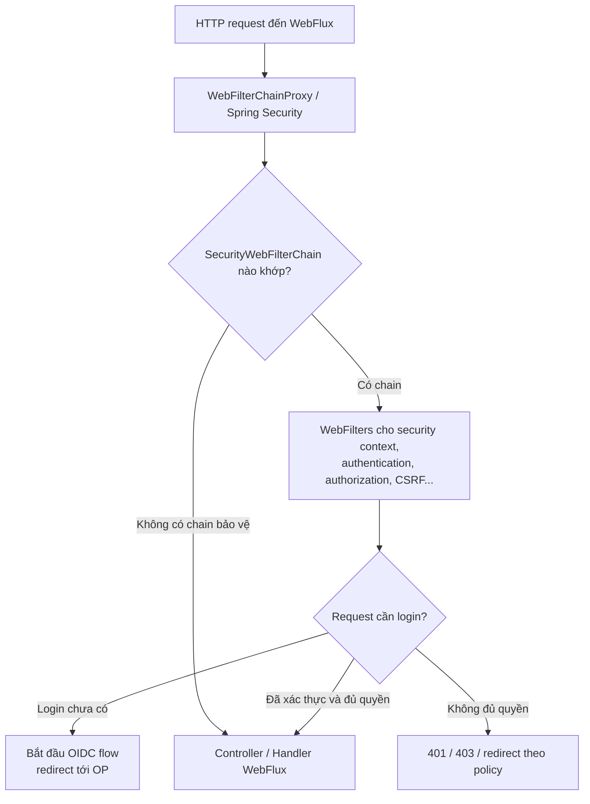
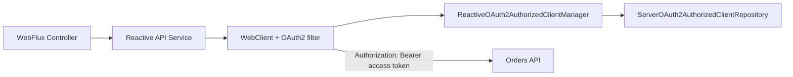

# 20.1. SecurityWebFilterChain và cấu hình oauth2Login

Trong **Spring Security OAuth 2.0/OIDC Client**, một ứng dụng **Spring WebFlux** có thể cho người dùng đăng nhập thông qua một OpenID Provider (OP) như hệ thống SSO của doanh nghiệp. Khác với ứng dụng Spring MVC/Servlet, WebFlux sử dụng **reactive security chain** được xây dựng bằng `ServerHttpSecurity` và trả về `SecurityWebFilterChain`.

Một cấu hình ngắn gọn có thể là:

```java
@Bean
SecurityWebFilterChain springSecurityFilterChain(ServerHttpSecurity http) {
    return http
        .authorizeExchange(exchanges -> exchanges
            .pathMatchers("/", "/error").permitAll()
            .anyExchange().authenticated())
        .oauth2Login(Customizer.withDefaults())
        .build();
}
```

Tuy nhiên, để triển khai đúng và an toàn, cần hiểu **`SecurityWebFilterChain` làm gì**, Spring tìm **`ReactiveClientRegistrationRepository`** từ đâu, request nào bắt đầu đăng nhập, callback được xử lý thế nào, authentication được lưu vào reactive security context ra sao, và tại sao không nên bê nguyên `HttpSecurity` của Servlet sang WebFlux.

Bài học đi từ kiến trúc, dependency và cấu hình OIDC tối thiểu đến trang login tùy chỉnh, nhiều provider, nhiều security filter chains, xử lý CSRF/session, principal OIDC, gọi API downstream và các lỗi thực tế.

## 1. Chọn đúng Servlet hay Reactive trước khi cấu hình

Spring Security có hai mô hình web security khác nhau:

| Nội dung | Spring MVC / Servlet | Spring WebFlux / Reactive |
|---|---|---|
| HTTP abstraction | `HttpServletRequest`, `HttpServletResponse` | `ServerWebExchange` |
| DSL bảo mật | `HttpSecurity` | **`ServerHttpSecurity`** |
| Security chain | `SecurityFilterChain` | **`SecurityWebFilterChain`** |
| Matcher | `RequestMatcher` | `ServerWebExchangeMatcher` |
| Authentication result | Thường là `Authentication` đồng bộ | Thường xử lý theo `Mono<Authentication>` |
| Security context | `SecurityContextHolder` gắn với thread theo mô hình truyền thống | **`ReactiveSecurityContextHolder`** gắn với Reactor Context |
| OAuth client registration | `ClientRegistrationRepository` | **`ReactiveClientRegistrationRepository`** |
| Authorized client trong request | `OAuth2AuthorizedClientRepository` | **`ServerOAuth2AuthorizedClientRepository`** |
| OAuth client manager | `OAuth2AuthorizedClientManager` | **`ReactiveOAuth2AuthorizedClientManager`** |
| Login DSL | `http.oauth2Login(...)` | **`http.oauth2Login(...)` trên ServerHttpSecurity** |

Cùng tên phương thức `oauth2Login` nhưng **hai đối tượng DSL khác nhau**. Trong WebFlux, khai báo:

```java
SecurityWebFilterChain securityWebFilterChain(ServerHttpSecurity http)
```

chứ không dùng:

```java
// Sai stack nếu mục tiêu là WebFlux.
SecurityFilterChain securityFilterChain(HttpSecurity http)
```

Một ứng dụng có thể sử dụng thư viện Reactor hoặc WebClient mà **vẫn chạy Servlet MVC**. Chỉ thấy `Mono` hay `WebClient` trong code không có nghĩa web stack của toàn ứng dụng đã là WebFlux.

### 1.1. Cẩn thận khi có cả starter-web và starter-webflux

Trong những dự án Spring Boot có cả:

```groovy
implementation 'org.springframework.boot:spring-boot-starter-web'
implementation 'org.springframework.boot:spring-boot-starter-webflux'
```

Spring Boot thông thường **ưu tiên ứng dụng Servlet MVC** nếu cả hai loại web stack cùng có mặt. Vì thế, một bean `SecurityWebFilterChain` có thể không bảo vệ requests như bạn kỳ vọng nếu ứng dụng thực tế đang chạy Servlet.

Với project muốn triển khai WebFlux, nên lựa chọn dependencies nhất quán và kiểm tra loại web application. Có thể cấu hình `spring.main.web-application-type: reactive` khi có lý do rõ ràng, nhưng không dùng thuộc tính đó để che đi việc cấu trúc ứng dụng vẫn phụ thuộc blocking MVC components.

### 1.2. Reactive không tự biến mọi thao tác thành non-blocking

`SecurityWebFilterChain` chạy trong reactive pipeline; nhưng nếu bạn gọi JDBC blocking, `Thread.sleep` hoặc `Mono.block()` trực tiếp trên Netty event-loop thì ứng dụng vẫn có thể nghẽn.

Đăng nhập reactive yêu cầu:

- Không tự chặn luồng event-loop ở custom authentication service.
- Dùng reactive repositories/HTTP clients khi có thể.
- Nếu phải tích hợp blocking legacy API, cô lập đúng scheduler/tầng thích hợp thay vì gọi trực tiếp trên event-loop.
- Bảo toàn Reactor Context để security context được truyền xuyên các bước bất đồng bộ.

## 2. SecurityWebFilterChain là gì?

`SecurityWebFilterChain` là chuỗi **`WebFilter` của Spring Security** áp dụng cho những `ServerWebExchange` phù hợp. Chuỗi này thực hiện nhiều trách nhiệm, không chỉ OAuth Login:

- Khôi phục/lưu security context.
- Phát hiện request đã được xác thực hay chưa.
- Bảo vệ authorization theo đường dẫn và HTTP method.
- Điều phối entry point khi request chưa xác thực.
- Thực hiện OAuth2/OIDC login qua redirect và callback.
- Quản lý CSRF, security headers, logout và các chính sách khác.
- Chuyển lỗi authentication/authorization thành response thích hợp.

Trong Spring WebFlux, có thể tạo một hoặc nhiều bean `SecurityWebFilterChain`. Mỗi chain có matcher và các quy tắc riêng.



**Không có chain khớp** có thể khiến request đi tiếp mà không qua những quy tắc security bạn dự định. Khi chia nhiều chains, phải xác định một chain cho các paths còn lại nếu không muốn để lỗ hổng do matcher.

### 2.1. Đừng tạo một chain chỉ để login rồi quên authorization

Ví dụ:

```java
return http
    .oauth2Login(Customizer.withDefaults())
    .build();
```

có thể dựa vào những hành vi mặc định ngoài ý muốn. Cách rõ ràng hơn là khai báo quyền truy cập:

```java
.authorizeExchange(exchanges -> exchanges
    .pathMatchers("/", "/login", "/css/**", "/error").permitAll()
    .anyExchange().authenticated())
```

Đặt `anyExchange().authenticated()` sau những ngoại lệ public; tránh cấu hình cho phép mọi đường dẫn chỉ vì muốn trang login hiển thị được.

## 3. Dependencies cho Spring Boot WebFlux OAuth2 Login

Với Gradle Groovy DSL:

```groovy
dependencies {
    implementation 'org.springframework.boot:spring-boot-starter-webflux'
    implementation 'org.springframework.boot:spring-boot-starter-security'
    implementation 'org.springframework.boot:spring-boot-starter-oauth2-client'
}
```

Ba starter đảm nhiệm:

| Starter | Vai trò |
|---|---|
| `spring-boot-starter-webflux` | HTTP reactive stack, WebFlux handler/router, reactive runtime |
| `spring-boot-starter-security` | Spring Security core và WebFlux security |
| `spring-boot-starter-oauth2-client` | OAuth 2.0/OIDC Client, registration, token exchange, principal |

**Không cần** `spring-boot-starter-oauth2-resource-server` chỉ để người dùng đăng nhập qua OIDC. Starter đó dành cho app/API **nhận** bearer access token. Nếu ứng dụng cùng lúc làm OAuth Client và Resource Server, đó là hai trách nhiệm riêng, cần thiết kế filter chains và credentials đúng ngữ cảnh.

### 3.1. Application entry point

```java
import org.springframework.boot.SpringApplication;
import org.springframework.boot.autoconfigure.SpringBootApplication;

@SpringBootApplication
public class ReactivePortalApplication {

    public static void main(String[] args) {
        SpringApplication.run(ReactivePortalApplication.class, args);
    }
}
```

Đoạn code trên không chứa đặc thù OAuth, nhưng Spring Boot sẽ tạo reactive web application khi dependency và ứng dụng web type phù hợp.

## 4. ClientRegistration cho OIDC trên WebFlux

### 4.1. Cấu hình issuer-uri

Ví dụ với một OP hỗ trợ OIDC Discovery:

```yaml
spring:
  security:
    oauth2:
      client:
        registration:
          company:
            provider: company
            client-id: ${COMPANY_OIDC_CLIENT_ID}
            client-secret: ${COMPANY_OIDC_CLIENT_SECRET}
            client-authentication-method: client_secret_basic
            authorization-grant-type: authorization_code
            redirect-uri: "{baseUrl}/login/oauth2/code/{registrationId}"
            scope:
              - openid
              - profile
              - email
        provider:
          company:
            issuer-uri: https://login.example.org
```

Giải thích:

- `company` là **registrationId** — tên cục bộ mà Spring dùng để chọn client.
- `client-id` là OAuth client ID OP cấp cho app, **không nhất thiết bằng `company`**.
- `client-secret` dùng cho confidential client, chỉ lưu ở backend.
- `authorization-grant-type: authorization_code` sử dụng authorization code, thường kết hợp PKCE theo chính sách/client type.
- `redirect-uri` chỉ định callback mà OP được phép trả code về.
- `scope: openid` khiến flow mang ý nghĩa OIDC và yêu cầu ID Token.
- `issuer-uri` cung cấp điểm khởi đầu cho việc khám phá metadata OP, gồm các endpoints phù hợp.

Khi OP không hỗ trợ Discovery, có thể cần cấu hình các endpoint như `authorization-uri`, `token-uri`, `jwk-set-uri`, `user-info-uri` theo contract; đồng thời không được bỏ các điều kiện xác minh OIDC chỉ để làm cấu hình đơn giản hơn.

### 4.2. URL callback phải đăng ký chính xác tại OP

Với website:

```text
https://portal.example.org
```

và registration ID `company`, callback mặc định:

```text
https://portal.example.org/login/oauth2/code/company
```

URL này cần khớp redirect URI đã khai báo/cho phép ở OP theo quy tắc của provider. Không dùng wildcard redirect URI rộng kiểu:

```text
https://*.example.org/*
```

trừ khi có yêu cầu và provider/risk policy kiểm soát chặt; redirect URI tùy ý là rủi ro nghiêm trọng trong OAuth.

### 4.3. ReactiveClientRegistrationRepository

Ở WebFlux, Spring Security dùng:

```java
org.springframework.security.oauth2.client.registration
    .ReactiveClientRegistrationRepository
```

Repository này cho phép tìm registration theo ID bằng reactive API.

```java
import reactor.core.publisher.Mono;
import org.springframework.security.oauth2.client.registration.ClientRegistration;
import org.springframework.security.oauth2.client.registration.ReactiveClientRegistrationRepository;

public final class RegistrationLookup {

    private final ReactiveClientRegistrationRepository registrations;

    public RegistrationLookup(ReactiveClientRegistrationRepository registrations) {
        this.registrations = registrations;
    }

    public Mono<ClientRegistration> findCompany() {
        return registrations.findByRegistrationId("company");
    }
}
```

Với properties Spring Boot, framework thường tạo repository phù hợp tự động. Nếu định nghĩa repository riêng (multi-tenant/dynamic registrations), cần bảo đảm registration được lấy từ nguồn đáng tin và thông tin issuer/endpoints/client secrets không bị input người dùng điều khiển trực tiếp.

## 5. SecurityWebFilterChain tối thiểu cho oauth2Login

### 5.1. Cấu hình recommended cho bài học

```java
import org.springframework.context.annotation.Bean;
import org.springframework.context.annotation.Configuration;
import org.springframework.security.config.Customizer;
import org.springframework.security.config.annotation.web.reactive.EnableWebFluxSecurity;
import org.springframework.security.config.web.server.ServerHttpSecurity;
import org.springframework.security.web.server.SecurityWebFilterChain;

@Configuration
@EnableWebFluxSecurity
public class ReactiveSecurityConfig {

    @Bean
    SecurityWebFilterChain webSecurity(ServerHttpSecurity http) {
        return http
            .authorizeExchange(exchanges -> exchanges
                .pathMatchers("/", "/error", "/css/**", "/js/**").permitAll()
                .anyExchange().authenticated())
            .oauth2Login(Customizer.withDefaults())
            .build();
    }
}
```

Phân tích:

1. `@EnableWebFluxSecurity` bật cấu hình Spring Security cho WebFlux trong ngữ cảnh sử dụng; Spring Boot có các cơ chế auto-configuration, nhưng khai báo tường minh giúp bài học dễ nhận diện.
2. `@Bean SecurityWebFilterChain` tạo security chain được framework dùng để bảo vệ requests.
3. `ServerHttpSecurity` là DSL WebFlux tương ứng với `HttpSecurity` ở Servlet.
4. `authorizeExchange` thiết lập policy theo `ServerWebExchange`.
5. `pathMatchers(...).permitAll()` cho phép trang public, lỗi và static assets.
6. `anyExchange().authenticated()` yêu cầu các request khác đã xác thực.
7. `oauth2Login(Customizer.withDefaults())` bật login qua OAuth2/OIDC client registrations.
8. `build()` tạo chain hoàn chỉnh.

**Không gọi `block()` trong cấu hình hoặc filter code để “đợi” một kết quả OAuth2.** Reactive pipeline xử lý kết quả bằng composition của publishers.

### 5.2. Không cần thay mọi mặc định ngay từ đầu

Đối với một ứng dụng học tập, chain trên cộng một `ClientRegistration` hợp lệ đã đủ minh họa đường đi OAuth2 Login. Chỉ tùy chỉnh entry point, authorization request resolver, failure handler, authorized client storage hoặc login page khi có yêu cầu cụ thể.

Mỗi tùy biến nên giữ các điều kiện an toàn mặc định: state, redirect URI correlation, issuer/audience/signature/time và các bảo vệ liên quan.

## 6. URL bắt đầu đăng nhập và callback

Đây là hai URL hay bị nhầm nhất.

| URL | Đầu tiên ai gọi? | Mục đích |
|---|---|---|
| `/oauth2/authorization/company` | Browser vào RP | **Bắt đầu** OAuth2 authorization request cho registration `company` |
| OP `/authorize` | Browser theo redirect | OP xử lý xác thực/consent |
| `/login/oauth2/code/company` | Browser được OP redirect về RP | **Callback** để RP xử lý `code` và `state` |
| OP `/token` | Server/backend gọi | Đổi code lấy access token/ID token |
| `/login` | Browser vào RP | Trang login, mặc định hoặc tùy chỉnh |

### 6.1. Bắt đầu flow

Ví dụ người dùng nhấn:

```html
<a href="/oauth2/authorization/company">
  Đăng nhập qua tài khoản công ty
</a>
```

Spring Security xử lý endpoint khởi đầu bằng OAuth2 authorization request redirect logic. RP tạo yêu cầu có các tham số thích hợp, chẳng hạn:

```text
response_type=code
client_id=portal-web-prod
scope=openid profile email
redirect_uri=https://portal.example.org/login/oauth2/code/company
state=<random-value>
nonce=<when-used-by-oidc-flow>
code_challenge=<when-pkce-is-used>
code_challenge_method=S256
```

Các tham số thực tế phụ thuộc grant, registration, Spring version và chính sách provider. Đừng hard-code `state`, `nonce` hoặc PKCE verifier; các giá trị này phải được tạo/quản lý đúng giao thức.

### 6.2. Callback không phải trang login

OP redirect browser về:

```http
GET /login/oauth2/code/company?code=<authorization-code>&state=<state>
```

Tại callback, Spring xử lý correlation với authorization request đã lưu, đổi authorization code lấy tokens, xác minh dữ liệu OIDC và tạo authentication.

**Không tự viết controller `@GetMapping("/login/oauth2/code/company")` để decode `code` hoặc ID Token nếu framework đã phụ trách callback.** Làm vậy có thể bỏ qua state, token exchange, PKCE và các kiểm tra an toàn của Spring.

### 6.3. Không coi 302 là thất bại

OAuth2 Login trên browser bao gồm nhiều redirects:

```text
GET /protected
  -> 302 /login (hoặc OAuth authorization entry point)
GET /oauth2/authorization/company
  -> 302 https://login.example.org/authorize?...
OP xác thực / consent
  -> 302 https://portal.example.org/login/oauth2/code/company?...
RP đăng nhập thành công
  -> 302 URL gốc hoặc default success URL
```

Những redirects là cơ chế bình thường của Authorization Code Flow. Không thiết kế API JSON mong chờ một POST `/login` gửi username/password nếu đã chọn SSO/OIDC.

## 7. Spring lưu authorization request và state ở đâu?

Trong Authorization Code Flow, RP cần xác định callback trả về thuộc **đúng authorization request ban đầu**. Tham số `state` giúp ràng buộc yêu cầu và phản hồi.

Trên WebFlux, Spring Security sử dụng các abstraction thuộc reactive/server context, bao gồm:

- `ServerOAuth2AuthorizationRequestResolver` — xây authorization request từ registration và request context.
- `ServerAuthorizationRequestRepository<OAuth2AuthorizationRequest>` — lưu/tìm authorization request cho callback.
- Các implementation theo `WebSession` của Spring Security có thể được dùng theo cấu hình mặc định.

Tên class cụ thể có thể thay đổi theo version nhưng nguyên tắc không đổi: **không lấy state từ callback rồi tự tin rằng nó hợp lệ**. Callback phải được so với request đã lưu thuộc cùng flow.

### 7.1. WebSession không phải HttpSession

WebFlux sử dụng `WebSession` thay cho `HttpSession` của Servlet API. Mã reactive không nên giả định có thể lấy một `HttpServletRequest` từ current thread.

Cần quan tâm:

- Session cookie có các thuộc tính `Secure`, `HttpOnly`, `SameSite` phù hợp với deployment.
- HTTPS và reverse proxy có thông tin scheme/host chính xác.
- Trong hệ thống nhiều nodes, session storage phải cho phép callback tìm lại authorization request đã lưu, hoặc ứng dụng có routing/session policy tương ứng.
- Session có thể hết hạn giữa lúc người dùng đang xác thực tại OP.

Nếu state/authorization request biến mất, callback có thể bị từ chối — đây thường là bảo vệ cần thiết, không nên tắt để “giảm lỗi login”.

## 8. SecurityContext trong WebFlux

### 8.1. Authentication không tự tồn tại trong ThreadLocal qua mọi bước

Ở Servlet stack, mã đồng bộ thường thấy:

```java
SecurityContextHolder.getContext().getAuthentication();
```

Nhưng WebFlux dựa trên **Reactor Context**, nơi security context được truyền theo reactive subscription pipeline.

API cần biết:

```java
import org.springframework.security.core.context.ReactiveSecurityContextHolder;
import reactor.core.publisher.Mono;

Mono<String> currentPrincipalName =
    ReactiveSecurityContextHolder.getContext()
        .map(context -> context.getAuthentication().getName());
```

Một đoạn code reactive nên compose `Mono`/`Flux` thay vì `block()` hoặc chuyển context sang một static variable.

### 8.2. Sau OIDC Login, principal thường là OidcUser

Một `Authentication` liên quan OAuth2 Login thường chứa principal có thể là `OidcUser` khi flow dùng OIDC:

```text
Authentication
  name: user-subject-or-configured-claim
  principal: OidcUser
    idToken
    userInfo (có thể có)
    claims
  authorities:
    OIDC_USER
    ... authority được mapping theo cấu hình
```

Danh sách authorities thực tế phụ thuộc framework và custom mapping. **Đăng nhập thành công không đồng nghĩa người dùng được cấp `ROLE_ADMIN` hoặc mọi scope API.**

### 8.3. Controller lấy OIDC principal theo reactive style

```java
import java.util.Map;

import org.springframework.security.core.annotation.AuthenticationPrincipal;
import org.springframework.security.oauth2.core.oidc.user.OidcUser;
import org.springframework.web.bind.annotation.GetMapping;
import org.springframework.web.bind.annotation.RestController;

import reactor.core.publisher.Mono;

@RestController
public class ReactiveProfileController {

    @GetMapping("/me")
    public Mono<Map<String, Object>> me(
            @AuthenticationPrincipal Mono<OidcUser> principal) {

        return principal.map(user -> Map.of(
            "subject", user.getSubject(),
            "issuer", user.getIdToken().getIssuer().toString(),
            "displayName", displayName(user)
        ));
    }

    private static String displayName(OidcUser user) {
        String name = user.getFullName();
        if (name != null && !name.isBlank()) {
            return name;
        }

        String preferred = user.getPreferredUsername();
        if (preferred != null && !preferred.isBlank()) {
            return preferred;
        }

        return user.getSubject();
    }
}
```

Ví dụ:

- Chỉ trả các trường hiển thị cần thiết, không trả raw ID Token/access token.
- `sub` cùng `iss` tạo cặp external identity ổn định theo OIDC.
- `name` và `preferred_username` có thể thiếu, nên fallback dùng cho UI.
- Endpoint giả định principal là `OidcUser`; nếu app còn hỗ trợ OAuth2 Login không OIDC, cần xử lý principal type tương ứng.

`Map.of` không nhận `null`, nên ví dụ đã dùng hàm `displayName(...)` đảm bảo một tên không-null trong trường hợp `sub` hợp lệ.

## 9. Trang đăng nhập mặc định và trang tùy chỉnh

### 9.1. Trang login được tạo tự động

Khi OAuth2 Login được bật và các client registrations có thể được liệt kê theo cơ chế framework, Spring Security có thể cung cấp **trang login được sinh** với các liên kết bắt đầu authorization cho những providers đã cấu hình.

Hành vi chính xác phụ thuộc config/version và repository. Một repository động không cho phép liệt kê registrations có thể khiến trang login mặc định không biết phải hiển thị những provider nào.

Đừng coi generated login page là một trang UX production hoàn chỉnh. Ứng dụng thường muốn trang login mang nhận diện thương hiệu, ngôn ngữ riêng, liên kết SSO cụ thể và cách xử lý lỗi phù hợp.

### 9.2. Tạo GET /login trong WebFlux

Ví dụ thêm Thymeleaf reactive view support:

```groovy
dependencies {
    implementation 'org.springframework.boot:spring-boot-starter-thymeleaf'
}
```

Controller:

```java
import org.springframework.stereotype.Controller;
import org.springframework.web.bind.annotation.GetMapping;

@Controller
public class LoginPageController {

    @GetMapping("/login")
    public String login() {
        return "login";
    }
}
```

Template `src/main/resources/templates/login.html`:

```html
<!DOCTYPE html>
<html lang="vi" xmlns:th="http://www.thymeleaf.org">
<head>
  <meta charset="UTF-8">
  <title>Đăng nhập</title>
</head>
<body>
  <main>
    <h1>Đăng nhập hệ thống</h1>
    <a th:href="@{/oauth2/authorization/company}">
      Đăng nhập bằng tài khoản công ty
    </a>
  </main>
</body>
</html>
```

Cấu hình quyền:

```java
.authorizeExchange(exchanges -> exchanges
    .pathMatchers("/", "/login", "/css/**", "/error").permitAll()
    .anyExchange().authenticated())
```

### 9.3. Khi nào cần cấu hình trang login trong OAuth DSL?

Việc tạo route `/login` và khai báo public access là một phần, còn cách OAuth2 Login entry point đưa người dùng về trang nào cần phù hợp với **cấu hình WebFlux OAuth2 Login** đang dùng.

Các phiên bản Spring Security có DSL tùy chỉnh login entry point/login page. Khi tùy biến, cần bảo đảm:

- Browser chưa đăng nhập được dẫn đến trang login đúng.
- `/login` không bị bảo vệ bởi chính điều kiện authenticated, tạo redirect loop.
- Trang login có liên kết tới **authorization start endpoint**, không trỏ trực tiếp callback.
- `/oauth2/authorization/company` vẫn được Spring Security xử lý.
- Callback `/login/oauth2/code/company` không bị controller custom chiếm mất.
- Nếu có nhiều filter chains, route login và callback nằm trong chain phù hợp.

Không tự thay đổi token exchange hoặc callback matcher chỉ để đổi giao diện HTML của `/login`.

### 9.4. Trang login với nhiều providers

Nếu có registrations `company` và `partner`:

```html
<a href="/oauth2/authorization/company">Tài khoản công ty</a>
<a href="/oauth2/authorization/partner">Tài khoản đối tác</a>
```

Hai registration IDs là lựa chọn có kiểm soát ở server. Không cho input tùy ý trở thành `registrationId` có thể kích hoạt một client registration nhạy cảm mà sản phẩm không cho phép người dùng chọn.

## 10. Cấu hình nhiều OpenID Providers

Ví dụ:

```yaml
spring:
  security:
    oauth2:
      client:
        registration:
          company:
            provider: company
            client-id: ${COMPANY_CLIENT_ID}
            client-secret: ${COMPANY_CLIENT_SECRET}
            client-authentication-method: client_secret_basic
            authorization-grant-type: authorization_code
            redirect-uri: "{baseUrl}/login/oauth2/code/{registrationId}"
            scope: openid,profile,email

          partner:
            provider: partner
            client-id: ${PARTNER_CLIENT_ID}
            client-secret: ${PARTNER_CLIENT_SECRET}
            client-authentication-method: client_secret_basic
            authorization-grant-type: authorization_code
            redirect-uri: "{baseUrl}/login/oauth2/code/{registrationId}"
            scope: openid,profile

        provider:
          company:
            issuer-uri: https://login.company.example
          partner:
            issuer-uri: https://login.partner.example
```

Đường dẫn:

```text
/oauth2/authorization/company
/login/oauth2/code/company

/oauth2/authorization/partner
/login/oauth2/code/partner
```

Với mỗi flow:

- Đúng `ClientRegistration` phải được chọn.
- Callback phải tương ứng authorization request trước đó.
- ID Token phải được xác minh với đúng issuer, client ID/audience, chữ ký và thời gian.
- Không dùng khóa ký/JWKS từ một issuer khác.
- Danh tính thường cần gắn bằng **(iss, sub)** chứ không chỉ bằng `sub` hoặc email.

### 10.1. Đừng hợp nhất tài khoản chỉ vì email giống nhau

Hai OP có thể phát claim `email=person@example.org` cho hai external identities khác nhau. Email có thể thay đổi, bị cấp lại hoặc chưa được xác minh.

Nếu ứng dụng muốn liên kết tài khoản giữa providers, cần quy trình linking có xác thực và chính sách rõ; không tự cho hai principal khác issuer thành cùng một local account chỉ bằng email.

### 10.2. RegistrationId không phải clientId

`registrationId=company` là tên trong Spring config; `clientId=portal-web-prod` là định danh RP tại OP.

Điều này ảnh hưởng `aud`/`azp` validation. Không so claim audience hoặc authorized party với chuỗi `company` khi client ID thực tế là `portal-web-prod`.

## 11. Phân biệt oauth2Login và oauth2Client trong Reactive

Tên hai tính năng dễ khiến người học nghĩ chúng giống nhau.

### 11.1. oauth2Login() phục vụ đăng nhập

`oauth2Login()` xử lý một browser login flow, xác thực End-User, tạo `Authentication` và phiên web phù hợp.

### 11.2. oauth2Client() phục vụ OAuth Client authorization

`oauth2Client()` liên quan việc quản lý OAuth authorized clients để ứng dụng **gọi downstream APIs**. Một app có thể vừa sử dụng `oauth2Login()` vừa cần `oauth2Client()`/reactive authorized client manager cho các hoạt động API.

Ví dụ cấu hình có cả hai tính năng (khi kiến trúc cần):

```java
@Bean
SecurityWebFilterChain webSecurity(ServerHttpSecurity http) {
    return http
        .authorizeExchange(exchanges -> exchanges
            .pathMatchers("/", "/error").permitAll()
            .anyExchange().authenticated())
        .oauth2Login(Customizer.withDefaults())
        .oauth2Client(Customizer.withDefaults())
        .build();
}
```

Không đồng nhất `Authentication.getAuthorities()` của user với granted scopes trong `OAuth2AuthorizedClient.getAccessToken()`. Role user và scope access token thuộc các ranh giới authorization khác nhau.

### 11.3. Authorized client storage của WebFlux

Một số abstraction cần biết:

| Abstraction Reactive | Ý nghĩa |
|---|---|
| `ReactiveClientRegistrationRepository` | Tra ClientRegistration dưới dạng reactive |
| `ServerOAuth2AuthorizedClientRepository` | Lưu/nạp authorized client theo `ServerWebExchange` và principal |
| `ReactiveOAuth2AuthorizedClientService` | Lưu/nạp authorized client theo registration + principal không phụ thuộc Servlet |
| `ReactiveOAuth2AuthorizedClientManager` | Điều phối authorization/reauthorization reactive |
| `DefaultReactiveOAuth2AuthorizedClientManager` | Phù hợp khi có `ServerWebExchange` |
| `AuthorizedClientServiceReactiveOAuth2AuthorizedClientManager` | Phù hợp các tác vụ ngoài web exchange |

Không dùng `OAuth2AuthorizedClientRepository` của Servlet trong một WebFlux chain. Các loại manager/repository cần khớp reactive stack.

## 12. Spring WebFlux SecurityContext và session lifecycle

### 12.1. WebSession và SecurityContext

Sau login, Spring Security cần khôi phục Authentication ở những request tiếp theo. Trong WebFlux, `ServerSecurityContextRepository` quản lý việc nạp/lưu security context, với cách triển khai `WebSessionServerSecurityContextRepository` trong nhiều cấu hình session-based.

Điều này không có nghĩa “mọi access token luôn nằm trong cùng session object”; authorized client repository/service là abstraction riêng.

### 12.2. Logout không đồng nghĩa OP logout

Ví dụ cấu hình logout cơ bản:

```java
.logout(Customizer.withDefaults())
```

Logout khỏi RP có thể xóa Authentication/session theo chính sách của Spring. Nhưng nó **không tự bảo đảm**:

- Đã xóa mọi authorized client persistent storage.
- Đã revoke access/refresh tokens tại AS.
- Đã kết thúc OP SSO session.
- Đã xóa session/tokens ở mọi thiết bị.

Nếu sản phẩm cần OIDC RP-Initiated Logout, cần cấu hình theo metadata của OP và khả năng của phiên bản Spring Security, không dùng logout URL bất kỳ rồi coi token đã bị thu hồi.

### 12.3. Session timeout trong flow đăng nhập

Nếu người dùng ở trang OP quá lâu, WebSession lưu authorization request có thể hết hạn trước callback. Khi đó RP có thể từ chối `state`/authorization response.

Đây không nhất thiết là bug của decoder. Cần phân biệt session lost, callback URL mismatch, token endpoint error và OIDC validation error.

## 13. CSRF, cookies và bảo vệ trang web Reactive

### 13.1. CSRF vẫn cần với browser/session app

WebFlux dùng `ServerHttpSecurity.csrf(...)` để quản lý CSRF. Với ứng dụng browser gửi session cookie tự động, các endpoint thay đổi trạng thái vẫn cần CSRF protection.

Không làm:

```java
// Tránh tắt CSRF toàn web app chỉ để "login chạy được".
http.csrf(ServerHttpSecurity.CsrfSpec::disable);
```

nếu không có kiến trúc và threat model cụ thể cho việc vô hiệu hóa.

Authorization Code Flow sử dụng `state` để ràng buộc authorization response, nhưng **OAuth state không thay thế mọi bảo vệ CSRF cho các form POST nghiệp vụ**.

### 13.2. Cookie session cần cấu hình phù hợp

Trong production:

- Dùng HTTPS.
- Bật `Secure` cho session cookie.
- Bật `HttpOnly` khi phù hợp.
- Đặt `SameSite` theo browser/OP flow và yêu cầu ứng dụng.
- Không nhúng access token/refresh token vào cookie tự tạo gửi ra browser.
- Kiểm soát session fixation và logout/session invalidation.

Đăng nhập qua redirect tới OP có thể chịu ảnh hưởng của các chính sách SameSite cookies, proxy và host. Khi xảy ra lỗi state/session sau callback, điều tra cookie behavior chứ không tắt validation.

### 13.3. CORS khác CSRF

- **CORS** quy định browser script từ origin nào được đọc/gửi cross-origin requests theo browser policy.
- **CSRF** liên quan việc browser tự gửi credential/cookie của người dùng khi thực hiện thao tác không mong muốn.

Không dùng `cors().disable()` hoặc mở `Access-Control-Allow-Origin: *` để “sửa” redirect OIDC nếu không hiểu origin/client architecture. Đăng nhập browser redirect có mô hình khác một XHR `fetch()` cross-origin.

## 14. Hai SecurityWebFilterChain cho UI và API

Một ứng dụng có thể vừa phục vụ giao diện có OAuth2 Login, vừa cung cấp API dùng Bearer JWT authentication.

Nếu dùng một chain cho mọi đường dẫn, request API chưa login có thể nhận redirect HTML tới OP thay vì một `401 Unauthorized`. Với API clients, thường cần phản hồi token-based.

Ví dụ tách theo path:

```java
import org.springframework.context.annotation.Bean;
import org.springframework.context.annotation.Configuration;
import org.springframework.core.annotation.Order;
import org.springframework.http.HttpMethod;
import org.springframework.security.config.Customizer;
import org.springframework.security.config.annotation.web.reactive.EnableWebFluxSecurity;
import org.springframework.security.config.web.server.ServerHttpSecurity;
import org.springframework.security.web.server.SecurityWebFilterChain;

@Configuration
@EnableWebFluxSecurity
public class DualChainSecurityConfig {

    @Bean
    @Order(1)
    SecurityWebFilterChain apiChain(ServerHttpSecurity http) {
        return http
            .securityMatcher(
                org.springframework.security.web.server.util.matcher
                    .ServerWebExchangeMatchers.pathMatchers("/api/**"))
            .authorizeExchange(exchanges -> exchanges
                .pathMatchers(HttpMethod.GET, "/api/public/**").permitAll()
                .anyExchange().authenticated())
            .oauth2ResourceServer(resource -> resource
                .jwt(Customizer.withDefaults()))
            .csrf(ServerHttpSecurity.CsrfSpec::disable)
            .build();
    }

    @Bean
    @Order(2)
    SecurityWebFilterChain webChain(ServerHttpSecurity http) {
        return http
            .authorizeExchange(exchanges -> exchanges
                .pathMatchers("/", "/login", "/error", "/css/**")
                    .permitAll()
                .anyExchange().authenticated())
            .oauth2Login(Customizer.withDefaults())
            .build();
    }
}
```

Ví dụ giả định API dùng **stateless Bearer JWT** và không dựa trên browser cookies, nên việc tắt CSRF trong **API chain riêng** có thể phù hợp. Đừng sao chép `csrf().disable()` từ API sang web login chain có session cookie.

Khi áp dụng thực tế, cần bảo đảm API decoder xác minh **audience của API**, ngoài issuer/chữ ký/thời gian. Cần xem xét có thực sự muốn bất cứ request `/api/public/**` nào đi qua chain nhận Bearer token như các API khác; phần public chỉ là ví dụ.

### 14.1. Thứ tự @Order

Nếu một chain không có `securityMatcher(...)` được đặt trước chain `/api/**`, nó có thể khớp **mọi request** và khiến API chain không được chọn.

Quy tắc thực dụng:

1. Chains chuyên biệt (`/api/**`, `/admin/**`) đặt trước.
2. Matcher của chain chuyên biệt càng rõ ràng càng tốt.
3. Chain web chung đặt sau để bao phủ phần còn lại.
4. Không để khoảng trống paths cần bảo vệ.
5. Không đặt OAuth callback vào API-only chain nếu callback cần browser login filters.

### 14.2. oauth2Login là tính năng web, không phải bearer API authentication

Nếu API nhận `Authorization: Bearer ...`, nó cần **Resource Server support**, không phải chỉ `oauth2Login()`.

Nếu UI cần browser SSO redirect, nó cần **oauth2Login**, không phải chỉ `oauth2ResourceServer().jwt()`.

Cùng một application có thể cần cả hai nhưng **mỗi loại request phải được xử lý bởi chain thích hợp**.

## 15. Tùy chỉnh redirect/entry point phải có mục đích

Không phải ứng dụng nào cũng muốn trang `/login`. Có thể muốn redirect trực tiếp tới một OP duy nhất.

Kiến trúc có thể chọn:

- Trang login cho nhiều providers.
- Entry point dẫn thẳng đến `/oauth2/authorization/company`.
- Một trang login tùy chỉnh với lựa chọn tenant/provider đáng tin cậy.

Khi tùy biến, cần lưu ý:

- URL khởi đầu OAuth2 Authorization Request vẫn thuộc Spring.
- Đừng tạo redirect loop giữa `/login` và authorization start endpoint.
- Callback cần được Spring xử lý đúng matcher và registration.
- Không bỏ kiểm tra `state`, `nonce`, redirect URI hoặc PKCE.
- Không tin provider selection được điều khiển bằng URL tùy ý mà chưa cho phép.

### 15.1. Ví dụ lựa chọn provider trong controller

Một cách đơn giản là để browser nhấn link tường minh trong template. Không cần viết controller:

```java
@GetMapping("/start")
public Mono<Void> start(@RequestParam String url) {
    // Tự redirect tới URL lấy từ input - rủi ro open redirect.
}
```

Nếu có logic chọn provider tự động theo miền doanh nghiệp/tenant, xây mapping allowlist trên server, không cho caller cung cấp toàn bộ issuer URI hoặc redirect URI.

## 16. OIDC validation trong Reactive Login

`oauth2Login()` không chỉ có nhiệm vụ chuyển browser về OP. Với scope `openid`, Spring thực hiện quy trình OIDC xác minh ID Token và tạo principal thích hợp.

Các phép kiểm tra quan trọng:

| Điều kiện | Vì sao quan trọng? |
|---|---|
| Chữ ký ID Token | Token thực sự do OP đáng tin phát hành |
| `iss` | Đúng issuer theo registration |
| `aud` | RP client ID phải nằm trong audience |
| `azp` khi có | Authorized party phải phù hợp policy/client ID |
| `exp`/`iat` và thời gian | Chống nhận token hết hạn hoặc sai thời gian nghiêm trọng |
| `nonce` khi đã gửi | Ràng buộc ID Token với request xác thực |
| `state` của OAuth flow | Ràng buộc authorization response với request ban đầu |
| `sub` | Định danh End-User tại issuer |
| PKCE khi áp dụng | Giảm nguy cơ authorization code interception |

**Không đọc payload của ID Token bằng Base64 rồi thiết lập `SecurityContext` thủ công.** Một payload JWT chưa được xác minh có thể chứa mọi giá trị do attacker tạo ra.

### 16.1. UserInfo và subject

Khi OP cung cấp UserInfo, OIDC yêu cầu `sub` của UserInfo response khớp `sub` của ID Token đã xác minh. Không bỏ bước này chỉ để hỗ trợ provider trả JSON hơi khác.

Các field như `name`, `preferred_username` và `email` thường là dữ liệu hiển thị/tùy chọn; không dùng làm identity key hoặc cấp quyền admin tự động.

### 16.2. OIDC khác OAuth2-only Login

Một provider OAuth2-only có thể trả profile API với `id`, `login` hoặc `avatar_url`, không có ID Token OIDC. Spring có thể tạo `OAuth2User` cho login đó.

Với OIDC, principal thường là `OidcUser`. Khi code xử lý nhiều providers, phân biệt hai loại và không ép tất cả thành OIDC nếu registration không có `openid`.

## 17. Reactive user service và tùy chỉnh hồ sơ

Spring Security cung cấp user service reactive cho OAuth2/OIDC. Trong một tích hợp nhiều provider, có thể cần normalize profile claims, thêm authorities hoặc tra user nội bộ.

Nguyên tắc nên làm:

1. Để Spring hoàn tất OIDC ID Token validation.
2. Không bỏ kiểm tra `sub` giữa ID Token và UserInfo.
3. Xác định external identity bằng `(iss,sub)`.
4. Dùng một service reactive để tra user/profile/authorities khi cần.
5. Không chặn event-loop bằng database blocking trong custom reactive user service.
6. Giữ authorities nghiệp vụ tách biệt với OAuth access token scopes.

### 17.1. Tra user nội bộ bằng reactive repository

Ví dụ lớp nghiệp vụ nhận issuer/subject đã được xác minh:

```java
import reactor.core.publisher.Mono;

public interface LocalAccountService {
    Mono<LocalAccount> findByExternalIdentity(
        String issuer, String subject);
}

public record LocalAccount(
    String id,
    String displayName,
    java.util.Set<String> roles) {}
```

Service thật có thể dùng reactive DB driver hoặc một non-blocking client. Nếu bắt buộc gọi blocking legacy DB, cần offload một cách có kiểm soát để không làm nghẽn Netty event-loop.

Code này không tự tích hợp vào OAuth2 Login; nó mô tả hợp đồng một tầng nghiệp vụ **sau khi identity đã được xác minh**.

### 17.2. Authorities không phải scopes

Một `OidcUser` có thể có authorities như `OIDC_USER` hoặc các role được map từ nguồn tin cậy. Trong khi `OAuth2AuthorizedClient` chứa access token với granted scopes, chẳng hạn `orders.read`.

Không coi:

```text
scope=openid profile email
```

là:

```text
ROLE_ADMIN
ROLE_ORDER_EDITOR
```

Nguồn quyền người dùng cần hợp đồng riêng và được Resource Server/domain policy kiểm tra khi truy cập API.

## 18. Khi WebFlux app cần gọi downstream API sau login

Sau khi browser login thành công, RP có thể dùng access token để gọi Resource Server bằng `WebClient`.

### 18.1. Không dùng ID Token làm Bearer access token

Access token lấy từ authorized client được Spring quản lý, không phải ID Token của `OidcUser`. Tránh:

```java
// Sai mục đích nếu gọi Orders API bằng ID token.
String bearer = oidcUser.getIdToken().getTokenValue();
```

Thay bằng authorized client phù hợp cho API.

### 18.2. ReactiveOAuth2AuthorizedClientManager

Reactive stack có `ReactiveOAuth2AuthorizedClientManager` để điều phối việc nạp và re-authorize clients. Khi request có `ServerWebExchange`, implementation phù hợp thường là `DefaultReactiveOAuth2AuthorizedClientManager`.

Nguyên tắc tương tự Servlet nhưng trả reactive types, ví dụ `Mono<OAuth2AuthorizedClient>`. Không ép code reactive phải sử dụng `OAuth2AuthorizedClientManager` đồng bộ của Servlet.

### 18.3. WebClient integration

Spring Security có `ServerOAuth2AuthorizedClientExchangeFilterFunction` để hỗ trợ bearer injection theo reactive authorized client.

Mô hình:



Trong hệ thống nhiều registrations, caller phải chỉ định đúng registration/authorized client và resource destination. Không bật một filter gửi access token mặc định cho **mọi host** mà WebClient có thể gọi, vì Bearer token là credential nhạy cảm.

### 18.4. API vẫn xác minh token

Resource Server phải kiểm tra:

- Issuer và signature/introspection.
- Audience/resource binding.
- Expiration/validity.
- Granted scopes.
- Quyền user/tenant/object hoặc workload policy.

OIDC Login thành công không tự cấp quyền xem mọi dữ liệu downstream.

## 19. Lỗi thường gặp khi chuyển cấu hình từ Servlet sang Reactive

| Biểu hiện | Nguyên nhân có thể | Hướng kiểm tra |
|---|---|---|
| `SecurityWebFilterChain` không được áp dụng | Ứng dụng thực tế chạy Servlet MVC | Dependencies và web application type |
| Không inject được `ServerHttpSecurity` | Thiếu reactive security setup hoặc stack không phù hợp | `@EnableWebFluxSecurity` / Boot config |
| Dùng `SecurityFilterChain` cho WebFlux | Nhầm DSL của Servlet | Đổi sang `SecurityWebFilterChain` |
| Không tìm thấy client registration | Sai `registrationId` hoặc thiếu client config | `ReactiveClientRegistrationRepository` |
| Không có login link trên generated page | Repository không thể liệt kê registrations hoặc custom config | Registration list và custom login page |
| Callback trả 404/không khớp | Redirect URI sai hoặc matcher/chain không chứa OAuth callback | `/login/oauth2/code/{registrationId}` |
| Lỗi state/correlation | WebSession bị mất, cookie/proxy vấn đề | Authorization request storage, session continuity |
| Redirect loop ở `/login` | Trang login bị bảo vệ hoặc entry point cấu hình sai | Public route và login entry point |
| ID Token validation thất bại | Issuer, audience, signature, expiry, nonce... | OP config và OIDC validation |
| Request API bị 302 sang OP | Dùng web login chain cho API bearer clients | Tách API `SecurityWebFilterChain` |
| API 401 dù user login được | Gửi ID token hoặc access token sai audience | Token type/resource policy |
| API 403 | Thiếu scope hoặc domain permission | Granted scopes và authorization |
| BlockingOperationError / event-loop nghẽn | Gọi blocking JDBC/`block()` trong reactive path | Chuyển non-blocking / offload đúng cách |
| SecurityContext bị null trong background pipeline | Tách khỏi Reactor Context hoặc chạy thread không truyền context | Reactor Context propagation |
| Chỉ lỗi ở một node | Session storage hoặc configuration không nhất quán | Cluster/WebSession persistence |

### 19.1. Phân biệt lỗi ở từng tầng

Một flow đăng nhập có thể lỗi ở:

1. **Authorization start:** không tìm thấy registration hoặc không redirect.
2. **Browser/session:** mất state hoặc callback URL mismatch.
3. **Token endpoint:** `invalid_client`, `invalid_grant`, PKCE verifier không đúng.
4. **OIDC ID Token validation:** chữ ký, issuer, audience, time, nonce.
5. **UserInfo/profile:** OP trả response sai subject hoặc schema.
6. **Spring Security context:** Authentication không được lưu/khôi phục.
7. **Domain authorization:** user hợp lệ nhưng không có quyền trang/API.
8. **Downstream API:** access token thiếu scope, sai audience hoặc hết hạn.

Không giải quyết lỗi ở tầng 4 bằng cách tắt kiểm tra chữ ký. Không giải quyết lỗi ở tầng 7 bằng cách cho phép mọi `anyExchange()`.

## 20. Debug redirect và proxy trên môi trường production

Khi Spring WebFlux đứng sau ingress/reverse proxy:

```text
Browser --HTTPS--> Reverse Proxy --HTTP nội bộ--> Spring WebFlux
```

Spring có thể thấy scheme/host khác URL public nếu forwarded headers chưa được xử lý đúng, dẫn đến tạo callback:

```text
http://internal-host:8080/login/oauth2/code/company
```

thay vì:

```text
https://portal.example.org/login/oauth2/code/company
```

Các bước cần xét:

- Public URL của RP là gì?
- Proxy có gửi `Forwarded`/`X-Forwarded-*` headers đáng tin cậy không?
- Spring Boot/WebFlux có cấu hình chiến lược xử lý forwarded headers thích hợp không?
- AS đã đăng ký redirect URI chính xác chưa?
- Proxy có giới hạn forwarded headers do browser có thể giả mạo không?
- HTTPS, session cookies và path prefix có tương thích không?

Không tin forwarded headers từ mọi client trực tiếp trên internet nếu không có trusted proxy boundary. Việc sử dụng host/scheme từ untrusted input có thể dẫn đến open redirect hoặc URL callback không an toàn.

## 21. Không dùng block(), subscribe() thủ công trong authentication flow

### 21.1. Anti-pattern: block trong request handler

```java
// Không nên thực hiện trong WebFlux event-loop.
User user = reactiveUserRepository.findById(id).block();
```

Điều này có thể gây nghẽn event-loop và giảm khả năng phục vụ concurrent requests.

Ưu tiên:

```java
Mono<User> user = reactiveUserRepository.findById(id);

return user.map(this::toView);
```

`User`/`toView` là các loại/logic ứng dụng minh họa, không phải class đặc thù OAuth.

### 21.2. Anti-pattern: tự subscribe rồi trả kết quả lập tức

```java
// Không đúng để trả thông tin đã xác thực từ async operation.
Mono<User> pending = reactiveUserRepository.findById(id);
pending.subscribe(user -> updateSomething(user));
return Mono.just("success");
```

Cách này tách công việc khỏi request pipeline, làm lỗi/cancellation/security context khó kiểm soát. Hãy compose bằng `flatMap`, `then` và các operators phù hợp:

```java
return reactiveUserRepository.findById(id)
    .flatMap(user -> updateSomething(user))
    .thenReturn("success");
```

Nếu cần background workflow thật sự, tách qua queue/scheduler đáng tin và thiết kế identity delegation, không dựa vào Reactor Context của một request đã kết thúc.

### 21.3. Reactive authorization không thay domain authorization

Người dùng có Authentication hợp lệ có thể không được xem báo cáo cụ thể. Dù authorization WebFlux quyết định request `authenticated()`, domain service vẫn phải kiểm tra tenant/resource permission nếu nghiệp vụ cần.

## 22. Những nguyên tắc bảo mật cần giữ khi tùy biến OAuth2 Login

### 22.1. Bảo vệ client credentials và tokens

- Client secret chỉ ở backend/secret manager, không đưa vào browser.
- Access token/refresh token không được log hoặc trả nguyên trong `/me`.
- Tránh ghi raw authorization code và token response trong traces.
- Không gửi Bearer token tới URL bất kỳ do query/user input quyết định.
- Bảo vệ WebSession storage và session cookies.
- Thiết kế logout/token revocation theo policy sản phẩm.

### 22.2. Không cho provider tùy ý điều khiển issuer

Nếu hỗ trợ nhiều tenants, không nhận:

```text
/login?issuer=https://attacker.example
```

rồi tự tải metadata/JWKS từ URL đó và tin token. Các issuer/registration cần phải thuộc trust policy có kiểm soát và chống SSRF.

### 22.3. Không nhận ID Token chưa xác minh làm principal

Đọc JWT payload bằng Base64 không phải validation. Để Spring Security thực hiện xác minh theo OP metadata/JWKS đúng issuer và client ID. Nếu cần custom validator, phải **bổ sung** chứ không bỏ các validation cốt lõi.

### 22.4. State và nonce

- `state` giúp liên kết authorization response với request.
- `nonce` trong OIDC khi sử dụng giúp ràng buộc ID Token với authentication request.
- PKCE khi sử dụng ràng buộc authorization code với client đã tạo verifier.

Không hard-code hay làm rò rỉ các giá trị này. Không tắt correlation validation chỉ vì callback báo lỗi sau khi session hết hạn.

### 22.5. Authorization code chỉ dùng một lần

Authorization code thường có thời hạn ngắn và chỉ được đổi một lần tại Token Endpoint. Nếu callback chạy lại với cùng code, `invalid_grant` có thể là phản ứng hợp lệ. Không replay code cũ hoặc retry không kiểm soát.

## 23. Quy trình dựng một ví dụ hoạt động

Một quy trình có thứ tự giúp tránh nhầm Servlet/Reactive:

1. **Tạo dự án WebFlux** với WebFlux, Security, OAuth2 Client starter.
2. **Xác nhận runtime là reactive**; không giữ MVC starter không cần thiết.
3. **Đăng ký confidential/public client** tại OP với flow và redirect URI phù hợp.
4. **Cấu hình `spring.security.oauth2.client.registration.company`** và `provider.company.issuer-uri`.
5. **Tạo bean `SecurityWebFilterChain`**, dùng `ServerHttpSecurity`, `authorizeExchange` và `oauth2Login`.
6. **Cho phép trang public/login/assets**, yêu cầu authentication cho tài nguyên bảo vệ.
7. **Bắt đầu authorization** qua `/oauth2/authorization/company`.
8. **Để Spring xử lý callback** `/login/oauth2/code/company`.
9. **Lấy `OidcUser` trong WebFlux handler** để đọc subject/claims đã xác minh.
10. **Giữ SecurityContext trong reactive pipeline**, tránh ThreadLocal assumptions.
11. **Nếu gọi API**, dùng reactive authorized client manager và WebClient filter tương ứng.
12. **Nếu có API bearer endpoints**, tạo chain/resource server policy phù hợp thay vì redirect login cho mọi API.
13. **Bảo vệ session, CSRF, proxy headers và tokens**.
14. **Phân biệt lỗi theo tầng** để không bỏ qua các kiểm tra OAuth/OIDC.

Không cần viết lại Token Endpoint client, OIDC decoder hay authentication WebFilters khi chỉ muốn một trang login OIDC cơ bản.

## 24. Bảng quy đổi API Servlet sang Reactive

| Mục tiêu | Servlet stack | Reactive stack |
|---|---|---|
| Bật web security | `@EnableWebSecurity` | `@EnableWebFluxSecurity` |
| Tạo chain | `SecurityFilterChain` | **`SecurityWebFilterChain`** |
| Security DSL | `HttpSecurity` | **`ServerHttpSecurity`** |
| Authorize routes | `authorizeHttpRequests` | **`authorizeExchange`** |
| Route matcher | `requestMatchers` | `pathMatchers` / `securityMatcher` |
| OIDC login | `oauth2Login` | **`oauth2Login` trên ServerHttpSecurity** |
| Client registration lookup | `ClientRegistrationRepository` | **`ReactiveClientRegistrationRepository`** |
| Authorized client per web request | `OAuth2AuthorizedClientRepository` | **`ServerOAuth2AuthorizedClientRepository`** |
| Authorized client service | `OAuth2AuthorizedClientService` | **`ReactiveOAuth2AuthorizedClientService`** |
| Authorized client manager | `OAuth2AuthorizedClientManager` | **`ReactiveOAuth2AuthorizedClientManager`** |
| Request abstraction | `HttpServletRequest` | **`ServerWebExchange`** |
| Session | `HttpSession` | **`WebSession`** |
| Security context propagation | `SecurityContextHolder` | **`ReactiveSecurityContextHolder`** |
| API bearer validation | `oauth2ResourceServer().jwt()` | `oauth2ResourceServer().jwt()` theo WebFlux DSL |
| Downstream HTTP integration | `RestClient`/Servlet WebClient filter | `WebClient` + reactive OAuth2 filter |

Những API tương đồng về tên không phải luôn có cùng kiểu đối số, lifecycle hoặc storage. Khi gặp lỗi compile/runtime sau khi copy một ví dụ Servlet, hãy kiểm tra **đúng package, DSL, matcher, repository và thread context**, thay vì ép kiểu để làm code chạy.

## 25. Kết luận và những điều cần ghi nhớ

`SecurityWebFilterChain` là điểm trung tâm cấu hình Spring Security cho **WebFlux**, còn `ServerHttpSecurity.oauth2Login(...)` bật browser authentication bằng OAuth2/OIDC. Hai API này thay thế tương ứng `SecurityFilterChain`/`HttpSecurity` của Servlet, nhưng giữ cùng mục tiêu tổng quát: bảo vệ request, thực hiện login với OP và duy trì principal đã xác thực.

Khi triển khai:

- Dùng **WebFlux/Reactive dependencies và `SecurityWebFilterChain`** đúng stack.
- Khai báo **`ReactiveClientRegistrationRepository`**/client registration tin cậy.
- Hiểu rõ **authorization start URL** và **callback URL** khác nhau.
- Để Spring xử lý **`state`, token exchange, OIDC ID Token validation**.
- Giữ **SecurityContext trong Reactor Context**, không dựa vào thread-local giả định.
- Cấu hình **session, CSRF và login page** phù hợp ứng dụng browser.
- Phân biệt **OAuth2 Login** với **Reactive OAuth2 Client** gọi API và **Resource Server** nhận bearer token.
- Khi chia nhiều security filter chains, kiểm soát **matcher/order** để không bỏ lộ paths hoặc chiếm mất callback.
- Không hy sinh issuer/audience/signature/nonce validation để làm login “chạy được”.

Một cấu hình ban đầu tốt thường ngắn. Điều làm nó an toàn và có thể mở rộng là **hiểu đúng reactive web lifecycle, các ranh giới authentication/authorization và những điểm mở rộng của Spring Security**.

## 26. Tài liệu tham khảo

- [Spring Security — Reactive OAuth 2.0 Login](https://docs.spring.io/spring-security/reference/reactive/oauth2/login/index.html): đăng nhập OAuth2/OIDC trong WebFlux.
- [Spring Security — Reactive OAuth 2.0 Client](https://docs.spring.io/spring-security/reference/reactive/oauth2/client/index.html): reactive registrations, authorized client manager và WebClient.
- [Spring Security — WebFlux Security](https://docs.spring.io/spring-security/reference/reactive/configuration/webflux.html): `SecurityWebFilterChain` và `ServerHttpSecurity`.
- [Spring Security — Reactive OAuth 2.0 Resource Server](https://docs.spring.io/spring-security/reference/reactive/oauth2/resource-server/index.html): bảo vệ API nhận bearer access tokens.
- [Spring Security — Reactive Method Security](https://docs.spring.io/spring-security/reference/reactive/authorization/method.html): authorization trong reactive method invocation.
- [Spring Framework — WebFlux](https://docs.spring.io/spring-framework/reference/web/webflux.html): Reactor pipeline, reactive handlers và event-loop model.
- [Spring Boot — OAuth2 Client properties](https://docs.spring.io/spring-boot/reference/web/spring-security.html): cấu hình `spring.security.oauth2.client` với Boot.
- [OpenID Connect Core 1.0](https://openid.net/specs/openid-connect-core-1_0.html): ID Token, issuer, audience, UserInfo và OIDC login.
- [RFC 6749 — The OAuth 2.0 Authorization Framework](https://www.rfc-editor.org/rfc/rfc6749): Authorization Code Flow, state, token endpoint.
- [RFC 7636 — Proof Key for Code Exchange](https://www.rfc-editor.org/rfc/rfc7636): bảo vệ authorization code bằng PKCE.
- [RFC 9700 — Best Current Practice for OAuth 2.0 Security](https://www.rfc-editor.org/rfc/rfc9700): các khuyến nghị bảo mật OAuth2 hiện đại.
