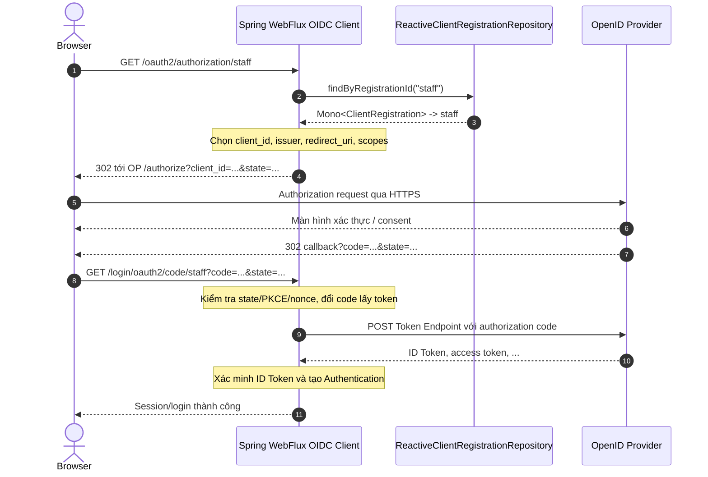
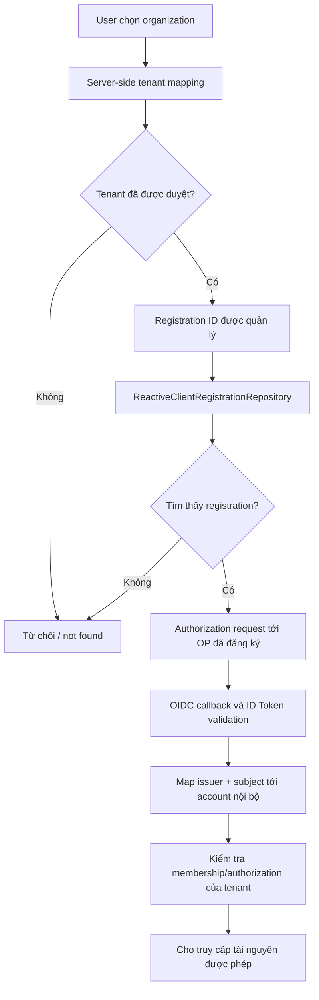

# 20.3. ReactiveClientRegistrationRepository và chọn registration

Trong **Spring Security OAuth 2.0 / OpenID Connect (OIDC) Client** chạy trên **Spring WebFlux**, một ứng dụng có thể cho người dùng đăng nhập qua một hoặc nhiều OpenID Provider (OP): SSO nội bộ, một đối tác, hoặc các nhà cung cấp danh tính dành cho từng tổ chức. Để Spring Security biết **client nào cần dùng khi bắt đầu đăng nhập**, ứng dụng phải có một nơi tra cứu cấu hình của các client đã đăng ký.

Nơi đó chính là **`ReactiveClientRegistrationRepository`**. Nó nhận **registration ID** do ứng dụng quản lý và trả về `Mono<ClientRegistration>`; `ClientRegistration` chứa thông tin cần thiết để bắt đầu Authorization Code Flow và giao tiếp với đúng provider. Chọn nhầm registration có thể làm sai client ID, redirect URI, issuer, scopes và cả chính sách ủy quyền.

Bài học tập trung vào **Spring Boot 3.x, Spring Security 6.x, WebFlux/Reactor và `oauth2Login()`**:

- Hiểu `ClientRegistration` và `ReactiveClientRegistrationRepository` có nhiệm vụ gì.
- Phân biệt cấu hình **reactive** với `ClientRegistrationRepository` trên Servlet.
- Khai báo một hoặc nhiều registrations bằng `application.yml`/`application.properties`.
- Hiểu cách URL `/oauth2/authorization/{registrationId}` chọn provider.
- Tra cứu registration bất đồng bộ bằng `findByRegistrationId(...)` mà không `block()`.
- Giới hạn danh sách provider được người dùng phép chọn; không để input bên ngoài quyết định issuer/token endpoint tùy ý.
- Biết lúc nào cần `InMemoryReactiveClientRegistrationRepository` hoặc repository tùy biến.
- Phân biệt **registration repository** với **authorized client repository/service** giữ access/refresh token.
- Kiểm thử, quan sát và xử lý các lỗi thực tế trong luồng login nhiều provider.

Các domain, client ID, secret và scope dưới đây đều là ví dụ. Không dùng credential thật trong source code hay ví dụ test.

## 1. Bối cảnh của đăng nhập OIDC trong WebFlux

Một người dùng bấm **“Đăng nhập bằng SSO nhân viên”**. WebFlux cần tìm đúng registration trước khi tạo authorization request đến OP:



Chú ý: `ReactiveClientRegistrationRepository` **không xác thực user**. Nó chỉ cung cấp **cấu hình OAuth2 client tin cậy** để các web filters và các thành phần OIDC login tiếp tục thực hiện giao thức. Xác minh ID Token, callback `state`, chữ ký, issuer, audience và nonce là trách nhiệm của các thành phần khác trong flow.

### 1.1. Tại sao WebFlux cần repository riêng?

Trên Servlet, Spring Security có interface:

```java
ClientRegistrationRepository
```

với việc tìm registration theo hướng đồng bộ. Trong WebFlux, Spring Security dùng:

```java
ReactiveClientRegistrationRepository
```

và contract trả về `Mono<ClientRegistration>`. Điều này phù hợp mô hình **không chặn luồng (non-blocking)** của Reactor.

Hai interface không thể thay thế bằng cách đổi tên bean. Một dự án dùng `ServerHttpSecurity`/WebFlux phải cung cấp **reactive repository**; một repository dành cho Servlet không tự động đáp ứng injection của reactive OAuth2 login.

### 1.2. Mục đích của bài không phải “lưu token”

Có hai khái niệm dễ nhầm:

- **Client registration repository:** lưu thông tin *client đã đăng ký như thế nào*, ví dụ `client-id`, grant type, issuer và endpoints.
- **Authorized client repository/service:** lưu trạng thái *client đã được cấp token gì cho principal nào*, có thể gồm access token/refresh token.

Khi người dùng chọn nút SSO, việc đầu tiên là tra **registration**, không phải đi tìm refresh token.

## 2. `ClientRegistration` lưu những gì?

`ClientRegistration` là mô tả cấu hình một OAuth2 Client được Spring Security hiểu và sử dụng:

| Trường/thuộc tính | Ví dụ | Mục đích |
| --- | --- | --- |
| `registrationId` | `staff` | Khóa nội bộ Spring dùng để tra cứu registration và làm thành phần URL |
| `clientId` | `academy-web-client` | Client ID do Authorization Server cấp |
| `clientSecret` | Secret lấy từ môi trường | Credential của confidential client; không đưa cho browser |
| `clientAuthenticationMethod` | `client_secret_basic` | Cách client xác thực với Token Endpoint |
| `authorizationGrantType` | `authorization_code` | Grant dùng cho browser-based OAuth2/OIDC login |
| `redirectUri` | `{baseUrl}/login/oauth2/code/{registrationId}` | Callback URL Spring sử dụng và OP phải cho phép |
| `scopes` | `openid`, `profile` | Phạm vi client yêu cầu trong authorization request |
| `providerDetails.authorizationUri` | OP authorization endpoint | Nơi browser được redirect tới để user login |
| `providerDetails.tokenUri` | OP token endpoint | Nơi backend đổi authorization code/refresh token |
| `providerDetails.jwkSetUri` | OP JWKS endpoint | Nguồn khóa công khai để xác minh JWT/JWS |
| `providerDetails.issuerUri` | URL issuer | Ràng buộc danh tính OP và xác minh ID Token |
| `clientName` | `SSO nhân viên` | Tên hiển thị của registration khi ứng dụng cần |

**`registrationId` không phải `clientId`.** Bạn có thể đặt registration ID là `staff` trong Spring, trong khi OP cấp `client_id` là một chuỗi dài không thân thiện để hiển thị.

Một ứng dụng có thể có nhiều `ClientRegistration` với các client IDs, providers, scopes và redirect URIs khác nhau. Hai registrations dùng cùng một OP cũng có thể đại diện cho **hai OAuth2 clients khác nhau** với quyền/consent riêng.

### 2.1. Không nhầm OAuth2 provider alias với registration ID

Trong YAML, bạn có thể viết:

```yaml
registration:
  staff:
    provider: corporate-op

provider:
  corporate-op:
    issuer-uri: https://idp.example.com/realms/staff
```

Ở đây:

- `staff` là **registration ID** để tìm client.
- `corporate-op` là **tên nhóm cấu hình provider**.
- `https://idp.example.com/realms/staff` là **issuer URI thực tế**.
- `client-id` là giá trị do OP cấp.

URL Spring mặc định chọn registration bằng:

```text
/oauth2/authorization/staff
```

chứ không phải `/oauth2/authorization/corporate-op`, trừ khi bạn cũng khai báo một registration có ID đó.

### 2.2. Registration không đại diện một user

Nhiều người dùng đăng nhập qua `staff` đều dùng chung client registration, nhưng mỗi lần đăng nhập có **authorization request**, `state`, session và Authentication của người dùng riêng.

Không tạo một `ClientRegistration` mới cho mỗi lần người dùng mở trình duyệt chỉ để chứa email hoặc `sub`. Thông tin định danh người dùng xuất hiện **sau khi login**, không thuộc cấu hình client registration.

## 3. Interface `ReactiveClientRegistrationRepository`

Giao diện trong Spring Security reactive OAuth2 Client:

```java
package org.springframework.security.oauth2.client.registration;

import reactor.core.publisher.Mono;

public interface ReactiveClientRegistrationRepository {

    Mono<ClientRegistration> findByRegistrationId(
            String registrationId);
}
```

Đây là **chữ ký khái niệm** để giải thích interface, không yêu cầu bạn định nghĩa lại nó trong project. Spring Security đã cung cấp sẵn.

Ý nghĩa:

1. Caller truyền một `registrationId`.
2. Repository trả một `Mono<ClientRegistration>`.
3. Nếu tìm thấy, Mono phát đúng một registration rồi hoàn tất.
4. Nếu không tìm thấy, implementation thông dụng phát **`Mono.empty()`**.
5. Nếu xảy ra lỗi truy cập cấu hình/storage, Mono có thể phát **error signal**.

Với `Mono`, tra cứu chỉ thực sự thực thi theo pipeline tại thời điểm subscribe (tùy nguồn Mono). Không nên hiểu `Mono<ClientRegistration>` là một `ClientRegistration` đã có ngay lập tức trong một biến Java.

### 3.1. Phân biệt ba kết quả

```text
findByRegistrationId("staff")
           |
           +--> onNext(ClientRegistration) + onComplete
           |
           +--> onComplete (không có giá trị)
           |
           +--> onError(Throwable)
```

**Không có registration** và **repository lỗi** là hai trường hợp khác nhau. Ứng dụng cần xử lý `Mono.empty()` có chủ đích; không biến mọi lỗi storage thành “registration không tồn tại”.

### 3.2. Ví dụ tra cứu reactive đúng cách

```java
import org.springframework.security.oauth2.client.registration.ClientRegistration;
import org.springframework.security.oauth2.client.registration.ReactiveClientRegistrationRepository;
import org.springframework.stereotype.Service;
import reactor.core.publisher.Mono;

@Service
public class RegistrationLookupService {

    private final ReactiveClientRegistrationRepository registrations;

    public RegistrationLookupService(
            ReactiveClientRegistrationRepository registrations) {
        this.registrations = registrations;
    }

    public Mono<String> displayName(String registrationId) {
        return registrations.findByRegistrationId(registrationId)
                .map(ClientRegistration::getClientName)
                .switchIfEmpty(Mono.error(
                        new IllegalArgumentException(
                                "Unknown client registration")));
    }
}
```

Dòng `.map(...)` chỉ chạy khi Mono chứa `ClientRegistration`. `switchIfEmpty(...)` giúp phân biệt trường hợp ID không tồn tại, nhưng trong ứng dụng HTTP production nên chuyển lỗi nghiệp vụ này thành HTTP status phù hợp (ví dụ 404) và không để lộ chi tiết cấu hình cho caller.

### 3.3. Không gọi `block()` trong WebFlux request

Đây là anti-pattern:

```java
// KHÔNG NÊN trong WebFlux event-loop:
ClientRegistration registration =
        registrations.findByRegistrationId("staff").block();
```

`block()` chặn thread chờ kết quả, phá vỡ lợi thế non-blocking; với một số luồng WebFlux/Reactor, thao tác chặn còn gây exception nếu chạy trên thread không cho phép blocking.

Hãy **compose bằng Reactor operators**:

```java
return registrations.findByRegistrationId("staff")
        .flatMap(registration -> doSomethingReactive(registration));
```

Trong ví dụ trên, `doSomethingReactive` là một method giả định trả `Mono<T>`. Không dùng `subscribe()` thủ công trong controller để “bắt đầu” login rồi trả response ngay; WebFlux sẽ subscribe pipeline response đúng cách.

## 4. Implementation thường dùng: `InMemoryReactiveClientRegistrationRepository`

Spring Security cung cấp:

```java
InMemoryReactiveClientRegistrationRepository
```

Implementation này lưu sẵn tập `ClientRegistration` trong bộ nhớ, sau đó đáp ứng `findByRegistrationId(...)` theo ID. Đây là lựa chọn phổ biến khi:

- Số lượng OP/client registrations ít và cố định.
- Cấu hình đến từ application configuration/environment.
- Không cần lookup tenant từ một registry động.
- Bạn muốn cấu hình đơn giản và dễ kiểm thử.

Tên “in-memory” **không có nghĩa token user bị lưu trong cùng repository**. Nó chỉ lưu **registration metadata và credential của client**, không phải access/refresh tokens được cấp cho mỗi người dùng.

### 4.1. Hai cách khởi tạo

**Cách phổ biến nhất:** để Spring Boot tạo reactive registration repository từ properties.

**Cách tùy biến có chủ đích:** tạo bean trực tiếp:

```java
@Bean
ReactiveClientRegistrationRepository registrations(
        ClientRegistration staff,
        ClientRegistration partner) {

    return new InMemoryReactiveClientRegistrationRepository(
            staff, partner);
}
```

Đây là đoạn minh họa cách lắp ghép; nếu áp dụng, bạn cần có **hai bean `ClientRegistration` thực sự**, hoặc tự tạo đối tượng từ cấu hình đáng tin cậy. Ví dụ `@Bean` đầy đủ được trình bày ở mục 8.

### 4.2. Một đặc điểm hữu ích: `Iterable<ClientRegistration>`

`InMemoryReactiveClientRegistrationRepository` cũng triển khai `Iterable<ClientRegistration>`, cho phép liệt kê các registrations đã cấu hình. Điều này hữu ích với một số thành phần giao diện login được Spring Security cung cấp.

**Không giả định mọi implementation `ReactiveClientRegistrationRepository` đều `Iterable`.** Interface reactive chỉ cam kết tìm theo ID. Nếu bạn thay bằng repository động nhưng không hỗ trợ liệt kê, giao diện đăng nhập mặc định có thể không biết các options để hiển thị; khi đó hãy tạo login page/endpoint liệt kê **danh sách đã kiểm soát** của ứng dụng.

## 5. Spring Boot auto-configuration cho WebFlux OAuth2 Client

Khi dùng `spring-boot-starter-oauth2-client` trong một ứng dụng WebFlux đã bật bảo mật phù hợp, Spring Boot có thể đọc các properties `spring.security.oauth2.client.registration.*` và `spring.security.oauth2.client.provider.*` để tạo tập `ClientRegistration` tương ứng.

Một `ReactiveClientRegistrationRepository` phù hợp thường được auto-configure từ dữ liệu này. Ứng dụng không nhất thiết phải viết bean thủ công cho trường hợp thông dụng.

### 5.1. Dependencies Maven

```xml
<dependencies>
    <dependency>
        <groupId>org.springframework.boot</groupId>
        <artifactId>spring-boot-starter-webflux</artifactId>
    </dependency>

    <dependency>
        <groupId>org.springframework.boot</groupId>
        <artifactId>spring-boot-starter-oauth2-client</artifactId>
    </dependency>
</dependencies>
```

### 5.2. Dependencies Gradle

```groovy
dependencies {
    implementation 'org.springframework.boot:spring-boot-starter-webflux'
    implementation 'org.springframework.boot:spring-boot-starter-oauth2-client'
}
```

Nếu cùng project đưa thêm `spring-boot-starter-web` (Spring MVC) một cách không chủ đích, Spring Boot có thể chọn **Servlet web application type** theo cơ chế nhận diện classpath. Khi đó bạn sẽ gặp cấu hình/filters khác WebFlux; đừng cố sửa bằng cách tạo một reactive repository trong ứng dụng vẫn chạy Servlet.

Hãy xác nhận kiến trúc web application type trước khi phân tích lỗi OAuth2 reactive. Nếu dự án cố tình có cả hai stacks, cần thiết kế context và security configuration phù hợp, không chỉ đổi import.

## 6. Khai báo nhiều OIDC registrations bằng YAML

Giả sử ứng dụng hỗ trợ hai OP:

- `staff`: nhân viên đăng nhập qua SSO nội bộ.
- `partner`: đối tác đăng nhập qua OP của họ.

**`application.yml`:**

```yaml
spring:
  security:
    oauth2:
      client:
        registration:
          staff:
            provider: staff-oidc
            client-id: ${STAFF_OIDC_CLIENT_ID}
            client-secret: ${STAFF_OIDC_CLIENT_SECRET}
            client-authentication-method: client_secret_basic
            authorization-grant-type: authorization_code
            redirect-uri: "{baseUrl}/login/oauth2/code/{registrationId}"
            scope:
              - openid
              - profile
              - email
            client-name: "SSO nhân viên"

          partner:
            provider: partner-oidc
            client-id: ${PARTNER_OIDC_CLIENT_ID}
            client-secret: ${PARTNER_OIDC_CLIENT_SECRET}
            client-authentication-method: client_secret_basic
            authorization-grant-type: authorization_code
            redirect-uri: "{baseUrl}/login/oauth2/code/{registrationId}"
            scope:
              - openid
              - profile
            client-name: "Đăng nhập đối tác"

        provider:
          staff-oidc:
            issuer-uri: https://sso.example.com/realms/staff
          partner-oidc:
            issuer-uri: https://id.partner.example.com/oidc
```

**Vì sao khai báo `issuer-uri`?** Với provider hỗ trợ OIDC Discovery, Spring có thể lấy authorization, token, UserInfo và JWKS endpoints theo metadata của issuer. Client vẫn phải đối chiếu chính xác issuer/redirect URI đã đăng ký.

`scope: [openid, ...]` cho biết đây là luồng OIDC; không phải OAuth2 login thường không có ID Token. Dù OP cho phép nhiều scopes, **chỉ yêu cầu claims và quyền thật sự cần thiết**. `email` không phải định danh duy nhất đáng tin cậy và không tự chứng minh user là admin.

### 6.1. Tương đương bằng `application.properties`

```properties
spring.security.oauth2.client.registration.staff.provider=staff-oidc
spring.security.oauth2.client.registration.staff.client-id=${STAFF_OIDC_CLIENT_ID}
spring.security.oauth2.client.registration.staff.client-secret=${STAFF_OIDC_CLIENT_SECRET}
spring.security.oauth2.client.registration.staff.client-authentication-method=client_secret_basic
spring.security.oauth2.client.registration.staff.authorization-grant-type=authorization_code
spring.security.oauth2.client.registration.staff.redirect-uri={baseUrl}/login/oauth2/code/{registrationId}
spring.security.oauth2.client.registration.staff.scope=openid,profile,email
spring.security.oauth2.client.registration.staff.client-name=SSO nhân viên
spring.security.oauth2.client.provider.staff-oidc.issuer-uri=https://sso.example.com/realms/staff

spring.security.oauth2.client.registration.partner.provider=partner-oidc
spring.security.oauth2.client.registration.partner.client-id=${PARTNER_OIDC_CLIENT_ID}
spring.security.oauth2.client.registration.partner.client-secret=${PARTNER_OIDC_CLIENT_SECRET}
spring.security.oauth2.client.registration.partner.client-authentication-method=client_secret_basic
spring.security.oauth2.client.registration.partner.authorization-grant-type=authorization_code
spring.security.oauth2.client.registration.partner.redirect-uri={baseUrl}/login/oauth2/code/{registrationId}
spring.security.oauth2.client.registration.partner.scope=openid,profile
spring.security.oauth2.client.registration.partner.client-name=Đăng nhập đối tác
spring.security.oauth2.client.provider.partner-oidc.issuer-uri=https://id.partner.example.com/oidc
```

Chỉ sử dụng YAML **hoặc** properties theo convention của project. Trong Java code, đừng để lộ client secret vào HTML, controller response hoặc debug endpoint.

### 6.2. Redirect URI phải khớp cấu hình OP

Với registration `staff`, nếu ứng dụng chạy tại `https://app.example.com`, redirect URI thông thường được mở rộng thành:

```text
https://app.example.com/login/oauth2/code/staff
```

OP phải cho phép URI đó theo chính sách đăng ký client. Với `partner`:

```text
https://app.example.com/login/oauth2/code/partner
```

Hai URI có thể cùng host nhưng registration ID khác nhau. Lỗi callback không khớp không được giải quyết bằng cách bỏ xác minh `state` hoặc tự cho phép redirect URI tùy ý ở OP.

**Nếu chạy sau reverse proxy**, cần cấu hình trusted forwarded headers, scheme/host public và proxy boundary đúng cách. Không tin `X-Forwarded-Host` từ client ngoài Internet nếu proxy chưa lọc; tính `{baseUrl}` từ header không tin cậy có thể gây lỗi callback hoặc rủi ro host-header/open-redirect.

## 7. Kích hoạt OAuth2/OIDC Login trong `SecurityWebFilterChain`

Trên **WebFlux**, sử dụng `ServerHttpSecurity` và `SecurityWebFilterChain`, không phải `HttpSecurity`/`SecurityFilterChain` của Servlet.

```java
import org.springframework.context.annotation.Bean;
import org.springframework.context.annotation.Configuration;
import org.springframework.security.config.Customizer;
import org.springframework.security.config.web.server.ServerHttpSecurity;
import org.springframework.security.web.server.SecurityWebFilterChain;

@Configuration
public class ReactiveWebSecurityConfig {

    @Bean
    SecurityWebFilterChain springSecurityFilterChain(
            ServerHttpSecurity http) {

        return http
                .authorizeExchange(exchange -> exchange
                        .pathMatchers(
                                "/", "/login", "/error",
                                "/css/**", "/js/**", "/sso/start/**")
                            .permitAll()
                        .anyExchange()
                            .authenticated())
                .oauth2Login(Customizer.withDefaults())
                .build();
    }
}
```

Đoạn này cho phép các đường dẫn public và yêu cầu Authentication ở phần còn lại. Tùy cách tổ chức login page, có thể cần các matching rules khác. **Không dùng `csrf().disable()` chỉ để OIDC login chạy**, vì WebFlux session-based application vẫn có nhu cầu CSRF protection cho các thao tác thay đổi trạng thái.

Đối với login page tùy biến, đảm bảo đường dẫn page được `permitAll`, các link login trỏ đến registration ID đã khai báo. Mỗi security chain phải thực sự áp dụng cho authorization request và callback của luồng mà nó xử lý.

### 7.1. Filter nào quyết định registration?

Trong reactive OAuth2 login, các thành phần liên quan gồm:

- **`OAuth2AuthorizationRequestRedirectWebFilter`:** xử lý yêu cầu bắt đầu OAuth2 authorization, xây redirect tới OP.
- **`ServerOAuth2AuthorizationRequestResolver`:** tìm và xây `OAuth2AuthorizationRequest` dựa trên `ServerWebExchange` và client registration.
- **`ReactiveClientRegistrationRepository`:** trả `ClientRegistration` cho registration ID.
- **`OAuth2LoginAuthenticationWebFilter`:** xử lý kết quả redirect/callback từ OP trong flow login.
- Những thành phần reactive authentication, token response và OIDC validation hỗ trợ xác thực kết quả.
- **`ServerSecurityContextRepository`** và web session/context liên quan tới việc duy trì Authentication sau login theo cấu hình.

Không có nghĩa chỉ cần repository là login xong. Repository là **điểm tra cấu hình** nằm trong một pipeline lớn.

### 7.2. WebFilter chain khác Servlet Filter chain

| Servlet | WebFlux |
| --- | --- |
| `HttpSecurity` | `ServerHttpSecurity` |
| `SecurityFilterChain` | `SecurityWebFilterChain` |
| `ClientRegistrationRepository` | `ReactiveClientRegistrationRepository` |
| `OAuth2AuthorizationRequestRedirectFilter` | `OAuth2AuthorizationRequestRedirectWebFilter` |
| `OAuth2LoginAuthenticationFilter` | `OAuth2LoginAuthenticationWebFilter` |
| `HttpSession` | `WebSession` (khi dùng phiên reactive) |
| `SecurityContextHolder` trong Servlet request | `ReactiveSecurityContextHolder` thông qua Reactor Context |
| `OAuth2AuthorizedClientRepository` | `ServerOAuth2AuthorizedClientRepository` |

Đừng copy một hướng dẫn Servlet rồi chỉ đổi tên `HttpSecurity` mà không thay kiểu repository/filter/service. Các cấu hình OAuth2 Login, reactive authentication và HTTP client integration phải tương thích cùng stack.

## 8. Tạo repository thủ công bằng Java khi thật sự cần

Nếu không muốn dùng Boot properties, có thể xây `ClientRegistration` đáng tin cậy rồi đưa vào `InMemoryReactiveClientRegistrationRepository`.

Ví dụ một registration được khai báo trực tiếp:

```java
import org.springframework.beans.factory.annotation.Value;
import org.springframework.context.annotation.Bean;
import org.springframework.context.annotation.Configuration;
import org.springframework.security.oauth2.client.registration.ClientRegistration;
import org.springframework.security.oauth2.client.registration.InMemoryReactiveClientRegistrationRepository;
import org.springframework.security.oauth2.client.registration.ReactiveClientRegistrationRepository;
import org.springframework.security.oauth2.core.AuthorizationGrantType;
import org.springframework.security.oauth2.core.ClientAuthenticationMethod;

@Configuration
public class ManualReactiveRegistrationConfig {

    @Bean
    ReactiveClientRegistrationRepository clientRegistrations(
            @Value("${STAFF_OIDC_CLIENT_ID}") String clientId,
            @Value("${STAFF_OIDC_CLIENT_SECRET}") String clientSecret) {

        ClientRegistration staff =
                ClientRegistration.withRegistrationId("staff")
                        .clientId(clientId)
                        .clientSecret(clientSecret)
                        .clientAuthenticationMethod(
                                ClientAuthenticationMethod.CLIENT_SECRET_BASIC)
                        .authorizationGrantType(
                                AuthorizationGrantType.AUTHORIZATION_CODE)
                        .redirectUri(
                                "{baseUrl}/login/oauth2/code/{registrationId}")
                        .scope("openid", "profile")
                        .authorizationUri(
                                "https://sso.example.com/realms/staff/authorize")
                        .tokenUri(
                                "https://sso.example.com/realms/staff/token")
                        .jwkSetUri(
                                "https://sso.example.com/realms/staff/jwks")
                        .issuerUri(
                                "https://sso.example.com/realms/staff")
                        .clientName("SSO nhân viên")
                        .build();

        return new InMemoryReactiveClientRegistrationRepository(
                staff);
    }
}
```

Các endpoints là giả lập. Với OP thật, cần đúng discovery metadata/URI và các yêu cầu client registration. **Đừng tự điền URL đoán mò** chỉ vì phần host giống nhau. Nếu dùng `ClientRegistrations.fromIssuerLocation(issuer)`, xem chú ý ở mục 15 về metadata discovery và blocking tại startup.

### 8.1. Cẩn thận khi tự khai báo bean

Trong trường hợp Boot auto-configure registration repository từ properties, một bean `ReactiveClientRegistrationRepository` do ứng dụng tự khai báo có thể **thay thế/ghi đè việc Boot tạo repository mặc định** theo điều kiện auto-configuration.

Khi đó, nếu bean custom chỉ chứa `staff` thì `partner` trong YAML có thể **không còn được sử dụng** trong repository ứng dụng mong đợi. Bạn phải chủ động đăng ký **đầy đủ tập registrations**, hoặc thiết kế cách kết hợp tin cậy.

Không nên tạo bean custom chỉ để thay tên hiển thị khi có thể dùng property `client-name`.

### 8.2. Cấu hình client secret và public client

Ví dụ trên là **confidential client** dùng `client_secret_basic`. Với public client (chẳng hạn một app không thể giữ secret), cấu hình OAuth2/OIDC có yêu cầu **PKCE và mô hình tin cậy khác**, không sao chép `client-secret` sang frontend.

Một WebFlux backend server-side thường có thể bảo vệ client secret, nhưng cách dùng PKCE, redirect và token policy vẫn phải theo client registration thực tế. Không tự đổi từ `client_secret_basic` sang `none` chỉ để vượt lỗi `invalid_client`.

### 8.3. Không hardcode secret trong class Java

Những giá trị `client-id`/`client-secret` trong sample được đưa qua environment. Không:

```java
.clientSecret("production-real-client-secret")
```

Không xuất `ClientRegistration` nguyên object qua log/JSON: object có thể chứa secret hoặc những thông số không cần công khai.

## 9. Chọn registration qua URL mặc định

Trên WebFlux OAuth2 Login, một URL quen thuộc để **khởi tạo authorization request** là:

```text
GET /oauth2/authorization/{registrationId}
```

Với các registrations đã khai báo:

```text
GET /oauth2/authorization/staff
GET /oauth2/authorization/partner
```

Flow:

1. Spring khớp pattern URL bắt đầu authorization.
2. Lấy `registrationId` từ path.
3. Repository trả registration tương ứng.
4. Framework tạo request chứa `client_id`, `redirect_uri`, `response_type=code`, `scope`, `state` và những tham số hợp lệ khác.
5. Browser được redirect tới Authorization Endpoint của OP đã cấu hình.
6. OP gửi callback về redirect URI của registration.

**Không phải browser gửi `client_secret` tới OP**. Confidential client xác thực tại Token Endpoint qua backend. Browser đi qua authorization redirect, không nên nhìn thấy token endpoint secret.

### 9.1. Các link đăng nhập

Một giao diện đơn giản có thể hiển thị:

```html
<nav aria-label="Đăng nhập">
  <a href="/oauth2/authorization/staff">
    Đăng nhập nhân viên
  </a>
  <a href="/oauth2/authorization/partner">
    Đăng nhập đối tác
  </a>
</nav>
```

Các URL được **ứng dụng xác định sẵn**, không được tạo bằng cách nối chuỗi từ issuer URI do browser gửi. Việc ẩn bớt nút login chỉ ảnh hưởng UI; chính sách server-side vẫn phải xác định registration nào được phép sử dụng cho từng nhóm người dùng/tenant.

### 9.2. Chọn provider khác login vào account khác như thế nào?

Nếu cùng một người có tài khoản tại `staff` và `partner`, hai OP có thể cấp:

```text
staff:
  iss = https://sso.example.com/realms/staff
  sub = 4242

partner:
  iss = https://id.partner.example.com/oidc
  sub = 4242
```

Hai `sub` trùng ký tự **không có nghĩa cùng một người** vì `sub` có ý nghĩa trong phạm vi issuer. Hệ thống nên liên kết danh tính theo `(issuer, subject)` và quy trình account linking đã được xác minh, không gộp user chỉ vì email giống nhau.

**Registration selection** quyết định **đăng nhập qua OP nào**. **Account linking** quyết định liệu các danh tính từ nhiều OP có được liên kết vào cùng một tài khoản nội bộ hay không. Đây là hai bài toán khác nhau.

## 10. Viết controller lựa chọn provider theo allowlist

Có thể tổ chức URL thân thiện như:

```text
GET /sso/start/staff
GET /sso/start/partner
```

Nhưng controller phải map tên public đến một registration ID **đã được phép**, không nhận URI tùy ý từ browser.

### 10.1. Ví dụ WebFlux controller an toàn

```java
import java.net.URI;

import org.springframework.http.HttpStatus;
import org.springframework.http.ResponseEntity;
import org.springframework.security.oauth2.client.registration.ReactiveClientRegistrationRepository;
import org.springframework.web.bind.annotation.GetMapping;
import org.springframework.web.bind.annotation.PathVariable;
import org.springframework.web.bind.annotation.RestController;
import org.springframework.web.server.ResponseStatusException;

import reactor.core.publisher.Mono;

@RestController
public class SsoStartController {

    private final ReactiveClientRegistrationRepository registrations;

    public SsoStartController(
            ReactiveClientRegistrationRepository registrations) {
        this.registrations = registrations;
    }

    @GetMapping("/sso/start/{organization}")
    public Mono<ResponseEntity<Void>> start(
            @PathVariable String organization) {

        // Mapping do SERVER quyết định, không lấy từ query URL tùy ý.
        String registrationId = switch (organization) {
            case "staff" -> "staff";
            case "partner" -> "partner";
            default -> throw new ResponseStatusException(
                    HttpStatus.NOT_FOUND);
        };

        return registrations.findByRegistrationId(registrationId)
                .switchIfEmpty(Mono.error(
                        new ResponseStatusException(HttpStatus.NOT_FOUND)))
                .map(registration ->
                        ResponseEntity.status(HttpStatus.FOUND)
                                .location(URI.create(
                                        "/oauth2/authorization/"
                                                + registrationId))
                                .<Void>build());
    }
}
```

Controller không lấy `clientId`, `clientSecret`, issuer hoặc token endpoint từ input. Nó chỉ chuyển hướng tới **URL nội bộ đã được Spring Security quản lý**; chính filter OAuth2 tiếp tục tạo authorization request.

Đảm bảo `/sso/start/**` được permit như trong `SecurityWebFilterChain` ở mục 7. Nếu một nhóm provider chỉ dành cho những người/tenant nhất định, mapping còn phải kiểm tra **ngữ cảnh đã được tin cậy** trước khi redirect.

### 10.2. Vì sao không redirect trực tiếp đến URL OP do user gửi?

Không làm:

```java
// ANTI-PATTERN: cho browser quyết định Authorization Server.
String issuer = request.getQueryParams().getFirst("issuer");
return redirectTo(issuer + "/authorize");
```

Một attacker có thể trỏ browser tới authorization endpoint giả mạo hoặc khiến backend tải metadata từ host không tin cậy nếu custom registration loader dùng URL đó. Rủi ro gồm phishing, open redirect, SSRF, nhầm issuer/tenant và đánh cắp authorization response nếu redirect URI bị cấu hình sai.

**Issuer, discovery metadata và client credentials phải đến từ nguồn cấu hình đã kiểm soát**, không phải input tùy ý của user.

### 10.3. Path variable có cần validate lại không?

Ngay cả khi `/oauth2/authorization/{registrationId}` là endpoint mặc định, Spring vẫn tìm registration trong repository. Một ID không tồn tại sẽ không tạo được flow hợp lệ. Nhưng với ứng dụng nhiều tenants, **“có registration” chưa đủ để kết luận user/tenant có quyền sử dụng nó**.

Nếu có yêu cầu hạn chế, hãy áp dụng mapping/policy phía server và tránh hiển thị hoặc cho phép những registrations không được dành cho tenant đang xét.

## 11. Dùng repository để công bố login options an toàn

Một ứng dụng có thể cần hiển thị trang chọn provider. Nếu không muốn dựa vào việc repository có triển khai `Iterable` hay không, hãy giữ **danh sách registration IDs đã duyệt** riêng trong application configuration/policy, rồi tra cứu reactive.

Ví dụ API chỉ trả tên hiển thị và đường dẫn nội bộ:

```java
import java.util.List;

import org.springframework.security.oauth2.client.registration.ReactiveClientRegistrationRepository;
import org.springframework.web.bind.annotation.GetMapping;
import org.springframework.web.bind.annotation.RestController;

import reactor.core.publisher.Flux;
import reactor.core.publisher.Mono;

@RestController
class LoginOptionsController {

    record LoginOption(
            String registrationId,
            String name,
            String startUrl) {}

    private static final List<String> APPROVED_IDS =
            List.of("staff", "partner");

    private final ReactiveClientRegistrationRepository registrations;

    LoginOptionsController(
            ReactiveClientRegistrationRepository registrations) {
        this.registrations = registrations;
    }

    @GetMapping("/api/login-options")
    Mono<List<LoginOption>> options() {
        return Flux.fromIterable(APPROVED_IDS)
                .concatMap(registrations::findByRegistrationId)
                .map(reg -> new LoginOption(
                        reg.getRegistrationId(),
                        reg.getClientName(),
                        "/oauth2/authorization/" + reg.getRegistrationId()))
                .collectList();
    }
}
```

**Không trả `ClientRegistration` nguyên vẹn qua endpoint này.** Nó có thể chứa `clientSecret`, metadata nội bộ và thông số không cần cho browser. Một DTO nhỏ làm rõ những gì được phép công bố.

Nếu API login options là public, đảm bảo `SecurityWebFilterChain` cho phép `/api/login-options` trước `anyExchange().authenticated()`. Nếu danh sách phụ thuộc tenant, cần lấy tenant từ **một nguồn được xác minh** và áp dụng policy trước khi chọn IDs.

### 11.1. `concatMap` thay vì `flatMap` có ý nghĩa gì?

`concatMap` xử lý nguồn theo thứ tự để thứ tự nút login ổn định. Với danh sách nhỏ, hiệu năng không phải vấn đề. `flatMap` có thể phù hợp khi cần concurrency, nhưng kết quả có thể không giữ thứ tự. Cả hai đều **không cần `block()`**.

Khi repository custom phát `Mono.error(...)`, pipeline sẽ báo lỗi; nếu yêu cầu trang login vẫn hoạt động với một provider bị unavailable, cần chính sách phân loại lỗi/circuit breaker riêng. Đừng âm thầm nuốt mọi lỗi thành “không có provider” nếu điều đó che sự cố bảo mật/cấu hình.

## 12. Sau đăng nhập: xác định registration đã dùng

Khi OAuth2 Login hoàn tất, Authentication có thể chứa thông tin **authorized client registration ID**. Với `OAuth2AuthenticationToken`:

```java
OAuth2AuthenticationToken token = ...;

String registrationId =
        token.getAuthorizedClientRegistrationId();
```

Thông tin này giúp ứng dụng biết user đã đăng nhập qua `staff` hay `partner`, chẳng hạn để áp dụng policy hoặc chọn integration phù hợp.

### 12.1. Lấy Authentication trong Reactor Context

Trong WebFlux, nên đọc `ReactiveSecurityContextHolder` thay vì dựa vào thread-local kiểu Servlet:

```java
import java.util.Map;

import org.springframework.http.HttpStatus;
import org.springframework.security.core.context.ReactiveSecurityContextHolder;
import org.springframework.security.core.context.SecurityContext;
import org.springframework.security.oauth2.client.authentication.OAuth2AuthenticationToken;
import org.springframework.security.oauth2.client.registration.ReactiveClientRegistrationRepository;
import org.springframework.web.bind.annotation.GetMapping;
import org.springframework.web.bind.annotation.RestController;
import org.springframework.web.server.ResponseStatusException;

import reactor.core.publisher.Mono;

@RestController
public class CurrentLoginProviderController {

    private final ReactiveClientRegistrationRepository registrations;

    public CurrentLoginProviderController(
            ReactiveClientRegistrationRepository registrations) {
        this.registrations = registrations;
    }

    @GetMapping("/api/login-provider")
    Mono<Map<String, String>> currentProvider() {
        return ReactiveSecurityContextHolder.getContext()
                .map(SecurityContext::getAuthentication)
                .filter(auth -> auth instanceof OAuth2AuthenticationToken)
                .cast(OAuth2AuthenticationToken.class)
                .flatMap(auth -> registrations.findByRegistrationId(
                        auth.getAuthorizedClientRegistrationId()))
                .map(registration -> Map.of(
                        "registrationId",
                        registration.getRegistrationId(),
                        "displayName",
                        registration.getClientName()))
                .switchIfEmpty(Mono.error(
                        new ResponseStatusException(
                                HttpStatus.UNAUTHORIZED)));
    }
}
```

Đoạn này chỉ trả metadata tối thiểu, **không trả ID Token, access token, refresh token, user claims hay client secret**. Nó giả định route được bảo vệ và request đã qua một OAuth2/OIDC login phù hợp.

Trong ứng dụng có nhiều kiểu Authentication (API key, JWT Resource Server, form login), `Authentication` hiện tại không nhất thiết là `OAuth2AuthenticationToken`. Khi đó cần chính sách response riêng; không cast mù.

### 12.2. Authentication không thay thế đăng ký client

`OAuth2AuthenticationToken.getAuthorizedClientRegistrationId()` trả **ID của registration đã dùng**, chứ không biến Authentication thành một `ClientRegistration`. Nếu cần đọc issuer/client metadata, tra repository theo ID trong pipeline reactive.

Không lưu `ClientRegistration` nguyên vẹn vào user-facing JWT/session attribute chỉ để tiện lấy `clientId`. Cấu hình client có vòng đời riêng và có thể chứa secret.

## 13. Repository chỉ giữ client metadata, không giữ authorized clients

Bảng phân biệt quan trọng trong Spring Security reactive:

| Interface/lớp | Tra cứu bằng gì? | Trả về | Dùng khi nào? |
| --- | --- | --- | --- |
| **`ReactiveClientRegistrationRepository`** | `registrationId` | `Mono<ClientRegistration>` | Chọn cấu hình OAuth2 client/OP |
| **`ServerOAuth2AuthorizedClientRepository`** | Registration + Authentication + `ServerWebExchange` theo contract | Authorized client đã cấp token | Giữ token trong web/session context phù hợp |
| **`ReactiveOAuth2AuthorizedClientService`** | Registration + principal name | `Mono<OAuth2AuthorizedClient>` | Quản lý authorized clients độc lập Servlet request |
| **`ReactiveOAuth2AuthorizedClientManager`** | `OAuth2AuthorizeRequest` và context | `Mono<OAuth2AuthorizedClient>` | Điều phối lấy/reuse/refresh token để gọi API |
| **`ServerOAuth2AuthorizationRequestRepository`** | Authorization request trong flow | Authorization request tạm, gồm correlation state | Giữ request đang đợi callback |

Các interface này có trách nhiệm khác nhau. Đặc biệt, **`ClientRegistration` không chứa token access của một user sau login**. Nếu code tìm token bằng:

```java
registrations.findByRegistrationId("staff")
```

thì kết quả chỉ là **client metadata**; không thể lấy Bearer access token từ đó.

### 13.1. Chọn registration có thể đi trước authorized client manager

Trong luồng gọi downstream API:

```text
Business service xác định cần API nào
             |
             v
Chọn registration ID theo policy
             |
             v
ReactiveOAuth2AuthorizedClientManager.authorize(...)
             |
             v
Tìm authorized client tương ứng hoặc xin/refresh token
             |
             v
WebClient gửi Bearer access token tới API đã phê duyệt
```

Đây là **OAuth2 Client API call**, khác với **OIDC browser login**. Một `client_credentials` registration có thể dùng để gọi API từ job nhưng **không dùng như nút OIDC login** vì grant đó không có browser user authorization flow.

### 13.2. Đừng gộp registration với principal key

`registrationId` trả lời *“client nào?”*.

`principalName` của authorized client trả lời *“trạng thái token này gắn với principal nào?”*.

Hai users đăng nhập qua cùng registration `staff` vẫn có thể có authorized clients riêng. Nếu hệ thống dùng principal name chung cho mọi users, có nguy cơ lấy nhầm token; đây là lỗi ở authorized client storage/policy, không phải lỗi repository registration.

## 14. Tích hợp `WebClient` với registration đã chọn

Trong WebFlux, client outbound thường là `WebClient`. Spring Security có `ServerOAuth2AuthorizedClientExchangeFilterFunction` hỗ trợ đưa OAuth2 access token vào các requests của `WebClient`.

Ví dụ dựa trên `ReactiveOAuth2AuthorizedClientManager` đã được cấu hình phù hợp:

```java
import org.springframework.context.annotation.Bean;
import org.springframework.context.annotation.Configuration;
import org.springframework.security.oauth2.client.ReactiveOAuth2AuthorizedClientManager;
import org.springframework.security.oauth2.client.web.reactive.function.client.ServerOAuth2AuthorizedClientExchangeFilterFunction;
import org.springframework.web.reactive.function.client.WebClient;

@Configuration
public class CalendarWebClientConfig {

    @Bean
    WebClient calendarWebClient(
            ReactiveOAuth2AuthorizedClientManager manager) {

        ServerOAuth2AuthorizedClientExchangeFilterFunction oauth2 =
                new ServerOAuth2AuthorizedClientExchangeFilterFunction(
                        manager);

        return WebClient.builder()
                .baseUrl("https://calendar-api.example.com")
                .filter(oauth2)
                .build();
    }
}
```

Khi gọi:

```java
import static org.springframework.security.oauth2.client.web.reactive.function.client
        .ServerOAuth2AuthorizedClientExchangeFilterFunction.clientRegistrationId;

// Trong ngữ cảnh có principal/authorization phù hợp:
Mono<String> events = calendarWebClient.get()
        .uri("/v1/events")
        .attributes(clientRegistrationId("staff"))
        .retrieve()
        .bodyToMono(String.class);
```

Ở ví dụ này, registration ID được xác định **bởi server-side business service**. Không coi một query parameter `?registrationId=...` chưa được xác minh là căn cứ đủ để sử dụng client nào, vì client credentials hoặc tokens có thể có phạm vi quyền khác nhau.

**Lưu ý về ngữ cảnh:** Khi dùng manager dành cho WebFlux request, việc tìm user principal và `ServerWebExchange` phải phù hợp với flow thực tế. `WebClient` không tự biến một login chưa được authorize thành token có quyền cho API. Các luồng chạy không có HTTP request cần manager/service và principal context được thiết kế riêng.

### 14.1. Không bắt repository làm nhiệm vụ của token manager

Nếu API trả 401 do access token hết hạn, đừng thay `ClientRegistration` hoặc tạo registration ID mới theo timestamp. Việc cấp lại token thuộc **ReactiveOAuth2AuthorizedClientManager/Provider** và authorized client storage. Registration mô tả client configuration, không quản lý vòng đời mỗi access token.

### 14.2. Chú ý `clientCredentials` và người dùng

Một registration `client_credentials` không xác thực OIDC user. Nếu ứng dụng có cả `staff-login` và `inventory-service`, chỉ hiển thị `staff-login` trong danh sách OIDC login. Không tạo link `/oauth2/authorization/inventory-service` và kỳ vọng Authorization Code Flow hoạt động.

## 15. Nếu danh sách provider thay đổi động thì sao?

Trong ứng dụng lớn, tập registrations có thể được quản lý từ một configuration service/database. Khi đó một `ReactiveClientRegistrationRepository` custom có thể hữu ích.

**Nhưng đây là một quyết định bảo mật**, không chỉ bài toán truy vấn R2DBC/HTTP. Mỗi record có thể chứa:

- Issuer và metadata discovery URL.
- Client ID và phương thức client authentication.
- Client secret hoặc tham chiếu secret manager.
- Redirect URI được đăng ký.
- Scopes và giới hạn tenant.
- Các endpoint OP/JWKS.
- Thông tin chủ sở hữu và trạng thái kích hoạt.

Nếu user có thể thêm bản ghi tùy ý, backend có thể bị lợi dụng để tải discovery metadata từ host nội bộ (SSRF), chọn provider giả mạo hoặc gửi credential đến nơi không đáng tin cậy.

### 15.1. Trách nhiệm của một custom reactive repository

Một thiết kế có thể gồm:

```text
findByRegistrationId(id)
      |
      v
Kiểm tra syntax/allowlist của ID
      |
      v
Đọc trusted registration record từ reactive DB/config store
      |
      v
Xác minh record đã được phê duyệt và active
      |
      v
Lấy secret từ nguồn đã kiểm soát
      |
      v
Trả ClientRegistration bất biến/cached
```

Cần một **administrative enrollment process** riêng cho việc thêm/sửa issuers và client credentials. Không cho một user đang đăng nhập có thể tự đổi issuer và dùng ngay chỉ vì có quyền gửi HTTP request.

### 15.2. Ví dụ repository allowlisted, không blocking

Nếu tập registrations đã được tạo an toàn ở startup, một custom repository có thể đơn giản như:

```java
import java.util.Collection;
import java.util.Map;
import java.util.function.Function;
import java.util.stream.Collectors;

import org.springframework.security.oauth2.client.registration.ClientRegistration;
import org.springframework.security.oauth2.client.registration.ReactiveClientRegistrationRepository;

import reactor.core.publisher.Mono;

public final class AllowlistedReactiveRegistrationRepository
        implements ReactiveClientRegistrationRepository {

    private final Map<String, ClientRegistration> allowed;

    public AllowlistedReactiveRegistrationRepository(
            Collection<ClientRegistration> registrations) {

        this.allowed = registrations.stream()
                .collect(Collectors.toUnmodifiableMap(
                        ClientRegistration::getRegistrationId,
                        Function.identity()));
    }

    @Override
    public Mono<ClientRegistration> findByRegistrationId(
            String registrationId) {

        return Mono.justOrEmpty(allowed.get(registrationId));
    }
}
```

Bởi dữ liệu ở `Map` bất biến đã tạo từ trước, lookup nhanh và không I/O blocking. Tuy nhiên, custom implementation trên **không triển khai `Iterable<ClientRegistration>`**, nên nếu ứng dụng trông chờ trang login được framework tự liệt kê, cần cung cấp giao diện selection riêng.

Đoạn code này không làm việc với database; nó minh họa contract **`Mono<ClientRegistration>`** và deny-by-default với registration IDs không tồn tại.

### 15.3. Khi dùng R2DBC hoặc service qua HTTP

Repository dynamic có thể xây từ một reactive client:

```java
// PSEUDOCODE KIẾN TRÚC, KHÔNG PHẢI class Spring có sẵn:
@Override
public Mono<ClientRegistration> findByRegistrationId(String id) {
    return trustedRegistrationStore.findApprovedById(id)
            .flatMap(record -> secretResolver.resolve(record)
                    .map(secret -> buildClientRegistration(record, secret)))
            .cache(cachePolicy);
}
```

Ở đây `trustedRegistrationStore`, `secretResolver`, `buildClientRegistration` và `cachePolicy` là những abstraction tùy biến; đoạn mã nhằm mô tả **reactive composition**, không phải code có thể dán nguyên vào project. Caching `Mono` trong ví dụ này cần thiết kế theo tenant, credential rotation, concurrency và invalidation.

**Không dùng `JdbcTemplate`/blocking HTTP discovery ngay trong event-loop** rồi chỉ bọc kết quả bằng `Mono.just(...)`. Việc tạo `Mono` sau khi gọi blocking không làm I/O trở thành non-blocking.

### 15.4. Về metadata discovery lúc startup

Các API tiện ích như `ClientRegistrations.fromIssuerLocation(...)` có thể truy vấn OIDC/OAuth metadata để tạo registration. Việc discovery có thể bao gồm **HTTP I/O**. Nếu dùng cách này, phải hiểu nó diễn ra ở thời điểm nào và có thể block không:

- Thực hiện discovery/bootstrap trên đường startup phù hợp thay vì request event-loop.
- Chỉ cho phép issuers đã phê duyệt.
- Có timeout và TLS validation.
- Kiểm tra issuer trong metadata khớp issuer mong đợi.
- Đừng redirect/truy cập metadata trên host do browser quyết định.
- Cân nhắc cache và refresh metadata/key rotation theo cơ chế của framework.

Không đánh đổi khả năng reactive bằng việc load một provider mới qua blocking call mỗi lần user nhấn nút đăng nhập.

## 16. Chọn registration theo tenant trong ứng dụng nhiều tổ chức

Một hệ thống SaaS có thể có:

```text
Organization "alpha" -> registrationId "alpha-oidc"
Organization "beta"  -> registrationId "beta-oidc"
Organization "gamma" -> registrationId "gamma-oidc"
```

Lúc người dùng chưa đăng nhập, ứng dụng có thể dựa trên tổ chức mà họ chọn, subdomain đã được kiểm soát hoặc một quy trình discovery tenant riêng để chọn registration. **Nhưng tenant selection là input phục vụ routing, không tự chứng minh danh tính hay quyền truy cập tenant.**

### 16.1. Một thiết kế đúng theo từng bước

1. Người dùng chọn tổ chức hoặc truy cập subdomain đã được quản lý.
2. Server ánh xạ giá trị này tới **organization record đã đăng ký**.
3. Server tra **registration ID đã được phép** cho tổ chức đó.
4. Repository trả `ClientRegistration` tương ứng.
5. Spring bắt đầu Authorization Code Flow, giữ `state` và các giá trị correlation cần thiết.
6. Sau callback, Spring xác minh ID Token và hoàn tất Authentication.
7. Ứng dụng kiểm tra **issuer/subject** và quyền thành viên của user đối với organization thực, không chỉ tin chuỗi organization do browser đã gửi.



### 16.2. Email domain có đủ để chọn và cấp quyền không?

Không. Có thể dùng miền email làm **gợi ý UX** trong một số sản phẩm, nhưng không nên:

- Cấp quyền admin chỉ vì địa chỉ kết thúc bằng `@company.example`.
- Gộp tài khoản giữa hai OP chỉ vì email giống nhau.
- Coi email do user nhập trước login là bằng chứng họ thuộc tenant.
- Tin provider ngẫu nhiên vì provider trả `email_verified=true` mà không có trust policy.

OIDC identity nên được ràng buộc bằng **issuer + subject** và chính sách account linking/tenant membership nội bộ.

### 16.3. Không làm “dynamic issuer” từ query string

Anti-pattern:

```text
GET /login?issuer=https://arbitrary-host.example
```

rồi server lập tức tạo `ClientRegistration` và tải metadata qua URL đó. Đây là bề mặt SSRF/phishing và dễ gây rò client configuration. Thay bằng:

```text
GET /sso/start/alpha
```

sau đó server ánh xạ `alpha` tới registration đã được duyệt.

## 17. Custom authorization request resolver khi cần điều kiện chọn phức tạp

Đường mặc định `/oauth2/authorization/{registrationId}` thường đã đủ. Khi ứng dụng cần:

- Link login gắn với một tổ chức đã xác định.
- Tham số OIDC bổ sung theo chính sách (ví dụ `prompt` hoặc `login_hint`).
- Quy tắc lựa chọn provider từ một route nội bộ.
- Hành vi consent hoặc login page tùy tenant.

Có thể nghiên cứu mở rộng ở **`ServerOAuth2AuthorizationRequestResolver`**, ví dụ implementation mặc định **`DefaultServerOAuth2AuthorizationRequestResolver`** và phần cấu hình OAuth2 Login của `ServerHttpSecurity` theo phiên bản.

**Không tùy biến resolver nếu chỉ muốn hai nút SSO**: cấu hình YAML và link `/oauth2/authorization/staff` thường đơn giản hơn, ít rủi ro hơn.

### 17.1. Cẩn thận với `state` và `redirect_uri`

Một authorization request resolver tùy biến phải **giữ nguyên thuộc tính bảo vệ flow**:

- `state` đủ ngẫu nhiên để liên kết callback với authorization request.
- `nonce` khi OIDC flow yêu cầu/ngữ cảnh sử dụng.
- PKCE `code_challenge`/`code_verifier` khi áp dụng.
- Chính xác `client_id`, `redirect_uri`, issuer/endpoints của registration.
- Không cho user tùy ý đổi `redirect_uri` sang domain của họ.
- Không trộn state của hai browser sessions hoặc của hai registrations.

Nếu muốn mang `returnTo`/tenant context qua login, hãy lưu dữ liệu đã xác minh theo một cơ chế correlation thích hợp và validate đường đích trước khi redirect sau login. Không dùng một URL callback bên ngoài tùy ý để thay Spring OAuth2 callback.

### 17.2. Hai kiểu “redirect” khác nhau

**Redirect bắt đầu đăng nhập**: browser từ ứng dụng tới Authorization Endpoint OP.

**Redirect callback**: OP đưa browser về `/login/oauth2/code/{registrationId}` đã đăng ký.

**Redirect sau đăng nhập**: ứng dụng chuyển user tới trang họ định truy cập hoặc một trang mặc định.

Một `returnTo` trong UI không được phép thay **OIDC redirect URI** ở Token Endpoint. Sửa lẫn ba loại redirect gây lỗi `redirect_uri_mismatch` và open redirect.

## 18. Reactive context: không giả định có thread-local user hiện tại

Trên Servlet, nhiều hướng dẫn đọc:

```java
SecurityContextHolder.getContext().getAuthentication();
```

Trong WebFlux, principal/security context thường được truyền qua **Reactor Context**, được đọc qua:

```java
ReactiveSecurityContextHolder.getContext()
```

Nếu bạn lưu Authentication vào `ThreadLocal` tùy ý hoặc gọi code trên scheduler khác mà không duy trì Reactor Context theo hợp đồng, có thể mất user identity.

### 18.1. Một service dùng Reactor Context

```java
import org.springframework.security.core.Authentication;
import org.springframework.security.core.context.ReactiveSecurityContextHolder;
import org.springframework.security.core.context.SecurityContext;
import org.springframework.stereotype.Service;

import reactor.core.publisher.Mono;

@Service
public class ReactiveIdentityService {

    public Mono<String> authenticationType() {
        return ReactiveSecurityContextHolder.getContext()
                .map(SecurityContext::getAuthentication)
                .map(Authentication::getClass)
                .map(Class::getSimpleName)
                .defaultIfEmpty("anonymous");
    }
}
```

Đoạn code này chỉ quan sát loại Authentication, không cần làm lộ OIDC claims. Việc xuất tên class trong API production cũng cần cân nhắc; đây là ví dụ để phân biệt Reactor Context với thread-local.

### 18.2. Không gọi `subscribe()` thủ công rồi thay đổi response

Anti-pattern:

```java
// SAI: chạy side effect tách khỏi pipeline của WebFlux.
registrations.findByRegistrationId("staff")
        .subscribe(reg -> mutableHolder.set(reg));

// Trả response trước khi kết quả lookup được xử lý.
return Mono.just("done");
```

Cách đúng là compose:

```java
return registrations.findByRegistrationId("staff")
        .map(reg -> "Using " + reg.getRegistrationId());
```

Nếu truy vấn thất bại, error signal thuộc cùng pipeline và có thể được xử lý nhất quán.

### 18.3. Cấu hình có bị load lại mỗi request không?

Với `InMemoryReactiveClientRegistrationRepository`, cấu hình thường nằm sẵn trong bộ nhớ. Mỗi `findByRegistrationId` không phải HTTP metadata discovery mới.

Với custom repository, việc truy vấn mỗi request hoặc cache phụ thuộc implementation. Nếu dùng database/config service, cần thiết kế cache/TTL/credential rotation và tránh blocking. Không tự giả định Spring tự làm cache cho mọi custom repository.

## 19. Luồng login nhiều provider: nơi thường xảy ra lỗi

### 19.1. Lỗi registration ID

User nhấn:

```text
/oauth2/authorization/corporate
```

nhưng YAML chỉ có `staff` và `partner`.

Repository không tìm được `corporate`. Đừng sửa bằng cách đổi `client-id` tại OP; đây là lỗi **khóa registration trong ứng dụng hoặc URL**.

Hãy bảo đảm:

```text
login link registrationId == ClientRegistration.getRegistrationId()
```

### 19.2. Lỗi issuer hoặc discovery

YAML khai báo:

```yaml
provider:
  staff-oidc:
    issuer-uri: https://wrong.example.com/realms/staff
```

Có thể xảy ra:

- Không tải được metadata.
- TLS certificate không hợp lệ.
- Metadata `issuer` không khớp issuer cấu hình.
- Token Endpoint/Authorization Endpoint không đúng.
- ID Token issuer validation thất bại.

Không tắt HTTPS/JWS/issuer validation để “đăng nhập được”. Cần đối chiếu tài liệu OP và cấu hình client registration thật.

### 19.3. Lỗi redirect URI

Ứng dụng chạy sau proxy hoặc dùng route callback khác đăng ký:

```text
Registered at OP:
  https://app.example.com/login/oauth2/code/staff

Sent by client:
  http://internal-container:8080/login/oauth2/code/staff
```

OP có thể báo `redirect_uri_mismatch`. Hãy cấu hình trusted proxy/forwarded headers và public base URL, không mở wildcard redirect URI tùy tiện.

### 19.4. Lỗi `state`/session

Người dùng bắt đầu login ở một node nhưng callback tới node khác mà state/session chưa được chia sẻ đúng:

```text
Login initiation  -> Node A lưu authorization request/state
Callback          -> Node B không tìm được state
```

Kết quả có thể là authentication failure. Đây không phải lý do thay repository registration bằng bean khác: **authorization request repository/session** là thành phần khác.

Trong môi trường nhiều instances, cần session/correlation strategy phù hợp, bảo vệ cookies và sticky-session hoặc session store phân tán khi kiến trúc yêu cầu.

### 19.5. Nhiều registrations nhưng chỉ một issuer

Có thể cả `staff-web` và `staff-admin` trỏ cùng một issuer nhưng dùng **client IDs/scopes/redirect URIs** khác nhau. Đừng suy từ issuer giống nhau rằng authorized clients của hai registrations có thể dùng chung token.

## 20. Kiểm thử repository bằng Reactor `StepVerifier`

`reactor-test` cung cấp `StepVerifier` để kiểm tra signals của `Mono<ClientRegistration>`.

### 20.1. Dependency test

Gradle:

```groovy
dependencies {
    testImplementation 'io.projectreactor:reactor-test'
    testImplementation 'org.springframework.boot:spring-boot-starter-test'
    testImplementation 'org.springframework.security:spring-security-test'
}
```

Maven:

```xml
<dependency>
    <groupId>io.projectreactor</groupId>
    <artifactId>reactor-test</artifactId>
    <scope>test</scope>
</dependency>
<dependency>
    <groupId>org.springframework.boot</groupId>
    <artifactId>spring-boot-starter-test</artifactId>
    <scope>test</scope>
</dependency>
<dependency>
    <groupId>org.springframework.security</groupId>
    <artifactId>spring-security-test</artifactId>
    <scope>test</scope>
</dependency>
```

### 20.2. Unit test cho lookup

Ví dụ tạo registration test không gọi OP thật:

```java
import static org.junit.jupiter.api.Assertions.assertEquals;

import org.junit.jupiter.api.Test;
import org.springframework.security.oauth2.client.registration.ClientRegistration;
import org.springframework.security.oauth2.client.registration.InMemoryReactiveClientRegistrationRepository;
import org.springframework.security.oauth2.client.registration.ReactiveClientRegistrationRepository;
import org.springframework.security.oauth2.core.AuthorizationGrantType;
import org.springframework.security.oauth2.core.ClientAuthenticationMethod;

import reactor.test.StepVerifier;

class ReactiveRegistrationRepositoryTest {

    private ClientRegistration testRegistration() {
        return ClientRegistration.withRegistrationId("staff")
                .clientId("test-staff-client")
                .clientSecret("test-only-secret")
                .clientAuthenticationMethod(
                        ClientAuthenticationMethod.CLIENT_SECRET_BASIC)
                .authorizationGrantType(
                        AuthorizationGrantType.AUTHORIZATION_CODE)
                .redirectUri(
                        "{baseUrl}/login/oauth2/code/{registrationId}")
                .scope("openid")
                .authorizationUri("https://idp.test/authorize")
                .tokenUri("https://idp.test/token")
                .jwkSetUri("https://idp.test/jwks")
                .issuerUri("https://idp.test")
                .clientName("Test Staff SSO")
                .build();
    }

    @Test
    void foundRegistrationEmitsExpectedClient() {
        ReactiveClientRegistrationRepository repository =
                new InMemoryReactiveClientRegistrationRepository(
                        testRegistration());

        StepVerifier.create(
                repository.findByRegistrationId("staff"))
                .assertNext(registration -> {
                    assertEquals("staff",
                            registration.getRegistrationId());
                    assertEquals("test-staff-client",
                            registration.getClientId());
                })
                .verifyComplete();
    }

    @Test
    void missingRegistrationCompletesEmpty() {
        ReactiveClientRegistrationRepository repository =
                new InMemoryReactiveClientRegistrationRepository(
                        testRegistration());

        StepVerifier.create(
                repository.findByRegistrationId("unknown"))
                .verifyComplete();
    }
}
```

Test này kiểm tra **lookup behavior**, không chứng minh Authorization Code Flow, state/nonce/PKCE hoặc ID Token validation hoạt động. Các URL `idp.test` không nhằm kết nối mạng; repository in-memory ở test chỉ lưu metadata.

### 20.3. Test quyết định chọn registration

Nếu có controller `/sso/start/{organization}`, kiểm thử:

| Input | Expected registration | Kết quả |
| --- | --- | --- |
| `staff` | `staff` | Redirect nội bộ `/oauth2/authorization/staff` |
| `partner` | `partner` | Redirect nội bộ `/oauth2/authorization/partner` |
| `unknown` | Không có | 404/từ chối |
| URL chứa domain ngoài | Không được map | Không redirect tới host ngoài |
| `staff` nhưng repository không có | Không có | Trả lỗi kiểm soát, không tạo OP request |
| Organization thiếu quyền/disabled | Không được chọn | Từ chối theo policy |
| Hai tenants có `sub` trùng | Khác issuer/context | Không tự gộp danh tính |

Với `WebTestClient`, bạn có thể assert HTTP status và header `Location` ở route start. Nhưng một unit test controller không chứng minh filter thật sự chuyển browser đến OP; cần thêm integration test với security chain và registration fixture.

## 21. Integration test luồng WebFlux OAuth2 Login

Một bộ kiểm thử tích hợp nên sử dụng OP giả lập hoặc test provider (không dùng credentials production), với:

1. WebFlux app có hai registrations.
2. Link `/oauth2/authorization/staff` tạo redirect đến đúng Authorization Endpoint.
3. Link `/oauth2/authorization/partner` tạo redirect đến provider khác.
4. Callback giữ đúng registration và `state`.
5. Token Endpoint response và ID Token được xác minh theo issuer/client phù hợp.
6. User A/B và tenant A/B không lẫn authorized client/session.
7. OP metadata/certificate/JWKS lỗi được từ chối, không bỏ xác minh.
8. Custom login UI chỉ công bố providers được phép.
9. Unknown registration bị từ chối.
10. WebFlux request pipeline không bị blocking I/O từ custom repository.

Ví dụ khung `WebTestClient` khi app đã có security chain và registrations fixture:

```java
import org.junit.jupiter.api.Test;
import org.springframework.beans.factory.annotation.Autowired;
import org.springframework.boot.test.autoconfigure.web.reactive.AutoConfigureWebTestClient;
import org.springframework.boot.test.context.SpringBootTest;
import org.springframework.test.web.reactive.server.WebTestClient;

@SpringBootTest(webEnvironment =
        SpringBootTest.WebEnvironment.RANDOM_PORT)
@AutoConfigureWebTestClient
class OAuth2LoginSelectionIntegrationTest {

    @Autowired
    WebTestClient webTestClient;

    @Test
    void staffLoginStartsOAuth2Redirect() {
        webTestClient.get()
                .uri("/oauth2/authorization/staff")
                .exchange()
                .expectStatus().is3xxRedirection();
    }
}
```

Test trên chỉ assert redirect, **không đủ để khẳng định Location đúng provider**. Với OP test fixture, còn nên assert `Location` có authorization endpoint của đúng issuer, `client_id` của đúng registration, `redirect_uri` dự kiến và `state` hiện diện; không ghi giá trị state/code thật vào log.

Nếu Boot auto-config cần tải metadata qua mạng, hãy dùng cấu hình provider test không phụ thuộc Internet thật hoặc mock metadata endpoint trong test. Không phải test nào cũng có thể chạy hoàn toàn offline nếu cấu hình issuer discovery trỏ ra ngoài.

### 21.1. `mockOidcLogin` dùng để kiểm thử gì?

Spring Security Test cho WebFlux có các helper như `mockOidcLogin()` khi dùng `WebTestClient` với cấu hình test phù hợp. Chúng giúp kiểm thử **authorization của controller** với principal OIDC giả lập mà không thực hiện toàn bộ browser redirect.

Nhưng `mockOidcLogin()` **không tự chứng minh**:

- `ReactiveClientRegistrationRepository` tra đúng registration khi browser nhấn link.
- OP trả ID Token hợp lệ.
- Chữ ký/issuer/audience/nonce được xác minh thật.
- Callback URL/state/PKCE hoạt động.
- Mapping nhiều OP không lẫn identities.

Cần tách **unit test repository**, **WebFlux authorization tests** và **OIDC protocol integration tests**.

## 22. Những lỗi thiết kế thường gặp

| Hiện tượng | Nguyên nhân khả dĩ | Cách xử lý |
| --- | --- | --- |
| `ReactiveClientRegistrationRepository` bean missing | Chưa có OAuth2 Client starter/config hoặc ứng dụng chạy sai web stack | Xác nhận WebFlux app type, dependencies và registration properties |
| Dùng `ClientRegistrationRepository` từ Servlet trong WebFlux | Sai interface/spring stack | Dùng `ReactiveClientRegistrationRepository` |
| `/oauth2/authorization/staff` không hoạt động | Không có registration ID `staff` | So đường dẫn và tên key dưới `registration` |
| Link dùng `corporate-op` nhưng ID là `staff` | Nhầm provider alias và registration ID | Dùng đúng `registrationId` |
| Tạo custom repository xong mất provider thứ hai | Bean custom đã thay repo Boot auto-config và thiếu registration | Khai báo đầy đủ registrations hoặc bỏ custom bean |
| Login page không liệt kê providers | Custom reactive repo không `Iterable`/không hỗ trợ listing | Tạo login page/endpoint options theo allowlist |
| `findByRegistrationId` không phát giá trị | ID không tồn tại hoặc filter policy | Dùng `switchIfEmpty` để xử lý rõ, không tạo fallback tùy ý |
| Event-loop bị chặn | Gọi `block()`/JdbcTemplate/HTTP blocking trong repository | Dùng R2DBC/WebClient hoặc bootstrap/caching ngoài event-loop |
| Redirect đến sai OP | Mapping tenant/provider sai | Kiểm tra allowlist và configuration trusted source |
| OP báo `redirect_uri_mismatch` | Proxy base URL/callback chưa khớp | Đồng bộ public URL và URI đăng ký tại OP |
| OIDC issuer validation lỗi | `issuer-uri` không đúng metadata/ID Token | Sửa issuer theo OP thật; không tắt validation |
| Callback báo `state` sai | Mất authorization request/session hoặc flow bị trộn | Kiểm tra WebSession/correlation/sticky routing |
| Dùng email làm user key nhiều OP | Email trùng hoặc đổi | Dùng `(issuer, subject)` và account linking policy |
| Sau login muốn có access token nhưng chỉ tra repo registration | Nhầm client metadata và authorized client | Dùng authorized client repository/manager |
| `client_credentials` xuất hiện như nút SSO | Đưa registration app-only vào login options | Chỉ cho phép authorization_code/OIDC registrations phù hợp |
| Ứng dụng nhiều OP dùng chung quyền admin | Mapping authorities không giới hạn issuer | Policy theo issuer/registration/tenant, không tin mọi `groups` |
| URL login động lấy issuer từ query | SSRF/open redirect/provider confusion | Server-side tenant-to-registration mapping |
| WebClient không có Bearer header | Chưa tích hợp OAuth2 authorized client | Cấu hình `ServerOAuth2AuthorizedClientExchangeFilterFunction`/manager phù hợp |
| User login thành công nhưng không có access token của API khác | Chưa authorize đúng client/scope | Account linking/consent hoặc registration tương ứng |
| Secret xuất hiện trong response/log | Trả nguyên `ClientRegistration` hoặc dump config | DTO tối thiểu, redaction và secret management |
| Không tìm thấy registration khi runtime config đổi | Cache chưa invalidate hoặc rollout không đồng bộ | Chính sách versioning/caching/reload nhất quán |

## 23. Bảo mật: ranh giới tin cậy khi lựa chọn OP

### 23.1. Chỉ cho phép provider được tổ chức phê duyệt

`ReactiveClientRegistrationRepository` nên được coi là **nguồn cấu hình có thẩm quyền**. Nếu ứng dụng hỗ trợ dynamic enrollment, quy trình thêm provider cần xác minh:

- Người quản trị có quyền thao tác.
- Issuer dùng HTTPS và đã được phê duyệt.
- Discovery/JWKS/Token Endpoint thuộc nguồn tin cậy.
- Client ID/secret được lưu bảo mật.
- Redirect URIs cố định và đúng domain ứng dụng.
- Client authentication method và grant đúng.
- Scopes giới hạn ở mức cần thiết.
- Chính sách tenant/user mapping rõ ràng.
- Cache/rotation có lifecycle kiểm soát.
- Có audit về thay đổi cấu hình nhưng không lộ credential.

### 23.2. Không cấp quyền dựa vào việc chọn registration

Người dùng chọn nút `staff` **không chứng minh** họ là nhân viên. Chỉ sau khi OP xác thực và Spring xác minh ID Token, ứng dụng mới có principal tin cậy theo OP. Ngay lúc đó, quyền truy cập ứng dụng vẫn phải được xác định theo role/authority/tenant policy phù hợp.

Không làm:

```java
if ("staff".equals(selectedRegistrationId)) {
    grantRole("ROLE_ADMIN");
}
```

`selectedRegistrationId` là đầu vào phục vụ **routing**, không phải kết quả authorization. Một identity từ OP nhân viên cũng không mặc định có quyền admin nội bộ.

### 23.3. Kiểm soát redirect và callback

- Bắt đầu flow tại endpoint do Spring quản lý.
- OP callback về redirect URI đã đăng ký.
- Lưu và kiểm tra `state`; áp dụng PKCE/nonce theo ngữ cảnh.
- Không thay issuer/JWKS dựa trên token header.
- Không forward token tới host ngoài allowlist.
- Không nhận `returnTo` trỏ domain ngoài rồi tự redirect.
- Đảm bảo reverse proxy được tin cậy khi tạo `{baseUrl}`.
- Từ chối registration ID không tồn tại/không được phép.

### 23.4. Metadata và secret không phải thông tin UI

`ClientRegistration.getClientId()` đôi khi không được coi là secret, nhưng **`clientSecret` rõ ràng là credential**. Cả object cũng có thể chứa endpoint/metadata nội bộ. Khi tạo danh sách login options, chỉ gửi:

```json
{
  "name": "SSO nhân viên",
  "startUrl": "/oauth2/authorization/staff"
}
```

Không gửi JSON serialized `ClientRegistration` cho trình duyệt. Nếu đang sử dụng public OAuth2 client không có secret, cũng không suy ra mọi metadata/tenant mapping nên công khai.

## 24. Observability không làm lộ dữ liệu

Khi bắt đầu login, log hữu ích thường là:

```text
event=oidc_login_started
registrationId=staff
requestId=non-secret-correlation-id
result=redirect
```

Khi lookup thất bại:

```text
event=registration_lookup_failed
registrationId=unknown
reason=not_found
```

Không ghi:

- Client secret hoặc token endpoint client assertion.
- Authorization code ở callback query.
- Raw `state`, nonce, PKCE verifier, access/refresh/ID token.
- Cookie/session ID.
- Toàn bộ UserInfo, email, phone, subject khi không cần.
- Toàn bộ `ClientRegistration.toString()`/application config map.

Chỉ ghi registration ID có allowlist/canonical form, không dùng input tùy ý chưa validate làm metric label. Với nhiều tenant, metadata quan sát nên có cardinality được kiểm soát; mã lỗi được chuẩn hóa và retention phù hợp.

### 24.1. Những metrics nên có

| Metric | Dùng để phát hiện |
| --- | --- |
| Login starts theo registration | Provider nào được chọn, bất thường lưu lượng |
| Unknown registration requests | Broken links, dò ID hoặc lỗi routing |
| Metadata discovery/bootstrap failures | Issuer unreachable, TLS/config sai |
| Authorization callback success/failure | Lỗi state, nonce, token, issuer |
| Authorization redirect latency | Hiệu năng bước tạo request |
| Reactive repository lookup latency | I/O chậm nếu custom dynamic repository |
| WebSession correlation failures | Lỗi callback state/session nhiều nodes |
| OIDC login errors theo provider | Provider outage hoặc cấu hình sai |
| Login options visibility errors | Tenant mapping sai hoặc thiếu registration |
| Authorized client token failures | Cần phân biệt với registration lookup |

Không dùng raw access token, email hoặc `sub` làm metric labels.

## 25. Bài tập thực hành

**Bài 1 — Tìm đúng registration ID.** YAML có `registration.staff.provider=staff-oidc`. Người dùng phải nhấn URL nào để bắt đầu login?

> `/oauth2/authorization/staff`. `staff-oidc` chỉ là provider alias trong cấu hình.

**Bài 2 — Interface reactive.** Vì sao WebFlux không dùng `ClientRegistrationRepository` kiểu Servlet?

> WebFlux dùng contract `ReactiveClientRegistrationRepository.findByRegistrationId` trả `Mono<ClientRegistration>` để phù hợp pipeline không chặn.

**Bài 3 — Không có registration.** `findByRegistrationId("unknown")` trả `Mono.empty()`. Có nên tự chọn registration đầu tiên làm fallback?

> Không mặc định. Chọn provider khác khi user chưa yêu cầu có thể gây nhầm identity/issuer; xử lý unknown ID bằng lỗi hoặc policy rõ ràng.

**Bài 4 — Tra cứu blocking.** Trong controller WebFlux, lập trình viên gọi `.block()` để lấy client registration. Cần sửa gì?

> Compose Mono bằng `map`/`flatMap`/`switchIfEmpty`. Nếu custom storage đang blocking, chuyển sang I/O reactive hoặc xử lý rõ ràng ngoài event-loop.

**Bài 5 — Nhiều OP.** `staff` và `partner` cùng phát `sub="123"`. Có thể tự gộp tài khoản không?

> Không. `sub` phải được diễn giải trong phạm vi issuer. Cần issuer+subject và account-linking policy.

**Bài 6 — Lộ secret.** API `/api/login-options` trả JSON của `ClientRegistration`. Sai ở đâu?

> Nó có thể làm lộ `clientSecret` và metadata. Chỉ trả DTO tên hiển thị và URL đăng nhập nội bộ.

**Bài 7 — Thay repository.** Sau khi khai báo custom bean chỉ có `staff`, registration `partner` trong YAML không còn dùng được. Vì sao?

> Bean custom có thể khiến Boot không tạo repository mặc định; cần tự đưa toàn bộ registrations hợp lệ vào bean hoặc bỏ custom bean.

**Bài 8 — Tenant routing.** User gửi `?issuer=https://evil.example`. Có nên tạo registration theo issuer này?

> Không. Dùng server-side allowlist/tenant mapping và quy trình provider enrollment được phê duyệt.

**Bài 9 — Đăng nhập và lấy token.** Tại sao tìm `ClientRegistration` bằng `findByRegistrationId` không trả access token của user?

> ClientRegistration chứa cấu hình client; token user được quản lý bởi authorized client repository/service và manager khác.

**Bài 10 — Callback.** OP báo `redirect_uri_mismatch` sau khi triển khai reverse proxy. Nên kiểm tra gì?

> Base URL công khai, trusted forwarded headers, scheme/host, template `redirect-uri` và URI đã đăng ký tại OP.

**Bài 11 — Logout/login lại.** User login bằng `staff`, logout rồi login bằng `partner`. Có nên gán role từ lần login staff cho partner không?

> Không. Authorities/tenant mapping cần đánh giá lại theo issuer và principal mới; không kéo quyền qua các OP.

**Bài 12 — WebClient.** Một service đã có registration repo nhưng outbound API trả 401 vì không có Bearer. Repo có tự gắn token không?

> Không. Cần authorized client manager/repository/service và `WebClient` OAuth2 integration đúng ngữ cảnh.

**Bài 13 — Cấu hình dynamic.** Repository truy vấn database bằng JDBC blocking trong `findByRegistrationId` rồi `Mono.just(result)`. Có trở thành non-blocking chưa?

> Chưa. JDBC vẫn blocking trước khi Mono được tạo. Dùng reactive driver hoặc chuyển bootstrap/caching đúng kiến trúc.

**Bài 14 — `client_credentials`.** Registration `inventory-service` dùng client credentials. Có đưa nó vào login page OIDC không?

> Không. Grant này không xác thực browser user, nên không phù hợp như một lựa chọn OIDC login.

**Bài 15 — Kiểm thử.** `StepVerifier` xác nhận `findByRegistrationId("staff")` trả đúng client. Đã đủ chứng minh OIDC login an toàn chưa?

> Chưa. Cần integration tests cho authorization redirect, callback state/PKCE/nonce, ID Token validation và account linking.

## 26. Tóm tắt

```text
Browser chọn nhà cung cấp OIDC
               |
               v
Registration ID đã được server cho phép
               |
               v
ReactiveClientRegistrationRepository
  findByRegistrationId(id)
               |
        +------+------+
        |             |
    Mono.empty     Mono<ClientRegistration>
        |             |
        v             v
    Không có ID    Có client metadata
    -> từ chối          |
                        v
              Authorization request
              /oauth2/authorization/{id}
                        |
                        v
                OpenID Provider
                        |
                        v
                 Callback + state
                        |
                        v
                 ID Token validation
                        |
                        v
                 Authentication
                        |
                        v
              Kiểm tra role/tenant
              và truy cập được phép
```

**Các nguyên tắc cần ghi nhớ:**

1. **`ReactiveClientRegistrationRepository` là điểm tra cấu hình OAuth2 Client trong WebFlux**, với API `Mono<ClientRegistration> findByRegistrationId(String)`.
2. **`registrationId` khác `clientId`, provider alias và issuer URI.** Spring chọn registration mặc định qua `/oauth2/authorization/{registrationId}`.
3. **Spring Boot có thể auto-configure repository từ properties/YAML**; không cần bean Java custom cho trường hợp đơn giản.
4. **`InMemoryReactiveClientRegistrationRepository` phù hợp với tập registrations ổn định**; custom repository cần xử lý reactive I/O, caching, invalidation và trust policy.
5. **Không `block()` trên WebFlux event-loop.** Compose publisher bằng `map`/`flatMap`/`switchIfEmpty`.
6. **Đăng nhập reactive dùng `ServerHttpSecurity`/`SecurityWebFilterChain`**, không phải các class Servlet.
7. **Registration repository không phải token store**. Access/refresh tokens thuộc `ServerOAuth2AuthorizedClientRepository`/`ReactiveOAuth2AuthorizedClientService` và manager phù hợp.
8. **Chọn provider bằng server-side allowlist**; không chấp nhận issuer/token endpoint/redirect URI tùy ý từ browser.
9. **Một nút SSO không tự cấp quyền ứng dụng.** Sau callback phải xác minh OIDC và authorization theo issuer+subject/tenant policy.
10. **Kiểm thử phải bao phủ cả lookup lẫn full login flow**, đồng thời tránh lộ secret, state, authorization code và tokens trong log/UI.

### Tài liệu tham khảo

- [Spring Security Reference — Reactive OAuth 2.0 Login](https://docs.spring.io/spring-security/reference/reactive/oauth2/login/index.html).
- [Spring Security Reference — Reactive OAuth 2.0 Client](https://docs.spring.io/spring-security/reference/reactive/oauth2/client/index.html).
- [Spring Security Reference — Reactive OAuth 2.0 Login Advanced Configuration](https://docs.spring.io/spring-security/reference/reactive/oauth2/login/advanced.html).
- [Spring Security API — ReactiveClientRegistrationRepository](https://docs.spring.io/spring-security/site/docs/current/api/org/springframework/security/oauth2/client/registration/ReactiveClientRegistrationRepository.html).
- [Spring Security API — InMemoryReactiveClientRegistrationRepository](https://docs.spring.io/spring-security/site/docs/current/api/org/springframework/security/oauth2/client/registration/InMemoryReactiveClientRegistrationRepository.html).
- [Spring Security API — ClientRegistration](https://docs.spring.io/spring-security/site/docs/current/api/org/springframework/security/oauth2/client/registration/ClientRegistration.html).
- [Spring Security API — ServerHttpSecurity](https://docs.spring.io/spring-security/site/docs/current/api/org/springframework/security/config/web/server/ServerHttpSecurity.html).
- [Spring Security API — DefaultServerOAuth2AuthorizationRequestResolver](https://docs.spring.io/spring-security/site/docs/current/api/org/springframework/security/oauth2/client/web/server/DefaultServerOAuth2AuthorizationRequestResolver.html).
- [Spring Security Reference — Reactive WebTestClient Security Testing](https://docs.spring.io/spring-security/reference/reactive/test/web/setup.html).
- [Project Reactor Reference](https://projectreactor.io/docs/core/release/reference/).
- [Spring Boot Reference — OAuth2 Client](https://docs.spring.io/spring-boot/reference/web/spring-security.html).
- [OpenID Connect Core 1.0](https://openid.net/specs/openid-connect-core-1_0.html).
- [OpenID Connect Discovery 1.0](https://openid.net/specs/openid-connect-discovery-1_0.html).
- [RFC 6749 — OAuth 2.0 Authorization Framework](https://www.rfc-editor.org/rfc/rfc6749).
- [RFC 9700 — OAuth 2.0 Security Best Current Practice](https://www.rfc-editor.org/rfc/rfc9700).
