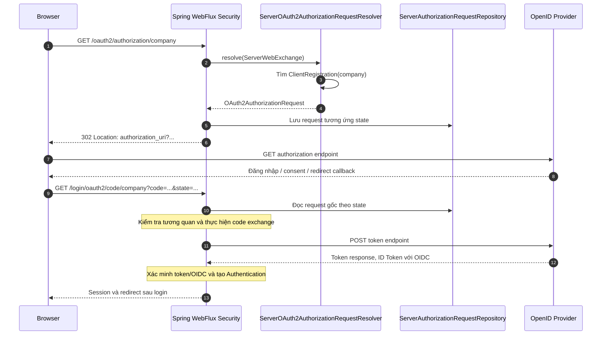
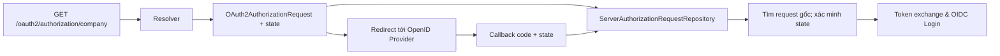
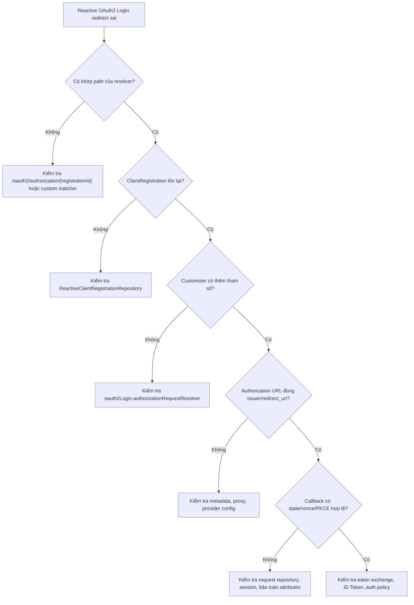

# 20.4. ServerOAuth2AuthorizationRequestResolver và tùy chỉnh request

Trong **Spring Security OAuth 2.0 / OpenID Connect (OIDC) Client** chạy trên **Spring WebFlux**, quá trình đăng nhập bắt đầu khi ứng dụng điều hướng trình duyệt tới Authorization Server hoặc OpenID Provider. Trước khi trả HTTP redirect, Spring Security phải xây dựng **OAuth2 Authorization Request** chứa những giá trị như `client_id`, `redirect_uri`, `response_type=code`, `scope` và `state`; với OIDC và PKCE còn có các tham số hoặc thuộc tính ràng buộc bổ sung.

Thành phần chịu trách nhiệm tạo yêu cầu ở phía Reactive chính là **`ServerOAuth2AuthorizationRequestResolver`**. Triển khai mặc định **`DefaultServerOAuth2AuthorizationRequestResolver`** giải quyết đa số nhu cầu; ứng dụng có thể tùy chỉnh nó để thêm `prompt`, `login_hint`, `max_age`, `acr_values`, scope hoặc hỗ trợ đường dẫn đăng nhập riêng.

Tuy nhiên, Authorization Request là một phần của **ranh giới bảo mật OAuth2/OIDC**. Sửa nhầm `state`, `nonce`, PKCE `code_challenge`, redirect URI, issuer hoặc dùng dữ liệu từ browser mà không kiểm tra có thể gây lỗi xác thực, vòng lặp đăng nhập, token bị trả sai callback hoặc những lỗ hổng nghiêm trọng. Bài học này giải thích cách tùy chỉnh đúng API WebFlux mà vẫn giữ hành vi bảo vệ của Spring Security.

## 1. Mục tiêu và phạm vi

Sau bài học, bạn cần phân biệt được:

1. `ServerOAuth2AuthorizationRequestResolver` là gì, được gọi lúc nào và trả về đối tượng nào.
2. `DefaultServerOAuth2AuthorizationRequestResolver` dùng `ReactiveClientRegistrationRepository` để tìm cấu hình client ra sao.
3. Cách gắn resolver vào `ServerHttpSecurity.oauth2Login()` và khi nào dùng `oauth2Client()`.
4. Cách bổ sung tham số OIDC vào redirect bằng `setAuthorizationRequestCustomizer(...)`.
5. Cách viết resolver riêng hoặc wrapper khi quy tắc phụ thuộc `ServerWebExchange`.
6. Phân biệt **authorization request**, **authorization request repository**, **callback**, **token request** và **outbound WebClient request**.
7. Cách bảo vệ `state`, `nonce`, PKCE, redirect URI, scopes, user hints và tenant boundaries.
8. Cách kiểm thử luồng redirect một cách có kiểm soát bằng `WebTestClient`.

Đây là bài về **Reactive web login / Authorization Code Flow**, không phải hướng dẫn tự tạo Authorization Server hoặc tự phát hành access token.

## 2. Authorization Request nằm ở đâu trong luồng Reactive Login?

Giả sử ứng dụng WebFlux có registration `company`. Người dùng truy cập:

```http
GET /oauth2/authorization/company HTTP/1.1
Host: portal.example.org
```

Spring Security xử lý theo mô hình:



Các vai trò:

- **`OAuth2AuthorizationRequestRedirectWebFilter`** kích hoạt Authorization Code Flow và dùng resolver để xây request.
- **`ServerOAuth2AuthorizationRequestResolver`** chọn đăng ký OAuth2 và tạo `OAuth2AuthorizationRequest`.
- **`ServerAuthorizationRequestRepository<OAuth2AuthorizationRequest>`** giữ request gốc giữa lúc redirect đi và lúc callback về.
- **Reactive authentication manager / callback filters** xử lý code, xác thực token và tạo principal; chúng không phải resolver.

Luồng này **không đồng nghĩa** với API endpoint nhận bearer token (`oauth2ResourceServer()`). Resource Server xác thực access token được gửi tới API; OAuth2 Login cho phép ứng dụng web đăng nhập qua provider.

### 2.1. Hai endpoint cần phân biệt

| Endpoint | Mục đích | Chủ thể xử lý |
|---|---|---|
| `/oauth2/authorization/{registrationId}` | **Khởi động** login: tạo Authorization Request và chuyển hướng sang provider | Resolver + Authorization Request Redirect WebFilter |
| `/login/oauth2/code/{registrationId}` | **Nhận callback** có authorization code và state từ provider | Các thành phần callback/authentication của Spring Security |

Đổi đường dẫn khởi động không tự động đổi callback. Ngược lại, chỉnh `redirect-uri` trong `ClientRegistration` không mặc nhiên đổi URL mà người dùng bấm để bắt đầu đăng nhập.

### 2.2. Authorization Request chứa gì?

Ví dụ query đã URL-encode, trình bày lại cho dễ đọc:

```text
GET https://idp.example.org/realms/company/protocol/openid-connect/auth
    ?response_type=code
    &client_id=portal-web
    &redirect_uri=https%3A%2F%2Fportal.example.org%2Flogin%2Foauth2%2Fcode%2Fcompany
    &scope=openid%20profile%20email
    &state=<GENERATED_UNPREDICTABLE_VALUE>
    &nonce=<GENERATED_IF_APPLICABLE>
    &code_challenge=<GENERATED_IF_PKCE_IS_USED>
    &code_challenge_method=S256
    &prompt=consent
```

Các mục `nonce` và PKCE chỉ xuất hiện khi flow/registration và cấu hình tương ứng áp dụng. `state`, `nonce`, `code_challenge` trong ví dụ là placeholder; tuyệt đối không sử dụng các chuỗi cố định đó trong production.

`prompt=consent` là ví dụ tham số OIDC **được tùy chỉnh thêm**. Nó không phải tham số bắt buộc của OAuth2 và không tự được thêm chỉ vì client có scope `openid`.

## 3. ServerOAuth2AuthorizationRequestResolver: hợp đồng API

Interface `ServerOAuth2AuthorizationRequestResolver` nằm trong:

```java
org.springframework.security.oauth2.client.web.server
        .ServerOAuth2AuthorizationRequestResolver
```

Nó giải quyết một `OAuth2AuthorizationRequest` từ `ServerWebExchange` bằng API reactive, với những phương thức chính:

```java
Mono<OAuth2AuthorizationRequest> resolve(ServerWebExchange exchange);

Mono<OAuth2AuthorizationRequest> resolve(
        ServerWebExchange exchange, String clientRegistrationId);
```

Giá trị `Mono.empty()` thông thường thể hiện resolver **không tạo request** cho exchange đó, ví dụ đường dẫn không khớp. Một resolver có thể báo lỗi khi registration không tồn tại hoặc dữ liệu đầu vào không hợp lệ; cần để Spring xử lý theo hợp đồng, không tự chuyển mọi lỗi thành redirect tới host tùy ý.

### 3.1. Giải thích các tham số

`ServerWebExchange` đại diện cho ngữ cảnh HTTP Reactive, gồm request, response, attributes, session bất đồng bộ và thông tin routing. Nó không phải `HttpServletRequest`.

`clientRegistrationId` là khóa nội bộ tương ứng với một `ClientRegistration`, ví dụ `company` hoặc `partner`. Nó **không phải** `client_id` phía provider. Nếu client registration được định nghĩa với ID `company`, đường dẫn mặc định là:

```text
/oauth2/authorization/company
```

Chữ `company` do ứng dụng quản lý; client ID thực tế mà OP biết có thể là `portal-web-prod`.

### 3.2. Resolver mặc định xử lý những gì?

`DefaultServerOAuth2AuthorizationRequestResolver`:

1. Nhận request bắt đầu authorization.
2. Khớp đường dẫn với pattern, mặc định `/oauth2/authorization/{registrationId}`.
3. Truy vấn `ReactiveClientRegistrationRepository` để tìm `ClientRegistration`.
4. Dựa vào registration và request context để tạo `OAuth2AuthorizationRequest`.
5. Cho phép customizer điều chỉnh builder trước khi request hoàn tất.

Nó còn xử lý các chi tiết giao thức liên quan `redirect_uri`, `state` và PKCE theo cấu hình, thay vì buộc lập trình viên tự xây URL bằng chuỗi.

### 3.3. Vì sao nên giữ Default resolver?

Nếu yêu cầu chỉ là “thêm `prompt=consent`” hoặc “thêm `login_hint`”, việc viết lại toàn bộ resolver và thao tác URL thủ công là không cần thiết. Giữ default resolver giúp tiếp tục dùng logic framework về:

- Lựa chọn client registration.
- Sinh giá trị `state` khó đoán.
- Chuyển đổi redirect URI template.
- Hỗ trợ PKCE khi điều kiện cấu hình đáp ứng.
- Xây dựng Authorization Request đúng định dạng.
- Tương tác với Authorization Request Repository.

Tùy chỉnh nên tập trung vào **phần khác biệt của nghiệp vụ**, không thay thế bảo mật mặc định một cách vô ý.

## 4. Cấu hình WebFlux OIDC Login ban đầu

Ví dụ Spring Boot Reactive cần các dependency chính:

```xml
<dependencies>
    <dependency>
        <groupId>org.springframework.boot</groupId>
        <artifactId>spring-boot-starter-webflux</artifactId>
    </dependency>
    <dependency>
        <groupId>org.springframework.boot</groupId>
        <artifactId>spring-boot-starter-security</artifactId>
    </dependency>
    <dependency>
        <groupId>org.springframework.boot</groupId>
        <artifactId>spring-boot-starter-oauth2-client</artifactId>
    </dependency>
</dependencies>
```

Registration OIDC trong `application.yml`:

```yaml
spring:
  security:
    oauth2:
      client:
        registration:
          company:
            provider: corporate-op
            client-id: "${OIDC_CLIENT_ID}"
            client-secret: "${OIDC_CLIENT_SECRET}"
            client-authentication-method: client_secret_basic
            authorization-grant-type: authorization_code
            redirect-uri: "{baseUrl}/login/oauth2/code/{registrationId}"
            scope:
              - openid
              - profile
              - email
        provider:
          corporate-op:
            issuer-uri: "https://idp.example.org/realms/company"
```

`issuer-uri` cho phép discovery khi OP công bố metadata hợp lệ; ứng dụng xác minh issuer, lấy endpoint/token/JWK Set URI qua metadata theo khả năng framework. Ví dụ URI là giả định, cần thay bằng issuer thực tế được tin cậy. Secrets phải lấy từ cấu hình bí mật bên ngoài mã nguồn.

Security chain mặc định:

```java
import org.springframework.context.annotation.Bean;
import org.springframework.context.annotation.Configuration;
import org.springframework.security.config.annotation.web.reactive.EnableWebFluxSecurity;
import org.springframework.security.config.web.server.ServerHttpSecurity;
import org.springframework.security.web.server.SecurityWebFilterChain;

@Configuration
@EnableWebFluxSecurity
class ReactiveSecurityConfig {

    @Bean
    SecurityWebFilterChain securityWebFilterChain(ServerHttpSecurity http) {
        return http
                .authorizeExchange(exchanges -> exchanges
                        .pathMatchers("/", "/error").permitAll()
                        .anyExchange().authenticated())
                .oauth2Login(oauth2 -> {})
                .build();
    }
}
```

Khi chỉ cần login tiêu chuẩn, không bắt buộc khai báo custom resolver. Spring Security sử dụng default resolver và cấu hình client từ `ReactiveClientRegistrationRepository`.

### 4.1. Servlet và Reactive khác nhau

| Servlet / Spring MVC | Reactive / WebFlux |
|---|---|
| `HttpSecurity` | `ServerHttpSecurity` |
| `SecurityFilterChain` | `SecurityWebFilterChain` |
| `OAuth2AuthorizationRequestResolver` | `ServerOAuth2AuthorizationRequestResolver` |
| `DefaultOAuth2AuthorizationRequestResolver` | `DefaultServerOAuth2AuthorizationRequestResolver` |
| `ClientRegistrationRepository` | `ReactiveClientRegistrationRepository` |
| `HttpServletRequest` | `ServerWebExchange` |
| `HttpSessionOAuth2AuthorizationRequestRepository` (Servlet) | `WebSessionOAuth2ServerAuthorizationRequestRepository` (Reactive) |
| `OAuth2AuthorizationRequestRedirectFilter` | `OAuth2AuthorizationRequestRedirectWebFilter` |

**Không lấy ví dụ Servlet rồi đổi mỗi tên biến**. Cả loại request, repository, filter chain và kiểu trả về đều khác.

## 5. Tùy chỉnh tham số OIDC bằng setAuthorizationRequestCustomizer

Trường hợp phổ biến nhất là thêm tham số trên authorization redirect **cho mọi request** của một resolver. API mặc định cung cấp:

```java
resolver.setAuthorizationRequestCustomizer(
        builder -> builder.additionalParameters(parameters ->
                parameters.put("prompt", "consent")));
```

`additionalParameters` là map của những tham số mở rộng phía Authorization Request. `builder.build()` do resolver thực hiện sẽ tạo request/URI phù hợp với các tham số đó.

### 5.1. Ví dụ đầy đủ: prompt=consent

```java
import org.springframework.context.annotation.Bean;
import org.springframework.context.annotation.Configuration;
import org.springframework.security.config.annotation.web.reactive.EnableWebFluxSecurity;
import org.springframework.security.config.web.server.ServerHttpSecurity;
import org.springframework.security.oauth2.client.registration.ReactiveClientRegistrationRepository;
import org.springframework.security.oauth2.client.web.server.DefaultServerOAuth2AuthorizationRequestResolver;
import org.springframework.security.oauth2.client.web.server.ServerOAuth2AuthorizationRequestResolver;
import org.springframework.security.web.server.SecurityWebFilterChain;

@Configuration
@EnableWebFluxSecurity
public class OidcRequestConfig {

    @Bean
    SecurityWebFilterChain securityWebFilterChain(
            ServerHttpSecurity http,
            ReactiveClientRegistrationRepository registrations) {

        ServerOAuth2AuthorizationRequestResolver resolver =
                authorizationRequestResolver(registrations);

        return http
                .authorizeExchange(exchanges -> exchanges
                        .pathMatchers("/", "/error").permitAll()
                        .anyExchange().authenticated())
                .oauth2Login(oauth2 ->
                        oauth2.authorizationRequestResolver(resolver))
                .build();
    }

    private ServerOAuth2AuthorizationRequestResolver
            authorizationRequestResolver(
                    ReactiveClientRegistrationRepository registrations) {

        var resolver = new DefaultServerOAuth2AuthorizationRequestResolver(
                registrations);

        resolver.setAuthorizationRequestCustomizer(builder ->
                builder.additionalParameters(params ->
                        params.put("prompt", "consent")));

        return resolver;
    }
}
```

Khi người dùng truy cập `/oauth2/authorization/company`, URL redirect sẽ chứa các tham số mặc định cùng với `prompt=consent`, nếu provider hỗ trợ tham số đó.

Đây là cách tùy chỉnh **authorization endpoint** chứ không phải token endpoint. Tham số `prompt` không được gửi trong HTTP POST đổi authorization code lấy access token.

### 5.2. Ý nghĩa của prompt

OIDC định nghĩa các giá trị thường gặp:

| `prompt` | Ý nghĩa |
|---|---|
| `none` | Yêu cầu OP không hiển thị UI tương tác; có thể trả lỗi như `login_required` hoặc `interaction_required` |
| `login` | Yêu cầu OP thực hiện xác thực người dùng một lần nữa |
| `consent` | Yêu cầu OP hiển thị quy trình consent theo policy |
| `select_account` | Yêu cầu OP cho chọn tài khoản |

Một số giá trị có thể kết hợp theo cú pháp cách nhau bằng dấu cách, nhưng `none` không được kết hợp với giá trị khác. Việc OP thực thi tham số còn phụ thuộc hỗ trợ và chính sách riêng; không dùng `prompt=login` làm bằng chứng duy nhất rằng người dùng đã đạt mức MFA mong muốn.

### 5.3. Thêm nhiều tham số mở rộng

Một ví dụ cho một OP hỗ trợ chúng:

```java
resolver.setAuthorizationRequestCustomizer(builder ->
        builder.additionalParameters(params -> {
            params.put("prompt", "select_account");
            params.put("ui_locales", "vi en");
            params.put("max_age", "3600");
        }));
```

Các tham số:

- `ui_locales`: gợi ý ngôn ngữ giao diện, không bảo đảm OP hiển thị đúng tiếng Việt.
- `max_age`: thời gian tối đa tính bằng giây kể từ lần xác thực người dùng gần nhất theo OIDC; có thể buộc OP xác thực lại theo chính sách.
- `prompt`: yêu cầu hành vi tương tác của OP.

Không thêm cả `prompt=none` và `prompt=login` đồng thời. Nếu một tham số không được OP hỗ trợ, OP có thể bỏ qua hoặc trả lỗi; cần thiết kế ứng dụng theo contract provider.

## 6. Các tham số thường tùy chỉnh và rủi ro

| Tham số | Mục đích | Nguồn giá trị nên dùng | Lưu ý |
|---|---|---|---|
| `prompt` | Điều khiển yêu cầu tương tác/consent | Giá trị cố định hoặc allowlist do server quyết định | Không kết hợp `none` với giá trị khác; tránh login loop |
| `login_hint` | Gợi ý tài khoản tại OP | Danh tính đã biết, được phép chia sẻ với provider | Có thể chứa email/username, gây lộ PII qua URL/log |
| `max_age` | Yêu cầu xác thực gần đây | Chính sách step-up phía server | Giá trị nguyên không âm, verify kết quả khi cần |
| `acr_values` | Đề xuất lớp/mức xác thực | Allowlist ACR đã thống nhất với OP | OP có thể không đáp ứng; kiểm tra `acr` thực tế |
| `ui_locales` | Ngôn ngữ UI mong muốn | Giá trị được chuẩn hóa từ preference/allowlist | Không phải security claim |
| `id_token_hint` | Gợi ý phiên OIDC đã có | Chỉ khi flow OIDC tương ứng yêu cầu, xử lý token bí mật | Không lấy ID Token tùy ý từ browser |
| `scope` | Phạm vi quyền yêu cầu | ClientRegistration và chính sách scope | Yêu cầu thêm không bảo đảm được cấp |
| `redirect_uri` | Callback trả code về client | Đăng ký trước và server-side configuration | Không dùng URL user cung cấp |
| `state` | Liên kết request với callback, chống CSRF | Framework sinh ngẫu nhiên và lưu | Không override bằng chuỗi cố định |
| `nonce` | Liên kết ID Token với OIDC request | Framework xử lý theo OIDC | Không làm mất hoặc thay sai giá trị |
| `code_challenge` | PKCE ràng buộc code với verifier | Framework tạo cùng `code_verifier` | Không tự chế challenge hoặc gửi verifier ra URL |

### 6.1. login_hint không phải đăng nhập hộ

Ví dụ:

```java
builder.additionalParameters(params ->
        params.put("login_hint", "employee@example.org"));
```

`login_hint` chỉ là **gợi ý** gửi cho OP. Nó không chứng minh người được xác thực có email đó, không khóa người dùng vào tài khoản đó và không cho phép ứng dụng tự chấp nhận login response có `sub` khác kỳ vọng.

Nếu OP hỗ trợ, `login_hint` có thể giúp trải nghiệm đăng nhập, nhưng email có thể xuất hiện trong redirect URL, lịch sử truy cập, reverse proxy log và telemetry. Chỉ gửi dữ liệu cần thiết khi có cơ sở pháp lý/quyền riêng tư phù hợp; tránh ghi nguyên URL nếu nó chứa thông tin nhạy cảm.

### 6.2. acr_values và MFA

Ví dụ:

```java
builder.additionalParameters(params ->
        params.put("acr_values", "urn:example:loa:high"));
```

Đây là **giá trị minh họa**, không phải ACR chuẩn mà mọi IdP đều hiểu. Nếu ứng dụng yêu cầu xác thực mức cao, cần có hợp đồng với OP về `acr_values`, policy MFA, `max_age`, và xác minh kết quả thông qua những claim như `acr`/`auth_time` theo contract. Không suy luận rằng việc **yêu cầu** ACR đã đồng nghĩa OP thực sự **đáp ứng** ACR.

### 6.3. max_age=0 và kiểm tra auth_time

`max_age=0` là cách OIDC yêu cầu OP thực hiện xác thực mới, phù hợp trong một số luồng step-up. Nhưng ứng dụng có yêu cầu xác thực mới/giới hạn tuổi phiên nên kiểm tra ID Token theo tiêu chuẩn OIDC, ví dụ `auth_time` và những ràng buộc mà framework/provider hỗ trợ.

Không biến một query parameter `?max_age=0` không được xác minh thành cơ chế duy nhất quyết định quyền thực hiện giao dịch nhạy cảm. Chính sách step-up và permission vẫn thuộc backend.

## 7. Tùy chỉnh theo từng request: viết wrapper resolver

`setAuthorizationRequestCustomizer(...)` chỉ nhận `OAuth2AuthorizationRequest.Builder`; nó không nhận trực tiếp `ServerWebExchange`. Khi muốn quyết định tùy chỉnh dựa trên đường dẫn, tenant, cookie/sessions hợp lệ hoặc chính sách đăng nhập của request hiện tại, có thể **bọc** `DefaultServerOAuth2AuthorizationRequestResolver`.

Mẫu:

```text
ServerWebExchange
      |
      v
Custom ServerOAuth2AuthorizationRequestResolver
      |
      +--> delegate DefaultServerOAuth2AuthorizationRequestResolver
      |        +--> tìm ClientRegistration
      |        +--> sinh request chuẩn (state, nonce, PKCE...)
      |
      +--> kiểm tra business/login policy theo exchange
      |
      +--> OAuth2AuthorizationRequest.from(original)
               +--> chỉ bổ sung allowlisted parameters
               +--> build()
```

Cách này tránh viết lại toàn bộ bảo vệ giao thức.

### 7.1. Ví dụ wrapper dùng lựa chọn prompt được kiểm soát

Giả sử ứng dụng cung cấp một tùy chọn giao diện *chọn lại tài khoản*. Browser có thể gửi `?account_selection=yes`, nhưng server chỉ chấp nhận đúng giá trị allowlist này và **không cho browser sửa `state`, `nonce`, `redirect_uri`, `client_id`**.

```java
import org.springframework.security.oauth2.client.web.server
        .ServerOAuth2AuthorizationRequestResolver;
import org.springframework.security.oauth2.core.endpoint.OAuth2AuthorizationRequest;
import org.springframework.web.server.ServerWebExchange;
import reactor.core.publisher.Mono;

final class AccountSelectionAuthorizationRequestResolver
        implements ServerOAuth2AuthorizationRequestResolver {

    private final ServerOAuth2AuthorizationRequestResolver delegate;

    AccountSelectionAuthorizationRequestResolver(
            ServerOAuth2AuthorizationRequestResolver delegate) {
        this.delegate = delegate;
    }

    @Override
    public Mono<OAuth2AuthorizationRequest> resolve(
            ServerWebExchange exchange) {
        return delegate.resolve(exchange)
                .map(request -> customize(exchange, request));
    }

    @Override
    public Mono<OAuth2AuthorizationRequest> resolve(
            ServerWebExchange exchange,
            String clientRegistrationId) {
        return delegate.resolve(exchange, clientRegistrationId)
                .map(request -> customize(exchange, request));
    }

    private OAuth2AuthorizationRequest customize(
            ServerWebExchange exchange,
            OAuth2AuthorizationRequest original) {

        String selection = exchange.getRequest().getQueryParams()
                .getFirst("account_selection");

        if (!"yes".equals(selection)) {
            return original;
        }

        return OAuth2AuthorizationRequest.from(original)
                .additionalParameters(params ->
                        params.put("prompt", "select_account"))
                .build();
    }
}
```

Trong ví dụ, browser chỉ được yêu cầu một hành vi UI ít nhạy cảm, với giá trị cố định `yes`; **không được phép cung cấp thẳng chuỗi `prompt` bất kỳ**. Với chính sách bảo mật nhạy cảm hơn như MFA, chọn tenant hoặc cấp scope nâng cao, phải dựa vào dữ liệu và quyền **đã được xác minh bởi server**, không chỉ query string.

`OAuth2AuthorizationRequest.from(original)` tạo builder từ request đã được delegate xây dựng. Chỉ chỉnh `additionalParameters` cho phép bảo toàn những thuộc tính quan trọng của request gốc tốt hơn tự tái tạo toàn bộ từ đầu.

### 7.2. Đăng ký wrapper vào SecurityWebFilterChain

```java
@Bean
SecurityWebFilterChain securityWebFilterChain(
        ServerHttpSecurity http,
        ReactiveClientRegistrationRepository registrations) {

    var defaultResolver =
            new DefaultServerOAuth2AuthorizationRequestResolver(
                    registrations);

    var resolver =
            new AccountSelectionAuthorizationRequestResolver(
                    defaultResolver);

    return http
            .authorizeExchange(exchanges -> exchanges
                    .pathMatchers("/", "/error").permitAll()
                    .anyExchange().authenticated())
            .oauth2Login(oauth2 ->
                    oauth2.authorizationRequestResolver(resolver))
            .build();
}
```

Đây là một cấu hình **thay thế** cho SecurityWebFilterChain ở mục 5.1; ứng dụng nên có một chain phù hợp cho cùng nhóm route, không sao chép nhiều bean trùng phạm vi một cách không chủ đích.

### 7.3. Khi chính sách phải truy vấn reactive service

Ví dụ cần biết một user/tenant có được bật tính năng “yêu cầu xác thực mức cao” hay không. Nếu policy là service bất đồng bộ, resolver có thể dùng `flatMap`:

```java
@Override
public Mono<OAuth2AuthorizationRequest> resolve(
        ServerWebExchange exchange) {

    return delegate.resolve(exchange)
            .flatMap(original ->
                    stepUpPolicy.shouldRequireFreshLogin(exchange)
                            .map(required -> {
                                if (!required) {
                                    return original;
                                }
                                return OAuth2AuthorizationRequest
                                        .from(original)
                                        .additionalParameters(params -> {
                                            params.put("prompt", "login");
                                            params.put("max_age", "0");
                                        })
                                        .build();
                            }));
}
```

`stepUpPolicy` là **service do ứng dụng triển khai**, ví dụ trả `Mono<Boolean>` từ thông tin đã xác thực/phê duyệt trong session. Khi viết resolver hoàn chỉnh, cần xử lý cả overload `resolve(exchange, registrationId)` với cùng policy. Đặc biệt, `Mono.empty()` từ policy có thể làm mất Authorization Request, nên service cần có semantics rõ ràng và fallback có chủ ý.

Không gọi `block()` trong Reactor event loop để đọc database/policy. Một resolver Reactive phải giữ việc tra cứu/nghiệp vụ phi blocking khi thuộc luồng reactive.

## 8. Tùy chỉnh đường dẫn bắt đầu đăng nhập

Mặc định resolver khớp:

```text
/oauth2/authorization/{registrationId}
```

Nếu ứng dụng muốn đường dẫn:

```text
/login/oauth2/authorization/{registrationId}
```

hãy cung cấp một `ServerWebExchangeMatcher`:

```java
import org.springframework.security.oauth2.client.registration.ReactiveClientRegistrationRepository;
import org.springframework.security.oauth2.client.web.server
        .DefaultServerOAuth2AuthorizationRequestResolver;
import org.springframework.security.web.server.util.matcher
        .PathPatternParserServerWebExchangeMatcher;
import org.springframework.security.web.server.util.matcher.ServerWebExchangeMatcher;

ServerWebExchangeMatcher matcher =
        new PathPatternParserServerWebExchangeMatcher(
                "/login/oauth2/authorization/{registrationId}");

var resolver = new DefaultServerOAuth2AuthorizationRequestResolver(
        registrations, matcher);
```

Sau đó gắn `resolver` qua `oauth2Login(...authorizationRequestResolver(resolver))`.

Trang đăng nhập tùy chỉnh phải hiển thị link **khớp** với pattern mới:

```html
<a href="/login/oauth2/authorization/company">
  Đăng nhập bằng tài khoản công ty
</a>
```

Nếu UI vẫn dẫn tới `/oauth2/authorization/company` trong khi resolver chỉ nghe pattern mới, flow có thể không khởi động.

### 8.1. Đường bắt đầu khác callback

Hai đường:

```text
Authorization initiation:
    /login/oauth2/authorization/company

OAuth2 redirect callback:
    /login/oauth2/code/company
```

Đường callback đến từ `redirect-uri` của registration và cấu hình callback authentication matcher. Không chỉ đổi `ServerWebExchangeMatcher` ở resolver rồi giả định callback cũng thay đổi.

### 8.2. Custom login page và security matcher

Nếu viết trang login riêng, hãy bảo đảm:

- Đường dẫn login page được phép truy cập khi chưa authenticated.
- Link đăng nhập dùng đúng registration ID hợp lệ.
- Không lấy URL Authorization Server từ browser rồi tạo link trực tiếp.
- Không biến `returnUrl` thành open redirect sau login.
- Không để một custom security chain thứ hai chặn mất endpoint khởi động hoặc callback.

Nên để Spring Security sinh `state` và lưu request gốc; không tự dựng một link chứa state tĩnh trong template HTML.

## 9. Tùy chỉnh scope theo chính sách

OAuth2 `scope` nằm trong Authorization Request và thường lấy từ `ClientRegistration.getScopes()`. Tại Authorization Server, scope chỉ là **yêu cầu quyền**; các scope thực sự được cấp và token audience phụ thuộc provider.

### 9.1. Cấu hình scope tĩnh

```yaml
spring:
  security:
    oauth2:
      client:
        registration:
          company:
            scope:
              - openid
              - profile
              - email
```

Đây là lựa chọn đơn giản, dễ vận hành và audit. Nếu toàn bộ người dùng/luồng của client luôn cần các scope giống nhau, không cần resolver custom chỉ để dựng lại cùng danh sách đó.

### 9.2. Thêm scope qua builder khi có policy

Một customizer có thể yêu cầu thêm một scope mà **client đã đăng ký và provider cho phép**:

```java
import java.util.HashSet;

resolver.setAuthorizationRequestCustomizer(builder ->
        builder.scopes(new HashSet<>(java.util.Set.of(
                "openid",
                "profile",
                "reports.read"))));
```

Đoạn này minh họa API `scopes(Set<String>)`, nhưng việc thay toàn bộ scopes từ hằng có thể bỏ mất những scope đang có trong cấu hình khác. Trong production, ưu tiên một cấu hình registration có tập scope rõ ràng hoặc dùng wrapper nhận request **đã được resolve** rồi xây tập hợp mới từ scopes gốc:

```java
private OAuth2AuthorizationRequest withReportScope(
        OAuth2AuthorizationRequest original) {

    Set<String> scopes = new HashSet<>(original.getScopes());
    scopes.add("reports.read"); // Chỉ khi policy/OP cho phép.

    return OAuth2AuthorizationRequest.from(original)
            .scopes(scopes)
            .build();
}
```

Phương thức này giả định đã có import `Set` và `HashSet`. Đừng đưa `reports.admin` vào request chỉ vì browser gửi `?scope=reports.admin`; phải có allowlist, quyền client và kiểm tra business policy.

### 9.3. Vì sao requested scope không đủ cho authorization?

Một user có thể xin `reports.read` nhưng OP chỉ cấp một subset hoặc user không được phép vào mọi báo cáo. Khi gọi Resource Server, **access token** phải phù hợp audience/scope; API phải kiểm tra quyền trên tổ chức/tài nguyên. Cấp được OAuth2 Login không đồng nghĩa được xem mọi dữ liệu.

Đối với incremental authorization, người dùng có thể phải consent thêm; authorized client cũ không tự nhận scope mới chỉ vì lần sau application sửa một map.

## 10. Bảo vệ state, nonce và PKCE

Đây là phần quan trọng nhất khi tùy chỉnh OAuth2 Authorization Request.

### 10.1. state chống nhầm lẫn/các cuộc tấn công liên quan callback

`state` liên kết authorization request đã gửi với callback mà ứng dụng nhận lại. Spring Security tạo và lưu request gốc để xác nhận correlation.

**Không nên**:

```java
// KHÔNG AN TOÀN: state không được cố định hay lấy tùy ý từ browser.
builder.state("fixed-state-value");
```

Và cũng không nên thay `state` bằng query parameter `?state=...` từ frontend. Một state tĩnh hoặc có thể đoán dễ làm yếu khả năng liên kết request/callback. Nếu cần truyền “quay về trang nào sau login”, hãy dùng cơ chế server-side có validation, không lợi dụng state làm container dữ liệu không được bảo vệ.

### 10.2. nonce bảo vệ ràng buộc ID Token của OIDC

OIDC có thể đưa `nonce` trong Authorization Request để liên kết ID Token nhận được với login request ban đầu. Nó quan trọng với việc chống token injection/replay theo flow. Trong cấu hình Spring Security OIDC, framework quản lý nonce và validation theo cơ chế được hỗ trợ.

Không tự:

- Xóa nonce khi sửa `additionalParameters`.
- Đặt nonce bằng chuỗi hằng.
- Dùng nonce chung giữa những login requests.
- Chấp nhận ID Token từ một issuer khác mà không kiểm tra issuer/audience.

Nếu custom resolver thay toàn bộ `OAuth2AuthorizationRequest`, cần bảo toàn state/nonce và các attributes hỗ trợ validation.

### 10.3. PKCE liên kết authorization code với code_verifier

PKCE sử dụng:

```text
Client sinh code_verifier bí mật
   |
   +--> code_challenge = BASE64URL(SHA256(code_verifier))
   |
   +--> Authorization Request gửi code_challenge và method=S256
   |
   +--> Khi đổi code ở token endpoint, client gửi code_verifier
   |
   +--> Authorization Server xác minh quan hệ
```

Spring Security hỗ trợ PKCE cho public client và khi `ClientRegistration.clientSettings.requireProofKey` bật theo API/version tương ứng. Khi custom resolver:

- Không thay `code_challenge` bằng giá trị cố định.
- Không gửi `code_verifier` lên authorization URL.
- Không làm mất attributes nội bộ lưu `code_verifier` cần cho token exchange.
- Không vô hiệu PKCE chỉ để “sửa lỗi callback”.
- Không gửi code/PKCE verifier vào log.

### 10.4. Vì sao dùng from(original)?

Khi tùy chỉnh một request đã được default resolver tạo:

```java
OAuth2AuthorizationRequest.from(original)
        .additionalParameters(params ->
                params.put("prompt", "select_account"))
        .build();
```

thông thường giúp giữ lại các giá trị/attributes của request gốc hơn tự dựng builder mới từ `OAuth2AuthorizationRequest.authorizationCode()`. Dù vậy, bạn vẫn cần tránh sửa các trường nhạy cảm của builder nếu không có yêu cầu giao thức cụ thể.

## 11. ServerAuthorizationRequestRepository khác resolver thế nào?

`ServerOAuth2AuthorizationRequestResolver` **tạo request**; `ServerAuthorizationRequestRepository<OAuth2AuthorizationRequest>` **lưu request** từ lúc bắt đầu đến lúc callback.



Triển khai mặc định thường dùng:

```java
WebSessionOAuth2ServerAuthorizationRequestRepository
```

để lưu `OAuth2AuthorizationRequest` trong `WebSession` của Spring WebFlux.

### 11.1. Không nhầm với OAuth2AuthorizedClient storage

| Thành phần | Loại dữ liệu | Vòng đời |
|---|---|---|
| `ServerOAuth2AuthorizationRequestResolver` | Tạo request trước redirect | Khi khởi động authorization |
| `ServerAuthorizationRequestRepository` | Authorization Request gồm `state` và thuộc tính cần cho callback | Ngắn, giữa request và callback |
| `ServerOAuth2AuthorizedClientRepository` | Authorized client và token tương ứng user/session | Sau khi được cấp token |
| `ReactiveOAuth2AuthorizedClientService` | Authorized client trong service storage Reactive | Sau khi được cấp token, tùy chính sách |
| `ServerSecurityContextRepository` | Authentication/security context | Gắn với phiên/request theo cấu hình |

Đăng nhập thất bại vì `state` không khớp không nên được khắc phục bằng cách xóa `OAuth2AuthorizedClient` bất kỳ. Đây là hai kho lưu khác nhau với trách nhiệm khác nhau.

### 11.2. Vì sao không nên tự lưu state vào query parameter không bảo vệ?

Nếu bạn phải lưu metadata nghiệp vụ qua redirect:

- Có thể lưu server-side theo `state` hoặc một khóa correlation riêng.
- Ràng buộc dữ liệu với request/user/session và TTL hợp lý.
- Không ghi client secret, code verifier hoặc thông tin nhạy cảm vào query URL.
- Không tin `returnTo` hoặc `tenant` chỉ vì chúng xuất hiện lại ở callback.
- Không thay thế kiểm tra `state` của Spring Security bằng một custom cookie không bảo vệ.

Khi dùng deployment nhiều instance, session/repository cần tương thích kiến trúc phân tán, session affinity hoặc shared session storage tùy chiến lược. Nếu callback về instance không tìm được request gốc, state correlation có thể thất bại.

## 12. Redirect URI và reverse proxy

Authorization Request có `redirect_uri` chỉ tới callback URL của client. Giá trị này phải khớp URI đã đăng ký ở Authorization Server theo chính sách provider, tránh open redirect và code exfiltration.

Spring Security hỗ trợ placeholder trong registration:

```yaml
redirect-uri: "{baseUrl}/login/oauth2/code/{registrationId}"
```

Các placeholder có thể phụ thuộc scheme, host, port và base path của request được framework nhìn thấy. Khi ứng dụng nằm sau reverse proxy:

```text
Browser -> https://portal.example.org
             |
             v
Reverse proxy -> http://portal-service:8080
```

nếu ứng dụng xác định base URL sai, redirect URI có thể trở thành `http://portal-service:8080/...` và provider từ chối vì `redirect_uri_mismatch`.

Giải pháp thường là cấu hình forwarded headers đáng tin và reverse proxy chuẩn, cùng danh sách callback URI chính xác ở OP. **Không lấy `X-Forwarded-Host` bất kỳ từ Internet mà không thiết lập trust boundary của proxy**, vì có thể gây host header injection hoặc redirect tới host không được phép.

### 12.1. Khi nào phải chỉnh Authorization Request URI?

`DefaultServerOAuth2AuthorizationRequestResolver` cho phép builder chỉnh `authorizationRequestUri` cho trường hợp provider có yêu cầu URL đặc biệt. Nhưng đây là điểm mở rộng quyền lực cao: nếu tự dựng sai, có thể bỏ `state`, `nonce`, `code_challenge` hoặc URL encode không đúng.

Nếu chỉ muốn thêm `prompt=consent`, nên dùng:

```java
builder.additionalParameters(params ->
        params.put("prompt", "consent"));
```

thay vì tự nối chuỗi:

```java
// KHÔNG NÊN: xây URL thủ công và bỏ các tham số bảo mật.
String url = authEndpoint + "?client_id=" + clientId
        + "&redirect_uri=" + redirectUri;
```

Đối với tham số cố định cho một provider, có thể có lựa chọn cấu hình `authorization-uri` chứa query parameter tĩnh, nhưng phải kiểm tra hợp đồng/provider và tránh chèn trùng tham số. Tùy chỉnh builder thường rõ ràng hơn khi chính sách thay đổi.

## 13. Tùy chỉnh theo provider hoặc registration

Ứng dụng có thể tích hợp Corporate OP và Partner OP:

```text
/oauth2/authorization/company
/oauth2/authorization/partner
```

Hai provider có thể hiểu `prompt` hoặc `acr_values` khác nhau. Một customizer áp dụng mọi registration có thể vô tình gửi tham số không hỗ trợ tới đối tác.

Một chiến lược an toàn là wrapper tùy chỉnh **dựa trên registration đã được resolver chọn**, không đoán provider từ một query parameter của browser.

### 13.1. Đọc registration từ request đã được resolve

`OAuth2AuthorizationRequest` có các thuộc tính phục vụ việc xử lý OAuth2. Khi cần quyết định provider/registration trong wrapper, có thể tổ chức resolver và policy theo đường dẫn đã khớp hoặc metadata được kiểm soát từ registration repository.

Ví dụ thiết kế:

```text
request path -> default resolver -> OAuth2AuthorizationRequest
                                  |
                                  v
                     server-side RegistrationPolicy
                       company -> prompt=select_account
                       partner -> no custom prompt
                                  |
                                  v
                            final request
```

Nếu cần thông tin `ClientRegistration` trong policy, sử dụng `ReactiveClientRegistrationRepository.findByRegistrationId(...)` và xác định registration ID từ routing đã chuẩn hóa; không lấy mỗi `client_id` hoặc `issuer` do browser tự khai.

### 13.2. Mã minh họa policy theo route đã định nghĩa

```java
private OAuth2AuthorizationRequest applyProviderPolicy(
        String registrationId,
        OAuth2AuthorizationRequest original) {

    if ("company".equals(registrationId)) {
        return OAuth2AuthorizationRequest.from(original)
                .additionalParameters(params ->
                        params.put("prompt", "select_account"))
                .build();
    }

    // Với partner giữ nguyên request nếu không có policy tùy chỉnh.
    return original;
}
```

`registrationId` ở đây phải đến từ cơ chế routing/matcher tin cậy của resolver, không phải giá trị tự do do browser gửi để quyết định quyền. Đoạn này là helper minh họa trong custom resolver, không thay thế phần implement cả hai overload `resolve(...)`.

### 13.3. Tenant-specific login

Nếu mỗi tenant có một provider hoặc client khác nhau:

1. Xác định tenant từ host/domain, session hoặc quy trình lựa chọn đã được xác minh.
2. Mapping tenant → `registrationId` trong registry phía server.
3. Đảm bảo registration đúng issuer, callback, client ID và client authentication.
4. Dùng resolver để thêm tham số UX khi phù hợp.
5. Sau login, ánh xạ identity bằng (`iss`, `sub`), không tự liên kết tài khoản chỉ qua email.

Không cho browser gửi `?issuer=https://evil.example` rồi tạo ClientRegistration/token URI động không được kiểm soát. Một resolver tạo URL login tới provider ngoài allowlist có thể làm rò mã authorization hoặc đánh lừa user.

## 14. OIDC Login và OAuth2 Client authorization: cấu hình ở đâu?

Trong WebFlux, cả:

```java
http.oauth2Login(...);
http.oauth2Client(...);
```

đều có những hook liên quan Authorization Request. Tuy nhiên:

- `oauth2Login()` nhắm tới đăng nhập người dùng qua OAuth2/OIDC và tạo authenticated principal.
- `oauth2Client()` nhắm tới các khả năng OAuth2 Client để ứng dụng lấy/duy trì authorized clients và gọi Resource Server.

Khi ứng dụng dùng cả hai, cần xác định resolver/repository của flow nào thật sự đang hoạt động và tránh cấu hình hai resolver khác nhau cho cùng đường khởi động một cách vô ý. Cấu hình dưới `oauth2Login().authorizationRequestResolver(...)` là cách trực tiếp cho **bài học về login Reactive** này.

### 14.1. Không nhầm với WebClient attributes

Ở downstream `WebClient`, có thể chọn registration cho access token khi gọi API; đó **không phải** cùng một hành động với resolver tạo Authorization Request lúc browser bắt đầu login.

```text
Browser login:
  GET /oauth2/authorization/company
      -> ServerOAuth2AuthorizationRequestResolver
      -> Redirect authorization endpoint

Backend gọi API:
  WebClient.get().uri(...)
      -> Authorized Client Manager / OAuth2 exchange filter
      -> Access Token -> Resource Server
```

Muốn thêm `prompt` trên login redirect, thay resolver. Muốn gửi header hay param bổ sung tại **token endpoint**, tùy chỉnh token response client. Muốn chọn token khi **gọi API**, cấu hình authorized client manager/WebClient. Ba nhu cầu khác nhau.

## 15. Khi thêm tham số mà provider không hỗ trợ

Ví dụ một OP không hỗ trợ `acr_values=urn:example:loa:high` có thể bỏ qua tham số hoặc trả lỗi. Một OP khác có thể xử lý `prompt` theo policy riêng.

| Triệu chứng | Nguyên nhân khả dĩ | Cách xử lý |
|---|---|---|
| Login redirect không có `prompt` | Customizer chưa được gắn vào resolver, chain khác đang xử lý, hoặc request không khớp | Kiểm tra bean `SecurityWebFilterChain` và matcher |
| `prompt=none` gây `login_required` | User chưa có phiên OP phù hợp hoặc cần tương tác | Thiết kế fallback có kiểm soát; không loop redirect |
| `acr_values` gửi đi nhưng không có MFA như mong đợi | OP không hỗ trợ giá trị hoặc policy không yêu cầu | Kiểm tra hợp đồng OP và claim kết quả `acr`/`amr` |
| `login_hint` không điền sẵn username | OP không hỗ trợ hoặc không chấp nhận hint | Coi là gợi ý UI, không ép flow dựa vào hint |
| `max_age` gây đăng nhập lặp lại | App yêu cầu re-auth trên mọi request và không kiểm tra kết quả/chu kỳ | Tách step-up event, state và điều kiện hoàn tất |
| Scope mới không có trong token | Client chưa được cấp quyền hoặc consent chưa hoàn thành | Kiểm tra registration, granted scope và provider policy |
| `redirect_uri_mismatch` | Redirect URI không được đăng ký hoặc proxy tạo base URL sai | Kiểm tra redirect-uri/forwarded headers/trust proxy |
| Callback `invalid_state` | Request gốc mất session, state bị override hoặc callback sai | Không tự đổi state; kiểm tra WebSession/repository |
| `invalid_nonce` | Nonce không trùng ID Token hoặc request gốc mất | Giữ cơ chế tạo/lưu/kiểm tra nonce của Spring |
| Code exchange thất bại sau custom PKCE | `code_verifier` không khớp challenge, attributes bị mất | Không thay thủ công PKCE; bảo toàn request attributes |
| Provider khác bị lỗi khi dùng chung customizer | Tất cả registrations bị thêm tham số riêng của một OP | Áp policy theo registration/provider |
| Đường login tùy chỉnh trả 404 | Link UI không khớp matcher mới | Đồng bộ pattern của resolver với login links |
| Browser bị redirect tới host lạ | Dùng external URL/issuer hoặc forwarded header không đáng tin | Allowlist provider/host, trust proxy và callback |

### 15.1. Quy trình chẩn đoán



Khi chẩn đoán, phải phân biệt lỗi **trước redirect**, lỗi **tại OP**, lỗi **callback state/nonce/PKCE** và lỗi **token exchange**. Đổ tất cả vào “resolver không chạy” sẽ dẫn đến sửa nhầm thành phần.

## 16. Kiểm thử với WebTestClient

Vì authorization initiation chỉ cần tạo HTTP redirect, có thể kiểm thử bước này **không cần đăng nhập thực tế với OP**.

### 16.1. Những điều nên khẳng định

Một integration test nên:

1. Gọi `GET /oauth2/authorization/company`.
2. Kỳ vọng trạng thái HTTP redirect 3xx.
3. Đọc `Location` và phân tích thành URI/query parameters.
4. Kiểm tra host/scheme/path của Authorization Server theo registration.
5. Kiểm tra `response_type=code`, `client_id`, `redirect_uri`, `scope` phù hợp.
6. Kiểm tra `state` có mặt và không dùng hằng.
7. Kiểm tra `prompt=consent` hoặc parameter custom đã cấu hình.
8. Khi OIDC/PKCE áp dụng, kiểm tra nonce/challenge theo ngữ cảnh.
9. Đảm bảo token/code/secret không bị lộ qua URL tùy chỉnh hoặc log.

### 16.2. Ví dụ WebTestClient: quan sát redirect

```java
import java.net.URI;
import org.junit.jupiter.api.Test;
import org.springframework.beans.factory.annotation.Autowired;
import org.springframework.boot.test.autoconfigure.web.reactive.WebFluxTest;
import org.springframework.test.web.reactive.server.WebTestClient;
import org.springframework.web.util.UriComponentsBuilder;

import static org.assertj.core.api.Assertions.assertThat;

class AuthorizationRedirectTest {

    @Autowired
    WebTestClient webTestClient;

    @Test
    void loginRedirectIncludesPrompt() {
        webTestClient.get()
                .uri("/oauth2/authorization/company")
                .exchange()
                .expectStatus().is3xxRedirection()
                .expectHeader()
                .value("Location", location -> {
                    URI uri = URI.create(location);
                    var query = UriComponentsBuilder.fromUri(uri)
                            .build()
                            .getQueryParams();

                    assertThat(uri.getHost())
                            .isEqualTo("idp.example.org");
                    assertThat(query.getFirst("response_type"))
                            .isEqualTo("code");
                    assertThat(query.getFirst("prompt"))
                            .isEqualTo("consent");
                    assertThat(query.getFirst("state"))
                            .isNotBlank();
                });
    }
}
```

Đây là ví dụ **cấu trúc test**, giả định `WebTestClient` đã được cấu hình với application context, `SecurityWebFilterChain`, registration test và resolver. Import `WebFluxTest` được đưa để gợi ý môi trường test slice, nhưng ví dụ không tự tạo slice/mocks; khi dùng `@WebFluxTest` có thể cần import thêm security config và beans thích hợp hoặc thay bằng `@SpringBootTest(webEnvironment=RANDOM_PORT)` với `@AutoConfigureWebTestClient`. Test không nên gọi OP thật.

### 16.3. Test hai requests có state khác nhau

Với hai lần bắt đầu login:

```text
GET /oauth2/authorization/company -> state A
GET /oauth2/authorization/company -> state B
assert state A != state B
```

Không nên assert bằng một giá trị state cố định. Mục đích là chứng minh ứng dụng không vô tình override state bằng constant khi tùy chỉnh.

### 16.4. Test custom matcher

Khi đổi path:

```text
GET /login/oauth2/authorization/company -> HTTP 302 tới OP
GET /oauth2/authorization/company       -> không còn khởi động cùng resolver
```

Kết quả của đường cũ có thể là 401/404/redirect login tùy security configuration; không hardcode kỳ vọng chung cho mọi project. Điều cần xác minh là **đường cũ không còn tạo Authorization Request trái ý muốn**.

### 16.5. Test policy động và dữ liệu độc hại

Một custom resolver đọc query parameter cần test:

| Request | Kỳ vọng |
|---|---|
| `?account_selection=yes` | Có `prompt=select_account` |
| `?account_selection=anything-else` | Không tự thêm prompt đặc biệt |
| `?prompt=login%20consent` khi app không hỗ trợ nhập prompt tự do | Không phản chiếu giá trị tùy ý |
| `?redirect_uri=https://attacker.example` | Redirect URI thực tế vẫn lấy từ registration |
| `?state=fixed` | State thực tế vẫn được framework sinh |
| `?scope=admin` | Không tự thêm scope admin |
| `?login_hint=<untrusted>` | Không gửi PII chưa được policy cho phép |
| Tenant ID của đối tác khác | Không thể chọn provider/client của tenant khác chỉ vì query |

Test bảo vệ các ranh giới này hữu ích hơn một test chỉ xác nhận có HTTP 302.

## 17. Lỗi thiết kế thường gặp

1. **Dùng resolver Servlet trong WebFlux**: `DefaultOAuth2AuthorizationRequestResolver` không thay thế `DefaultServerOAuth2AuthorizationRequestResolver`.
2. **Tự nối authorization URL** rồi làm mất state, PKCE hoặc nonce.
3. **Tự set state/nonce cố định** để “dễ debug”.
4. **Đọc `prompt` từ browser rồi phản chiếu nguyên văn** mà không allowlist.
5. **Dùng `login_hint` như bằng chứng user identity** thay vì kiểm tra ID Token.
6. **Cho browser chọn issuer, client ID hoặc redirect URI** mà không ràng buộc registration tin cậy.
7. **Gửi `acr_values` rồi giả định MFA đã hoàn tất** mà không kiểm tra kết quả.
8. **Bật `prompt=login` cho mọi request nhạy cảm** và tạo vòng reauthentication không có điểm dừng.
9. **Dùng `additionalParameters` để cố sửa token endpoint** — sai giai đoạn giao thức.
10. **Thay matcher khởi động nhưng quên cập nhật login link**.
11. **Thay callback URI mà không đăng ký lại với OP** hoặc không cấu hình callback processing.
12. **Mất WebSession giữa redirect và callback**, khiến request gốc không được tìm thấy.
13. **Dùng `block()` trong custom reactive resolver** để đọc DB/policy.
14. **Đưa code verifier/ID Token/client secret vào URL hoặc log**.
15. **Nhầm request-resolver với authorized-client manager**, dẫn tới tìm lỗi ở sai lớp.

## 18. Tình huống tổng hợp: Portal đăng nhập đa provider và step-up

Giả sử một cổng nội bộ dùng Spring WebFlux:

- `company` là OIDC client cho nhân viên.
- `partner` là OIDC client cho đối tác.
- Trang login có link riêng cho mỗi registration.
- Khi nhân viên thực hiện một thao tác nhạy cảm, server áp chính sách yêu cầu xác thực mới.

Thiết kế:

```text
Reactive Portal
   |
   +-- GET /oauth2/authorization/company
   |       -> DefaultServerOAuth2AuthorizationRequestResolver
   |       -> ClientRegistration(company)
   |       -> StepUpPolicy (nếu session hợp lệ yêu cầu)
   |       -> prompt=login, max_age=0 theo contract OP
   |       -> state/nonce/PKCE do Spring bảo vệ
   |       -> Corporate OP
   |
   +-- GET /oauth2/authorization/partner
           -> DefaultServerOAuth2AuthorizationRequestResolver
           -> ClientRegistration(partner)
           -> không áp prompt riêng của Corporate OP
           -> Partner OP
```

Quy trình quan trọng:

1. Server chọn registration từ route/matcher và cấu hình đã đăng ký, không lấy issuer tùy ý từ browser.
2. Resolver mặc định tạo Authorization Request.
3. Wrapper kiểm tra policy đã xác minh, chỉ thêm tham số được OP hỗ trợ.
4. Request Repository lưu tương quan theo state; callback hoàn tất flow.
5. Sau login, Spring Security xác minh ID Token, issuer/audience và các ràng buộc OIDC.
6. Nếu là step-up, service kiểm tra `auth_time`/`acr` theo chính sách, không chỉ tin rằng đã gửi `prompt=login`.
7. Resource Server và các service vẫn phân quyền theo user/tenant/object; được xác thực lại không tự tạo quyền quản trị.

Mô hình này giữ nguyên các trách nhiệm: **resolver tạo Authorization Request**, **OP xác thực người dùng**, **Spring Security xác minh kết quả**, còn **business policy quyết định quyền ứng dụng**.

## 19. Câu hỏi ôn tập

1. `ServerOAuth2AuthorizationRequestResolver` được gọi ở thời điểm nào trong Reactive OAuth2 Login?
2. `DefaultServerOAuth2AuthorizationRequestResolver` tìm `ClientRegistration` bằng cách nào?
3. Khác biệt giữa `/oauth2/authorization/{registrationId}` và `/login/oauth2/code/{registrationId}` là gì?
4. Vì sao `OAuth2AuthorizationRequest` và `OAuth2AuthorizeRequest` không phải cùng một khái niệm?
5. Khi chỉ muốn thêm `prompt=consent`, vì sao nên dùng `setAuthorizationRequestCustomizer(...)` thay vì tự xây URL?
6. Vì sao `login_hint` không chứng minh chủ thể đăng nhập?
7. `max_age=0` và `acr_values` cần kiểm tra điều gì sau khi OP trả ID Token?
8. Khi nào cần custom `ServerOAuth2AuthorizationRequestResolver` và khi nào default resolver đủ dùng?
9. `OAuth2AuthorizationRequest.from(original)` giúp giữ những thuộc tính nào khi bổ sung tham số?
10. Vì sao không nên sửa `state` hoặc `nonce` theo query parameter?
11. PKCE `code_challenge` và `code_verifier` liên quan thế nào, và resolver custom có thể làm hỏng mối liên hệ đó ra sao?
12. `ServerAuthorizationRequestRepository` và `ServerOAuth2AuthorizedClientRepository` lưu những dữ liệu khác nhau gì?
13. Khi đổi login initiation matcher, vì sao callback URI không nhất thiết thay đổi?
14. Vì sao một `prompt` áp dụng cho Corporate OP không nên tự động áp vào Partner OP?
15. Với WebFlux, làm thế nào test request redirect và state mà không gọi IdP thật?
16. Khi ứng dụng nằm sau proxy, những yếu tố nào có thể làm `redirect_uri` không khớp đăng ký OP?
17. Vì sao một resolver phản chiếu `?scope=admin` từ browser có thể tạo lỗ hổng chính sách?
18. Tại sao được OP xác thực thành công vẫn chưa đủ để truy cập tài nguyên nghiệp vụ?

## Tài liệu tham khảo

- [Spring Security Reference — Reactive OAuth2 Client: Authorization Grant Support](https://docs.spring.io/spring-security/reference/reactive/oauth2/client/authorization-grants.html)
- [Spring Security Reference — Reactive OAuth2 Login](https://docs.spring.io/spring-security/reference/reactive/oauth2/login/index.html)
- [Spring Security Reference — Reactive OAuth2 Login: Advanced Configuration](https://docs.spring.io/spring-security/reference/reactive/oauth2/login/advanced.html)
- [Spring Security API — ServerOAuth2AuthorizationRequestResolver](https://docs.spring.io/spring-security/reference/api/java/org/springframework/security/oauth2/client/web/server/ServerOAuth2AuthorizationRequestResolver.html)
- [Spring Security API — DefaultServerOAuth2AuthorizationRequestResolver](https://docs.spring.io/spring-security/reference/api/java/org/springframework/security/oauth2/client/web/server/DefaultServerOAuth2AuthorizationRequestResolver.html)
- [Spring Security API — ServerHttpSecurity.OAuth2LoginSpec](https://docs.spring.io/spring-security/reference/api/java/org/springframework/security/config/web/server/ServerHttpSecurity.OAuth2LoginSpec.html)
- [Spring Security API — OAuth2AuthorizationRequest](https://docs.spring.io/spring-security/reference/api/java/org/springframework/security/oauth2/core/endpoint/OAuth2AuthorizationRequest.html)
- [Spring Security API — WebSessionOAuth2ServerAuthorizationRequestRepository](https://docs.spring.io/spring-security/reference/api/java/org/springframework/security/oauth2/client/web/server/WebSessionOAuth2ServerAuthorizationRequestRepository.html)
- [OpenID Connect Core 1.0 — Authentication Request](https://openid.net/specs/openid-connect-core-1_0.html#AuthRequest)
- [OpenID Connect Core 1.0 — Authentication Request Validation](https://openid.net/specs/openid-connect-core-1_0.html#AuthRequestValidation)
- [RFC 6749 — Authorization Request](https://datatracker.ietf.org/doc/html/rfc6749#section-4.1.1)
- [RFC 7636 — Proof Key for Code Exchange (PKCE)](https://datatracker.ietf.org/doc/html/rfc7636)
- [RFC 9700 — OAuth 2.0 Security Best Current Practice](https://www.rfc-editor.org/rfc/rfc9700.html)
