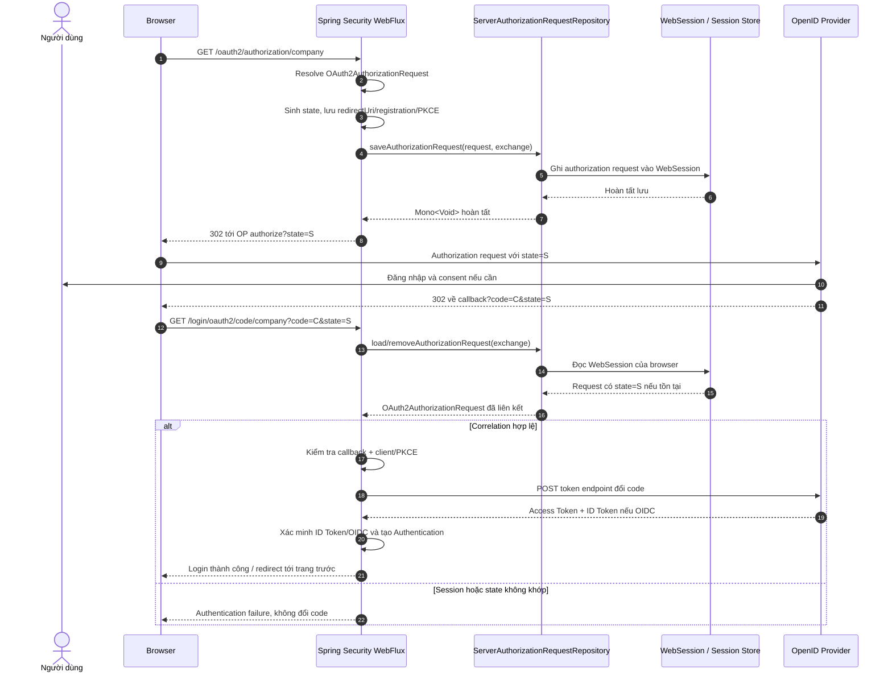

# 20.5. ServerAuthorizationRequestRepository và lưu correlation trong WebSession

Trong **Spring Security OAuth 2.0 / OIDC Client** chạy trên **Reactive WebFlux**, đăng nhập OAuth2/OIDC thường gồm hai HTTP request tới chính ứng dụng, cách nhau bởi một lần chuyển hướng qua Authorization Server hoặc OpenID Provider (OP):

1. Browser vào ứng dụng và bắt đầu đăng nhập, ví dụ `GET /oauth2/authorization/company`.
2. Sau khi người dùng xác thực tại OP, browser quay về callback, ví dụ `GET /login/oauth2/code/company?code=...&state=...`.

Hai request này **không phải cùng một request HTTP**. Làm thế nào Spring Security biết callback thuộc yêu cầu đăng nhập nào? Nó phải ghi nhớ **OAuth2AuthorizationRequest ban đầu**, tìm lại đúng bản ghi dựa trên `state` và xác nhận callback thực sự thuộc giao dịch đã bắt đầu trước đó. Công việc đó gọi là **correlation**.

Trên WebFlux, contract chịu trách nhiệm lưu và tìm authorization request là **`ServerAuthorizationRequestRepository<OAuth2AuthorizationRequest>`**. Implementation mặc định là **`WebSessionOAuth2ServerAuthorizationRequestRepository`**, dùng **`WebSession`** để giữ authorization request qua những lần HTTP redirect.

> **Ý chính:** `state` được gửi qua browser để liên hệ hai chặng giao thức; authorization request gốc được giữ ở phía ứng dụng, gắn với `WebSession` của browser. Khi callback quay lại, Spring Security phải tìm được **đúng session** và **đúng state** rồi mới tiếp tục đổi authorization code lấy token.

Bài học thuộc chương **20. Đăng nhập Reactive**, tập trung vào OAuth2/OIDC Login trên Spring WebFlux, cách lưu correlation, thứ tự `save/load/remove`, cấu hình repository và chẩn đoán lỗi session/cookie/proxy. Ví dụ dùng Spring Boot 3.x / Spring Security 6.x; một số tùy chỉnh có thể khác giữa phiên bản Spring Security, vì vậy khi phát triển thực tế cần đối chiếu Javadoc tương ứng.

---

## 1. Tại sao correlation là bắt buộc?

OAuth2 Authorization Code Flow bắt đầu từ trình duyệt, đi sang OP và quay lại ứng dụng. Từ góc nhìn Spring Security, có ít nhất hai giao dịch HTTP độc lập:

```text
HTTP request A
Browser -> Client:
GET /oauth2/authorization/company

Client -> Browser:
302 Location: https://id.example.test/authorize?...&state=S-123

[Browser chuyển tới OP, người dùng đăng nhập]

HTTP request B
Browser -> Client:
GET /login/oauth2/code/company?code=C-456&state=S-123
```

Nếu chỉ nhìn HTTP request B, ứng dụng thấy một `code` và một `state`. Nhưng nó chưa biết:

- Đây có phải callback của một flow do ứng dụng vừa khởi động không?
- `state` có bằng giá trị đã tạo ban đầu không?
- Authorization request ban đầu gắn với `registrationId` nào?
- `redirect_uri` và scope ban đầu là gì?
- Có dữ liệu PKCE `code_verifier` nào cần dùng lúc token exchange?
- Có ngữ cảnh OIDC nào như `nonce` cần đối chiếu trong ID Token?
- Callback có thuộc cùng ngữ cảnh browser/session ban đầu không?

Bằng cách lưu `OAuth2AuthorizationRequest` rồi khôi phục đúng bản ghi, Spring Security duy trì được mối liên kết giữa chặng **authorization request** và chặng **authorization response**.

### 1.1. Không có correlation có thể dẫn đến điều gì?

Nếu client chấp nhận một callback không liên quan tới request đã bắt đầu, attacker có thể tìm cách đưa một authorization response của giao dịch khác vào browser của nạn nhân. Điều này có nguy cơ dẫn đến **login CSRF**, **account/session confusion** hoặc gắn sai danh tính.

Một authorization code hợp lệ **không đủ** để client tin callback thuộc phiên login hiện tại. Client còn cần các ràng buộc của giao thức, bao gồm state/correlation, redirect URI, client registration và các kiểm tra PKCE/OIDC theo luồng.

### 1.2. State là gì?

`state` là một giá trị khó đoán, được client sinh cho authorization request. Giá trị này được gửi tới authorization endpoint, rồi OP trả lại trong authorization response.

Ví dụ minh họa:

```text
Authorization request:
    response_type=code
    client_id=portal-client
    redirect_uri=https://app.example.test/login/oauth2/code/company
    state=9xG7KpD4w...

Authorization response:
    code=ABCD...
    state=9xG7KpD4w...
```

Spring Security xác nhận **giá trị state của callback phải khớp với state của authorization request đã lưu** trong ngữ cảnh phù hợp. Không được coi `state` là khóa tự do do browser cung cấp mà không gắn với session hoặc giao dịch đã tồn tại.

**State không phải access token, không phải refresh token và không phải OAuth2 authorization code.** Đây là tham số ràng buộc giao dịch, không phải credential gọi API.

---

## 2. Sơ đồ toàn bộ Reactive OAuth2/OIDC Login



Những việc cần tách rõ:

- **Authorization request repository** giữ thông tin để liên hệ hai chặng redirect.
- **SecurityContext repository** lưu trạng thái người dùng *sau khi đã xác thực*.
- **Authorized client repository/service** lưu token đã cấp sau khi authorization thành công.
- **Request cache** có thể lưu URL người dùng định truy cập trước khi bị đưa sang login.

Chúng có thể cùng dùng session như một phần persistence, nhưng **không phải cùng một đối tượng hoặc cùng một trách nhiệm**.

## 3. OAuth2AuthorizationRequest chứa những gì?

`OAuth2AuthorizationRequest` là model do Spring Security cung cấp, thuộc:

```java
import org.springframework.security.oauth2.core.endpoint.OAuth2AuthorizationRequest;
```

Một authorization request cho Authorization Code Flow thường có:

| Thành phần | Ý nghĩa |
| --- | --- |
| `authorizationUri` | URL authorization endpoint của OP |
| `authorizationGrantType` | Thường là `authorization_code` |
| `responseType` | `code` |
| `clientId` | Client ID tại OP |
| `redirectUri` | Callback URI mà client yêu cầu |
| `scopes` | Tập scope ban đầu |
| `state` | Giá trị correlation để liên hệ authorization response |
| `additionalParameters` | Tham số mở rộng như `prompt` hoặc PKCE challenge |
| `attributes` | Metadata nội bộ của request dùng cho xử lý callback, PKCE và các ràng buộc khác |

Ví dụ về *mô hình dữ liệu logic*, không phải JSON chuẩn được Spring Security serialize ra browser:

```json
{
  "clientRegistrationId": "company",
  "authorizationUri": "https://id.example.test/oauth2/authorize",
  "clientId": "portal-client",
  "responseType": "code",
  "redirectUri": "https://app.example.test/login/oauth2/code/company",
  "scopes": ["openid", "profile", "email"],
  "state": "S-opaque-random",
  "additionalParameters": {
    "code_challenge": "REDACTED",
    "code_challenge_method": "S256"
  },
  "attributes": {
    "registration_context": "company",
    "code_verifier": "REDACTED"
  }
}
```

**Tên thuộc tính nội bộ và cách lưu cụ thể phụ thuộc phiên bản/flow**; ví dụ trên không phải schema API công khai. Không tự đọc/ghi những key nội bộ của framework như một hợp đồng ổn định.

### 3.1. Thông tin nào thuộc browser, thông tin nào nên giữ ở server?

```text
Browser/OP có thể thấy:
  client_id
  redirect_uri
  scope
  state
  code_challenge
  code_challenge_method

Ứng dụng cần giữ bí mật hoặc giữ ngữ cảnh:
  authorization request gốc
  PKCE code_verifier
  metadata gắn registration/session
  dữ liệu OIDC nonce/correlation nếu được áp dụng
```

`state` thường có mặt trong authorize URL và callback URL; do đó không nên xem nó là secret tuyệt đối. **Sự an toàn đến từ tính khó đoán và việc đối chiếu với dữ liệu đã lưu trong session của đúng browser**. Dù vậy, tránh ghi raw state vào log hoặc URL chia sẻ vì nó có thể tiết lộ chi tiết giao dịch đang diễn ra.

## 4. ServerAuthorizationRequestRepository là contract gì?

Trên Reactive WebFlux, interface nằm tại:

```java
org.springframework.security.oauth2.client.web.server
    .ServerAuthorizationRequestRepository
```

Cách khai báo type:

```java
ServerAuthorizationRequestRepository<OAuth2AuthorizationRequest> repository;
```

Ba method quan trọng:

```java
Mono<Void> saveAuthorizationRequest(
    OAuth2AuthorizationRequest authorizationRequest,
    ServerWebExchange exchange);

Mono<OAuth2AuthorizationRequest> loadAuthorizationRequest(
    ServerWebExchange exchange);

Mono<OAuth2AuthorizationRequest> removeAuthorizationRequest(
    ServerWebExchange exchange);
```

### 4.1. saveAuthorizationRequest

`saveAuthorizationRequest` được dùng để **ghi lại authorization request trước khi chuyển hướng browser sang OP**. Thông thường repo ghi request vào một store có thể truy cập lại ở callback.

Kết quả trả về là `Mono<Void>`. Trong reactive programming, không thể chỉ gọi method rồi bỏ qua publisher:

```java
// Sai về tư duy reactive: tạo Mono nhưng không subscribe/compose.
repository.saveAuthorizationRequest(authRequest, exchange);
// Sau đó lập tức redirect mà không đợi kết quả.
```

Đúng về mặt nguyên tắc:

```java
return repository.saveAuthorizationRequest(authRequest, exchange)
    .then(doRedirectToProvider());
```

`doRedirectToProvider()` ở đây là pseudocode cho một `Mono<Void>` tạo HTTP redirect; framework đã xử lý thứ tự lưu rồi redirect, ứng dụng thường không cần tự viết logic này.

### 4.2. loadAuthorizationRequest

`loadAuthorizationRequest` nhận `ServerWebExchange` của callback và tìm authorization request tương ứng.

Nếu callback không có `state`, session bị mất hoặc không có request khớp, implementation có thể trả **`Mono.empty()`**. Trong Reactor, không dùng `null` để biểu diễn “không có kết quả”.

### 4.3. removeAuthorizationRequest

`removeAuthorizationRequest` tìm request tương ứng và **loại khỏi store**, đồng thời trả lại request vừa lấy được (nếu có).

Đây là bước quan trọng để **hạn chế replay/đọc lại correlation state**. Sau khi callback đã được xử lý, authorization request không nên tồn tại mãi như một giao dịch vẫn đang chờ.

```text
Initial login:
  save(state=S, request=R)

Callback có state=S:
  load/remove(state=S) -> R
  store không còn pending request S

Callback lặp lại state=S:
  không còn R -> authentication failure
```

**Authorization code còn có tính dùng một lần ở phía OP**, nhưng việc xóa authorization request ở client vẫn là một lớp bảo vệ cần thiết.

### 4.4. Lưu ý Javadoc về tên HttpServletRequest

Ở một số trang Javadoc, phần mô tả method của interface này có thể còn dùng từ `HttpServletRequest` do tài liệu được chia sẻ từ Servlet contract. **Chữ ký API WebFlux thực sự dùng `ServerWebExchange` và trả `Mono`**, không phải `HttpServletRequest` / `HttpServletResponse`.

## 5. WebSessionOAuth2ServerAuthorizationRequestRepository mặc định

Spring Security cung cấp:

```java
import org.springframework.security.oauth2.client.web.server
    .WebSessionOAuth2ServerAuthorizationRequestRepository;
```

Class này cài đặt:

```java
ServerAuthorizationRequestRepository<OAuth2AuthorizationRequest>
```

và **lưu authorization request trong `WebSession`**. Khi một login được khởi động, Spring Security lưu request; khi browser quay về callback với session và state phù hợp, repo tìm và lấy request tương ứng.

### 5.1. WebSession không phải một cookie chứa toàn bộ OAuth2AuthorizationRequest

`WebSession` là session abstraction của Spring WebFlux. Với nhiều cấu hình triển khai, browser chỉ giữ **cookie định danh session**, còn nội dung session nằm trong memory hoặc store như Redis.

```text
Browser:
  Cookie: SESSION=<session-id>

Server/WebSession store:
  session-id -> attributes
                 +-- pending OAuth2AuthorizationRequest(s)
                 +-- dữ liệu session khác
```

Đừng cho rằng vì browser có cookie SESSION nên nó đang giữ raw `code_verifier` hoặc toàn bộ authorization request trong cookie. Cookie thường là **khóa định danh truy cập session**, còn dữ liệu phải được bảo vệ ở phía server/store.

**Session ID là credential có giá trị bảo mật.** Nếu attacker lấy được session cookie, có thể tạo rủi ro session hijacking, vì thế cần HTTPS, cookie attributes và quản lý session phù hợp.

### 5.2. WebSession được lấy từ ServerWebExchange

Trong WebFlux:

```java
Mono<WebSession> sessionMono = exchange.getSession();
```

Bản thân `getSession()` là reactive API. Khi dùng repository mặc định, bạn không cần tự viết `exchange.getSession().flatMap(...)` trong controller OAuth2 callback.

### 5.3. Vì sao repo mặc định phù hợp đa số ứng dụng?

Nó giải quyết những trách nhiệm dễ sai:

- Tìm đúng WebSession qua `ServerWebExchange`.
- Lưu authorization request trước redirect.
- Gắn thao tác lookup/remove với `state` của callback.
- Trả publisher đúng chuẩn Reactor.
- Tách trách nhiệm lưu correlation khỏi logic xác thực token.

**Ứng dụng WebFlux OAuth2 Login thông thường không cần tự viết lại repo chỉ để dùng WebSession.** Chỉ thay khi có yêu cầu đặc biệt về storage, multi-tab, TTL, observability hoặc kiến trúc session.

## 6. Phân biệt WebSession và SecurityContext

Một người dùng có thể **chưa hề đăng nhập**, nhưng đã có WebSession chứa authorization request đang chờ:

```text
Trước callback:
  WebSession đã có pending OAuth2AuthorizationRequest
  SecurityContext chưa có OAuth2 login Authentication

Sau callback hợp lệ:
  Spring Security tạo Authentication
  ReactiveSecurityContextHolder/SecurityContext repository quản lý
  Authorized client có thể được lưu riêng
  Pending authorization request được loại bỏ
```

Vì vậy:

- **Authorization request repository** không phải nơi lưu trạng thái đăng nhập lâu dài.
- **`WebSessionServerSecurityContextRepository`** có thể lưu Authentication/SecurityContext sau đăng nhập.
- **`ServerOAuth2AuthorizedClientRepository`** lưu `OAuth2AuthorizedClient`, gồm access token và có thể refresh token.
- **`ServerRequestCache`** có thể ghi nhớ URL cần truy cập sau login.

Mọi thứ có thể cùng sử dụng một WebSession hoặc store, nhưng **không thay thế nhau**.

### 6.1. Không lấy access token từ authorization request repository

Ở thời điểm `saveAuthorizationRequest`, ứng dụng **chưa đổi authorization code lấy access token**; thông thường authorization request chưa chứa access token. Đừng đọc repository này với kỳ vọng tìm refresh token hoặc ID Token.

### 6.2. Không nhầm state với SecurityContext

`state` chỉ ràng buộc hai chặng của Authorization Code Flow. Nó **không phải bằng chứng user đã xác thực thành công**, không được dùng để cấp ROLE_ADMIN hoặc chọn account nội bộ.

## 7. Các WebFlux filter/liên kết xử lý liên quan

Những thành phần quan trọng:

| Thành phần | Trách nhiệm |
| --- | --- |
| **`OAuth2AuthorizationRequestRedirectWebFilter`** | Nhận yêu cầu bắt đầu OAuth2 authorization, tạo và lưu authorization request, redirect browser |
| **`ServerOAuth2AuthorizationRequestResolver`** | Tạo `OAuth2AuthorizationRequest` phù hợp registration/endpoint |
| **`ServerAuthorizationRequestRepository`** | Lưu và tìm correlation qua redirect |
| **`WebSessionOAuth2ServerAuthorizationRequestRepository`** | Repo mặc định dựa trên WebSession |
| **`ServerOAuth2AuthorizationCodeAuthenticationTokenConverter`** | Chuyển callback WebFlux sang authentication token cho code flow, dùng repository |
| **`AuthenticationWebFilter` / OAuth2 login flow** | Điều phối authentication khi nhận callback hợp lệ |
| **`ReactiveClientRegistrationRepository`** | Cung cấp metadata của registrations |
| **`ReactiveOAuth2AccessTokenResponseClient`** | Đổi authorization code lấy token ở token endpoint |
| **`ReactiveOAuth2AuthorizedClientService`** | Lưu authorized client theo registration/principal ngoài session request khi phù hợp |

### 7.1. Đường bắt đầu authorization

Với cấu hình thông thường, endpoint:

```text
GET /oauth2/authorization/{registrationId}
```

được xử lý bởi cơ chế OAuth2 authorization redirect. Resolver dùng registration để dựng authorize URL, sinh `state` và các tham số liên quan. Repo lưu request gốc trước khi browser rời ứng dụng.

### 7.2. Đường callback

Mặc định:

```text
GET /login/oauth2/code/{registrationId}?code=...&state=...
```

Spring Security dùng callback data và repo để tìm authorization request tương ứng, rồi tiếp tục authentication và token exchange.

**Không nên tự viết controller trùng callback path**, vì request này đã thuộc trách nhiệm filter WebFlux Security, trừ khi bạn chủ đích thay đổi toàn bộ flow với hiểu biết đầy đủ.

### 7.3. Không dùng Servlet classes trong reactive flow

Tránh trộn các class:

| Servlet | Reactive WebFlux |
| --- | --- |
| `HttpSessionOAuth2AuthorizationRequestRepository` | `WebSessionOAuth2ServerAuthorizationRequestRepository` |
| `AuthorizationRequestRepository` | `ServerAuthorizationRequestRepository` |
| `HttpSecurity` | `ServerHttpSecurity` |
| `SecurityFilterChain` | `SecurityWebFilterChain` |
| `HttpServletRequest` | `ServerWebExchange` |
| `ClientRegistrationRepository` | `ReactiveClientRegistrationRepository` |

Những tên rất giống nhau, nhưng signatures và persistence model khác nhau.

## 8. Cấu hình Spring Boot WebFlux OAuth2/OIDC Login

### 8.1. Dependencies Maven

Một ứng dụng thuần WebFlux có thể dùng:

```xml
<dependencies>
    <dependency>
        <groupId>org.springframework.boot</groupId>
        <artifactId>spring-boot-starter-webflux</artifactId>
    </dependency>
    <dependency>
        <groupId>org.springframework.boot</groupId>
        <artifactId>spring-boot-starter-security</artifactId>
    </dependency>
    <dependency>
        <groupId>org.springframework.boot</groupId>
        <artifactId>spring-boot-starter-oauth2-client</artifactId>
    </dependency>
</dependencies>
```

Đây là **WebFlux application**; không cần thêm `spring-boot-starter-web` chỉ để đăng nhập. Nếu cả hai starters cùng có mặt, Spring Boot thường chọn MVC server trừ khi đã được cấu hình khác; bài này giả định request đi qua **Reactive WebFilter chain**.

### 8.2. application.yml

```yaml
spring:
  security:
    oauth2:
      client:
        registration:
          company:
            provider: company
            client-id: ${OIDC_CLIENT_ID}
            client-secret: ${OIDC_CLIENT_SECRET}
            authorization-grant-type: authorization_code
            redirect-uri: "{baseUrl}/login/oauth2/code/{registrationId}"
            scope:
              - openid
              - profile
              - email

        provider:
          company:
            issuer-uri: https://id.example.test/realms/company
```

Cấu hình này minh họa một OP hỗ trợ OIDC Discovery. `issuer-uri` cần trùng issuer chính thức của OP theo contract; không tự đổi sang host tùy ý.

### 8.3. SecurityWebFilterChain mặc định

```java
import org.springframework.context.annotation.Bean;
import org.springframework.context.annotation.Configuration;
import org.springframework.security.config.Customizer;
import org.springframework.security.config.annotation.web.reactive.EnableWebFluxSecurity;
import org.springframework.security.config.web.server.ServerHttpSecurity;
import org.springframework.security.web.server.SecurityWebFilterChain;

@Configuration
@EnableWebFluxSecurity
class ReactiveSecurityConfig {

    @Bean
    SecurityWebFilterChain securityWebFilterChain(ServerHttpSecurity http) {
        return http
            .authorizeExchange(exchanges -> exchanges
                .pathMatchers("/", "/error", "/public/**").permitAll()
                .anyExchange().authenticated())
            .oauth2Login(Customizer.withDefaults())
            .build();
    }
}
```

Với cấu hình này, Spring Security tự dùng repository mặc định cho correlation của OIDC Login. **Không cần khai báo WebSession OAuth2 repo bean** trừ khi muốn cấu hình rõ hoặc thay implementation.

### 8.4. Đăng nhập và callback

```text
GET /oauth2/authorization/company

=> 302 đến OP
=> OP xử lý login/consent
=> redirect đến /login/oauth2/code/company?code=...&state=...
=> Spring Security tìm request đã lưu trong WebSession
=> token exchange + OIDC validation
=> Authentication
```

Với Authorization Code Flow, cookie/session phải tồn tại và được browser gửi lại lúc callback. Nếu session mất giữa hai chặng, correlation không thể hoàn tất.

## 9. Đăng ký repository tường minh trong OAuth2 Login

Có thể tạo bean rồi gắn vào DSL:

```java
import org.springframework.context.annotation.Bean;
import org.springframework.context.annotation.Configuration;
import org.springframework.security.config.annotation.web.reactive.EnableWebFluxSecurity;
import org.springframework.security.config.web.server.ServerHttpSecurity;
import org.springframework.security.oauth2.client.web.server.ServerAuthorizationRequestRepository;
import org.springframework.security.oauth2.client.web.server.WebSessionOAuth2ServerAuthorizationRequestRepository;
import org.springframework.security.oauth2.core.endpoint.OAuth2AuthorizationRequest;
import org.springframework.security.web.server.SecurityWebFilterChain;

@Configuration
@EnableWebFluxSecurity
class OAuth2CorrelationConfiguration {

    @Bean
    ServerAuthorizationRequestRepository<OAuth2AuthorizationRequest>
            authorizationRequestRepository() {

        return new WebSessionOAuth2ServerAuthorizationRequestRepository();
    }

    @Bean
    SecurityWebFilterChain securityWebFilterChain(
            ServerHttpSecurity http,
            ServerAuthorizationRequestRepository<OAuth2AuthorizationRequest>
                    authorizationRequestRepository) {

        return http
            .authorizeExchange(exchanges -> exchanges
                .pathMatchers("/", "/error").permitAll()
                .anyExchange().authenticated())
            .oauth2Login(login -> login
                .authorizationRequestRepository(authorizationRequestRepository))
            .build();
    }
}
```

Điều này tương đương chủ yếu với default behavior, nhưng cho thấy extension point chính xác.

**Lưu ý:** thêm một `@Bean` repository không phải lúc nào cũng tự động thay repository mà DSL đã lựa chọn trong mọi phiên bản/cách cấu hình. Khi thay custom implementation, nên **đăng ký tường minh bằng `.oauth2Login(login -> login.authorizationRequestRepository(repo))`** để tránh không nhất quán.

### 9.1. Khi ứng dụng dùng cả oauth2Login và oauth2Client

Ứng dụng có thể dùng OAuth2 Login **và** OAuth2 Client Authorization Code Flow riêng để kết nối API khác. Hai đường xử lý cần nhất quán về nơi lưu authorization requests.

Ví dụ:

```java
return http
    .authorizeExchange(exchanges -> exchanges
        .anyExchange().authenticated())
    .oauth2Login(login -> login
        .authorizationRequestRepository(authorizationRequestRepository))
    .oauth2Client(client -> client
        .authorizationRequestRepository(authorizationRequestRepository))
    .build();
```

Đây là cách **chủ động dùng chung cùng một repository** cho hai extension points. Với custom storage, phải bảo đảm cách xử lý state phù hợp cho cả login flow và client authorization flow; không nên lưu cùng một key đơn lẻ rồi để flow này ghi đè flow kia.

Không phải ứng dụng nào cũng cần bật `oauth2Client()` tường minh; ví dụ chỉ làm rõ trách nhiệm khi có hai flow.

## 10. Cách WebSession nối hai request khác nhau

Một điểm quan trọng: ở thời điểm callback, server phải biết đây là **WebSession của browser đã bắt đầu flow**.

### 10.1. Cookie session định danh browser

Một flow có thể diễn ra:

```text
1. Browser -> App:
   GET /oauth2/authorization/company

2. App -> Browser:
   HTTP/1.1 302 Found
   Set-Cookie: SESSION=<opaque-session-id>; Path=/; Secure; HttpOnly; SameSite=Lax
   Location: https://id.example.test/authorize?...&state=S

3. Browser -> OP:
   GET /authorize?...&state=S

4. OP -> Browser:
   HTTP/1.1 302 Found
   Location: https://app.example.test/login/oauth2/code/company?code=C&state=S

5. Browser -> App:
   GET /login/oauth2/code/company?code=C&state=S
   Cookie: SESSION=<same-opaque-session-id>

6. App:
   WebSession(session-id) -> authorization request state=S
   Correlation thành công
```

Cookie attributes là **ví dụ triển khai**, không phải bắt buộc tất cả ứng dụng đều đúng cùng một tên/giá trị. Tên cookie, Path, SameSite, Secure và session storage phụ thuộc configuration.

### 10.2. Vì sao session cookie cần được gửi lại?

Authorization request đã được lưu ở session **X**. Nếu callback tới với một cookie khác hoặc không có cookie:

```text
Authorization start:
  WebSession X -> state=S

Callback:
  WebSession Y -> no state=S
```

thì server không thể liên hệ callback với request gốc. Kết quả thường là lỗi authentication như `authorization_request_not_found` hoặc lỗi state/correlation tương đương, tùy điểm xử lý và phiên bản.

**Không nên “fix” bằng cách bỏ kiểm tra state hoặc tìm request trên tất cả sessions**. Cần giải quyết nguyên nhân session/cookie/proxy.

### 10.3. Session tồn tại trước khi user login

Một số người hiểu nhầm phải có Authentication rồi mới có session. Thực tế, WebSession có thể được tạo trong giai đoạn **chưa đăng nhập**, chỉ để lưu authorization request phục vụ callback.

Do vậy, một user mới mở trình duyệt vẫn có thể nhận SESSION cookie trước khi OAuth2 login hoàn tất.

## 11. SameSite và OAuth2 callback

Cookie SameSite ảnh hưởng việc browser có gửi session cookie khi quay lại từ OP hay không.

| SameSite | Tính chất liên quan | Lưu ý với login |
| --- | --- | --- |
| **Lax** | Thường cho phép cookie trong cross-site top-level navigation sử dụng phương thức an toàn như GET | Phù hợp với redirect callback GET trong nhiều flow |
| **Strict** | Chặt chẽ hơn khi điều hướng từ site ngoài | Có thể khiến callback cross-site không gửi session cookie |
| **None** | Cho phép gửi cookie trong cross-site context | Trình duyệt hiện đại thường yêu cầu `Secure`; cần đánh giá CSRF và bảo vệ bổ sung |

**Không đặt SameSite=None chỉ vì login lỗi mà chưa kiểm tra nguyên nhân.** Đầu tiên cần xem callback là GET hay POST, cookie thực tế gửi/không gửi, domain, path, reverse proxy và HTTPS.

### 11.1. response_mode=form_post

Một số OP có thể trả authorization response qua **cross-site POST** thay vì redirect GET. Với SameSite=Lax, cookie có thể không được gửi trong cross-site POST, gây mất WebSession và correlation.

Nếu ứng dụng cần `form_post` theo OP, phải cấu hình cookie và callback handling phù hợp với security model, cân nhắc `SameSite=None; Secure`, CSRF và các hạn chế trình duyệt. Không giả định endpoint mặc định của mọi phiên bản Spring Security chấp nhận mọi response mode mà không cần cấu hình.

### 11.2. Cookie Secure, HttpOnly và Path

- **Secure:** chỉ gửi cookie qua HTTPS; trên production nên dùng HTTPS từ browser đến public origin.
- **HttpOnly:** giảm khả năng JavaScript đọc session ID.
- **Path:** cần bao phủ cả endpoint bắt đầu login và callback; nếu Path quá hẹp, callback có thể không nhận cookie.
- **Domain:** phải phù hợp origin mà browser thực sự truy cập; đừng đặt domain rộng quá nhu cầu.
- **Max-Age/expiry:** không làm session hết hạn giữa hai chặng login.

**HttpOnly không ngăn mọi CSRF**; cookie security là một lớp, còn state/correlation vẫn phải được kiểm tra đúng.

## 12. Session timeout và correlation timeout

Spring Boot 3.x hỗ trợ các thuộc tính session WebFlux. Ví dụ:

```yaml
server:
  reactive:
    session:
      timeout: 30m
      cookie:
        secure: true
        http-only: true
        same-site: lax
```

Đây là một cấu hình minh họa cho môi trường sử dụng HTTPS. **Cần xem ứng dụng dùng session store mặc định hay Spring Session**: khi dùng Spring Session, timeout có thể được điều khiển bằng `spring.session.timeout` theo auto-configuration.

### 12.1. Session timeout không phải access token lifetime

```text
WebSession timeout:       ví dụ 30 phút
Authorization code TTL:   do OP quyết định, thường ngắn
Access token TTL:         do Authorization Server quyết định
Refresh token lifetime:   do OP và client policy quyết định
```

Những khoảng thời gian này **khác nhau**. Một correlation bị mất do WebSession timeout không chứng minh access token hết hạn; ở giai đoạn callback, access token còn chưa chắc đã được cấp.

### 12.2. Nếu user mất quá lâu ở trang OP

Người dùng mở trang login của OP, để đó vượt session timeout, rồi mới xác thực. Khi quay lại, `WebSession` đã hết hạn hoặc bị loại. Client không tìm được authorization request ban đầu.

Hướng xử lý hợp lý là báo phiên đăng nhập đã hết hạn và **bắt đầu flow mới**, không chấp nhận callback cũ bằng cách nới lỏng state validation.

### 12.3. Không lưu pending authorization request vô thời hạn

Nếu tự viết repository bằng Redis/database, cần áp dụng **TTL phù hợp, một lần sử dụng, cleanup, giới hạn số request đang chờ**. Một store không giới hạn số state có thể bị tấn công gây tăng bộ nhớ hoặc storage pressure.

## 13. Multi-tab và nhiều authorization requests song song

Một browser có thể bắt đầu hai login flows ở hai tab gần như cùng lúc:

```text
Tab A: /oauth2/authorization/company
  state = S-A

Tab B: /oauth2/authorization/partner
  state = S-B

Callback B về trước: ?code=...&state=S-B
Callback A về sau:  ?code=...&state=S-A
```

Đây là một trường hợp quan trọng vì cả hai tab có thể dùng **cùng cookie/session**.

### 13.1. Repository cần liên kết request theo state

Một thiết kế lưu nhiều pending requests có thể dùng cấu trúc logic:

```text
WebSession X:
  pendingAuthorizationRequests:
    S-A -> OAuth2AuthorizationRequest(company)
    S-B -> OAuth2AuthorizationRequest(partner)
```

Khi callback B quay về, repository phải lấy **S-B** mà không nhầm thành A. Sau khi xử lý, chỉ remove S-B; callback A vẫn có thể được xử lý nếu còn hợp lệ.

### 13.2. Default repo hỗ trợ nhiều request như thế nào?

Hành vi chi tiết (ví dụ hạn mức pending requests và cách ánh xạ state) **có thể thay đổi theo phiên bản Spring Security**. Các phiên bản cũ từng có tùy chọn cho nhiều requests, trong khi một số API cấu hình đã bị deprecate/loại bỏ.

**Không mặc định `WebSessionOAuth2ServerAuthorizationRequestRepository` của mọi phiên bản xử lý tất cả mô hình multi-tab giống nhau**. Nếu ứng dụng có nhu cầu mở nhiều authorization flows đồng thời, hãy xác nhận phiên bản và xây chính sách storage/correlation phù hợp; không thay repo bằng một slot duy nhất nếu sản phẩm cần nhiều flows.

### 13.3. Rủi ro của custom repo chỉ có một key

Ví dụ triển khai đơn giản:

```text
session.setAttribute("AUTH_REQUEST", authorizationRequest)
```

có thể khiến request B ghi đè request A, dù hai flow có state khác nhau. Khi callback A quay về, chỉ còn B → state mismatch.

Một custom repo cần xác định rõ:
- Có hỗ trợ nhiều pending requests không?
- Key theo state hay theo (session, state)?
- TTL và maximum pending requests?
- Khi remove có xóa đúng một entry không?
- Đồng thời nhiều request trên một session có bị lost update không?
- Session serialization qua Redis có giữ update đúng không?

**Không dùng các câu hỏi đó làm lý do bỏ qua correlation**; đây là đặc tả cần hoàn thiện của repository.

## 14. Cách cấu hình logging an toàn cho repository

Khi chẩn đoán một lỗi login, thường muốn biết “đã lưu”, “đã đọc”, “đã xóa” request nào. Nhưng phải tránh đưa thông tin nhạy cảm vào log.

Một giải pháp là **decorator** gọi repository mặc định, chỉ ghi nhận sự kiện đã được lọc:

```java
import org.slf4j.Logger;
import org.slf4j.LoggerFactory;
import org.springframework.security.oauth2.client.web.server
    .ServerAuthorizationRequestRepository;
import org.springframework.security.oauth2.client.web.server
    .WebSessionOAuth2ServerAuthorizationRequestRepository;
import org.springframework.security.oauth2.core.endpoint.OAuth2AuthorizationRequest;
import org.springframework.web.server.ServerWebExchange;
import reactor.core.publisher.Mono;

public final class ObservedAuthorizationRequestRepository
        implements ServerAuthorizationRequestRepository<OAuth2AuthorizationRequest> {

    private static final Logger log =
        LoggerFactory.getLogger(ObservedAuthorizationRequestRepository.class);

    private final ServerAuthorizationRequestRepository<OAuth2AuthorizationRequest>
        delegate = new WebSessionOAuth2ServerAuthorizationRequestRepository();

    @Override
    public Mono<Void> saveAuthorizationRequest(
            OAuth2AuthorizationRequest request,
            ServerWebExchange exchange) {

        return delegate.saveAuthorizationRequest(request, exchange)
            .doOnSuccess(ignored ->
                log.debug("OAuth2 correlation event=stored"));
    }

    @Override
    public Mono<OAuth2AuthorizationRequest> loadAuthorizationRequest(
            ServerWebExchange exchange) {

        return delegate.loadAuthorizationRequest(exchange)
            .doOnNext(ignored ->
                log.debug("OAuth2 correlation event=found"));
    }

    @Override
    public Mono<OAuth2AuthorizationRequest> removeAuthorizationRequest(
            ServerWebExchange exchange) {

        return delegate.removeAuthorizationRequest(exchange)
            .doOnNext(ignored ->
                log.debug("OAuth2 correlation event=consumed"));
    }
}
```

Trong Java source thật, các dòng `import` phải viết liền tên package/class:

```java
import org.springframework.security.oauth2.client.web.server.ServerAuthorizationRequestRepository;
import org.springframework.security.oauth2.client.web.server.WebSessionOAuth2ServerAuthorizationRequestRepository;
```

**Đây là decorator để quan sát, không thay đổi logic correlation**. Không log `request.getState()`, `code_verifier`, raw authorization URL, cookie hoặc token.

### 14.1. Đăng ký decorator

```java
@Bean
ServerAuthorizationRequestRepository<OAuth2AuthorizationRequest>
        authorizationRequestRepository() {
    return new ObservedAuthorizationRequestRepository();
}
```

Sau đó gắn bean vào `oauth2Login(login -> login.authorizationRequestRepository(...))` như mục 9. Với cả `oauth2Client()`, hãy cân nhắc cấu hình cùng bean nếu cần observability ở cả hai flows.

### 14.2. Vì sao decorator phải giữ nguyên Mono?

Không gọi `.block()` trong repository; không tự `subscribe()` bên trong method. Cần **trả về publisher** từ delegate để framework quyết định thời điểm subscribe, và đảm bảo thứ tự lưu/đọc/xóa trong reactive pipeline.

## 15. Khi nào nên tự viết ServerAuthorizationRequestRepository?

Một custom implementation phù hợp khi có yêu cầu rõ ràng:

| Nhu cầu | Lý do cân nhắc custom |
| --- | --- |
| Shared session phân tán | Cần bảo đảm correlation vẫn tìm được khi callback tới node khác |
| Giới hạn pending requests | Tránh lưu quá nhiều authorization flows trong cùng session |
| Multi-tab/custom UX | Cần mapping và concurrency policy theo state |
| TTL riêng | Cần expiry ngắn hơn hoặc khác session timeout |
| Audit/observability | Cần thống kê các bước mà không log secrets |
| Sessionless/BFF architecture đặc biệt | Cần một correlation store an toàn khác, vẫn ràng buộc browser context |
| Multi-tenant/provider policy | Cần ngăn việc một context đọc authorization request của tenant/provider khác |

**Tuy nhiên:** nếu chỉ muốn bật đăng nhập OIDC trên WebFlux, repository mặc định thường là điểm bắt đầu phù hợp. Tự viết lại state validation, PKCE hoặc cookie/session binding có thể tạo lỗ hổng mới.

### 15.1. Contract của custom repository

Một implementation an toàn cần đáp ứng:

1. `save` chỉ nhận request có `state` phù hợp và lưu server-side ở ngữ cảnh đáng tin.
2. `load` dùng **state của callback** và browser/session context để tìm đúng entry.
3. `remove` xóa **đúng entry** sau khi xác định match; không xóa state của tab khác.
4. Khi không có entry: trả `Mono.empty()`.
5. TTL, size limit và cleanup được thiết kế rõ.
6. Không serialize secret/correlation data ra frontend.
7. Không dùng user input để chọn tenant, principal hoặc session của người khác.
8. Nếu dùng distributed store, phải xử lý thao tác concurrent và atomicity.
9. Token exchange phải dùng authorization request đúng registration.
10. Không chặn event loop bởi blocking database/Redis client.

### 15.2. Cấu trúc lưu trữ logic theo (session, state)

```text
Key:
  sessionId + ":" + state

Value:
  OAuth2AuthorizationRequest (serialized server-side)

Metadata:
  issuedAt
  expiry
  registrationId
  oneTimeUse
```

Đây là **pseudomodel**, không phải gợi ý sử dụng raw session ID/state làm key in logs hoặc lưu dữ liệu không mã hóa. Key nên được quản lý an toàn, có TTL và giới hạn truy cập; với session store phân tán cần xem rủi ro concurrency.

### 15.3. Vì sao không lưu theo state toàn cục rồi lấy bất kỳ request nào?

Nếu chỉ dùng:

```text
correlationStore[state] -> OAuth2AuthorizationRequest
```

và cho bất kỳ browser nào gửi `state` để lấy entry, có thể làm mất yếu tố **ràng buộc với browser/session gốc**, đặc biệt trong các mô hình login CSRF và account mix-up. State khó đoán là một phần quan trọng nhưng custom design phải phân tích toàn bộ threat model, trong đó có session binding, expiry, nonce, PKCE, replay và client mix-up.

**Tránh thay WebSession repo bằng stateless cookie thuần chỉ để “đỡ phải dùng Redis”** nếu chưa có cơ chế bảo vệ dữ liệu và integrity, expiry, session binding và anti-replay phù hợp.

## 16. Spring Session và deployment nhiều instance

Trong production, có thể chạy nhiều instance:

```text
Browser
  |
  v
Load Balancer
  |
  +--> App Node A
  |
  +--> App Node B
```

Một flow:

```text
1. GET /oauth2/authorization/company -> Node A
2. Node A lưu authorization request vào WebSession cục bộ
3. Browser redirect sang OP
4. Callback /login/oauth2/code/company -> Node B
5. Node B không thấy session/request đã lưu tại A
6. Correlation thất bại
```

### 16.1. Hướng giải quyết

- **Shared session store**, ví dụ Spring Session + Redis, để mọi node đọc được cùng session.
- **Sticky sessions** có thể giảm rủi ro ngắn hạn nhưng không giải quyết node restart/failover hoàn toàn.
- Không tự đồng bộ state bằng query parameter tới backend mà bỏ session binding.
- Đảm bảo các node có cấu hình security, serialization, encryption và client registration đồng nhất.
- Kiểm tra session cookie đi qua Load Balancer/Ingress đúng domain/path.

Trong Spring Boot reactive app, Spring Session có thể tích hợp Redis thông qua starter tương ứng. Chọn version và cấu hình phù hợp với Spring Boot/Spring Security đang triển khai.

### 16.2. Distributed session không tự đảm bảo mọi mutation được lưu

Một custom repository có thể đọc Map từ session rồi sửa Map đó ngay:

```java
// Ý tưởng dễ gây lỗi trên một số session stores:
Map<String, Object> map = session.getAttribute("pending");
map.put(state, request);
```

Nếu store chỉ theo dõi `setAttribute` hoặc cơ chế change detection khác, mutation in-place có thể không được persist như kỳ vọng. Khi dùng Redis/session store, cần hiểu contract cập nhật của implementation và **ghi lại attribute đã thay đổi theo cách được hỗ trợ**.

Ngoài persistence, concurrent writes của hai tab/nodes có thể gây lost update nếu chúng cùng đọc/sửa một Map rồi ghi đè.

### 16.3. Session không nên chứa vô hạn pending requests

Mỗi lần user bắt đầu OAuth2 Login có thể sinh authorization request mới. Nếu có thể khởi động hàng nghìn flows mà không giới hạn, hệ thống chịu rủi ro tăng memory/store usage. Tùy version và custom store, cần giới hạn pending count, TTL và kích thước dữ liệu; không lưu tùy tiện toàn bộ callback headers/parameters vào session.

## 17. Redirect URI, reverse proxy và forwarded headers

Dù session và state đúng, OAuth2 Login vẫn có thể thất bại vì **redirect URI không khớp với đăng ký tại OP**.

Ví dụ app đứng sau reverse proxy:

```text
Public URL:  https://app.example.test
Internal:    http://app-service:8080
```

Spring Security phải tạo redirect URI dựa trên **public origin** đúng:

```text
https://app.example.test/login/oauth2/code/company
```

không phải:

```text
http://app-service:8080/login/oauth2/code/company
```

Ở Spring Boot, khi cần và tin cậy proxy, có thể cấu hình forwarded headers theo mô hình triển khai:

```yaml
server:
  forward-headers-strategy: framework
```

Tuy nhiên, forwarded headers phải được **proxy tin cậy kiểm soát**, không được dùng raw `X-Forwarded-Host` từ client bên ngoài để tự dựng redirect URI tùy ý.

### 17.1. Redirect mismatch không đồng nghĩa state mismatch

| Dấu hiệu | Nơi phát hiện | Hướng xem |
| --- | --- | --- |
| OP báo `redirect_uri_mismatch` | Authorization endpoint/token endpoint | Client registration, public origin, forwarded headers |
| Callback về ứng dụng nhưng thiếu session cookie | Browser/app | Cookie, SameSite, domain, HTTPS, proxy |
| Session có nhưng không có request khớp state | Spring Security repo | Storage, multi-tab, callback state, TTL |
| State match nhưng token endpoint báo `invalid_grant` | OP token endpoint | Code reuse/expiry, PKCE, redirect URI, client auth |
| ID Token nonce không hợp lệ | OIDC validation | Nonce, token/provider, request linkage |

Không “sửa” lỗi redirect bằng cách bỏ state validation; hai vấn đề nằm ở ranh giới khác nhau.

## 18. PKCE: thêm một ràng buộc ngoài state

Với Authorization Code + PKCE, ứng dụng tạo:

- **`code_verifier`**: giá trị khó đoán, chỉ client giữ;
- **`code_challenge`**: được suy ra từ verifier, gửi tới authorization endpoint;
- **`code_challenge_method`**: thường là `S256`.

Authorization request logic:

```text
code_verifier = random verifier kept client-side/server-side
code_challenge = BASE64URL(SHA256(code_verifier))
send to OP:
    code_challenge=...
    code_challenge_method=S256
```

Tại callback, client phải dùng **đúng `code_verifier` gắn với authorization request ban đầu** trong token request. Nếu mất authorization request đã lưu, client có thể không khôi phục được verifier để đổi code.

### 18.1. State và PKCE giải quyết hai vấn đề khác nhau

| Cơ chế | Vai trò |
| --- | --- |
| `state` | Liên hệ authorization response với request gốc, chống một số loại CSRF/mix-up |
| PKCE `code_verifier` | Chứng minh bên đổi code là bên đã bắt đầu authorization request có challenge tương ứng |
| OIDC `nonce` | Ràng buộc ID Token với yêu cầu xác thực khi được sử dụng |
| Session cookie | Giúp client tìm đúng dữ liệu correlation đã lưu cho browser |

**Không thay thế state bằng PKCE một cách tùy tiện**: chính sách OAuth2/OIDC và framework có các điều kiện yêu cầu riêng; implementation cần tuân thủ flow đã cấu hình.

### 18.2. Không đưa verifier vào query callback

`code_verifier` phải được giữ trong ngữ cảnh phù hợp để gửi qua token endpoint. Đừng nhét nó vào `redirect_uri` hoặc để browser tự gửi lại dưới dạng query tuỳ ý.

## 19. OIDC nonce và subject validation

Khi `openid` scope được dùng, flow có **ID Token**. OIDC có thêm ràng buộc về issuer, audience, signature, expiry và tùy trường hợp **`nonce`**.

- `state` liên hệ authorization response với authorization request.
- `nonce` (nếu được dùng) liên hệ ID Token với yêu cầu xác thực.
- `sub` xác định subject của user theo issuer.
- Khi có UserInfo Response, `sub` UserInfo phải khớp `sub` ID Token.

**Không coi state match là chứng minh ID Token hợp lệ.** Sau correlation, Spring Security vẫn phải xác minh token và OIDC claims theo quy trình.

### 19.1. Cùng một session có thể có nhiều lần login

Một user có thể bắt đầu login với provider A rồi provider B. Nếu custom repository chỉ lưu nonce/verifier theo một key toàn cục, dữ liệu của hai flows dễ bị trộn.

Đối với giao dịch OIDC, nonce và các metadata đi kèm phải gắn đúng authorization request/client registration tương ứng.

## 20. Tự quan sát WebSession mà không làm lộ state

Trong môi trường phát triển, có thể tạo endpoint chỉ trả metadata về trạng thái session (không đọc trực tiếp key nội bộ của Spring Security):

```java
import java.util.Map;

import org.springframework.web.bind.annotation.GetMapping;
import org.springframework.web.bind.annotation.RestController;
import org.springframework.web.server.ServerWebExchange;
import reactor.core.publisher.Mono;

@RestController
class SessionDiagnosticController {

    @GetMapping("/internal/session/status")
    Mono<Map<String, Object>> sessionStatus(ServerWebExchange exchange) {
        return exchange.getSession()
            .map(session -> Map.of(
                "sessionStarted", session.isStarted(),
                "sessionExpired", session.isExpired(),
                "maxIdleTime", session.getMaxIdleTime().toString()
            ));
    }
}
```

Endpoint này **chỉ nên được phép truy cập trong môi trường chẩn đoán được kiểm soát**, không công khai cho mọi user. Mỗi lần gọi `getSession()` có thể tham gia quản lý session; không sử dụng endpoint như một cách kiểm tra login hợp lệ cho business logic.

### 20.1. Không log session ID

Sai:

```java
// KHÔNG NÊN:
log.info("Session id = {}", session.getId());
log.info("OAuth state = {}", authorizationRequest.getState());
log.info("Verifier = {}", authorizationRequest.getAttributes());
```

Nên dùng metadata đã lọc, ví dụ event `correlation_stored`, `correlation_missing`, `correlation_consumed`, provider registration ID đã kiểm soát và trace ID nội bộ.

### 20.2. Tránh log toàn bộ callback URL

```text
/login/oauth2/code/company?code=SECRET_CODE&state=S
```

OAuth2 authorization code là credential ngắn hạn và `state` là correlation data. Reverse proxy/access log, exception stacktrace hoặc analytics có thể ghi query string. Cần redaction cho `code`, `state` và các trường nhạy cảm.

## 21. Cấu hình timeout và session cookie theo môi trường

Một app có thể có ba môi trường:

| Môi trường | Public URL | Session strategy cần quan tâm |
| --- | --- | --- |
| Local | `http://localhost:8080` | Cookie phù hợp HTTP local, tránh đặt Secure bắt buộc nếu không dùng HTTPS |
| Staging | `https://staging.example.test` | HTTPS, cookie path/domain đúng, store phù hợp nhiều instance |
| Production | `https://app.example.test` | HTTPS bắt buộc, session store tin cậy, cookie Secure/HttpOnly, TTL/audit |

### 21.1. Localhost và Secure cookie

Nếu cấu hình cookie `secure: true` nhưng truy cập ứng dụng qua HTTP thuần, tùy browser/cấu hình cookie có thể không được gửi như kỳ vọng. Cần mô phỏng local HTTPS hoặc dùng profile phát triển phù hợp, không hạ security production để khắc phục local.

### 21.2. Staging dùng domain khác OP là bình thường

Ứng dụng và OP thường ở hai origin khác nhau. Trong authorization redirect GET, session cookie của **ứng dụng** phải được browser mang về callback **của ứng dụng**. Nó không cần được gửi tới domain OP.

Sai lầm là cố cấu hình Domain cookie để cả OP và ứng dụng cùng đọc session. **OP không nên nhận session cookie của ứng dụng**.

## 22. Những lỗi thường gặp và cách chẩn đoán

| Triệu chứng | Nguyên nhân có thể | Hướng xử lý |
| --- | --- | --- |
| Login về callback rồi `authorization_request_not_found` | WebSession mất hoặc repo không tìm được entry theo state | Cookie/session timeout, store, callback state, repo configuration |
| Callback không có SESSION cookie | SameSite, Path, Secure, Domain hoặc browser privacy policy | Xem browser network request và Set-Cookie, không log cookie value |
| Flow bắt đầu trên node A, callback node B thất bại | Session in-memory không được chia sẻ | Spring Session/Redis hoặc session routing phù hợp |
| Chỉ lỗi khi mở hai tab login | Repo/custom store ghi đè state cũ hoặc concurrent update | Xem multi-request support và key theo state |
| Không có `state` ở callback | OP không trả đúng hoặc callback bị sửa | Từ chối callback; kiểm tra provider/response mode |
| State callback khác request đã lưu | Trộn flow, session, tampering hoặc URL cũ | Không normalize state; bắt đầu flow mới và điều tra |
| Redirect thành công nhưng token endpoint `invalid_grant` | Code đã dùng/hết hạn, PKCE/redirect URI/client auth sai | Không gán cho session ngay nếu correlation đã đúng |
| OP báo redirect URI không hợp lệ | Base URL từ proxy sai, URI chưa đăng ký | Đồng bộ public URI/forwarded headers/client registration |
| OIDC nonce mismatch | ID Token không thuộc yêu cầu xác thực | Giữ nonce gắn request, kiểm tra OP/token |
| UserInfo sub mismatch | UserInfo không thuộc subject của ID Token | Không sử dụng UserInfo sai; điều tra OP/token |
| Login thành công nhưng app không giữ Authentication | SecurityContext/session repository cấu hình sai | Tách lỗi sau-login khỏi repo correlation |
| Có login trong memory nhưng không qua Redis | Spring Session persistence/serialization không đúng | Dùng store tương thích và xác nhận session attrs được persist |
| User login rồi refresh page quay về OP liên tục | Session cookie không được giữ hoặc Authentication không lưu | Kiểm tra cookie, session security context và proxy |
| Chỉ lỗi trên form_post | SameSite=Lax không gửi cross-site POST hoặc callback không hỗ trợ | Xem response mode/cookie/trình xử lý |
| Không có WebSession trong handler | Dùng nhầm Servlet API hoặc publisher không được subscribe | Dùng `ServerWebExchange`/`Mono` |
| SecurityFilterChain không bắt đầu flow | Dùng `HttpSecurity` trong WebFlux hoặc path matching khác | Dùng `ServerHttpSecurity`/`SecurityWebFilterChain` |
| Custom repo lưu thành công nhưng callback không đọc | Hai instance repository dùng store/key khác hoặc cấu hình DSL chưa đồng nhất | Gắn đúng repo cho oauth2Login/oauth2Client |
| Callback lặp lại vẫn dùng được state | Custom repo không remove/TTL | Đảm bảo one-time removal và replay resistance |
| Lưu quá nhiều pending flows làm phình session | Không có limit/TTL cho custom repo | Giới hạn pending entries, expiry, cleanup |
| Session cookie bị mất sau reverse proxy | Cookie Secure/Domain/Path hoặc forwarded headers sai | Kiểm tra public origin và proxy config |

## 23. Các tình huống phân tích

### Tình huống A — State hợp lệ nhưng mất cookie

Request ban đầu lưu:

```text
WebSession X:
  state=S1
```

Callback:

```text
GET /login/oauth2/code/company?code=C1&state=S1
(no SESSION cookie)
```

**Hỏi:** chỉ cần so sánh `S1` với giá trị trong query là đủ chưa?

> **Không.** Callback không còn ràng buộc với WebSession X; server không tìm được bản ghi ban đầu trong session của browser. Không được tự chấp nhận state bằng cách tra một kho toàn cục thiếu session binding. Cần sửa cookie/session và bắt đầu authorization flow mới.

### Tình huống B — Callback không có state

```text
GET /login/oauth2/code/company?code=C1
```

**Hỏi:** có thể lấy authorization request mới nhất trong session không?

> **Không nên.** Nếu callback không có correlation token cần thiết, client không có căn cứ đầy đủ để xác nhận nó thuộc giao dịch nào. Hãy từ chối và chẩn đoán OP/response mode.

### Tình huống C — Hai tab cùng session

```text
Tab A: state=A1
Tab B: state=B1
Tab B hoàn tất trước
Tab A hoàn tất sau
```

**Hỏi:** repo custom chỉ lưu `session["AUTH_REQ"] = currentRequest` có ổn không?

> Không nếu ứng dụng cần nhiều login flows đồng thời. Request B có thể ghi đè A. Cần storage theo state hoặc thiết kế quy tắc multi-flow rõ ràng, có TTL và atomicity.

### Tình huống D — Session in-memory sau Load Balancer

Authorization start đến node A, callback đến node B. Hai node không chia sẻ WebSession.

**Hỏi:** cách sửa đúng là bỏ check state?

> **Không.** Cần shared session store hoặc routing/session affinity đúng, đồng thời bảo đảm consistency. Bỏ check state mở rủi ro login CSRF và callback mix-up.

### Tình huống E — SameSite=Strict

OP ở `id.example.test` đưa browser về `app.example.test` qua top-level redirect. Cookie ứng dụng được cấu hình Strict.

**Hỏi:** vì sao callback có thể mất session?

> Trong cross-site navigation, Strict có thể khiến browser không gửi cookie. Cần lựa chọn cookie policy phù hợp với response mode và kiến trúc mà vẫn bảo vệ HTTPS/CSRF; không đặt None một cách tùy tiện.

### Tình huống F — Save Mono không được subscribe

Custom code:

```java
repository.saveAuthorizationRequest(request, exchange);
return redirectResponse;
```

**Hỏi:** vì sao callback không thấy request?

> Reactive publisher có thể không được thực thi. Phải compose `saveAuthorizationRequest(...).then(redirectPublisher)` để đảm bảo lưu trước redirect. Trong framework mặc định, Spring Security đã xử lý sequencing.

### Tình huống G — Authorization code đã được dùng

Callback thứ nhất hợp lệ; repo remove authorization request. Một callback tương tự đến lần nữa với code cũ.

**Hỏi:** có nên nạp lại bản ghi đã remove để cho login thành công?

> **Không.** Authorization code là one-time credential và correlation state cũng cần tránh replay. Client phải từ chối callback lặp; nếu cần login thì bắt đầu flow mới.

### Tình huống H — PKCE thiếu code_verifier

Authorization request có code challenge nhưng callback token exchange thiếu code verifier sau khi custom repo chỉ lưu state.

**Hỏi:** vì sao token endpoint có thể từ chối?

> PKCE yêu cầu verifier khớp challenge của authorization request ban đầu. Chỉ lưu một chuỗi state mà bỏ các metadata cần thiết không đủ để hoàn tất Authorization Code + PKCE. Cần lưu trữ request/context phù hợp.

### Tình huống I — OIDC state đúng nhưng ID Token không hợp lệ

State đã match; token endpoint trả ID Token có `iss` hoặc `aud` sai.

**Hỏi:** có thể coi login thành công nhờ correlation không?

> **Không.** Correlation chỉ là bước đầu. Spring Security vẫn phải xác minh signature, issuer, audience, expiration và ràng buộc OIDC liên quan.

### Tình huống J — Custom repository chỉ ghi log

Ứng dụng muốn biết bao nhiêu login flows được lưu, hoàn thành hoặc không tìm thấy.

**Hỏi:** có nên tự viết toàn bộ repo/Redis protocol không?

> Không cần. Có thể bọc `WebSessionOAuth2ServerAuthorizationRequestRepository` bằng một decorator, ghi metric dạng category mà không log state/verifier/cookie, giữ nguyên lưu/đọc/xóa mặc định.

### Tình huống K — Response mode form_post

OP gửi cross-site POST về callback, cookie SameSite=Lax không được gửi.

**Hỏi:** có nên tăng WebSession timeout lên một ngày?

> Không giải quyết được vấn đề cookie không được browser gửi. Cần kiểm tra response mode được framework hỗ trợ và cấu hình cookie SameSite/Secure phù hợp.

### Tình huống L — Correlation thất bại chỉ ở production

Local chạy ổn, production behind proxy báo không tìm thấy request.

**Hỏi:** kiểm tra những điều gì đầu tiên?

> Xem public host/scheme, callback URI, cookie Secure/Domain/Path/SameSite, forwarded headers tin cậy và shared session store nếu nhiều node. Không kết luận ngay do OAuth provider phát token sai.

## 24. Quy trình điều tra một lỗi correlation có thứ tự

Khi nhận log `authorization_request_not_found` hoặc lỗi state tương đương:

1. **Xác nhận route ban đầu:** `/oauth2/authorization/{registrationId}` có khởi động flow đúng registration không?
2. **Xác nhận có redirect tới OP:** authorize URL có `state` và các tham số yêu cầu không?
3. **Xác nhận cookie tại response bắt đầu login:** server có đặt session cookie đúng public origin/path không?
4. **Xác nhận callback hợp lệ:** path `/login/oauth2/code/{registrationId}` có match SecurityWebFilterChain không?
5. **So sánh hiện diện cookie:** browser có gửi lại session cookie không, mà **không ghi giá trị cookie**?
6. **Kiểm tra session store:** callback có truy cập đúng dữ liệu đã lưu; Redis/session persistence hoặc node routing có nhất quán không?
7. **Kiểm tra state:** callback có state, repo có entry tương ứng và chưa hết hạn/chưa bị remove không?
8. **Kiểm tra multi-tab/concurrency:** có flow khác ghi đè hoặc xóa entry của request này không?
9. **Sau khi correlation đúng:** mới chuyển sang kiểm tra token endpoint, PKCE, redirect URI và ID Token OIDC.
10. **Làm lại flow mới:** nếu giao dịch đã thất bại/expire, không tái sử dụng authorization code cũ.

Quy trình này giúp **phân loại tầng lỗi**, không phải thay đổi policy để bỏ qua validation.

## 25. Lưu ý về bảo mật và vận hành

### 25.1. Chống login CSRF và session fixation

- Dùng state khó đoán và repository có ràng buộc với session đã bắt đầu flow.
- Không chấp nhận state từ một callback không có session/correlation hợp lệ.
- Cấu hình session fixation/session renewal theo cơ chế framework khi login hoàn tất.
- Tránh cho một callback từ flow A hoàn tất trong session của user B.
- Kiểm tra SameSite/cookie/path và session ID bảo mật.

### 25.2. Giới hạn dữ liệu pending và replay

- Không để pending authorization requests không giới hạn.
- Có thời hạn hết hiệu lực phù hợp.
- Remove entry đã dùng thành công hoặc đã tiêu thụ theo contract.
- Với custom distributed store, cần xóa atomic theo key và tránh race.
- Không cho phép lookup bằng raw state mà bỏ browser binding.

### 25.3. Bảo vệ storage

Nếu WebSession được lưu trong Redis hoặc database:
- Giới hạn network và authentication tới store.
- Cân nhắc mã hóa data at rest theo chính sách.
- Kiểm soát serialization và version compatibility.
- Không log nguyên session attributes.
- Bảo đảm cleanup, retention và lock/concurrent update phù hợp.
- Không cho người dùng truy cập endpoint chẩn đoán lộ session ID.

### 25.4. Các cơ chế không thay nhau

| Cơ chế | Tài sản bảo vệ |
| --- | --- |
| HTTPS/TLS | Tính bí mật/toàn vẹn trên đường truyền |
| Session cookie security | Liên hệ browser tới session và giảm nguy cơ lộ cookie |
| OAuth2 state | Correlation/anti-CSRF cho authorization response |
| Authorization request repository | Dữ liệu yêu cầu ban đầu phục vụ state/registration/PKCE |
| PKCE | Ràng buộc đổi authorization code với phía đã bắt đầu request |
| OIDC nonce | Ràng buộc ID Token với authentication request trong flow áp dụng |
| Token validation | Xác minh issuer, audience, chữ ký và điều kiện token |
| Application authorization | Quyết định user được làm gì sau login |

Nếu thiếu một ràng buộc, không nên dùng một ràng buộc khác như lời biện hộ để bỏ qua nó.

## 26. Bài tập ngắn cho người học

**Bài 1.** Ứng dụng WebFlux login qua `company`. Class nào là repository mặc định lưu `OAuth2AuthorizationRequest`?

> `WebSessionOAuth2ServerAuthorizationRequestRepository`, thực thi contract `ServerAuthorizationRequestRepository<OAuth2AuthorizationRequest>` và lưu dữ liệu trong `WebSession`.

**Bài 2.** Ba phương thức chính của contract là gì?

> `saveAuthorizationRequest(...) -> Mono<Void>`, `loadAuthorizationRequest(...) -> Mono<OAuth2AuthorizationRequest>` và `removeAuthorizationRequest(...) -> Mono<OAuth2AuthorizationRequest>`.

**Bài 3.** Vì sao không thể chỉ gửi authorization code từ callback vào token endpoint mà bỏ state?

> Vì client cần ràng buộc response với request do chính nó tạo trong ngữ cảnh browser phù hợp, phòng login CSRF/mix-up, và lấy lại registration/redirectUri/PKCE metadata.

**Bài 4.** Browser bắt đầu login trên node A, quay về node B và mất correlation. Nên sửa ở đâu?

> Ở session routing/persistence: dùng shared WebSession store hoặc topology phù hợp. Không bỏ state check.

**Bài 5.** Khi callback đã dùng state S, repository có nên giữ S mãi không?

> Không. Cần remove request đã tiêu thụ và có TTL/cleanup phù hợp để giảm replay và storage bloat.

**Bài 6.** `WebSession` có phải là cookie chứa code verifier không?

> Không theo kiến trúc session server-side thông thường. Browser giữ session ID, còn authorization request/PKCE context nằm trong session store của ứng dụng.

**Bài 7.** Hai tab cùng browser bắt đầu login khác nhau. Custom repo chỉ lưu một request trong `session["AUTH_REQ"]` có ổn không?

> Có nguy cơ ghi đè. Nếu cần nhiều pending flows, phải key theo state và xử lý concurrency/TTL đúng.

**Bài 8.** Có nên ghi `state` hoặc `code` vào access logs để debug không?

> Không. Cần che các correlation/credential values và chỉ log event category/registration/trace ID phù hợp.

**Bài 9.** Tại sao `.oauth2Login().authorizationRequestRepository(repo)` khác `ServerOAuth2AuthorizedClientRepository`?

> Cái thứ nhất lưu authorization request *trước callback*, cái thứ hai giữ authorized client/token *sau khi được cấp quyền*.

**Bài 10.** Nếu state đã match nhưng token endpoint báo `invalid_grant` thì có phải correlation vẫn sai?

> Không chắc. Có thể code hết hạn/dùng lại, PKCE verifier sai hoặc redirect URI/client authentication không khớp. Phải phân biệt các lớp lỗi.

---

## Ghi nhớ

```text
Browser bắt đầu login
    |
    v
OAuth2AuthorizationRequestRedirectWebFilter
    |
    v
Resolver tạo OAuth2AuthorizationRequest
    - registration / clientId
    - redirectUri
    - scope
    - state
    - PKCE metadata nếu cần
    |
    v
ServerAuthorizationRequestRepository.save(...)
    |
    v
WebSession giữ authorization request
    |
    v
302 Redirect tới OpenID Provider
    |
    v
Browser quay về callback với code + state
    |
    v
WebSession của đúng browser
    |
    v
ServerAuthorizationRequestRepository.load/remove(...)
    |
    +-- Không thấy / state không khớp
    |       -> Từ chối callback
    |
    +-- Tìm thấy đúng request
            |
            v
       Token exchange (PKCE nếu có)
            |
            v
       OIDC token validation
            |
            v
       Authentication thành công
```

**Các điểm chính:**

1. **`ServerAuthorizationRequestRepository` giữ correlation qua hai request HTTP**: authorization start và callback.
2. **Implementation mặc định trên WebFlux là `WebSessionOAuth2ServerAuthorizationRequestRepository`**; không dùng `HttpSessionOAuth2AuthorizationRequestRepository` của Servlet.
3. **`state` phải khớp authorization request đã lưu trong session phù hợp**, không chỉ khớp một chuỗi bất kỳ do browser gửi.
4. **`save/load/remove` là API reactive dựa trên `Mono`**; đừng chặn event loop hay bỏ publisher không subscribe.
5. **Session cookie, SameSite, domain/path, reverse proxy và shared session store** có thể quyết định callback có tìm được request hay không.
6. **Correlation không thay PKCE, OIDC nonce hay ID Token validation**, và repo correlation khác kho authorized client/token.
7. Khi custom repository, phải giữ **session binding, state matching, one-time removal, TTL, concurrency và bảo vệ thông tin nhạy cảm**.

### Tài liệu tham khảo chính thức

- [Spring Security — Reactive OAuth2 Client: Storing the Authorization Request](https://docs.spring.io/spring-security/reference/6.5/reactive/oauth2/client/authorization-grants.html)
- [Spring Security — Reactive OAuth2 Login: Advanced Configuration](https://docs.spring.io/spring-security/reference/6.5/reactive/oauth2/login/advanced.html)
- [Spring Security API — ServerAuthorizationRequestRepository](https://docs.spring.io/spring-security/reference/6.5/api/java/org/springframework/security/oauth2/client/web/server/ServerAuthorizationRequestRepository.html)
- [Spring Security API — WebSessionOAuth2ServerAuthorizationRequestRepository](https://docs.spring.io/spring-security/reference/6.5/api/java/org/springframework/security/oauth2/client/web/server/WebSessionOAuth2ServerAuthorizationRequestRepository.html)
- [Spring Security API — OAuth2AuthorizationRequestRedirectWebFilter](https://docs.spring.io/spring-security/reference/6.5/api/java/org/springframework/security/oauth2/client/web/server/OAuth2AuthorizationRequestRedirectWebFilter.html)
- [Spring Session — WebFlux Custom Cookie](https://docs.spring.io/spring-session/reference/guides/boot-webflux-custom-cookie.html)
- [Spring Boot — Common Application Properties: server.reactive.session](https://docs.spring.io/spring-boot/3.5/appendix/application-properties/)
- [RFC 6749 — OAuth 2.0 Authorization Framework, Authorization Code Flow](https://www.rfc-editor.org/rfc/rfc6749#section-4.1)
- [RFC 7636 — Proof Key for Code Exchange by OAuth Public Clients](https://www.rfc-editor.org/rfc/rfc7636)
